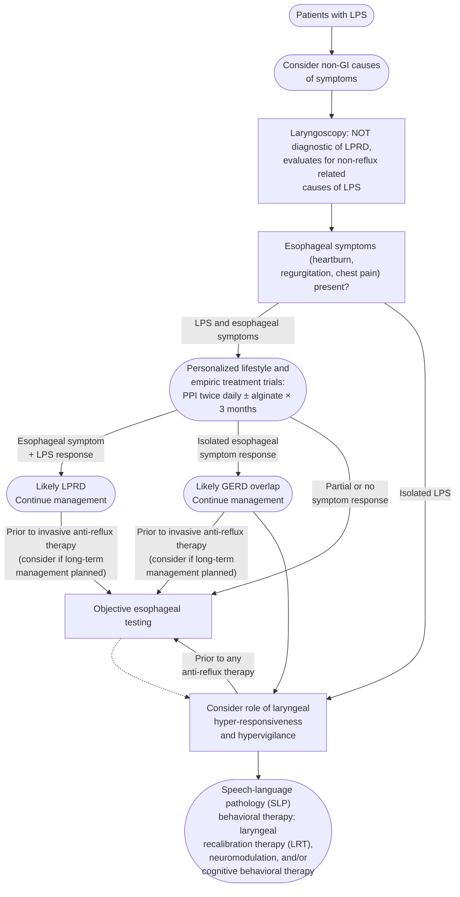

## Contents
- [[#Definition / Scope]]
- [[#Differential Diagnosis]]
- [[#Diagnostic Algorithm]]
  - [[#Step 1: Laryngoscopy]]
  - [[#Step 2: Assess for Concurrent Esophageal Reflux Symptoms]]
    - [[#Branch A: LPS + Concurrent Esophageal Reflux Symptoms]]
    - [[#Branch B: Isolated LPS (No Esophageal Symptoms)]]
  - [[#Step 3: Esophageal Evaluation]]
  - [[#Step 4: Address Laryngeal Hyperresponsiveness / Hypervigilance]]
- [[#Key Tests]]
- [[#Red Flags / Alarm Features]]
- [[#Treatment Framework]]
  - [[#Anti-reflux Therapy]]
  - [[#Behavioral Therapy]]
  - [[#Neuromodulators]]

## Definition / Scope

- **Laryngopharyngeal symptoms (LPS):** chronic, frequent throat and upper-airway symptoms with potential to be induced by retrograde flow of gastric content to the upper esophagus, pharynx and larynx ([[san-diego-2025-lprd]])
  - **Frequent** = ≥2×/week · **chronic** = ≥8 weeks
  - A symptom descriptor — the term does not implicate reflux as the cause
- **Laryngopharyngeal reflux disease (LPRD):** chronic troublesome LPS **and** objective evidence supporting a relationship between symptoms and gastroesophageal reflux. San Diego's objective evidence = either:
  1. Concurrent esophageal reflux-like symptoms with LPS that respond to an anti-reflux trial, **or**
  2. Diagnostic evidence of reflux — Los Angeles (LA) grade B, C or D esophagitis and/or biopsy-proven [[barretts-esophagus|Barrett's esophagus]] on upper gastrointestinal (GI) endoscopy, and/or distal esophageal acid exposure time (AET) >6.0% on ambulatory reflux monitoring off acid suppression
  - The American Gastroenterological Association (AGA) 2023 does not accept criterion 1 as confirmation of [[gerd|gastroesophageal reflux disease (GERD)]] — see [[#Branch A: LPS + Concurrent Esophageal Reflux Symptoms]]
- Laryngopharyngeal reflux (LPR) is the laryngeal arm of [[extraesophageal-reflux|extraesophageal reflux (EER)]]; cough, asthma and dental erosions → that page

> [!pearl] LPS is not LPRD
> Up to 60% of patients labelled "LPR" have normal [[ambulatory-reflux-monitoring|ambulatory reflux monitoring]]; ~35% of evaluated LPS patients have objective LPRD; <50% of LPS patients respond to antisecretory therapy ([[san-diego-2025-lprd]]).

- [[antireflux-surgery|Anti-reflux surgery]] often gives suboptimal outcomes in LPS — neurogenic, inflammatory, behavioral and motility mechanisms are not addressed by anti-reflux therapy ([[san-diego-2025-lprd]])

**Agreed LPS** (San Diego, % agreement):

- Cough (89%), regurgitation (89%), throat pain/sore throat (89%), throat clearing (86%), excess throat phlegm (82%), hoarseness/voice change (80%)
- Globus: approached but did not reach agreement as an LPS; still warrants evaluation and management (88%); often a *negative* predictor of reflux physiology
- Did not reach agreement as LPS: tongue burning, nasal burning, post-nasal drip, halitosis, [[abdominal-bloating-and-distention|belching]], [[dysphagia]]

---

## Differential Diagnosis

Multiple mechanisms cause LPS; reflux is one of several ([[san-diego-2025-lprd]]).

| Mechanism | Causes |
|---|---|
| Reflux-mediated (LPRD) | Direct laryngopharyngeal injury (acid, pepsin, bile salts); indirect injury from vagally mediated or reactive cough and throat clearing; micro-aspiration (reflux pathway) or vagally mediated airway stimulation (reflex pathway) |
| Laryngeal, non-reflux (found on laryngoscopy) | Benign vocal fold lesions; epithelial lesions (keratotic, pre-malignant dysplastic, malignant); glottic pathology/insufficiency; spontaneous vocal process granuloma; allergy |
| Neurogenic / behavioral | Laryngeal hyperresponse (repetitive throat clearing, coughing, breath-holding, vocal-fold strain altering the voice); laryngeal hypervigilance and symptom-specific anxiety; vagal hypersensitivity (chronic cough) |
| Airway / other | Asthma and other pulmonary disorders (reported with both LPS and LPRD) |

- Full non-reflux ear, nose and throat (ENT) and pulmonary differential, with the specialty to involve for each (AGA 2023 Table 1): [[extraesophageal-reflux#Differential Diagnosis]]

---

## Diagnostic Algorithm

### Step 1: Laryngoscopy

- **Perform before further diagnostic evaluation and/or LPRD treatment** — primary role is to find non-reflux causes incl. malignancy (93% agreement) ([[san-diego-2025-lprd]])
- Cannot diagnose LPRD on its own (89%)
- Hoarseness not explained by white-light flexible laryngoscopy → **videostroboscopy** (symmetry, amplitude, mucosal wave, glottic closure) (89%)
- Reflux Finding Score (RFS) and Reflux Sign Assessment (RSA): not diagnostic of LPRD — suboptimal specificity (86%)
- White-light findings often ascribed to reflux (infraglottic edema, interarytenoid mucosal hypertrophy, erythema, post-cricoid edema) are **non-specific** — also seen with other laryngeal inflammation and in healthy asymptomatic people
- Vocal process granuloma is **not** pathognomonic for LPRD — surveyed laryngologists ranked phonotrauma (88%) above reflux (67%) and glottic insufficiency (48%)

### Step 2: Assess for Concurrent Esophageal Reflux Symptoms

- Ask about heartburn, regurgitation and esophageal chest pain (96% agreement) — the pathway splits on them ([[san-diego-2025-lprd]])
  - Present → empiric [[proton-pump-inhibitors|proton pump inhibitor (PPI)]] trial (Branch A) · absent (isolated LPS) → test before treating (Branch B)

*San Diego Consensus approach to laryngopharyngeal symptoms*
*Source: redrawn from San Diego Consensus 2025 Figure 1*
*[[san-diego-2025-lprd|San Diego Consensus 2025 (LPS/LPRD)]]*
*LPS = laryngopharyngeal symptoms · GI = gastrointestinal · LPRD = laryngopharyngeal reflux disease · PPI = proton pump inhibitor · GERD = gastroesophageal reflux disease · SLP = speech-language pathology · LRT = laryngeal recalibration therapy*

- Dashed arrow: disordered laryngeal behaviors can coexist with objective GERD/LPRD and drive symptoms; partial/no responders also get this considered ([[san-diego-2025-lprd]])
- AGA 2023's general EER algorithm (which, without typical GERD symptoms, considers non-GI evaluation by ENT, pulmonary or allergy before endoscopy): [[extraesophageal-reflux#Diagnostic Algorithm]]

#### Branch A: LPS + Concurrent Esophageal Reflux Symptoms

- Empiric medical anti-reflux trial is appropriate (93% agreement), accompanied by **diet and lifestyle modification** (88%) ([[san-diego-2025-lprd]]); [[aga-2023-extraesophageal-gerd|AGA 2023]] agrees a trial is reasonable with typical GERD symptoms but differs on dose and on what a response means. Where they differ, the US guideline (AGA) is followed:

| | AGA 2023 — followed | San Diego 2025 |
|---|---|---|
| Starting dose | Single-dose PPI, titrating up to twice daily (Best Practice Advice [BPA] 4; the Figure 1 box reads twice daily) | PPI twice daily (omeprazole 20 mg twice daily equivalent) ± alginate (Table 2) |
| Trial length | Up to 12 weeks (BPA 6); 8–12 weeks in text and Figure 1 | 3 months |
| Add-ons | Lifestyle; alginate-containing antacids among alternatives to acid suppression (BPA 9) | Alginate four times daily (after meals and at bedtime); diet + lifestyle |
| A response means | Suggests reflux as a contributor; **not confirmation of GERD** (BPA 5) | Esophageal + LPS response = objective evidence supporting LPRD ("likely LPRD") |
| Failure | Objective testing for pathologic reflux; further trials of different PPIs are low yield (BPA 6) | Objective esophageal testing |

- Lifestyle (San Diego): weight loss, avoid tight abdominal clothing (↓ intragastric pressure); stay upright / no recumbency 2–3 h after meals, diaphragmatic breathing (↓ post-prandial reflux); head-of-bed elevation, left lateral sleep (nocturnal reflux); avoid trigger foods
- Response categories and next steps: flowchart above — responders still need objective testing before invasive anti-reflux therapy, and it should be considered if long-term management is planned

> [!pitfall] A PPI response does not prove GERD
> Improvement of extraesophageal symptoms on a PPI may come from mechanisms other than acid suppression and should not be regarded as confirmation of GERD ([[aga-2023-extraesophageal-gerd]] BPA 5).

#### Branch B: Isolated LPS (No Esophageal Symptoms)

- **No acid-reducing medication first-line** without diagnostic evidence of reflux; reflux testing personalizes management better than empiric trials (81%) ([[san-diego-2025-lprd]])
  - AGA 2023 agrees: consider reflux testing before starting a PPI when typical GERD symptoms are absent (BPA 4)
- Consider laryngeal hyperresponsiveness and hypervigilance (Step 4)
- **[[reflux-testing|Objective esophageal testing]] before any anti-reflux therapy** — abnormal reflux burden required before escalating anti-reflux management (86%)

### Step 3: Esophageal Evaluation

Next step for isolated LPS and for LPS with esophageal symptoms that do not respond to the empiric trial ([[san-diego-2025-lprd]]).

**[[upper-endoscopy|Upper GI endoscopy]]:**

- Ideally off antisecretory therapy in unproven GERD
- Conclusive GERD evidence: LA grade B, C or D esophagitis and/or biopsy-proven Barrett's esophagus (Table 3 also lists peptic stricture); LA grade criteria: [[reflux-testing]]
- Supplementary, not conclusive (86%): disrupted esophagogastric junction (EGJ) — [[hiatal-hernia|hiatal hernia]], Hill grade, AFS grade
- Up to 47% of LPS patients had erosive findings and/or hiatal hernia — in isolated LPS as well as LPS with esophageal symptoms
- Office-based transnasal esophagoscopy (TNE): with coexisting esophageal symptoms, can screen for erosive esophagitis and Barrett's (82%); similar diagnostic performance for Barrett's; done by providers with specialized esophageal-endoscopy training
- **Cervical inlet patch** (heterotopic gastric mucosa in the proximal esophagus; may secrete acid, mucus, pepsin): associated with LPS and globus; ablation reduced LPS only in small case series → **no agreement** on the value of finding or treating it

> [!pearl] Place the pH capsule at the index endoscopy
> No endoscopic evidence of GERD → decide in real time to place a wireless pH capsule during the same endoscopy — a cost-effective strategy ([[san-diego-2025-lprd]]).

**[[ambulatory-reflux-monitoring|Ambulatory reflux monitoring]]** — reference standard for LPRD (86%):

- Off acid suppression in unproven GERD (89%)
- Required before invasive (endoscopic or surgical) anti-reflux management (93%); consider before long-term medical anti-reflux therapy (86%)
- pH-impedance and wireless pH measure different properties and are not mutually exclusive (82%)
- Distal AET (both modalities): **>6.0% = proven GERD** (93%); **<4.0% = physiologic**, especially on all 4 days of a 96-hour study — which predicts low likelihood of symptom response to antisecretory therapy (89%)
- Positive reflux event–LPS association on 96-hour wireless pH strengthens confidence in LPRD (93%)

| Modality | Best use | Limits |
|---|---|---|
| 24-hour pH-impedance, incl. hypopharyngeal-esophageal multichannel intraluminal impedance with dual pH (HEMII-pH) | Isolated LPS (82%); mechanism — reflux-mediated vs reflex; detects proximal, weakly acidic and non-acidic events | No day-to-day variability; suboptimal for ruling out reflux disease; GERD yield in LPS **27%** |
| 96-hour wireless pH | Concomitant esophageal reflux symptoms; before escalating reflux management (82% each); recent guidance cited by San Diego makes it the preferred test (off therapy) for unproven GERD | Placed at sedated endoscopy; no proximal/pharyngeal data or baseline impedance; cannot directly ascribe LPS to reflux; GERD yield in LPS **50%** |
| Oropharyngeal pH (Restech) | Not supported as a stand-alone tool — poor specificity (93%) | Misses weakly acidic/non-acidic reflux; poor concordance with pH-impedance; no correlation with outcomes |

- Yields: multicenter study of 813 patients referred for LPS ([[san-diego-2025-lprd]])
- Near (not full) agreement that HEMII-pH helps when standard monitoring is inconclusive and suspicion of a reflux mechanism stays high

**Table 3 — Role of tools in diagnosing GERD and/or LPRD** ([[san-diego-2025-lprd]])

| Tool | Confirmatory | Supportive | Exclusionary | Considerations |
|---|---|---|---|---|
| Laryngoscopy | None | — | None | Not a diagnostic tool for LPRD |
| Upper endoscopy | LA grade B, C, D esophagitis; biopsy-proven Barrett's; peptic stricture | Disrupted EGJ (e.g., hiatal hernia) | None | Inlet patch not diagnostic of GERD/LPRD; may contribute to globus |
| pH-impedance | AET >6.0% | >80 distal esophageal reflux events; >10 proximal esophageal reflux events; elevated hypopharyngeal events on HEMII-pH; positive symptom–reflux association; low mean nocturnal baseline impedance | AET <4.0% | 24-hour window misses day-to-day variability; lower diagnostic yield for GERD |
| Prolonged wireless pH | AET >6.0% on ≥2 days | Positive symptom–reflux association; AET >4.0% on ≥1 day | AET <4.0% on all 4 days | Cannot directly link LPS to proximal reflux |
| Oropharyngeal pH (Restech) | None | — | None | Not a diagnostic tool for LPRD |

- The panel did **not** agree on >80 esophageal or >10 hypopharyngeal reflux events as abnormal — Table 3 lists event counts as *supportive* only, not cutoffs

### Step 4: Address Laryngeal Hyperresponsiveness / Hypervigilance

- Hyperresponsive laryngeal behaviors and laryngeal hypervigilance/symptom-specific anxiety may contribute to, or be the primary cause of, LPS — with or without LPRD ([[san-diego-2025-lprd]])
- **Laryngeal Cognitive Affective Tool (LCAT)** — validated patient-reported outcome (PRO) instrument — helps identify symptom-specific anxiety and hypervigilance likely to improve with behavioral therapy (80%)
- Negative reflux monitoring **and** non-response to acid-reducing therapy → consider a disorder of brain–larynx interaction, hypervigilance, and/or a non-GI process (83%)
- Isolated LPS, or LPS not responding to anti-reflux therapy even in confirmed LPRD → behavioral therapy and/or neuromodulation ([[#Treatment Framework]])

---

## Key Tests

| Test | Role |
|---|---|
| Laryngoscopy ± videostroboscopy | First test in every LPS patient ([[#Step 1: Laryngoscopy]]) |
| Upper endoscopy (off acid suppression in unproven GERD) | Conclusive GERD findings; wireless pH capsule at the same session ([[#Step 3: Esophageal Evaluation]]) |
| Ambulatory reflux monitoring (96-hour wireless pH and/or 24-hour pH-impedance ± HEMII-pH) | Reference standard for LPRD; modalities complementary ([[#Step 3: Esophageal Evaluation]]) |
| LCAT | Laryngeal hypervigilance/anxiety → behavioral therapy |
| Reflux Symptom Index (RSI), Reflux Symptom Score (RSS), LPR-HRQL | Not specific for diagnosing LPRD (86%). RSI can follow laryngeal complaints over time; the former **RSI ≥13** cutoff did not identify increased proximal/pharyngeal reflux or symptom correlation on HEMII-pH; RSS predicts proximal reflux burden and outcome better but is not diagnostic |
| GERD PROs (GERDQ, GERD-HRQL) | Useful for esophageal symptom severity and treatment response (86%); not specific for LPS/LPRD (96%) |
| Voice Handicap Index-10 (VHI), Cough Severity Index (CSI), Leicester Cough Questionnaire (LCQ) | PROs only; unclear diagnostic value (93%) |
| HAS-BEER, COuGH RefluX risk tools | Promising; more data needed before adoption into the algorithm |
| Non-GI testing (bronchoscopy, thoracic imaging, laryngoscopy) | Results from other specialties should inform whether reflux is considered the cause ([[aga-2023-extraesophageal-gerd]] BPA 2) |

---

## Red Flags / Alarm Features

- **Laryngoscopy for every LPS patient before further evaluation or treatment** — keratotic, pre-malignant dysplastic and malignant epithelial lesions are common and present with dysphonia, throat clearing and globus often ascribed to reflux ([[san-diego-2025-lprd]])
- **Hoarseness unexplained by white-light laryngoscopy** → videostroboscopy
- **Dysphagia did not reach agreement as an LPS** ([[san-diego-2025-lprd]]); AGA treats it as an alarm symptom favoring upper endoscopy first ([[aga-2023-extraesophageal-gerd]]) → [[extraesophageal-reflux#Red Flags / Alarm Features]]

> [!pitfall] Don't escalate acid suppression for non-response
> After one failed PPI trial (up to 12 weeks), further trials of different PPIs are low yield → objective testing ([[aga-2023-extraesophageal-gerd]] BPA 6) and the non-reflux differential ([[san-diego-2025-lprd]]).

---

## Treatment Framework

### Anti-reflux Therapy

San Diego 2025 makes no formal reflux-*management* recommendations; these points come from its discussion ([[san-diego-2025-lprd]]).

- Empiric trial (dose, length, add-ons): [[#Branch A: LPS + Concurrent Esophageal Reflux Symptoms]]
- [[potassium-competitive-acid-blockers|Potassium-competitive acid blockers (PCABs)]]: approved for non-erosive reflux disease and erosive esophagitis; could be used in place of a PPI; LPS outcome data pending
- Alginates: inexpensive, well tolerated, may reduce globus perception, may add benefit over PPI monotherapy
- Invasive anti-reflux therapy (endoscopic or surgical fundoplication, magnetic sphincter augmentation) only after LPRD is diagnosed objectively ([[#Step 3: Esophageal Evaluation]])
  - AGA 2023 BPA 10: shared decision-making before referral, only with clear, objectively defined GERD; lack of PPI response predicts lack of response to anti-reflux surgery ([[aga-2023-extraesophageal-gerd]]) — details on [[extraesophageal-reflux#Treatment Framework]]

### Behavioral Therapy

- **LRT** — initial option, by a voice-specialized speech-language pathologist (83%): voice therapy techniques + autonomic regulation (heart-rate-variability biofeedback) + cognitive reframing / acceptance and commitment therapy (85%)
  - LPS + typical reflux symptoms: LRT can follow a diet/lifestyle + acid-suppression trial (80%)
- **Cognitive behavioral therapy (CBT)** — ongoing hypervigilance, anxiety, depression or LPS after LRT or neuromodulation (80%); targets symptom-specific processes, not general mental-health disorders; delivered by a mental health professional with health-psychology training
- Behavioral therapies can be used alone or with LRT, neuromodulators or dietary management (85%); of value independent of the underlying mechanism

### Neuromodulators

- **When:** isolated LPS with negative reflux testing and persistent symptoms after LRT (83%); LPRD with partial or poor response to acid suppression, together with LRT (83%)
- **Gabapentin, pregabalin:** may be an effective adjunct to LRT, especially for cough (92%); evidence mainly in chronic cough (vagal hypersensitivity)
- **Tricyclic antidepressants (TCAs):** may help (92%); use with caution — anticholinergic dry mouth (xerostomia) may aggravate LPS
- **Selective serotonin reuptake inhibitors (SSRIs) / serotonin–norepinephrine reuptake inhibitors (SNRIs):** not studied in LPS; may benefit patients with clinical anxiety and/or depression (80%)

---

## See Also

[[gerd]], [[extraesophageal-reflux]], [[barretts-esophagus]], [[hiatal-hernia]], [[ambulatory-reflux-monitoring]], [[reflux-testing]], [[upper-endoscopy]], [[antireflux-surgery]], [[proton-pump-inhibitors]], [[potassium-competitive-acid-blockers]], [[dysphagia]], [[abdominal-bloating-and-distention]], [[disorders-of-gut-brain-interaction]]

---

## Sources

1. [[san-diego-2025-lprd|San Diego Consensus (2025): Laryngopharyngeal Symptoms and Laryngopharyngeal Reflux Disease]]
2. [[aga-2023-extraesophageal-gerd|AGA Clinical Practice Update on the Diagnosis and Management of Extraesophageal Gastroesophageal Reflux Disease: Expert Review (2023)]]
