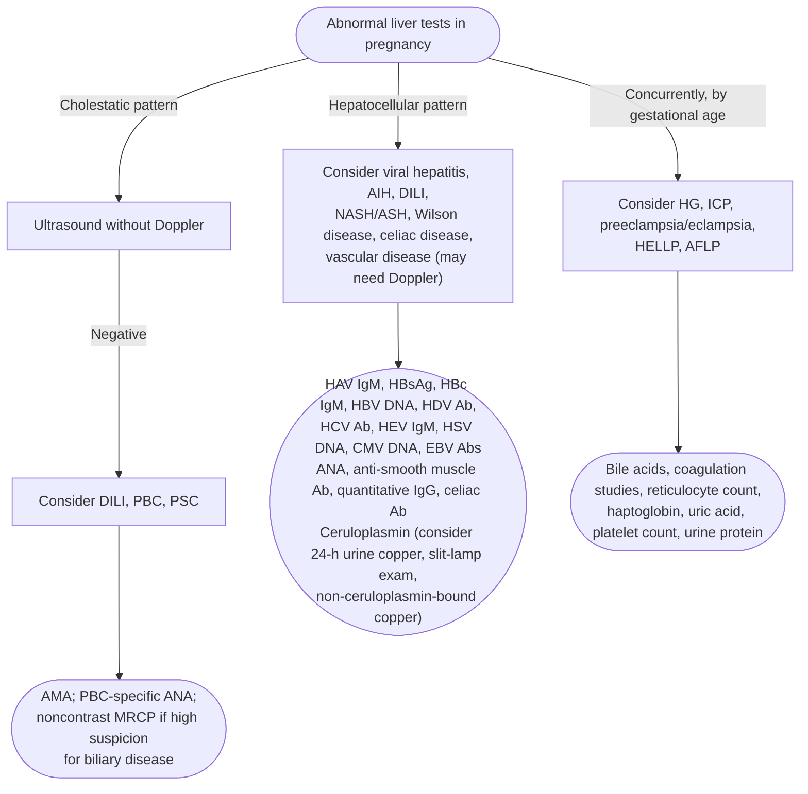

## Contents
- [[#Definition / Scope]]
  - [[#Normal Liver Tests in Pregnancy]]
- [[#Differential Diagnosis]]
  - [[#Diseases Unique to Pregnancy]]
  - [[#Distinguishing ICP, HELLP and AFLP]]
  - [[#Coincident or Pre-existing Liver Disease]]
- [[#Diagnostic Algorithm]]
  - [[#Imaging]]
- [[#Key Tests]]
- [[#Red Flags / Alarm Features]]
- [[#Management of Diseases Unique to Pregnancy]]
  - [[#Hyperemesis Gravidarum (HG)]]
  - [[#Intrahepatic Cholestasis of Pregnancy (IHCP)]]
  - [[#Preeclampsia and Eclampsia]]
  - [[#HELLP Syndrome]]
  - [[#Acute Fatty Liver of Pregnancy (AFLP)]]
- [[#Viral Hepatitis in Pregnancy]]
- [[#Chronic Liver Disease in Pregnancy]]
- [[#See Also]]
- [[#Sources]]

---

## Definition / Scope

- [[abnormal-liver-chemistries|Abnormal liver tests]] in ~3–5% of pregnancies ([[acg-2016-liver-disease-pregnancy|American College of Gastroenterology (ACG) 2016]])
- Three groups ([[aasld-2021-reproductive-liver|American Association for the Study of Liver Diseases (AASLD) 2021]]):
  - **Unique to pregnancy** — hyperemesis gravidarum (HG), intrahepatic cholestasis of pregnancy (ICP), preeclampsia/eclampsia, hemolysis, elevated liver enzymes, low platelets (HELLP) syndrome, acute fatty liver of pregnancy (AFLP)
  - **Exacerbated by pregnancy** — gallstones, vascular diseases, [[cirrhosis]]
  - **Coincidental** — viral hepatitis, [[drug-induced-liver-injury|drug-induced liver injury (DILI)]], [[autoimmune-hepatitis|autoimmune hepatitis (AIH)]], others

### Normal Liver Tests in Pregnancy

| Test | [[acg-2016-liver-disease-pregnancy\|ACG 2016]] Table 2 | [[aasld-2021-reproductive-liver\|AASLD 2021]] Table 2 (1st / 2nd / 3rd trimester) |
|---|---|---|
| Aspartate aminotransferase (AST), alanine aminotransferase (ALT) | ↔ | Normal throughout |
| Bilirubin | ↔ | Normal throughout |
| Gamma-glutamyl transferase (GGT) | ↔ | Normal throughout |
| Bile acids | — | Normal throughout |
| Prothrombin time / international normalized ratio (INR) | ↔ | — |
| 5′ nucleotidase | ↔ | — |
| Alkaline phosphatase (ALP) | ↑ | Normal / ↑ / ↑ |
| Albumin | ↓ | Normal or ↓ in each trimester |
| Alpha-fetoprotein (AFP) | ↑ | Normal or ↑ / ↑ / ↑ |
| Hemoglobin | ↓ | — |

*Liver tests in normal pregnancy*
*Source: recreated from ACG 2016 Table 2 and AASLD 2021 Table 2*
*[[acg-2016-liver-disease-pregnancy|ACG 2016 Liver Disease and Pregnancy]] · [[aasld-2021-reproductive-liver|AASLD 2021 Reproductive Health and Liver Disease]]*
*↔ = unchanged · ↑ = increased · ↓ = decreased · — = not listed · ACG = American College of Gastroenterology · AASLD = American Association for the Study of Liver Diseases*

- **Elevated aminotransferases, bilirubin or bile acids in pregnancy are abnormal → investigate** (AASLD guidance statement)
- **ALP elevation alone → no further workup** (ACG Figure 1)

---

## Differential Diagnosis

### Diseases Unique to Pregnancy

**Gestational age is the first clue** — each disease has a typical window, though they overlap ([[aasld-2021-reproductive-liver]]).

| Disease | Typical onset | Clinical | Labs | Diagnosis |
|---|---|---|---|---|
| **HG** | 1st trimester (rarely 2nd/3rd) | Vomiting, weight loss ≥5% of prepregnancy weight, dehydration | AST/ALT abnormal in ~50%, rarely >1,000 U/L, improve with hydration; ketonuria; electrolyte abnormalities; jaundice rare | Clinical; upper endoscopy rarely indicated |
| **ICP** | 2nd or 3rd trimester; 80% after 30 wk | Generalized pruritus, worst on palms and soles, no rash | AST/ALT 2–30× upper limit of normal (ULN); total bile acids >10 μmol/L | Clinical + bile acids >10 μmol/L is sufficient; AST/ALT rise not required; ultrasound to exclude biliary causes if needed |
| **Preeclampsia / eclampsia** | After 20 wk (usually 3rd trimester or immediately postpartum) | New hypertension + maternal organ dysfunction (renal, hepatic, neurologic, hematologic); proteinuria often present, not required. Eclampsia = + seizures | — | Clinical |
| **HELLP** | Weeks 27–37; 20% within 48 h of delivery | Abdominal pain, nausea/vomiting; usually with preeclampsia, but blood pressure can be normal | AST/ALT typically >500 U/L; bilirubin <5 mg/dL; hemolysis (schistocytes, spherocytes, reticulocytes); hyperuricemia; lactate dehydrogenase (LDH) >600 U/L | Clinical + maternal organ dysfunction or uteroplacental dysfunction / fetal growth restriction; liver biopsy not advised |
| **AFLP** | 3rd trimester (week 29 on) or postpartum | Abdominal pain, nausea/vomiting, jaundice, hypoglycemia; [[hepatic-encephalopathy\|encephalopathy]] if hepatic failure | AST/ALT 300–1,000 U/L; ↓antithrombin III, ↑prothrombin time (PT), ↓fibrinogen, ↑bilirubin, ↑LDH, thrombocytopenia; in [[acute-liver-failure\|acute liver failure (ALF)]] also hypoglycemia, hyperuricemia, disseminated intravascular coagulation (DIC) | Clinical; [[acute-fatty-liver-of-pregnancy#Establishing the Diagnosis\|Swansea criteria]] (high sensitivity, low specificity once ALF is present) |

*Onset, findings and diagnosis of the liver diseases unique to pregnancy*
*Source: recreated from AASLD 2021 Table 7, with onset weeks from its Figure 2 and the preeclampsia row from its text*
*[[aasld-2021-reproductive-liver|AASLD 2021 Reproductive Health and Liver Disease]]*
*HG = hyperemesis gravidarum · ICP = intrahepatic cholestasis of pregnancy · HELLP = hemolysis, elevated liver enzymes, low platelets · AFLP = acute fatty liver of pregnancy · AST/ALT = aspartate/alanine aminotransferase · ULN = upper limit of normal · LDH = lactate dehydrogenase · PT = prothrombin time · ALF = acute liver failure · DIC = disseminated intravascular coagulation*

### Distinguishing ICP, HELLP and AFLP

| Feature | ICP | HELLP | AFLP |
|---|---|---|---|
| Frequency in pregnancies | 0.3–0.5% | 0.2–0.6% | 0.01% |
| Family history | Often | No | Occasionally |
| Pregnancy characteristics | Multiparity, multifetal pregnancy | Multiparity, age >35 y | Multifetal pregnancy, male fetus |
| Preeclampsia | No | Yes | ~50% |
| Imaging | Normal | Infarcts, hematoma, rupture; no ascites | Fatty infiltration, sometimes [[ascites]] |
| Labs | Bilirubin <5 mg/dL; ↑ALP and GGT; ↑bile acids | Bilirubin <5 mg/dL; hemolysis; platelets <100 × 10⁹/L; ↑uric acid; ± proteinuria; ALT <500 U/L; ↑LDH | Bilirubin <5 mg/dL; hypoglycemia; ↑creatinine; ± proteinuria and thrombocytopenia; ↑ammonia; ALT <500 U/L; prolonged PT; DIC >75% |
| Maternal outcome | Recurrence in later pregnancy 45–70% | Seizures, acute renal failure, hepatic rupture; mortality 1–25% | Acute renal failure; mortality 7–18% |
| Fetal outcome | Stillbirth | Mortality 11% | Mortality 9–23% |

*Features separating the three third-trimester liver diseases*
*Source: recreated from American Gastroenterological Association (AGA) 2024 Table 3*
*[[aga-2024-pregnancy-gi-liver|AGA 2024 Clinical Practice Update: Pregnancy-Related GI and Liver Disease]]*
*ICP = intrahepatic cholestasis of pregnancy · HELLP = hemolysis, elevated liver enzymes, low platelets · AFLP = acute fatty liver of pregnancy · ALP = alkaline phosphatase · GGT = gamma-glutamyl transferase · ALT = alanine aminotransferase · LDH = lactate dehydrogenase · PT = prothrombin time · DIC = disseminated intravascular coagulation · AGA = American Gastroenterological Association*

> [!pitfall] Aminotransferase level does not separate HELLP from AFLP
> The guidelines disagree: AGA 2024 Table 3 gives ALT <500 U/L for both; AASLD 2021 Table 7 gives AST/ALT typically >500 U/L in HELLP and 300–1,000 U/L in AFLP. Use the whole pattern — hypoglycemia, coagulopathy, hemolysis, imaging.

- Other source disagreements: HELLP jaundice in 5% ([[acg-2016-liver-disease-pregnancy|ACG 2016]]) vs up to 40% ([[aasld-2021-reproductive-liver|AASLD 2021]]); DIC in AFLP >75% (AGA 2024 Table 3) vs 10% (AASLD 2021 text)

### Coincident or Pre-existing Liver Disease

- Biliary: cholelithiasis (3.5% of pregnancies), [[acute-cholecystitis|cholecystitis]], [[choledocholithiasis]], [[acute-cholangitis|cholangitis]], [[acute-pancreatitis|biliary pancreatitis]] ([[acg-2016-liver-disease-pregnancy]])
- Viral: [[hepatitis-a|hepatitis A virus (HAV)]], [[chronic-hepatitis-b|hepatitis B virus (HBV)]], [[hepatitis-c-in-pregnancy|hepatitis C virus (HCV)]], [[hepatitis-e|hepatitis E virus (HEV)]], herpes simplex virus (HSV) — see [[#Viral Hepatitis in Pregnancy]]
- Autoimmune/cholestatic: [[autoimmune-hepatitis|AIH]], [[primary-biliary-cholangitis|primary biliary cholangitis (PBC)]], [[primary-sclerosing-cholangitis|primary sclerosing cholangitis (PSC)]]
- Metabolic/genetic: [[wilson-disease|Wilson disease (WD)]], [[nafld-masld|nonalcoholic fatty liver disease]]; also [[celiac-disease]], vascular disease ([[budd-chiari-syndrome]]) — AASLD Figure 3
- DILI; [[cirrhosis]] and [[portal-hypertension]]; liver masses ([[hepatic-hemangioma]], [[focal-nodular-hyperplasia]], [[hepatocellular-adenoma]])

---

## Diagnostic Algorithm

- **Workup is the same as in a non-pregnant patient** — history (prior pregnancies, travel, environmental, drug and high-risk exposures), examination, focused serology ([[acg-2016-liver-disease-pregnancy]] Rec 1 — strong, very low level of evidence; [[aasld-2021-reproductive-liver]])
- Sort by **pattern** and, at the same time, by **gestational age** for the diseases unique to pregnancy

*Evaluation of abnormal liver tests in pregnancy*
*Source: redrawn from AASLD 2021 Figure 3*
*[[aasld-2021-reproductive-liver|AASLD 2021 Reproductive Health and Liver Disease]]*
*DILI = drug-induced liver injury · PBC = primary biliary cholangitis · PSC = primary sclerosing cholangitis · AMA = antimitochondrial antibody · ANA = antinuclear antibody · MRCP = magnetic resonance cholangiopancreatography · AIH = autoimmune hepatitis · NASH = nonalcoholic steatohepatitis · ASH = alcohol-associated steatohepatitis · HAV/HBV/HCV/HDV/HEV = hepatitis A/B/C/D/E virus · HBsAg = hepatitis B surface antigen · HBc = hepatitis B core · Ab = antibody · IgM/IgG = immunoglobulin M/G · HSV = herpes simplex virus · CMV = cytomegalovirus · EBV = Epstein-Barr virus · HG = hyperemesis gravidarum · ICP = intrahepatic cholestasis of pregnancy · HELLP = hemolysis, elevated liver enzymes, low platelets · AFLP = acute fatty liver of pregnancy*

- ACG 2016 Figure 1 (older) has the same split; it adds that bilirubin ± ALP with **no obstruction on imaging → pregnancy-related workup**
- **[[liver-biopsy|Liver biopsy]]** — rarely needed; diagnosis is usually made without it ([[aasld-2021-reproductive-liver]]). If required: percutaneous is safe; transjugular adds 0.05–0.1 rad fetal exposure ([[acg-2016-liver-disease-pregnancy]])
- Endoscopy and [[ercp|endoscopic retrograde cholangiopancreatography (ERCP)]] in pregnancy — timing, sedation and radiation on those pages and [[endoscopy-sedation]]

### Imaging

- **Ultrasound first** — no ionizing radiation, no known fetal risk; limited Doppler of the hepatic vessels allowed, minimize exposure time ([[aasld-2021-reproductive-liver]]; [[acg-2016-liver-disease-pregnancy]] Rec 2 — strong, low). 95% sensitive for gallstones (ACG)
- **[[mri-mrcp|Magnetic resonance imaging (MRI)/MRCP]] without gadolinium is preferred over computed tomography (CT)**, in all trimesters; **gadolinium is contraindicated** (crosses the placenta, excreted into amniotic fluid) ([[aasld-2021-reproductive-liver]])
  - Older: ACG 2016 Rec 3 allowed MRI without gadolinium in the **second and third trimester** only (conditional, low)
- **CT** — noncontrast abdominal CT generally safe; keep cumulative fetal dose as low as possible and **<50 mGy**; iodinated contrast only if essential ([[aasld-2021-reproductive-liver]]). ACG 2016 Rec 4: judicious use, minimized protocols (2–5 rads) (conditional, very low); anomaly risk not increased <5 rad

| Modality | Fetal dose (mGy) | Maternal dose (mSv) |
|---|---|---|
| CT abdomen/pelvis (no contrast) | 13–25 | 3–45 |
| Chest radiograph, two views | 0.0005–0.01 | 0.06–0.29 |
| Abdominal radiograph | 0.1–0.3 | 0.01–1.1 |
| Double-contrast barium enema | 1.0–20 | 2.0–18.0 |
| Small-bowel examination | 7 | 3.0–7.8 |
| ERCP (varies with fluoroscopy time) | 0.1–0.3 | 2–6 |

*Radiation exposure with common procedures*
*Source: recreated from AASLD 2021 Table 3*
*[[aasld-2021-reproductive-liver|AASLD 2021 Reproductive Health and Liver Disease]]*
*CT = computed tomography · ERCP = endoscopic retrograde cholangiopancreatography*

- **Suspected intra-abdominal infection** — Infectious Diseases Society of America (IDSA) 2024 (no diagnostic-accuracy studies in pregnancy):
  - [[acute-cholecystitis|Acute cholecystitis]] or cholangitis → ultrasound **or** MRI; panel unable to recommend one over the other (knowledge gap) ([[idsa-2024-ciai-imaging-cholecystitis-cholangitis]])
  - Appendicitis → **ultrasound first** (R5), **MRI if ultrasound equivocal/non-diagnostic and suspicion persists** (R6) — both conditional, very low certainty; [[diverticulitis]] or abscess → ultrasound or MRI, no preference (R13, R17; knowledge gap) ([[idsa-2024-ciai-risk-imaging-microbiology]]; wiki numbering)

---

## Key Tests

| Question | Test |
|---|---|
| Biliary cause? | Abdominal ultrasound; noncontrast MRCP if stone suspected but not seen |
| ICP? | Total serum bile acids (>10 μmol/L); repeat if normal; HCV test if not done ([[aasld-2021-reproductive-liver]]) |
| Disease unique to pregnancy? | The gestational-age panel in the flowchart, read against the two tables above; abdominal imaging in suspected HELLP or AFLP ([[aasld-2021-reproductive-liver]]) |
| Acute hepatitis? | HAV IgM, HBsAg + hepatitis B core IgM, HEV IgM, HSV polymerase chain reaction (PCR) ([[acg-2016-liver-disease-pregnancy]] Rec 20 — strong, very low) |
| Chronic HBV? | HBV DNA + liver biochemistries ([[aga-2024-pregnancy-gi-liver]] Best Practice Advice [BPA] 12) |
| HCV? | Screening every pregnancy — [[#Viral Hepatitis in Pregnancy]] |

---

## Red Flags / Alarm Features

- **Encephalopathy** → high suspicion for AFLP ([[aasld-2021-reproductive-liver]]) — [[#Acute Fatty Liver of Pregnancy (AFLP)]]
- **Hemolysis + thrombocytopenia + raised liver enzymes** → HELLP — [[#HELLP Syndrome]]
- **Abdominal or shoulder pain, or hypotension, in HELLP/preeclampsia** → image now for hepatic hemorrhage, infarction or rupture ([[aasld-2021-reproductive-liver]]); ACG 2016 adds AST/ALT >1,000 U/L as a trigger for cross-sectional imaging
- **Hepatic rupture or ALF** in HELLP or AFLP → transfer to a transplant center ([[aasld-2021-reproductive-liver]])
- **Fever + anicteric severe hepatitis** (± upper respiratory symptoms; mucocutaneous lesions in <50%) → suspect HSV → empiric acyclovir ([[acg-2016-liver-disease-pregnancy]] Rec 21)
- **Total bile acids ≥100 μmol/L in ICP** → highest risk of intrauterine fetal demise ([[aga-2024-pregnancy-gi-liver]])
- **Cirrhosis or portal hypertension** → multidisciplinary care in a tertiary center ([[aga-2024-pregnancy-gi-liver]] BPA 3); variceal screening ([[#Chronic Liver Disease in Pregnancy]])

---

## Management of Diseases Unique to Pregnancy

### Hyperemesis Gravidarum (HG)

*Antiemetic ladder and Pregnancy-Unique Quantification of Emesis (PUQE) score: [[nausea-and-vomiting-of-pregnancy]].*

- **Supportive:** rehydration, correction of electrolytes, **thiamine**, antiemetics ([[aasld-2021-reproductive-liver]]); may require hospitalization ([[acg-2016-liver-disease-pregnancy]] Rec 11 — strong, very low)
- Early treatment of nausea and vomiting of pregnancy may reduce progression to HG ([[aga-2024-pregnancy-gi-liver]] BPA 4)
- Liver tests normalize with hydration and end of vomiting; **persistent abnormalities after symptoms resolve → look for another cause** ([[aasld-2021-reproductive-liver]])

### Intrahepatic Cholestasis of Pregnancy (IHCP)

*Full disease script, incl. bile-acid-stratified delivery timing: [[intrahepatic-cholestasis-of-pregnancy]].*

- **Diagnosis:** pruritus in the 2nd or 3rd trimester + total bile acids >10 μmol/L, no other cause of pruritus; AST/ALT rise frequent, not required ([[aasld-2021-reproductive-liver]]; [[aga-2024-pregnancy-gi-liver]] BPA 10). Test for HCV if not done
- **[[ursodeoxycholic-acid|Ursodeoxycholic acid (UDCA)]] 10–15 mg/kg/day** (total daily dose) ([[aga-2024-pregnancy-gi-liver]] BPA 10; [[acg-2016-liver-disease-pregnancy]] Rec 13 — strong, moderate)
- **Delivery:** AGA 2024 relays Society for Maternal-Fetal Medicine timing — **total bile acids ≥100 μmol/L → 36 weeks** (or at diagnosis if later); lower bands on the disease page. Supersedes ACG 2016 Rec 12 (37 weeks for all)
- Vitamin K if PT prolonged ([[aasld-2021-reproductive-liver]]); pruritus persisting **>6 weeks postpartum** → evaluate for chronic liver disease ([[aga-2024-pregnancy-gi-liver]])

### Preeclampsia and Eclampsia

- **Liver involvement makes it severe preeclampsia** ([[acg-2016-liver-disease-pregnancy]] Rec 14); epigastric/right upper quadrant pain from hepatomegaly stretching Glisson's capsule; risk of subcapsular hematoma and hepatic rupture
- Liver-test abnormality tracks **maternal, not fetal**, risk; normal enzymes do not exclude disease (ACG 2016)
- **Delivery** ([[aasld-2021-reproductive-liver]]):
  - Without severe features → **37 weeks**; with severe features → **34 weeks**; eclampsia → as soon as possible after maternal stabilization, regardless of gestational age
  - Guidance statement: deliver by 37 weeks, monitoring for eclampsia and HELLP
  - Older: ACG 2016 Rec 14 — severe preeclampsia **after 36 weeks** → prompt delivery (strong, very low); its text advises an expectant approach **until after 34 weeks**
- **Prevention:** aspirin **81 mg/day from weeks 12–16 until delivery** for those with risk factors — prior preeclampsia, multiple gestation, diabetes, hypertension, chronic kidney disease, autoimmune disease ([[aga-2024-pregnancy-gi-liver]] BPA 11)

### HELLP Syndrome

- Complicates up to 20% of severe preeclampsia/eclampsia ([[acg-2016-liver-disease-pregnancy]]); hypertension in 85% ([[aasld-2021-reproductive-liver]])
- **Imaging if abdominal pain, shoulder pain or hypotension** — hepatic hemorrhage, rupture or infarction in up to 45% ([[aasld-2021-reproductive-liver]])
- **Delivery:** expeditious, after maternal stabilization ([[aasld-2021-reproductive-liver]]); [[acg-2016-liver-disease-pregnancy|ACG 2016]] Rec 15 — prompt delivery, especially after 34 weeks (strong, very low)
- **Platelets:** transfuse to **40,000–50,000 cells/μL before delivery**, especially if cesarean likely ([[acg-2016-liver-disease-pregnancy]] Rec 16 — conditional, very low); >40,000 cells/μL before invasive procedures
- Glucocorticoids <34 weeks speed fetal lung maturity; dexamethasone raises platelet count without changing maternal morbidity/mortality or perinatal death (Cochrane review cited by ACG 2016)
- **Hepatic rupture or ALF → transfer to a transplant center** ([[aasld-2021-reproductive-liver]])
- **Hepatic hematoma/rupture:** supportive care for most contained hematomas; surgery for enlarging hematoma or rupture with hemodynamic instability; percutaneous hepatic artery embolization in stable patients; [[liver-transplantation|liver transplantation]] for continued decompensation ([[acg-2016-liver-disease-pregnancy]]). AASLD 2021: coagulation support, antibiotics, transfusion; angiography with embolization or surgery if these fail

### Acute Fatty Liver of Pregnancy (AFLP)

*Full disease script, incl. the Swansea criteria table: [[acute-fatty-liver-of-pregnancy]].*

- Third trimester (median 36 weeks at identification); risk factors twin pregnancy, low body mass index ([[acg-2016-liver-disease-pregnancy]]); primiparity, male fetus ([[aasld-2021-reproductive-liver]])
- **Diagnosis is clinical**; Swansea criteria ≥6 of 14 without another cause; limited in separating AFLP from ALF of other cause ([[aga-2024-pregnancy-gi-liver]]); liver biopsy rarely required ([[aasld-2021-reproductive-liver]])
- **Expeditious delivery after maternal stabilization — expectant management is not appropriate** ([[acg-2016-liver-disease-pregnancy]] Rec 17 — strong, very low; [[aasld-2021-reproductive-liver]])
- Image to exclude hepatic hemorrhage, infarct or rupture; **rupture or ALF → transplant center** ([[aasld-2021-reproductive-liver]])
- **Long-chain 3-hydroxyacyl-CoA dehydrogenase (LCHAD):** molecular testing of every mother and child ([[acg-2016-liver-disease-pregnancy]] Rec 18 — conditional, moderate); monitor offspring for hypoketotic hypoglycemia and fatty liver (ACG Rec 19 — conditional, very low); screen newborns at birth, genetic counseling for affected families ([[aasld-2021-reproductive-liver]])

---

## Viral Hepatitis in Pregnancy

| Virus | Pregnancy-specific decisions | Detail |
|---|---|---|
| HAV | Test HAV IgM in acute hepatitis (Rec 20); CDC (relayed by ACG 2016): HAV immunoglobulin for the neonate if maternal infection is within 2 weeks of delivery | [[hepatitis-a]] |
| HEV | Test HEV IgM in acute hepatitis (Rec 20) — anticipate progression to ALF and need for transplant evaluation; otherwise supportive | [[hepatitis-e]] |
| HSV | Rare, mortality up to 74%; clues fever, upper respiratory symptoms, anicteric severe hepatitis; mucocutaneous lesions in <50%. HSV PCR, and **start acyclovir as soon as suspected** (Rec 21 — strong, very low); stop if PCR negative | — |
| HBV | Hepatitis B immunoglobulin + vaccine series for every infant of an infected mother (Rec 22 — strong, low). **HBV DNA >200,000 IU/mL → tenofovir in the third trimester** (Rec 23 — strong, low; [[aga-2024-pregnancy-gi-liver]] BPA 12). No elective cesarean (Rec 24); breastfeeding allowed (Rec 25); monitor for postpartum flare (AGA 2024) | [[chronic-hepatitis-b]] |
| HCV | **Screen every pregnancy** (Centers for Disease Control and Prevention [CDC], relayed by [[aga-2024-pregnancy-gi-liver]]) — replaces risk-based screening (ACG 2016 Rec 26). Minimize invasive fetal procedures (Rec 27); no elective cesarean (Rec 28); breastfeeding allowed (Rec 29). Treatment: ACG 2016 Rec 30 — none in pregnancy; AASLD 2021 — insufficient safety data to recommend direct-acting antivirals (DAAs) for reducing transmission; AGA 2024 relays IDSA/AASLD that DAAs may be considered case by case | [[hepatitis-c-in-pregnancy]] |

*Viral hepatitis in pregnancy — decisions that change because the patient is pregnant*
*Source: built from ACG 2016 Recs 20–30, AGA 2024 BPA 12 and text, and AASLD 2021 (Rec numbers are ACG 2016)*
*[[acg-2016-liver-disease-pregnancy|ACG 2016]] · [[aga-2024-pregnancy-gi-liver|AGA 2024]] · [[aasld-2021-reproductive-liver|AASLD 2021]]*
*HAV/HBV/HCV/HEV = hepatitis A/B/C/E virus · HSV = herpes simplex virus · IgM = immunoglobulin M · CDC = Centers for Disease Control and Prevention · ALF = acute liver failure · PCR = polymerase chain reaction · BPA = Best Practice Advice · DAA = direct-acting antiviral · IDSA = Infectious Diseases Society of America*

---

## Chronic Liver Disease in Pregnancy

- **Immunosuppression for chronic liver disease or after transplant: continue at the lowest effective dose; no [[mycophenolate-mofetil|mycophenolate mofetil (MMF)]] in pregnancy** ([[aga-2024-pregnancy-gi-liver]] BPA 13); its text: stop MMF at least 6–12 weeks before conception planning begins. [[easl-2025-autoimmune-hepatitis|EASL 2025]] asks ≥3 months for AIH (non-US; the US advice stands)
- Complex disease (advanced cirrhosis, transplant) → multidisciplinary birth planning, preferably in a tertiary center ([[aga-2024-pregnancy-gi-liver]] BPA 3)

| Condition | Pregnancy-specific decisions | Detail |
|---|---|---|
| AIH | **Continue corticosteroids and/or [[thiopurines\|azathioprine]]** (ACG Rec 31 — strong, very low). Flares up to 30% (AGA 2024); EASL 2025: 13% in pregnancy, 41% postpartum (median 11 weeks) → keep monitoring after delivery. Higher risk of gestational diabetes, hypertensive complications, prematurity, small for gestational age, low birth weight (EASL meta-analysis, odds ratios 2.20–3.04); no rise in neonatal death, stillbirth or malformations | [[autoimmune-hepatitis#AIH in Pregnancy]] |
| PBC | **Continue UDCA** (ACG Rec 32 — strong, very low) | [[primary-biliary-cholangitis#Pregnancy]] |
| WD | **Continue penicillamine, trientine or zinc, reducing the dose if possible** (ACG Rec 33 — strong, very low); stopping risks decompensation and placental/fetal copper deposition. ACG 2016 relays WD practice guidelines: cut penicillamine/trientine 25–50% to aid wound healing in case cesarean is needed | [[wilson-disease]] |
| Cirrhosis / portal hypertension | **Variceal screening:** before pregnancy; else [[upper-endoscopy\|upper endoscopy]] early in the 2nd trimester if not done within 1 year before conception or with ongoing injury/decompensation (AASLD 2021; AGA 2024 BPA 6; ACG Rec 34 — strong, low). **Small varices** → consider nonselective beta-blocker (NSBB); **medium/large** → band ligation or NSBB, propranolol preferred (AASLD 2021; ACG Rec 35 — conditional, very low). **Acute bleed** → octreotide or somatostatin, proton pump inhibitor, cephalosporin, endoscopy; **avoid terlipressin**. Mode of delivery by obstetric indications only (AASLD 2021). Up to 30% bleed from varices, 50–78% with known varices; maternal mortality 20–50% per bleed (ACG 2016) | [[portal-hypertension]], [[variceal-upper-gi-bleeding]] |
| Liver transplant | **Continue all immunosuppression except mycophenolic acid** (ACG Rec 36 — strong, moderate); most experts wait ≥1 year (some 2) before pregnancy; acute rejection and graft loss higher if pregnancy within 6 months; everolimus/sirolimus may impair cesarean wound healing (ACG 2016) | [[liver-transplantation]] |

*Pre-existing liver disease in pregnancy — decisions that change because the patient is pregnant*
*Source: built from ACG 2016 Recs 31–36 and text, AGA 2024 BPA 3, 6, 13, AASLD 2021 guidance statements, and EASL 2025 (Rec numbers are ACG 2016)*
*[[acg-2016-liver-disease-pregnancy|ACG 2016]] · [[aga-2024-pregnancy-gi-liver|AGA 2024]] · [[aasld-2021-reproductive-liver|AASLD 2021]] · [[easl-2025-autoimmune-hepatitis|EASL 2025 AIH]]*
*AIH = autoimmune hepatitis · PBC = primary biliary cholangitis · UDCA = ursodeoxycholic acid · WD = Wilson disease · NSBB = nonselective beta-blocker · BPA = Best Practice Advice · EASL = European Association for the Study of the Liver*

---

## See Also

[[intrahepatic-cholestasis-of-pregnancy]], [[acute-fatty-liver-of-pregnancy]], [[nausea-and-vomiting-of-pregnancy]], [[abnormal-liver-chemistries]], [[acute-cholangitis]], [[acute-liver-failure]], [[hepatitis-a]], [[hepatitis-e]], [[chronic-hepatitis-b]], [[hepatitis-c-in-pregnancy]], [[autoimmune-hepatitis]], [[primary-biliary-cholangitis]], [[primary-sclerosing-cholangitis]], [[wilson-disease]], [[drug-induced-liver-injury]], [[nafld-masld]], [[cirrhosis]], [[portal-hypertension]], [[variceal-upper-gi-bleeding]], [[liver-transplantation]], [[liver-biopsy]], [[mri-mrcp]], [[ercp]], [[endoscopy-sedation]], [[choledocholithiasis]], [[acute-cholecystitis]], [[hepatocellular-adenoma]], [[hepatic-hemangioma]], [[focal-nodular-hyperplasia]], [[hepatic-encephalopathy]], [[acute-pancreatitis]], [[mycophenolate-mofetil]], [[thiopurines]], [[ursodeoxycholic-acid]]

---

## Sources

1. [[aga-2024-pregnancy-gi-liver|AGA Clinical Practice Update on Pregnancy-Related Gastrointestinal and Liver Disease: Expert Review]]
2. [[acg-2016-liver-disease-pregnancy|ACG Clinical Guideline: Liver Disease and Pregnancy (2016)]]
3. [[aasld-2021-reproductive-liver|AASLD Practice Guidance: Reproductive Health and Liver Disease (2021)]]
4. [[easl-2025-autoimmune-hepatitis|EASL Clinical Practice Guidelines on the management of autoimmune hepatitis (2025)]]
5. [[idsa-2024-ciai-imaging-cholecystitis-cholangitis|IDSA 2024 Clinical Practice Guideline Update on Complicated Intraabdominal Infections: Diagnostic Imaging of Suspected Acute Cholecystitis and Acute Cholangitis]]
6. [[idsa-2024-ciai-risk-imaging-microbiology|IDSA 2024 Clinical Practice Guideline Update on Complicated Intra-abdominal Infections: Risk Assessment, Diagnostic Imaging, and Microbiological Evaluation]]
