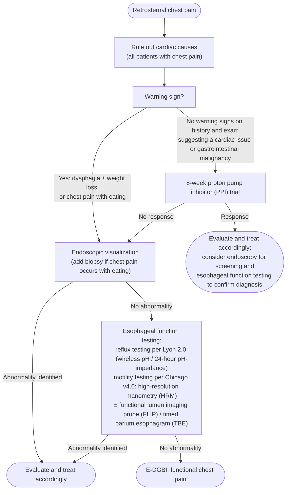

## Contents
- [[#Definition / Scope]]
- [[#Differential Diagnosis]]
- [[#Diagnostic Algorithm]]
- [[#Key Tests]]
- [[#Red Flags / Alarm Features]]
- [[#See Also]]
- [[#Sources]]

---

## Definition / Scope

- **Noncardiac chest pain (NCCP)** — broad umbrella term, not a diagnosis
- Most cases → [[gerd|gastroesophageal reflux disease (GERD)]]; a minority → esophageal motor disorder; about a third → [[functional-chest-pain|functional chest pain]], the esophageal disorder of gut–brain interaction (E-DGBI) endpoint of this schema ([[disorders-of-gut-brain-interaction]])
- Functional chest pain = a subset within NCCP ([[rome-v-2026-functional-esophageal-disorders]])

> [!pitfall] History cannot separate esophageal from cardiac pain
> History and physical do not reliably separate esophageal from cardiac chest pain. Proceed with esophageal workup only after confirmation (typically from the cardiologist or primary care physician) that symptoms are unrelated to concurrent or new coronary artery disease ([[rome-v-2026-functional-esophageal-disorders]]).

---

## Differential Diagnosis

| Cause | Share of NCCP |
|---|---|
| [[gerd\|GERD]] | **~50%–60%** |
| Esophageal motility disorder | **15%–18%** |
| [[functional-chest-pain\|Functional chest pain]] | **32%–35%** |

- **Motor disorders that exclude functional chest pain** (Chicago Classification version 4.0): [[achalasia]], conclusive [[esophagogastric-junction-outflow-obstruction|esophagogastric junction outflow obstruction (EGJOO)]], absent contractility, hypercontractile esophagus, distal esophageal spasm
  - Ineffective esophageal motility is **not** exclusionary; inconclusive EGJOO may coexist with functional chest pain
- [[eosinophilic-esophagitis|Eosinophilic esophagitis (EoE)]] — especially **chest pain during eating**, which may be a surrogate for [[dysphagia]]
- [[reflux-hypersensitivity|Reflux hypersensitivity]] — heartburn or chest pain with normal endoscopy and physiologic acid exposure, but a positive reflux–symptom association
- **Abelchia** (retrograde cricopharyngeal dysfunction / inability to belch) — under-recognized motility disorder; chest pain with **audible gurgling noises in the chest**; see [[abdominal-bloating-and-distention]]
- Psychiatric comorbidity (anxiety, depression, somatization) — **present in up to 75% of NCCP patients**; chest pain is a common feature of panic attacks

---

## Diagnostic Algorithm

*Noncardiac chest pain workup — chest-pain branches of the Rome V E-DGBI algorithm*
*Source: redrawn from Rome V functional esophageal disorders Figure 1*
*[[rome-v-2026-functional-esophageal-disorders|Rome V 2026: Functional Esophageal Disorders]]*
*PPI = proton pump inhibitor · HRM = high-resolution manometry · FLIP = functional lumen imaging probe · TBE = timed barium esophagram · E-DGBI = esophageal disorder of gut–brain interaction*

- **Upfront PPI trial unless a warning sign** — dysphagia (with or without weight loss) or chest pain with eating goes straight to endoscopy
- **PPI nonresponders with persisting GERD suspicion** → ambulatory reflux testing **off acid suppression**
- **Most NCCP patients have normal motor function** — consider [[high-resolution-manometry|HRM]] once GERD has been comfortably ruled out
- **Diagnosis of exclusion** — no definitive clinical test confirms esophageal origin of chest pain

---

## Key Tests

| Test | Use in NCCP |
|---|---|
| Cardiac evaluation | **First step** in all patients with chest pain |
| 8-week optimized [[proton-pump-inhibitors\|PPI]] or [[potassium-competitive-acid-blockers\|potassium-competitive acid blocker (PCAB)]] trial | Simple, cost-effective given the high GERD prevalence in NCCP |
| [[upper-endoscopy\|Upper endoscopy]] | Role unclear on limited data, but has exclusionary value; indications as for GERD. **Biopsy (to rule out EoE) only if chest pain is meal-triggered** — Rome IV suggested biopsy for all chest-pain patients |
| [[ambulatory-reflux-monitoring\|Ambulatory reflux monitoring]] | PPI nonresponders with persisting GERD suspicion — **off acid suppression**. **No method shown superior**: pH, combined pH-impedance, or prolonged wireless pH beyond 24 hours, per availability and interpreting expertise |
| [[high-resolution-manometry\|HRM]] per [[chicago-classification-v4\|Chicago Classification version 4.0]] | Exclude major motor disorders, once GERD is ruled out |

- **Lyon Consensus 2.0 acid exposure time (AET):** **<4% rules out GERD, >6% supports it, 4%–6% inconclusive**; full thresholds on [[reflux-testing]]

---

## Red Flags / Alarm Features

- **Any cardiac feature** — rule out cardiac causes in every patient with chest pain before esophageal workup
- **[[dysphagia|Dysphagia]], with or without weight loss** — skip the PPI trial; endoscopy first
- **Chest pain with eating** — skip the PPI trial; endoscopy with biopsy
- Warning signs on history or exam suggesting **gastrointestinal malignancy** — no empiric PPI trial

---

## See Also

[[functional-chest-pain]], [[gerd]], [[reflux-hypersensitivity]], [[functional-heartburn]], [[globus]], [[functional-dysphagia]], [[disorders-of-gut-brain-interaction]], [[dysphagia]], [[achalasia]], [[esophagogastric-junction-outflow-obstruction]], [[eosinophilic-esophagitis]], [[upper-endoscopy]], [[ambulatory-reflux-monitoring]], [[reflux-testing]], [[high-resolution-manometry]], [[chicago-classification-v4]], [[abdominal-bloating-and-distention]], [[proton-pump-inhibitors]], [[potassium-competitive-acid-blockers]]

---

## Sources

1. [[rome-v-2026-functional-esophageal-disorders|Functional Esophageal Disorders (Rome V, 2026)]]
