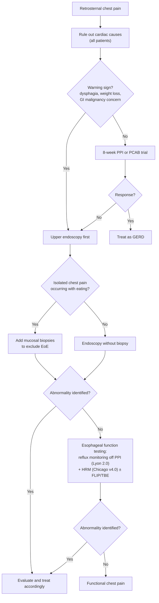

## Contents
- [[#Definition / Scope]]
- [[#Differential Diagnosis]]
- [[#Diagnostic Algorithm]]
- [[#Key Tests]]
- [[#Red Flags / Alarm Features]]
- [[#See Also]]
- [[#Sources]]

---

## Definition / Scope

**Noncardiac chest pain (NCCP)** = recurring retrosternal chest pain, distinct from heartburn, **after cardiac causes have been excluded**. It is an umbrella term, not a diagnosis: most cases resolve to [[gerd|gastroesophageal reflux disease (GERD)]], a minority to an esophageal motor disorder, and about a third to [[functional-chest-pain|functional chest pain]] — the esophageal disorder of gut–brain interaction (E-DGBI) endpoint of this schema ([[disorders-of-gut-brain-interaction]]).

**Cardiac exclusion is step zero.** Esophageal workup should only proceed after confirmation — typically from the patient's cardiologist or primary care physician — that symptoms are unrelated to concurrent or new coronary artery disease ([[rome-v-2026-functional-esophageal-disorders]]).

---

## Differential Diagnosis

| Cause | Share of NCCP |
|---|---|
| [[gerd\|GERD]] | **~50%–60%** |
| Esophageal motility disorder — [[achalasia]], conclusive [[esophagogastric-junction-outflow-obstruction\|EGJOO]], distal esophageal spasm, hypercontractile esophagus, absent contractility | **15%–18%** |
| [[functional-chest-pain\|Functional chest pain]] | **32%–35%** |

Also consider:

- [[eosinophilic-esophagitis|Eosinophilic esophagitis]] — especially **chest pain during eating**, which may be a surrogate for [[dysphagia]]
- [[reflux-hypersensitivity|Reflux hypersensitivity]] — chest pain triggered by physiologic reflux events
- **Abelchia (inability to belch syndrome / retrograde cricopharyngeal dysfunction)** — chest pain with **audible gurgling noises in the chest**; see [[abdominal-bloating-and-distention]]
- Panic disorder and other psychiatric causes — **psychiatric comorbidity is present in up to 75% of NCCP patients**
- Musculoskeletal chest wall pain

---

## Diagnostic Algorithm

Per the Rome V global algorithm for esophageal symptoms ([[rome-v-2026-functional-esophageal-disorders]], Figure 1):

- **The PPI trial comes first only when there is no warning sign.** Dysphagia is the warning sign that sends the patient straight to endoscopy.
- **Reflux testing is performed off acid suppression** when clinical suspicion for GERD remains high after PPI nonresponse.
- **Most NCCP patients have normal motor function** — consider [[high-resolution-manometry|high-resolution manometry (HRM)]] once GERD has been comfortably ruled out.

---

## Key Tests

| Test | Use in NCCP |
|---|---|
| Cardiac evaluation | **Mandatory first step** in all patients |
| 8-week optimized [[proton-pump-inhibitors\|PPI]] or [[potassium-competitive-acid-blockers\|PCAB]] trial | Simple, cost-effective; high GERD prevalence makes this the efficient first move |
| [[upper-endoscopy\|Upper endoscopy]] | Exclusionary value; **biopsy only if chest pain is meal-related** (Rome V change from Rome IV) |
| [[ambulatory-reflux-monitoring\|Ambulatory reflux monitoring]] | PPI nonresponders with persisting GERD suspicion — **off acid suppression**. **No method is superior**: pH, pH-impedance, or prolonged wireless pH beyond 24 hours |
| [[high-resolution-manometry\|HRM]] per [[chicago-classification-v4\|Chicago Classification version 4.0]] | Exclude major motor disorders, after GERD is ruled out |

**Lyon Consensus 2.0 thresholds** used to rule GERD in or out are on [[reflux-testing]]; **acid exposure time (AET) <4% rules out GERD, >6% supports it, and 4%–6% is inconclusive**.

---

## Red Flags / Alarm Features

- **Any cardiac feature** — the dominant red flag; exclude coronary artery disease before anything esophageal
- **[[dysphagia]]** — the warning sign that bypasses the PPI trial and goes straight to endoscopy
- Odynophagia
- Unintentional weight loss
- History or clinical suspicion of gastrointestinal malignancy

---

## See Also

[[functional-chest-pain]], [[gerd]], [[reflux-hypersensitivity]], [[functional-heartburn]], [[globus]], [[functional-dysphagia]], [[disorders-of-gut-brain-interaction]], [[dysphagia]], [[achalasia]], [[esophagogastric-junction-outflow-obstruction]], [[eosinophilic-esophagitis]], [[upper-endoscopy]], [[ambulatory-reflux-monitoring]], [[reflux-testing]], [[high-resolution-manometry]], [[chicago-classification-v4]], [[abdominal-bloating-and-distention]], [[proton-pump-inhibitors]], [[potassium-competitive-acid-blockers]]

---

## Sources

1. [[rome-v-2026-functional-esophageal-disorders|Functional Esophageal Disorders (Rome V, 2026)]]
