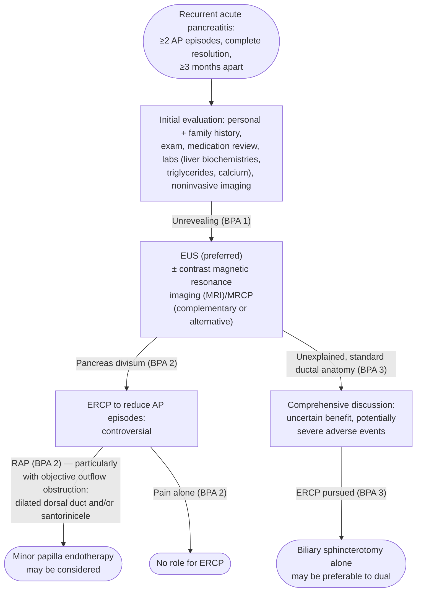

## Contents
- [[#Definition / Scope]]
- [[#Differential Diagnosis]]
- [[#Diagnostic Algorithm]]
  - [[#Finding the Cause]]
  - [[#ERCP to Reduce Attacks]]
- [[#Key Tests]]
- [[#Red Flags / Alarm Features]]

## Definition / Scope

- **Recurrent acute pancreatitis (RAP) = ≥2 distinct episodes of [[acute-pancreatitis|acute pancreatitis (AP)]] with complete interceding resolution, separated by ≥3 months** [[aga-2022-recurrent-pancreatitis-endoscopy]].
- After an index AP episode, **10–30%** develop RAP; **~35% of RAP progress to [[chronic-pancreatitis|chronic pancreatitis (CP)]]** (other patients develop CP without antecedent AP attacks).
- **Unexplained AP:** etiology remains unexplained in **16–27%** of all AP cases despite routine efforts to find a cause.

## Differential Diagnosis

- **Occult biliary lithiasis** — most common etiology found at [[endoscopic-ultrasound|endoscopic ultrasound (EUS)]]
- Ductal anatomic variants: [[pancreas-divisum|pancreas divisum (PD)]], anomalous pancreaticobiliary union
- [[sphincter-of-oddi-dysfunction|Pancreaticobiliary sphincter dysfunction or stenosis]] — proposed cause in standard ductal anatomy when EUS and/or [[mri-mrcp|magnetic resonance cholangiopancreatography (MRCP)]] is unrevealing
- **Occult ampullary or pancreatobiliary malignancy** (see *Red Flags*)
- Underlying CP
- Causes sought on the initial evaluation: medications (medication review), triglycerides and calcium (labs)

## Diagnostic Algorithm

- Built from the AGA 2022 clinical practice update (CPU) best practice advice (BPA) 1–3 [[aga-2022-recurrent-pancreatitis-endoscopy]]: find the cause first; [[ercp|endoscopic retrograde cholangiopancreatography (ERCP)]] only to try to reduce attacks — controversial in both ductal anatomies.

*Evaluation and ERCP decisions in unexplained recurrent acute pancreatitis*
*Source: built from AGA 2022 CPU Best Practice Advice 1, 2 and 3 and their supporting text (the CPU has no flowchart)*
*[[aga-2022-recurrent-pancreatitis-endoscopy|AGA 2022 CPU: Endoscopic Approach to Recurrent Acute and Chronic Pancreatitis]]*
*AP = acute pancreatitis · BPA = best practice advice · CPU = clinical practice update · EUS = endoscopic ultrasound · MRI = magnetic resonance imaging · MRCP = magnetic resonance cholangiopancreatography · ERCP = endoscopic retrograde cholangiopancreatography*

### Finding the Cause

- EUS: potential etiology in **29–88%**; yield varies with patient demographics, tempo and pattern of RAP, and a priori likelihood of a biliary cause (liver biochemistries, gallbladder present).
- Contrast MRI/MRCP: complementary, particularly if EUS is unrevealing; alternative when EUS expertise is not available (BPA 1). Test comparison → *Key Tests*.

> [!pearl] Wait 2–6 weeks after the attack for EUS
> Optimal timing not concretely defined; most experts advise a short delay (2–6 weeks) after AP resolution — persistent inflammation may hide subtle lesions and underlying CP ([[aga-2022-recurrent-pancreatitis-endoscopy]]).

### ERCP to Reduce Attacks

- **Pancreas divisum (BPA 2):** evidence-based predictors of response not yet defined. BPA 2 was written while a sham-controlled randomized trial of minor papilla sphincterotomy in PD with RAP was underway — its result, technique and detail → [[pancreas-divisum]].
- **Standard ductal anatomy (BPA 3):** even more controversial; individualize to disease burden and potential for iatrogenesis.
- **The numbers the discussion turns on** — benefit rests on uncontrolled series or small trials:

| | Pancreas divisum | Standard ductal anatomy |
|---|---|---|
| **Benefit** | Uncontrolled retrospective series: RAP reduced or eliminated in **up to 60–80%**. Only randomized controlled trial (RCT) (**n = 19**): future AP **10% vs 67%** with minor papilla stenting vs controls (P < .05) | Jacob small open-label RCT: pancreatic duct stenting vs medical therapy alone → RAP **11% vs 53%** (P < .02). Observational study (≥10-year follow-up) suggested benefit with sphincterotomy; retrospective study (median 7 years) found no reduction. Coté RCT: pancreatic sphincterotomy may not add benefit over biliary sphincterotomy alone |
| **Harm** | **Post-ERCP pancreatitis 10–15%**; post-papillotomy stenosis (below) | Low but very real risk of severe post-ERCP pancreatitis |

> [!pitfall] Minor papilla therapy can worsen RAP
> In PD, post-papillotomy stenosis occurs in up to 1 in 5 (19%) and may result in RAP frequency higher than the original presentation ([[aga-2022-recurrent-pancreatitis-endoscopy]]).

## Key Tests

| Test | Role in RAP |
|---|---|
| Labs (initial evaluation) | Liver biochemistries, triglycerides, calcium |
| **EUS** | Preferred test after an unrevealing initial evaluation (BPA 1). More likely than MRI to give a probable cause (meta-analysis odds ratio 3.79), driven mainly by sensitivity for occult biliary stones |
| **MRI/MRCP with contrast** | Complementary or alternative to EUS, per local expertise and availability (BPA 1). Particularly helpful for ductal etiologies (PD, anomalous pancreaticobiliary union). Secretin-enhanced MRCP improves yield over standard MRI/MRCP, but limited by availability, secretin logistics, and variable acquisition/interpretation |
| **ERCP** | Role in RAP = reducing attack frequency — controversial (BPA 2–3); see *ERCP to Reduce Attacks* |

## Red Flags / Alarm Features

- **Occult ampullary or pancreatobiliary malignancy** — up to **5%** after a single unexplained AP, up to **12%** with RAP.
- Progression to CP (~35% of RAP) — irreversible fibroinflammatory disease: pain, [[exocrine-pancreatic-insufficiency|exocrine]] and endocrine insufficiency.

## See Also

[[acute-pancreatitis]], [[chronic-pancreatitis]], [[pancreas-divisum]], [[endoscopic-ultrasound]], [[ercp]], [[mri-mrcp]], [[sphincter-of-oddi-dysfunction]], [[hereditary-pancreatitis]], [[choledocholithiasis]], [[exocrine-pancreatic-insufficiency]]

---

## Sources

1. [[aga-2022-recurrent-pancreatitis-endoscopy|AGA Clinical Practice Update on the Endoscopic Approach to Recurrent Acute and Chronic Pancreatitis: Expert Review]]
