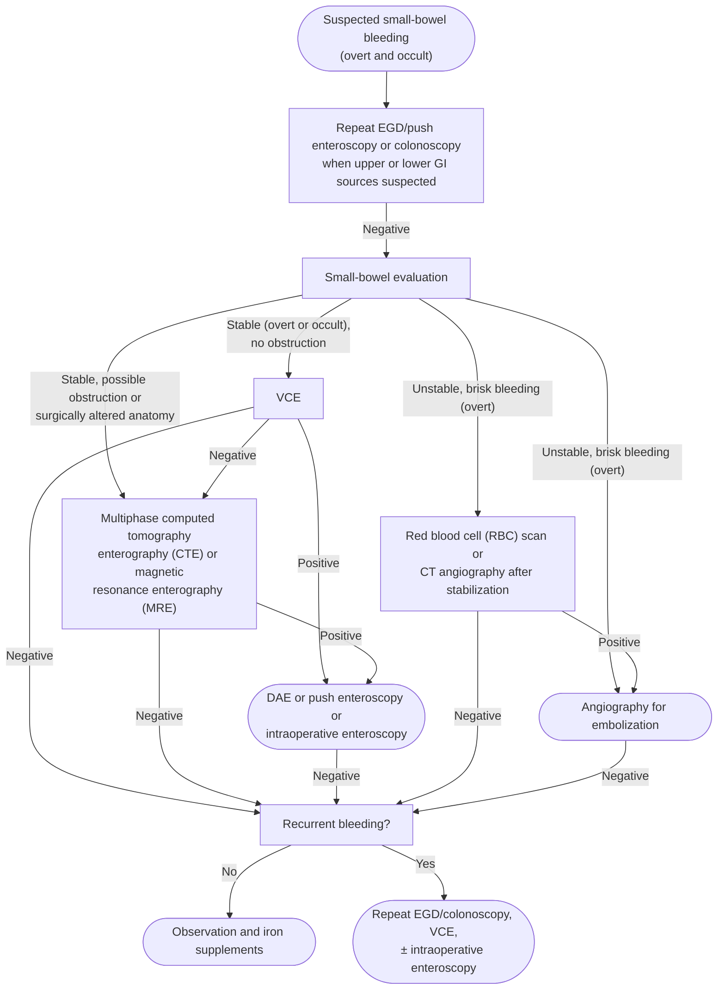
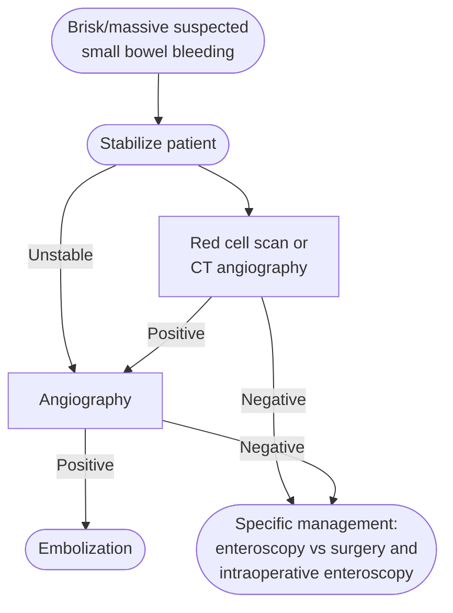
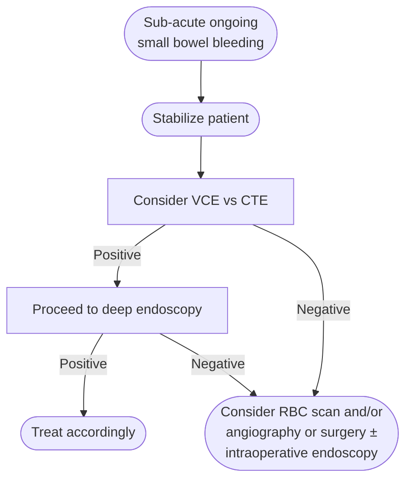

## Contents
- [[#Definition / Scope]]
- [[#Differential Diagnosis]]
  - [[#By Age]]
  - [[#Vascular Lesions (Most Common Overall)]]
  - [[#Inflammatory]]
  - [[#Neoplastic]]
  - [[#Previously Delisted Causes]]
- [[#Diagnostic Algorithm]]
  - [[#Step 1: Confirm Small Bowel Origin]]
  - [[#Step 2: Small Bowel Evaluation]]
  - [[#Step 3: Brisk or Massive Overt Bleeding]]
  - [[#Step 4: Sub-Acute Ongoing Bleeding]]
- [[#Key Tests]]
  - [[#Video Capsule Endoscopy (VCE)]]
  - [[#Push Enteroscopy]]
  - [[#Device-Assisted Enteroscopy (DAE)]]
  - [[#CT Enterography (CTE)]]
  - [[#CT Angiography (CTA)]]
  - [[#Tagged RBC Scintigraphy (⁹⁹ᵐTc-labeled RBCs)]]
  - [[#Conventional Angiography]]
  - [[#Meckel's Scan (⁹⁹ᵐTc-pertechnetate)]]
  - [[#Intraoperative Enteroscopy (IOE)]]
- [[#Red Flags / Alarm Features]]
- [[#Treatment]]
  - [[#Endoscopic Therapy]]
  - [[#Conservative Management (No Bleeding Source Found on Workup)]]
  - [[#Medical Therapy for Refractory/Recurrent Bleeding]]
  - [[#Surgical Therapy]]
- [[#See Also]]
- [[#Sources]]

---

## Definition / Scope

- **Small bowel bleeding (SBB)** = gastrointestinal (GI) bleeding with a source between the ampulla of Vater and the ileocecal valve. ~5–10% of patients presenting with GI bleeding per [[acg-2015-small-bowel-bleeding|American College of Gastroenterology (ACG) 2015]]; 5% per [[asge-2017-small-bowel-bleeding|American Society for Gastrointestinal Endoscopy (ASGE) 2017]].
- ACG 2015 replaces **"obscure GI bleeding (OGIB)"** with anatomic terms (ACG summary statements 1–5; ASGE 2017 endorses the shift):

| Term | Definition |
|---|---|
| **Potential small bowel bleeding** | After normal upper and lower endoscopy, before capsule endoscopy |
| **Small bowel bleeding** | Source identified distal to the ampulla of Vater and/or proximal to the ileocecal valve |
| **Overt SBB** | Melena or hematochezia with a small bowel source |
| **Occult SBB** | [[iron-deficiency-anemia\|Iron-deficiency anemia (IDA)]] with or without guaiac-positive stools, with a small bowel source |
| **OGIB** | No source after standard upper and lower endoscopy, small bowel evaluation with video capsule endoscopy (VCE) and/or enteroscopy, and radiographic testing |

- Neighbouring territories: [[upper-gi-bleeding]] and [[acute-lower-gi-bleeding]].
- The [[aga-2020-ida|American Gastroenterological Association (AGA) 2020]] IDA guideline covers the workup *before* small bowel evaluation (Step 1) and excludes obscure GI bleeding (persistent or recurrent bleeding of unknown origin after appropriate endoscopic evaluation) from its scope.

---

## Differential Diagnosis

### By Age

*ACG 2015 Table 2.*

| Under age 40 years | Over age 40 years | Rare causes |
|---|---|---|
| [[inflammatory-bowel-disease\|Inflammatory bowel disease (IBD)]] | [[angioectasia\|Angioectasia]] | Henoch–Schönlein purpura |
| Dieulafoy's lesions | Dieulafoy's lesions | Small bowel varices and/or portal hypertensive enteropathy |
| Neoplasia | Neoplasia | Amyloidosis |
| [[meckels-diverticulum\|Meckel's diverticulum]] | [[nsaid-enteropathy\|Nonsteroidal anti-inflammatory drug (NSAID) ulcers]] | Blue rubber bleb nevus syndrome |
| Polyposis syndromes | | Pseudoxanthoma elasticum |
| | | [[hereditary-hemorrhagic-telangiectasia\|Osler–Weber–Rendu syndrome]] |
| | | Kaposi's sarcoma with acquired immunodeficiency syndrome (AIDS) |
| | | Plummer–Vinson syndrome |
| | | Ehlers–Danlos syndrome |
| | | Inherited polyposis syndromes ([[familial-adenomatous-polyposis\|familial adenomatous polyposis (FAP)]], [[peutz-jeghers-syndrome\|Peutz–Jeghers]]) |
| | | Malignant atrophic papulosis |
| | | Hematobilia |
| | | Aorto-enteric fistula |
| | | Hemosuccus entericus |

- Lesion type depends on age, not gender or ethnicity (ACG summary statement 1).
- Pooled VCE / double-balloon enteroscopy (DBE) yields (10 studies): vascular lesions **24%** on both; inflammatory **18%** (VCE) / **16%** (DBE); mass lesions **11%** ([[acg-2015-small-bowel-bleeding]]).

### Vascular Lesions (Most Common Overall)

- **[[angioectasia|Angioectasia]]** = most common cause of SBB (ACG summary statement 2); 20%–30% of SBB, more common in older patients ([[asge-2017-small-bowel-bleeding]]).
- **Risk factors for angioectasia:** advancing age, aortic stenosis, chronic renal failure, left ventricular assist devices (LVADs), other hereditary disorders (ACG summary statement 3).
- **Risk factors for recurrent bleeding from small bowel angioectasia:** number of vascular lesions, age >65 y, jejunal lesions, cardiac valvular disease, chronic renal disease, anticoagulant use, need for transfusion ([[acg-2015-small-bowel-bleeding]]).
- **[[heydes-syndrome|Heyde's syndrome]]:** a *controversial* association of aortic stenosis and angioectasia, thought secondary to acquired type 2 von Willebrand deficiency. LVAD patients are also at risk of angioectasia bleeding via acquired von Willebrand deficiency ([[acg-2015-small-bowel-bleeding]]).

### Inflammatory

- [[crohns-disease|Crohn's disease]] and NSAID erosions/ulcers ([[asge-2017-small-bowel-bleeding]]). IBD is more likely under 40 y; ulcers from anti-inflammatory drugs are more likely over 40 y ([[acg-2015-small-bowel-bleeding]]).

### Neoplastic

- [[gastrointestinal-stromal-tumor|GI stromal tumors]], lymphoma, [[gastroenteropancreatic-neuroendocrine-tumors|carcinoid]], adenocarcinoma, other polypoid lesions — occur in younger and older patients alike ([[acg-2015-small-bowel-bleeding]], [[asge-2017-small-bowel-bleeding]]). Approach to masses: [[subepithelial-lesion]].
- Dieulafoy's lesions also span both age groups.

### Previously Delisted Causes

- **[[celiac-disease|Celiac disease]]** is no longer listed as a cause of SBB: it causes IDA through malabsorption, not occult bleeding ([[acg-2015-small-bowel-bleeding]]).
- It still belongs in the IDA workup:
  - **AGA 2020:** plausible celiac disease in asymptomatic adults with IDA → serology first, small bowel biopsy only if positive, over routine small bowel biopsies (conditional, very low).
  - **ASGE 2017** (older) says small bowel biopsy for celiac disease should be considered in IDA. AGA 2020 is newer and governs.

---

## Diagnostic Algorithm

### Step 1: Confirm Small Bowel Origin

**Second-look endoscopy**

| Statement | Source · grade |
|---|---|
| Second-look [[upper-endoscopy\|esophagogastroduodenoscopy (EGD)]] for recurrent hematemesis, melena or a previously incomplete exam | ACG Rec 1 · strong, low |
| Second-look [[colonoscopy]] for recurrent hematochezia or a suspected lower source | ACG Rec 2 · conditional, very low |
| Push enteroscopy can serve as the second-look exam | ACG Rec 4 · conditional, moderate |
| Signs/symptoms of a recurrent upper or lower source → suggest repeating EGD or colonoscopy, respectively, before small-bowel evaluation | ASGE Rec 1 · suggest, low quality |
| Second-look exams normal → small bowel evaluation next | ACG Rec 3 · strong, moderate |

- **Overt bleeding:**
  - Upper presentation (e.g., hematemesis) → EGD within 24 h, before small-bowel evaluation.
  - A recent EGD of sufficient quality → repeat the upper exam with push enteroscopy; if that is negative, consider repeat colonoscopy with terminal ileum evaluation ([[asge-2017-small-bowel-bleeding]]).
- **Occult bleeding:**
  - Repeat EGD if an upper lesion is suspected (NSAID risk factors, uncertain prior EGD details).
  - Repeat colonoscopy if the bowel preparation was suboptimal, the exam quality is in doubt, or a missed colon lesion is suspected ([[asge-2017-small-bowel-bleeding]]).
- **Occult bleeding presenting as IDA** (AGA 2020; full workup on [[iron-deficiency-anemia]]):
  - Bidirectional endoscopy: **recommended** for asymptomatic postmenopausal women and men (strong, moderate); **suggested** for asymptomatic premenopausal women (conditional, moderate).
  - IDA without other cause after bidirectional endoscopy → noninvasive [[helicobacter-pylori-infection|*Helicobacter pylori*]] testing, treat if positive (conditional, low); celiac serology as above.
  - Uncomplicated asymptomatic IDA with negative bidirectional endoscopy → **trial of iron over routine VCE** (conditional, very low).
    - Does not apply (VCE may be indicated) with: symptoms suggesting small bowel disease; higher risk of small bowel pathology (e.g., propensity for angioectasias); anticoagulant or antiplatelet use; anemia refractory to adequate iron; hospitalized patients with acute or acute-on-chronic anemia.

> [!pearl] Many "small bowel" sources are within reach of a standard scope
> Repeat EGD finds a source in 2–25% and repeat colonoscopy in 6–23% ([[acg-2015-small-bowel-bleeding]]). A source within reach of a standard EGD was found in 26% of push enteroscopy studies and 13.1% of [[device-assisted-enteroscopy|device-assisted enteroscopy (DAE)]] patients ([[asge-2017-small-bowel-bleeding]]). Large hiatal hernias, hematemesis and NSAID use raise the yield of repeat EGD.

### Step 2: Small Bowel Evaluation

*Suggested approach to overt and occult suspected small-bowel bleeding*
*Source: redrawn from Figure 1 of ASGE 2017 (journal p. 24)*
*[[asge-2017-small-bowel-bleeding|ASGE 2017: Role of Endoscopy in Suspected Small-Bowel Bleeding]]*
*EGD = esophagogastroduodenoscopy · GI = gastrointestinal · VCE = video capsule endoscopy · CTE = CT enterography · MRE = magnetic resonance enterography · RBC = red blood cell · CT = computed tomography · DAE = device-assisted enteroscopy*

- Positive results direct specific therapy. Tests are complementary, so more than one may be needed, and the first-line test may depend on local expertise and availability (ASGE Figure 1 legend).
- **[[capsule-endoscopy|VCE]] first:** "first-line procedure" after upper and lower sources are excluded (ACG Rec 5 · strong, moderate); "initial test" (ASGE Rec 2 · suggest, low).
  - VCE before deep enteroscopy (ACG Rec 10 · strong, high). Initial deep enteroscopy can be considered for massive hemorrhage or when VCE is contraindicated.
  - **Timing:** yield is higher within 2 weeks of overt bleeding and greatest at 48–72 h ([[asge-2017-small-bowel-bleeding]], [[acg-2015-small-bowel-bleeding]]).
- **Cross-sectional imaging first:**
  - Multiphase CTE or MRE comes first if stricture, bowel obstruction or IBD is suspected (capsule-retention risk; [[asge-2017-small-bowel-bleeding]]).
  - CTE could be considered before VCE in established IBD, prior radiation, previous small bowel surgery and/or suspected small bowel stenosis (ACG Rec 14 · strong, very low).
- **Suspected small bowel neoplasm** (e.g., young patients) → multiphase CTE or MRE should be considered (ASGE Rec 6 · suggest, moderate quality).
- **DAE first** in select cases (ASGE Rec 4 · suggest, low):
  - high suspicion of small bowel angioectasias;
  - surgically altered anatomy with a bypassed segment (e.g., Roux-en-Y gastrojejunostomy).
- **Positive VCE:**
  - Push enteroscopy if within reach, otherwise DAE (ASGE Rec 2).
  - Push enteroscopy if proximal lesions are suspected (ACG Rec 6 · strong, very low).
  - Total deep enteroscopy if strong suspicion from the clinical presentation or an abnormal VCE (ACG Rec 7 · strong, moderate).
- **VCE unavailable or nondiagnostic in overt bleeding** → DAE or push enteroscopy (ASGE Rec 3 · suggest, low).
- **Negative VCE** — clinical status decides ([[asge-2017-small-bowel-bleeding]]):
  - Stable patients may be observed.
  - Those needing further workup, or with recurrent bleeding, get more tests.
  - High clinical suspicion → CTE even after a prior standard abdominal CT (ACG Rec 15 · conditional, very low; also Rec 12 · strong, low). DBE should still be pursued, including total enteroscopy ([[acg-2015-small-bowel-bleeding]]).
- **Repeat VCE** is particularly informative when bleeding changes from occult to overt, or with a hemoglobin (Hb) decrease of ≥4 g/dL ([[asge-2017-small-bowel-bleeding]], [[acg-2015-small-bowel-bleeding]]).
- **ACG 2015 vs ASGE 2017:**
  - ACG 2015 Figure 1: a negative CTE/MRE with no obstruction goes on to VCE, or to "further evaluation warranted?" (no → observation/iron; yes → consider repeat endoscopy/VCE/Meckel's scan/surgery ± intraoperative enteroscopy (IOE)).
  - ASGE 2017 sends a negative CTE/MRE to "recurrent bleeding?". This page follows the newer ASGE algorithm.

> [!pitfall] A negative capsule does not exclude a lesion
> VCE false-negative rate: 11% for all small bowel findings, up to 19% for neoplasms. With high clinical suspicion, pursue DBE anyway, including total enteroscopy ([[acg-2015-small-bowel-bleeding]]).

### Step 3: Brisk or Massive Overt Bleeding

*Brisk or massive suspected small bowel bleeding*
*Source: redrawn from Figure 2 of ACG 2015 (journal p. 1268)*
*[[acg-2015-small-bowel-bleeding|ACG 2015 Small Bowel Bleeding Guideline]]*
*CT = computed tomography*

| Test | Minimum bleeding rate detected | When |
|---|---|---|
| Conventional angiography | 0.5–1.0 ml/min (ACG); >0.5 mL/min (ASGE) | **Hemodynamically unstable:** after resuscitation, angiography for selective embolization (ASGE Rec 7 · **recommend**, moderate quality); emergently (ACG Rec 16 · strong, low) |
| CT angiography (CTA) | 0.3 ml/min (ACG) | **Stable with active bleeding:** to localize and guide management (ACG Rec 17 · strong, low; ASGE Rec 8 · suggest, low). Preferred over CTE in brisk active overt bleeding (ACG Rec 19 · conditional, very low) |
| Tagged RBC scintigraphy | 0.2 ml/min (ACG); at least 0.1–0.4 mL/min (ASGE) | **Slower bleeding (0.1–0.2 ml/min) or uncertain activity**, if VCE or deep enteroscopy is not performed, to time angiography (ACG Rec 18 · strong, moderate); stable, suspected active bleeding (ASGE Rec 8) |

- Positive RBC scan → angiography immediately ([[asge-2017-small-bowel-bleeding]]).
- Conventional angiography is not a diagnostic test without overt bleeding (ACG Rec 20 · conditional, very low).
- **Provocative angiography** can be considered with ongoing overt bleeding and a negative VCE, deep enteroscopy and/or CT (ACG Rec 21 · conditional, very low). ASGE: provocative testing with anticoagulants is rarely considered (safety concerns, limited benefit).
- **Meckel's scan** for younger patients with ongoing overt bleeding and normal VCE and enterography (ACG Rec 22 · conditional, very low); ASGE: younger patients with negative tests and recurrent bleeding.

### Step 4: Sub-Acute Ongoing Bleeding

*Sub-acute ongoing suspected small bowel bleeding*
*Source: redrawn from Figure 3 of ACG 2015 (journal p. 1268)*
*[[acg-2015-small-bowel-bleeding|ACG 2015 Small Bowel Bleeding Guideline]]*
*VCE = video capsule endoscopy · CTE = computed tomographic enterography · RBC = red blood cell*

- VCE vs CTE: choose per Step 2 (obstruction, IBD or suspected neoplasm → cross-sectional imaging first).

---

## Key Tests

### Video Capsule Endoscopy (VCE)

- Whole small bowel seen in 79–90% of patients; diagnostic yield 38–83% in suspected SBB ([[acg-2015-small-bowel-bleeding]]). Full performance, yield predictors and retention detail: [[capsule-endoscopy]].
- **Retention:** ~1.5% in SBB evaluations and up to 13% in Crohn's disease (ACG); 1.4% of examinations (ASGE). The patency capsule may be useful (ACG).
- Misses the major papilla in most cases and can miss duodenal/proximal jejunal lesions (ACG) → push enteroscopy when proximal lesions are suspected (ACG Rec 6).
- Rebleeding after a negative VCE: 6–27% (ACG 2015) vs 6%–11% (ASGE 2017).

### Push Enteroscopy

- A push enteroscope (~250 cm) or pediatric colonoscope. It reaches ~70 cm beyond the ligament of Treitz, 45–60 cm with a colonoscope, and nearly 90 cm with a variable-stiffness design ([[acg-2015-small-bowel-bleeding]]).
- Diagnostic yield: 3–70% (ACG; mostly vascular lesions); 24%–56% (ASGE).
- Use instead of repeat EGD when an upper source is highly suspected, or to treat VCE lesions within its reach ([[asge-2017-small-bowel-bleeding]]).

### Device-Assisted Enteroscopy (DAE)

- DBE, single-balloon enteroscopy (SBE) and spiral enteroscopy. Any method can be used when evaluation and therapy are needed (ACG Rec 8 · strong, high). Platforms, depth and adverse events: [[device-assisted-enteroscopy]].
- **Indications** ([[acg-2015-small-bowel-bleeding]]):
  - positive VCE (tissue diagnosis, therapy);
  - VCE contraindicated;
  - negative VCE with high clinical suspicion;
  - active bleeding.
- **Yield depends on the VCE result:**
  - DBE yield 75% after a positive VCE vs 27.5% after a negative one ([[asge-2017-small-bowel-bleeding]]).
  - VCE-targeted DBE: diagnostic yield 73–93%, therapeutic yield 57–73% ([[acg-2015-small-bowel-bleeding]]).
- **Urgent DBE** (within 72 h of last visible bleeding) vs non-urgent: diagnostic yield 70% vs 30%, with less recurrent bleeding ([[asge-2017-small-bowel-bleeding]]).

### CT Enterography (CTE)

- **Barium studies should not be performed** (ACG Rec 11 · strong, high).
- CT preferred over magnetic resonance (MR) (ACG Rec 13 · conditional, very low). MR is an option with CT contraindications or to avoid radiation in younger patients. MRE is an alternative when obstruction is suspected (ASGE).
- **Better for masses:** CTE detected 9/9 small bowel tumors vs 3/9 for VCE (ACG); 16/17 vs 6/17 (ASGE).
- **VCE better for vascular lesions** (ACG). Pooled yield: CTE 40% vs VCE 53% (18 studies).
- **Complementary:**
  - CTE after a nondiagnostic VCE was positive in 50%.
  - VCE after a negative CTE was positive in 57%.
- Also screens for capsule contraindications: 11% were excluded from VCE for high-grade strictures on MRE ([[acg-2015-small-bowel-bleeding]]).
- Multiphase CTE can show whether antegrade or retrograde DAE fits better ([[asge-2017-small-bowel-bleeding]]).

### CT Angiography (CTA)

- Multiphasic CT without oral contrast. The patient must be actively bleeding at the time of the scan.
- Pooled sensitivity 89%, specificity 85% (9 studies, 198 patients).
- One study of 86 CTAs: 64 negative, of whom 92% needed no further intervention; no negative CTA was followed by a positive conventional angiogram within 24 h ([[acg-2015-small-bowel-bleeding]]).

### Tagged RBC Scintigraphy (⁹⁹ᵐTc-labeled RBCs)

- Wide ranges: sensitivity 33–93%, specificity 30–95%, diagnostic yield 26–87%, localization accuracy 19–100% ([[acg-2015-small-bowel-bleeding]]).
- Identifies only a general area of bleeding. Failed to localize hemorrhage in 85% of 103 patients with suspected SBB ([[asge-2017-small-bowel-bleeding]]).
- Monitor closely so the patient can go to angiography promptly (ACG).

### Conventional Angiography

- Yield 20–77% in GI bleeding; mean near 50% (ACG).
- **Predictors of a positive angiogram:**
  - hemodynamic instability, particularly needing ≥5 U transfused to stabilize;
  - more massive bleeding (yield up to 87%);
  - active bleeding with minimal delay.
  - After a positive CTA: non-diverticular cause and lower Hb.
- A negative tagged RBC scan or negative CTA makes a positive angiogram unlikely.
- Complications up to 10%: renal failure, thromboembolic events, infection or bleeding at the catheter site ([[acg-2015-small-bowel-bleeding]]).
- Selective mesenteric embolization reduces the risk of intestinal ischemia ([[asge-2017-small-bowel-bleeding]]).
- **Superselective embolization** (15 studies, 309 patients, mostly sources outside the small bowel; ACG):
  - success rate 82%;
  - overall clinical success 95%;
  - 30-day success 76%;
  - rebleeding 12%.
- **A later series of 70 patients** (ACG):
  - bowel infarction 4%;
  - failure to achieve 30-day hemostasis predicted by Hb <8 g/dl, coagulopathy, upper GI bleeding, contrast extravasation and more than one vessel embolized.

### Meckel's Scan (⁹⁹ᵐTc-pertechnetate)

- Detects ectopic gastric mucosa in [[meckels-diverticulum|Meckel's diverticulum]]. Highest yields in children.
- Sensitivity 50–90%, specificity 9–95% (ACG); sensitivity 62%–87.5% for ectopic gastric mucosa (ASGE).
- **False positives:** ulcers, inflammatory lesions, arteriovenous malformations, obstruction, intussusception, ectopic gastric mucosa in other lesions such as duplication cysts (ACG).

### Intraoperative Enteroscopy (IOE)

- Diagnostic yield 58–88%. Rebleeding up to 60%; mortality 17% ([[acg-2015-small-bowel-bleeding]]).
- Adverse events: serosal tears, avulsion of mesenteric vessels, prolonged ileus.
- With VCE lesions, IOE yielded treatment in 13/15 (87%) ([[asge-2017-small-bowel-bleeding]]).
- **Last resort:**
  - Limit to cases where enteroscopy cannot be done, such as prior surgery with adhesions (ACG Rec 9 · strong, low).
  - Or recurrent bleeding needing multiple transfusions or hospitalizations after unrevealing VCE and deep enteroscopy (ACG, ASGE).

---

## Red Flags / Alarm Features

- **Hemodynamic instability** → resuscitation, then angiography for embolization (Step 3).
- **Hb fall ≥4 g/dL, or occult bleeding turning overt** → repeat VCE.
- **Age <40 y** → IBD, Meckel's diverticulum, polyposis syndromes; neoplasm suspected → CTE/MRE (ASGE Rec 6).
- **Capsule-retention risk** (stricture, obstruction, IBD, prior radiation or small bowel surgery) → CTE/MRE before VCE.
- **Skin findings:** a detailed dermatologic exam may identify [[hereditary-hemorrhagic-telangiectasia|hereditary hemorrhagic telangiectasia]] or blue rubber bleb nevus syndrome ([[acg-2015-small-bowel-bleeding]]).
- **Family history of polyposis syndromes** — an important etiologic clue (ACG).
- **Aortic stenosis or LVAD** → acquired von Willebrand deficiency with angioectasia ([[heydes-syndrome|Heyde's syndrome]]).
- **Portal hypertension or varices** → small bowel varices or portal hypertensive enteropathy (ACG).
- **Bleeding diathesis; aspirin, NSAID, anticoagulant or antiplatelet use** → etiologic clues (ACG). Anticoagulant or antiplatelet use also makes AGA's iron-before-capsule approach inapplicable.

---

## Treatment

### Endoscopic Therapy

- Source found on VCE and/or deep enteroscopy with significant ongoing anemia or active bleeding → endoscopic therapy (ACG Rec 23 · strong, low).
- **Within reach of a standard endoscope:** electrocautery, [[argon-plasma-coagulation|argon plasma coagulation (APC)]], injection, mechanical hemostasis (hemoclips or bands), or a combination ([[endoscopic-hemostasis]]). More distal angioectasias → push enteroscopy or DAE, depending on location ([[asge-2017-small-bowel-bleeding]]).
- APC has been primarily used as the treatment of choice since 2001 (ACG).
- **Recurrence after treating vascular lesions** ([[acg-2015-small-bowel-bleeding]]):
  - ranges from 20% to nearly 50%;
  - meta-analysis (14 studies, 623 patients): pooled 34% (95% confidence interval 27–42%) at a mean of 22 ± 13 months, 45% in the 341 patients with small bowel angioectasia;
  - no trial has compared endoscopic therapy with sham.
- Recurrent SBB → endoscopic management can be considered, depending on clinical course and response to prior therapy (ACG Rec 31 · conditional, moderate).
- Masses or tumors likely require surgery. Massive bleeding → coordinate with surgery and interventional radiology ([[asge-2017-small-bowel-bleeding]]).

### Conservative Management (No Bleeding Source Found on Workup)

- No source after appropriate small bowel investigation → oral or intravenous iron as dictated by the severity and persistence of IDA. A small vascular lesion on capsule does not always need treatment (ACG Rec 24 · strong, very low).
- After a negative evaluation, clinically stable patients without recurrent bleeding may receive iron and be followed clinically if iron deficient (ASGE Rec 5 · suggest, low).
- Oral vs intravenous iron and dosing: [[iron-deficiency-anemia]] ([[aga-2020-ida]]).
- Persistent bleeding with worsening anemia → repeat the workup as appropriate:
  - upper and lower endoscopy, VCE, deep enteroscopy, CT or MR enterography (ACG Rec 25 · strong, low).

### Medical Therapy for Refractory/Recurrent Bleeding

- Bleeding persists or recurs, or the lesion cannot be localized → consider iron, somatostatin analogs or antiangiogenic therapy (ACG Rec 26 · strong, moderate).
- ASGE: octreotide and low-dose thalidomide for patients who are not candidates for endoscopic therapy or who keep bleeding after it.
- **[[somatostatin-analogs|Somatostatin analogs]]** (ACG):
  - Refractory bleeding (>5 U within 3 months) was treated with depot octreotide long-acting release intramuscularly monthly, or lanreotide 90 mg monthly, for a mean of 12 months (range 6–36).
  - Octreotide protocol in a 98-patient series: 100 µg subcutaneously three times daily for 1 month, plus depot 20 mg monthly for 6 months starting at 2 weeks.
  - Predictors of poor response: age >65 y, male sex, antiplatelet therapy, chronic obstructive pulmonary disease, chronic renal failure.
- **Thalidomide** (ACG):
  - Open-label randomized controlled trial (RCT) in patients with ≥6 bleeding episodes: 25 mg four times daily vs iron 100 mg daily, for 4 months.
  - ≥50% reduction in bleeding episodes: 20/28 (71%) vs 1/27 (4%), p<0.001. Adverse events (fatigue, constipation, somnolence): 73% vs 34%.
  - A 2012 study used 200 mg daily for 4 months: response in 9/12.
- **Hormonal therapy:** no benefit vs placebo in RCTs; no role ([[acg-2015-small-bowel-bleeding]], [[asge-2017-small-bowel-bleeding]]).
- **[[anticoagulation-gi-bleeding|Anticoagulation]]/antiplatelet therapy:** discontinue if possible (ACG Rec 27 · conditional, very low); no prospective data show benefit from withdrawal.

### Surgical Therapy

- Generally a last resort, or for patients needing lysis of adhesions for deep enteroscopy ([[acg-2015-small-bowel-bleeding]]).
- In massive SBB, surgery is greatly aided by presurgical tattoo marking of the lesion (ACG Rec 28 · strong, low).
- IOE should be available at surgery to localize and treat (ACG Rec 29 · conditional, low).
- An angiographic catheter can be left in place; at laparotomy, methylene blue injected through it marks the relevant segment.
- **[[heydes-syndrome|Heyde's syndrome]] with ongoing bleeding** → aortic valve replacement (ACG Rec 30 · conditional, moderate). Pooled rebleeding event rate after replacement: 0.16 (2 studies).

---

## See Also

[[upper-gi-bleeding]], [[acute-lower-gi-bleeding]], [[iron-deficiency-anemia]], [[capsule-endoscopy]], [[device-assisted-enteroscopy]], [[upper-endoscopy]], [[colonoscopy]], [[angioectasia]], [[heydes-syndrome]], [[meckels-diverticulum]], [[crohns-disease]], [[inflammatory-bowel-disease]], [[nsaid-enteropathy]], [[celiac-disease]], [[helicobacter-pylori-infection]], [[familial-adenomatous-polyposis]], [[peutz-jeghers-syndrome]], [[hereditary-hemorrhagic-telangiectasia]], [[gastrointestinal-stromal-tumor]], [[gastroenteropancreatic-neuroendocrine-tumors]], [[subepithelial-lesion]], [[argon-plasma-coagulation]], [[endoscopic-hemostasis]], [[somatostatin-analogs]], [[anticoagulation-gi-bleeding]]

---

## Sources

1. [[acg-2015-small-bowel-bleeding|ACG 2015: Diagnosis and Management of Small Bowel Bleeding]]
2. [[aga-2020-ida|AGA Clinical Practice Guideline: Gastrointestinal Evaluation of Iron-Deficiency Anemia (2020)]]
3. [[asge-2017-small-bowel-bleeding|ASGE 2017: Role of Endoscopy in Suspected Small-Bowel Bleeding]]
