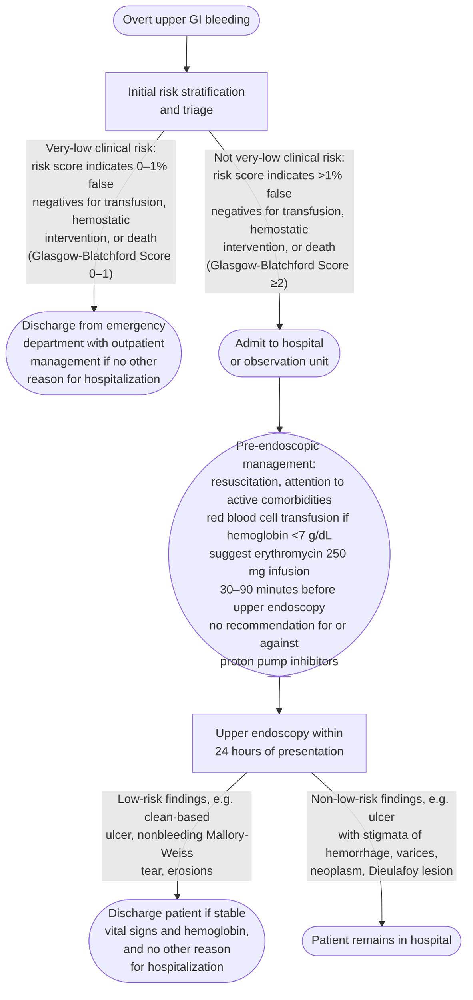
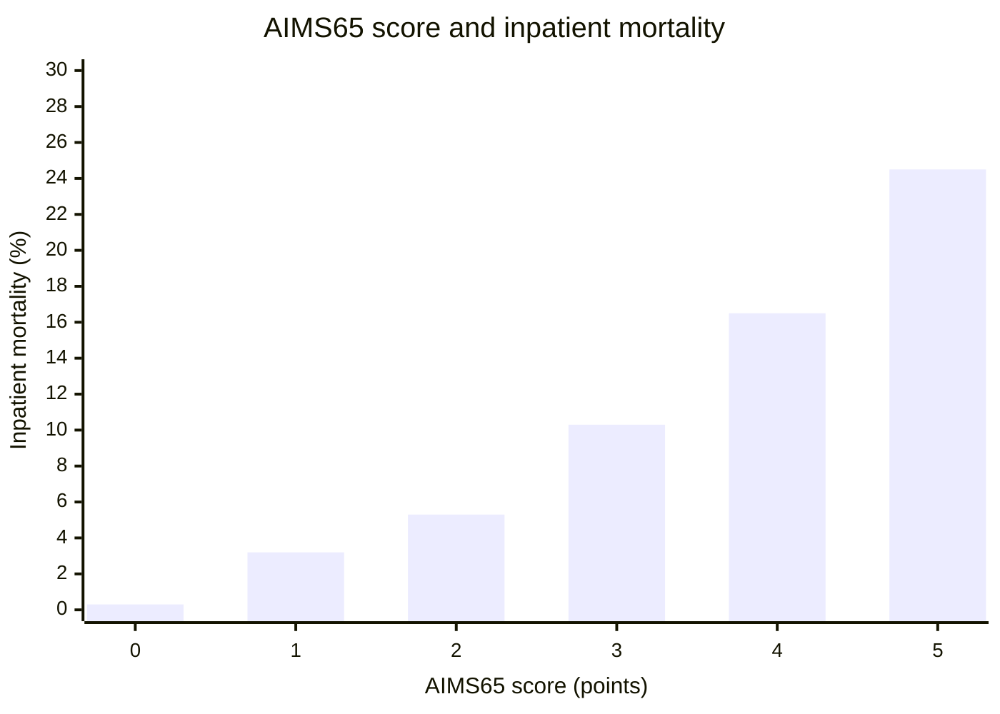

## Contents
- [[#Definition / Scope]]
  - [[#UGIB vs. LGIB Distinction]]
- [[#Differential Diagnosis]]
  - [[#Non-Variceal]]
  - [[#Variceal and Portal Hypertensive]]
- [[#Diagnostic Algorithm]]
  - [[#Step 1: Initial Assessment and Resuscitation (Simultaneous)]]
  - [[#Step 2: Risk Stratification in the Emergency Department]]
  - [[#Step 3: Pre-Endoscopic Management]]
  - [[#Step 4: Timing of Endoscopy]]
  - [[#Step 5: Endoscopic Evaluation — Ulcer Stigmata]]
  - [[#Step 6: Choice of Endoscopic Hemostatic Therapy (Ulcer Bleeding)]]
  - [[#Step 7: Post-Endoscopic Management (Ulcer Bleeding)]]
  - [[#Step 8: Recurrent Bleeding]]
- [[#Key Tests]]
  - [[#Endoscopy]]
  - [[#Glasgow-Blatchford Score]]
  - [[#Rockall Score]]
  - [[#AIMS65 Score]]
- [[#Red Flags / Alarm Features]]
  - [[#Hemodynamic Instability (Requires Urgent Resuscitation Before Endoscopy)]]
  - [[#High-Risk Clinical Features (GBS ≥12)]]
  - [[#Endoscopic High-Risk Stigmata (Requiring Therapy)]]
  - [[#Rebleeding Warning Signs]]
  - [[#Alarm Features for Alternative Diagnoses]]
- [[#See Also]]
- [[#Sources]]

---

## Definition / Scope

- **Upper gastrointestinal (GI) bleeding (UGIB)** = bleeding from the **esophagus, stomach, or duodenum** ([[acg-2021-ugib|American College of Gastroenterology (ACG) 2021]]).
- **Overt UGIB** presents as:
  - **Hematemesis** — vomiting of red blood or coffee-grounds material
  - **Melena** — black, tarry stool
  - **Hematochezia** — red or maroon material per rectum
- Scope: overt UGIB up to and including endoscopy. ACG 2021 restricts its endoscopic and post-endoscopic recommendations to **ulcer bleeding** — the most common cause of UGIB and the one with the most randomized controlled trial (RCT) data.
- Variceal bleeding → [[variceal-upper-gi-bleeding]]. Chronic blood loss → [[iron-deficiency-anemia|iron-deficiency anemia]].

### UGIB vs. LGIB Distinction

- **Hematochezia with hemodynamic instability may come from an upper source** — 15% of 85 patients with hematochezia and high-risk features had a proximal source at esophagogastroduodenoscopy (EGD) done before [[colonoscopy]]. Suspicion high → [[upper-endoscopy]] first ([[acg-2023-lgib]], Key Concept 3).
- Point toward an upper source: history of peptic ulcer disease or decompensated liver disease; blood urea nitrogen (BUN):creatinine ratio >30 (likelihood ratio [LR] 7.5). Clots in stool point away (LR 0.05).
- Nasogastric (NG) aspirate: sensitivity only 28% → routine NG tube not recommended ([[acg-2023-lgib]]).
- Full discriminator data: [[acute-lower-gi-bleeding|acute lower GI bleeding (LGIB)]].

---

## Differential Diagnosis

### Non-Variceal

[[acg-2021-ugib|ACG 2021]] (Figure 2) sorts the endoscopic findings into two triage groups:

| Finding | Triage group after endoscopy | Notes |
|---|---|---|
| [[peptic-ulcer-disease\|Peptic ulcer]], clean base | Low risk | Peptic ulcer is the most common cause of UGIB; stigma-by-stigma management in [[#Step 5: Endoscopic Evaluation — Ulcer Stigmata]] |
| Peptic ulcer with stigmata of hemorrhage | Non-low risk | — |
| Mallory-Weiss tear, nonbleeding | Low risk | Look for tears on scope insertion — retching during the procedure can itself cause one ([[aga-2020-nvugib-endoscopic-therapies]]) |
| Erosions | Low risk | — |
| Dieulafoy lesion | Non-low risk | — |
| Neoplasm ([[gastric-adenocarcinoma\|gastric]], [[esophageal-cancer\|esophageal]]) | Non-low risk | Diffuse tumor bleeding: hemostatic powder as a bridge to radiotherapy or surgery ([[aga-2020-nvugib-endoscopic-therapies]]) |

*Low risk = discharge if vital signs and hemoglobin are stable and there is no other reason for hospitalization; non-low risk = remains in hospital ([[acg-2021-ugib]] Figure 2).*

- Other upper sources with their own pages: [[angioectasia|angioectasias]], [[gastric-antral-vascular-ectasia|gastric antral vascular ectasia (GAVE)]].
- Bleeding after endoscopic resection or sphincterotomy: [[endoscopic-hemostasis]].

### Variceal and Portal Hypertensive

- **Varices** — non-low-risk finding ([[acg-2021-ugib]] Figure 2); management on [[variceal-upper-gi-bleeding]].
- Octreotide is not recommended for non-variceal UGIB (NVUGIB), but keep a low threshold to use it when [[portal-hypertension|portal hypertension]] is suspected ([[aga-2020-nvugib-endoscopic-therapies]]).
- [[portal-hypertensive-gastropathy|Portal hypertensive gastropathy]] — see its page.

---

## Diagnostic Algorithm

*Initial management of overt upper GI bleeding*
*Source: redrawn from the ACG 2021 upper GI and ulcer bleeding initial-management algorithm (Figure 2)*
*[[acg-2021-ugib|ACG 2021 Upper GI and Ulcer Bleeding Guideline]]*
*GI = gastrointestinal*

- Future risk tools may replace the Glasgow-Blatchford Score if they discriminate transfusion, hemostatic intervention, or death with 99–100% sensitivity (0–1% false negatives) ([[acg-2021-ugib]] Figure 2 footnote).

### Step 1: Initial Assessment and Resuscitation (Simultaneous)

From [[aga-2020-nvugib-endoscopic-therapies|American Gastroenterological Association (AGA) 2020 Clinical Practice Update (CPU)]] unless marked:

- Assess hemodynamic status; resuscitate with intravenous (IV) fluids and blood products through large-bore catheters.
- History that shapes the presentation: age, comorbid conditions, prior surgery, prior GI bleeding, medications (antihypertensives, antithrombotics, nonsteroidal anti-inflammatory drugs [NSAIDs]).
- **Airway:** endotracheal intubation for suspected ongoing or massive bleeding, active hematemesis, or suspected retained gastric contents (aspiration risk).
- **Antithrombotics:** reversal decided with intensivists, cardiology, neurology and hematology; when in doubt, err toward **not** reversing → [[anticoagulation-gi-bleeding]].

**Red blood cell transfusion** ([[acg-2021-ugib]]):

| Patient | Transfuse when hemoglobin falls below | Basis |
|---|---|---|
| UGIB (restrictive policy) | **7 g/dL** | Statement 2 — conditional, low-quality evidence |
| Pre-existing cardiovascular disease | **8 g/dL** (reasonable) | Text; extrapolated from general transfusion guidelines |
| Acute coronary syndrome (ACS) | **>8 g/dL** may be considered | Text; very limited evidence — ACS is kept separate from pre-existing cardiovascular disease |
| Hypotensive patient | May transfuse above 7 g/dL | Text; hemoglobin falls further as fluid resuscitation equilibrates |

- Basis: RCT of 899 patients — threshold 7 vs 9 g/dL: lower mortality (5% vs 9%) and less further bleeding (10% vs 16%) with 7 g/dL. Patients with massive exsanguinating bleeding were excluded ([[acg-2021-ugib]]).
- ⚠ **Other guidelines differ; ACG 2021 governs UGIB:**
  - [[acg-2023-lgib]] — 8 g/dL "can also be considered" in ACS + GI bleeding; data on restrictive vs liberal thresholds there are extremely limited.
  - [[aga-2020-nvugib-endoscopic-therapies]] (older) — target "generally 9 g/dL" in significant cardiovascular disease, 7 g/dL for others.

### Step 2: Risk Stratification in the Emergency Department

**Glasgow-Blatchford Score (GBS)** — identifies very-low-risk patients safe for outpatient care ([[acg-2021-ugib]] Table 2):

| Variable | Points |
|---|---|
| **BUN (mg/dL)** | |
| 18.2 to <22.4 | 2 |
| 22.4 to <28.0 | 3 |
| 28.0 to <70.0 | 4 |
| ≥70.0 | 6 |
| **Hemoglobin (g/dL)** | |
| 12.0 to <13.0 (men) / 10.0 to <12.0 (women) | 1 |
| 10.0 to <12.0 (men) | 3 |
| <10.0 | 6 |
| **Systolic blood pressure (BP), mm Hg** | |
| 100–109 | 1 |
| 90–99 | 2 |
| <90 | 3 |
| **Heart rate ≥100 beats/min** | 1 |
| **Melena** | 1 |
| **Syncope** | 2 |
| **Hepatic disease** ᵃ | 2 |
| **Cardiac failure** ᵃ | 2 |

ᵃ Not defined in the original GBS report. A later study cited by ACG 2021 defines **hepatic disease** as known history, or clinical and laboratory evidence, of chronic or acute liver disease, and **cardiac failure** as known history, or clinical and echocardiographic evidence, of cardiac failure.

- Score range 0–23, calculated on admission ([[aga-2020-nvugib-endoscopic-therapies]] Table 1).
- **GBS 0–1 → discharge with outpatient follow-up** (Statement 1 — conditional, very-low-quality evidence): sensitivity 99% (95% confidence interval [CI] lower bound 97–98%) for hospital-based intervention or death; 19–24% of UGIB patients qualify. The benchmark is the ≤1% false-negative rate, not GBS itself ([[acg-2021-ugib]]).
- **GBS ≥2 → admit** to hospital or observation unit.
- **GBS ≥12** = the high-risk group of the urgent-endoscopy RCT → [[#Step 4: Timing of Endoscopy]].
- ACG 2021 raised the discharge cutoff from GBS 0 (2012 guideline) to **0–1**.

### Step 3: Pre-Endoscopic Management

- **Erythromycin** — suggested before endoscopy (Statement 3 — conditional, very-low-quality evidence) ([[acg-2021-ugib]]):
  - **250 mg IV**, infused over 5–30 min (most often 20–30 min), endoscopy 20–90 min later in the RCTs; Figure 2 prints 30–90 min.
  - Fewer repeat endoscopies (odds ratio [OR] 0.51) and shorter stay (mean −1.75 days); no shown benefit on further bleeding or mortality.
  - RCT enrollment did not suggest benefit limited to any subgroup.
  - QT prolongation, related to infusion rate and dose; torsade de pointes very rare, reported with repeated and/or higher doses. Some trials excluded baseline QT prolongation, cardiac disease, electrolyte abnormalities, hepatic dysfunction, antiarrhythmics, and QT-prolonging CYP3A4 substrates.
- **Metoclopramide** — evidence scant (older abstracts only); does not support its use ([[acg-2021-ugib]]).
- **Pre-endoscopic [[proton-pump-inhibitors|proton pump inhibitor (PPI)]]** — no recommendation for or against (Statement 4, ungraded) ([[acg-2021-ugib]]):
  - No benefit on further bleeding or mortality in the RCT data; may modestly reduce the need for endoscopic therapy (relative risk [RR] 0.73).
  - Patients who will not have endoscopy, or whose endoscopy will be delayed: PPI might be given (very indirect evidence).
- **NG tube** — controversial, does not change outcomes. Continuous copious bright red return suggests emergent endoscopy; a negative lavage should not delay endoscopy ([[aga-2020-nvugib-endoscopic-therapies]]).
- **Prophylactic antibiotics** — not indicated in NVUGIB ([[aga-2020-nvugib-endoscopic-therapies]]).
- ⚠ **[[aga-2020-nvugib-endoscopic-therapies|AGA 2020]] differs (older; ACG 2021 governs):** IV PPI to all patients with suspected NVUGIB; erythromycin **or** metoclopramide (data favor erythromycin).

### Step 4: Timing of Endoscopy

- **Admitted or observed patients → endoscopy within 24 hours of presentation** (Statement 5 — conditional, very-low-quality evidence) ([[acg-2021-ugib]]).
  - Measured from **presentation, not admission** — admission delays vary between institutions.
  - Observational data: shorter stay with endoscopy within 1 day; lower surgery or mortality in some studies.
- **Earlier is not better, even at GBS ≥12:** RCT of 516 patients — endoscopy <6 h vs 6–24 h after GI consultation (actual means 10 vs 25 h from presentation): further bleeding 10.9% vs 7.8%, mortality 8.9% vs 6.6% (no reduction) ([[acg-2021-ugib]]).
- **Hemodynamically unstable:** Danish cohort — lowest in-hospital mortality with endoscopy 6–24 h after admission; very early endoscopy may harm if resuscitation and comorbidities are not addressed first ([[acg-2021-ugib]]).
- **Exception — hypotensive shock that does not stabilize after initial resuscitation** (~5% of high-risk patients, excluded from the RCT): urgent endoscopy or interventional radiology, on anecdotal experience ([[acg-2021-ugib]]).
- ACG 2021 **dropped** the 2012 suggestion that endoscopy within 12 h "may be considered" for high-risk clinical features.
- ⚠ **[[aga-2020-nvugib-endoscopic-therapies|AGA 2020]] differs (older; ACG 2021 governs):** emergent endoscopy within 12 h for persistent hemodynamic compromise after resuscitation or moderate- to large-volume hematemesis; stable patients with melena only and no ongoing hematemesis can wait until the next morning.
- Timing quality indicator: [[upper-endoscopy#Timing for UGIB]].

> [!pitfall] Resuscitate before you scope
> Very early endoscopy did not help even the highest-risk patients, and a cohort suggests harm in unstable patients scoped before resuscitation. Resuscitate first; only refractory shock goes straight to endoscopy or interventional radiology ([[acg-2021-ugib]]).

### Step 5: Endoscopic Evaluation — Ulcer Stigmata

- [[acg-2021-ugib|ACG 2021]] describes stigmata in words and does not use Forrest labels. Forrest classes and post-hemostasis rebleeding rates come from [[acg-2025-egd-quality|American College of Gastroenterology/American Society for Gastrointestinal Endoscopy (ACG/ASGE) 2025]].
- Classify every ulcer by Forrest class in the report — the class sets the need for endoscopic therapy and the post-intervention PPI dose. Quality indicator (QI) 13: ≥1 stigma documented, grade 1A, target >98%.

| Forrest class | Stigma | Rebleeding **after** successful endoscopic hemostasis ᵃ | Further bleeding without endoscopic therapy (ACG 2021) |
|---|---|---|---|
| **Ia** | Spurting hemorrhage | **22.5%** | Spurting is less common than oozing (17% of actively bleeding ulcers in a large trial) and seems to rebleed more often |
| **Ib** | Oozing hemorrhage | **4.9%** | Pooled **39% (range 10–100%)** across 8 prospective trials |
| *Ia + Ib (active bleeding)* | — | — | Endoscopic therapy vs none: **RR 0.29 (0.20–0.43), number needed to treat (NNT) 2** |
| **IIa** | Nonbleeding visible vessel (pigmented protuberance) | **11.3%** | Endoscopic therapy vs none: **RR 0.49 (0.40–0.59), NNT 5** |
| **IIb** | Adherent clot (resistant to vigorous irrigation) | **17.7%** | Meta-analysis: no benefit of endoscopic therapy — further bleeding RR 0.31 (0.06–1.77), mortality RR 0.90 (0.23–3.58). Without endoscopic therapy, recurrent bleeding **0/64 on PPI vs 13/61 (21%) on placebo** |
| **IIc** | Flat pigmented spot | Low risk — no endoscopic therapy needed | — |
| **III** | Clean based | Low risk — no endoscopic therapy needed | — |

ᵃ [[acg-2025-egd-quality]]: post-hoc analysis of an RCT of IV esomeprazole vs placebo — recurrent bleeding after successful hemostasis, not the untreated natural history.

- No mortality benefit of endoscopic therapy was documented in the active-bleeding / visible-vessel meta-analysis ([[acg-2021-ugib]]).
- "Oozing" is defined variably; some trials require continuous bleeding over 5 minutes of observation ([[acg-2021-ugib]]).
- **Adherent clot:** remove it endoscopically to look for a high-risk stigma underneath ([[aga-2020-nvugib-endoscopic-therapies]]). If it resists vigorous irrigation, ACG 2021 reaches no recommendation (Statement 7) — either course is acceptable; local expertise and patient factors decide.

*See Figure 2 in [[aga-2024-upper-endoscopy-quality|AGA 2024 High-Quality Upper Endoscopy]] for example images of each Forrest class (Ia spurting to III clean-based ulcer).*

> [!pearl] Oozing rebleeds less than a visible vessel
> After hemostasis, Ib (4.9%) rebleeds less than IIa (11.3%), while Ia spurting is highest (22.5%). Older trials lumped spurting and oozing together as "active bleeding," which hides this ([[acg-2025-egd-quality]]).

| Endoscopic features | Endoscopic therapy | Medical therapy |
|---|---|---|
| Active bleeding or visible vessel | Endoscopic therapy | High-dose PPI therapy ᵃ |
| Adherent clot | No recommendation for or against endoscopic therapy | High-dose PPI therapy ᵃ |
| Flat pigmented spot | No endoscopic therapy | Standard PPI therapy ᵇ |
| Clean base | No endoscopic therapy | Standard PPI therapy ᵇ |

*Endoscopic and medical therapy for ulcer bleeding by endoscopic features of the ulcer*
*Source: redrawn from Figure 3 of ACG 2021*
*[[acg-2021-ugib|ACG 2021 Upper GI and Ulcer Bleeding Guideline]]*
*PPI = proton pump inhibitor*

ᵃ Regimens in [[#Step 7: Post-Endoscopic Management (Ulcer Bleeding)]]. ᵇ Standard PPI therapy (e.g. oral PPI once daily) was recommended by earlier guidelines but is not assessed in ACG 2021.

- Active spurting, active oozing, nonbleeding visible vessel → **endoscopic therapy recommended** (Statement 6 — strong, moderate-quality evidence). QI 14: treated, grade 1A, target >90% ([[acg-2025-egd-quality]]).

### Step 6: Choice of Endoscopic Hemostatic Therapy (Ulcer Bleeding)

Modality choice for ulcers ([[acg-2021-ugib]]). Device settings, technique and failure modes: [[endoscopic-hemostasis]]; argon settings for ulcers: [[argon-plasma-coagulation#Settings by Site]].

| Modality | ACG 2021 statement | Strength, evidence | Key data |
|---|---|---|---|
| [[electrosurgery\|Bipolar electrocoagulation]] or heater probe | 8 | Strong, moderate | vs no therapy: further bleeding RR 0.44, mortality RR 0.58 |
| Absolute ethanol injection | 8 | Strong, moderate | vs no therapy: further bleeding RR 0.56 |
| Through-the-scope clips | 9 | Conditional, very low to low | vs epinephrine alone: RR 0.20 (no direct trial vs no therapy) |
| [[argon-plasma-coagulation\|Argon plasma coagulation (APC)]] | 9 | Conditional, very low to low | vs water injection: 6.9% vs 20.7% further bleeding (1 RCT) |
| Soft monopolar electrocoagulation | 9 | Conditional, very low to low | vs clips: 5.4% vs 33.9% (1 RCT) |
| [[epinephrine\|Epinephrine]] injection | 10 | Strong, very low to moderate | **Never alone** — always with a second modality |
| Hemostatic powder TC-325 | 11 | Conditional, very low | **Actively bleeding ulcers only**; noninferior to standard therapy in 1 RCT (ulcers 12.3% vs 15.4%) |
| Over-the-scope clips | 12 | Conditional, low | **Recurrent** bleeding after successful hemostasis → [[#Step 8: Recurrent Bleeding]] |

*Endoscopic hemostatic modalities for bleeding ulcers*
*Source: built from ACG 2021 Statements 8–12 and their summaries of evidence*
*[[acg-2021-ugib|ACG 2021 Upper GI and Ulcer Bleeding Guideline]]*
*APC = argon plasma coagulation · RCT = randomized controlled trial · TC-325 = hemostatic powder product name*

- Thermal contact vs ethanol: no significant difference — neither preferred.
- Epinephrine before thermal contact therapy: evidence not enough to say thermal devices should always be preceded by epinephrine.
- **TC-325:** adheres only to actively bleeding lesions. In the US (list price $2,500, November 2020) it should not be the first modality when others can be readily applied ([[acg-2021-ugib]]).
  - ⚠ [[aga-2020-nvugib-endoscopic-therapies|AGA 2020]] (older) — powder preferably as **rescue**, not primary hemostasis, except malignant bleeding or massive bleeding where thermal therapy or clips cannot be applied (Best Practice Advice 7). Powder stays <24 h, so not as monotherapy for ulcers with high-risk stigmata.

### Step 7: Post-Endoscopic Management (Ulcer Bleeding)

**High-dose PPI for 3 days after successful endoscopic hemostasis** (Statement 13 — strong, moderate- to high-quality evidence) ([[acg-2021-ugib]]):

- High dose = **≥80 mg daily for ≥3 days**, continuous or intermittent.
- Continuous: **80 mg IV bolus, then 8 mg/h infusion**.
- Intermittent: **40 mg 2–4 times daily**, oral or IV; an initial 80 mg bolus may be appropriate. Oral is fine if awake, alert, and without nausea, vomiting or dysphagia.
- vs placebo/no treatment: further bleeding RR 0.43, mortality RR 0.41, surgery RR 0.42. Continuous and intermittent regimens performed alike.
- QI 26: given, grade 1A, target >95% ([[acg-2025-egd-quality]]).

**High-risk patients → twice-daily oral PPI until 2 weeks after the index endoscopy** (Statement 14 — conditional, low-quality evidence) ([[acg-2021-ugib]]):

- "High risk" is not defined in the statement. The single supporting RCT enrolled **Rockall score ≥6** ulcers (active bleeding, nonbleeding visible vessel, or adherent clot) treated endoscopically, after 3 days of bolus + continuous-infusion PPI.
- Esomeprazole 40 mg twice daily vs once daily for 11 days: further bleeding at 28 days **10.8% vs 28.7%**.
- After 2 weeks the trial gave 2 more weeks of esomeprazole 40 mg once daily. Whether longer courses add benefit is unknown.

**Helicobacter pylori:**

- ACG 2021 does not address it. Peptic ulcer disease (active or prior) is a test-and-treat indication ([[acg-2024-hp-treatment]] Table 4) → test every patient with ulcer bleeding for [[helicobacter-pylori-infection]]; treat a positive non-serological test absent contraindications. QI 27: testing plan documented in peptic ulcer disease, grade 2C, target >95% ([[acg-2025-egd-quality]]).
- Regimens and test of cure: [[helicobacter-pylori-infection]].

**Gastric ulcer:** biopsy at the index EGD or plan a follow-up EGD to exclude malignancy (QI 17, grade 2C, target >80%). A bleeding ulcer or one with high-risk stigmata can be biopsied at a later endoscopy ([[acg-2025-egd-quality]]).

**Not routine:** second-look endoscopy ([[aga-2020-nvugib-endoscopic-therapies]]); prophylactic transcatheter arterial embolization (TAE) after successful endoscopic therapy — not recommended on an RCT of 241 patients ([[acg-2021-ugib]]; AGA 2020 Best Practice Advice 10).

### Step 8: Recurrent Bleeding

**Repeat endoscopy and endoscopic therapy, rather than surgery or TAE** (Statement 15 — conditional; low-quality evidence vs surgery, very-low vs TAE) ([[acg-2021-ugib]]):

- RCT vs surgery: repeat endoscopy prevented further bleeding in ~3/4; complications 14.6% vs 36.4%; further bleeding higher with endoscopy (22.9% vs 6.8%); mortality not significantly different.
- Thermal contact used the first time → consider another modality (perforations with consecutive heater-probe sessions; very-low-quality evidence).
- **Over-the-scope clips** (Statement 12): further bleeding 15.2% vs 57.6% with standard therapy in recurrent ulcer bleeding.
- Failure of repeat endoscopic hemostasis was associated with **hypotension at rebleeding** and **ulcer size >2 cm** — occasional patients may go to TAE or surgery instead.

**Failed endoscopic therapy → TAE** (Statement 16 — conditional, very-low-quality evidence) ([[acg-2021-ugib]]):

- TAE vs surgery: fewer major complications (OR 0.45), more further bleeding (OR 2.44), no mortality difference; shorter stay (median 8 vs 16 days, cohort study).
- TAE or surgery is individualized — comorbidities, current medical status, local interventional-radiology and surgical expertise, and whether the patient weighs further bleeding or complications and hospital stay more.
- [[aga-2020-nvugib-endoscopic-therapies|AGA 2020]] (Best Practice Advice 9): weigh cause (peptic ulcer, unknown source, post-surgical), patient factors (hemodynamic instability, coagulopathy, multi-organ failure, surgical history), rebleeding risk and adverse events; decide case by case.

---

## Key Tests

| Score | When it can be calculated | What it predicts | Guideline use |
|---|---|---|---|
| Glasgow-Blatchford | On admission, before endoscopy (0–23) | Combined end point of intervention and death; may lead to overadmission | Only score named in an ACG 2021 recommendation (Statement 1: 0–1 → outpatient) |
| Rockall | Needs endoscopy for the full score | Further bleeding and death in hospitalized patients | Not endorsed by ACG 2021; ≥6 = entry criterion of the Statement 14 RCT |
| AIMS65 | Before endoscopy; easy | Inpatient mortality; less sensitive than Glasgow-Blatchford and Rockall | Not mentioned in ACG 2021 |

*UGIB risk scores compared*
*Source: built from AGA 2020 Table 1 and ACG 2021 Statements 1 and 14*
*[[aga-2020-nvugib-endoscopic-therapies|AGA 2020 Endoscopic Therapies for NVUGIB]] · [[acg-2021-ugib|ACG 2021 Upper GI and Ulcer Bleeding Guideline]]*
*UGIB = upper gastrointestinal bleeding · RCT = randomized controlled trial · NVUGIB = non-variceal upper gastrointestinal bleeding*

- AGA 2020 Table 1 note: *"These risk assessment scores cannot precisely identify individual high-risk patients who will die from gastrointestinal bleeding if they do not receive an intervention, but may have a clinical role in identifying patients who are at very low risk for mortality and may be amenable to outpatient medical care/endoscopy."*

### Endoscopy

Purpose: find the source, assess rebleeding risk, and treat high-risk lesions ([[aga-2020-nvugib-endoscopic-therapies]]). Timing → [[#Step 4: Timing of Endoscopy]]; stigmata → [[#Step 5: Endoscopic Evaluation — Ulcer Stigmata]].

- Examine the esophagus carefully on insertion for varices and Mallory-Weiss tears.
- Large clot in the stomach: don't spend time clearing it unless no source is found distally. Ways to see the fundus: reposition the patient (reverse Trendelenburg, supine/right lateral), prokinetics, large-channel or "clot-busting" scopes, retrieval nets.
- No source and retained clot → repeat after gastric emptying; timing by stability and degree of bleeding.
- Therapeutic scopes (larger channel, 10F accessories, better suction) may be preferred in severe bleeding; a duodenoscope may be needed for the posterior bulb and second duodenum.

### Glasgow-Blatchford Score

- Components, points and the hepatic-disease / cardiac-failure definitions: [[#Step 2: Risk Stratification in the Emergency Department]].
- Machine learning: the Shung model matches GBS 0–1 at 99% sensitivity (lower CI bound 97–98%) with higher specificity, but ACG 2021 names only GBS — the model had been evaluated in 1 setting ([[acg-2021-ugib]]).
- Specificity at GBS 0–1 is poor (27–40%) — most patients who will not need intervention are still admitted ([[acg-2021-ugib]]).

### Rockall Score

- **Not endorsed or defined by [[acg-2021-ugib|ACG 2021]]** — appears only as the **Rockall ≥6** entry criterion of the extended twice-daily PPI RCT ([[#Step 7: Post-Endoscopic Management (Ulcer Bleeding)]]).
- Components and available points ([[aga-2020-nvugib-endoscopic-therapies]] Table 1):

| Component | Points available |
|---|---|
| Age | 0, 1, 2 |
| Signs of hemodynamic shock | 0, 1, 2 |
| Major comorbidities | 0, 2, 3 |
| Endoscopic diagnosis | 0, 2 |
| Stigmata of recent hemorrhage and/or presence of blood on endoscopy | 0, 2 |

- Neither guideline prints the cutpoints that assign a given age, shock state or comorbidity to a point value, so the full score cannot be computed from this table.

### AIMS65 Score

All five components score 0 or 1 → range 0–5 ([[aga-2020-nvugib-endoscopic-therapies]] Table 1):

| Letter | Component | Threshold | Points |
|---|---|---|---|
| **A** | Albumin | <3 mg/dL ᵃ | 0, 1 |
| **I** | International normalized ratio (INR) | >1.5 | 0, 1 |
| **M** | Altered mental status | present | 0, 1 |
| **S** | Systolic BP | <100 mm Hg | 0, 1 |
| **65** | Age | >65 years | 0, 1 |

ᵃ Unit as printed in the source table.

*Inpatient mortality rises with every AIMS65 point*
*Source: data from the AIMS65 score-specific inpatient mortality printed in AGA 2020 Table 1*
*[[aga-2020-nvugib-endoscopic-therapies|AGA 2020 Endoscopic Therapies for NVUGIB]]*
*AIMS65 = albumin, INR, mental status, systolic blood pressure, age >65 years (table above)*

---

## Red Flags / Alarm Features

### Hemodynamic Instability (Requires Urgent Resuscitation Before Endoscopy)

- Intensive-care-level triage: unstable vital signs, multiple comorbidities, need for endotracheal intubation, ongoing massive bleeding ([[aga-2020-nvugib-endoscopic-therapies]] Figure 1).
- Hypotensive shock not stabilizing after initial resuscitation → urgent endoscopy or interventional radiology ([[#Step 4: Timing of Endoscopy]]).
- Hematochezia with hemodynamic instability → consider an upper source ([[#UGIB vs. LGIB Distinction]]).

### High-Risk Clinical Features (GBS ≥12)

- GBS ≥12 defined the high-risk group of the urgent-endoscopy RCT; endoscopy <6 h did not beat 6–24 h even here ([[#Step 4: Timing of Endoscopy]]).

### Endoscopic High-Risk Stigmata (Requiring Therapy)

- Active spurting, active oozing, nonbleeding visible vessel → endoscopic therapy ([[#Step 5: Endoscopic Evaluation — Ulcer Stigmata]]).

### Rebleeding Warning Signs

- Active bleeding at the first endoscopy (Forrest Ia or Ib) — risk factor for further bleeding; spurting worse than oozing ([[acg-2025-egd-quality]]).
- Persistent Doppler-probe signal after hemostasis — rebleeding risk factor ([[aga-2020-nvugib-endoscopic-therapies]]).
- Suboptimal first treatment: epinephrine alone, hemostatic powder alone for a high-risk lesion, inadequate coagulation, too little tissue in a clip; large, fibrotic or awkwardly placed ulcers ([[aga-2020-nvugib-endoscopic-therapies]]).
- At rebleeding: hypotension and ulcer size >2 cm predict failure of repeat endoscopic hemostasis ([[acg-2021-ugib]]).

### Alarm Features for Alternative Diagnoses

- Suspected portal hypertension or varices → low threshold for octreotide ([[aga-2020-nvugib-endoscopic-therapies]]); management on [[variceal-upper-gi-bleeding]].
- Diffuse bleeding from a tumor → hemostatic powder as a bridge to radiotherapy or surgery ([[aga-2020-nvugib-endoscopic-therapies]]).

---

## See Also

[[variceal-upper-gi-bleeding]], [[acute-lower-gi-bleeding]], [[small-bowel-bleeding]], [[peptic-ulcer-disease]], [[helicobacter-pylori-infection]], [[endoscopic-hemostasis]], [[upper-endoscopy]], [[colonoscopy]], [[portal-hypertension]], [[portal-hypertensive-gastropathy]], [[gastric-antral-vascular-ectasia]], [[cirrhosis]], [[anticoagulation-gi-bleeding]], [[angioectasia]], [[gastric-adenocarcinoma]], [[esophageal-cancer]], [[argon-plasma-coagulation]], [[electrosurgery]], [[epinephrine]], [[proton-pump-inhibitors]], [[test-and-treat]], [[iron-deficiency-anemia]]

---

## Sources

1. [[acg-2021-ugib|ACG 2021: Upper Gastrointestinal and Ulcer Bleeding]]
2. [[acg-2023-lgib|ACG 2023: Management of Patients With Acute Lower Gastrointestinal Bleeding]]
3. [[acg-2024-hp-treatment|ACG Clinical Guideline: Treatment of Helicobacter pylori Infection (2024)]]
4. [[acg-2025-egd-quality|ACG/ASGE 2025: Quality Indicators for Upper GI Endoscopy (EGD)]]
5. [[aga-2024-upper-endoscopy-quality|AGA Clinical Practice Update on High-Quality Upper Endoscopy: Expert Review (2024)]]
6. [[aga-2020-nvugib-endoscopic-therapies|AGA 2020 Clinical Practice Update: Endoscopic Therapies for Non-Variceal Upper Gastrointestinal Bleeding]]
