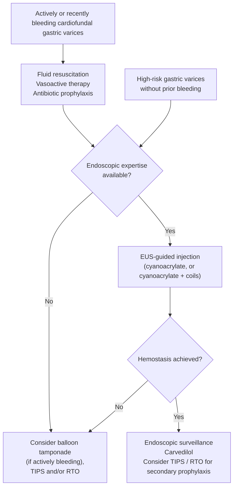

> **[[baveno-viii-2026-portal-hypertension|Baveno VIII (2026)]] supersedes [[baveno-vii-2022-portal-hypertension|Baveno VII]].** Where they differ this page states the VIII position and names what changed. Notable for this page: the pre-emptive transjugular intrahepatic portosystemic shunt (TIPS) band, a **24-hour** vasoactive option, individualized antibiotic duration, the removal of the numeric salvage-TIPS futility rule, endoscopic ultrasound (EUS)–guided coil + glue for cardiofundal varices, and endoscopic variceal ligation (EVL) over argon plasma coagulation (APC) for [[gastric-antral-vascular-ectasia|gastric antral vascular ectasia (GAVE)]].
>
> ⚠ **Two 2026 tier-1 documents now cover this page and they are not identical.** [[asge-2026-esophageal-gastric-varices|ASGE 2026]] (accepted 20 July 2026) and Baveno VIII (accepted 30 July 2026) share a publication year, so neither supersedes the other by date. Where they differ — **endoscopy timing (24 h vs 12 h)**, **vasoactive duration (2–3 d vs 2–5 d)**, and **the bridge in refractory bleeding (either device vs covered stent preferred)** — this page states **both positions side by side** rather than picking one. Everywhere else ASGE 2026 adds detail Baveno does not carry: prophylactic intubation, esophageal stent selection, coil sizing, and the gastric-varix pre-procedure workup.

## Definition / Scope

Acute variceal hemorrhage (AVH) refers to hemorrhage from esophageal or gastric varices in the setting of [[portal-hypertension|portal hypertension]] (PH), most commonly due to [[cirrhosis]]. Even with modern therapy, **6-week mortality is 10–15%** ([[aasld-2023-portal-hypertension]]) — and 6-week mortality is the recommended study endpoint (Baveno VIII 5.15), with **Child-Pugh class C, Model for End-Stage Liver Disease (MELD) and its variants (MELD-Na, MELD 3.0), and failure to control bleeding** as the key risk factors for it (5.17).

**Operative definitions ([[baveno-viii-2026-portal-hypertension|Baveno VIII]] 5.1–5.2, 5.16):**

- **Acute variceal bleeding (AVB)** = blood emanating from a varix (**spurting or oozing**); **or** varices with **signs of recent bleeding** (clots, white nipple sign); **or** varices with **no other bleeding source** in a patient with upper gastrointestinal (GI) bleeding and **blood in the stomach**
- **Active bleeding at endoscopy** = blood coming from a varix (spurting, oozing) — the finding that, with Child-Pugh B >7, triggers pre-emptive TIPS. ⚠ **Interobserver agreement for this call is only moderate** (5.2), so a borderline read should not be treated as a hard boundary
- **Treatment failure** = uncontrolled bleeding **or** rebleeding within **5 days** (5.16)

**Which varices are "high-risk" — the size and stigmata cut-points** ([[asge-2026-esophageal-gastric-varices|ASGE 2026]]):

| | High-risk if |
|---|---|
| **Esophageal varices** | Moderate/large size, **or any size with high-risk bleeding stigmata** (red wale signs, cherry-red spots) |
| **Gastric varices** | Actively bleeding, **or** previously bled, **or** high-risk bleeding stigmata, **or** **>10 mm** in size |

*The >10 mm gastric cut-point is what selects a patient for the [[#Cardiofundal Varices (GOV2/IGV1) — the Bimodal Pathway]] even in the absence of bleeding.* ASGE also fixes the timing vocabulary used below: **emergent** endoscopy = within **12 hours** of presentation to hospital; **urgent** = within **24 hours**.

**[[hepatic-venous-pressure-gradient|Hepatic venous pressure gradient (HVPG)]] thresholds as the sources actually state them:**

- **≥10 mmHg = clinically significant portal hypertension (CSPH)** — the pressure at which portosystemic collaterals form and decompensation typically begins (American Association for the Study of Liver Diseases [AASLD] 2023; Baveno VII 1.10, retained as still valid in Baveno VIII). *(>5 mmHg merely indicates sinusoidal PH.)*
- **≥20 mmHg at the time of haemorrhage** = high risk for treatment failure and a preemptive-TIPS criterion (Baveno VIII 5.31 — **changed from Baveno VII's >20 mmHg**; the boundary value itself now qualifies).
- **<12 mmHg is a post-TIPS haemodynamic target**, not a bleeding-risk threshold — see step 6.

Distinct from non-variceal [[upper-gi-bleeding|upper GI bleeding (UGIB)]] (peptic ulcer, Mallory-Weiss, Dieulafoy) in management priorities: vasoactive agents, [[antibiotic-prophylaxis-cirrhosis|antibiotic prophylaxis]], and early [[tips|TIPS]] consideration are specific to variceal hemorrhage. See [[portal-hypertension]] for PH staging (compensated advanced chronic liver disease [cACLD]/CSPH), surveillance decisions, and primary prophylaxis.

## Differential Diagnosis

In a cirrhotic patient with UGIB, consider:

- **Esophageal varices** — most common (~70% of variceal bleeds)
- **Gastric varices** — fundal (gastroesophageal varices type 2 [GOV2]/isolated gastric varices type 1 [IGV1]) carry higher rebleed risk; often require different intervention (glue, balloon-occluded retrograde transvenous obliteration [BRTO], TIPS)
- **Portal hypertensive gastropathy (PHG)** — diffuse oozing, not brisk hemorrhage; may cause chronic blood loss
- **[[peptic-ulcer-disease|Peptic ulcer disease]]** — cirrhosis increases risk ([[helicobacter-pylori-infection|H. pylori]], nonsteroidal anti-inflammatory drugs [NSAIDs], impaired mucosal defense)
- **Mallory-Weiss tear** — especially with retching/vomiting
- **GAVE** — antral lesion, usually chronic occult loss presenting as iron-deficiency anemia

## Diagnostic Algorithm

**Immediate (before endoscopy) — steps 1–4 must occur in parallel, not sequentially:**

1. **Resuscitation**: Large-bore intravenous (IV) access × 2; airway assessment (intubate if Glasgow Coma Scale [GCS] altered/aspiration risk before endoscopy). Transfuse packed red blood cells (pRBCs) to target hemoglobin (Hgb) **~7 g/dL** — restrictive strategy (AASLD guidance statement [GS] 28). **Baveno VIII 5.4 states the target as a band, 7–8 g/dL**, individualized for cardiovascular disorders, age, haemodynamic status, and ongoing bleeding — the same restrictive principle with an explicit ceiling.
   - **The qualifier is the decision:** ~7 g/dL applies **in the absence of comorbidities (e.g. ischemic coronary disease) or hemodynamic instability that might merit higher targets** — AASLD's own wording. Do not apply 7 g/dL to the unstable or the cardiac patient.
   - **No fresh frozen plasma (FFP) and no platelet transfusions** based on international normalized ratio (INR) or platelet count targets — INR does not predict hemostatic dysfunction; no evidence of benefit, and evidence of potential **harm** from FFP (GS 29).
   - The restrictive-transfusion randomized controlled trials (RCTs) underlying this are AASLD refs 166–167; only AASLD's guidance statement is cited here. ([[aasld-2023-portal-hypertension]])

2. **Start vasoactive therapy immediately** (GS 25): do not wait for endoscopy. Initiate as soon as variceal bleeding is *suspected*, before diagnostic/therapeutic endoscopy ([[aga-2024-vasoactive-albumin-cirrhosis|American Gastroenterological Association (AGA) 2024 clinical practice update (CPU)]], best practice advice [BPA] 1); **octreotide is the agent of choice in the US** based on its safety profile (BPA 3).
   - **[[somatostatin-analogs|Octreotide]]:** 50 mcg IV bolus → 25–50 mcg/hr infusion × 2–5 days (additional IV boluses may be given for ongoing bleeding — [[aga-2024-vasoactive-albumin-cirrhosis]])
     - ⚠ *Guidelines differ on the infusion rate:* [[aasld-2023-portal-hypertension]] Table 5 gives **25–50 mcg/hr**; [[aga-2024-vasoactive-albumin-cirrhosis]] (newer) gives a flat **50 mcg/hr**. The AGA figure sits inside the AASLD range, so either is defensible.
   - **Somatostatin:** 250 mcg IV bolus → 250–500 mcg/hr × 2–5 days
   - **[[terlipressin|Terlipressin]]** (not FDA approved in US for AVH): 2 mg IV q4–6h × 24–48h, then 1 mg q4–6h × 2–5 days
   - Continue vasoactive therapy if PH bleeding confirmed on endoscopy (GS 26); **stop the drug if endoscopy reveals a non-variceal source**.
   - **Duration — [[baveno-viii-2026-portal-hypertension|Baveno VIII]] 5.7–5.8:** continue **2–5 days, *or until a TIPS (if indicated) is placed***. **A shorter course — even 24 hours — can be considered after successful endoscopic haemostasis, *provided [[nonselective-beta-blockers|nonselective beta-blocker (NSBB)]] treatment is then initiated*.** The NSBB proviso is the decision: stopping the drip early is only safe if the beta-blocker takes over.
     - ⚠ **Changed from Baveno VII 6.5**, which gave a flat 2–5 days with no early-stop option and no TIPS clause. AASLD's "may shorten to 2 days in selected low-risk patients" sits between the two.
     - ⚠ **[[asge-2026-esophageal-gastric-varices|ASGE 2026]] goes shorter and states it as the rule, not an option: 2–3 days is sufficient** for bleeding varices or other portal-hypertensive bleeding (conditional, low certainty) — and it attaches **no NSBB proviso**. Across 14 RCTs, short course (<3 d) vs long (3–5 d) showed no difference in recurrent bleeding at 5 d (risk ratio [RR] 0.79; 95% CI, 0.37–1.65) or at 30–42 d (RR 0.77; 0.46–1.30, *moderate* certainty), none in mortality (RR 1.03; 0.62–1.71), and **shorter length of stay with the short course** (mean difference −1.12 days; −1.42 to −0.30). ASGE also changed its own prior position here: **the 2014 ASGE guideline said 3–5 days.**
     - ⚠ **The one exception that lengthens the course: sclerotherapy.** In a subgroup analysis, a *shorter* vasoactive duration after sclerotherapy produced **more recurrent bleeding and greater mortality** — attributed to an acute rise in portal pressure lasting **up to 5 days** after sclerotherapy. **Give 5 days of vasoactive therapy to a patient treated with sclerotherapy** ([[asge-2026-esophageal-gastric-varices]]).

3. **Start IV antibiotics immediately** (GS 27): **Ceftriaxone 1 g IV q24h up to 5 days** (preferred; especially in Child-Pugh C or high-resistance settings). Norfloxacin 400 mg by mouth (PO) twice daily (BID) × 7 days (alternative in low-resistance, Child-Pugh A/B). De-escalate once bleeding controlled and no active infection. See [[#Antibiotic Prophylaxis]] for the duration controversy.
   - **Baveno VIII 5.10–5.11:** preventive antibiotics are recommended **at presentation**, but **duration and need can be individualized by infection risk and cirrhosis severity — Child-Pugh A patients may need only a shorter course or none at all.** The preferred class is **3rd-generation cephalosporins**, subject to local resistance patterns and antimicrobial policy.
   - ⚠ **Baveno no longer supplies the dose.** Baveno VII 6.9 named **ceftriaxone 1 g/24 h**; VIII names only the class. The **1 g q24h figure above now rests on [[aasld-2023-portal-hypertension]] GS 27**, not on Baveno.

4. **Risk stratify** using Child-Pugh and MELD (see [[cirrhosis]] for the Child-Turcotte-Pugh (CTP)/MELD-Na criteria themselves). The purpose is to identify preemptive-TIPS candidates — criteria in step 6.

5. **Endoscopy within 12 hours** of presentation (GS 30; Baveno VIII 5.18 — if haemodynamically unstable, as soon as possible depending on local availability):
   - ⚠ **[[asge-2026-esophageal-gastric-varices|ASGE 2026]] suggests within 24 hours instead** (conditional, very low certainty), **with timing then individualized to the clinical presentation** — resuscitation status, haemodynamic status, and clinical suspicion of ongoing active bleeding. This reverses ASGE's own 2014 guideline, which said 12 hours. In 6 observational studies of endoscopy <12 h vs not, nothing separated the groups: mortality RR 0.72 (95% CI, 0.38–1.38), recurrent bleeding RR 1.04 (0.55–1.95), hemostasis RR 0.56 (0.27–1.15), length of stay −0.28 days — all very low certainty.
   - **The two documents are not as far apart as the numbers look.** ASGE's reason for widening the window is explicitly *not* to delay care: the panel's stated concern is **not under-resuscitating a patient in order to perform an emergent endoscopy**, while equally **not delaying endoscopy in hemorrhagic shock or ongoing active bleeding after initial resuscitation**. Both documents therefore converge on *as soon as possible* in the unstable patient; they differ on the default for the stabilized one. **Resuscitate first, then scope** — the 24-hour figure is a ceiling, not a target.
   - IV erythromycin before [[upper-endoscopy|esophagogastroduodenoscopy (EGD)]] improves visualization. **Baveno VIII 5.20 specifies a single IV dose of 250 mg, 30–90 minutes before endoscopy** (Baveno VII 6.19 said 30–120 min; AASLD gives 125–250 mg over 30–120 min). Contraindicated with QT prolongation; benefit includes reduced transfusion requirement
   - **Esophageal varices and GOV1 → EVL** ([[endoscopic-band-ligation|band ligation]]; GS 31, Baveno VIII 5.29); preferred over sclerotherapy
   - **Gastric/fundal varices (GOV2/IGV1)** → do NOT band; see [[#Cardiofundal Varices (GOV2/IGV1) — the Bimodal Pathway]]
   - **Not first-line for AVB:** haemoclips, over-the-scope clips, **topical haemostatic agents/powders**, and fibrin (Baveno VIII 5.28)
   - Obtain **contrast-enhanced cross-sectional imaging (computed tomography [CT] or magnetic resonance imaging [MRI]) in every AVB** — to exclude portal/splanchnic vein thrombosis and [[hepatocellular-carcinoma|hepatocellular carcinoma (HCC)]] and to map portosystemic collaterals (Baveno VIII 5.30); AASLD GS 44 requires it specifically for gastric/ectopic bleeds
   - **Uncontrolled bleeding** → bridge to TIPS. **Baveno VIII 5.35 now prefers a dedicated covered self-expanding metal stent (cSEMS) *over* balloon tamponade** — Baveno VII 6.29 called them equally efficacious with SEMS the safer option; VIII states a preference

6. **Preemptive TIPS** (GS 32) — within **72 hours, ideally within 24 hours** of index EGD:
   - **AASLD indications:** CTP class B score >7 with active bleeding on endoscopy, OR CTP class C score 10–13
   - **[[baveno-viii-2026-portal-hypertension|Baveno VIII]] 5.31 — any one of: CTP class C 10–13 points; CTP class B >7 with active bleeding at initial endoscopy; HVPG ≥20 mmHg at the time of AVB.** ⚠ *Changed from Baveno VII 6.27, which said CTP **C <14** and HVPG **>**20 mmHg. The CTP band now matches AASLD; the HVPG limb remains Baveno-only.* Figure 3 adds a candidate profile of **age <75 y, creatinine <3 mg/dL, no heart failure**
   - **Missed the 72 h window → still worth doing** (5.32, new): **within 2 weeks** for CTP C 10–13, **within 1 week** for CTP B >7 with active bleeding
   - **Not absolute contraindications** (5.33): [[acute-on-chronic-liver-failure|acute-on-chronic liver failure (ACLF)]], overt hepatic encephalopathy (HE), hyperbilirubinaemia, **MELD score**, or **severe alcohol-related hepatitis** — VIII adds the last two to the Baveno VII list
   - ⚠ **The numeric futility rule is withdrawn.** Baveno VII 6.31 (CTP ≥14, or MELD >30 with lactate >12 mmol/L) is replaced by **Baveno VIII 5.37: salvage TIPS should be discussed for any refractory variceal bleeding regardless of age, Child-Pugh and MELD scores, case-by-case.** [[aasld-2024-tips]] GS 23 still carries the old thresholds; the newer Baveno VIII position governs, and a replacement futility score is a research priority (RA5.13)
   - **Refractory overt HE after TIPS → may be prioritised for [[liver-transplantation|liver transplantation]]** (5.34)
   - Haemodynamic target: post-TIPS portal pressure gradient (PPG) **<12 mmHg** (near-complete protection from PH bleeding); ≥50% relative reduction may also suffice (Baveno VII 1.23, retained)
   - If TIPS not locally available → transfer to capable center
   - PREVENT and TRANSJIP-1 trials: preemptive TIPS significantly improves bleeding control and survival vs. standard pharmacologic + endoscopic therapy

7. **Post-endoscopy care** (patients NOT receiving preemptive TIPS):
   - Start **NSBB** (carvedilol 6.25 mg daily → 12.5 mg/day) at **discontinuation of vasoactive therapy** (GS 33) — full titration, down-titration (systolic blood pressure <90 mmHg), and CTP B/C dose caveats live on [[portal-hypertension]]
   - **Discontinue [[proton-pump-inhibitors|proton pump inhibitor (PPI)]]** once portal-hypertension–related bleeding is confirmed as the source (unless a strong indication to continue; GS 37, Baveno VIII 5.14)
   - Start **[[nutrition-in-liver-disease|enteral nutrition]]** once AVH episode controlled; variceal bands do NOT contraindicate nasogastric (NG) tube placement (GS 36)
   - **Consider iron supplementation for blood-loss anaemia** before discharge (Baveno VIII 5.27, new; Figure 3 gives the trigger as **Hb <10 g/dL**)

8. **Salvage/Rescue TIPS** (GS 35): Uncontrolled AVH despite vasoactive + EVL ("salvage") or rebleed ("rescue"). **Baveno VIII 5.36–5.37:** salvage TIPS is the best management of failure to control bleeding despite combined pharmacological and endoscopic therapy, and **should be discussed for any refractory variceal bleeding regardless of age, Child-Pugh and MELD scores** — see the futility note in step 6
   - Bridge to TIPS: **covered SEMS preferred over balloon tamponade** (Baveno VIII 5.35)

9. **Secondary prophylaxis** (GS 38–39):
   - Patients who did NOT receive preemptive TIPS: **NSBB + EVL** (repeat EVL every 2–4 weeks until obliteration). **Baveno VIII 4.8 prefers carvedilol over conventional NSBB**, independent of what was used for primary prophylaxis
   - TIPS as secondary prophylaxis only when additional TIPS indication exists (e.g., refractory [[ascites]]; GS 39); **TIPS should be considered when PH bleeding recurs despite carvedilol/cNSBB + EVL** (Baveno VIII 4.13)
   - **Post-EVL ulcer bleeding** (Baveno VIII 5.47, new): rare but serious; management is individualised and may require vasoactive therapy, endoscopic haemostasis, temporary stenting or tamponade, and **rescue TIPS with embolisation** — **high-risk patients are those with MELD >18 or an emergency EVL**. **Routine [[proton-pump-inhibitors|PPI]] to prevent post-EVL ulcers is not supported** by current evidence (5.48)

**Baveno VIII additions to the bundle** [[baveno-viii-2026-portal-hypertension]]:

- **[[lactulose|Lactulose]] (oral or enema)** is recommended to prevent **or treat** overt HE by accelerating blood elimination from the gut (5.22)
- **Do not chase the coagulopathy** — the target is portal pressure, not INR. **No routine FFP** (5.23); **no recombinant factor VIIa and no tranexamic acid** (5.25). **Platelet count and fibrinogen do not correlate** with failure to control bleeding or rebleeding and **their transfusion is not routinely recommended** — but **if bleeding is not controlled, platelet transfusion or fibrinogen supplementation may be considered** (5.24). See [[cirrhosis-hemostasis]]
- **[[anticoagulation-gi-bleeding|Anticoagulants]]** are held temporarily until bleeding is controlled; **timing of re-initiation** is individualised to the strength of the indication (5.26)
- **Nutrition:** malnutrition worsens AVB outcomes — start oral nutrition as soon as possible (5.12); handle the airway and NG tubes cautiously given **aspiration and pulmonary infection** risk (5.13)
- **Intubate before endoscopy** for altered consciousness or active haematemesis (5.5); **extubate as quickly as possible afterwards** (5.6)
- **Terlipressin → monitor sodium** for hyponatraemia (5.9)
- Manage in an **intensive or intermediate care unit** (5.21); centres with a hepatology service should have **24/7 on-call endoscopist and assistant staff** proficient in variceal haemostasis (5.19)
- **HCC alone may not preclude treatment** — decide within a multidisciplinary framework, accounting for futility criteria that relate to **both liver function and tumour prognosis** (5.46)
- **Cirrhosis + [[portal-vein-thrombosis|portal vein thrombosis (PVT)]]:** manage AVB as in patients without PVT; in selected patients **TIPS ± portal vein recanalisation** when other portal-hypertension factors are present (ascites, documented PVT progression) or the patient is a transplant candidate (5.45)

## Key Tests

| Test | Purpose |
|------|---------|
| Complete blood count (CBC), basic metabolic panel (BMP), liver function tests (LFTs), coagulation (prothrombin time [PT]/INR) | Severity, coagulopathy |
| Blood cultures × 2 | Bacteremia (obtain before antibiotics) |
| Urinalysis | Rule out urinary tract infection (UTI) as precipitant |
| MELD, Child-Pugh score | Prognosis, TIPS candidacy |
| Abdominal ultrasound with Doppler | Portal vein patency, splenomegaly, [[ascites]] |
| EGD (within 12 hours) | Diagnosis + treatment |
| HVPG (if available) | **≥20 mmHg** = high-risk; a pre-emptive TIPS criterion |
| Contrast-enhanced CT or MRI | **Every** AVB — exclude portal/splanchnic vein thrombosis and HCC, map portosystemic collaterals |

## Red Flags / Alarm Features

- Hemodynamic instability not responding to resuscitation → emergent endoscopy/TIPS consultation
- Active spurting at endoscopy with failed EVL → surgical/interventional radiology (IR) consult for rescue TIPS or shunt
- CTP class C (score 10–13), or CTP class B >7 with active bleeding at endoscopy, or **HVPG ≥20 mmHg** → preemptive TIPS within 72 hours (ideally <24 h); **within 2 weeks (CTP C 10–13) or 1 week (CTP B >7 + active bleeding) if the window was missed**. **MELD is not an indication** — AASLD notes only that retrospective series show high mortality despite intervention at **MELD >19**, where early TIPS still beats standard therapy and transplant candidacy should be assessed promptly
- Fundal/cardiofundal gastric varices (GOV2, IGV1) → do not band; require glue or BRTO/TIPS
- [[hepatic-encephalopathy|Encephalopathy]] → cautious [[endoscopy-sedation|sedation for endoscopy]]; lactulose/[[rifaximin]]; avoid over-transfusion
- Rebleed within 5 days → high mortality; escalate to TIPS

## Airway — Prophylactic Intubation Before Endoscopy

**[[asge-2026-esophageal-gastric-varices|ASGE 2026]] suggests *against* prophylactic endotracheal intubation (PEI)** in cirrhosis presenting with suspected variceal bleeding (conditional, very low certainty). This reverses the 2014 ASGE guideline, which intubated **all** such patients periprocedurally.

- **PEI is defined narrowly** — endotracheal intubation performed *only* for the indication of protecting the airway before upper endoscopy. The recommendation touches nothing else.
- **Intubate anyway, and the guideline says so explicitly, for:** acute respiratory failure · inability to protect the airway · significantly impaired mental status · massive ongoing hematemesis. **A patient who cannot protect the airway because of ongoing emesis or mental-status change requires intubation.** *(Baveno VIII 5.5 — intubate for altered consciousness or active haematemesis — names the same exceptions, so the two documents agree in practice; Baveno VIII 5.6 adds: extubate as quickly as possible afterwards.)*
- **Why against** — PEI performed worse, never better, on every outcome that separated:

| Outcome | Population | Effect | 95% CI | Judgment |
|---|---|---|---|---|
| Overall mortality | Varices only (2 studies) | OR = 3.47 | 1.24–9.74 | Favors **no** PEI |
| Aspiration | All upper GI bleeding (7 studies) | OR = 3.85 | 1.46–10.15 | Favors **no** PEI |
| Aspiration | Varices only (2 studies) | OR = 4.90 | 0.53–39.91 | Favors **no** PEI |
| Length of hospital stay | All upper GI bleeding (7 studies) | Standard MD = 0.86 | 0.13–1.59 | Favors **no** PEI |
| Overall mortality | All upper GI bleeding (7 studies) | OR = 1.92 | 0.71–5.23 | Neither |

  *All very low certainty. OR, odds ratio; MD, mean difference.*
- **Decide case by case with anesthesia and critical care** before endoscopy, on resuscitation status, mental status, haemodynamic status, and presence or absence of active bleeding.
- ⚠ The studies were **adult** populations; the suggestion may not apply to pediatric and adolescent patients.

## Refractory Esophageal Variceal Bleeding — the Bridge

**20% of patients with bleeding esophageal varices are refractory to initial attempts at hemostasis** ([[asge-2026-esophageal-gastric-varices]]).

**ASGE 2026 suggests *either* a fully covered esophageal stent *or* balloon tamponade as a bridge, chosen on institutional expertise**, until definitive therapy (e.g., [[tips|TIPS]]) can be performed (conditional, very low certainty). ⚠ **Baveno VIII 5.35 instead states a preference for a dedicated covered self-expanding metal stent (cSEMS) over balloon tamponade** (step 5 above). The disagreement is about confidence, not direction — ASGE declines to prefer stents because the only randomized evidence used a device unavailable in the United States, and because stent placement typically requires advanced-endoscopy training that the physicians managing variceal bleeding often do not have.

**The single RCT** (9 hospitals in Spain; 28 patients — 13 stent, 15 balloon tamponade; median indwelling stent time 5 days):

| Outcome | Esophageal stent | Balloon tamponade | *P* |
|---|---|---|---|
| Immediate hemostasis | 66% | 20% | .025 |
| Recurrent bleeding at 15 days | 15% | 53% | .037 |
| Device-related serious adverse events | 8% | 40% | .049 |
| 6-week mortality | 46% | 60% | .46 |

*Refractory bleeding* in that trial = failure to control bleeding after pharmacologic **and** endoscopic therapy; *massive variceal bleeding* = persistent haemodynamic instability despite attempted volume resuscitation. The device was an SX-ELLA nitinol stent (25-mm body, 30-mm flare, 135-mm length, gastric balloon in the delivery system, placed over a guidewire without fluoroscopy or endoscopy, approved up to 7 days) — **not available in the United States**.

**If a stent is used — the selection rules:**

- **Fully covered self-expandable metal stents only.**
- **Largest available diameter**, to maximise mechanical varix compression.
- Position so **at least two-thirds of the stent lies within the esophagus**.
- **Do not place a stent for known or suspected gastric variceal bleeding** — a stent cannot tamponade gastric varices.
- **Bridge only.** Place as a bridge to definitive therapy, then **remove endoscopically**.
- **Ongoing bleeding despite the stent → balloon tamponade and/or emergent TIPS.**
- Other risks: stent migration, esophageal ulceration.
- ⚠ Availability of **fluoroscopy** for deployment may dictate which stents can be used.

## Cardiofundal Varices (GOV2/IGV1) — the Bimodal Pathway

**Baveno VIII 5.38–5.41 restructures gastric variceal bleeding.** The **Sarin classification** (GOV1/2, IGV1/2) is formally recommended to harmonise reporting, stratify bleeding risk, and inform therapy (5.38) — type definitions live on [[portal-hypertension|portal hypertension → Gastric and Ectopic Varices]].

Bleeding from **GOV2 or IGV1 is a high-risk event** requiring **rapid, structured, multidisciplinary** management, treated in **two phases that may run in parallel — or, if staged, with the shortest possible interval between them** (5.39):

| Phase | Goal | Options |
|---|---|---|
| **Acute** | Immediate haemostasis | **Conventional endoscopic cyanoacrylate injection** *or* **EUS-guided therapy** — similarly effective for controlling bleeding and preventing early rebleeding. **Where available, EUS-guided coil + cyanoacrylate may be recommended in experienced centres**: higher variceal obliteration rates, less late rebleeding, less reintervention (5.40) |
| **Definitive** | Durable bleeding control and prevention of further decompensation | **[[tips\|TIPS]] ± variceal embolisation, performed as soon as possible — the preferred option** (5.41). If TIPS is contraindicated: **transvenous obliteration**, endoscopic therapies (including [[endoscopic-ultrasound\|EUS]]-guided), or surgical methods, chosen by expertise, anatomy and bleeding site after multidisciplinary discussion |

- **Ectopic varices:** either endovascular (TIPS or transvenous obliteration) or endoscopic treatment (5.42)

**[[asge-2026-esophageal-gastric-varices|ASGE 2026]] turns "EUS-guided therapy may be recommended in experienced centres" into a ranked order.** All three statements are conditional, very low certainty:

*Figure — management of high-risk gastric varices. Before therapy, a stable patient without ongoing bleeding should have the pre-procedure workup below and a multidisciplinary discussion. Where EUS-guided injection expertise is unavailable, direct endoscopic injection can be performed. ([[asge-2026-esophageal-gastric-varices]], recreated from Figure 2)*

1. **EUS-guided injection (EUS-I) over direct endoscopic injection (DEI)** for high-risk gastric varices. Across 23 studies (851 EUS-I vs 3467 DEI patients): **obliteration 0.84 vs 0.63** (95% CI, 0.75–0.91 vs 0.43–0.79; *P* = .02, favors EUS), recurrence 0.09 vs 0.18 (*P* = .06, leans EUS), technical success 0.94 vs 0.91 and early/late rebleeding **not** separated.
2. **EUS-cyanoacrylate (CYA) + coils over EUS-CYA alone, when feasible.** Versus DEI, the coil+glue subgroup widened the gap: obliteration **0.88 vs 0.63** (*P* = .02), recurrence **0.05 vs 0.18** (*P* = .01). Head-to-head against EUS-CYA alone in an RCT of Sarin IGV1/GOV2 varices (reassessed at 12 weeks, retreated if needed), coils gave similar obliteration and adverse events but **reintervention 20.8% vs 53.8%** (*P* = .03), **time to reintervention 44 vs 25 weeks** (*P* = .01), **survival 48 vs 42 weeks** (*P* = .04) and **glue volume 1.5 vs 3.5 cm³** (*P* < .001). **1 to 4 coils** per patient.
3. **If EUS-guided intervention is not available, DEI can be performed.** A lack of local EUS-I or DEI expertise **must not delay bleeding management** — an unstable patient with ongoing gastric variceal bleeding may need radiologic intervention or balloon tamponade for initial hemostasis instead.

**Pre-procedure workup in the *stable* patient** (before any gastric variceal intervention) — [[asge-2026-esophageal-gastric-varices]]:

- **3-phase CT of the abdomen and pelvis** — look for a **large splenorenal shunt**, which represents a higher risk of systemic embolization.
- **Transthoracic echocardiogram with bubble agitation study** — assess for a **patent foramen ovale**.
- Discuss both results with interventional radiology, hepatology and/or transplant surgery before choosing therapy.

**Coil and needle mechanics** — [[asge-2026-esophageal-gastric-varices]]:

- Deploy coils **approximately 20%–30% greater in diameter than the varix**.
- **22-gauge needle → 0.018-inch coil only. 19-gauge needle → 0.018-inch *or* 0.035-inch coils.**
- ⚠ **Protect the scope and the needle:** CYA can polymerize inside the **working channel** of the EUS scope, occlude the fine-needle aspiration needle, or cause the **needle to stick within the varix**. Review the avoidance technique before starting.
- ⚠ **Embolization is the adverse event to brief for** — pulmonary, coronary and neurovascular thromboembolism after EUS-CYA with or without coils, plus **asymptomatic ectopic pulmonary embolism**. Reported rates are low but the panel asks endoscopists to be alert to it.

**[[endoscopic-ultrasound|EUS]]-guided injection over retrograde transvenous obliteration (RTO) for *initial* management** — ASGE 2026, conditional/very low. The mechanistic trade-off: EUS-I directly obliterates the varices but **they can re-form, because portal hypertension persists**; RTO **may worsen ascites or esophageal varices** by increasing portal pressure and flow. In a multicentre propensity-matched analysis, EUS-I vs RTO gave **periprocedural adverse events 5.1% vs 22.0%** (*P* = .007), **worsening ascites 0% vs 15.3%** (*P* = .003) and **unplanned intervention for worsening esophageal varices 1.7% vs 16.9%** (*P* = .008) — at the cost of **more reintervention for the gastric varices themselves, 28.8% vs 5.1%** (*P* = .001). ⚠ The panel raised the counter-argument against its own advice: **RTO may be more commonly available than EUS intervention for gastric varices.** Know which expertise exists locally before offering either.

**After successful endoscopic hemostasis, bring radiology back into the conversation** — ASGE 2026 suggests **multidisciplinary discussion to consider pre-emptive TIPS or other radiologic intervention** (conditional/very low):

- **Pre-emptive TIPS RCT** (previously DEI-treated bleeding gastric varices, randomized to continued glue + [[nonselective-beta-blockers|NSBB]] vs pre-emptive TIPS): **free from death or recurrent bleeding at 1 year 77% vs 37%** (*P* < .0001), with **similar** rates of jaundice, ascites, infection, encephalopathy and further decompensation.
- **Choosing TIPS vs RTO by anatomy** — an RCT of balloon-assisted retrograde transvenous obliteration (BRTO, where an amenable shunt was present) or TIPS (where it was not) vs endoscopy alone, excluding intractable ascites and portal vein thrombosis: **gastric variceal rebleeding 2.2% vs 24.4%** (*P* = .04) and **variceal-bleeding-related mortality 2.2% vs 17.8%** (*P* = .03) favouring the radiologic arms. The cost of each: **hepatic encephalopathy 30% vs 6.7%** in the TIPS group (*P* = .020) — **medically manageable**; **ascites 36% vs 4.4%** in the BRTO group (*P* = .001) — **diuretic responsive**. **26.7% of the glue-only arm needed a second session**; only one patient in the radiologic arm needed further CYA.
- **BRTO was favoured over TIPS when an amenable shunt was present**, because a large spontaneous shunt diverts blood away from the TIPS and because gastric varices can bleed at lower pressures than a TIPS alone will prevent.
- **Patient factors that decide it:** presence of shunts and thromboses, Model for End-Stage Liver Disease with Sodium (MELD-Na) score, history of hepatic encephalopathy or intractable ascites. **Shunt-related encephalopathy → RTO with shunt closure. Poorly controlled ascites or large high-risk esophageal varices → TIPS, with or without RTO.** One panellist noted **RTO ultimately drives collateral formation elsewhere** in portal hypertension.
- ⚠ **Read the two trials with this caveat:** in both, patients randomized to endoscopic therapy **did not necessarily receive EUS-guided coils and glue**. Better endoscopic arms may narrow the gap.

**Temporizing vs definitive at the index endoscopy** ([[aga-2021-bleeding-gastric-varices|AGA 2021]] — ungraded Best Practice Advice; **outranked by Baveno VIII above wherever they speak to the same question**, but it is the only source for the items below):

- **Give a promotility agent and use a therapeutic endoscope or advanced suctioning device** — intragastric blood frequently obscures the cardia and fundus. **Classify the esophageal varices as well as the gastric ones** at the index exam: the definitive gastric varix (GV) therapies differ in their effect on subsequent esophageal varix (EV) bleeding risk.
- **Band ligation** achieves initial hemostasis in **45%–93%** but is inferior to cyanoacrylate for long-term control of cardiofundal GV → a reasonable **temporizing** measure that must be followed by definitive therapy. For **lesser-curve GV it is often the best definitive therapy**, given their similarity to EV.
- **Gastric compression balloons** (Sengstaken-Blakemore, Linton-Nachlas) are highly effective temporizing for cardiofundal and lesser-curve GV — ⚠ **inflate only the gastric balloon**, and proceed to definitive therapy as fast as possible; prolonged balloon tension precipitates mucosal breakdown. *(Baveno VIII 5.35 prefers a dedicated covered SEMS over balloon tamponade as the bridge to TIPS — see step 5.)*
- **Alcohol-based sclerotherapy (e.g. ethanolamine) is not recommended unless there is no other option** — marginal initial hemostasis, high early rebleeding, deep ulceration.
- **Cyanoacrylate injection is *not* recommended as a temporizing measure** absent other options: logistics limit its use at the index diagnostic exam, and undefined vascular anatomy (thrombosis, shunting) may affect the result.
- **Procoagulants (activated factor VII) are not recommended** — thrombotic risk, no efficacy data in GV bleeding.

**Cyanoacrylate injection — how it is done** [[aga-2021-bleeding-gastric-varices]]:

- **Prefer the fastest-polymerizing formulation** to avoid embolization: **4-carbon (butyl) preparations polymerize much faster than 8-carbon (octyl)** and have more supporting data.
- ⚠ **Do not add plant-based oils (lipiodol)** — radiographic confirmation of success is unnecessary and the additive may **increase distal embolization risk**. *([[asge-2026-esophageal-gastric-varices|ASGE 2026]] agrees and generalises it: ethiodized oil is **now generally avoided** because of embolization concerns.)*
- **The formulation sets the injection rate** ([[asge-2026-esophageal-gastric-varices]]): **n-butyl-2-CYA polymerizes fast → inject more rapidly** to avoid premature needle occlusion. **2-octyl CYA polymerizes slowly → lower occlusion risk but greater embolization concern → inject at a slower rate, and consider placing it after the coils.**
- **Flush the needle rapidly with sterile water or 5% dextrose in water immediately after glue injection** — crucial for timely glue delivery and needle clearance ([[asge-2026-esophageal-gastric-varices]]).
- **Gelfoam and thrombin** can also be injected under EUS guidance for variceal obliteration, but there is not yet enough published evidence to compare them with CYA ([[asge-2026-esophageal-gastric-varices]]).
- **Complications:** glue embolization (pulmonary embolus, stroke) **0.7%** in the largest series, clinically significant events very rare; needle impaction into the varix (case reports); exacerbation of bleeding (rare if glue is injected immediately after needle insertion); portal/splenic vein thrombosis (extremely rare); infection (mainly in actively bleeding patients, who receive antibiotic prophylaxis anyway).
- **No cyanoacrylate formulation is FDA-approved** as a long-term implant into vascularized human tissue.
- Perform **only** by endoscopists with specific training, with interventional radiology available for complications.

**Follow-up after definitive therapy — the schedules** [[aga-2021-bleeding-gastric-varices]]:

| After | Do this |
|---|---|
| **Cyanoacrylate injection** | Repeat endoscopy **every 2–4 weeks**, re-injecting as needed, **until obliteration is complete**. **Palpate a previously treated cardiofundal varix** with a blunt-tipped instrument or Doppler probe — areas that **dimple or invert merit repeat injection**. Lesser-curve GV: repeat band ligation as for EV eradication. Once eradicated: reassess **within 3–6 months, then yearly** |
| **[[tips\|TIPS]]** | **Endoscopy at 1 month** to confirm GV resolution — without direct obliteration, continued flow through cardiofundal GV is likely. Shrinking GV may need nothing further; **stable or enlarging cardiofundal GV merit subsequent BRTO** (favored — after TIPS, cyanoacrylate carries increased risk of glue embolization and portal vein thrombosis) **or direct embolization through the patent TIPS**. Persistent lesser-curve GV → repeat band ligation to eradication |
| **BRTO / transvenous obliteration** | **[[endoscopic-ultrasound\|EUS]] within 48 h** to confirm obliteration, assess EV exacerbation, and set a new baseline — **if residual vascular flow is detected, inject cyanoacrylate**. Unobliterated minimal areas usually thrombose spontaneously within **1–2 months**. Clinic visit + labs + **contrast-enhanced CT/MR at 4–6 weeks**, then **3 and 6 months**, and as clinically indicated. ⚠ **Esophageal varices are exacerbated after BRTO — up to 30%–35% progress in size** and are the commonest source of post-BRTO bleeding: **repeat upper endoscopy within 2 weeks if high-risk EV were present at BRTO, within 4–6 weeks if low-risk**, and treat per standard guidelines |
| **Any — de novo or recurrent GV on long-term (>12 mo) follow-up** | Repeat cross-sectional imaging and return to multidisciplinary discussion |

- ⚠ *Baveno VIII / [[aasld-2024-tips]] give a **72-hour** CT-or-EUS confirmation and a **1–2 month** follow-up endoscopy after retrograde transvenous obliteration (RTO) (see [[tips]]); the AGA CPU's 48-hour EUS and 2-/4–6-week EV-risk-stratified endoscopy are the older and more granular version. The newer documents govern the confirmation timing.*
- **Endovascular therapy is only for proven GV bleeding** — electively after, or emergently during, the first sentinel bleed. **No form of primary prophylaxis for GV was supported** at the time of this CPU, and **endoscopic classification systems must not be used to guide primary prophylaxis** (BPA 1). ⚠ **Superseded:** Baveno VIII 3.21b now permits local therapy for high-risk GOV2/IGV1 when NSBB is contraindicated — see [[portal-hypertension]].
- ⚠ **What changed:** [[aasld-2023-portal-hypertension]] GS 45 and [[aasld-2024-tips]] GS 26 list cyanoacrylate injection, TIPS, and RTO as three co-equal first-line options. Baveno VIII separates the question into *acute haemostasis* (endoscopic or EUS-guided, with **EUS-guided coil + glue preferred where available**) and *definitive therapy* (**TIPS ± embolisation preferred**), rather than treating them as alternatives to choose between once.

## Portal Hypertensive Gastropathy and GAVE

*Both lesions have their own pages — grading, prevalence and the full treatment sequence live there: [[portal-hypertensive-gastropathy]] and [[gastric-antral-vascular-ectasia|GAVE]]. What matters for a patient presenting with suspected variceal bleeding:*

- **Neither is a variceal lesion, and the pathways diverge** — **PHG** is diffuse and responds to portal-pressure reduction with NSBB (Baveno VIII 5.44, with [[tips|TIPS]] as the most effective rescue therapy for severe or refractory bleeding); **GAVE** is antral and responds to endoscopic ligation (Baveno VIII 5.43).
- ⚠ **PHG must be distinguished from GAVE at the index endoscopy** — the treatments differ (Baveno VI/VII, retained as still valid in Baveno VIII).
- **Acute bleeding from severe PHG** gets the same vasoactive therapy as variceal bleeding, for 2–5 days ([[aasld-2023-portal-hypertension]] GS 49) — so the resuscitation bundle above is not wasted if the source turns out to be PHG.

## Antibiotic Prophylaxis

Standard practice recommends prophylactic antibiotics to prevent bacterial infections ([[spontaneous-bacterial-peritonitis|spontaneous bacterial peritonitis (SBP)]], bacteremia) that independently worsen outcomes in variceal UGIB.

*Regimen and dosing: see step 3 of the [[#Diagnostic Algorithm]] — not repeated here. This section covers the **duration** question only.*

**Guideline position** ([[aasld-2023-portal-hypertension]], GS 27): ceftriaxone **1 g/24 h up to 5 days**, tailored to local resistance patterns and allergies; discontinue once bleeding is controlled and no active infection.

**Evolving evidence** ([[albhaisi-2025-prophylactic-antibiotics-cirrhosis]]): a 2025 systematic review (14 RCTs, n=1,322) — which characterizes standard practice as a **5–7 day** course — found shorter/no antibiotic courses are non-inferior to 5–7 days for all-cause mortality (97.3% probability of non-inferiority; risk difference 0.9%). However:

- Shorter courses associated with 15.2% higher bacterial infection rate
- Evidence quality is low (12/14 studies unblinded; 8/14 high risk of bias)
- Most data from Asia/Europe; US applicability uncertain
- Post-2004 data show stronger non-inferiority signals (modern endoscopy + intensive care unit [ICU] care)

**Current recommendation**: The 5–7 day duration recommendation is not supported by high-quality evidence. An individualized approach is reasonable — consider patient-specific factors (liver disease severity, local resistance patterns). Shorter durations (2–3 days) may be acceptable in lower-risk patients if prophylaxis is used.

**[[baveno-viii-2026-portal-hypertension|Baveno VIII]] 5.10 now says this in a guideline.** Antibiotics remain **recommended at presentation** (level of evidence [LoE] 1, strong), but **duration and need could be individualized based on infection risk and cirrhosis severity, "as Child-Pugh A patients may only require a shorter course or no therapy"** (LoE 2, weak). Baveno VII 6.8 had said only that prospective studies were still needed before antibiotics could be avoided in Child-Pugh A. An RCT of preventive antibiotics vs none in Child-Pugh A remains a research-agenda item (RA5.2) — so **do not omit prophylaxis outside a Child-Pugh A patient**, and document the reasoning when you do.

---

## See Also

[[portal-hypertension]], [[cirrhosis]], [[porto-sinusoidal-vascular-disorder]], [[tips]], [[upper-gi-bleeding]], [[acute-lower-gi-bleeding]], [[ascites]], [[spontaneous-bacterial-peritonitis]], [[hepatic-encephalopathy]], [[peptic-ulcer-disease]], [[helicobacter-pylori-infection]], [[liver-transplantation]], [[antibiotic-prophylaxis-cirrhosis]], [[somatostatin-analogs]], [[nutrition-in-liver-disease]], [[cirrhosis-hemostasis]], [[rifaximin]], [[upper-endoscopy]], [[hepatic-venous-pressure-gradient]], [[acute-on-chronic-liver-failure]], [[portal-vein-thrombosis]], [[endoscopy-sedation]], [[anticoagulation-gi-bleeding]], [[endoscopic-ultrasound]], [[hepatocellular-carcinoma]], [[proton-pump-inhibitors]], [[endoscopic-hemostasis]], [[argon-plasma-coagulation]], [[nonselective-beta-blockers]], [[terlipressin]], [[portal-hypertensive-gastropathy]], [[gastric-antral-vascular-ectasia]]

---

## Sources

1. [[asge-2026-esophageal-gastric-varices|ASGE Guideline on Management of Esophageal and Gastric Varices in Patients With Cirrhosis (2026)]]
2. [[baveno-viii-2026-portal-hypertension|Baveno VIII — Advancing Consensus in Portal Hypertension (2026)]]
3. [[albhaisi-2025-prophylactic-antibiotics-cirrhosis|Prophylactic Antibiotics for Upper GI Bleeding in Patients With Cirrhosis — Journal Club (Albhaisi)]]
4. [[aasld-2023-portal-hypertension|AASLD 2023 Practice Guidance on Portal Hypertension and Varices in Cirrhosis]]
5. [[baveno-vii-2022-portal-hypertension|Baveno VII — Renewing Consensus in Portal Hypertension (2022)]]
6. [[aga-2024-vasoactive-albumin-cirrhosis|AGA Clinical Practice Update on the Use of Vasoactive Drugs and Intravenous Albumin in Cirrhosis: Expert Review (2024)]]
7. [[aasld-2024-tips|AASLD Practice Guidance: TIPS, Variceal Embolization, and Retrograde Transvenous Obliteration (2024)]]
8. [[aga-2021-bleeding-gastric-varices|AGA Clinical Practice Update on Management of Bleeding Gastric Varices: Expert Review (2021)]]
