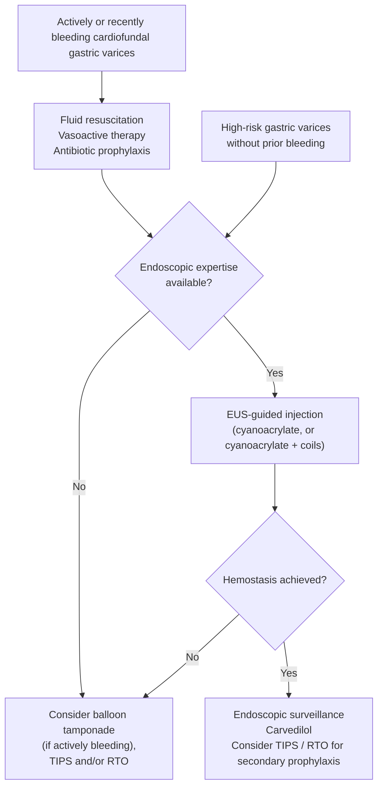

> **[[baveno-viii-2026-portal-hypertension|Baveno VIII (2026)]] supersedes [[baveno-vii-2022-portal-hypertension|Baveno VII]]**; changes are named inline. [[asge-2026-esophageal-gastric-varices|American Society for Gastrointestinal Endoscopy (ASGE) 2026]] and Baveno VIII share a publication year, so where they differ — **endoscopy timing**, **vasoactive duration**, **bridge device** — both positions are shown.

## Contents
- [[#Definition / Scope]]
- [[#Differential Diagnosis]]
- [[#Diagnostic Algorithm]]
  - [[#1. Resuscitation and Pre-Endoscopy Bundle]]
  - [[#2. Endoscopy]]
  - [[#3. Pre-emptive TIPS]]
  - [[#4. After Hemostasis and Secondary Prophylaxis]]
  - [[#Refractory Esophageal Variceal Bleeding]]
  - [[#Cardiofundal Varices (GOV2/IGV1) — the Bimodal Pathway]]
    - [[#Technique — Gastric Variceal Injection]]
    - [[#Follow-up After Definitive Therapy]]
  - [[#Portal Hypertensive Gastropathy and GAVE]]
- [[#Key Tests]]
- [[#Red Flags / Alarm Features]]
- [[#See Also]]
- [[#Sources]]

## Definition / Scope

- **Acute variceal hemorrhage (AVH):** bleeding from esophageal or gastric varices in [[portal-hypertension|portal hypertension (PH)]], usually [[cirrhosis]]. **6-week mortality 10–15%** [[aasld-2023-portal-hypertension]] — the recommended endpoint (Baveno VIII 5.15); risk factors: **Child-Pugh C, Model for End-Stage Liver Disease (MELD) and variants, failure to control bleeding** (5.17) [[baveno-viii-2026-portal-hypertension]].
- **Acute variceal bleeding (AVB)** = blood from a varix (spurting/oozing); **or** signs of recent bleeding (clot, white nipple sign); **or** varices with no other source plus blood in the stomach in upper gastrointestinal bleeding (5.1).
- **Active bleeding at endoscopy** = spurting/oozing from a varix — the pre-emptive [[tips|transjugular intrahepatic portosystemic shunt (TIPS)]] trigger with Child-Pugh B >7; interobserver agreement only moderate (5.2).
- **Treatment failure** = uncontrolled bleeding or rebleeding within **5 days** (5.16).
- **High-risk varices** (incl. ASGE's **>10 mm** gastric cut-point), PH staging, screening and primary prophylaxis: [[portal-hypertension]]. Pressure strata: [[hepatic-venous-pressure-gradient|hepatic venous pressure gradient (HVPG)]].
- Timing vocabulary (ASGE): **emergent** endoscopy ≤12 h, **urgent** ≤24 h of presentation [[asge-2026-esophageal-gastric-varices]].

## Differential Diagnosis

Upper gastrointestinal bleeding (UGIB) in cirrhosis — non-variceal workup: [[upper-gi-bleeding]].

- **Esophageal varices** — ~70% of variceal bleeds
- **Gastric varices** — cardiofundal (gastroesophageal varices type 2 [GOV2]/isolated gastric varices type 1 [IGV1]) rebleed more; need glue, [[variceal-obliteration|retrograde transvenous obliteration (RTO)]] or TIPS, not bands
- **[[portal-hypertensive-gastropathy|Portal hypertensive gastropathy (PHG)]]** — diffuse oozing, chronic loss
- **[[peptic-ulcer-disease|Peptic ulcer disease]]** — more common in cirrhosis ([[helicobacter-pylori-infection|H. pylori]], nonsteroidal anti-inflammatory drugs)
- **Mallory-Weiss tear** — after retching
- **[[gastric-antral-vascular-ectasia|Gastric antral vascular ectasia (GAVE)]]** — antral; usually occult iron-deficiency anemia

## Diagnostic Algorithm

*Steps 1–2 run in parallel — do not wait for endoscopy to start drugs.*

### 1. Resuscitation and Pre-Endoscopy Bundle

- **Access + transfusion:** two large-bore intravenous (IV) lines. **Restrictive transfusion — hemoglobin ~7 g/dL** (American Association for the Study of Liver Diseases [AASLD] guidance statement [GS] 28) / **7–8 g/dL** (Baveno VIII 5.4), **higher with coronary disease or hemodynamic instability** [[aasld-2023-portal-hypertension]] [[baveno-viii-2026-portal-hypertension]].
- **Don't chase the coagulopathy:** no fresh frozen plasma or platelets to international normalized ratio (INR)/platelet targets (GS 29; 5.23–5.24); no recombinant factor VIIa or tranexamic acid (5.25). **Uncontrolled bleeding →** platelets or fibrinogen may be considered (5.24). See [[cirrhosis-hemostasis]].
- **Airway:** intubate for altered consciousness, active hematemesis, respiratory failure or inability to protect the airway (5.5; ASGE); **otherwise ASGE suggests against prophylactic intubation** (conditional, very low; reverses ASGE 2014) — it was associated with higher mortality (odds ratio [OR] 3.47, 95% confidence interval [CI] 1.24–9.74, varices) and aspiration (OR 3.85, all UGIB). Decide with anesthesia/critical care; adult data only. **Extubate as soon as possible** (5.6) [[asge-2026-esophageal-gastric-varices]].
- **Vasoactive drug at suspicion**, before endoscopy (GS 25; American Gastroenterological Association [AGA] 2024 best practice advice 1) — **[[somatostatin-analogs|octreotide]] is the US agent of choice** (50 mcg IV bolus → 25–50 mcg/h; AGA gives 50 mcg/h) [[aga-2024-vasoactive-albumin-cirrhosis]]. Somatostatin and [[terlipressin]] doses on their pages; terlipressin → **monitor sodium** (5.9). **Stop if the source is non-variceal.**

| Vasoactive duration | Rule |
|---|---|
| AASLD 2023 / AGA 2024 | **2–5 d** (2 d reasonable in Child-Pugh A/B without active bleeding) |
| Baveno VIII 5.7–5.8 | **2–5 d or until TIPS**; **≥24 h** acceptable after endoscopic hemostasis **only if a nonselective beta-blocker (NSBB) is then started** |
| ASGE 2026 | **2–3 d** sufficient (conditional, low; no NSBB proviso) — ASGE 2014 said 3–5 d |
| After **sclerotherapy** | **5 d** — shorter courses → more rebleeding and death (ASGE 2026) |

- **Antibiotics at presentation:** **ceftriaxone 1 g IV q24h up to 5 d** (GS 27); Baveno VIII names only the class (3rd-generation cephalosporin) and allows a **shorter course or none in Child-Pugh A** (5.10–5.11). Shorter courses look non-inferior for mortality but with more infections ([[albhaisi-2025-prophylactic-antibiotics-cirrhosis]]). Duration evidence: [[antibiotic-prophylaxis-cirrhosis]].
- **Also:** [[lactulose]] (oral/enema) to prevent or treat hepatic encephalopathy (HE) (5.22); hold [[anticoagulation-gi-bleeding|anticoagulants]] until controlled, restart individualized (5.26); intensive/intermediate care unit (5.21); risk-stratify with Child-Turcotte-Pugh (CTP) and MELD ([[cirrhosis]]) to find pre-emptive TIPS candidates.

### 2. Endoscopy

- **Timing:** **≤12 h** (AASLD GS 30; Baveno VIII 5.18; as soon as possible if unstable) vs **≤24 h, individualized** (ASGE 2026, conditional, very low; reverses ASGE 2014) — no outcome difference in observational data.

> [!pearl] Resuscitate first, then scope
> ASGE's 24 h is a ceiling, not a target: don't under-resuscitate to make an emergent slot, and don't delay endoscopy in shock or ongoing bleeding once resuscitated ([[asge-2026-esophageal-gastric-varices]]).

- **Erythromycin 250 mg IV, single dose, 30–90 min before** esophagogastroduodenoscopy (EGD) (Baveno VIII 5.20; AASLD 125–250 mg, 30–120 min); avoid with QT prolongation.
- **Esophageal varices and GOV1 → [[endoscopic-band-ligation|endoscopic variceal ligation (EVL)]]**, over sclerotherapy (GS 31; 5.29).
- **GOV2/IGV1 → do not band** → [[#Cardiofundal Varices (GOV2/IGV1) — the Bimodal Pathway]].
- **Not first-line:** clips, over-the-scope clips, hemostatic powders, fibrin (5.28).
- **Contrast computed tomography (CT) or magnetic resonance imaging (MRI) in every AVB** — exclude portal/splanchnic vein thrombosis and [[hepatocellular-carcinoma|hepatocellular carcinoma (HCC)]], map collaterals (5.30; AASLD GS 44 for gastric/ectopic).
- **Uncontrolled bleeding →** bridge to TIPS: [[#Refractory Esophageal Variceal Bleeding]].

### 3. Pre-emptive TIPS

**Within 72 h (ideally <24 h) of index EGD — any one of** (AASLD GS 32; Baveno VIII 5.31):

- **CTP C 10–13 points**
- **CTP B >7 with active bleeding** at initial endoscopy
- **HVPG ≥20 mm Hg** at the time of bleeding (Baveno only; VII said >20 and CTP C <14)

Candidate profile age <75 y, creatinine <3 mg/dL, no heart failure (Baveno VIII Figure 3). Not locally available → transfer. Missed window (2 weeks CTP C / 1 week CTP B), non-contraindications (acute-on-chronic liver failure, overt HE, MELD, severe alcohol-related hepatitis), post-TIPS gradient target <12 mm Hg: [[tips]].

### 4. After Hemostasis and Secondary Prophylaxis

**No pre-emptive TIPS:**

- Start an **[[nonselective-beta-blockers|NSBB]]** (carvedilol) when vasoactive therapy stops (GS 33).
- **Stop [[proton-pump-inhibitors|proton pump inhibitor (PPI)]]** once a PH source is confirmed (GS 37; 5.14).
- **Feed early** — oral/enteral nutrition as soon as possible; bands don't contraindicate a nasogastric tube (GS 36; 5.12) → [[nutrition-in-liver-disease]].
- **Iron** for blood-loss anemia, trigger hemoglobin <10 g/dL (5.27).

**Secondary prophylaxis** [[baveno-viii-2026-portal-hypertension]] [[aasld-2023-portal-hypertension]]:

- **NSBB + EVL** (EVL q2–4 weeks to obliteration) — **carvedilol preferred over conventional NSBB**, whatever was used before (4.8; GS 38). Only one tolerated → that one alone (4.9).
- **Consider TIPS** when bleeding recurs despite NSBB + EVL (4.13); TIPS as secondary prophylaxis otherwise only if another TIPS indication exists, e.g. refractory [[ascites]] (GS 39). Bled **plus** another decompensating event and not a pre-emptive/rescue TIPS candidate → consider TIPS and [[liver-transplantation|liver transplantation]] (4.10).
- Post-EVL ulcer bleeding (higher risk with MELD >18 or emergency EVL; no routine PPI): [[endoscopic-band-ligation]].

**Special settings:** HCC alone may not preclude treatment — multidisciplinary, with futility weighed on liver function and tumour prognosis (5.46). Cirrhosis + [[portal-vein-thrombosis|portal vein thrombosis]]: manage as without; in selected patients TIPS ± recanalization (5.45).

### Refractory Esophageal Variceal Bleeding

**~20% of bleeding esophageal varices fail initial hemostasis** [[asge-2026-esophageal-gastric-varices]].

- **Salvage TIPS** is the best management when combined drug + endoscopic therapy fails (Baveno VIII 5.36; AASLD GS 35); **discuss it for any refractory bleed regardless of age, Child-Pugh or MELD** — the numeric futility rule (Child-Pugh ≥14, or MELD >30 + lactate >12 mmol/L) is withdrawn (5.37); [[aasld-2024-tips]] GS 23 still carries it → [[tips]].
- **Bridge:** ASGE 2026 — **fully covered esophageal stent *or* balloon tamponade**, by local expertise (conditional, very low). Baveno VIII 5.35 — **covered self-expanding metal stent (SEMS) preferred** over tamponade.
- Single randomized controlled trial (RCT), n=28, stent vs tamponade: hemostasis **66% vs 20%**, 15-day rebleeding **15% vs 53%**, device serious adverse events **8% vs 40%**, 6-week mortality 46% vs 60% (not significant); the device (SX-ELLA) is not available in the US.

> [!howto] Esophageal stent as a bridge
> 1. Fully covered SEMS only, **largest available diameter**.
> 2. Position with **≥2/3 of the stent in the esophagus**; fluoroscopy availability may dictate the stent.
> 3. **Never for suspected gastric variceal bleeding** — it cannot compress them.
> 4. Still bleeding → balloon tamponade and/or emergent TIPS.
> 5. Remove endoscopically after definitive therapy; watch for migration and ulceration ([[asge-2026-esophageal-gastric-varices]]).

### Cardiofundal Varices (GOV2/IGV1) — the Bimodal Pathway

*Sarin types and gastric-varix (GV) primary prophylaxis: [[portal-hypertension]].* Initial bundle as for esophageal bleeding (AASLD GS 43). GOV2/IGV1 bleeding = **high-risk; rapid multidisciplinary care in two phases, run in parallel or with the shortest interval** (Baveno VIII 5.39) [[baveno-viii-2026-portal-hypertension]]:

| Phase | Goal | Options |
|---|---|---|
| **Acute** | Hemostasis | **Endoscopic cyanoacrylate (CYA)** or **[[endoscopic-ultrasound\|endoscopic ultrasound (EUS)]]-guided therapy** — similar control; **EUS-guided coil + CYA preferred in experienced centres** (more obliteration, less late rebleeding/reintervention) (5.40) |
| **Definitive** | Durable control, prevent decompensation | **TIPS ± variceal embolization, as soon as possible — preferred** (5.41). TIPS contraindicated → transvenous obliteration, endoscopic (incl. EUS) or surgical therapy by expertise and anatomy |

- Ectopic varices: endovascular (TIPS or transvenous obliteration) or endoscopic (5.42).
- AASLD GS 45 / [[aasld-2024-tips]] GS 26 list CYA, TIPS and RTO as co-equal first-line; Baveno VIII splits acute vs definitive instead.

*Figure — management of high-risk gastric varices. Stable patients get the workup below and multidisciplinary discussion first; without EUS expertise, direct endoscopic injection is acceptable. ([[asge-2026-esophageal-gastric-varices]], recreated from Figure 2)*

**ASGE 2026 ranking** (all conditional, very low certainty) [[asge-2026-esophageal-gastric-varices]]:

1. **EUS-guided injection (EUS-I) over direct endoscopic injection (DEI)** — obliteration 0.84 vs 0.63 (23 studies); rebleeding not separated.
2. **EUS-CYA + coils over EUS-CYA alone** when feasible — RCT reintervention **20.8% vs 53.8%**, less glue (1.5 vs 3.5 cm³).
3. **No EUS → DEI.** Lack of expertise **must not delay** care — unstable patients may need radiology or balloon tamponade.
4. **EUS-I over RTO for initial management** — fewer adverse events (5.1% vs 22%), less worsening ascites (0 vs 15.3%) and esophageal varices (1.7% vs 16.9%), but more GV reintervention (28.8% vs 5.1%); RTO may be more available locally.
5. **After endoscopic hemostasis → multidisciplinary discussion of pre-emptive TIPS or RTO** — pre-emptive TIPS RCT: free of death/rebleeding at 1 y **77% vs 37%**. Choose by anatomy: **amenable gastrorenal shunt → balloon-occluded retrograde transvenous obliteration (BRTO)**, otherwise TIPS — vs glue alone, rebleeding **2.2% vs 24.4%**, variceal-bleeding mortality 2.2% vs 17.8%; **shunt-related HE → RTO**; **poorly controlled ascites or large high-risk esophageal varices → TIPS ± RTO**. Costs: HE 30% after TIPS, ascites 36% after BRTO (both manageable).

**Pre-procedure workup, stable patient:** **3-phase CT** (large splenorenal shunt = higher systemic embolization risk) + **transthoracic echo with bubble study** (patent foramen ovale); review with interventional radiology, hepatology and/or transplant surgery [[asge-2026-esophageal-gastric-varices]].

**Temporizing at the index endoscopy** ([[aga-2021-bleeding-gastric-varices|AGA 2021]], ungraded):

- Promotility agent + therapeutic scope or advanced suction; **classify esophageal varices too**.
- **Band ligation:** temporizing only for cardiofundal GV (hemostasis 45%–93%, inferior long-term); often **definitive for lesser-curve GV**.
- **Gastric balloon tamponade** — **inflate only the gastric balloon**, move to definitive therapy fast.
- **Not recommended:** alcohol-based sclerotherapy, CYA as a temporizing step, activated factor VII.

#### Technique — Gastric Variceal Injection

> [!howto] Cyanoacrylate ± coils
> 1. Use **butyl (n-butyl-2-CYA)** — polymerizes fast → inject **rapidly**; slow **2-octyl** CYA → inject slowly, ideally after coils.
> 2. **No lipiodol/ethiodized oil** — raises embolization risk.
> 3. Coils **~20%–30% wider than the varix**; **22-gauge needle → 0.018-inch coils only; 19-gauge → 0.018- or 0.035-inch**.
> 4. **Flush the needle immediately** with sterile water or 5% dextrose after glue.
> 5. Experienced endoscopist only, interventional radiology available ([[aga-2021-bleeding-gastric-varices]]; [[asge-2026-esophageal-gastric-varices]]).

- **Pitfalls:** glue can set in the working channel, occlude the needle, or **stick the needle in the varix**. Embolization (pulmonary, coronary, cerebral) **~0.7%** in the largest series; no CYA is approved by the US Food and Drug Administration as a long-term vascular implant. Gelfoam/thrombin: insufficient comparative data.

#### Follow-up After Definitive Therapy

| After | Do ([[aga-2021-bleeding-gastric-varices]]) |
|---|---|
| **CYA** | EGD **q2–4 weeks** until obliterated — **palpate** treated cardiofundal varices (blunt probe/Doppler); dimpling/inverting areas → re-inject. Then **3–6 months, then yearly** |
| **TIPS** | EGD at **1 month**; stable/enlarging cardiofundal GV → **BRTO** (preferred; CYA after TIPS ↑ embolization and portal vein thrombosis) or embolization through the shunt |
| **BRTO/RTO** | Confirm obliteration — **CT or EUS ≤72 h** and EGD at **1–2 months** ([[aasld-2024-tips]], newer than AGA) → [[tips]]. **Esophageal varices progress in up to 30%–35%** after BRTO |
| **New/recurrent GV >12 mo** | Repeat cross-sectional imaging + multidisciplinary review |

### Portal Hypertensive Gastropathy and GAVE

*Grading and treatment: [[portal-hypertensive-gastropathy]], [[gastric-antral-vascular-ectasia]].* Neither is variceal: **PHG** → portal-pressure reduction (NSBB; TIPS as rescue, Baveno VIII 5.44); **GAVE** → endoscopic band ligation (5.43). Distinguish them at the index endoscopy. Acute severe PHG bleeding gets the same vasoactive therapy for 2–5 d (AASLD GS 49).

## Key Tests

| Test | Purpose |
|---|---|
| Complete blood count, metabolic panel, liver tests, prothrombin time/INR | Severity; baseline |
| Blood cultures ×2, urinalysis | Infection as precipitant (cultures before antibiotics) |
| CTP, MELD | Prognosis, pre-emptive TIPS candidacy |
| EGD | Diagnosis + treatment (timing above) |
| HVPG (if available) | **≥20 mm Hg** → pre-emptive TIPS |
| Contrast CT/MRI | **Every** AVB — thrombosis, HCC, collateral/shunt map |
| Doppler ultrasound | Portal vein patency, ascites |

## Red Flags / Alarm Features

- Hemodynamic instability despite resuscitation → emergent endoscopy + TIPS consult
- Failed EVL / ongoing spurting → bridge device + salvage TIPS
- **Pre-emptive TIPS criteria met** (CTP C 10–13; CTP B >7 + active bleeding; HVPG ≥20) → TIPS within 72 h. **MELD alone is not an indication** — at **MELD >19** mortality is high despite intervention; early TIPS still beats standard therapy, assess transplant candidacy promptly [[aasld-2023-portal-hypertension]]
- **Cardiofundal varices (GOV2/IGV1)** → don't band
- [[hepatic-encephalopathy|HE]] → cautious [[endoscopy-sedation|sedation]]; lactulose/[[rifaximin]]
- **Rebleeding within 5 days** = treatment failure → escalate to TIPS

---

## See Also

[[portal-hypertension]], [[cirrhosis]], [[upper-gi-bleeding]], [[tips]], [[endoscopic-band-ligation]], [[nonselective-beta-blockers]], [[somatostatin-analogs]], [[terlipressin]], [[antibiotic-prophylaxis-cirrhosis]], [[cirrhosis-hemostasis]], [[hepatic-venous-pressure-gradient]], [[endoscopic-ultrasound]], [[interventional-eus-vascular]], [[portal-hypertensive-gastropathy]], [[gastric-antral-vascular-ectasia]], [[hepatic-encephalopathy]], [[portal-vein-thrombosis]], [[anticoagulation-gi-bleeding]], [[liver-transplantation]], [[endoscopy-sedation]]

---

## Sources

1. [[asge-2026-esophageal-gastric-varices|ASGE Guideline on Management of Esophageal and Gastric Varices in Patients With Cirrhosis (2026)]]
2. [[baveno-viii-2026-portal-hypertension|Baveno VIII — Advancing Consensus in Portal Hypertension (2026)]]
3. [[albhaisi-2025-prophylactic-antibiotics-cirrhosis|Prophylactic Antibiotics for Upper GI Bleeding in Patients With Cirrhosis — Journal Club (Albhaisi)]]
4. [[aasld-2023-portal-hypertension|AASLD 2023 Practice Guidance on Portal Hypertension and Varices in Cirrhosis]]
5. [[baveno-vii-2022-portal-hypertension|Baveno VII — Renewing Consensus in Portal Hypertension (2022)]]
6. [[aga-2024-vasoactive-albumin-cirrhosis|AGA Clinical Practice Update on the Use of Vasoactive Drugs and Intravenous Albumin in Cirrhosis: Expert Review (2024)]]
7. [[aasld-2024-tips|AASLD Practice Guidance: TIPS, Variceal Embolization, and Retrograde Transvenous Obliteration (2024)]]
8. [[aga-2021-bleeding-gastric-varices|AGA Clinical Practice Update on Management of Bleeding Gastric Varices: Expert Review (2021)]]
