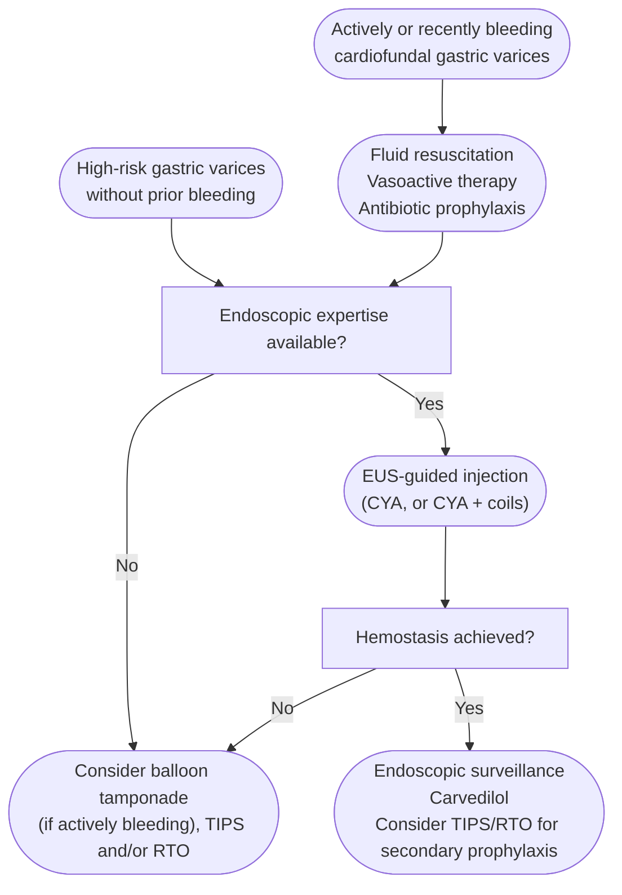

> Recommendations follow US guidance — [[aasld-2023-portal-hypertension|American Association for the Study of Liver Diseases (AASLD)]], [[asge-2026-esophageal-gastric-varices|American Society for Gastrointestinal Endoscopy (ASGE) 2026]], American Gastroenterological Association (AGA). Where ASGE 2026 and AASLD differ (**endoscopy timing**, **vasoactive duration**), newer ASGE leads. [[baveno-viii-2026-portal-hypertension|Baveno VIII (2026)]] fills gaps; its differences are noted inline.

## Contents
- [[#Definition / Scope]]
- [[#Differential Diagnosis]]
- [[#Diagnostic Algorithm]]
  - [[#1. Resuscitation and Pre-Endoscopy Bundle]]
  - [[#2. Endoscopy]]
  - [[#3. Pre-emptive TIPS]]
  - [[#4. After Hemostasis and Secondary Prophylaxis]]
  - [[#Refractory Esophageal Variceal Bleeding]]
  - [[#Cardiofundal Varices (GOV2/IGV1)]]
    - [[#Technique — Gastric Variceal Injection]]
    - [[#Follow-up After Definitive Therapy]]
  - [[#Portal Hypertensive Gastropathy and GAVE]]
- [[#Key Tests]]
- [[#Red Flags / Alarm Features]]
- [[#See Also]]
- [[#Sources]]

## Definition / Scope

- **Acute variceal hemorrhage (AVH):** bleeding from esophageal, gastric or ectopic varices in [[portal-hypertension|portal hypertension (PH)]], usually [[cirrhosis]]. **6-week mortality 10%–15%** despite current therapy; most deaths occur in Child-Turcotte-Pugh (CTP) class C, rarely in CTP A [[aasld-2023-portal-hypertension]].
- **Acute variceal bleeding (AVB)** = blood from a varix (spurting/oozing); **or** varices with signs of recent bleeding (clot, white nipple sign); **or** varices with no other source plus blood in the stomach (Baveno VIII 5.1) [[baveno-viii-2026-portal-hypertension]].
- **Active bleeding at endoscopy** = spurting/oozing from a varix; interobserver agreement only moderate (5.2). Decides pre-emptive [[tips|transjugular intrahepatic portosystemic shunt (TIPS)]] in CTP B.
- **Treatment failure** = uncontrolled bleeding or rebleeding within **5 days** (5.16).
- **High-risk varices** (incl. ASGE's **>10 mm** gastric cut-point), screening and primary prophylaxis: [[portal-hypertension]]. Pressure strata: [[hepatic-venous-pressure-gradient|hepatic venous pressure gradient (HVPG)]].
- Timing vocabulary (ASGE): **emergent** endoscopy ≤12 h, **urgent** ≤24 h of presentation [[asge-2026-esophageal-gastric-varices]].

## Differential Diagnosis

Upper gastrointestinal bleeding (UGIB) in cirrhosis — non-variceal workup: [[upper-gi-bleeding]].

- **Esophageal varices** — bleed far more often than gastric varices [[aasld-2023-portal-hypertension]]
- **Gastric varices** (Sarin) — gastroesophageal varices type 1 (GOV1, lesser curve) behave like esophageal varices; cardiofundal gastroesophageal varices type 2 (GOV2) and isolated gastric varices type 1 (IGV1) carry more treatment failure, rebleeding and mortality → glue, [[variceal-obliteration|retrograde transvenous obliteration (RTO)]] or TIPS, not bands
- **Ectopic varices** (duodenal, jejunal, rectal, stomal) — managed on gastric-varix principles
- **[[portal-hypertensive-gastropathy|Portal hypertensive gastropathy (PHG)]]** — acute bleeding uncommon (2.5%–5%); chronic blood loss commoner (4%–12%) (AASLD)
- **[[gastric-antral-vascular-ectasia|Gastric antral vascular ectasia (GAVE)]]**
- **Non-portal-hypertensive sources** — e.g., [[peptic-ulcer-disease|peptic ulcer disease]] → stop the vasoactive drug [[aga-2024-vasoactive-albumin-cirrhosis]]

## Diagnostic Algorithm

*Steps 1–2 run in parallel — do not wait for endoscopy to start drugs.*

### 1. Resuscitation and Pre-Endoscopy Bundle

- **Setting:** intensive care or other closely monitored unit [[aasld-2023-portal-hypertension]].
- **Access + transfusion:** ≥2 large-bore intravenous (IV) lines. **Restrictive transfusion — target hemoglobin 7–8 g/dL** absent ischemic comorbidity, ongoing bleeding or hemodynamic instability; overtransfusion may worsen PH bleeding (ASGE). AASLD guidance statement (GS) 28: ~7 g/dL unless comorbidity needs higher.
- **Don't chase the coagulopathy:** no fresh frozen plasma or platelets to international normalized ratio (INR)/platelet targets (GS 29); platelet >50 × 10⁹/L and fibrinogen >120 mg/dL targets are no longer routine — platelets or cryoprecipitate case by case (ASGE). No recombinant factor VIIa or tranexamic acid (Baveno VIII 5.25). See [[cirrhosis-hemostasis]].
- **Airway:** intubate for acute respiratory failure, inability to protect the airway, significantly impaired mental status or massive ongoing hematemesis; **otherwise ASGE suggests against prophylactic intubation** (conditional, very low; reverses ASGE 2014) — associated with higher mortality (odds ratio [OR] 3.47, varices) and aspiration (OR 3.85, all UGIB). Decide with anesthesia/critical care; adult data only. **Extubate as soon as safely possible** (AASLD).
- **Vasoactive drug at suspicion**, before endoscopy (GS 25; AGA 2024 best practice advice [BPA] 1) — **[[somatostatin-analogs|octreotide]] is the agent of choice** (BPA 3): 50 mcg IV bolus → 25–50 mcg/h (AASLD Table 5; AGA gives 50 mcg/h) [[aga-2024-vasoactive-albumin-cirrhosis]]. Somatostatin and [[terlipressin]] doses on their pages; terlipressin is not approved for this indication in North America — if used, **monitor sodium** (Baveno VIII 5.9). **Stop if the source is non-variceal.**

| Vasoactive duration | Rule |
|---|---|
| **ASGE 2026** | **2–3 d** sufficient (conditional, low) — ASGE 2014 said 3–5 d |
| AASLD 2023 (GS 26) / AGA 2024 (BPA 2) | 2–5 d; AASLD: stop when the [[nonselective-beta-blockers\|nonselective beta-blocker (NSBB)]] starts, **no later than day 5** |
| AGA 2024 | **2 d** reasonable only in selected CTP A/B without active bleeding at endoscopy |
| After **sclerotherapy** | **5 d** — shorter courses → more rebleeding and death (ASGE 2026) |

- Baveno VIII 5.8 alone allows as little as 24 h after endoscopic hemostasis if an NSBB is then started.
- **Antibiotics at presentation** (GS 25): **ceftriaxone 1 g IV q24h up to 5 d**, tailored to local resistance and allergies; stop once bleeding is controlled and no infection is present (GS 27). ASGE 2026 still suggests prophylaxis (conditional, very low) — fewer infections, not lower mortality — and flags *[[clostridioides-difficile|Clostridioides difficile]]* risk with third-generation cephalosporins. A 2025 meta-analysis ([[albhaisi-2025-prophylactic-antibiotics-cirrhosis|Prosty et al.]]): shorter or no prophylaxis noninferior for mortality, more infections (driven by prophylaxis-vs-none trials); authors' hypothesis-generating view — routine prophylaxis may be unnecessary. Detail: [[antibiotic-prophylaxis-cirrhosis]].
- **Also:** [[lactulose]] (oral/enema) to prevent or treat hepatic encephalopathy (HE) (Baveno VIII 5.22); hold [[anticoagulation-gi-bleeding|anticoagulants]] until controlled, restart individualized (5.26); no routine pre-endoscopic nasogastric tube (aspiration risk; AASLD); stage with CTP and Model for End-Stage Liver Disease (MELD) ([[cirrhosis]]) to find pre-emptive TIPS candidates.

### 2. Endoscopy

- **Timing: within 24 h, individualized** (ASGE 2026, conditional, very low; replaces previous ASGE guidance of 12 h) — observational data show no outcome difference for ≤12 h. AASLD GS 30 (and GS 43 for gastric varices) still says ≤12 h.

> [!pearl] Resuscitate first, then scope
> ASGE's 24 h is a ceiling, not a target: don't under-resuscitate to make an emergent slot, and don't delay endoscopy in shock or ongoing bleeding once resuscitated ([[asge-2026-esophageal-gastric-varices]]).

- **Erythromycin 125–250 mg IV, 30–120 min before** esophagogastroduodenoscopy (EGD) (AASLD); check the QT interval first ([[aga-2021-bleeding-gastric-varices|AGA 2021]]).
- **Esophageal varices → [[endoscopic-band-ligation|endoscopic variceal ligation (EVL)]]** (GS 31); **GOV1** → banding effective (ASGE).
- **GOV2/IGV1 → do not band** → [[#Cardiofundal Varices (GOV2/IGV1)]].
- **Not first-line:** clips, over-the-scope clips, topical hemostatic agents, fibrin (Baveno VIII 5.28).
- **Abdominal imaging once stable** — contrast computed tomography (CT) or magnetic resonance imaging (MRI), or Doppler ultrasound — for portal vein thrombosis, liver cancer and endovascular planning (AASLD; GS 44 for gastric/ectopic varices). Baveno VIII 5.30 prefers CT/MRI in every AVB.
- **Uncontrolled bleeding →** [[#Refractory Esophageal Variceal Bleeding]].

### 3. Pre-emptive TIPS

**Within 72 h (ideally <24 h) of the index EGD, absent absolute contraindications — either** (AASLD GS 32; [[aasld-2024-tips]] GS 20):

- **CTP C 10–13 points**
- **CTP B >7 (8–9 points) with active bleeding** at initial endoscopy despite vasoactive therapy

- Not locally available → consider transfer (GS 32).
- **HVPG:** Baveno VIII 5.31 adds **HVPG ≥20 mm Hg** at the time of bleeding as a third criterion; AASLD notes similar data for HVPG >20 mm Hg but does not recommend measuring it in this setting.
- Early-TIPS trials excluded older and pregnant patients, non-early-stage [[hepatocellular-carcinoma|hepatocellular carcinoma (HCC)]], severe acute or chronic kidney disease, patients already on secondary prophylaxis, nonesophageal bleeding, complete portal vein thrombosis and heart failure (AASLD).
- Missed 72-h window, non-contraindications, post-TIPS gradient target: [[tips]].

### 4. After Hemostasis and Secondary Prophylaxis

**No pre-emptive TIPS:**

- Start an NSBB when vasoactive therapy stops (GS 33).
- **Stop [[proton-pump-inhibitors|proton pump inhibitor (PPI)]]** once AVH is the confirmed source, absent another indication (GS 37).
- **Enteral feeding** once AVH is controlled; bands don't contraindicate a feeding tube (GS 36) → [[nutrition-in-liver-disease]].
- **Iron** for blood-loss anemia (Baveno VIII 5.27; its Figure 3: hemoglobin <10 g/dL, before discharge).

**Secondary prophylaxis** — start within 7 days of admission; rebleeding up to 60% at 1 y without it, highest in the first 6 weeks [[aasld-2023-portal-hypertension]]:

- **NSBB + EVL** (GS 38), EVL q2–4 weeks to obliteration. Propranolol, nadolol or carvedilol (AASLD; GS 1 makes carvedilol its preferred NSBB in PH); Baveno VIII 4.8 prefers carvedilol regardless of prior prophylaxis. Only one tolerated → that one alone (4.9).
- **TIPS** for rebleeding despite adequate NSBB + EVL (AASLD 2024 GS 24); as secondary prophylaxis otherwise only with another TIPS indication, e.g. refractory [[ascites]] (GS 39) — it lowers rebleeding but not mortality, with more HE. Bled **plus** a non-bleeding decompensating event, not a pre-emptive/rescue candidate → consider TIPS and [[liver-transplantation|liver transplantation]] (Baveno VIII 4.10).
- Post-EVL ulcer bleeding (higher risk with MELD >18 or emergency EVL; no routine PPI): [[endoscopic-band-ligation]].

**Special settings:** HCC → same principles as without HCC (GS 52). Cirrhosis + [[portal-vein-thrombosis|portal vein thrombosis]]: manage AVB as without it; TIPS ± recanalization in selected patients (Baveno VIII 5.45); bland thrombosis does not preclude TIPS (AASLD 2024 GS 4).

### Refractory Esophageal Variceal Bleeding

**~20% of bleeding esophageal varices fail initial hemostasis** [[asge-2026-esophageal-gastric-varices]].

- **Bridge — fully covered esophageal stent *or* balloon tamponade, by local expertise** (ASGE 2026, conditional, very low; AASLD GS 34). Stents can stay up to 1 week; tamponade is limited to 24 h (AASLD). Baveno VIII 5.35 prefers a covered self-expanding metal stent (SEMS) over tamponade.
- Single randomized controlled trial (RCT), n=28, stent vs tamponade: hemostasis **66% vs 20%**, 15-day rebleeding **15% vs 53%**, device serious adverse events **8% vs 40%**, 6-week mortality not different; trial stent (SX-ELLA) not available in the US.
- **Salvage TIPS** when drug + endoscopic therapy fails (GS 35; AASLD 2024 GS 21); **rescue TIPS** for early rebleeding (GS 22). **Not** with MELD >30, lactate >12 mmol/L or CTP >13, unless TIPS bridges to transplant in the short term (AASLD 2024 GS 23). Baveno VIII 5.37 drops these cut-offs: discuss salvage TIPS for any refractory bleed regardless of age, CTP or MELD, case by case. → [[tips]].

> [!howto] Esophageal stent as a bridge
> 1. Fully covered SEMS only, **largest available diameter**.
> 2. Position with **≥2/3 of the stent in the esophagus**; fluoroscopy availability may dictate the stent.
> 3. **Never for suspected gastric variceal bleeding** — it cannot compress them.
> 4. Still bleeding → balloon tamponade and/or emergent TIPS.
> 5. Remove endoscopically after definitive therapy; watch for migration and ulceration ([[asge-2026-esophageal-gastric-varices]]).

### Cardiofundal Varices (GOV2/IGV1)

*Sarin types and gastric-varix (GV) primary prophylaxis: [[portal-hypertension]].* Initial bundle as for esophageal bleeding (GS 43); contrast cross-sectional imaging for anatomy and thrombosis (GS 44); no local GV expertise → refer to a tertiary centre [[aasld-2023-portal-hypertension]]. Choose definitive therapy in a multidisciplinary team (gastroenterology/hepatology + interventional radiology) by endoscopic appearance, vascular anatomy, other PH complications and local resources ([[aga-2021-bleeding-gastric-varices|AGA 2021]] BPA 5).

- **First-line options:** endoscopic cyanoacrylate (CYA), TIPS or RTO (GS 45; AASLD 2024 GS 26); **RTO when TIPS is contraindicated** (AASLD 2024 GS 27).
- **Both TIPS and RTO possible** → by anatomy, clinical profile and centre expertise (AASLD 2024 GS 28):

| Favors RTO / balloon-occluded retrograde transvenous obliteration (BRTO) | Favors TIPS (± variceal embolization) |
|---|---|
| Gastrorenal shunt present + local expertise + no severe PH complications (AGA 2021 BPA 10) | Significant coronary-vein inflow to the GV (AGA 2021 BPA 8) |
| Prior overt HE (GS 28); shunt-related HE (ASGE) | Large or high-risk esophageal varices; significant or poorly controlled ascites (GS 28; ASGE) |
| Poor liver function (GS 28): MELD-sodium (MELDNa) >20 or Freiburg Index of Post-TIPS Survival (FIPS) >0.92 (AASLD 2023) | Portal vein thrombosis (GS 28); preserved liver function, MELDNa <20 (AASLD 2023) |

- TIPS for GV → add embolization or endovascular sclerosis when feasible (AGA 2021 BPA 9; AASLD 2024 GS 29, case by case). After TIPS, NSBB not required if the portosystemic gradient is <12 mm Hg (AASLD 2023).
- Baveno VIII (5.39–5.41) frames GOV2/IGV1 care as an acute hemostasis phase plus a definitive phase and prefers TIPS ± embolization as definitive therapy; US guidance leaves TIPS vs RTO to anatomy and patient factors.
- Ectopic varices: multidisciplinary team; TIPS first-line for most, usually with antegrade or retrograde obliteration (AASLD 2024 GS 30, 33).

**ASGE 2026 ranking** (all conditional, very low certainty) [[asge-2026-esophageal-gastric-varices]]:

1. **[[endoscopic-ultrasound|Endoscopic ultrasound (EUS)]]-guided injection (EUS-I) over direct endoscopic injection (DEI)** — obliteration 0.84 vs 0.63 (23 studies); rebleeding no different.
2. **EUS-CYA + coils over EUS-CYA alone** when feasible — RCT reintervention **20.8% vs 53.8%**, less glue (1.5 vs 3.5 cm³).
3. **No EUS → DEI.** Lack of expertise **must not delay** care — unstable patients may need radiology or balloon tamponade.
4. **EUS-I over RTO for initial management** — fewer adverse events (5.1% vs 22%), less worsening ascites (0 vs 15.3%) and unplanned intervention for worsening esophageal varices (1.7% vs 16.9%), but more GV reintervention (28.8% vs 5.1%); RTO may be more available locally.
5. **After endoscopic hemostasis → multidisciplinary discussion of pre-emptive TIPS or other radiologic intervention** — pre-emptive TIPS RCT: free of death/rebleeding at 1 y **77% vs 37%**. Radiologic therapy (BRTO with an amenable shunt, otherwise TIPS) vs glue alone: rebleeding **2.2% vs 24.4%**, variceal-bleeding mortality 2.2% vs 17.8%; costs: HE 30% after TIPS, ascites 36% after BRTO (both manageable).

*Management of high-risk gastric varices in cirrhosis*
*Source: redrawn from ASGE 2026 Figure 2*
*[[asge-2026-esophageal-gastric-varices|ASGE 2026 Esophageal and Gastric Varices Guideline]]*
*EUS = endoscopic ultrasound · CYA = cyanoacrylate · TIPS = transjugular intrahepatic portosystemic shunt · RTO = retrograde transvenous obliteration*

**Pre-procedure workup, stable patient:** **3-phase CT** (large splenorenal shunt = higher systemic embolization risk) + consider **transthoracic echo with bubble study** (patent foramen ovale); review with interventional radiology, hepatology and/or transplant surgery [[asge-2026-esophageal-gastric-varices]].

**Temporizing at the index endoscopy** ([[aga-2021-bleeding-gastric-varices|AGA 2021]]):

- Promotility agent + therapeutic scope or advanced suction; **classify esophageal varices too**.
- **Band ligation:** temporizing only for cardiofundal GV (hemostasis 45%–93%, inferior long-term); often **definitive for lesser-curve GV**.
- **Gastric balloon tamponade** — **inflate only the gastric balloon**, move to definitive therapy fast.
- **Not recommended:** alcohol-based sclerotherapy (unless no other options), CYA as a temporizing step (absent other options), activated factor VII.

#### Technique — Gastric Variceal Injection

> [!howto] Cyanoacrylate ± coils
> 1. Use **butyl (n-butyl-2-CYA)** — polymerizes fast → inject **rapidly**; slow **2-octyl** CYA → inject slowly, consider placing after coils.
> 2. **No lipiodol/ethiodized oil** — raises embolization risk.
> 3. Coils **~20%–30% wider than the varix**; **22-gauge needle → 0.018-inch coils only; 19-gauge → 0.018- or 0.035-inch**.
> 4. **Flush the needle immediately** with sterile water or 5% dextrose after glue.
> 5. Experienced endoscopist only, interventional radiology available ([[aga-2021-bleeding-gastric-varices]]; [[asge-2026-esophageal-gastric-varices]]).

- **Pitfalls:** glue can set in the working channel, occlude the needle, or **stick the needle in the varix**. Embolization (pulmonary, coronary, cerebral) **~0.7%** in the largest series; no CYA is approved by the US Food and Drug Administration as a long-term vascular implant. Gelfoam/thrombin: insufficient comparative data.

#### Follow-up After Definitive Therapy

| After | Do |
|---|---|
| **CYA** | EGD **q2–4 weeks** until obliterated — **palpate** treated cardiofundal varices (blunt probe/Doppler); dimpling/inverting areas → re-inject. Then **3–6 months, then yearly** (AGA 2021 BPA 7). Add an NSBB (GS 46) |
| **TIPS** | EGD at **1 month**; stable/enlarging cardiofundal GV → **BRTO** (preferred; CYA after TIPS ↑ embolization and portal vein thrombosis) or embolization through the shunt (AGA 2021) |
| **BRTO/RTO** | Confirm obliteration — **CT or EUS ≤72 h** and EGD at **1–2 months** (AASLD 2024 GS 13–14, newer than AGA) → [[variceal-obliteration]]. **Esophageal varices progress in up to 30%–35%** after BRTO (AGA 2021) |
| **New/recurrent GV >12 mo** | Repeat cross-sectional imaging + multidisciplinary review (AGA 2021) |

### Portal Hypertensive Gastropathy and GAVE

*Grading and treatment: [[portal-hypertensive-gastropathy]], [[gastric-antral-vascular-ectasia]].* Neither is variceal.

- **PHG:** acute bleeding from **severe** PHG → vasoactive drug 2–5 d at variceal doses (GS 49); NSBB to prevent rebleeding (GS 50); transfusion-dependent despite NSBB → TIPS (GS 51).
- **GAVE** needing serial transfusion → endoscopic band ligation over argon plasma coagulation (Baveno VIII 5.43).

## Key Tests

| Test | Purpose |
|---|---|
| CTP, MELD ([[cirrhosis]]) | Prognosis, pre-emptive TIPS candidacy |
| EGD | Diagnosis + treatment (timing above) |
| Contrast CT/MRI or Doppler ultrasound | Portal vein thrombosis, liver cancer, collateral/shunt map |
| HVPG | Baveno VIII only: **≥20 mm Hg** → pre-emptive TIPS; AASLD does not recommend measuring it during AVH |

## Red Flags / Alarm Features

- Hemodynamic instability or ongoing bleeding after resuscitation → emergent endoscopy (ASGE)
- Failed endoscopic hemostasis → bridge device + salvage TIPS
- **Pre-emptive TIPS criteria met** → TIPS within 72 h. At **MELD >19** mortality stays high despite intervention, but early TIPS still beats standard therapy — assess transplant candidacy promptly [[aasld-2023-portal-hypertension]]
- Altered mentation ([[hepatic-encephalopathy|HE]]) → protect the airway before endoscopy (AASLD)
- **Rebleeding within 5 days** = treatment failure → rescue TIPS (AASLD 2024 GS 22)

---

## See Also

[[portal-hypertension]], [[cirrhosis]], [[upper-gi-bleeding]], [[tips]], [[endoscopic-band-ligation]], [[nonselective-beta-blockers]], [[somatostatin-analogs]], [[terlipressin]], [[antibiotic-prophylaxis-cirrhosis]], [[cirrhosis-hemostasis]], [[hepatic-venous-pressure-gradient]], [[endoscopic-ultrasound]], [[variceal-obliteration]], [[interventional-eus-vascular]], [[portal-hypertensive-gastropathy]], [[gastric-antral-vascular-ectasia]], [[hepatic-encephalopathy]], [[portal-vein-thrombosis]], [[anticoagulation-gi-bleeding]], [[liver-transplantation]], [[endoscopy-sedation]]

---

## Sources

1. [[asge-2026-esophageal-gastric-varices|ASGE Guideline on Management of Esophageal and Gastric Varices in Patients With Cirrhosis (2026)]]
2. [[baveno-viii-2026-portal-hypertension|Baveno VIII — Advancing Consensus in Portal Hypertension (2026)]]
3. [[albhaisi-2025-prophylactic-antibiotics-cirrhosis|Prosty et al. — Prophylactic Antibiotics for Upper Gastrointestinal Bleeding in Patients With Cirrhosis: A Systematic Review and Bayesian Meta-Analysis (JAMA Intern Med 2025)]]
4. [[aasld-2023-portal-hypertension|AASLD 2023 Practice Guidance on Portal Hypertension and Varices in Cirrhosis]]
5. [[baveno-vii-2022-portal-hypertension|Baveno VII — Renewing Consensus in Portal Hypertension (2022)]]
6. [[aga-2024-vasoactive-albumin-cirrhosis|AGA Clinical Practice Update on the Use of Vasoactive Drugs and Intravenous Albumin in Cirrhosis: Expert Review (2024)]]
7. [[aasld-2024-tips|AASLD Practice Guidance: TIPS, Variceal Embolization, and Retrograde Transvenous Obliteration (2024)]]
8. [[aga-2021-bleeding-gastric-varices|AGA Clinical Practice Update on Management of Bleeding Gastric Varices: Expert Review (2021)]]
