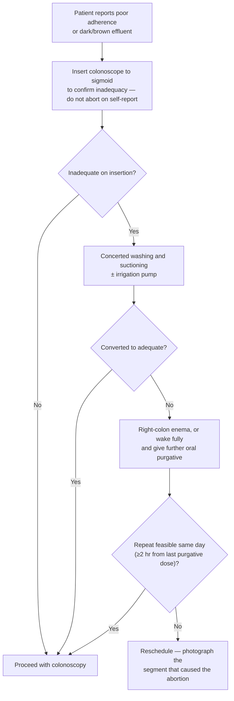

# Bowel Preparation

## Contents
- [[#Scope and Terminology]]
- [[#Patient Education and Navigation]]
- [[#Diet]]
- [[#Purgative Selection]]
  - [[#Commonly Used Regimens]]
  - [[#Volume — High, Low, and Ultra-Low]]
  - [[#Agent-Specific Safety]]
- [[#Dosing and Timing]]
- [[#Adjuncts]]
- [[#Assessing Preparation Quality]]
  - [[#Preparation Quality Scales]]
  - [[#Adequacy Cut-Points and Wording]]
- [[#Salvage of an Inadequate Preparation]]
- [[#Repeat Colonoscopy After an Inadequate Preparation]]
- [[#High Risk for Inadequate Preparation]]
  - [[#Risk Factors]]
  - [[#Modifications and the High-Risk Regimen]]
- [[#Special Populations]]
- [[#Tracking Adequacy]]

---

## Scope and Terminology

Unless stated otherwise, everything below applies to **ambulatory patients at low risk for inadequate preparation**; higher-risk patients are handled separately. [[usmstf-2025-bowel-prep]]

| Term | Definition |
|---|---|
| Bowel preparation **process** | Every step communicated to the patient — what to expect, arranging an escort, diet, which medications to hold and take |
| Bowel preparation **regimen** | The combination of medications and dietary modifications used to clean the colon |
| Bowel preparation **quality** | Degree of colonic cleanliness; assess and report **only after all washing and suctioning are done** |
| **Adequate** quality | A standard screening or surveillance interval **can** be assigned based on the findings of the [[colonoscopy]] |
| **Inadequate** quality | A standard screening or surveillance interval **cannot** be assigned |
| **Purgative** | The primary medication used to clear stool |
| **Adjunct** | Any secondary medication or supplement other than the purgative |
| **Day prior** regimen | Entire purgative the day before |
| **Split-dose** regimen | Part (typically half) the day before, remainder the day of |
| **Same-day** regimen | Entire purgative on the day of colonoscopy |
| **High-volume** | **≥4 L** of purgative |
| **Low-volume** | **≥2 to <4 L** of purgative |
| **Ultra-low-volume** | **<2 L** of purgative |

- The US Multi-Society Task Force on Colorectal Cancer (USMSTF) calls its 2025 statements **"Recommendations," not "Guidelines,"** and **numbers none of them**; strength is strong ("We recommend") or weak ("We suggest"), evidence high / moderate / low / very low.

---

## Patient Education and Navigation

- **Verbal *and* written instructions covering every component** of the preparation — not just the purgative (strong, high-quality evidence).
- **Some form of patient navigation** — telephonic or virtual, including automated electronic messaging (weak, moderate).
- Write instructions at a **sixth-grade or lower reading level, in the patient's own language**; delivery in the patient's preferred language improves both completion and preparation quality. [[acg-2014-bowel-cleansing]], [[asge-2015-bowel-preparation]]
- Ceiling effect: where baseline adequacy already exceeds ~89%, added education measures show little further gain.

---

## Diet

- **Limit dietary modification to the day before** colonoscopy (strong, high) — multi-day restriction is reserved for high-risk patients.
- **Low-residue / low-fiber foods or full liquids for the early and midday meals** on the day before, when using a split-dose regimen (strong, high).
- Low-residue diets are **noninferior to clear liquids** for adequacy, and better tolerated: willing to repeat 71% vs 62%, easier to comply 52% vs 39%, less hunger 25% vs 44%, less nausea 18% vs 23%.
- A low-residue diet limits high-fiber foods — cereals, beans, peas, nuts, seeds, raw or dried fruits and vegetables. **There is no standardized definition of a low-residue diet**; sample meals are listed in [[usmstf-2025-bowel-prep]].
- **Avoid red liquids** — mistaken for blood and they obscure mucosal detail. [[asge-2015-bowel-preparation]]

---

## Purgative Selection

- **No single purgative is superior** to others for adequacy in low-risk ambulatory patients (strong, high). Head-to-head superiority data are not expected: baseline adequacy already exceeds 90%, so trials are powered for noninferiority.
- **Select the regimen from the individual's medical history, medications, and — when available — the adequacy reported from prior colonoscopies** (strong, moderate).
- **Against hyperosmotic regimens in anyone at risk for volume overload or electrolyte disturbance** (strong, high).
- Also weigh patient preference, comorbidities, out-of-pocket cost for both prescription and over-the-counter (OTC) products, and ease of obtaining and drinking it (ungraded).

### Commonly Used Regimens

*All carry nausea, bloating/abdominal cramps and anal irritation; all carry bowel obstruction, ileus and allergy/hypersensitivity as contraindications. Only the additional items are listed.* [[usmstf-2025-bowel-prep]]

| Regimen (brand) | US Food and Drug Administration (FDA) approved | Tonicity | Volume to consume | Standard split-dose approach | Added side effects | Added contraindications |
|---|---|---|---|---|---|---|
| Polyethylene glycol–electrolyte lavage solution (PEG-ELS) (GoLYTELY, CoLyte) | Yes | Isotonic | **4 L** | 2 L night before + 2 L day of exam | — | — |
| Sulfate-free PEG-ELS (NuLytely, TriLyte) | Yes | Isotonic | **4 L** | 2 L night before + 2 L day of exam | — | — |
| 2 L PEG-ELS + ascorbate (MoviPrep) | Yes | Isotonic | **2 L** | 16 oz clear liquids per 500 cc night before + same day of exam | Hemolysis in glucose-6-phosphate dehydrogenase (G6PD) deficiency | — |
| 1 L PEG + ascorbate (PLENVU) | Yes | Isotonic | **1 L** | 16 oz clear liquids per 500 cc night before + same day of exam | — | — |
| Oral sodium sulfate (SUTAB tablets, SUPREP liquid) | Yes | Hypertonic | **12 oz + 2.5 L H₂O**, or **24 tablets + 2 L H₂O** | 6 oz or 12 tablets night before + same dose day of exam | Vomiting | — |
| Sodium picosulfate + magnesium oxide + anhydrous citric acid (CLENPIQ) | Yes | Hypertonic | **10 oz + 2 L H₂O** | 5 oz + 1 L night before + same day of exam | Vomiting | Chronic or acute kidney disease |
| Sodium phosphate (NaP) tablets (OsmoPrep) | Yes | Hypertonic | **32 tablets + 2 L H₂O** | 16 tablets + 1 L night before + same day of exam | Vomiting | Chronic or acute kidney disease |
| PEG-3350 / sports drink (MiraLAX / Gatorade) | **No** | Hypotonic without sports drink | **238 g PEG-3350 in 2 L** sports drink | 1 L night before + same day of exam | Hypocalcemia, hyponatremia, hypokalemia | Chronic or acute kidney disease, seizures |
| Magnesium citrate (generic) | **No** | Hypertonic | **2 bottles (12 oz each) + 2 L H₂O** | 1 bottle night before + 1 bottle day of exam, each with 1 L H₂O | Hypermagnesemia | Chronic or acute kidney disease |
| Bisacodyl (generic) | **No** | — | **4 tablets (20 mg) + 2–3 L H₂O** | — | [[colon-ischemia\|Ischemic colitis]] | — |

- The authors of [[asge-2015-bowel-preparation]] suggest an **additional 1–2 L of clear fluid** beyond what the prescribing information specifies.

### Volume — High, Low, and Ultra-Low

- **2 L regimens are suggested instead of 4 L** (weak, moderate) — on **tolerability, not cleansing superiority**:

| Outcome | 4 L | 2 L | Relative risk (RR), high vs low volume (95% confidence interval [CI]) |
|---|---|---|---|
| Adequate cleanliness, overall | 87.4% | 86.1% | 1.00 (0.98–1.02) |
| Adequate cleanliness, right colon | 89.6% | 91.2% | 1.01 (0.99–1.03) |
| Adherence to regimen | 86.8% | 92.8% | 1.06 (1.02–1.10) |
| **Tolerability** | 49.6% | 72.5% | **1.39 (1.12–1.74)** |
| **Willingness to repeat** | 61.9% | 89.5% | **1.41 (1.20–1.66)** |
| Adenoma detection rate (ADR) | 28.7% | 27.6% | 0.96 (0.87–1.08) |

- **Ultra-low-volume (<2 L) regimens are not ready for general use.** Pooled adequacy: sodium picosulfate/magnesium citrate 75%, 1 L PEG + ascorbate 83%, <1 L sodium phosphate 82%; a ≤1 L split-dose oral sulfate solution reached 92%. Heterogeneity was extreme (I² 86%–98%).

### Agent-Specific Safety

- **NaP is not recommended** in any of the following ([[acg-2014-bowel-cleansing]]):

| Contraindication | Threshold |
|---|---|
| Renal insufficiency | **Creatinine clearance <60 mL/min/1.73 m²** |
| Pre-existing electrolyte disturbance | — |
| Congestive heart failure | **New York Heart Association (NYHA) class III or IV**, or **ejection fraction <50%** |
| [[cirrhosis\|Cirrhosis]], or [[ascites\|ascites]] | — |

  - **Caution rather than a bar:** elderly, hypertensive, or taking angiotensin-converting enzyme inhibitors, nonsteroidal anti-inflammatory drugs (NSAIDs), or diuretics. Also avoid in children **<12 y** and in known or suspected [[inflammatory-bowel-disease|inflammatory bowel disease (IBD)]].
  - **NaP-induced acute phosphate nephropathy — risk factors:** female sex, pre-existing renal insufficiency, inadequate hydration during the preparation, **<12 h between the 2 NaP doses**, hypertension, older age, and diuretics / NSAIDs / renin–angiotensin inhibitors. Oral NaP left the US OTC market in 2008; the prescription tablet carries a boxed warning.
- **NaP and sodium picosulfate can produce mucosal lesions that mimic early IBD.** Preparation-induced inflammation was **10-fold greater** than with PEG (*P* = 0.03); aphthoid-like lesions in **24.5%** after NaP vs **2.3%** after PEG; mucosal lesions in **3.3%** of 730 patients with no known IBD. The endoscopic changes can resemble [[crohns-disease|Crohn's disease]], but the **histology is distinctive** — biopsy before letting a prep-day finding become an IBD diagnosis.
- **Magnesium-based preparations — avoid in chronic kidney disease** (all formulations); a PEG-ELS–based regimen is preferred.
- **PEG-ELS is iso-osmotic** → preferred where fluid shifts are poorly tolerated (renal insufficiency, congestive heart failure, advanced liver disease). It **does not alter colonic mucosal histology**, so it can be used in suspected IBD without obscuring diagnosis or tissue analysis. [[asge-2015-bowel-preparation]]
- **2 L PEG-ELS + ascorbate** is contraindicated in phenylketonuria and G6PD deficiency, should not be used with creatinine clearance **<30 mL/min** or congestive heart failure.
- **Sodium picosulfate + magnesium citrate** is contraindicated in congestive heart failure, hypermagnesemia and severe renal impairment. Higher risk of hospitalization with hyponatremia (absolute increase 0.05%, 95% CI 0.04%–0.06%; RR 2.4, 1.5–3.9), without an increase in urgent head computed tomography or death.
- **Oral sulfate solution** — increased nausea (RR 1.35, 1.03–1.77) and more than twice the vomiting (RR 2.30, 1.63–2.23) vs low-volume PEG-ELS.
- **Senna** — high dose **24 tablets of 12 mg** (as effective as 4 L PEG-ELS but markedly more cramping and pain); low dose **3–12 tablets** with 2 L PEG-ELS. [[acg-2014-bowel-cleansing]]

---

## Dosing and Timing

| Parameter | Rule | Strength / evidence |
|---|---|---|
| Dosing strategy | **Split-dose for all patients**, regardless of high- or low-volume | Strong / high |
| Split-dose second portion | **Begin 4–6 hr before** the colonoscopy; **complete at least 2 hr before** the procedure start | Strong / moderate |
| Same-day regimen, **afternoon** colonoscopy | **Acceptable alternative** to split dosing | Strong / high |
| Same-day regimen, **morning** colonoscopy | **Inferior alternative** to split dosing | Weak / low |
| Same-day regimen, timing | Begin drinking **4–6 hr before**, complete **≥2 hr before** the procedure start | Ungraded key concept |

- **Why split-dose works:** the first dose clears solid stool; the second clears the chyme that enters the large bowel overnight after the first.
- **The interval from last dose to scope insertion is inversely related to quality.** In non-split preparations, every additional hour cut the chance of a good or excellent preparation by **10%**. In a meta-analysis of 29 randomized controlled trials (RCTs), split-dose superiority was maintained within **3 hr** of finishing the purgative, declined progressively after **4–5 hr**, and was **gone after 5 hr**.
- **Split dosing raises detection:** adenomas per colonoscopy 53.0% vs 40.9% (95% CI 1.03–1.46); advanced adenomas 26.4% vs 20.0% (1.06–1.73).
- **Aspiration and fasting.** The 2023 American Society of Anesthesiologists (ASA) guidance permits clear liquids — including up to **400 mL** containing simple or complex carbohydrates — up to **2 hr** before anesthesia or procedural sedation. Not every anesthesiologist counts a purgative as a clear liquid, so some units require longer. Observational data show **no excess gastric volume** with split dosing finished no earlier than 2 hr before endoscopy (residual fluid 11 mL vs 19 mL for day-prior; *P* < 0.001). See [[endoscopy-sedation]].
- **ASA definition of "healthy patients"** for aspiration risk excludes significant uncontrolled reflux, [[hiatal-hernia|hiatal hernia]], Zenker diverticulum, [[achalasia|achalasia]], stricture, previous gastric surgery, [[gastroparesis|gastroparesis]], diabetes mellitus, opioid use, gastrointestinal obstruction or acute intraabdominal processes, pregnancy, [[obesity|obesity]], and emergency procedures — **use clinical judgement in anyone meeting these criteria**.
- **[[glp-1-receptor-agonists|Glucagon-like peptide-1 (GLP-1) receptor agonists]]** delay gastric emptying and so may affect when to stop drinking the purgative. The ASA advises stopping them **1–7 days** before an elective procedure depending on agent; if the agent was not stopped, proceed **assuming the stomach is full**. The American Gastroenterological Association (AGA) favours a case-by-case decision over routine cessation — see [[endoscopy-sedation]]. GLP-1 receptor agonist use is **not** a listed risk factor for inadequate preparation and carries no prep modification of its own.
- **Nasogastric (NG) administration** of PEG-ELS is an option when the patient cannot drink or has a significant swallowing disorder, is the most effective method in infants and children, and at **high dose (6–8 L)** is effective as rapid preparation in [[acute-lower-gi-bleeding|acute lower gastrointestinal bleeding]]. Risk of severe, life-threatening aspiration; prokinetics/antiemetics and avoiding over-rapid instillation improve tolerance. [[asge-2015-bowel-preparation]]

---

## Adjuncts

- **Oral simethicone is suggested** (weak, moderate) — an upgrade from the 2014 position against routine adjuncts. **If it is used, give at least 320 mg** (ungraded).
  - RCT (n = 583), 2 L PEG ± 30 mL simethicone 6–8 hr before: **ADR 21.0% vs 14.3%** (*P* = 0.04); Boston Bowel Preparation Scale (BBPS) ≥6 in 88.3% vs 75.2% (*P* < 0.001).
  - Meta-analysis of 38 trials (10,505 patients): simethicone, particularly **≥320 mg**, improved preparation quality and reduced bubbles but **did not improve ADR**.
  - Adding it to a PEG regimen cut intraprocedural simethicone use from **49% to 2%** of colonoscopies.
  - **The optimal timing relative to the purgative is not established.** Giving 200 mg during the first vs the second litre of a split-dose 2 L PEG regimen made no difference to BBPS or ADR.
- **Against the routine use of non-simethicone adjuncts** (weak, low) — chewing gum, orange juice, diet cola, menthol candy drops, citrus peel tablets, lubiprostone and mosapride citrate all lack sufficient evidence. Bisacodyl improved quality only in regimens using ≤1 L, and increased discomfort.
- **Against metoclopramide** as an adjunct — it reduced nausea and bloating in one study but did not improve cleansing, and a second showed no advantage for either. [[asge-2015-bowel-preparation]]
- **Simethicone through the scope:** if used for intraprocedural bubbles, use the **lowest possible dilution — 0.5 mL simethicone in 99.5 mL water (0.5%)** — and administer **only through an instrument channel routinely brushed during reprocessing**. Note that endoscope manufacturers, following FDA guidance, advise **against** instilling simethicone into accessory channels at all because of crystal formation and biofilm. See [[endoscope-reprocessing]].

---

## Assessing Preparation Quality

- **Grade only after all washing and suctioning are complete**, using reliably understood descriptors that communicate adequacy (strong, moderate). Grading before cleansing measures the purgative, not the examination.
- **Patient self-report is unreliable.** Of 429 patients with an adequate preparation at the end of washing and suctioning, **42% of the 52 who had reported brown liquid or solid stool beforehand** nonetheless had an adequate preparation. Despite this, 97% of academic fellowship directors reported their unit permits cancellation on self-report alone.
- Hence: **when the patient reports incomplete adherence or suggests the preparation may be inadequate (e.g. dark bowel effluent), insert the colonoscope to the sigmoid colon to confirm inadequacy before aborting** (weak, low).
- **Irrigation pumps are suggested** for routine use to assist preparation during colonoscopy (weak, very low). In one retrospective series of 1,037 colonoscopies, inadequate preparation fell from 24% to 10% (*P* < 0.01) after pumps were introduced, with no change in ADR.
- **If the colonoscopy is aborted for inadequate preparation, photograph the segment(s) that caused the abortion** (ungraded) — cancellation rates vary widely between endoscopists.

### Preparation Quality Scales

*Criteria from [[asge-2015-bowel-preparation]] and [[acg-2014-bowel-cleansing]]; [[usmstf-2025-bowel-prep]] names five scales but reproduces the criteria of none. A usable scale must be both **valid** (measures what it intends) and **reliable** (reproducible between observers).*

| Scale | Scored on | Range | Anchors |
|---|---|---|---|
| **BBPS** | Each of 3 segments (right, transverse, left), 0–3 each, **after all cleansing maneuvers** | **0** (very poor) – **9** (excellent) | 0 unprepared segment, stool cannot be cleared; 1 portion of mucosa seen after cleaning, other areas obscured by retained material; 2 minor residual material after cleaning, mucosa generally well seen; 3 entire mucosa of segment well seen after cleaning |
| **Ottawa Bowel Preparation Scale** | Each of 3 segments (right, transverse/descending, sigmoid/rectum) 0–4, **plus** a whole-colon fluid score (0 small, 1 moderate, 2 large) | **0** (excellent) – **14** (very poor) | Per segment: 0 excellent (mucosal detail clearly visible); 1 good (minimal turbid fluid); 2 fair (must suction liquid to view); 3 poor (must wash and suction for a reasonable view); 4 inadequate (solid stool not cleared) |
| **Aronchick Scale** | Whole colon (segments not evaluated) | **1**–**5** | 1 excellent (>95% of mucosa seen); 2 good (clear liquid covering ≤25% of mucosa, >90% seen); 3 fair (semisolid stool not suctionable, >90% seen); 4 poor (semisolid stool not suctionable, <90% seen); 5 inadequate (re-preparation needed) |

- **Use the BBPS.** It has the best validation data of any scale and is the only one that does **not** downgrade for retained fluid: intra-observer weighted κ **0.77**, interobserver intraclass correlation **0.74**.
- **Aronchick is a global rating best suited to comparing preparations** (it grades on initial inspection) and penalises retained fluid; intraclass correlations run **0.79 (cecum) to 0.31 (distal colon)** → **not recommended for clinical practice**.
- **Ottawa** correlates better than Aronchick (Pearson 0.89 vs 0.62; κ/intraclass 0.94 vs 0.77) but **scores the preparation before washing and suctioning** → also **not recommended for clinical practice**; observers need a calibration exercise before using it for a study or audit.
- **Examination aborted for inadequate preparation → score the unseen proximal segments 0.**
- The Harefield Cleansing Scale and the Chicago Bowel Preparation Scale are also in use; their scoring criteria are not reproduced by any of the documents above.

### Adequacy Cut-Points and Wording

- **The operative rule: a BBPS segment score of 2 or 3 in *every* segment = adequate** — validated against the ability to detect **adenomas >5 mm**.
- **Consider a total BBPS <6 caused by any segment scoring <2 to be inadequate**, requiring repeat colonoscopy as soon as feasible **within 12 months**.
- ⚠ **The 2014 and 2025 cut-points are not the same rule.** The scale's developers set **total BBPS <5 = inadequate** *a priori*, and [[acg-2014-bowel-cleansing|USMSTF 2014]] operated at **≥5** — so a total of 5 built from segment scores 3/2/0 is adequate by that threshold and **inadequate** by the 2025 segment rule. **Use the segment rule.**
- **Adequacy is indication-specific, and the report must say so:**
  - Score **all segments** on a screening or surveillance examination. For a small region that cannot be cleared, the endoscopist may exercise judgement based on the **overall likelihood of missing a clinically meaningful lesion**.
  - On a **non-screening/surveillance** colonoscopy the preparation may be **adequate for that indication** (e.g. [[chronic-diarrhea|diarrhea]], hematochezia) while still **inadequate for screening or surveillance** — the report must state the distinction so the right interval is assigned.
  - **The word "fair" is not an adequacy statement.** Wherever it is used it must be accompanied by an explicit statement of whether standard intervals can be assigned.
- **If the descending colon, sigmoid and rectum are well visualized** on an average-risk screening colonoscopy that is otherwise inadequate, it is reasonable to revisit screening options with the patient and referring clinician. A patient who elects to treat the limited examination as a flexible sigmoidoscopy should be rescreened by sigmoidoscopy or colonoscopy **in 5 y**, or with a nonendoscopic test — see [[colorectal-cancer-screening]].
- Neither document sets a numeric threshold for how much residual stool makes a segment inadequate, beyond the ">5 mm lesion" visibility test.

---

## Salvage of an Inadequate Preparation

**Use same-day salvage maneuvers when feasible** (weak, moderate). No single salvage strategy has enough evidence to be preferred over the others. [[acg-2014-bowel-cleansing]]

- **Washing and suctioning alone:** in a prospective series of 525 patients, **75%** of those with a poor (n = 11) or fair (n = 33) preparation at insertion were converted to good or excellent.
- **Right-colon enema** — instil with the patient in right lateral decubitus, withdraw, let them recover from sedation and evacuate, then rescope the same day. **PEG 500–1,000 mL or bisacodyl 10 mg**; success **53%–100%**.
- **Further oral purgative after waking the patient** — **2 L PEG beat a 1 L PEG enema, 82% vs 53%**, for achieving an adequate preparation. Same-day repeat requires 2 hr from the last dose; next-day is often the more feasible option.
- **Through-the-scope enema** — pass the colonoscope as proximally as possible, then instil through the accessory channel either a **phosphate enema (133 mL / 19 g)** followed by a **bisacodyl enema (37 mL / 10 mg)**, or **2 bisacodyl enemas**: colon well prepared in all 21 adults. A **500 mL PEG-ELS rescue enema** instilled at the **hepatic flexure** through the biopsy channel cleansed **96% (25/26)**. Recover the patient from propofol and let them evacuate before completing the examination.
- **Ask about effluent before sedation** — brown liquid or solid effluent on arrival carries a **54%** chance of a fair or poor preparation, and identifying it early is what makes salvage possible.

---

## Repeat Colonoscopy After an Inadequate Preparation

| Indication for the original colonoscopy | Repeat within |
|---|---|
| Screening or surveillance | **12 months** |
| Abnormal noncolonoscopic colorectal cancer (CRC) screening test (e.g. fecal immunochemical test) | **As soon as possible — generally within 3 months** |
| Alarm symptoms (e.g. gastrointestinal blood loss) | **As soon as possible**; time it from symptom onset or the date the screening test was positive |
| Advanced neoplasia found *and* the preparation was inadequate | **Sooner than 1 year**, generally with a more aggressive regimen ([[acg-2014-bowel-cleansing]]) |

- **Why the interval matters:** inadequate preparation carries a **5% absolute lower ADR** and a 1%–2% absolute lower advanced ADR; the odds ratio (OR) for detecting ≥1 adenoma, high- vs low-quality preparation, is **1.41 (95% CI 1.21–1.64)**. Adenoma and advanced adenoma miss rates run **15%–40%**. In one series of 3,047 inadequately prepared patients, only **17%** were repeated within 3 years; among those, the adenoma miss rate was **42% (95% CI 35–49)** and the advanced adenoma miss rate **27% (95% CI 17–41)**.
- **Repeat preparations fail often** — a second colonoscopy done specifically for inadequate preparation fails again for the same reason in **23% (54/235)**; **next-day** timing carried the lowest risk of repeat failure (OR 0.31; 95% CI 0.1–0.92). Always pair the repeat with a modified regimen (below).
- **Alternatives to repeating.** For an average-risk screening patient, 59% of >1,000 surveyed US adults aged 45–75 preferred a stool-based test to repeating the colonoscopy. **But finding adenomas at the index examination removes average-risk status — then repeat colonoscopy is recommended** to exclude synchronous lesions. Interval grids: [[colonoscopy-surveillance]].

---

## High Risk for Inadequate Preparation

### Risk Factors

| Risk factor | OR (95% CI) |
|---|---|
| [[cirrhosis\|Cirrhosis]] | 3.4 (1.5–7.9) |
| Parkinson disease | 3.2 (1.2–9.3) |
| Dementia | 3.0 (1.2–7.5) |
| Tricyclic antidepressant use | 2.0 (1.4–2.9) |
| Diabetes | 1.8 (1.5–2.1) |
| Opioid use | 1.7 (1.4–2.1) |
| [[gastroparesis\|Gastroparesis]] | 1.6 (1.2–2.3) |
| Previous colorectal surgery | 1.6 (1.2–2.2) |
| Lower level of education | 1.5 (1.3–1.8) |
| Body mass index >30 kg/m² | 1.5 (1.2–1.8) |
| Inpatient status | 1.5 (1.1–2.1) |
| Hypertension | 1.3 (1.2–1.4) |
| Tobacco use | 1.3 (1.1–1.5) |
| [[chronic-idiopathic-constipation\|Constipation]] | 1.3 (1.0–1.6) |
| Medicaid vs private insurance | 1.3 (1.1–1.6) |
| Medicare vs private insurance | 1.2 (1.1–1.3) |
| Male sex | 1.2 (1.1–1.3) |
| Age >65 | 1.1 (1.1–1.2) |
| Body mass index (each unit) | 1.1 (1.0–1.1) |

- **Risk factors are additive** — in 1,588 ambulatory colonoscopies the risk rose **linearly with the number of factors, plateauing at a 98% likelihood once 7 were present**.
- **A previous inadequate preparation is the single most important predictor.** [[asge-2015-bowel-preparation]]
- **Additional independent predictors** ([[acg-2014-bowel-cleansing]]; 10 multivariate studies, 25,376 participants, preparation inadequate 23.8% overall):
  - **≥8 prescription medications — OR 6.52 (5.12–8.56)**, the strongest single factor
  - **Prior colorectal surgery** — OR 7.5 (3.4–17.6) in one prospective study; inadequate in **59.7%** after colonic and **64%** after gastric resection despite 4 L PEG-ELS on the morning of the examination
  - **ASA physical status class III–V vs class I — OR 0.51 (0.32–0.73)** for achieving a high-quality preparation
  - **Spinal cord injury** — neurogenic bowel dysfunction; ≥73% of preparations rated unacceptable in one 36-patient study
- ⚠ **Do not rely on a risk score.** Predictive models yield positive predictive values of only **29%–41%**, have never been shown to improve preparation quality, and once split dosing is used the best model discriminates only modestly (area under the receiver operating characteristic curve **0.63** in validation). Apply the modifications below instead.

### Modifications and the High-Risk Regimen

- **Manage anyone at high risk exactly like someone with a prior inadequate preparation** (strong, moderate).
- **After a previous inadequate preparation, modify the instructions to include one or more of the following** (strong, moderate):
  - Increased attention to communicating the instructions
  - Increased use of patient navigation
  - **Restrict vegetables and legumes for 2 to 3 days** before colonoscopy
  - **Clear liquids only on the day before** colonoscopy
  - Addition of promotility agents
  - Treatment of underlying [[chronic-constipation|constipation]]
  - Temporary cessation of anticholinergic, opioid or other constipating medications
  - Use of a **high-volume** regimen
- **The specific high-risk regimen** (weak, low): **split-dose 4 L PEG-ELS + 15 mg bisacodyl the afternoon before the colonoscopy, with a low-residue diet 3 and 2 days before, changing to clear liquids the day before.**
  - This rests on a single multicentre RCT, in which 4 L and 6 L split-dose PEG performed similarly (91% vs 88%; *P* = 0.44) but patients were far more willing to repeat the 4 L regimen (92% vs 66%; *P* < 0.001).
  - In a separate RCT of 256 patients with a previous inadequate preparation (BBPS ≤5), **4 L split-dose PEG achieved adequacy more often than 2 L PEG + ascorbate — 81% vs 67% (OR 2.07; 95% CI 1.16–3.69)**; all patients had a 3-day low-residue diet and 10 mg bisacodyl the day before. **This is the one setting in which 4 L is still preferred over 2 L.**
- **Intensive re-preparation before a repeat colonoscopy** ([[acg-2014-bowel-cleansing]]; 51 patients after a previously failed outpatient examination): low-fiber diet **72 h**, liquid diet the day before, **bisacodyl 10 mg + 1.5 L PEG-ELS the evening before**, then a **second 1.5 L PEG-ELS on the day** → **90% (46/51)** adequate (BBPS ≥2 in every segment).

---

## Special Populations

- **After [[bariatric-surgery|bariatric surgery]]:** low-volume preparations, or **extended-time delivery** of a high-volume preparation.
- **Pregnancy:** colonoscopy is rarely indicated — defer to the **second trimester** where possible. **Tap water enemas** to prepare for sigmoidoscopy. PEG-ELS and NaP are both US pregnancy category C; the AGA recommends avoiding NaP, the American Society for Gastrointestinal Endoscopy (ASGE) advises caution with it because of possible fluid and electrolyte abnormalities.
- **Children and adolescents:** no national standards and insufficient evidence to recommend a specific regimen; **NaP must not be used under 12 y**. Clear liquids for 24 h plus a normal saline enema **10 mL/kg** usually suffices for infants with normal or frequent bowel movements; **PEG-3350 1.5 g/kg/d for 4 days** before the procedure with clear liquids on day 4 is an alternative. Maintaining hydration throughout matters.
- **Elderly:** insufficient evidence to specify a regimen; consider additional purgatives, and **no NaP**.
- **Spinal cord injury:** insufficient evidence to specify a regimen; consider additional purgatives.
- **Inpatients:** inpatient status is itself a risk factor (OR 1.5) and a clear liquid diet before the purgative is the only dietary modification shown to improve quality in hospitalized patients — but none of the above documents specifies an inpatient regimen. Preparation for urgent colonoscopy in bleeding is on [[acute-lower-gi-bleeding]].
- **Suspected IBD:** use PEG-ELS, which does not alter mucosal histology; avoid NaP and sodium picosulfate, which can produce lesions mimicking early IBD.

---

## Tracking Adequacy

- **Track the rate of adequate preparations at the level of the individual endoscopist *and* the endoscopy unit** (strong, moderate). Unit-level rate reflects policy factors — instruction quality, purgative prescribed, nursing and navigator support, pump availability; endoscopist-level rate reflects individual cleaning effort and the threshold used to call a preparation adequate.
- **Colonoscopies cancelled for presumed inadequate preparation — before the scope is inserted — must be counted** in both rates.
- The **target rate, the denominators, and how it sits among the other colonoscopy quality metrics** live on [[colonoscopy-quality-indicators]].
- Objective artificial-intelligence assessment of adequacy may become feasible ([[artificial-intelligence-endoscopy]]); today an individual endoscopist renders a subjective judgement, and in one single-centre study of 11 endoscopists the frequency of "poor/unsatisfactory" or "fair" preparations ranged from **3% to 40%** (mean 22%).

---

## See Also

[[colonoscopy]], [[colonoscopy-quality-indicators]], [[colonoscopy-surveillance]], [[colorectal-cancer-screening]], [[acute-lower-gi-bleeding]], [[chronic-constipation]], [[chronic-idiopathic-constipation]], [[endoscopy-sedation]], [[endoscope-reprocessing]], [[glp-1-receptor-agonists]], [[artificial-intelligence-endoscopy]], [[inflammatory-bowel-disease]], [[cirrhosis]], [[gastroparesis]], [[colon-ischemia]], [[bariatric-surgery]], [[preprocedure-testing]]

---

## Sources

1. [[usmstf-2025-bowel-prep|Optimizing Bowel Preparation Quality for Colonoscopy: Consensus Recommendations by the US Multi-Society Task Force on Colorectal Cancer (2025)]]
2. [[acg-2014-bowel-cleansing|Optimizing Adequacy of Bowel Cleansing for Colonoscopy: Recommendations from the US Multi-Society Task Force on Colorectal Cancer (2014)]]
3. [[asge-2015-bowel-preparation|ASGE 2015: Bowel Preparation Before Colonoscopy]]
