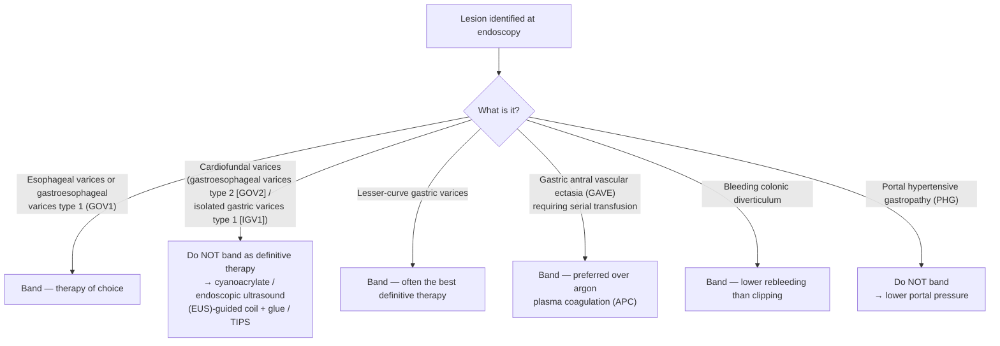

## Contents
- [[#Scope]]
- [[#Indications by Site and Setting]]
  - [[#Esophageal Varices and GOV1]]
  - [[#Gastric Varices — Where Banding Stops]]
  - [[#GAVE]]
  - [[#Colonic Diverticular Hemorrhage]]
  - [[#Internal Hemorrhoids]]
- [[#When Not to Band]]
- [[#Session Schedule and Post-Eradication Surveillance]]
- [[#Adverse Events]]
- [[#Outcomes and Comparisons]]
- [[#See Also]]
- [[#Sources]]

---

## Scope

Mechanical hemostasis by deploying an elastic band over a vessel or lesion drawn into a cap on the endoscope tip. Two names for the same device in different settings: **endoscopic variceal ligation (EVL)** for varices, **endoscopic band ligation (EBL)** for non-variceal targets.

The decision algorithms that *lead* to banding live on the syndrome pages; this page holds the procedure itself.

| Question | Where it is answered |
|---|---|
| The full acute variceal hemorrhage bundle (vasoactive drugs, antibiotics, preemptive transjugular intrahepatic portosystemic shunt [TIPS], salvage) | [[variceal-upper-gi-bleeding]] |
| Varix size/red-sign definitions, the Sarin classification, portal-hypertension staging, primary-prophylaxis decision | [[portal-hypertension]] |
| [[nonselective-beta-blockers\|Nonselective beta-blocker (NSBB)]] choice, dosing, titration and intolerance | [[nonselective-beta-blockers]] |
| The other hemostatic devices (clips, thermal, powder, injection) | [[endoscopic-hemostasis]] |
| Which lower-gastrointestinal (GI) lesion gets which modality | [[acute-lower-gi-bleeding]] |
| Hemorrhoid grading and the full office-treatment comparison | [[hemorrhoids]] |

---

## Indications by Site and Setting

### Esophageal Varices and GOV1

| Setting | Position | Source |
|---|---|---|
| **Acute bleeding** from esophageal varices or GOV1 | **EVL is the endoscopic therapy of choice**, preferred over sclerotherapy | [[aasld-2023-portal-hypertension]] guidance statement (GS) 31; [[baveno-viii-2026-portal-hypertension]] 5.29 |
| Acute bleeding — alternatives | **Not first-line:** hemoclips, over-the-scope clips, topical hemostatic agents/powders, fibrin | [[baveno-viii-2026-portal-hypertension]] 5.28 |
| **Primary prophylaxis**, compensated cirrhosis with **large** esophageal varices or GOV1, NSBB-ineligible | EVL to prevent a first variceal bleed | [[baveno-viii-2026-portal-hypertension]] 3.19; [[aasld-2023-portal-hypertension]] GS 19 |
| Primary prophylaxis, **small** high-risk varices | EVL is **not technically feasible** — NSBB is the only option | [[aasld-2023-portal-hypertension]] |
| Primary prophylaxis, decompensated cirrhosis, never bled, not on NSBB | **NSBB preferred over banding** (benefits beyond bleeding prevention) | [[aasld-2023-portal-hypertension]] GS 22–23 |
| NSBB stopped for persistent systolic blood pressure <90 mm Hg or severe adverse effects | Discontinuation **should prompt [[upper-endoscopy\|esophagogastroduodenoscopy (EGD)]]** to find high-risk varices needing banding | [[aasld-2023-portal-hypertension]] GS 24 |
| Permanent NSBB intolerance after re-challenge | EVL to prevent variceal hemorrhage | [[baveno-vii-2022-portal-hypertension]] 7.7 |
| **Secondary prophylaxis** after an esophageal variceal bleed (no preemptive TIPS) | **NSBB + EVL** — carvedilol preferred over conventional NSBB | [[baveno-viii-2026-portal-hypertension]] 4.8; [[aasld-2023-portal-hypertension]] GS 38 |
| Cannot tolerate **either** EVL or carvedilol/conventional NSBB | Maintain whichever is tolerated as monotherapy | [[baveno-viii-2026-portal-hypertension]] 4.9 |
| Varices with occlusive bland or malignant [[portal-vein-thrombosis\|portal vein thrombosis (PVT)]] | **NSBB preferred over banding**; EVL when NSBB cannot be given | [[aasld-2023-portal-hypertension]] GS 54 |

- ⚠ **Banding is not the safer option in primary prophylaxis.** One meta-analysis found **EVL associated with higher complication rates and mortality than NSBB** — NSBB is preferred wherever it is tolerated ([[aasld-2023-portal-hypertension]]).

### Gastric Varices — Where Banding Stops

*Lesion types and the two-phase cardiofundal pathway: [[variceal-upper-gi-bleeding]].*

- **Cardiofundal varices (GOV2 / IGV1):** band ligation achieves initial hemostasis in **45%–93%** but is **inferior to cyanoacrylate for long-term control** → a reasonable **temporizing** measure only, and must be followed by definitive therapy ([[aga-2021-bleeding-gastric-varices]]).
- **Lesser-curve gastric varices:** banding **is often the best definitive therapy**, because these varices behave like esophageal varices ([[aga-2021-bleeding-gastric-varices]]).
- Classify the esophageal varices as well as the gastric ones at the index exam — the definitive gastric-varix therapies differ in their effect on later esophageal variceal bleeding ([[aga-2021-bleeding-gastric-varices]]).

### GAVE

- **[[gastric-antral-vascular-ectasia|GAVE]] requiring serial transfusion → EVL is recommended over [[argon-plasma-coagulation|APC]]** — higher eradication rates, fewer treatment sessions, less recurrent bleeding, fewer hospitalizations and transfusions ([[baveno-viii-2026-portal-hypertension]] 5.43; level of evidence [LoE] 1, strong).
- The head-to-head transfusion, hemoglobin and session-count figures are on [[gastric-antral-vascular-ectasia]].
- ⚠ **This changed direction.** [[baveno-vii-2022-portal-hypertension]] 6.25 treated APC, radiofrequency ablation and banding as interchangeable local options; Baveno VIII makes ligation the recommendation and APC the comparator it beats.
- **Do not band [[portal-hypertensive-gastropathy|PHG]]** — it is diffuse and portal-pressure-driven, so it is treated by lowering portal pressure, not by local ablation ([[baveno-viii-2026-portal-hypertension]] 5.44). Distinguishing PHG from GAVE at the index endoscopy is what decides which pathway the patient enters.

### Colonic Diverticular Hemorrhage

- EBL gives **lower early rebleeding (8% vs 19%)** and **lower late rebleeding (9% vs 29%)** than clipping, and **may be preferred for durable outcomes** ([[acg-2023-lgib]]).
- **Initial hemostasis is 99%–100% across all modalities** — the modalities separate on **rebleeding**, not on initial success. Even after hemostasis, early rebleeding is **17.4%** and late rebleeding **32.0%** ([[acg-2023-lgib]]).
- **Recommendation 10 ([[acg-2023-lgib]], strong recommendation, moderate-quality evidence):** treat diverticular stigmata of hemorrhage with through-the-scope clips, endoscopic band ligation, **or** coagulation — the three are co-equal in the recommendation itself; EBL's edge is in the rebleeding data above, and it was also more effective than clipping at avoiding transarterial embolization or surgery.
- **Technique, because the scope must come out** ([[acg-2023-lgib]]):
  1. **Mark the stigmata with a clip, then withdraw the endoscope** — the banding device cannot be loaded with the scope in situ. An **adjacent tattoo** before banding has also been reported and may help if endotherapy fails and surgery is needed.
  2. Attach the banding device; **reinsert to the marked diverticulum**.
  3. **Suction the diverticulum into the device** and deploy the band.
  - **Feasibility criterion: the diverticulum must be smaller than the diameter of the banding device.**
  - A **clear cap** is recommended generally for lower-GI bleeding — it deflects folds, stabilizes the tip, and holds the target at a constant distance aligned with the accessory channel (key concept, ungraded).
  - ⚠ **The left-colon caveat is about reach, not wall thickness.** A conventional esophageal variceal banding device mounted on a gastroscope **may limit therapy to the left colon**; a newer banding device specific to colonic diverticular bleeding has a wider field of vision, appears equally effective, and may shorten procedure time.
  - Most published EBL experience is from Japanese cohorts, where right-sided diverticulosis predominates and presentation differs from Western populations.
- **Perforation: 2 of 647 patients (0.31%)** after colonic EBL versus none after clipping, in a 1,679-patient multicenter cohort ([[acg-2023-lgib]]).
- **Not an option for the other lower-GI sources.** [[acg-2023-lgib]] places banding only under diverticular hemorrhage — [[angioectasia|colonic angioectasias]] get [[argon-plasma-coagulation|APC]] first-line and postpolypectomy bleeding gets clips; neither algorithm lists EBL.
- [[acg-2021-ugib]] does not address band ligation at all: its endoscopic recommendations are restricted to **ulcer** bleeding, and banding appears in none of its 16 statements.

### Internal Hemorrhoids

- Rubber band ligation is the **preferred office therapy for grade 1–3 internal hemorrhoids** and must be tried before hemorrhoidectomy; grade-by-grade efficacy, the comparison with infrared coagulation and sclerotherapy, band placement relative to the dentate line, and the complication rates are all on [[hemorrhoids]].

---

## When Not to Band

- **Cardiofundal varices (GOV2/IGV1) as definitive therapy** — temporizing only (above).
- **PHG** — wrong target ([[baveno-viii-2026-portal-hypertension]] 5.44).
- **Small esophageal varices** — technically not feasible ([[aasld-2023-portal-hypertension]]).
- **As the first choice over NSBB** in decompensated cirrhosis never-bled patients, or in varices with occlusive PVT ([[aasld-2023-portal-hypertension]] GS 22–23, GS 54).

---

## Session Schedule and Post-Eradication Surveillance

| Phase | Interval | Source |
|---|---|---|
| Repeat sessions until variceal obliteration | **Every 2–4 weeks** | [[aasld-2023-portal-hypertension]] GS 19–20, GS 31 |
| First EGD after obliteration | **6 months** | [[aasld-2023-portal-hypertension]] GS 20 |
| Thereafter | **Annually** | [[aasld-2023-portal-hypertension]] GS 20 |

- Lesser-curve gastric varices follow the same repeat-banding-to-eradication schedule as esophageal varices; after cyanoacrylate or TIPS for cardiofundal varices, persistent lesser-curve varices are banded to eradication ([[aga-2021-bleeding-gastric-varices]]).

---

## Adverse Events

- **Post-EVL ulcer bleeding** ([[baveno-viii-2026-portal-hypertension]] 5.47): **rare but serious.** Management is individualized and may require vasoactive therapy, endoscopic hemostasis, temporary stenting or tamponade, and **rescue TIPS with embolization**.
  - **High-risk patients: Model for End-Stage Liver Disease (MELD) score >18, or an emergency EVL.**
- ⚠ **Routine [[proton-pump-inhibitors|proton pump inhibitor (PPI)]] to prevent post-banding ulcers is not supported** by current evidence ([[baveno-viii-2026-portal-hypertension]] 5.48). Separately, a PPI started empirically for suspected upper-GI bleeding is **discontinued** once portal-hypertensive bleeding is confirmed as the source, unless there is a strong independent indication ([[aasld-2023-portal-hypertension]] GS 37; [[baveno-viii-2026-portal-hypertension]] 5.14).
- **Variceal bands do not contraindicate nasogastric tube placement** — enteral nutrition is started once the hemorrhage episode is controlled ([[aasld-2023-portal-hypertension]] GS 36).

---

## Outcomes and Comparisons

| Comparison | Result | Source |
|---|---|---|
| EVL vs sclerotherapy, acute esophageal variceal bleeding | EVL preferred | [[aasld-2023-portal-hypertension]] GS 31 |
| EVL vs NSBB, primary prophylaxis | NSBB preferred — EVL had higher complication rates and mortality in one meta-analysis | [[aasld-2023-portal-hypertension]] |
| EVL vs APC, GAVE | EVL — higher eradication, fewer sessions, less rebleeding | [[baveno-viii-2026-portal-hypertension]] 5.43 |
| Band ligation vs cyanoacrylate, cardiofundal gastric varices | Cyanoacrylate for long-term control; banding temporizes | [[aga-2021-bleeding-gastric-varices]] |
| EBL vs clipping, diverticular hemorrhage | EBL — lower early and late rebleeding | [[acg-2023-lgib]] |

---

## See Also

[[variceal-upper-gi-bleeding]], [[portal-hypertension]], [[cirrhosis]], [[nonselective-beta-blockers]], [[tips]], [[endoscopic-hemostasis]], [[argon-plasma-coagulation]], [[gastric-antral-vascular-ectasia]], [[portal-hypertensive-gastropathy]], [[acute-lower-gi-bleeding]], [[upper-gi-bleeding]], [[hemorrhoids]], [[upper-endoscopy]], [[colonoscopy]], [[proton-pump-inhibitors]], [[portal-vein-thrombosis]], [[endoscopic-ultrasound]], [[hepatic-venous-pressure-gradient]]

---

## Sources

1. [[baveno-viii-2026-portal-hypertension|Baveno VIII — Advancing Consensus in Portal Hypertension (2026)]]
2. [[aasld-2023-portal-hypertension|AASLD 2023 Practice Guidance on Portal Hypertension and Varices in Cirrhosis]]
3. [[acg-2023-lgib|ACG 2023: Management of Patients With Acute Lower Gastrointestinal Bleeding]]
4. [[aga-2021-bleeding-gastric-varices|AGA Clinical Practice Update on Management of Bleeding Gastric Varices: Expert Review (2021)]]
5. [[baveno-vii-2022-portal-hypertension|Baveno VII — Renewing Consensus in Portal Hypertension (2022)]]
6. [[acg-2021-ugib|ACG 2021: Upper Gastrointestinal and Ulcer Bleeding]]
</content>
