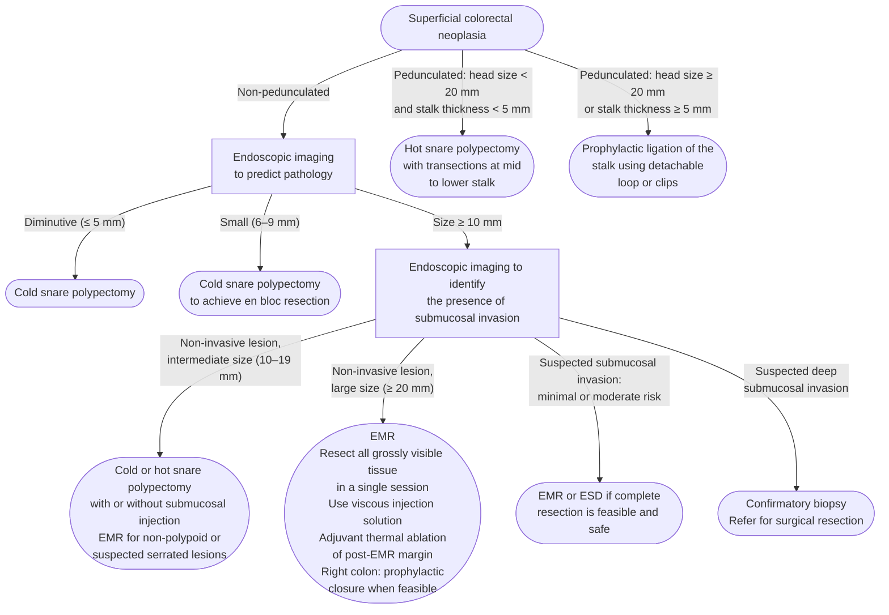
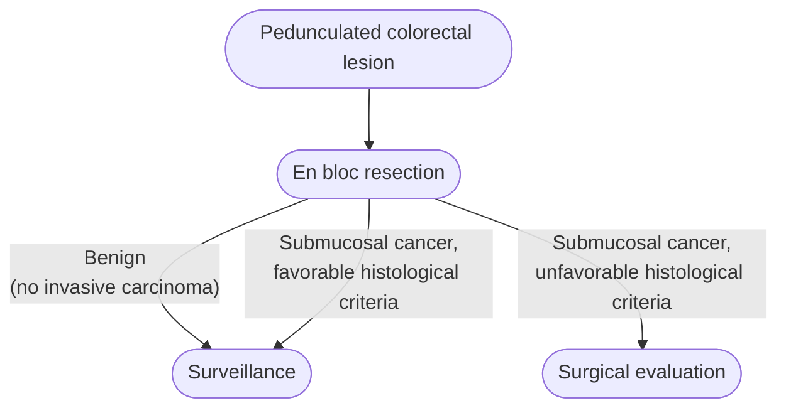
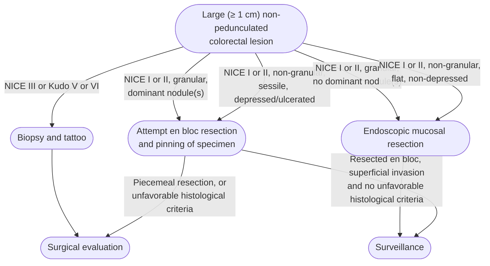

# Polypectomy (Colorectal)

Optical assessment and removal of colorectal polyps at [[colonoscopy]] — the technique choice that follows from lesion size, morphology, and suspected depth of invasion, plus recognition and management of the malignant polyp. Larger and more complex lesions are resected by [[endoscopic-mucosal-resection|endoscopic mucosal resection (EMR)]] or [[colorectal-esd|endoscopic submucosal dissection (ESD)]].

## Contents
- [[#Lesion Assessment]]
  - [[#Required Documentation (all lesions ≥10mm)]]
  - [[#Paris Classification (type 0 superficial lesions)]]
  - [[#Laterally Spreading Tumors (LSTs, ≥10mm)]]
  - [[#Optical Diagnosis]]
- [[#Resection by Lesion Size and Type]]
  - [[#≤5mm (Diminutive)]]
  - [[#6–9mm (Small)]]
  - [[#10–19mm Non-Pedunculated]]
  - [[#≥20mm Non-Pedunculated]]
  - [[#Pedunculated]]
  - [[#Difficult Locations]]
  - [[#Tailored Technique Selection (AGA 2024 CPU)]]
- [[#Lesion Marking / Tattoo]]
- [[#Malignant Polyp Recognition and Management]]
  - [[#Definition]]
  - [[#Endoscopic Features Predicting Deep Submucosal Invasion (≥1 mm)]]
  - [[#Morphology Features Predicting Superficial (but elevated) SMI Risk]]
  - [[#Management by Deep SMI Features (Recommendation 1b, Weak; low-quality evidence)]]
  - [[#En Bloc Resection for Superficial SMI Risk (Recommendation 2b, Weak; low-quality evidence)]]
  - [[#Haggitt Classification (Pedunculated Polyps)]]
  - [[#Kikuchi Classification (Sessile/Flat Polyps — Depth of Submucosal Invasion)]]
  - [[#Favorable vs. Unfavorable Histologic Criteria]]
  - [[#Specimen Handling for Potentially Malignant Polyps]]
  - [[#Pathology Reporting Standards]]
  - [[#Multidisciplinary Management]]
- [[#Quality Standards]]

---

## Lesion Assessment

### Required Documentation (all lesions ≥10mm)

- Location, size (mm), Paris classification
- Photo before removal; suggest photo of post-resection defect
- Resection method in procedure report
- **How to size it:** hold **open biopsy forceps over and against** the polyp; for smaller polyps use the **snare sheath tip (2.4 mm)** against the polyp base ([[asge-acg-2024-colonoscopy-quality-indicators]])
- **For every LST ≥20 mm, three things must be recorded** ([[weo-2024-large-colorectal-lst-consensus]]): the **Paris** type (**Strong**/High), the **LST classification** for nonserrated lesions — granular homogeneous, granular mixed, nongranular pseudodepressed, nongranular flat elevated (**Strong**/High) — and **some classification predicting submucosal invasion risk** (**Strong**/Moderate). Assess on a **high-definition** scope (**Strong**/High) with **virtual chromoendoscopy, dye-based chromoendoscopy, or both** (**Strong**/High). The consensus deliberately **endorses no single optical system** — the statement favoring one over the others failed at <50% agreement.
- **Competency:** resecting a large LST requires training in image-enhanced endoscopy and optical evaluation (**Strong**/Moderate), adequate caseload for the chosen technique (**Strong**/Moderate), and **self-audit of R0, curative resection, recurrence, perforation and bleeding rates** (**Strong**/Moderate). **No case number was agreed** — that statement was dropped at <50% agreement ([[weo-2024-large-colorectal-lst-consensus]]).

### Paris Classification (type 0 superficial lesions)

Type 0 = superficial lesions (types 1–5 = advanced cancers). Split by **polypoid (0-I)** — protrudes from mucosa into the lumen — vs **non-polypoid (0-II)** — little to no protrusion; **excavated (0-III)** is rare in the colon. Use it to describe surface morphology in the report (Statement 1, conditional; low-quality evidence).

| Type | Profile | Endoscopic appearance | Description | Submucosal invasion (SMI) risk |
|---|---|---|---|---|
| **0-Ip** — pedunculated | ![[polypectomy-2020-paris-schematic-0ip-07.png\|180]] | — | Attached to mucosa by a **stalk**; base of the lesion is narrow | — |
| **0-Is** — sessile | ![[polypectomy-2020-paris-schematic-0is-07.png\|180]] | ![[polypectomy-2020-paris-endoscopic-0is-07.png\|200]] | **No stalk**; base and top of the lesion have the same diameter | — |
| **0-IIa** — superficially elevated | ![[polypectomy-2020-paris-schematic-0iia-07.png\|180]] | ![[polypectomy-2020-paris-endoscopic-0iia-07.png\|200]] | Height **<2.5 mm** above normal mucosa (alternative definition: height < ½ the lesion diameter) | 0.7–2.4% |
| **0-IIb** — flat | ![[polypectomy-2020-paris-schematic-0iib-07.png\|180]] | — | **No protrusion** above the mucosa at all | — |
| **0-IIc** — depressed | ![[polypectomy-2020-paris-schematic-0iic-07.png\|180]] | ![[polypectomy-2020-paris-endoscopic-0iic-07.png\|200]] | Base **lower than** the surrounding normal mucosa; uncommon (1–6% of non-polypoid lesions) | **27–35.9%** — highest of any type; **>40%** if 6–10 mm; virtually all **>20 mm** have SMI |
| **0-IIa+IIc** — mixed | *(not depicted)* | — | Combined elevated + depressed components | — |
| **0-III** — excavated | ![[polypectomy-2020-paris-schematic-0iii-07.png\|180]] | — | Ulcerated; **rare in the colon** | — |

*Figure 1 — Paris Endoscopic Classification of superficial (type 0) neoplastic lesions of the colon and rectum. Profile column = schematic side-view of each subtype (red = lesion, dotted line = normal mucosal level). Endoscopic column = matching examples, white light on top, image-enhanced/chromoendoscopy below. Panels cropped from the source figure. ([[usmstf-2020-endoscopic-removal]])*

### Laterally Spreading Tumors (LSTs, ≥10mm)

Single home for laterally spreading tumor (LST) submucosal-invasion risk — the two US Multi-Society Task Force (USMSTF) 2020 documents describe the same four subtypes with different granularity, so both are given side by side:

| Subtype | SMI risk ([[usmstf-2020-endoscopic-removal]]) | SMI risk by size ([[usmstf-2020-malignant-colorectal-polyps]]) |
|---|---|---|
| LST-G-H (granular homogenous — even-sized nodules) | ~0.5% | <2% |
| LST-G-NM (granular nodular mixed — dominant nodule) | Intermediate | 7.1% (<20 mm); 38% for larger lesions (cut-point printed as >20 mm in one passage, >30 mm in another) |
| LST-NG-FE (non-granular flat elevated) | Higher | 6.4% (10–19 mm); 10.4% (20–29 mm) |
| LST-NG-PD (non-granular pseudodepressed — sessile/depressed) | ~31.6% | 27.8% (10–19 mm); 41.4% (20–29 mm) |

- **Deep** SMI in LST-NG with depression/ulceration (181 lesions): 12.5% (10–19 mm), 32.4% (20–29 mm), 83.3% (≥30 mm) ([[usmstf-2020-malignant-colorectal-polyps]]).
- LST-G mixed: invasion usually under the **largest nodule** → remove it (and any suspicious nodule) in one piece. LST-NG often has submucosal fibrosis → harder snare/EMR; invasion often multifocal.

*See Figure 2 in [[usmstf-2020-endoscopic-removal|USMSTF 2020 Endoscopic Removal]] for example images: granular LSTs (nodular surface) vs non-granular LSTs (smooth surface).*

*See Figure 5 in [[usmstf-2020-malignant-colorectal-polyps|USMSTF 2020 Malignant Polyps]] for example images: granular LSTs (LST-G) with a nodular surface or mixed nodular morphology.*

*See Figure 6 in [[usmstf-2020-malignant-colorectal-polyps|USMSTF 2020 Malignant Polyps]] for example images: non-granular LSTs (LST-NG) with a smooth surface or a pseudodepressed area.*

### Optical Diagnosis

- **Narrow-band imaging (NBI) International Colorectal Endoscopic (NICE) classification:**
  - Type 1 = serrated (hyperplastic polyp [HP]/sessile serrated lesion [SSL]); can leave rectosigmoid lesions ≤5mm
  - Type 2 = adenoma; remove
  - Type 3 = deep SMI (>1000μm) → biopsy + tattoo + surgical referral

| NBI feature | Type 1 | Type 2 | Type 3 |
|---|---|---|---|
| **Color** | Same or lighter than background | Browner relative to background (verify color arises from vessels) | Brown to dark brown relative to background; sometimes patchy whiter areas |
| **Vessels** | None, or isolated lacy vessels may be present coursing across the lesion | Brown vessels surrounding white structures | Has area(s) of disrupted or missing vessels |
| **Surface pattern** | Dark or white spots of uniform size, or homogeneous absence of pattern | Oval, tubular, or branched white structures surrounded by brown vessels | Amorphous or absent surface pattern |
| **Most likely pathology** | Hyperplastic and sessile serrated lesions | Adenoma | Deep submucosal invasive cancer |

*NICE classification of colorectal lesions under NBI*
*Source: table from the USMSTF 2020 endoscopic removal guideline NICE classification figure*
*[[usmstf-2020-endoscopic-removal|USMSTF 2020 Endoscopic Removal]]*
*NBI = narrow-band imaging · NICE = NBI International Colorectal Endoscopic*

- Usable with or without optical (zoom) magnification; stating a confidence level (high or low) for each optical diagnosis is important in clinical practice. The white structures of type 2 may represent the pits and the epithelium of the crypt opening. Sessile serrated polyps often show some dark, dilated crypt orifices. **Type 2 spans Vienna types 3, 4 and superficial 5** (adenomas with low- or high-grade dysplasia, or with superficial submucosal carcinoma); an irregular vessel or surface pattern, often with atypical morphology (eg, a depressed area), may suggest high-grade dysplasia or superficial submucosal carcinoma ([[usmstf-2020-endoscopic-removal]]).

*See Figure 3 in [[usmstf-2020-endoscopic-removal|USMSTF 2020 Endoscopic Removal]] for example images: an NBI view of a type 1, type 2 and type 3 lesion.*

- **Japan NBI Expert Team (JNET) classification** (magnifying NBI): keeps NICE types 1 and 3; splits type 2 into **2A** (regular caliber/distribution, regular tubular/branched/papillary surface → low-grade intramucosal neoplasia) and **2B** (variable caliber, irregular distribution; irregular or obscure surface → high-grade intramucosal neoplasia / superficial SMI cancer). JNET 3 (loose vessel areas, interrupted thick vessels, amorphous areas) → deep SMI cancer. Full table: [[usmstf-2020-malignant-colorectal-polyps]].
  - 2B → consider *en bloc* resection where feasible; accuracy without full optical magnification uncertain ([[usmstf-2020-malignant-colorectal-polyps]]).

| NBI | 2B-low | 2B-high |
|---|---|---|
| **Vessel pattern** | The thickness and distribution of irregular vessels are uniform | The diameter and/or distribution of irregular vessels are heterogeneous |
| **Surface pattern** | Irregularly in the pit-like pattern network · Smooth pit-like structure margin without ravaging | Irregular and destroyed pit-like pattern · Irregular, fluffing, and unclear pit-like structure margin |

*JNET type 2B split into 2B-low and 2B-high*
*Source: table from the USMSTF 2020 malignant polyp guideline JNET classification figure*
*[[usmstf-2020-malignant-colorectal-polyps|USMSTF 2020 Malignant Polyps]]*
*JNET = Japan NBI Expert Team · NBI = narrow-band imaging*

*See Figure 3 in [[usmstf-2020-malignant-colorectal-polyps|USMSTF 2020 Malignant Polyps]] for example images: magnified NBI views of a 2B-low and a 2B-high lesion.*

- **Workgroup Serrated Polyps and Polyposis (WASP) criteria:** adds 4 SSL features to NICE for serrated vs HP distinction. Within NICE type 1, the sessile serrated lesion–like features are a **clouded surface, indistinct borders, irregular shape, and dark spots inside the crypts**; **≥2 features are sufficient to diagnose an SSL** rather than a hyperplastic lesion ([[usmstf-2020-endoscopic-removal]]).

*See Figure 4 in [[usmstf-2020-endoscopic-removal|USMSTF 2020 Endoscopic Removal]] for example images: each of the four sessile serrated lesion–like features.*

- Non-lifting sign = SMI or fibrosis (prior polypectomy cautery, [[inflammatory-bowel-disease|colitis]]). On submucosal injection the lesion **infolds**, because only the submucosa of the surrounding normal mucosa expands; fibrosis also occurs under non-granular LSTs ([[usmstf-2020-endoscopic-removal]]).

*See Figure 9 in [[usmstf-2020-endoscopic-removal|USMSTF 2020 Endoscopic Removal]] for example images: non-lifting lesions from submucosal invasion, from fibrosis in a non-granular LST, and after prior polypectomy cautery.*

---

## Resection by Lesion Size and Type

*Management of superficial colorectal lesions by morphology, size and suspected submucosal invasion*
*Source: redrawn from the USMSTF 2020 endoscopic removal guideline algorithm for the management of colorectal lesions*
*[[usmstf-2020-endoscopic-removal|USMSTF 2020 Endoscopic Removal]]*
*EMR = endoscopic mucosal resection · ESD = endoscopic submucosal dissection*

### ≤5mm (Diminutive)

- **Cold snare polypectomy (CSP):** standard of care for diminutive (≤5 mm) and small (6–9 mm) lesions (Strong; **high**-quality per Table 1 of [[usmstf-2020-endoscopic-removal]], **moderate**-quality where the same sentence appears in that document's body text — an unresolved internal discrepancy, verified in both printings)
- **Cold forceps: NOT recommended for diminutive (≤5 mm) lesions** — 9–61% incomplete resection (Strong; moderate-quality)
- Hot biopsy forceps: NOT recommended for polypectomy of diminutive (≤5 mm) and small (6–9 mm) lesions — incomplete resection, inadequate histopathologic specimens, complications (Strong; moderate-quality). *The graded statement is scoped to diminutive and small lesions (≤9 mm); the guideline gives no graded recommendation against hot biopsy forceps at larger sizes.*
- **Cold-forceps exception — the size cutoff differs between guidelines:**
  - **≤2 mm**, only when CSP is technically difficult and single-bite resection is anticipated, using jumbo/large-capacity forceps ([[usmstf-2020-endoscopic-removal]], [[asge-2020-endoscopic-removal]])
  - **1–3 mm** when CSP is technically difficult ([[aga-2024-tailored-polypectomy]] best practice advice [BPA] 2 — newer; see the tailored-technique table below). Newer tier-1 source, so 1–3 mm is what this page follows.

### 6–9mm (Small)

- **Cold snare:** preferred; complete resection comparable to hot snare, lower delayed bleeding
- Hot snare: acceptable; comparable complete resection rates
- Cold snare advantage: no delayed bleeding or coagulation syndrome
- **This is a measured quality indicator: ≥90% of 4–9 mm lesions resected with a cold snare** — and it carries grade **1A**, the only one in the 2024 task-force set ([[asge-acg-2024-colonoscopy-quality-indicators]]). Benchmarks: [[colonoscopy-quality-indicators]]

### 10–19mm Non-Pedunculated

- Cold or hot snare ± submucosal injection
- **[[endoscopic-mucosal-resection|EMR]] preferred** for:
  - Non-polypoid lesions (0-IIa, 0-IIb, 0-IIc)
  - Serrated lesions (sessile serrated polyps [SSPs], traditional serrated adenoma [TSA]) — high incomplete resection with conventional polypectomy
  - LSTs
- **In [[serrated-polyposis-syndrome|serrated polyposis syndrome (SPS)]], resect SSLs and hyperplastic polyps by cold snare ± submucosal injection regardless of size** — lesions ≥10 mm can be taken piecemeal cold, with fewer complications and no clip closure required. Reserve electrocautery for **endoscopically evident dysplasia** and for bulky SSLs *(Strong, Oxford Level 3; [[usmstf-2026-serrated-polyposis-syndrome]])*

### ≥20mm Non-Pedunculated

- **EMR — preferred; first-line over surgery**
- Requires experienced endoscopist
- Resect all visible tissue in single session, minimum number of pieces
- Prior failed attempts → higher recurrence risk; refer to experienced endoscopist, not surgery

**En bloc vs piecemeal — by optical class and site** ([[weo-2024-large-colorectal-lst-consensus|WEO 2024]] Delphi consensus, GRADE-rated; **the rectum is handled separately throughout** because rectal lesions carry higher submucosal invasion rates yet are safer to take en bloc):

| Optical class / morphology | Proximal to rectum | Rectum |
|---|---|---|
| **Serrated** (JNET 1, WASP) | **Either** (Conditional/Mod); **cold snare** if no suspicion of dysplasia (Conditional/Mod) | same |
| **JNET 2A, granular homogeneous** — low risk of superficial SMI | **Either** (**Strong**/Mod) | **Attempt en bloc if feasible** (**Strong**/Mod) |
| **JNET 2B** — suspected **superficial (<1000 μm)** SMI | **En bloc** (**Strong**/Mod) | **En bloc** (**Strong**/Mod) |
| **Nongranular · granular mixed with a large dominant nodule · demarcated depressed area** — increased superficial-SMI risk | **En bloc** (**Strong**/Mod) | **En bloc** (**Strong**/Mod) |
| **JNET 3 · Kudo VN · Kudo VI-severe with demarcated area** — suspected **deep** SMI | **Multidisciplinary evaluation** of resection suitability and modality (**Strong**/Mod) | **Lower rectum**, staging negative for LNM/distant metastasis: a deeper-plane en bloc method (endoscopic intermuscular dissection, peranal endoscopic myectomy) **can be considered in patients declining surgery** after MDT review (Conditional/Low) |

> [!pearl] JNET 2B is a low-confidence call, which is why it buys en bloc resection
> Positive predictive value for high-grade dysplasia or submucosal invasion in **JNET 2B is only 50.9%**, against **91.0%–98.3%** for JNET 2A predicting neither. A 2B lesion may be restratified for *deep* invasion with the **Kudo pit pattern** (Conditional/High), ideally with optical magnification ([[weo-2024-large-colorectal-lst-consensus]]).

- **Piece count is the modifiable recurrence driver:** **~10% recurrence after 3 pieces, up to 25% after 4** in >20 mm lesions. Residual microscopic tissue sits in the **margin of 19.5%** and the **base of 23.8%** of post-EMR defects. Aim for as few pieces as possible **when it is safe** (Conditional/Low) — larger pieces carry their own adverse-event risk, and **cold snare transection fails above ~8 mm per piece.**
- **Submucosal invasion rates with no overt signs of invasion** (n=1712): **proximal granular homogeneous 0.7%**, **rectal granular homogeneous 1.2%**.
- **All rectal LSTs belong in a center where both ESD and EMR are readily available.** A rectum-specific strategy — piecemeal for flat lesions with no optical signs of invasion and **no nodule >10 mm**, ESD for the rest — cured **100%** of potentially curable superficially invasive cancers in 190 lesions.
- **Deviation is expected, in one direction:** attempting **piecemeal when en bloc is recommended is preferred over sending a benign lesion to surgery.** The consensus states it has **no agreed numeric threshold** for low, moderate or high submucosal invasion risk.
- **Serrated lesion with an overt dysplastic focus: no recommendation** — neither cold vs hot snare nor en bloc vs piecemeal, for lack of data. Piecemeal cold snare of ≥20 mm sessile serrated lesions recurs in **4.7%** (95% CI 0.9–8.5) in expert hands, but incomplete resection of 1–20 mm serrated lesions across expert *and* nonexpert endoscopists runs **28.5% vs 13.3%** for adenomas — **reserve the cold piecemeal approach for experts in optical diagnosis and advanced resection.**

### Pedunculated

- Hot snare: preferred for head ≥10mm
- **Prophylactic mechanical ligation** (detachable loop or clips) for:
  - Head ≥20mm OR stalk ≥5mm
  - Reduces immediate and delayed [[endoscopic-hemostasis|post-polypectomy bleeding]]
- Retrieve large specimens en bloc (don't divide head for retrieval)

### Difficult Locations

- **Right colon:** Higher [[endoscopic-management-of-perforation|perforation]] risk; prefer cold snare when feasible; CO2 insufflation mandatory; clip defects ≥20mm prophylactically
- **Difficult positions (folds, flexures, ileocecal valve):** Consider cap-assisted [[colonoscopy]], position change, water-jet assisted technique; partial resection plus avulsion acceptable if full snare not achievable
- **Rectal lesions:** [[colorectal-esd|ESD]] more often feasible given straight working channel; consider peri-anal approach for very distal lesions

### Tailored Technique Selection (AGA 2024 CPU)

Structured optical assessment (Paris/NICE/WASP/Kudo/JNET — see [[#Optical Diagnosis]]) precedes technique choice; overt deep SMI (NICE 3 / Kudo V) is not resected endoscopically. [[aga-2024-tailored-polypectomy|American Gastroenterological Association (AGA) 2024]] Best Practice Advice, by scenario:

| Scenario | Technique |
|---|---|
| **<10 mm** | **CSP** (BPA 2) |
| **1–3 mm, CSP technically difficult** | Cold forceps acceptable — use **large-capacity/jumbo** forceps (noninferior for 3-mm polyps in a recent randomized controlled trial [RCT]) (BPA 2) |
| **Any diminutive/small** | **Never hot forceps** (higher incomplete removal + delayed bleeding, esp. right colon) (BPA 3) |
| **Intermediate 10–19 mm** | Judgment call — be familiar with CSP, hot snare polypectomy (HSP), and EMR (BPA 4). Larger/bulkier/**sessile/adenomatous** → hot (HSP ± injection); **flat (Paris IIa/IIb) or serrated** → cold (cold EMR [c-EMR] preferred). Cold-snare failure is size-dependent (**~53% incomplete at 16–20 mm**) |
| **Sessile 10–19 mm** | Consider **lifting agents or underwater EMR** (BPA 5) |
| **Serrated lesions** | **Cold resection** techniques; add submucosal injection for >10 mm if margins can't be delineated (BPA 6) |
| **Pedunculated >10 mm** | **Hot snare** (feeding vessel in stalk) (BPA 7) |
| **≥20 mm, difficult location, or recurrence** | Refer to an **endoscopic referral center** (BPA 9) |
| **Nonpedunculated with clear submucosally invasive cancer (SMIC)** | **Surgical** evaluation (BPA 11) |

- **Intermediate-size RCT data:** complete resection CSP 81.6% / c-EMR 94.1% / hot-EMR 95.5% (6–20 mm); immediate bleeding higher with cold, delayed bleeding higher with hot. SSLs ≥10 mm resect cold with practically no upper size limit (recurrence 0–10%, no perforations; c-EMR vs h-EMR eliminates the ~5% bleeding / ~3% deep-mural-injury of hot).
- **Prophylactic clips (BPA 8):** do **not** routinely clip resection sites for polyps **<20 mm** — benefit is limited to **≥20 mm proximal-colon** lesions (individual-patient-data meta-analysis: 38% ↓ delayed bleeding, adjusted OR 0.62). Serrated polyps have low bleeding risk and don't need clipping. *(Consistent with the ≥20 mm / right-colon clipping guidance on [[endoscopic-mucosal-resection]].)*
- **Electrosurgical generator (ESG; BPA 12):** know your suite's ESG settings for polypectomy and post-polypectomy thermal techniques. Settings by manufacturer, waveform physics, and safety are on **[[electrosurgery]]**.

- **Which current, when a hot technique is chosen:** **either cut- or coagulation-predominant is acceptable** — no clear difference in serious adverse events, complete resection, or recurrence ([[aga-2026-electrosurgery]] BPA 5). For **large pedunculated** polyps a coagulation-predominant waveform may be preferable, to seal vessels across the thick stalk. *RCT numbers and the analog-generator caveat: [[electrosurgery#Polypectomy]].*
- **Snare placement on a stalk: across the *mid-stalk*, not near the base** — too basal transmits excessive thermal injury to the colonic wall ([[aga-2026-electrosurgery]] BPA 6).

---

## Lesion Marking / Tattoo

- Sterile carbon particle suspension for any lesion needing future localization
- 2–3 injection sites, **3–5 cm distal (anal side)** to lesion
- Do NOT inject at or adjacent to lesion — causes fibrosis, impairs future resection
- Document: material, volume, position relative to lesion; photo in report

---

## Malignant Polyp Recognition and Management

*Source: [[usmstf-2020-malignant-colorectal-polyps]]. See also [[colorectal-cancer]], [[colorectal-cancer-screening]], [[endoscopic-ultrasound]], [[lynch-syndrome]]. For en-bloc modality choice and curative-resection criteria in early (T1) colorectal cancer (CRC), see [[colorectal-esd]].*

### Definition

A **malignant polyp** is a colorectal polyp with neoplastic invasion of the submucosa without extension into the muscularis propria (pT1). Synonymous term: *submucosally invasive lesion*. Prevalence of cancer in colorectal polyps: 0.2–5%. High-grade dysplasia confined to the epithelium, lamina propria, or muscularis mucosae = "Tis": no risk of residual neoplasia in the bowel wall or lymph nodes after complete endoscopic resection → endoscopic resection alone; avoid the words "carcinoma"/"cancer" for these lesions. Malignant polyp = Vienna category 5.2 (submucosal carcinoma). Deep submucosal invasion (≥1 mm) → 10%–18% risk of residual cancer in the bowel wall or lymph nodes (lymph node metastasis [LNM]); superficial (<1 mm) → LNM 0%–4% without other adverse histology.

*See Figure 1 in [[usmstf-2020-malignant-colorectal-polyps|USMSTF 2020 Malignant Polyps]] for a schematic: cancer depth through the layers of the colon wall for American Joint Committee on Cancer (AJCC) Tis through T4.*

### Endoscopic Features Predicting Deep Submucosal Invasion (≥1 mm)

**Recommendation 1a (Strong; high-quality evidence):** Both pedunculated and nonpedunculated polyps with NICE type 3 or Kudo type V (VN and VI) should be considered to have deep submucosal invasion.

| Classification | Deep SMI Features |
|---|---|
| NICE | Type 3: brown/black color, disrupted/absent vessels, amorphous pattern |
| Kudo | Type VI (irregular) or VN (amorphous, pit loss) |
| JNET | Type 3: loose vessel areas, thick vessel interruption, amorphous surface |
| Nonlifting sign | Positive predictive value (PPV) ~80% for deep SMI in sessile polyps (but can be false-positive from fibrosis after biopsy, cautery, or tattoo — then not a contraindication to endoscopic resection) |

- **NICE 3:** any 1 of the 3 features (color, vessels, surface) → 94% accuracy, 96% negative predictive value for deep SMI (validation study: 80 images, 5 expert endoscopists). Specific but not sensitive.
- **Kudo V:** deep SMI in 56% (14/25) of polyps ≥20 mm with pit pattern V vs 4%–5% with other patterns. **Kudo VN:** meta-analysis of 20 studies (sub-analysis 1,623 lesions) — pooled sensitivity 90.4%, specificity 88.4%.

| Kudo type | Pit pattern |
|---|---|
| I | Round pit (normal pit) |
| II | Asteroid pit |
| IIIS | Tubular or round pit that is smaller than the normal pit (type I) |
| IIIL | Tubular or round pit that is larger than the normal pit (type I) |
| IV | Dendritic or gyrus-like pit |
| VI | Irregular arrangement and sizes of IIIL, IIIS, IV type pit pattern |
| VN | Loss or decrease of pits with an amorphous structure |

*Kudo pit pattern classification*
*Source: table from the USMSTF 2020 malignant polyp guideline Kudo pit pattern figure (after Tanaka 2006)*
*[[usmstf-2020-malignant-colorectal-polyps|USMSTF 2020 Malignant Polyps]]*
*IIIS, IIIL = type III small, large pits · VI = type V irregular · VN = type V nonstructural*

*See Figure 2 in [[usmstf-2020-malignant-colorectal-polyps|USMSTF 2020 Malignant Polyps]] for example images: a pit schematic and a chromoendoscopy view of each Kudo type.*

### Morphology Features Predicting Superficial (but elevated) SMI Risk

**Recommendation 2a (Weak; moderate-quality evidence):** LST-NG with sessile shape or depression, and LST-G with a dominant nodule, predict a higher risk of submucosally invasive cancer.

*Subtype-by-size SMI risk percentages: see [[#Laterally Spreading Tumors (LSTs, ≥10mm)]] above — one table, not repeated here.*

Other morphologic predictors of SMI ([[usmstf-2020-malignant-colorectal-polyps]]):

- **Paris 0-IIc (depressed):** invasive even when small — 61% of 0-IIc lesions had SMI in one series of 3,680 lesions (the Paris table above gives 27–35.9% from a different source and series). In lesions ≥20 mm, any 0-IIc component → specificity 95.9%, sensitivity 21% for SMI.
- **Covert SMI** (no endoscopic invasive features), lesions ≥20 mm: 0-Is nongranular odds ratio (OR) 22.5 (95% confidence interval [CI] 7.07–71.6); 0-IIa+Is nongranular OR 14.4 (4.53–45.5).
- **Size:** vs ≤5 mm, SMI OR 4.27 (95% CI 3.06–5.96) for >16 mm and 10 (6.97–14.56) for >35 mm. Size or location alone is not discriminating enough.
- **Rectosigmoid location** (lesions ≥20 mm): OR 1.91 (1.31–2.79) for SMI. **Rectum:** *en bloc* relatively safe (thick wall, partly below peritoneal reflection) and rectal surgery more morbid than colonic → stronger case for *en bloc*.

### Management by Deep SMI Features (Recommendation 1b, Weak; low-quality evidence)

- **Nonpedunculated with NICE 3 / Kudo V:** Biopsy (at area of surface feature disruption) + tattoo (unless in/near cecum) + surgical referral. Tattoo near the polyp base and on the opposite lumen wall (algorithm notes below).
- **Pedunculated with deep SMI features:** Endoscopic polypectomy is still appropriate (histologic features may still be favorable after resection) — *en bloc* through the stalk; pathology bivalves head and stalk.

**USMSTF malignant polyp algorithm** — two entry points, pedunculated and large non-pedunculated lesions ([[usmstf-2020-malignant-colorectal-polyps]]):

*Malignant polyp management: pedunculated lesion*
*Source: redrawn from the USMSTF 2020 malignant polyp guideline algorithm for malignant polyp assessment and management (left side)*
*[[usmstf-2020-malignant-colorectal-polyps|USMSTF 2020 Malignant Polyps]]*

*Malignant polyp management: large non-pedunculated lesion*
*Source: redrawn from the USMSTF 2020 malignant polyp guideline algorithm for malignant polyp assessment and management (right side)*
*[[usmstf-2020-malignant-colorectal-polyps|USMSTF 2020 Malignant Polyps]]*
*NICE = narrow-band imaging International Colorectal Endoscopic classification*

Algorithm notes ([[usmstf-2020-malignant-colorectal-polyps]]):
- **Tattoo:** not required for cecal polyps; target it near the base of the polyp as well as the opposite lumen wall.
- **Endoscopic mucosal resection:** piecemeal if size >20 mm.
- **Attempted en bloc resection:** if complete removal is unlikely, tattoo the areas near the polyp and refer the resection to endoscopists or centers with more experience at endoscopic mucosal resection.
- **Unfavorable histological criteria:** depth of submucosal invasion >1 mm, polypectomy margins positive for tumor cells, poor grade of differentiation, tumor budding, or lymphovascular invasion (see [[#Favorable vs. Unfavorable Histologic Criteria]]).

### En Bloc Resection for Superficial SMI Risk (Recommendation 2b, Weak; low-quality evidence)

- LST-NG (sessile/depressed) and LST-G with dominant nodule: consider *en bloc* resection rather than piecemeal, **when feasible and based on local expertise**.
- For LST-G with dominant nodule: at minimum, resect the nodule *en bloc*.
- All pedunculated polyps (even large): resect *en bloc* regardless of size.
- *En bloc* resection enables accurate pathologic assessment of depth of invasion and margins.
- If *en bloc* beyond local expertise, refer to dedicated center with advanced endoscopic skills; [[colorectal-esd|ESD]] achieves highest *en bloc* rates but, vs EMR, carries more complications (incl. perforation), cost, post-procedure hospitalization, and a longer learning curve. Final approach weighs size, morphology, location, and local expertise.

### Haggitt Classification (Pedunculated Polyps)

| Level | Location of Cancer Invasion |
|---|---|
| 0 | Dysplasia limited to mucosa (Tis) |
| 1 | Into submucosa, limited to head of pedunculated polyp |
| 2 | Cancer cells reach neck of pedunculated polyp |
| 3 | Cancer cells invade stalk |
| 4 | Invade submucosa below stalk (but not muscularis propria) |

- One study of 150 surgically treated polyps with submucosal cancer: Haggitt levels 1–3 → no LNM; level 4 → 27% LNM prevalence.
- Every malignant nonpedunculated lesion is level 4 by definition (limited utility for sessile/flat polyps).
- **Clinical note:** Pedunculated polyps are transected through the stalk endoscopically; in practice, clinicians rely on resection margin width rather than Haggitt level.

*See Figure 8 in [[usmstf-2020-malignant-colorectal-polyps|USMSTF 2020 Malignant Polyps]] for a schematic: Haggitt levels 0–4 in a pedunculated adenoma beside a sessile adenoma.*

### Kikuchi Classification (Sessile/Flat Polyps — Depth of Submucosal Invasion)

| Level | Invasion Depth | LNM Risk |
|---|---|---|
| SM1 | Superficial 1/3 of submucosa | 1–3% |
| SM2 | Middle 1/3 | 8% |
| SM3 | Deepest 1/3 | 23% |

*See Figure 7 in [[usmstf-2020-malignant-colorectal-polyps|USMSTF 2020 Malignant Polyps]] for a schematic: Kikuchi levels SM1, SM2 and SM3 of submucosal invasion in a sessile lesion.*

- SM1 → can be managed with endoscopic resection alone plus close surveillance; SM2/SM3 → surgical resection warranted.
- **In practice:** SM level is often indeterminate in endoscopic resection specimens (muscularis propria absent) → Kikuchi largely replaced by optical micrometer depth: <1 mm = superficial SMI; ≥1 mm = deep SMI → generally an indication for surgery.
- Meta-analysis (n=7376 polyps): deep SMI (>1 mm) → LNM OR 3.00 (95% CI 1.36–6.62).

### Favorable vs. Unfavorable Histologic Criteria

After endoscopic resection reveals a malignant polyp, histologic features determine surveillance vs. surgical referral:

| Feature | Favorable (surveillance) | Unfavorable (surgical evaluation) |
|---|---|---|
| Depth of submucosal invasion | <1 mm | ≥1 mm (the malignant polyp algorithm notes print ">1 mm") |
| Resection margin | Tumor-free ≥1 mm (ideally 2 mm) | <1 mm or positive margin |
| Grade of differentiation | Well or moderate | Poor |
| Lymphovascular invasion (LVI) | Absent | Present |
| Tumor budding | **Bd 1** (0–4 buds) | **Bd 2–3** (≥5 buds) — see grading below |

**Tumor budding — definition and grading** (the operative rule behind the "absent/present" shorthand; [[aga-2025-endoscopic-resection-crc]]):

- **Definition:** a single tumor cell, **or a cluster of ≤4 tumor cells**, at the **invasive margin** of the polyp (International Tumor Budding Consensus Conference [ITBCC] 2016).
- Graded by **bud count**: **Bd 1 = 0–4** (low), **Bd 2 = 5–9** (intermediate), **Bd 3 = ≥10** (high).
- In pT1 CRC, **Bd 2 and Bd 3** carry the increased LNM risk and are what USMSTF, the Japanese Society for Cancer of the Colon and Rectum (JSCCR), and the European Society of Gastrointestinal Endoscopy (ESGE) recognise as the high-risk criterion.
- ⚠ **Staining methods are not standardised**, so budding grade is the least reproducible of the five criteria — weigh it accordingly.

**Key data:**

- Margins ≥1 mm: LNM/recurrence 0–2%; margins <1 mm: recurrence 21–33%.
- Positive margins: OR 22 (95% CI 10.3–46.6) for unfavorable outcomes (31 studies, n=1900).
- Poor differentiation: OR 8.27 (95% CI 4.6–14.6) for LNM (13 studies, n=7066).
- LVI: OR 5.47 (95% CI 2.46–12.17) for LNM (8 studies); 45% of patients with LVI had LNM (16 case series, 351 patients).
- Tumor budding: OR 4.59 (95% CI 3.44–6.13) for LNM (13 studies, n=7066). [[usmstf-2020-malignant-colorectal-polyps|USMSTF 2020]]'s own text describes buds as clusters of ≤5 cells while citing the ITBCC ≤4-cell definition above; it gives no Bd cut-off and notes budding is recommended, but not a required core element, in College of American Pathologists (CAP) synoptic reporting.
- Pedunculated vs nonpedunculated: resection margin is the key factor for pedunculated polyps; depth of invasion for nonpedunculated.
- **Also an indication for surgery:** any cancer in a lesion resected **piecemeal**, or in a pedunculated polyp that could not be **oriented** for pathology. Each risk factor is weighed against surgical risk and comorbidity ([[#Multidisciplinary Management]]).

**Recommendation 4b (Strong; moderate evidence):** Pedunculated malignant polyps should be considered at high risk of residual or recurrent cancer if they have any of: poor tumor differentiation, lymphovascular invasion, or tumor within 1 mm of the resection margin.

*Deep SMI as a **solitary** adverse feature has been reappraised — see [[colorectal-esd]].*

### Specimen Handling for Potentially Malignant Polyps

**Recommendation 3 / 4a (Weak; low-quality evidence):** Specimens with features associated with submucosally invasive cancer that are removed *en bloc* should be handled to optimize specimen orientation and pathologic assessment.

- **Requisition:** location, size, morphology (sessile vs pedunculated).
- **Pedunculated polyps:** Retrieve through suction channel or with net/snare; do not cut a large *en bloc* specimen to fit the channel. Pathology bisects through head and stalk (cautery burn marks the stalk). If the stalk retracts, pin it before formalin. Head removed piecemeal → submit the stalk (with any attached head) separately.
- **Nonpedunculated (sessile/flat) *en bloc* resections (EMR or ESD):** Pin fresh specimen onto firm surface with stainless-steel pins around entire circumference. Fix in 10% formalin. Section perpendicular to plane of resection, typically the entire lesion at 2-mm intervals. Failure to pin causes tissue shrinkage, curling, and loss of margin assessment. Mark oral (O) and anal (A) orientation.

*See Figure 10 in [[usmstf-2020-malignant-colorectal-polyps|USMSTF 2020 Malignant Polyps]] for an example image: a large sessile polyp after en bloc resection, formalin fixed with steel pins on its borders and O (oral) and A (anal) orientation marks.*

### Pathology Reporting Standards

**Recommendation 5 (Weak; low-quality evidence):** The pathology report should adhere to the CAP structured template and include:

- Histologic type (World Health Organization [WHO] Classification of Colorectal Carcinoma)
- Grade of differentiation (4-tiered: well/moderate/poor/undifferentiated; report by worst area)
- Tumor extension/invasion (level of submucosal invasion by optical micrometer, particularly for nonpedunculated polyps; size of the invasive component)
- Stalk and mucosal margin status (deep margin: distance of invasive carcinoma from the deepest resection margin, typically in mm)
- Presence or absence of lymphovascular invasion
- Suggested additions: specimen integrity, polyp size, polyp morphology (pedunculated vs. sessile), tumor budding (counted in the hotspot)

**How the specimen must be handled to make that report possible** ([[weo-2024-large-colorectal-lst-consensus]]; all **Strong** unless noted, quality Very low for the first three):

- **Pin the en bloc specimen in the endoscopy room** — not later, not by the lab.
- **Embed carefully** enough to produce well-oriented stained sections.
- **Cut at 2–3 mm intervals** throughout the specimen, **along parallel lines**.
- Read by a **pathologist specialized in GI sections** (**Strong**/Moderate); with submucosal invasion, a **second pathologist can be considered** (Conditional/Moderate).
- With submucosal invasion, consider **desmin** (marks the muscularis mucosae, so depth can be measured), **D2-40** (lymphatic invasion) and **elastic fiber staining such as Elastica van Gieson** (venous invasion) (Conditional/Low).
- **R0 = no neoplasia at the resection margins** (Conditional/Low).

**Curative or not, after en bloc R0 resection** ([[weo-2024-large-colorectal-lst-consensus]]) — the three adverse features throughout are **lymphovascular invasion, poor differentiation, grade 2/3 tumor budding**:

| Depth, after en bloc R0 | Verdict |
|---|---|
| Up to and including high-grade dysplasia / intramucosal carcinoma | **Curative** (**Strong**/High) |
| **Superficial** SMI, none of the three adverse features | **Curative** (**Strong**/High) |
| **Deep (≥1000 μm)** SMI, none of the three | **Shared decision making** — patient, endoscopist, pathologist, surgeon — on further resection vs close follow-up (Conditional/Low) |
| **Deep (≥1000 μm)** SMI **with any** of the three | **Refer for surgical and oncologic evaluation** (**Strong**/High) |

- **Inadvertent piecemeal resection of an invasive cancer is not automatically a failure:** among 142 such cases in 3372 LSTs, **no residual cancer was found where the deep margin was R0**; nodal-metastasis risk tracked **poor differentiation and lymphovascular invasion** ([[weo-2024-large-colorectal-lst-consensus]]).
- **Follow-up after resection of a ≥20 mm LST:** **6 months after piecemeal** resection (**Strong**/Moderate); **1–3 years after en bloc R0**, whether or not high-grade dysplasia or intramucosal carcinoma was present (Conditional/Low for both) — that later exam looks for synchronous and metachronous lesions, not residual disease. Recurrence, when it happens, is usually small and endoscopically treatable (**>90%** success across 213 recurrences). General intervals: [[colonoscopy-surveillance]].
- **After EMR, same-day discharge is reasonable** in the proper setting once the post-endoscopy care unit shows no immediate complication (**Strong**/High).

### Multidisciplinary Management

**Recommendation 6 (Weak; low-quality evidence):** Establish communication among the gastroenterologist, pathologist, oncologist, surgeon, and patient for management of malignant polyps.

- Overall colon cancer surgical mortality: 1–8% (age- and comorbidity-dependent).
- Surgical decision is individualized: patient age, comorbidities, preferences, AND polyp features (size, histology, completeness of resection).
- Healthy patient with any unfavorable histologic criterion: surgical resection generally advisable.
- Poor surgical candidate with a tumor that has no unfavorable histologic features: surgery clearly should be avoided.
- Elderly with several comorbidities: forgoing surgery may be appropriate even with an unfavorable feature. Young patient at very low surgical risk: may choose surgery even when all histology is favorable.
- Residual-cancer risk similar to surgical mortality → shared decision-making.

---

## Quality Standards

- Endoscopy first-line for all benign colorectal lesions; refer to advanced endoscopist (not surgery) when unable to remove confidently
- Use CO2 insufflation (reduces post-procedure pain, faster absorption if perforation)
- **Why it matters — endoscopic resection of a nonmalignant colon polyp is more cost-effective, with a lower adverse-event rate, than surgical resection**, yet many such polyps are still sent to surgery because a colonoscopist who does not do complex polypectomy misjudges a "large" polyp as malignant ([[aga-2021-colonoscopy-quality]])
- **Polypectomy quality is variable: residual neoplasia is found at approximately 14% of post-polypectomy sites** ([[aga-2021-colonoscopy-quality]])
- **Forceps are never the primary modality for a polyp >5 mm** ([[aga-2021-colonoscopy-quality]]); the size-by-size forceps rules are above

**Graded quality recommendations ([[usmstf-2020-endoscopic-removal]]):**

| Statement | Grade |
|---|---|
| *"We recommend endoscopists engage in a local (institution-, hospital-, or practice-based) **quality-assurance program**, including measuring and reporting of **post-polypectomy adverse events**."* | **Strong; moderate**-quality evidence |
| *"We suggest measuring and reporting the **proportion of patients undergoing colonoscopy who are referred to surgery for benign colorectal lesion management**."* | **Conditional; moderate**-quality evidence |
| *"We suggest the use of polypectomy **competency assessment tools**, such as **Direct Observation of Polypectomy Skills (DOPyS)** and/or the **Cold Snare Polypectomy Competency Assessment Tool (CSPAT)**, in endoscopic training programs, and in practice improvement programs."* | **Conditional; low**-quality evidence |

- **Why competency is measured separately from detection:** polypectomy competency varies widely between colonoscopists — a prospective observational study of 13 high-volume screening colonoscopists at a US academic center found **overall competency rates of 30%–90%**, and those scores **did not correlate with [[colonoscopy|adenoma detection rate or withdrawal time]]**. Detection skills and resection skills are separate.
- Adverse events to measure and report: **bleeding, perforation, hospital admissions, and the number of benign colorectal lesions referred for surgical management.** Resection method should be documented in the procedure report.
- The guideline body does not enumerate the individual scored items within DOPyS or CSPAT; they are in its Appendix 4.

---

## See Also

[[colonoscopy]], [[colonoscopy-surveillance]], [[endoscopic-mucosal-resection]], [[colorectal-esd]], [[endoscopic-full-thickness-resection]], [[electrosurgery]], [[argon-plasma-coagulation]], [[endoscopic-hemostasis]], [[colorectal-cancer]], [[colorectal-cancer-screening]], [[endoscopic-ultrasound]], [[lynch-syndrome]], [[inflammatory-bowel-disease]], [[serrated-polyposis-syndrome]]

---

## Sources

1. [[usmstf-2020-endoscopic-removal|USMSTF 2020: Endoscopic Removal of Colorectal Lesions]]
2. [[asge-2020-endoscopic-removal|ASGE 2020: Endoscopic Removal of Colorectal Lesions]]
3. [[usmstf-2020-malignant-colorectal-polyps|USMSTF 2020: Endoscopic Recognition and Management Strategies for Malignant Colorectal Polyps]]
4. [[aga-2024-tailored-polypectomy|AGA Clinical Practice Update on Appropriate and Tailored Polypectomy: Expert Review (2024)]]
5. [[aga-2025-endoscopic-resection-crc|AGA Clinical Practice Update on Endoscopic Resection for Early Colorectal Cancer: Commentary (2025)]]
6. [[aga-2026-electrosurgery|AGA Clinical Practice Update on the Use of Electrosurgery in Therapeutic Endoscopy: Expert Review (2026)]]
7. [[asge-acg-2024-colonoscopy-quality-indicators|ASGE/ACG 2024: Quality Indicators for Colonoscopy]]
8. [[aga-2021-colonoscopy-quality|AGA 2021 Clinical Practice Update on Strategies to Improve Quality of Screening and Surveillance Colonoscopy]]
9. [[usmstf-2026-serrated-polyposis-syndrome|Serrated Polyposis Syndrome: A Review and Consensus Statement by the US Multi-Society Task Force on Colorectal Cancer (2026)]]
10. [[weo-2024-large-colorectal-lst-consensus|International consensus on the management of large (≥20 mm) colorectal laterally spreading tumors: World Endoscopy Organization Delphi study (2024)]]
