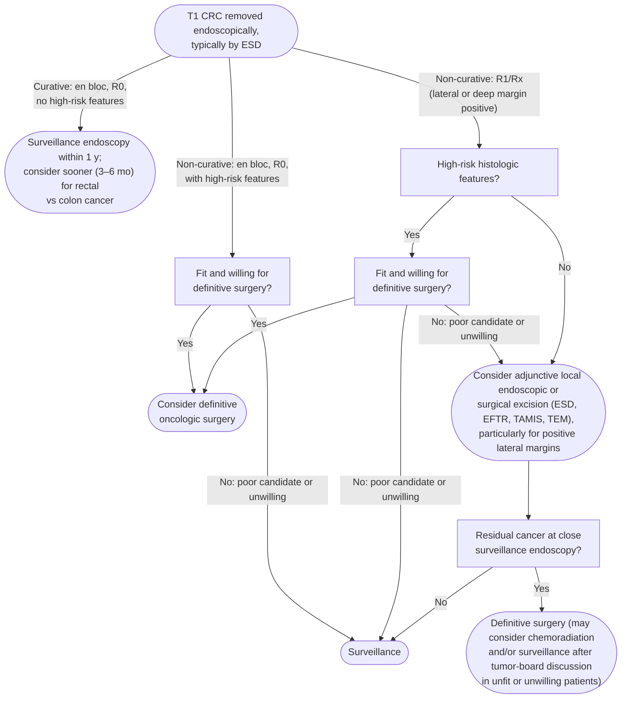

# Endoscopic Submucosal Dissection (Colorectal)

[[electrosurgery|Electrosurgical]]-knife dissection of colorectal lesions that cannot be taken en bloc by snare. Narrower indications than in the stomach and esophagus: most colorectal lesions are adequately treated by [[endoscopic-mucosal-resection|endoscopic mucosal resection (EMR)]], and the colon wall is thin. Generic endoscopic submucosal dissection (ESD) principles, en-bloc and R0 (margins microscopically free of tumor) definitions, and esophagogastric indications: [[endoscopic-submucosal-dissection]]. Lesion assessment (Paris, laterally spreading tumor [LST], Kudo) and snare technique: [[polypectomy]].

## Contents
- [[#Colorectal ESD Indications (limited)]]
- [[#Technique]]
  - [[#ESD Steps]]
  - [[#Hybrid ESD]]
  - [[#Specimen Handling]]
- [[#Endoscopic Full-Thickness Resection (eFTR)]]
- [[#Early (T1) CRC — Endoscopic Resection (AGA 2025 CPU)]]
  - [[#En-Bloc Imperative and Modality Choice]]
  - [[#Unified Curative-Resection Criteria (USMSTF / ESGE / JGES) — ALL five required]]
  - [[#Deep SMI — Solitary Risk Reappraised]]
  - [[#Surveillance After Endoscopic Resection of T1 CRC]]
- [[#Post-ESD Surveillance — Colon and Rectum]]
  - [[#Colonic Schedule]]
  - [[#Rectal Schedule]]
  - [[#Surveillance Technique]]
- [[#See Also]]
- [[#Sources]]

---

## Colorectal ESD Indications (limited)

**US Multi-Society Task Force (USMSTF) 2020 — narrative, ungraded** ([[usmstf-2020-endoscopic-removal]]). Gate: lesion **>20 mm**, indicated for endoscopic rather than surgical resection, in which en-bloc inject-and-cut EMR is difficult. Within that gate, ESD may be considered for:

- **Suspected submucosal invasion (SMI)** — large depressed lesion, or pseudodepressed non-granular LST (LST-NG)
- Mucosal lesions with **submucosal fibrosis**
- **Local residual early carcinoma** after endoscopic resection
- **Non-polypoid dysplasia in [[inflammatory-bowel-disease|inflammatory bowel disease (IBD)]]**

**American Gastroenterological Association (AGA) 2018 Clinical Practice Update (CPU) — ungraded** ([[aga-2018-esd-united-states]]). Where regional expertise exists, ESD should be considered for complex lesions difficult to remove by snare, lesions with risk factors for early SMI (en-bloc resection), and residual or recurrent adenomas. Table 2 — colorectal lesions **at risk for submucosally invasive cancer** (en-bloc resection):

| Feature | Threshold |
|---|---|
| Pit pattern | **Type V Kudo** |
| Depressed component | **Paris 0-IIc** |
| Complex morphology | **0-Is** or **0-IIa+Is** |
| Location | **Rectosigmoid** |
| Non-granular LST (adenoma) | **≥20 mm** |
| Granular LST (adenoma) | **≥30 mm** |
| Prior resection | **Residual or recurrent** colorectal adenoma |

*Australian Colonic Endoscopic Resection data (lesions ≥20 mm) also associate increasing size with SMI.*

**Why en bloc** ([[aga-2018-esd-united-states]]):
- Lesions **≥2 cm**: en-bloc EMR impossible in **>43%**. Piecemeal → neoplastic recurrence **10%–20%** vs **1%–2%** after en-bloc ESD (odds ratio [OR] **8.2**).
- Mucosa-confined dysplasia has **no lymph-node-metastasis (LNM) risk** (no lymphatic drainage in colorectal mucosa) → endoscopic resection is the criterion standard (Best Practice Advice [BPA] 8).
- Polyps ≥2 cm without deep-invasion features: **9.9%** were T1; **two thirds** of those confined to superficial submucosa (**<1000 µm**). For selected early cancers with **<1000 µm** SMI and favorable histology, en-bloc R0 ESD may obviate surgery.
- High-quality EMR remains the procedure of choice for **noninvasive** colorectal neoplasia in most US settings.

> [!pearl] The first attempt has the best chance
> The first endoscopic resection attempt has the highest success rate — don't attempt EMR without high confidence of complete resection ([[aga-2018-esd-united-states]]).

**Referral**
- Large complex colorectal polyps → **high-volume, specialized center** for EMR or ESD ([[aga-2018-esd-united-states]] BPA 9).
- **Difficult locations are not a contraindication:** lesions near the **dentate line** or at a **flexure behind a fold** have been removed by EMR, ESD or hybrid methods → refer to an endoscopist proficient in these techniques **before** surgical referral ([[usmstf-2020-endoscopic-removal]]).

**Lower rectum, suspected deep SMI — no US guidance** ([[weo-2024-large-colorectal-lst-consensus|World Endoscopy Organization (WEO) 2024]] statement 1.10, Conditional/Low): with staging negative for nodal and distant metastasis, an en-bloc method taking deeper planes — **endoscopic intermuscular dissection (EID)** or **peranal endoscopic myectomy (PAEM)** — can be considered in patients **declining surgery**, after multidisciplinary review.

## Technique

### ESD Steps

> [!howto] Colorectal ESD ([[usmstf-2020-endoscopic-removal]])
> 1. Submucosal injection to lift the lesion
> 2. Circumferential incision isolating the lesion with **3–4 mm** of surrounding normal mucosa
> 3. Further injection under the lesion
> 4. Cap-assisted dissection with the ESD knife through the expanded submucosa, under direct view
> 5. Resect in **1 piece**

- Colon lumen is narrow and tortuous and the wall thin → complication risk relatively high with ESD vs other removal techniques ([[usmstf-2020-endoscopic-removal]]).
- Vessel coagulation, defect closure and perforation management: [[endoscopic-submucosal-dissection#Technique]].

### Hybrid ESD

- **Partial submucosal dissection, then en-bloc snare resection** — a bridge in safety, efficacy and efficiency between conventional EMR and full ESD ([[usmstf-2020-endoscopic-removal]]).
- For lesions where snare capture is unlikely to succeed: **severe submucosal fibrosis** (eg, colitis-associated dysplasia, non-granular LST) or concern for SMI.
- Steps shown in USMSTF Figures 10–11: ESD knife incises the normal mucosa around the lesion → **stiff snare tip** placed into the cut mucosa → snare opened slowly to fit the cut perimeter → closed tightly and cut en bloc with endocut current.

### Specimen Handling

- Pin the specimen to a flat surface, immerse in formalin; expert gastrointestinal (GI) pathologist reports margins, differentiation, lymphovascular invasion (LVI), depth of SMI and tumor budding ([[aga-2018-esd-united-states]] BPA 13). USMSTF: pin en-bloc non-pedunculated lesions with features of submucosal invasive cancer before submission (Strong, low quality) ([[asge-2020-endoscopic-removal]]).

## Endoscopic Full-Thickness Resection (eFTR)

- Endoscopic full-thickness resection (eFTR) removes all layers of the colon wall → better histologic evaluation. **Full-thickness resection device (FTRD):** cap with mounted over-the-scope clip and fitted snare. Cap **outer diameter 21 mm** limits the tissue that can be grasped ([[usmstf-2020-endoscopic-removal]]).
- USMSTF narrative (ungraded): suggested indications — lesions **<30 mm**, particularly **non-lifting** or **involving a diverticulum**.
- **Size drives R0:** prospective 181-patient, 9-center German study — **58.1%** for lesions >20 mm vs **81.2%** for ≤20 mm (P = .0038); most effective for difficult lesions (non-lifting, challenging locations) **≤20 mm** ([[usmstf-2020-endoscopic-removal]]). Likely reason: hard to judge whether the margin is fully inside the cap.

| Lesion | Ceiling | Source |
|---|---|---|
| Colorectal **mucosal** lesion — suggested indication | **<30 mm** | [[usmstf-2020-endoscopic-removal\|USMSTF 2020]] |
| Mucosal lesion — FTRD generally accepted (SELs ≥15 mm: higher incomplete-resection risk) | **≤20 mm** | [[aga-2024-full-thickness-resection\|AGA 2024]] |
| **T1 colorectal cancer (CRC)** with suspected deep SMI — eFTR "particularly" reasonable | **<2 cm** (not a stated limit) | [[aga-2025-endoscopic-resection-crc\|AGA 2025]] |

- Subepithelial lesions, device mechanics and adverse events: [[endoscopic-full-thickness-resection]].

---

## Early (T1) CRC — Endoscopic Resection (AGA 2025 CPU)

*Source: [[aga-2025-endoscopic-resection-crc]] (Expert Commentary — ungraded). T1 [[colorectal-cancer|CRC]] ("malignant polyp") = invasion through the muscularis mucosae into the submucosa, not the muscularis propria. Without SMI, avoid the word "cancer". Histologic risk features in detail: [[polypectomy]].*

### En-Bloc Imperative and Modality Choice

- Suspected T1 CRC → ideally **en bloc** (USMSTF, European Society of Gastrointestinal Endoscopy [ESGE], Japan Gastroenterological Endoscopy Society [JGES]). Piecemeal impairs histology and is an independent risk factor for luminal recurrence; per the National Comprehensive Cancer Network (NCCN), piecemeal-removed T1 inevitably requires adjuvant surgery.
- **ESD is often preferred** for suspected **superficially** invasive T1 CRC — higher en-bloc rate than EMR irrespective of size. Limits: complexity, steep learning curve, cannot confidently resect deep SMI.
- **eFTR** *"may be a reasonable safe and effective alternative, particularly for select T1 CRCs <2 cm in size in which deep SMI is suspected."*
- Optical diagnosis of T1 CRC has sensitivity only **40%–50%** → when diagnosis is unclear or CRC highly suspected, **when available, we suggest** referral to a high-volume center with resection and pathology expertise.

### Unified Curative-Resection Criteria (USMSTF / ESGE / JGES) — ALL five required

1. Complete resection with histopathologic margins free of tumor
2. Superficial SMI (**<1000 µm**)
3. No LVI
4. Well-to-moderately differentiated histology (G1/G2)
5. Low or absent tumor budding — **Bd1 (0–4 buds)**; Bd2 (5–9) or Bd3 (≥10) raises LNM risk (OR **2.83**, Zwager meta-analysis)

- **Positive margin** (USMSTF and Japanese Society for Cancer of the Colon and Rectum [JSCCR]) = carcinoma at the **submucosal** margin of the specimen.

### Deep SMI — Solitary Risk Reappraised

- Deep SMI (**≥1000 µm**) traditionally triggered surgery, but **>95%** of patients with deep SMI as the only high-risk criterion have no LNM.
- Zwager meta-analysis (8 studies, 1146 patients): SMI as a solitary risk factor → absolute LNM risk **2.6%**; deep SMI **not** an independent LNM predictor.
- Surgery for T1 CRC (5170 patients): 30-day mortality **1.7%**, severe adverse events needing re-intervention **8.3%** → individualize, especially when deep SMI is the only adverse feature.

### Surveillance After Endoscopic Resection of T1 CRC

High-risk histologic features: poorly/undifferentiated histology; LVI or perineural invasion (PNI); increased tumor budding.

*Management after endoscopic resection of T1 colorectal cancer — not for hereditary cancer syndromes or IBD*
*Source: redrawn from AGA 2025 Figure 2*
*[[aga-2025-endoscopic-resection-crc|AGA 2025 Endoscopic Resection for Early CRC]]*
*T1 = submucosally invasive · CRC = colorectal cancer · ESD = endoscopic submucosal dissection · R0 = margins free of tumor · R1/Rx = incomplete/indeterminate margins · EFTR = endoscopic full-thickness resection · TAMIS = transanal minimally invasive surgery · TEM = transanal endoscopic microsurgery*

- **Recurrence:** **0.7%** after curative (low-risk) vs **7.0%** after noncurative (high-risk) resection; 60% within 36 mo, 96% within 72 mo. Low-risk → surveillance colonoscopy alone, without nodal or distant-metastasis imaging. Interval: JSCCR/ESGE within 1 y; NCCN at 1 y for colon, more frequent for rectal.
- **High-risk:** surgery is standard, but **>80%** of "high-risk" cases have no LNM at surgery → individualize. **High-risk rectal T1 CRC treated endoscopically** has significantly higher local recurrence and LNM than colonic, yet rectal surgery is more morbid → favor less invasive options.
- **R1/Rx without other risk factors:** intramural residual cancer **5%–11%**, LNM **8%–9%**.
  - ESGE/JSCCR: endoscopic surveillance at **3–6 mo** when only the **lateral** margin is positive.
  - ⚠ NCCN: adjuvant surgery for **any** positive margin (lateral, vertical or both).
  - Full-thickness scar resection (EFTR; TAMIS for rectal; combined endoscopic-laparoscopic for colonic) is an emerging alternative: retrospective, median 64 mo — recurrence **2.2%** after adjuvant surgery vs **9.0%** after EFTR, disease-free survival lower after EFTR (**96.8% vs 89.9%**, P = .019), but similar 5-year metastasis-free and overall survival (5 of 8 recurrences managed by adjuvant surgery).

---

## Post-ESD Surveillance — Colon and Rectum

*Source: [[aga-2021-post-esd-surveillance]] — Commentary, no graded statements; evidence generally low. Applies only when ESD pathology is **curative** (criteria, R0 and R1 margin rules: [[endoscopic-submucosal-dissection#Curative Resection Criteria]]); colorectal depth threshold **<1000 µm**. Not for hereditary syndromes ([[lynch-syndrome]]).*

- Lighter than post-piecemeal-EMR schedules because en-bloc R0 ESD has a low recurrence rate.
- Closer than Asian protocols: Western pathology does not uniformly use Japanese processing (2–3 mm serial sections, special stains for LVI), and there is no accepted definition of a negative margin.

### Colonic Schedule

| Pathology | 1st follow-up colonoscopy | 2nd follow-up | Subsequent | Endoscopic ultrasound (EUS) | Radiographic | Est. LNM risk |
|---|---|---|---|---|---|---|
| Adenoma with low-grade dysplasia (LGD); sessile serrated lesion (SSL) without dysplasia | 1 y | 3 y after the first | Revert to USMSTF | No or NA | No | 0% |
| Traditional serrated adenoma (TSA); SSL with dysplasia; high-grade dysplasia (HGD); carcinoma in situ; intramucosal carcinoma; dysplasia in IBD | 6–12 mo | 1 y after the first | 3 y after the second, then USMSTF (curative resection of IBD-associated dysplasia may require annual colonoscopy) | No or NA | No | 0% |
| T1, Sm1 colonic adenocarcinoma (<1000 µm SMI) | 3–6 mo | 6 mo after the first | 1 y after the second, then USMSTF | No or NA | No | <1% |

- **Lower-risk lesions >50 mm** (adenoma with LGD, SSL without dysplasia): consider closer follow-up, akin to the HGD row — a small invasive focus can be missed in a very large specimen.
- Recurrence/metastasis after endoscopic resection of T1 colonic carcinoma: mainly within **3–5 y**.
- **Carcinoembryonic antigen (CEA) and cross-sectional imaging: no supporting data** after curative ESD of T1 colonic adenocarcinoma → discretionary.
- IBD: dysplastic borders harder to define and field effect raises metachronous risk, but visible, clearly delineated dysplasia without signs of invasive cancer remains acceptable for endoscopic resection.

### Rectal Schedule

Surveilled harder: T1 rectal adenocarcinoma LNM risk **10%–16%** overall (lower if small **<1–3 cm** and G1/G2); after curative ESD of superficial (<1000 µm) T1 with favorable features, crude estimate **3%–6%**. Local recurrence: early T1 rectal **1.1%–6.3%** vs early colon **0%–1.9%**. The lower third of the rectum has no serosa.

| Pathology | 1st follow-up (assuming prior colonoscopy) | 2nd follow-up | Subsequent | EUS | Radiographic | Est. LNM risk |
|---|---|---|---|---|---|---|
| Adenoma with LGD; SSL without dysplasia | Flexible sigmoidoscopy at 1 y | Colonoscopy 3 y after the first | Revert to USMSTF | No | No | 0% |
| TSA; SSL with dysplasia; HGD (incl. carcinoma in situ, intramucosal carcinoma); dysplasia in IBD | Flexible sigmoidoscopy at 6–12 mo | Colonoscopy 1 y after the first | Colonoscopy 3 y later, then USMSTF (IBD-associated dysplasia, particularly with colitis proximal to the rectum, may require annual colonoscopy) | No | No | 0% |
| T1, Sm1 rectal adenocarcinoma (<1000 µm SMI; invasive cancer **<3 cm**, excluding surrounding LGD/HGD) | Flexible sigmoidoscopy at 3–6 mo | Flexible sigmoidoscopy 3–6 mo after the first, **plus** colonoscopy at 1 y after ESD (advanced adenoma → repeat in 1 y; none → 3 y, then USMSTF) | Flexible sigmoidoscopy every 6 mo to 5 y from ESD, then USMSTF | EUS **or** contrast pelvic magnetic resonance imaging (MRI) every 3–6 mo for 2 y, then every 6 mo to 5 y | May consider computed tomography (CT) chest/abdomen/pelvis annually for 3–5 y | 3–6% |

- **Invasive cancer ≥3 cm** (<1000 µm, R0, favorable histology) → **multidisciplinary tumor board** (elevated recurrence risk).
- **CEA** after curative ESD for rectal adenocarcinoma: not recommended by NCCN; optional.

> [!pitfall] Rectal recurrence can be late and distant
> After en-bloc R0 ESD of rectal neoplasia recurrence is rare (**≤2.5%**), but rectal cancer can recur **distantly after 3–5 years** ([[aga-2021-post-esd-surveillance]]).

- AGA 2025 sets surveillance after curative resection of low-risk T1 CRC **within 1 y** ([[#Surveillance After Endoscopic Resection of T1 CRC]]); the AGA 2021 post-ESD schedule starts at **3–6 mo** for T1 Sm1 disease.

### Surveillance Technique

- **High-definition endoscopy** plus image enhancement (dye-based or electronic chromoendoscopy) as needed; optical magnification where available.
- **Central and peripheral biopsies of the post-ESD scar** — prudent, though no supporting data.
- Inspect the **whole colon and rectum** for metachronous lesions.

---

## See Also

[[endoscopic-submucosal-dissection]], [[endoscopic-mucosal-resection]], [[polypectomy]], [[endoscopic-full-thickness-resection]], [[colonoscopy]], [[colonoscopy-surveillance]], [[colorectal-cancer]], [[inflammatory-bowel-disease]], [[endoscopic-oncology]], [[electrosurgery]], [[lynch-syndrome]]

---

## Sources

1. [[usmstf-2020-endoscopic-removal|USMSTF 2020: Endoscopic Removal of Colorectal Lesions]]
2. [[aga-2025-endoscopic-resection-crc|AGA Clinical Practice Update on Endoscopic Resection for Early Colorectal Cancer: Commentary (2025)]]
3. [[asge-2020-endoscopic-removal|ASGE 2020: Endoscopic Removal of Colorectal Lesions]]
4. [[aga-2024-full-thickness-resection|AGA 2024 Clinical Practice Update on Endoscopic Full-Thickness Resection for the Management of Gastrointestinal Subepithelial Lesions]]
5. [[aga-2018-esd-united-states|AGA Institute Clinical Practice Update: Endoscopic Submucosal Dissection in the United States]]
6. [[aga-2021-post-esd-surveillance|AGA Clinical Practice Update on Surveillance After Pathologically Curative Endoscopic Submucosal Dissection of Early Gastrointestinal Neoplasia in the United States: Commentary]]
7. [[weo-2024-large-colorectal-lst-consensus|International consensus on the management of large (≥20 mm) colorectal laterally spreading tumors: World Endoscopy Organization Delphi study (2024)]]
