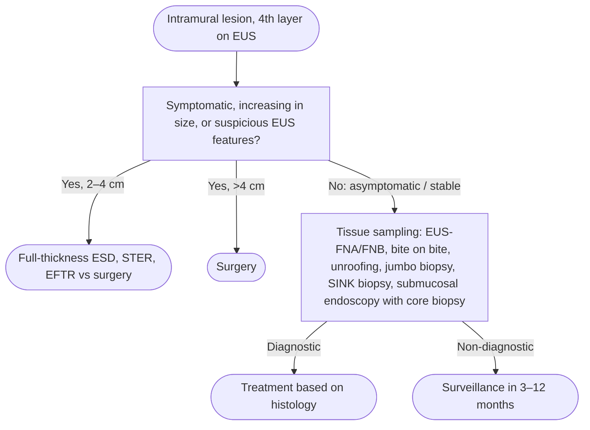

# Endoscopic Full-Thickness Resection (EFTR)

Endoscopic full-thickness resection (EFTR) — a less invasive alternative to surgery for the **diagnosis and treatment** of select gastrointestinal (GI) [[subepithelial-lesion|subepithelial lesions (SELs)]]. Colorectal EFTR for *mucosal* lesions: see [[colorectal-esd#Endoscopic Full-Thickness Resection (eFTR)|colorectal endoscopic submucosal dissection (ESD)]].

## Contents
- [[#Overview]]
- [[#Indications]]
  - [[#Fourth-Layer Lesions — EFTR vs Surgery]]
  - [[#Site Selection]]
- [[#Size Limits & Patient Selection]]
- [[#Preoperative Setup]]
- [[#Technique]]
  - [[#Exposed EFTR/ESD]]
  - [[#Nonexposed — STER / POET]]
  - [[#Device-Assisted EFTR (FTRD)]]
- [[#Outcomes]]
- [[#Adverse Events]]
- [[#Comparison of Techniques]]

## Overview

- **EFTR** = local resection of a tumor, often requiring dissection through the adjacent **muscularis propria** for complete resection.
- SELs arise from the wall (muscularis mucosa, submucosa, or muscularis propria); most small/incidental.
  - **~15% have malignant potential**; progression risk varies by size, location, histology.
  - Definitive diagnosis not always possible — **[[endoscopic-ultrasound|endoscopic ultrasound (EUS)]]–guided fine-needle aspiration (FNA)/fine-needle biopsy (FNB) yields range from as low as 20% to >90%**, highly operator-dependent.
- **Two technique families:**
  - **Exposed** — resection of all layers *including mucosa*; full-thickness excision completed **before** wall-defect closure.
  - **Nonexposed** — either preserves an overlying mucosal flap (submucosal tunneling endoscopic resection [STER]) or is a **"close first, then cut"** device-assisted method that avoids the impending perforation.
- **Individualized plan** essential — account for **size, location, histology**; "ideal" technique depends on lesion/patient characteristics and endoscopist expertise.

## Indications

- **Layer of origin:** SELs **arising from or infiltrating the muscularis propria — especially [[gastrointestinal-stromal-tumor|gastrointestinal stromal tumor (GIST)]] — require a full-thickness resection** for reliable and complete removal ([[asge-2017-subepithelial-lesions]]).
- **Expert-opinion indication (exposed EFTR):** consider when **other methods ([[endoscopic-mucosal-resection|endoscopic mucosal resection (EMR)]], [[endoscopic-submucosal-dissection|ESD]], nonexposed EFTR) cannot reliably and completely excise the SEL** due to larger size or difficult location ([[aga-2024-full-thickness-resection]]).
- **Preoperative evaluation (all patients):** endoscopy, EUS, cytology, histopathology, and cross-sectional imaging when indicated, per the American Gastroenterological Association (AGA) clinical practice update (CPU) on SELs ([[aga-2024-full-thickness-resection]]).
- **Multidisciplinary approach strongly advised** — surgeons, pathologists, radiologists, oncologists, gastroenterologists.

### Fourth-Layer Lesions — EFTR vs Surgery

*Fourth-layer (muscularis propria) subepithelial lesion — when endoscopic full-thickness options apply*
*Source: redrawn from ASGE 2017 Figure 3 (4th-layer branch)*
*[[asge-2017-subepithelial-lesions|ASGE 2017 Subepithelial Lesions]]*
*EUS = endoscopic ultrasound · ESD = endoscopic submucosal dissection · STER = submucosal tunneling with endoscopic resection · EFTR = endoscopic full-thickness resection · FNA = fine-needle aspiration · FNB = fine-needle biopsy · SINK = single-incision needle-knife*

- **American Society for Gastrointestinal Endoscopy (ASGE) 2017 Rec 3:** *recommend* surgery for **gastric and colorectal GIST >2 cm** and those with high-risk features (moderate quality). GIST-specific resection thresholds: GIST disease script (linked above).
- **ASGE 2017 Rec 11:** *suggest* lesions with malignant potential requiring treatment be removed **endoscopically or surgically** based on lesion type, size, location, patient preference, and available expertise (low quality).

### Site Selection

| Site | Exposed EFTR |
|---|---|
| Stomach | **Best suited** ([[aga-2024-full-thickness-resection\|AGA 2024]]); EFTR (technique not specified) reaches difficult locations such as the **fundus and proximal body** ([[asge-2017-subepithelial-lesions\|ASGE 2017]]) |
| Rectum | Alternative to other endoscopic approaches |
| Esophagus | **Avoid** — leak consequences can be devastating; endoscopic closure notoriously challenging |
| Duodenum | **Avoid** — same rationale |

## Size Limits & Patient Selection

| Technique | Size / selection threshold |
|---|---|
| **Exposed EFTR/ESD** | **Any size** ([[aga-2024-full-thickness-resection\|AGA 2024]] Table 1) |
| **STER / peroral endoscopic tunnel resection (POET)** | **≤3 cm** (Table 1); SELs **>3–4 cm** can be difficult to resect en bloc and often require conversion to exposed EFTR; one small study proposed **≤30 mm** in the axis perpendicular to the cranio-caudal length on cross-sectional imaging |
| **Full-thickness resection device (FTRD)** | SELs **<15 mm** (Table 1); SELs **≥15 mm** → higher risk of incomplete resection; effective and safe for **[[gastroenteropancreatic-neuroendocrine-tumors\|neuroendocrine tumors]] <10 mm**; for comparison, generally accepted for **mucosal** lesions **≤20 mm** |

- Older, less specific ceiling: [[asge-2017-subepithelial-lesions|ASGE 2017]] describes EFTR (techniques not separated) as applicable to large tumors **up to 4 cm** (see also [[#Fourth-Layer Lesions — EFTR vs Surgery]]).

## Preoperative Setup

- **[[endoscopy-sedation|General anesthesia with endotracheal intubation]]** (as with other third-space interventions).
- **Positive-pressure ventilation** to reduce effects of capnoperitoneum/capnomediastinum.
- **Constant neuromuscular relaxation** to reduce respiratory variability/movement.
- **Peak airway pressures** monitored as surrogate for raised intra-abdominal pressure → may signal need for **needle decompression**.
- **[[antibiotic-prophylaxis-endoscopy|Prophylactic intravenous antibiotics]]** recommended at time of procedure (peritoneal/mediastinal contamination risk).
- **CO₂ insufflation mandatory** (faster absorption than air, lower adverse event [AE] risk).
- Perform in a **hospital-based endoscopy unit** with surgical backup readily available.
- Fully equipped with ESD devices: single- and dual-channel gastroscopes, distal attachments, [[electrosurgery|electrosurgical]] knives, hemostatic forceps, closure devices (over-the-scope clips, through-the-scope clips, suture devices), peritoneal decompression needles — ideally on a **dedicated cart**.

## Technique

### Exposed EFTR/ESD

- Free-hand resection; full-thickness excision completed **before** wall-defect closure.
- **Steps:** mucosal incision around lesion → submucosal dissection to isolate lesion to muscular base → careful muscular dissection to "strip" lesion off wall; **often requires division of the muscularis propria** to assure complete excision and preserve tumor capsule.
- **Closure:** defect closure is **mandatory** — standard clips, over-the-scope clips, endoscopic suturing, endoloops ([[asge-2017-subepithelial-lesions]]).
- **Advantage:** en-bloc resection of SELs **irrespective of size**.
- **Drawbacks:** compromised insufflation/visualization from CO₂ leak into peritoneum (may need intraprocedural abdominal decompression); peritoneal contamination from luminal contents; theoretical tumor-seeding risk; large defects harder to close.
- **Laparoscopic-endoscopic cooperative surgery (LECS):** EFTR performed with laparoscopic guidance and assistance; surgeon closes the gastrotomy and retrieves the lesion. ASGE 2017: hybrid (combined endoscopic-laparoscopic) EFTR is used especially for **small GISTs that do not require lymphadenectomy** and can be treated by radical tumor enucleation.

> [!pitfall] Exposed EFTR belongs at referral centers
> Longer learning curve and potential for serious AEs → perform at referral centers with extensive "third-space" endoscopy experience ([[aga-2024-full-thickness-resection]]).

### Nonexposed — STER / POET

- **STER/POET** — a direct clinical application derived from the [[poem|peroral endoscopic myotomy (POEM)]] technique.
- **Steps:** submucosal tunnel initiated **3–5 cm proximal** to lesion, dissection extended **1–2 cm distal**; resect within tunnel, extract lesion, **close the mucosotomy** to restore luminal integrity.
- **Advantages:** tunnel gives scope stability/traction; mucosal flap minimizes extraluminal leakage/contamination; mucosal-flap closure easier than a large exposed-EFTR defect.
- **Anatomic suitability:** lesions reachable **in a straight line** — esophagus, gastric cardia, certain parts of the antrum, rectum.
- **Tunnel-start distance differs by source** — [[asge-2017-subepithelial-lesions|ASGE 2017]] specifies a mucosal incision **at least 5 cm proximal** to the lesion; the newer [[aga-2024-full-thickness-resection|AGA 2024]] CPU says 3–5 cm, as feasible.

### Device-Assisted EFTR (FTRD)

- **"Close first, then cut."** Over-the-scope clip or ligation device on scope tip; lesion **pulled/suctioned into the cap**, clip/ligator **deployed**, then **resection above the clip**.
- Variants: "banding without resection" (autoamputation); "suck, ligate, unroof, biopsy."
- **FTRD device (Ovesco, Tübingen):** approved for **colon and upper GI**; **23-mm deep cap** with dedicated over-the-scope clip + **integrated cautery snare**; **cap inner diameter 12–13 mm** limits the SEL size that can be drawn in and resected.
- **Maneuverability:** wide outer cap diameter can make passage through upper GI tract or colon challenging, if not prohibitive, in selected cases.
  - **Older position:** [[asge-2017-subepithelial-lesions|ASGE 2017]] reported the device's **21-mm outer diameter** made per-oral passage difficult, limiting it to **colon lesions**; the upper-GI approval above is from the newer [[aga-2024-full-thickness-resection|AGA 2024 CPU]].
- **Precursor over-the-scope clip technique** (clip over the lesion in esophagus/stomach/duodenum/rectum, then snare above the clip): complete (R0) resection in **87.5% (7/8)**, but full-thickness resection in only **25%**; mean lesion size **13.4 mm** (cap size limits lesion size); no adverse events ([[asge-2017-subepithelial-lesions]]).
- **Main limitation = lesion size.** Adjunctive **unroofing before FTRD** reported but **not well studied**.
- Short learning curve; case-by-case decision on patient- and lesion-related characteristics.

> [!pitfall] Bulky SELs slip out of the cap
> Firm grasp and retrieval into the cap can fail as the lesion slips under the overlying mucosa, particularly **gastric SELs** — careful case selection is paramount for complete resection ([[aga-2024-full-thickness-resection]]).

## Outcomes

| Technique | Metric | Result |
|---|---|---|
| **STER** (meta-analysis: 9 studies, 305 lesions) | En-bloc resection | **95%** |
| | Complete resection | **98%** |
| **STER vs video-assisted thoracoscopic surgery (VATS) enucleation** (randomized controlled trial [RCT]) | Lesions **<20 mm** | STER superior in postop pain, cost, procedure time, blood loss |
| | Lesions **>20 mm** | **Incomplete en-bloc resection in 29%** |
| **FTRD** — gastric SELs **<15 mm** | Technical success | up to **93%** |
| | R0 resection | only **68–76%** |
| **Exposed EFTR vs surgery** (2 retrospective cohorts) | En-bloc / complete / AE rates | **No difference** vs surgery |
| | Endoscopic arm | Faster, less blood loss, shorter stay (but lesions more intraluminal/smaller) |
| **EFTR, gastric SELs from the muscularis propria** (n = 26, ESD technique + endoclip closure) | Complete resection | **100%**; mean tumor 2.8 cm (range 1.2–4.5 cm); no major adverse events ([[asge-2017-subepithelial-lesions]]) |
| **STER, largest series** (85 small [≤3 cm] upper GI SELs from the muscularis propria) | Complete resection | **All 85** ([[asge-2017-subepithelial-lesions]]) |

- Evidence base scarce — mostly small retrospective cohorts and case series; literature on the FTRD for SELs is quite limited; comparative data among endoscopic techniques are scarce.

## Adverse Events

- **STER** (meta-analysis): air leakage (subcutaneous emphysema + pneumomediastinum) **15%**; **perforation 5.6%**.
  - Case series: AEs **11–33%**; largest series (85 lesions) **9.4%** — pneumothorax 7.1%, subcutaneous emphysema 9.4%, pneumoperitoneum 4.7%, all managed conservatively ([[asge-2017-subepithelial-lesions]]).
- **FTRD** (German and Dutch colorectal FTRD registry, nearly 1900 patients):
  - Overall AE rate **11.3%**.
  - **Bleeding 6.2%** (most common).
  - **Perforation:** immediate **1.4%**, delayed **1.1%**.
  - **No AE-related mortality.**
  - **57% of perforations** were technical/procedural; **64% of those required surgery.**
- Exposed EFTR: see drawbacks under [[#Exposed EFTR/ESD]].

## Comparison of Techniques

*EFTR techniques for SELs — adapted from [[aga-2024-full-thickness-resection|AGA 2024]] Table 1.*

| Technique | Pros | Cons |
|---|---|---|
| **Exposed — EFTR/ESD** | Any size; any wall layer | High likelihood of full-thickness defect (muscularis propria lesions) needing complex closure; peritoneal/mediastinal contamination risk; hypothetical tumor spillage; compromised insufflation |
| **Nonexposed — STER** | Tunnel gives resection stability; easier tunnel-incision closure; mucosal flap limits extraluminal leak/contamination | Size-limited (see [[#Size Limits & Patient Selection]]); not feasible if overlying mucosa compromised; tunneling not feasible in all locations |
| **Nonexposed — FTRD / device-assisted** | Any wall layer; short learning curve | Size-limited (see [[#Size Limits & Patient Selection]]); device malfunction (clip slippage, inadequate/failed closure); high incomplete-resection rates |

---

## See Also

[[subepithelial-lesion]], [[polypectomy]], [[colorectal-esd]], [[endoscopic-submucosal-dissection]], [[endoscopic-mucosal-resection]], [[poem]], [[endoscopic-ultrasound]], [[gastrointestinal-stromal-tumor]], [[gastroenteropancreatic-neuroendocrine-tumors]], [[endoscopy-sedation]], [[antibiotic-prophylaxis-endoscopy]], [[endoscopic-oncology]]

---

## Sources

1. [[aga-2024-full-thickness-resection|AGA 2024 Clinical Practice Update on Endoscopic Full-Thickness Resection for the Management of Gastrointestinal Subepithelial Lesions]]
2. [[asge-2017-subepithelial-lesions|ASGE 2017: The Role of Endoscopy in Subepithelial Lesions of the GI Tract]]
