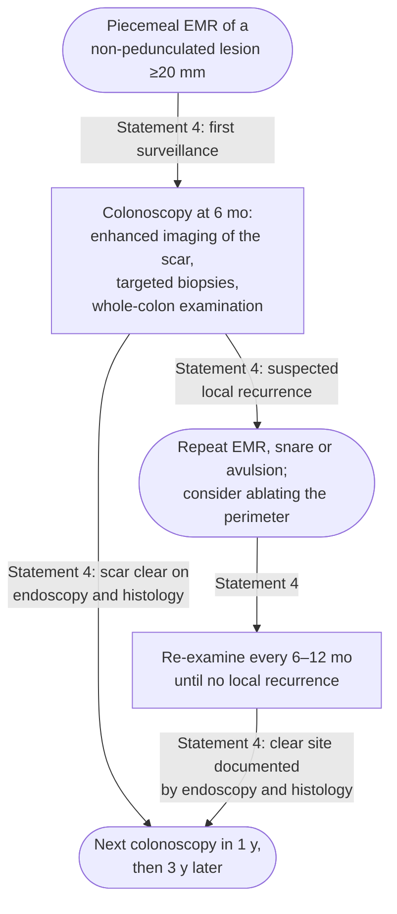

# Endoscopic Mucosal Resection (Colorectal)

Endoscopic mucosal resection (EMR) is snare resection over a submucosal cushion (or under water). [[usmstf-2020-endoscopic-removal|US Multi-Society Task Force (USMSTF) 2020]]:
- **Non-pedunculated lesions ≥20 mm:** EMR is the preferred treatment, over surgery (*Strong; moderate-quality*), by an endoscopist experienced in advanced polypectomy (*Strong; low-quality*).
- **Non-pedunculated lesions 10–19 mm:** the graded statement is only cold or hot snare ± submucosal injection (*Conditional; low-quality*). EMR "should be considered" for **non-polypoid (Paris 0-II) and serrated** lesions in this range — ungraded (narrative text and Figure 5 algorithm).

Lesion assessment, size-based technique selection and the full USMSTF algorithm are on [[polypectomy]]; lesions needing en bloc removal beyond snare diameter go to [[colorectal-esd|endoscopic submucosal dissection (ESD)]].

## Contents
- [[#Technique]]
  - [[#Inject-and-Cut (Standard)]]
  - [[#Submucosal Lifting Agents]]
    - [[#Injection strategy by lesion size and visibility]]
    - [[#Lifting agents — properties and trade-offs]]
  - [[#Electrosurgical Settings]]
  - [[#Underwater EMR]]
  - [[#Cold Snare EMR]]
  - [[#Hot Avulsion Technique]]
- [[#Post-Resection]]
- [[#Post-EMR Surveillance (Piecemeal, ≥20mm)]]
- [[#See Also]]
- [[#Sources]]

---

## Technique

### Inject-and-Cut (Standard)

- Lesions **<20 mm** can typically be removed en bloc with electrocautery; **≥20 mm** more typically need piecemeal resection ([[usmstf-2020-endoscopic-removal]]).
- **Resect all grossly visible tissue in one session, in the safest minimum number of pieces** — prior failed attempts raise the risk of incomplete resection or recurrence (*Strong; low-quality*).

> [!howto] Inject, capture, transect
> 1. **Dynamic injection:** a small volume to confirm the submucosal plane, then rapid large-volume injection while deflecting the tip toward the opposite wall, pulling the catheter back slightly and suctioning.
> 2. Capture with a **stiff snare**.
> 3. Insufflate to stretch the wall; lift the snare while slightly loosened to release any entrapped muscularis propria (MP).
> 4. Move the snare back and forth — **if the whole wall moves, MP is entrapped**: loosen and tent the mucosa toward the lumen.
> 5. Close fully and transect with microprocessor-controlled current; monofilament snare closed to **<1 cm** between thumb and fingers + fast transection = less tissue burn ([[usmstf-2020-endoscopic-removal]]).

**Injectants** — graded recommendations ([[usmstf-2020-endoscopic-removal]]):

| Statement | Strength / evidence |
|---|---|
| Use a **viscous** submucosal injectant for inject-and-cut EMR of lesions **≥20 mm** (hydroxyethyl starch, Eleview, ORISE Gel) — fewer pieces, less procedure time than saline | Conditional; moderate |
| Add **indigo carmine or methylene blue** to the injectant to distinguish submucosa from mucosa and MP | Conditional; moderate |
| Do **NOT** use tattoo (carbon particles) as the injectant — may cause submucosal fibrosis and reduce the success of future resection | **Strong**; low |

- ⚠ **ORISE is no longer available** — Boston Scientific removed it from the world market in December 2022 after distorted post-resection scars were misread as submucosal tumor ([[aga-2025-lifting-agents]]).

### Submucosal Lifting Agents

*Source: [[aga-2025-lifting-agents|American Gastroenterological Association (AGA) 2025 clinical practice update (CPU) on endoscopic lifting agents]].*

- The cushion separates lesion from MP; **blue contrast** (indigo carmine or methylene blue) demarcates margins and reveals MP injury.
- **Saline ± contrast ("homemade") remains acceptable** but dissipates fast. Consider **saline + contrast** for 10–19 mm non-pedunculated lesions or gastric polyps, and for [[poem|peroral endoscopic myotomy (POEM)]].
- **Sessile serrated lesions** lift with **any** agent (minimal fibrosis) — ideal for cold EMR.
- **[[endoscopic-submucosal-dissection|ESD]] always needs injection:** foregut lesions — thermal markings 2–5 mm around the lesion, inject **outside** them; never into the lesion (bleeding obscures the plane; seeding if cancer); a viscous agent, not saline + contrast alone.
- **Dilute [[epinephrine]]** for cold EMR (often also with electrocautery) — cleaner field, less oozing; dilutions on its page. ⚠ Serial injections may cause **post-procedure abdominal pain**, confusable with perforation or post-polypectomy syndrome in the first hour.
- Prime the needle (avoid air injection); dynamic injection (above) shapes the mound and directs fluid into the upper submucosa to maximize MP separation. Papillectomy generally needs no injection.

> [!pearl] Thick parallel white bands = type 3 MP injury
> Contrast stains the submucosa blue; the MP stays white. Thick parallel white bands mark type 3 MP injury — **reinforce with clips** to prevent delayed perforation ([[aga-2025-lifting-agents]]).

- **Lift duration:** shortest with saline + epinephrine (**<3 min**), longest with hyaluronic acid (**22 min**) in colonic EMR. Saline gives fewer en bloc resections and more residual lesion than viscous agents, with **no difference in adverse events**.
- Submucosal fibrosis (prior partial resection, biopsy, tattoo) creates an **iatrogenic non-lifting sign**; a **25-gauge rather than 23-gauge** needle may help. Approach **tangentially, not en face**.
- **No ideal solution exists** — choose by planned resection method, predicted histology, local expertise, and cost.

#### Injection strategy by lesion size and visibility

| Situation | Strategy |
|---|---|
| Flat lesion **10–30 mm**, entirely visible | **Central injection through the lesion** — domes it over the fluid. Contraindicated **only** if features suggesting cancer are present |
| Sessile lesion, or a dominant nodule | Start on the **most accessible side** |
| Lesion **>30–40 mm** | Raise a portion → snare-resect → repeat systematically side to side, usually **rectal side → cecal side** to keep the field clear |
| Significant portion hidden (e.g. behind a haustral fold on the cecal side) | **Proximal (cecal) edge injection** first, aided by retroflexion |

- Retroflexion is generally safe with a colonoscope in **cecum, ascending, transverse, rectum**; in **sigmoid and descending colon use an upper endoscope** instead.
- **Whether to inject:** optional at **10–19 mm** (USMSTF); **cold snare without injection** non-inferior to injection-based methods **≤15 mm**; viscous agents preferred **≥20 mm**; pedunculated polyps at the endoscopist's discretion; sessile serrated lesions do not always require injection, especially **<20 mm** or with margins clearly visible without it ([[aga-2025-lifting-agents]]).

#### Lifting agents — properties and trade-offs

*Table — the 14 agents and adjuvants, after Table 1 of [[aga-2025-lifting-agents]]. "Longer"/"shorter" are the document's own cushion-duration terms, not measured intervals.*

| Agent / adjuvant | Components | Cushion duration | Used for | Benefits | Disadvantages |
|---|---|---|---|---|---|
| Normal saline | 0.9% saline in water | Shorter | EMR, POEM, ESD dissection | Lower price; widely available | Quick dissipation of the lift |
| Contrast agent | Methylene blue or indigo carmine | — (adjuvant) | EMR, ESD, POEM | Shows lesion border; identifies muscular injury | — |
| Epinephrine | Diluted **1:50,000–1:500,000** | — (adjuvant) | EMR (cold and hot) | Limits immediate/acute bleeding; clear resection field | Post-procedure pain, depending on concentration, site and quantity |
| Eleview (SIC-8000) | Water, sodium chloride, poloxamer 188, polyoxyl-15-hydroxystearate, medium-chain triglycerides, methylene blue | Longer | EMR, ESD | Sustained lift; non-toxic; pre-packaged 5- and 10-mL vials | Expensive; bubble formation may obscure ESD visibility |
| EndoClot SIS | Absorbable modified polymers from plant starch particles | Longer | EMR, ESD | Potential hemostatic effect; sustained lift | Expensive; needs contrast added and in-room compounding |
| EverLift | Water, glycerin, hydroxyethyl cellulose, benzyl alcohol, sodium and potassium phosphate, methylene blue | Longer | EMR, ESD | Pre-packaged vials; sustained lift | Expensive |
| Blue Boost | Premixed sodium hyaluronate with methylene blue | Longer | EMR, ESD | Pre-packaged 10-mL vials; sustained lift | Expensive; **50 mL maximum per patient** |
| LiftUp | Water, poloxamers, sodium chloride, methylene blue | Longer | EMR, ESD | Pre-packaged 20-mL vials; usable with an inflation device; sustained lift | Expensive; easier injection if refrigerated — **turns to gel at warm temperatures** |
| Succinylated gelatin | Colloidal solution, oncotic pressure similar to albumin | Longer than saline | EMR | Widely available; non-toxic; inexpensive | Contraindicated in gelatin hypersensitivity. **Not available in the United States** |
| Hydroxyethyl starch | Colloidal volume expander, 6% solution | Longer than saline | EMR | Inexpensive; longer lift with less volume than saline for polyps **≥30 mm**; non-toxic | Needs contrast added and in-room compounding |
| Hyaluronic acid | High-viscosity glycosaminoglycan | — | — | — | Limited by risk of **residual tumor-cell growth** |
| Hydroxypropyl methylcellulose | Cellulose derivative, viscoelastic | — | — | — | Limited by risk of **antigen–antibody reactions** |
| Fibrinogen mixture | — | — | — | — | Limited by risk of **viral contamination and transmission** |
| 50% dextrose | Hypertonic solution | — | — | — | Painful inflammatory response resembling post-coagulation syndrome if injected into the pericolonic mesentery |

**Device-assisted lifting:** ERBEJET 2 high-pressure water jet (with a HybridKnife: lift + hydrosurgical separation) — most useful in third-space endoscopy, especially with submucosal fibrosis.

### Electrosurgical Settings

Either a cut- or a coagulation-predominant current can be used for colorectal polyp resection — no clear difference in serious adverse events, complete resection or recurrence ([[aga-2026-electrosurgery]] best practice advice [BPA] 5; trial data on [[electrosurgery#Polypectomy]]). Use a **microprocessor-controlled** electrosurgical unit (*Conditional; very low-quality*, [[usmstf-2020-endoscopic-removal]]).

| Step | AGA 2026 (ERBE) | USMSTF 2020 Table 5 (ERBE) |
|---|---|---|
| Inject-and-cut EMR | EndoCut Q, effect 2–3, duration 2–3, interval 2–3; or forced coagulation, effect 2–3, 30–40 W (Table 2). BPA 5's cited trial used EndoCut Q effect 2, duration 1, interval 4 vs forced coagulation effect 2, 25 W | Endocut Q, effect 2/3, cut duration 1, cut interval 4 |
| Snare-tip soft coagulation (STSC) | — | Soft Coag, effect 5, maximum 80 W |
| Hot forceps avulsion | EndoCut I, effect 3, duration 1, interval 3 (BPA 10 text) | Endocut I, effect 1, cut duration 4, cut interval 1 |
| Underwater EMR | Higher power output needed to cut under water; consult the manufacturer | Autocut or Drycut, effect 5, maximum 80 W (text: Drycut, effect 5, 60 W, VIO 300D) |

- [[aga-2026-electrosurgery|AGA 2026]] offers its settings as a reference only — confirm with the manufacturer case by case. Olympus and ConMed settings: [[electrosurgery#Settings by Indication and Manufacturer]].

### Underwater EMR

- Lumen distended with water instead of gas → mucosa and submucosa **involute as folds while the MP stays circular**, so no submucosal injection is needed. Borders marked with [[argon-plasma-coagulation|argon plasma coagulation (APC)]] or snare-tip coagulation, then hot snare resection ([[usmstf-2020-endoscopic-removal]]).
- **Immerse in saline, not water** (water intoxication / dilutional hyponatremia on long or large resections); immersion gives a predominantly coagulation effect, so **cutting needs higher power** ([[aga-2026-electrosurgery]] BPA 8; physics on [[electrosurgery#Operational Environment — Gas vs Fluid]]).
- **Outcomes** ([[usmstf-2020-endoscopic-removal]]):
  - 97 lesions, median 25 mm: submucosal lift still needed in **30%** (correlated with size **≥30 mm**); recurrence **13.6%** at median 6 mo.
  - Lesions ≥10 mm: delayed bleeding **2–5%**; **1 case report** of perforation (proximal colon, retroflexion).
  - One retrospective study used it as salvage for **non-lifting recurrent neoplasia**.

### Cold Snare EMR

- Submucosal injection (dilute epinephrine in saline with methylene blue), then snare resection **without diathermy** — aims to minimize delayed bleeding and perforation ([[usmstf-2020-endoscopic-removal]]).
- **Outcomes (small series):** piecemeal removal of 94 lesions (median 20 mm) → **9.7% local recurrence** at 2–10 mo; serrated lesions ≥10 mm (163, median 15 mm) → **0.6% recurrence** at 6 mo.
- Need for epinephrine in the injectate is uncertain; STSC of the edges and clip closure have not been used with cold EMR; long-term and comparative data are lacking.

### Hot Avulsion Technique

- **For:** focal areas of visible neoplasia that will not lift because of **fibrosis** (prior biopsy, incomplete resection, or tattoo) and resist snare resection — residual or recurrent tissue ([[aga-2026-electrosurgery]] BPA 10; [[usmstf-2020-endoscopic-removal]]).
- **How:** grasp a **small surface area** with hot forceps and pull it away from the wall with **short bursts of cutting current (tap the pedal)**; never prolonged continuous activation — deep injury → bleeding, post-coagulation syndrome, delayed perforation ([[aga-2026-electrosurgery]]).
- **Cutting (Endocut) current, not coagulation**, in both USMSTF 2020 and AGA 2026 (settings above; why: [[electrosurgery#Hot Forceps Avulsion for Non-Lifting Fibrosis]]) — unlike hot biopsy polypectomy, which tents the tissue under coagulation current.
- One retrospective study (20 patients, non-lifting areas mean 4.4 mm): **15% recurrence**, retreated with hot avulsion ([[usmstf-2020-endoscopic-removal]]).
- Efficacy and safety **outside the colon are undetermined** ([[aga-2026-electrosurgery]]).

---

## Post-Resection

| Statement | Strength / evidence |
|---|---|
| Adjuvant thermal ablation of the post-EMR margin (APC or STSC) where **no endoscopically visible adenoma remains** despite meticulous inspection. Insufficient evidence to recommend a specific modality ([[usmstf-2020-endoscopic-removal]]) | Conditional; moderate |
| After piecemeal EMR, **consider thermal ablation of the resection margins** — ablating the normal-appearing margin cut recurrence to **<5% at first follow-up** in trials; STSC and APC equally effective in a randomized trial, STSC **may** be more cost-effective in most settings ([[aga-2026-electrosurgery]] BPA 7) | BPA (ungraded) |
| Do **NOT** ablate endoscopically visible residual tissue (APC, STSC) — associated with more recurrence; resect it ([[usmstf-2020-endoscopic-removal]]) | **Strong; moderate** |
| **Detailed inspection** of the post-resection defect for immediate or delayed perforation-risk features, with endoscopic clip closure accordingly | **Strong; moderate** |
| Prophylactic closure of resection defects **≥20 mm in the right colon**, when closure is feasible | Conditional; moderate |
| Intraprocedural bleeding: coagulation (coagulation forceps or STSC) or clips, ± dilute epinephrine injection | Conditional; low |
| Patients on antithrombotics who are candidates for removal of a lesion **≥20 mm**: individualized assessment — risk of interrupting anticoagulation vs risk of significant bleeding during and after the procedure | Conditional; low |

*USMSTF grades are **Strong** or **Conditional**, quality very low/low/moderate/high; the document numbers no recommendations ([[asge-2020-endoscopic-removal]] lists them verbatim).*

**Delayed bleeding after resection of lesions ≥20 mm** — a risk prediction score USMSTF cites as a possible guide to prophylactic treatment ([[usmstf-2020-endoscopic-removal]]):

| Feature | Points |
|---|---|
| Size >30 mm | 2 |
| Proximal colon location | 2 |
| Major comorbidity | 1 |
| No epinephrine used | 1 |

- Probability of post-resection bleeding: **score 0–1 (low) 3.4%** · **2–4 (medium) 6.2%** · **5–6 (elevated) 15.7%**.
- **Why clip the right colon:** in a US multisite randomized trial, clipping defects >20 mm cut delayed hemorrhage **7.2% → 3.7%**; the benefit was confined to the proximal colon (**9.8% vs 3.3%**).
- **Prophylactic coagulation of visible vessels** in the defect has not reduced bleeding (randomized trial, 347 patients: **5.2% vs 8.0%**, P = .3).
- **Deep mural injury** in **10.2%** of EMR defects for lesions ≥20 mm, target sign or perforation in **3%** — more with transverse colon location, en bloc resection of lesions **≥25 mm**, advanced pathology. Clip a small fresh perforation or a resection that looks deep ([[endoscopic-management-of-perforation]]).
- **Quality:** post-polypectomy bleeding benchmark **≤1/100 colonoscopies** (American Society for Gastrointestinal Endoscopy [ASGE]/American College of Gastroenterology [ACG] task force, cited by USMSTF); engage in a **local quality-assurance program measuring and reporting post-polypectomy adverse events** (*Strong; moderate*). See [[colonoscopy-quality-indicators]].

---

## Post-EMR Surveillance (Piecemeal, ≥20mm)

*After piecemeal resection of a lesion ≥20 mm this schedule applies instead of the size/histology intervals on [[colonoscopy-surveillance]]; it exists to find and treat local recurrence and clear synchronous lesions.*

*Surveillance after piecemeal EMR of lesions ≥20 mm*
*Source: built from USMSTF 2020 Statement 4 (Surveillance) bullets (the guideline's Figure 5 algorithm stops at resection)*
*[[usmstf-2020-endoscopic-removal|USMSTF 2020 Endoscopic Removal of Colorectal Lesions]]*
*EMR = endoscopic mucosal resection*

- **Grades** ([[usmstf-2020-endoscopic-removal]]): schedule *Strong; moderate* (6-mo exam likewise in [[usmstf-2020-followup-colonoscopy]]) · scar imaging (dye chromoendoscopy or electronic, e.g. narrow-band imaging [NBI]) + biopsies *Conditional; moderate* · recurrence pathway *Conditional; low* · whole-colon exam *Strong; moderate*.
- A scar normal both macroscopically and on biopsy has the highest predictive value for long-term eradication.
- After a recurrence, use the shorter interval for recurrences **≥1 cm** or with high-grade dysplasia; most recurrences are a few millimeters, and 1 year is then adequate (narrative, ungraded).

> [!pitfall] Clip artifact is not recurrence
> Up to one-third of clipped post-EMR scars show nodular elevation with a **normal pit pattern** — clip artifact, not residual polyp. Don't retreat it or shorten the interval ([[usmstf-2020-endoscopic-removal]]).

---

## See Also

[[polypectomy]], [[colonoscopy]], [[colonoscopy-surveillance]], [[colorectal-esd]], [[endoscopic-submucosal-dissection]], [[endoscopic-full-thickness-resection]], [[argon-plasma-coagulation]], [[electrosurgery]], [[epinephrine]], [[endoscopic-management-of-perforation]], [[colonoscopy-quality-indicators]], [[colorectal-cancer]]

---

## Sources

1. [[usmstf-2020-endoscopic-removal|USMSTF 2020: Endoscopic Removal of Colorectal Lesions]]
2. [[asge-2020-endoscopic-removal|ASGE 2020: Endoscopic Removal of Colorectal Lesions]]
3. [[aga-2025-lifting-agents|AGA Clinical Practice Update on Endoscopic Lifting Agents: Commentary]]
4. [[usmstf-2020-followup-colonoscopy|USMSTF 2020: Recommendations for Follow-Up After Colonoscopy and Polypectomy]]
5. [[aga-2026-electrosurgery|AGA Clinical Practice Update on the Use of Electrosurgery in Therapeutic Endoscopy: Expert Review (2026)]]
