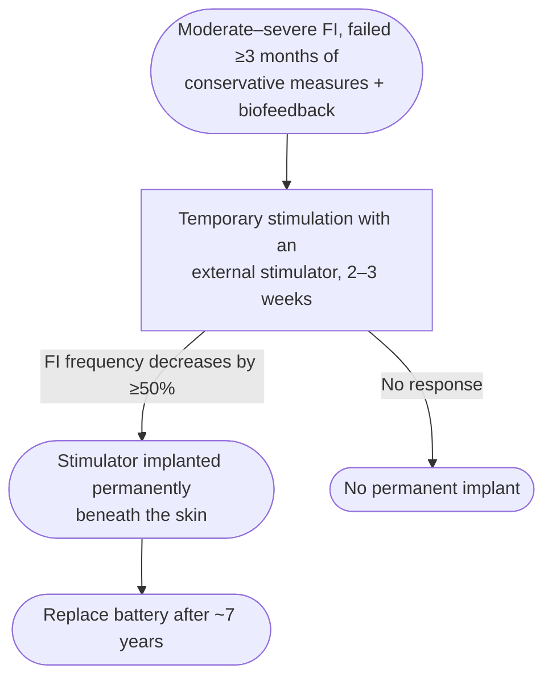

*Implanted device for peripheral nerve stimulation of the **S3 or S4 nerve roots** in the sacral foramina ([[acg-2021-anorectal-disorders]]). **Sacral nerve stimulation (SNS) is recommended for moderate–severe [[fecal-incontinence|fecal incontinence (FI)]] that has failed conservative measures; it is not recommended for constipation.** A temporary test stimulation precedes permanent implantation.*

## Contents
- [[#Indications]]
  - [[#What has to fail first]]
  - [[#How "moderate–severe" is judged]]
  - [[#Who the evidence excludes]]
- [[#Technique]]
- [[#Outcomes]]
- [[#Adverse Events]]
- [[#Where SNS Sits Among Alternatives]]
- [[#See Also]]
- [[#Sources]]

---

## Indications

| Indication | Recommendation | Source |
|---|---|---|
| **Moderate–severe FI** that has **failed conservative measures, biofeedback, and other low-cost, low-risk techniques** | **Recommended** — Rec 5, strong recommendation, low quality of evidence | American College of Gastroenterology (ACG) 2021 ([[acg-2021-anorectal-disorders]]) |
| **Moderate or severe FI** not responding after a **≥3-month trial of conservative measures and biofeedback**, without contraindications | **Should be considered** — Best Practice Advice (BPA) 4 | American Gastroenterological Association (AGA) 2017 ([[aga-2017-surgical-device-fecal-incontinence]]) |
| **Constipation of any type** | **Cannot be recommended** — 3 randomized controlled trials (RCTs) show no benefit regardless of type; long-term complication rate considerable ([[#Adverse Events]]) | ACG 2021 ([[acg-2021-anorectal-disorders]]) |
| [[defecation-disorders\|Defecatory disorders]] | **Should not be used** (based on limited evidence) — BPA 13; no evidence it improves bowel symptoms or rectal evacuation; in a sham-controlled crossover trial (n = 55, refractory slow-transit constipation) it did not increase complete bowel movements | AGA 2017 ([[aga-2017-surgical-device-fecal-incontinence]]) |
| Chronic constipation (CC) | Did not improve symptoms | AGA 2026 ([[aga-2026-refractory-constipation]]); see [[chronic-idiopathic-constipation]] |
| **Levator ani syndrome** ([[proctalgia-syndromes]]) | Listed among the **ineffective** therapies | Rome V 2026 ([[rome-v-2026-anorectal-disorders]]) |

### What has to fail first

All three clauses of ACG Rec 5 are gates ([[acg-2021-anorectal-disorders]]):

1. **Conservative measures** — education about diarrhea and constipation as causes of FI; [[loperamide]] or diphenoxylate for diarrhea, fiber and/or laxatives for constipation; daily pelvic floor exercises; a bowel diary may be added. Agents and doses: [[fecal-incontinence]].
2. **[[biofeedback-therapy|Biofeedback]]** — pelvic floor rehabilitative techniques with visual or auditory feedback (Rec 2, strong recommendation, moderate quality of evidence).
3. **Other low-cost, low-risk techniques** — ACG does not list them; Rec 3: devices (anal plugs, vaginal balloons) in selected patients not responding to conservative measures **and** biofeedback; Rec 4: injectable bulking agents in selected patients not responding to conservative therapy **or** biofeedback. ACG does not state their order relative to SNS.

**How long:** ≥3 months of conservative measures and biofeedback (AGA BPA 4) ([[aga-2017-surgical-device-fecal-incontinence]]).

### How "moderate–severe" is judged

ACG gives **no validated score or cutoff**; severity is judged clinically ([[acg-2021-anorectal-disorders]]):

- Ask the **type, frequency, amount** (small / medium / large) of leakage and whether there is **urgency** — together an index of severity that correlates strongly with quality-of-life impact and medical consultation.
- **Urge** FI = aware of the desire but cannot reach the toilet in time; **passive** FI = unaware before the episode. Urge FI predicts SNS success ([[#Outcomes]]).
- **Mild end:** most people with FI have it **less than once a month** or only staining of underclothes — they "might benefit from less costly interventions."
- Comorbidity (e.g. dementia) moderates other treatments such as biofeedback.
- Workup before advanced therapy ([[anorectal-manometry|anorectal manometry (ARM)]], balloon expulsion, rectal sensation; endoanal ultrasound or magnetic resonance imaging if surgery is considered): [[fecal-incontinence]].

### Who the evidence excludes

The pivotal North American multicenter study (2002–2008, **n = 133**) enrolled FI with **>2 incontinent episodes per week for >6 months**, or **>12 months after childbirth**, that had failed or was not a candidate for conservative therapy. It **excluded** ([[acg-2021-anorectal-disorders]]):

- [[chronic-diarrhea|Chronic diarrhea]]
- **Large sphincter defects**
- Chronic [[inflammatory-bowel-disease|inflammatory bowel disease]]
- Visible sequelae of pelvic radiation
- Active anal inflammation
- Neurologic disease — clinically significant peripheral neuropathy or complete spinal cord injury

**Sphincter defect size:** ACG 2021 does not quantify "large." AGA 2017: most trials were limited to a **structurally intact anal sphincter or a defect smaller than 120°**; efficacy with **larger external sphincter defects is unknown** (a few studies suggest benefit irrespective of sphincter injury; larger prospective trials needed) ([[aga-2017-surgical-device-fecal-incontinence]]).

---

## Technique

Continuous pulsed electrical stimulation of the sacral nerves with a battery-operated stimulator, in **2 stages** — permanent implantation is contingent on response to the test stimulation ([[aga-2017-surgical-device-fecal-incontinence]], [[rome-v-2026-anorectal-disorders]]).

*Two-stage SNS for FI*
*Source: built from AGA 2017 BPA 4 and its SNS section text, and the Rome V 2026 statement that implantation is contingent on the test response (neither source has an SNS flowchart)*
*[[aga-2017-surgical-device-fecal-incontinence|AGA 2017 Surgical and Device-Aided Therapy for FI]] · [[rome-v-2026-anorectal-disorders|Rome V 2026 Anorectal Disorders]]*
*SNS = sacral nerve stimulation · FI = fecal incontinence*

- **Test period length:** 2–3 weeks per ACG 2021 and AGA 2017; Rome V 2026 gives 2–4 weeks.
- **Implant site:** ACG 2021 describes implantation in the abdomen; AGA 2017 "beneath the skin" ([[acg-2021-anorectal-disorders]]).
- ACG 2021 gives no numeric response threshold for the test; the ≥50% gate is AGA 2017's.

> [!pitfall] Don't read a normal manometry as treatment failure
> SNS has no significant effect on measured anorectal function despite marked symptom improvement — judge response on symptoms, not on repeat ARM ([[acg-2021-anorectal-disorders]]).

---

## Outcomes

**Pivotal North American study** ([[acg-2021-anorectal-disorders]], [[aga-2017-surgical-device-fecal-incontinence]]):

| Endpoint | Result |
|---|---|
| Temporary stimulation → permanent implant | **90%** of 133 (Rome V 2026 cites 90% of 120) |
| Therapeutic success at 3 years (≥50% fewer incontinent episodes/week, implanted patients) | **86%** |
| Complete continence at 3 years | **40%** |
| Incontinent episodes, baseline → 12 months | mean **9.4/week → 1.7/week** |
| FI Quality of Life instrument | significant improvement in **all 4 scales** at 12, 24 and 36 months |
| 5-year follow-up (76 of 120 evaluated, 63%) | complete continence **36%**; therapeutic success **89%** |

- **Separate 5-year follow-up** (n = 101, intention-to-treat): favorable outcome in **42.6%**; **younger age, urge FI and response at 6 months predicted success** ([[rome-v-2026-anorectal-disorders]]).
- **Controlled data are few:** in 2 parallel-group RCTs SNS was significantly better than medical treatment but **not significantly better than percutaneous tibial nerve stimulation (PTNS)**; in 6 crossover studies patients had **equal symptoms with the stimulator on or off** ([[aga-2017-surgical-device-fecal-incontinence]]).

> [!pitfall] The efficacy evidence is thinner than the strong recommendation implies
> The pivotal study was **uncontrolled** ([[aga-2017-surgical-device-fecal-incontinence]]); **no high-quality, multicenter, sham-controlled RCT has confirmed efficacy**, mechanisms remain uncertain, and **sham-controlled trials showed clinically meaningful improvement with sham stimulation** ([[rome-v-2026-anorectal-disorders]]). AGA 2017 still calls SNS an effective surgical option for selected FI patients.

---

## Adverse Events

Most common device-related adverse events in the pivotal FI study ([[acg-2021-anorectal-disorders]]):

| Complication | Rate |
|---|---|
| Implant-site pain | **28%** |
| Paresthesias | **15%** |
| Change in the sensation of stimulation | **12%** |
| Infection | **10%** |

- AGA 2017: pain and infection at the insertion site in **up to 10%** ([[aga-2017-surgical-device-fecal-incontinence]]).
- In constipation, a long-term (60-month) follow-up study reported device-related adverse events in **61%** ([[acg-2021-anorectal-disorders]]).

---

## Where SNS Sits Among Alternatives

*Full FI treatment ladder, doses and data: [[fecal-incontinence]].*

| Option | Position relative to SNS |
|---|---|
| [[biofeedback-therapy\|Biofeedback]] | **Before** — a gate for SNS (ACG Rec 5; AGA BPA 4) |
| Anal plugs, vaginal balloons; injectable bulking agents | ACG Recs 3–4: after conservative measures and biofeedback (devices) or conservative therapy or biofeedback (bulking) fail; order vs SNS not stated. AGA 2017: SNS **or** perianal bulking at the same step |
| PTNS | **Not an alternative** — should not be used for FI until further evidence (AGA BPA 5); no significant benefit over sham in multiple RCTs ([[rome-v-2026-anorectal-disorders]]); ACG: efficacy unresolved |
| Translumbosacral neuromodulation therapy | Rome V 2026 only — magnetic lumbosacral stimulation; 1-Hz arm had 91% responders in a dose-ranging RCT, confirmed in a sham-controlled study |
| Anal sphincteroplasty | **First** for postpartum women with FI and recent sphincter injuries (AGA BPA 7); acute anal sphincter injuries (ACG Rec 6, conditional, low). Late presenters with sphincter damage: **after** SNS and bulking are unavailable or unsuccessful (AGA BPA 7; ACG similar). One retrospective comparison with SNS showed no clear superiority of either |
| Artificial anal sphincter / dynamic graciloplasty, magnetic anal sphincter | Medically refractory **severe** FI after failure of, or unsuitability for, barrier devices, SNS, bulking, sphincteroplasty and colostomy (AGA BPAs 8, 11). ACG: graciloplasty not currently recommended |
| [[ostomy-management\|End stoma]] | Last resort for severe FI not responding to other treatments (ACG Rec 7, conditional, low) |

---

## See Also

[[fecal-incontinence]], [[biofeedback-therapy]], [[anorectal-manometry]], [[defecation-disorders]], [[chronic-idiopathic-constipation]], [[proctalgia-syndromes]], [[rectal-prolapse]], [[loperamide]], [[inflammatory-bowel-disease]], [[ostomy-management]], [[chronic-constipation]]

---

## Sources

1. [[acg-2021-anorectal-disorders|ACG 2021 Clinical Guidelines: Management of Benign Anorectal Disorders]]
2. [[aga-2026-refractory-constipation|AGA Clinical Practice Update on Evaluation and Management of Refractory Constipation: Expert Review]]
3. [[aga-2017-surgical-device-fecal-incontinence|Surgical Interventions and the Use of Device-Aided Therapy for the Treatment of Fecal Incontinence and Defecatory Disorders]]
4. [[rome-v-2026-anorectal-disorders|Anorectal Disorders (Rome V, 2026)]]
