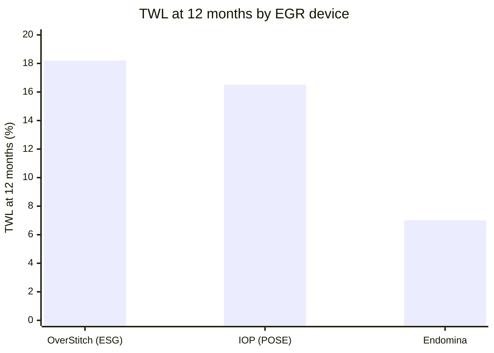

# Endoscopic Sleeve Gastroplasty (ESG)

## Contents
- [[#Overview]]
- [[#Indications and Patient Selection]]
- [[#Efficacy]]
- [[#Adverse Events]]
- [[#Periprocedural Management]]
- [[#Technique]]
- [[#Training]]
- [[#After ESG]]
- [[#See Also]]
- [[#Sources]]

---

## Overview

**Endoscopic sleeve gastroplasty (ESG)** treats [[obesity]] with endoluminal **full-thickness sutures** placed along the greater curvature with an endoscopic suturing device (OverStitch). The stomach becomes a narrow "sleeve" and its volume falls by **~70%** ([[jirapinyo-2025-esg-delphi-standards]]).

- **Family:** the American Society for Gastrointestinal Endoscopy–European Society of Gastrointestinal Endoscopy (ASGE–ESGE) 2024 guideline groups ESG with [[endoscopic-bariatric-therapies|primary obesity surgery endoluminal (POSE)]] (Incisionless Operating Platform [IOP]) and Endomina plication as **endoscopic gastric remodeling (EGR)**. The suture is the implant in all three, and all reduce gastric **width and length** and are thought to **delay gastric emptying** ([[asge-esge-2024-primary-ebmt]]).
- **Regulatory status:** OverStitch has a Conformité Européenne (CE) mark and **US Food and Drug Administration (FDA) De Novo authorization for obesity** ([[asge-esge-2024-primary-ebmt]]), granted in 2022 ([[jirapinyo-2025-esg-delphi-standards]]). IOP and Endomina have a CE mark and FDA 510(k) clearance for tissue approximation only ([[asge-esge-2024-primary-ebmt]]).
- **Availability:** in 2024, **[[intragastric-balloon|intragastric balloon (IGB)]] and EGR were the only endoscopic bariatric and metabolic therapies (EBMTs) commercially available and routinely used.**
- Class-level context (other devices, American Gastroenterological Association [AGA] 2017 program advice): [[endoscopic-bariatric-therapies]].

## Indications and Patient Selection

| Question | Answer | Source |
|---|---|---|
| **Who qualifies?** | Body mass index (BMI) **≥30 kg/m²**, with or without an obesity-related comorbidity, **or BMI 27.0–29.9 kg/m² with ≥1 obesity-related comorbidity**. EGR data exist for both bands and for class III. | ASGE–ESGE Rec 1 — conditional, very low certainty |
| **Upper BMI limit?** | **None.** ESG can be primary therapy or a bridge to [[bariatric-surgery]]. | ASGE–ESGE Rec 1 |
| **Is EGR advised?** | **Suggested: EGR plus lifestyle modification (LM) over LM alone.** | ASGE–ESGE Rec 6 — conditional, **moderate** certainty |
| **Which device?** | Evidence is **insufficient to favor one device**. Choose by clinical context, patient values, availability and operator experience. | ASGE–ESGE Rec 6 |
| **Contraindications?** | Neither ASGE–ESGE 2024 nor the Delphi consensus gives a full list. The Delphi panel names **active smoking** and **clinically significant [[portal-hypertension\|portal hypertension]]** as examples. | [[jirapinyo-2025-esg-delphi-standards\|Delphi 2025]] (expert opinion) |

- **Why conditional:** patient values vary; some prefer LM alone despite losing less weight. Use **shared decision-making**. Most insurers and national systems do not cover ESG, which limits access to patients who can pay ([[asge-esge-2024-primary-ebmt]]).
- Always pair ESG with **LM** (diet, physical activity, behavioral therapy) and a multidisciplinary team: dietitians, exercise physiologists, behavioral and obesity-medicine experts, bariatric surgeons.

## Efficacy

| Evidence | Total weight loss (TWL) | Source |
|---|---|---|
| 3 randomized controlled trials (RCTs), n = 585, EGR + LM vs LM | **10.5% vs 2.4% at 12 mo** — mean difference **8.0%** (95% confidence interval [CI] 3.4–12.6) | ASGE–ESGE Rec 6 |
| 21 observational studies, n = 5250 (16 OverStitch) | **17.3% at 12 mo** (95% CI 16.2–18.4) | ASGE–ESGE Rec 6 |
| Durability | Effective to **≥5 years** | ASGE–ESGE |
| Early multicenter ESG series (242 patients, 3 centers) | %TBWL (total body weight loss) **16.8% at 6 mo** (n = 137) · **18.2% at 12 mo** (n = 53) · **19.8% at 18 mo** (n = 30) | [[aga-2017-endoscopic-bariatric-therapies\|AGA 2017]] |

*Weight loss at 12 months by gastric-remodeling device (OverStitch 16 studies, IOP 4, Endomina 1)*
*Source: data from the observational meta-analysis (21 studies, 5250 patients) in the ASGE–ESGE 2024 guideline*
*[[asge-esge-2024-primary-ebmt|ASGE–ESGE 2024 Primary EBMT Guideline]]*
*TWL = total weight loss · EGR = endoscopic gastric remodeling · ESG = endoscopic sleeve gastroplasty · IOP = Incisionless Operating Platform · POSE = primary obesity surgery endoluminal*

> [!pitfall] Sham control and old technique shrink RCT results
> The RCT pooled estimate is conservative. The lowest arm (4.95% TWL) was a **sham-controlled POSE** trial; its unblinded lead-in group lost 40% more, and an open-label trial of the same technique reached 13.0%. Older POSE trials also plicated the **fundus**, whereas current ESG stitches the **gastric body** ([[asge-esge-2024-primary-ebmt]]).

## Adverse Events

- **RCTs (EGR vs control):** serious adverse events (SAEs) **14/435 vs 1/253**, relative risk **5.6** (95% CI 1.1–30.1); overall SAE rate **3.2%**. Some were short-lived nausea, vomiting, dehydration and pain that resolved without sequelae ([[asge-esge-2024-primary-ebmt]]).
- **ESG RCT examples (n = 131), 1 each:** abdominal abscess treated endoscopically; upper gastrointestinal (GI) bleeding managed conservatively; **malnutrition treated by endoscopic reversal of the ESG**.
- **POSE RCT examples (n = 221):** extraluminal bleeding needing laparoscopy (1); hepatic abscess drained percutaneously (1); pain, nausea or vomiting prolonging admission (9).
- **Early ESG series:** 5 of 242 (2%), all recovered without surgery: 2 perigastric fluid collections drained percutaneously, 1 self-limited bleed from a splenic laceration, 1 pulmonary embolism at 72 h, and 1 pneumoperitoneum with pneumothorax needing a chest tube ([[aga-2017-endoscopic-bariatric-therapies|AGA 2017]]).

## Periprocedural Management

*ASGE–ESGE 2024 Recs 7–10, all **conditional, very low certainty**. No comparative studies exist; the regimens are the panel's expert survey (16 experts, 2700 EGRs) and the ESG RCT, the Multicenter Endoscopic Sleeve Gastroplasty Randomized Interventional Trial (MERIT).*

| Element | Recommendation | Common regimens | Outcome with regimen |
|---|---|---|---|
| **Antiemetics** (Rec 7) | Suggested periprocedurally | Before: ondansetron (79%), dexamethasone (64%), aprepitant (57%), scopolamine patch (50%). Discharge: ondansetron (64%), scopolamine patch (57%), aprepitant (36%), metoclopramide (29%). MERIT: intravenous (IV) ondansetron + dexamethasone during the procedure, then oral ondansetron, promethazine and lorazepam as needed | Postoperative nausea and vomiting (PONV) **19.5% within 72 h**, 13.3% within 30 days. MERIT: severe nausea 20%, severe vomiting 10%, admission for accommodative symptoms 4% |
| **Pain medication** (Rec 8) | Suggested periprocedurally; **no regimen specified** | Acetaminophen (57%), opioids (36%), nonsteroidal anti-inflammatory drugs (14%). MERIT: low-dose liquid narcotic as needed | Pain 15.1% within 30 days; severe pain 15% in MERIT |
| **Antibiotics** (Rec 9) | Suggested: prophylactic, **short-term**, periprocedural | Ciprofloxacin ± metronidazole (50%), amoxicillin-clavulanate or ampicillin-sulbactam (30%), cephalosporin (20%). **60% give a single IV dose only**; 40% add a 3-day oral course. MERIT: one IV dose of ciprofloxacin, ceftriaxone or piperacillin-tazobactam | Infection 0.2% in the survey; 0.67% in MERIT (one abscess, managed endoscopically) |
| **[[proton-pump-inhibitors\|Proton pump inhibitor (PPI)]]** (Rec 10) | Suggested **short-term after the procedure**, over no PPI | **No agent or single duration named.** MERIT: PPI 40 mg daily for 12 months. A second RCT: 40 mg daily for 3 months | GI bleeding 0.67% (MERIT) and 0% |

- **Opioids sparingly:** about 10% of opioid-naive bariatric surgical patients become addicted after a periprocedural dose.
- **One IV antibiotic dose may suffice**, by analogy with bariatric surgery. The benefit of the extra oral course is unstudied.
- Pain after ESG likely comes from gas, stitches through the serosa, inflammation and transient ischemia.

## Technique

- **Equipment:** a double-channel therapeutic gastroscope with the suturing device. A **tissue helix** captures the gastric wall and retracts it into the suturing arm so the stitch is full thickness ([[aga-2017-endoscopic-bariatric-therapies|AGA 2017]]).
- **Standard steps** below come from the [[jirapinyo-2025-esg-delphi-standards|2025 global expert Delphi consensus]]: 6 experts with ≥300 ESGs each; ungraded expert opinion. Numbers are the consensus's own technical statements (T1–T21).

| Phase | Step |
|---|---|
| **Before suturing** | Diagnostic endoscopy: identify the antrum, incisura, anterior wall, greater curvature, posterior wall, fundus and gastroesophageal junction (T1) · check for contraindications (T2) · measure the gastric length (T3) |
| | *Optional:* argon plasma coagulation (APC) of the anterior and posterior walls of the gastric body to mark the gastric boundaries (T4) |
| | Pass the scope with the suturing device mounted, **with or without an overtube** (T5) |
| **Each stitch** | Advance the helix and give **3–4 clockwise turns**, with initial forward pressure and **early retraction as needed so it does not capture tissue outside the stomach** (T6) |
| | Pull the helix and wall in, maneuver the scope, and place a **full-thickness** stitch (T7) |
| | Create suture slack and work from a distance from the wall · load the needle driver without crossing the suture (T8–T9) |
| **Closing each suture** | Drop the tissue anchor at the end of the pattern (T10) · cinch firmly enough to compress the stomach **without overtensioning**; **no suture visible** after cinching (T11) |
| **Suture pattern** | **Suture 1:** start at the **incisura**, first stitch on the **anterior wall**; **6–12 full-thickness bites** (number depends on running vs U-pattern); **continuous** pattern, either single-row running or U-pattern (T16–T18) |
| | *Optional* **suture 2:** an interrupted reinforcement suture right next to the running or U-suture (T19) |
| | **6–10 sutures in total** (T20) · **identify the fundus and do not suture it** (T21) |
| **Finishing** | Troubleshoot as needed; recognize and manage intraprocedural adverse events such as bleeding (T12–T13) · remove the device **with the handle closed** (T14) |
| | Check the sleeve: the scope **passes the whole sleeve into the antrum**; identify the fundus, body and antrum; **no active bleeding or esophageal tear** (T15) |

> [!pearl] A thick fold means extragastric tissue
> A thick gastric fold on the helix suggests it has caught tissue next to the stomach. A thin fold suggests adequate capture without external structures. *See Figure 1 in [[jirapinyo-2025-esg-delphi-standards]] for endoscopic images: thick vs thin folds, partial- vs full-thickness stitches, the running and reinforcement sutures, and the fundus.*

> [!pitfall] MERIT's suture pattern is considered inadequate
> MERIT used a suture pattern that gave only **13.6% total weight loss**, which most experts consider inadequate ([[jirapinyo-2025-esg-delphi-standards]]).

- **Why:** the fundus is thin and vascular (risk, no benefit). The overtube and APC are optional because experienced operators pass the device safely and know the anatomy without marking.
- **No suture pattern has strong evidence of superiority;** new patterns should be developed within clinical studies.
- **Not endorsed:** grasping tissue with forceps instead of the helix (limited safety and efficacy data). Scope torquing to minimize alpha loops in the U-pattern is not mandatory (too advanced for some endoscopists).
- **Extent differs from the older description:** AGA 2017 described sutures running from the prepyloric antrum to the gastroesophageal junction. The 2025 consensus starts at the incisura and spares the fundus.

## Training

**Cognitive skills required before performing ESG.** The 2025 consensus agreed on all 6 unanimously ([[jirapinyo-2025-esg-delphi-standards]]):
- Describe primary EBMTs and the other treatment options for obesity.
- Know ESG indications, contraindications and patient-selection criteria.
- Consent patients for possible risks and adverse events, from pain, nausea and vomiting to leak and bleeding.
- Know pre- and postprocedural care: antiemetics, pain control, antibiotics, diet plan.
- Diagnose and manage adverse events.
- Communicate well with the team.

Institutional privileging and the general endoscopic bariatric therapy (EBT) knowledge base are on [[endoscopic-bariatric-therapies#Training and Credentialing]].

## After ESG

- **Regain can happen** after any EBMT. Options are repeat procedures, adding [[glp-1-receptor-agonists|antiobesity medication]], intensifying LM, or switching to another device or procedure; the guideline did not evaluate them ([[asge-esge-2024-primary-ebmt]]).
- **ESG does not prevent later [[bariatric-surgery]].**
- **Cost-effectiveness (class II obesity):** ESG was cost-effective vs LM alone in the US and the UK, and vs glucagon-like peptide-1 receptor agonists and sleeve gastrectomy in the US ([[asge-esge-2024-primary-ebmt]]).

---

## See Also

[[endoscopic-bariatric-therapies]], [[intragastric-balloon]], [[obesity]], [[bariatric-surgery]], [[bariatric-surgery-leak]], [[proton-pump-inhibitors]], [[glp-1-receptor-agonists]], [[portal-hypertension]], [[upper-endoscopy]]

---

## Sources

1. [[asge-esge-2024-primary-ebmt|ASGE–ESGE Guideline on Primary Endoscopic Bariatric and Metabolic Therapies for Adults with Obesity (2024)]]
2. [[jirapinyo-2025-esg-delphi-standards|Establishing Standards of Practice for Endoscopic Sleeve Gastroplasty: A Global Expert Consensus Using a Modified Delphi Method (2025)]]
3. [[aga-2017-endoscopic-bariatric-therapies|AGA Clinical Practice Update: Expert Review on Endoscopic Bariatric Therapies (2017)]]
