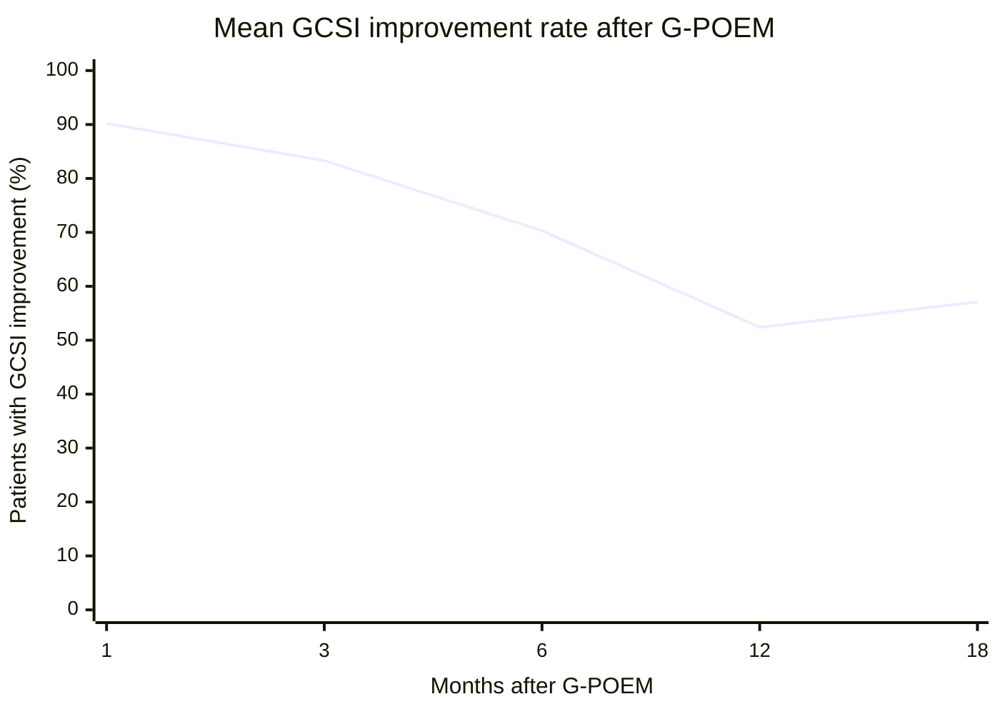

# G-POEM (Gastric Peroral Endoscopic Myotomy)

Gastric peroral endoscopic myotomy (G-POEM), also called peroral endoscopic pyloromyotomy: endoscopic pyloromyotomy for medically refractory [[gastroparesis]]. A third-space-endoscopy technique — an extension of [[endoscopic-submucosal-dissection|endoscopic submucosal dissection (ESD)]] and esophageal [[poem|peroral endoscopic myotomy (POEM)]]. Efficacious across **diabetic, post-surgical, and idiopathic** gastroparesis (causes and typing → [[gastroparesis]]), but **not a default step** — every guideline on file reserves it for selected patients. The American Gastroenterological Association (AGA) 2025 guideline is the newest source and governs this page.

## Contents
- [[#Patient Selection]]
  - [[#Candidacy Criteria]]
  - [[#GCSI (Gastroparesis Cardinal Symptom Index)]]
  - [[#Predictors of Response]]
  - [[#Poor Candidates]]
- [[#Technique]]
- [[#Post-Procedural Care]]
- [[#Follow-up and Efficacy Definitions]]
- [[#Outcomes]]
- [[#Adverse Events]]
- [[#After Failed G-POEM]]
- [[#Comparison with Alternatives]]
- [[#See Also]]
- [[#Sources]]

---

## Patient Selection

> **Recommendation 10 ([[aga-2025-gastroparesis]]; Conditional recommendation, low certainty of evidence):** *"In patients with gastroparesis refractory to medical therapy, the AGA suggests against the routine use of gastric peroral endoscopic pyloromyotomy (G-POEM)."*
> *Comment:* as part of shared decision making, patients and clinicians who place a higher value on potential symptom improvement and lower value on the potential risk of adverse events may reasonably select to undergo G-POEM.

- ⚠ **Guideline conflict.** [[acg-2022-gastroparesis|American College of Gastroenterology (ACG) 2022]] Recommendation 20 suggests **pyloromyotomy over no treatment for symptom control** in medically refractory gastroparesis (Conditional, low quality of evidence). AGA 2025 is newer and is what this page follows; neither makes G-POEM routine.
- "Refractory to medical therapy" is the gate for every gastroparesis procedure — the full definition, required drug trials and their durations live on [[gastroparesis]].
- Related AGA 2025 positions: **gastric electrical stimulation** — against routine use (Recommendation 12, Conditional, very low certainty); **surgical pyloromyotomy/pyloroplasty** — **no recommendation, knowledge gap** (Recommendation 11).

### Candidacy Criteria

| Requirement | [[aga-2025-gastroparesis\|AGA 2025]] — governs | [[aga-2023-gpoem-gastroparesis\|AGA 2023 Clinical Practice Update (CPU)]] |
|---|---|---|
| **Emptying study** | Appropriately performed **4-hour** gastric emptying study, generally with at least **moderate delay — 20% retention at 4 h** (Eggbeaters meal) | Solid-phase gastric emptying scan confirming delay, preferably **>20% retention at 4 h** (normal <10%; scintigraphy, low-fat 2% chicken-egg-white meal) |
| **Symptom burden** | **At least 6–12 months of moderate symptoms**, cardinal symptoms being nausea, vomiting, and/or postprandial fullness | Moderate-to-severe symptoms (often **Gastroparesis Cardinal Symptom Index (GCSI) total >2**), preferably nausea/vomiting-dominant |
| **Prior treatment** | **Trial of other gastroparesis treatments first — prokinetic *and* antiemetic agents.** Panel's working definition of refractory: cardinal symptoms for **≥6 months** after failing **≥3 months of a prokinetic** (e.g. metoclopramide) **and ≥1 antiemetic** | Prior failed therapy **not** a prerequisite — patients who failed gastric electrical stimulation, pyloric stenting, or [[botulinum-toxin\|botulinum toxin]] should also be offered G-POEM |
| **Obstruction excluded** | — | [[upper-endoscopy\|Esophagogastroduodenoscopy (EGD)]] confirming **no mechanical [[gastric-outlet-obstruction\|gastric-outlet obstruction]]** |
| **Setting** | Reserved for select patients with medically refractory disease | Decide on the **full clinical picture**, not the emptying study or symptom score alone |

- ⚠ Where the two disagree on prior therapy, **AGA 2025 governs**: a documented trial of other treatments plus 6–12 months of moderate symptoms is required before G-POEM is considered.
- **Operators and center** ([[aga-2021-medically-refractory-gastroparesis|AGA 2022 CPU]] Best Practice Advice (BPA) 8): select refractory patients with **severe** emptying delay (severe = 4-h retention >35%; severity bands on [[gastroparesis]]), using a team approach of motility specialists **and** advanced endoscopists at a center of excellence/tertiary center — *"G-POEM should not be considered first-line therapy."*
- **Opioids:** wean off whenever possible and **re-evaluate gastric emptying first** — opioids are a common, reversible cause of pyloric dysfunction and gastric stasis.
- **Special populations:** insufficient evidence in **children**; **post-lung-transplant** severe gastroparesis is an emerging, promising indication.

### GCSI (Gastroparesis Cardinal Symptom Index)

- Scale **0 (none) – 5 (very severe)**, 2-week recall, 9 symptoms in 3 subscales: nausea/vomiting (3 items), postprandial fullness/early satiety (4 items), bloating (2 items).
- **Total = average of the 3 subscale means.** Moderate-to-severe disease often corresponds to **total >2**.

### Predictors of Response

- **Independent predictors of 12-month success** ([[aga-2023-gpoem-gastroparesis]]): baseline **GCSI >2.6** (odds ratio [OR] 3.23) and baseline **4-hour retention >20%** (OR 3.65).
- ⚠ **Predictor conflict:** in [[acg-2022-gastroparesis|ACG 2022]], a 76-patient series found a **high 4-hour retention rate significantly associated with clinical failure** — the opposite direction to the AGA 2023 CPU finding above. No guideline resolves this.
- **Pyloric [[flip-panometry|functional lumen imaging probe (FLIP)]]:** ACG 2022 Recommendation 18 — FLIP (EndoFLIP) evaluation **may have a role** in characterizing pyloric function and predicting outcomes after peroral pyloromyotomy (Conditional, very low). AGA 2025: reduced pyloric compliance/diameter on FLIP and prior response to pyloric botulinum toxin are the two predictors commonly used — promising but not validated (supporting studies small, observational, confounded).
- Repeat pyloric botulinum toxin may scar the pylorus and complicate a later G-POEM ([[aga-2025-gastroparesis]]).

### Poor Candidates

- Most **post-infectious gastroparesis** — usually self-limited; **should not be offered G-POEM**.
- **Abdominal-pain-predominant** symptoms — less likely to respond.
- **Nonselective use should be discouraged.**

## Technique

- **Operator:** interventional endoscopists with expertise/training in **third-space endoscopy**. ESD experience is not mandatory but shortens the learning curve; combined esophageal POEM + ESD expertise is immensely beneficial.
- **Prep:** liquid diet ≥24 h; [[antibiotic-prophylaxis-endoscopy|periprocedural antibiotics]] active against enteric pathogens; general anesthesia, **supine preferred** (easier detection of capnoperitoneum; tension pneumoperitoneum → percutaneous needle decompression).
- **Equipment:** high-definition gastroscope with waterjet + clear distal cap; **low-flow CO₂ insufflation required — room air completely avoided**; impedance-modulating [[electrosurgery|electrosurgical generator]].

**Steps** ([[aga-2023-gpoem-gastroparesis]]):

1. Submucosal bleb **4–5 cm proximal to the pylorus**, typically **greater curvature** (saline + ~0.25% indigo carmine/methylene blue).
2. Longitudinal or transverse **1.5–2 cm mucosal incision**.
3. Submucosal **tunnel** by repeated injection/dissection until the **pyloric ring is exposed** (blended-cutting for the incision, blended-coagulation for the tunnel; hemostatic forceps for large vascular complexes; intermittent stomach deflation reduces looping).
4. **Single myotomy** extended **1–3 cm proximally into the antrum**; an insulated-tip knife may widen the safety margin in difficult cases / early learning curve. **At minimum incise the inner circular muscularis;** authors advise **full-thickness pyloromyotomy of circular and oblique bundles with the serosa preserved** (do not breach serosa).
5. **Close** the mucosal incision with endoscopic **clips or suturing**. Fluoroscopy optional.

**Variations:**

- **Lesser-curvature approach** — similar outcomes, but pyloromyotomy is more challenging.
- **Double myotomy** (2nd incision near the 1st) — superior to single myotomy at 6 months in a single study; technically easy, adds little time, but **needs more long-term data before being deemed routinely necessary**.

## Post-Procedural Care

- Often admitted overnight; if no adverse events (AEs) → clear liquids. Optional next-day upper gastrointestinal (GI) study to exclude contrast leak, then advance.
- Diet ladder: **full liquids 5–7 days**, then **5–6 small low-fiber, low-fat solid meals/day** (gastroparesis diet).
- **8 weeks of [[proton-pump-inhibitors|proton pump inhibitor (PPI)]]** (mucosal healing) + a short course of oral antibiotics.
- **Same-day discharge** possible at experienced centers for reliable patients with emergency department access if: high-confidence mucosal closure, no intraoperative AEs, no major comorbidities, pain controlled orally, liquids tolerated.
- **Aspirin** (strong indication) may be continued; clopidogrel/warfarin/other [[anticoagulation-gi-bleeding|antithrombotic]] resumption individualized.

> [!pitfall] Pain, tachycardia or fever after G-POEM → image
> Considerable abdominal pain, tachycardia, and/or fever calls for computed tomography (CT) or an upper-GI study, not reassurance ([[aga-2023-gpoem-gastroparesis]]).

## Follow-up and Efficacy Definitions

- Clinic follow-up ~**1–3 months**; **repeat solid-phase gastric emptying scan no sooner than 4–8 weeks**; obtain **GCSI before G-POEM and at each visit**.
- **Clinical success:** total GCSI decrease **≥1**, typically with **>25% decrease in ≥2 subscales** ([[aga-2023-gpoem-gastroparesis]]).
- **Responder threshold:** AGA 2025 instead scores the **GCSI daily diary (GCSI-DD)**, 0–4, with a minimally important difference of **0.58** on the total — see [[gastroparesis]].
- **Recurrence:** return of symptoms with GCSI back to baseline or **≥3** after an initial response.
- Desirable signs: relief of nausea/vomiting, larger meals, weight gain.

## Outcomes

> [!pearl] Expect about half to respond at 1 year
> Durable clinical success is **50%–60%** (pooled 1-year 61%; French multicenter 66% at 1 y; 4–5-year retrospective 50%) — more modest than the earlier short-term pooled estimates of 71%–82%, but still a major benefit given how few gastroparesis therapies work ([[aga-2023-gpoem-gastroparesis]]).

- **Sham-controlled randomized controlled trial (RCT; European, 41 patients, terminated early for superiority):** success (GCSI ↓ ≥50% at 6 mo) **71% G-POEM vs 22% sham** (OR 9.0); by GCSI ↓ ≥1, **95% vs 37%**; **diabetic gastroparesis highest (89%)**; 4-h retention 22% → 12%; 75% of sham crossovers succeeded.
- **Versus sham at 3 months** (same trial, as analyzed by [[aga-2025-gastroparesis]]): nausea/vomiting score **−0.80** (95% confidence interval [CI] −1.35 to −0.25), early satiety/postprandial fullness **−1.28** (−1.78 to −0.78), symptom severity **−1.20** (−1.84 to −0.56); similar at 6 months. Quality of life unchanged at 3 months, possibly improved at 6.
- **International prospective study (80 patients;** all failed prokinetics, 70% also failed botulinum toxin/stenting; mean 4-h retention 39%): 100% technical success, median 43 min; **12-month clinical success 56%**, GCSI <2 in 68%; GCSI 2.8 → 1.5; success consistent across etiologies; follow-up emptying scan improved in 64%, **normalized in 47%**.
- Single-center retrospective (97 patients): 81.1% response at 3–6 mo but **loss of response 12.9%/year**. Mexico City retrospective (374 patients): **4-year success 77.5%**, best and most durable in diabetic gastroparesis.
- **Pooled open-label data** (14 studies, 276 patients; [[acg-2022-gastroparesis]]): gastric-emptying normalization **61.3%** (95% CI 51.5%–70.8%), clinical symptom improvement **88.2%** (83.6%–93.1%); GCSI improvement rate by time point below.

*Mean GCSI improvement rate after G-POEM, by time since the procedure*
*Data from a meta-analysis of 14 open-label studies (276 patients), cited in ACG 2022*
*[[acg-2022-gastroparesis|ACG 2022: Gastroparesis]]*
*GCSI = Gastroparesis Cardinal Symptom Index · G-POEM = gastric peroral endoscopic myotomy*

## Adverse Events

- Overall **6.2%–14%**, most mild, when done by trained/experienced endoscopists — but serious AEs occur.
- Prospective study (80 patients): **6.2%, all mild** — capnoperitoneum ×3 (needle decompression), mucosotomy ×1 (stented), thermal mucosal injury ×1 (clipped).
- Retrospective (216 patients): **14%** (77% mild / 16% moderate / 6% severe); most common abdominal pain, then mucosotomy, capnoperitoneum; the 2 severe were pain → negative laparoscopy, and a 2-mm perforation → laparoscopic omental patch.
- Retrospective (374 patients): **8.6%; bleeding most common** (all managed endoscopically/conservatively). Also reported: gastric ulceration, dumping syndrome.
- Pooled meta-analyses in [[acg-2022-gastroparesis|ACG 2022]]: total AEs **6.8%–12%**; in the 14-study analysis, intraoperative complications ~**3.2%** and postoperative AEs **2.1%**.
- **Versus sham** ([[aga-2025-gastroparesis]], single trial, 41 patients): serious AEs possibly increased (risk ratio 1.51; 95% CI 0.42–5.48), with more procedural and periprocedural AEs after G-POEM. That harm signal, set against benefit from a single trial, is why AGA 2025 advises against routine use.

## After Failed G-POEM

- A sizable minority will not respond. **Redo G-POEM is very challenging** (dense fibrosis) with sparse data.
- Gastric electrical stimulation may be attempted if not already failed (no published guidance).
- **No proven medical or minimally invasive salvage strategy** → set realistic expectations, refine selection; intraprocedural impedance planimetry may gauge myotomy adequacy.

## Comparison with Alternatives

| Comparator | Finding |
|---|---|
| **Pyloric [[botulinum-toxin\|botulinum toxin]] injection** (RCT, 37 patients) | No clinically important difference at **3 or 12 months** in nausea/vomiting, early satiety/postprandial fullness, or symptom severity; GCSI fell in both arms, with a numerically higher clinically relevant success rate for G-POEM ([[aga-2025-gastroparesis]]) |
| **Laparoscopic pyloroplasty** (propensity-matched, 30 vs 30) | Pyloroplasty: longer stay (4.6 vs 1.4 d), longer operative time (99.3 vs 33.9 min), more AEs (16.7% vs 3.3%) — comparable function, **less morbidity with G-POEM** ([[aga-2023-gpoem-gastroparesis]]) |
| **Surgical pyloroplasty** (meta-analysis, 332 vs 375) | Clinical success by GCSI **75.8%** (95% CI 68.1%–82.1%) vs **77.3%** (66.4%–85.4%), not significantly different; comparable AEs ([[acg-2022-gastroparesis]]) |
| **Gastric electrical stimulation** (propensity-matched, 23 vs 23) | G-POEM **better and longer-lasting** response ([[aga-2023-gpoem-gastroparesis]]); AGA 2025 separately advises against routine stimulation |

*Many insurers still consider G-POEM investigational; the 2023 CPU argues its safety and effectiveness are now well supported.*

---

## See Also

[[gastroparesis]], [[poem]], [[endoscopic-submucosal-dissection]], [[flip-panometry]], [[upper-endoscopy]], [[botulinum-toxin]], [[antibiotic-prophylaxis-endoscopy]], [[anticoagulation-gi-bleeding]], [[proton-pump-inhibitors]], [[gastric-outlet-obstruction]], [[electrosurgery]]

---

## Sources

1. [[aga-2025-gastroparesis|AGA Clinical Practice Guideline on Management of Gastroparesis (2025)]]
2. [[aga-2023-gpoem-gastroparesis|AGA 2023 Clinical Practice Update on Gastric Peroral Endoscopic Myotomy for Gastroparesis: Commentary]]
3. [[aga-2021-medically-refractory-gastroparesis|AGA Clinical Practice Update on Management of Medically Refractory Gastroparesis: Expert Review]]
4. [[acg-2022-gastroparesis|ACG 2022: Gastroparesis]]
