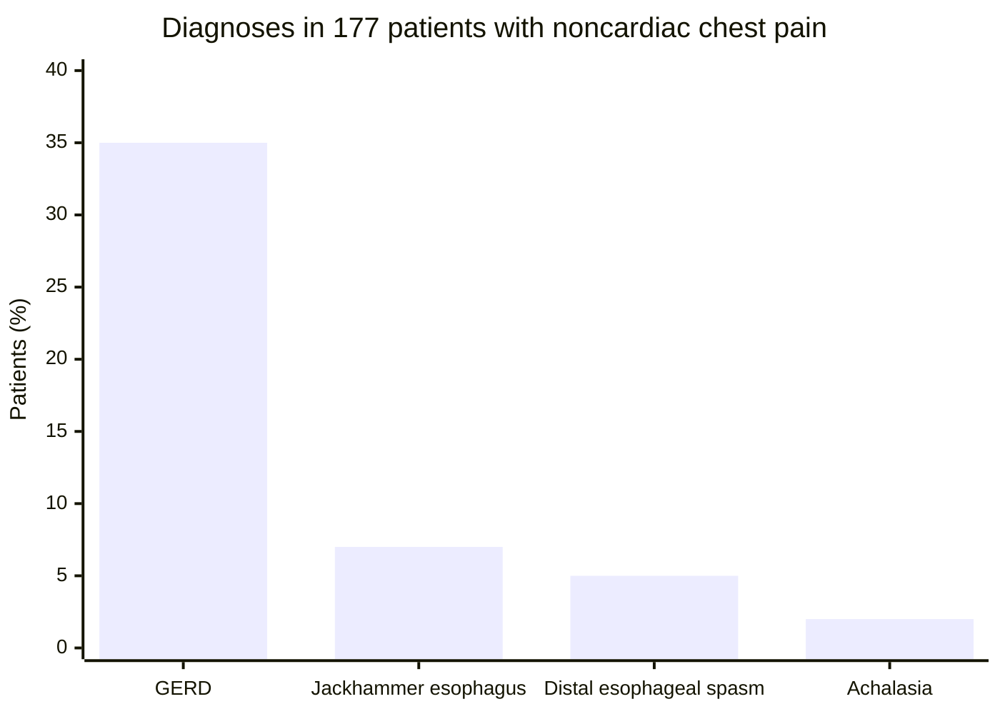

*Also called esophageal manometry or high-resolution esophageal manometry (HREM).*

## Contents
- [[#Overview]]
- [[#Indications]]
- [[#HRM Around Antireflux Surgery]]
  - [[#Before Surgery]]
  - [[#After Surgery]]
- [[#Technique]]
  - [[#Standard Protocol]]
  - [[#Provocative Maneuvers]]
  - [[#Technical Artifacts That Fake an Elevated IRP]]
- [[#Interpretation]]
- [[#Performance]]
  - [[#Versus Conventional Manometry]]
  - [[#Hiatal Hernia Detection]]
  - [[#Atypical Symptoms]]
- [[#See Also]]
- [[#Sources]]

## Overview

- High-resolution manometry (HRM): pressure data from **closely spaced circumferential sensors** on a catheter, displayed as 3-dimensional pressure topographs by dedicated software; conventional manometry (CM) = stacked line tracings from widely spaced sensors ([[acg-2020-esophageal-physiologic-testing]]).
- Studies are read with the **[[chicago-classification-v4|Chicago Classification v4.0 (CC v4.0)]]**, which owns the protocol, metrics, cutoffs and diagnostic algorithm.
- HRM by itself **cannot diagnose [[gerd|gastroesophageal reflux disease (GERD)]]** ([[acg-2020-esophageal-physiologic-testing]]; [[acg-2021-gerd]]).

## Indications

| Indication | Role of HRM | Source · grade |
|---|---|---|
| Obstructive esophageal symptoms ([[dysphagia]]) **without a mechanical cause** | HRM to evaluate for esophageal motility disorders | American College of Gastroenterology (ACG) 2020 Rec 1 · conditional, very low quality |
| Same population — which test | **HRM over conventional line-tracing manometry** | ACG 2020 Rec 2 · **strong, moderate quality** |
| Obstructive symptoms + **borderline HRM findings** | [[flip-panometry\|Functional lumen imaging probe (FLIP)]] to complement HRM | ACG 2020 · conditional, low quality |
| HRM cannot be completed (catheter placement fails despite endoscopic placement attempts) | FLIP topography may be used instead | ACG 2020 · key concept |
| Before antireflux surgery (ARS) or endoscopic antireflux therapy | Exclude achalasia and absent contractility — see [[#Before Surgery]] | ACG 2021 · key concept; ACG 2020 · key concept 9 |
| Refractory GERD | HRM if reflux monitoring and endoscopy are unrevealing; not a diagnostic test for GERD on its own | ACG 2021 · key concepts |
| [[noncardiac-chest-pain\|Noncardiac chest pain (NCCP)]] not responsive to [[proton-pump-inhibitors\|proton pump inhibitor (PPI)]] therapy | HRM complements the diagnostic evaluation | ACG 2020 · key concept 8 |
| Suspected [[rumination-syndrome\|rumination syndrome]] | High-resolution impedance manometry (HRIM) **with postprandial monitoring** to confirm, if clinically necessary | ACG 2020 Rec 15 · conditional, low quality |
| Excessive belching | pH impedance monitoring confirms supragastric belching (Rec 16 · conditional, very low quality); HRIM detects it only with a postprandial protocol | ACG 2020 |
| [[hiatal-hernia\|Hiatal hernia]] | Complements endoscopy and barium esophagography | ACG 2020 · key concept 10 |
| Transnasal pH-impedance catheter placement | Locates the lower esophageal sphincter (LES) | ACG 2020; ACG 2021 |

Sources: [[acg-2020-esophageal-physiologic-testing]]; [[acg-2021-gerd]].

> [!pearl] Achalasia can masquerade as refractory GERD
> 3% of patients having HRM before planned fundoplication had [[achalasia]]-spectrum disorders; of 524 patients with achalasia, 29% had been treated unsuccessfully with antisecretory drugs and referred for ARS ([[acg-2020-esophageal-physiologic-testing]]).

## HRM Around Antireflux Surgery

Detailed pre- and postoperative interpretation, including the Padova classification: [[hrm-antireflux-surgery]].

### Before Surgery

| Statement | Source · grade |
|---|---|
| **Recommend HRM before [[antireflux-surgery\|ARS]] or endoscopic therapy** to rule out achalasia and absent contractility | [[acg-2021-gerd\|ACG 2021]] · key concept |
| [[ineffective-esophageal-motility\|Ineffective esophageal motility (IEM)]] → HRM should include provocative testing for contractile reserve (e.g., multiple rapid swallows) | ACG 2021 · key concept |
| HRM should be performed before ARS or invasive GERD management | [[acg-2020-esophageal-physiologic-testing\|ACG 2020]] · key concept 9 |
| HRM is **essential** to exclude motor disorders not amenable to ARS | [[padova-2025-hrm-antireflux\|Padova 2025]] · median 9, 89% agreement |
| LES obstruction meeting CC v4.0 [[esophagogastric-junction-outflow-obstruction\|esophagogastric junction (EGJ) outflow obstruction (EGJOO)]] criteria **must be addressed** before ARS | Padova 2025 · median 8, 86% agreement |
| [[transoral-incisionless-fundoplication\|Transoral incisionless fundoplication (TIF)]], **no dysphagia**: manometry not routinely required | [[afs-2023-transoral-incisionless-fundoplication\|American Foregut Society (AFS) 2023]] white paper · ungraded |
| TIF **with dysphagia**: HRM ± timed barium esophagram (TBE) strongly advised to rule out a major motility disorder such as achalasia; FLIP is an alternative screening tool for achalasia and EGJ outflow obstruction | AFS 2023 · ungraded |

- **Absent contractility** is for most a contraindication to fundoplication ([[acg-2021-gerd]]).
- **Tailoring the wrap to motility** (Nissen for normal peristalsis, partial for IEM): ACG 2021 says studies have not supported it. AFS 2023 states that IEM on manometry may alter the fundoplication type before Nissen, and that TIF (partial wrap over a 60 Fr device) may carry less dysphagia risk in IEM.
- **TIF without dysphagia — sources differ:** ACG 2021 recommends HRM before endoscopic antireflux therapy and, until more data on magnetic sphincter augmentation (MSA) and TIF, a preoperative HRM; AFS 2023 (later, but a white paper) does not require it routinely.
- Reduced contractile reserve on multiple rapid swallows → associated with postoperative dysphagia ([[acg-2021-gerd]]; [[acg-2020-esophageal-physiologic-testing]]).

> [!pitfall] Absent contractility with dysphagia: exclude achalasia first
> Integrated relaxation pressure (IRP) can infrequently be normal in achalasia — confirm with barium radiography or FLIP before ARS ([[padova-2025-hrm-antireflux]]).

### After Surgery

| Statement | Source · grade |
|---|---|
| HRM has a diagnostic role after **unsuccessful fundoplication** (persistent or new reflux symptoms and/or dysphagia), **unless a large recurrent hernia necessitates reoperation** | Padova 2025 · median 8, 85% agreement |
| **No manometry finding is an absolute indication for reoperation**; HRM helps decision-making alongside endoscopy, pH monitoring and barium studies | Padova 2025 · median 9, 96% agreement |
| Esophageal symptoms after ARS → inspect EGJ and gastric cardia anatomy endoscopically and/or radiographically | ACG 2020 Rec 12 · conditional, very low quality |

## Technique

### Standard Protocol

- **10 supine test swallows** ([[acg-2020-esophageal-physiologic-testing]]); full CC v4.0 acquisition protocol (supine + upright positions, swallow volumes, rest intervals) on [[chicago-classification-v4#Required HRM Protocol]].
- **Dysphagia → [[upper-endoscopy|endoscopy]] first.** HRM ordered without an endoscopy or esophagram report cannot rule out structural causes of an elevated IRP ([[bredenoord-2021-egjoo-technical-review]]).

### Provocative Maneuvers

ACG 2020 Rec 3 (conditional, low quality): add supplementary/provocative maneuvers to the protocol to improve diagnostic yield for motility disorders in obstructive esophageal symptoms ([[acg-2020-esophageal-physiologic-testing]]). CC v4.0 normal responses and obstruction criteria: [[chicago-classification-v4]].

| Maneuver | Technique | What it adds |
|---|---|---|
| **Multiple rapid swallows (MRS)** | 5 × 2 mL water swallows, **<3 s apart** | Body contraction ceases and LES relaxes during the sequence; robust contraction afterwards = **contraction reserve**. Absent reserve → possible higher risk of post-fundoplication dysphagia and of developing or worsening IEM |
| **Rapid drink challenge (RDC)** | Free drinking of **100–200 mL** water through a straw, as fast as possible, upright | Aids identification of EGJ outflow obstruction (elevated LES postswallow residual pressure or panesophageal pressurization) |
| **Standardized test meal (STM)** | Typically cooked rice and gravy, or a cheese and onion pasty | Higher yield for obstructive disorders (EGJ outflow obstruction, spasm); reproduces symptoms |
| **Amyl nitrite (AN)** | Inhaled nitric oxide donor | Relaxes LES in health, EGJOO and achalasia; in achalasia and EGJOO (not healthy controls) relaxation is followed by a robust LES **rebound contraction**. In one retrospective series of 258 patients, an IRP drop **>10 mmHg** below deglutitive IRP defined AN-responsive patients ([[bredenoord-2021-egjoo-technical-review]]) |

### Technical Artifacts That Fake an Elevated IRP

**16%–32% of elevated supine IRPs normalize** when the patient is repositioned and given 5 upright wet swallows; the physiologic IRP range is also lower upright ([[bredenoord-2021-egjoo-technical-review]]). Exclude these before reporting EGJOO:

| Artifact | Mechanism | What to do |
|---|---|---|
| **Pressure drift** | Solid-state systems drift; manufacturer post-procedural "thermal compensation" does not always correct it and can itself produce an erroneously elevated IRP | Be aware compensation may not fix it (Figure 2 shows drift on the end-of-study trace after catheter removal) |
| **Catheter impingement / sensor angulation** | An EGJ-segment sensor is angulated, classically in a hiatal hernia sac, and records falsely high pressure; inspiratory crural pull moves the artifact aborally | **Reposition the catheter during live acquisition** to resolve it |
| **Hiatal hernia** | The EGJ is more typically a *weakened barrier* than an obstruction | Elevated IRP is often artifact here — ignore it; never treat it with invasive procedures |
| **Cardiac / vascular compression** | Compression pressure artifact | Reduced upright — posture change helps exclude clinically irrelevant elevated supine IRP |
| **Hysteresis / hydrostatic artifact** | Perfused HRM systems | Recognize as system artifact |
| **Psychological stress, breath interruption** | Stress and mid-expiratory breath interruption raise residual deglutitive EGJ pressure and are associated with incomplete liquid bolus clearance | — |

## Interpretation

- Metrics (IRP, contractile vigor, peristaltic integrity), cutoffs and the diagnostic hierarchy: [[chicago-classification-v4]].
- Diagnoses: [[achalasia]] types I–III, [[esophagogastric-junction-outflow-obstruction|EGJOO]], absent contractility, [[distal-esophageal-spasm|distal esophageal spasm (DES)]], [[hypercontractile-esophagus|hypercontractile esophagus]], IEM.
- **A manometric diagnosis of EGJOO is always clinically inconclusive** (strong); a conclusive diagnosis needs clinically relevant symptoms plus TBE (preferably with tablet) and/or FLIP (conditional, moderate quality) ([[bredenoord-2021-egjoo-technical-review]]).

## Performance

### Versus Conventional Manometry

From [[acg-2020-esophageal-physiologic-testing]]:
- Multicenter randomized trial, 247 patients: higher diagnostic yield for achalasia with HRM than CM.
- HRM: better inter-rater agreement and diagnostic accuracy for motility disorders; novice and intermediate readers more accurate.
- HRM-based achalasia subtyping predicted treatment outcome; no CM-based subtyping paradigm exists.
- Barium esophagram as a screen for dysmotility (281 patients, esophagram within 90 days of HRM): sensitivity 0.69, specificity 0.50, positive predictive value (PPV) 0.61, negative predictive value 0.58 — a suboptimal screening test.

### Hiatal Hernia Detection

HRM identifies hiatal hernia by comparing the positions of the LES and crural diaphragm. Data suggest higher sensitivity than endoscopy or barium radiography, but the tests are **complementary** (key concept 10) ([[acg-2020-esophageal-physiologic-testing]]). Reference standards differ between rows — compare within a row only.

| Study (n) | Reference standard | Test | Sensitivity | Specificity |
|---|---|---|---|---|
| Prospective, 100 consecutive | Surgery | **HRM** | **94.3%** | **91.5%** |
| " | " | Endoscopy | 96.2% | 74.5% |
| " | " | Barium radiography | 69.8% | 97.9% |
| Prospective, 34 [[obesity\|obese]], before bariatric surgery | Surgery | HRM | 88.9% | 60.0% |
| " | " | Endoscopy or barium radiography (reported together) | 77.4% | 44.0% |
| 90 patients | The other 2 tests (endoscopy, barium) | HRM | 92% | 95% |
| 215 patients | Endoscopy | CM | 28% | 97% (PPV 82%) |
| 92 obese, before bariatric surgery | Barium radiography | Endoscopy | ≤40% | ≥94% |

- CM row: ACG urges caution — CM was used, and endoscopy has poor sensitivity for hiatal hernia despite high specificity.
- 83 consecutive laparoscopic-fundoplication patients (42 with hernia >2 cm at surgery): false-positive rate HRM 5% vs endoscopy 32% (P = 0.01); false-negative rates similar (48% vs 45%).
- Detection rate higher **upright or standing** than supine.
- ACG 2020 gives no manometric LES–crural diaphragm separation cutoff for hiatal hernia; its >2 cm figure is surgical hernia size in one cohort. EGJ morphology subtypes: [[chicago-classification-v4]].

### Atypical Symptoms

*Diagnoses after manometry and pH testing in noncardiac chest pain*
*Source: data from 177 patients with noncardiac chest pain who underwent manometry and pH testing, cited in ACG 2020*
*[[acg-2020-esophageal-physiologic-testing|ACG 2020 Clinical Use of Esophageal Physiologic Testing]]*
*GERD = gastroesophageal reflux disease*

- NCCP: once cardiac causes are excluded, GERD is the most common mechanism; if chest pain does not respond to PPI, achalasia, spasm or hypercontractility can explain it (as an epiphenomenon rather than a cause); motor assessment is required to diagnose [[functional-chest-pain|functional chest pain]] ([[acg-2020-esophageal-physiologic-testing]]).
- Rumination on postprandial HRIM: intragastric pressure rise **>30 mmHg** with proximal movement of gastric content, esophageal pressurization and a clinically recognized episode. Sensitivity 75%–80%, specificity 100% (study of 15 children/adolescents and 15 controls); a postprandial protocol increases detection; frequent swallowing can confound ([[acg-2020-esophageal-physiologic-testing]]).
- Supragastric belching: pH impedance monitoring is the gold standard; HRIM identifies episodes only with a postprandial protocol ([[acg-2020-esophageal-physiologic-testing]]).

---

## See Also

[[chicago-classification-v4]], [[hrm-antireflux-surgery]], [[antireflux-surgery]], [[transoral-incisionless-fundoplication]], [[flip-panometry]], [[gerd]], [[achalasia]], [[dysphagia]], [[noncardiac-chest-pain]], [[ambulatory-reflux-monitoring]], [[reflux-testing]], [[esophagogastric-junction-outflow-obstruction]], [[ineffective-esophageal-motility]], [[distal-esophageal-spasm]], [[hypercontractile-esophagus]], [[rumination-syndrome]], [[hiatal-hernia]], [[upper-endoscopy]], [[poem]], [[heller-myotomy]], [[anorectal-manometry]]

---

## Sources

1. [[acg-2020-esophageal-physiologic-testing|ACG 2020: Clinical Use of Esophageal Physiologic Testing]]
2. [[acg-2021-gerd|ACG 2021 Clinical Guideline: Diagnosis and Management of GERD]]
3. [[afs-2023-transoral-incisionless-fundoplication|American Foregut Society White Paper on Transoral Incisionless Fundoplication (2023)]]
4. [[padova-2025-hrm-antireflux|Padova Consensus: High-Resolution Manometry Before and After Antireflux Surgery]]
5. [[bredenoord-2021-egjoo-technical-review|Esophagogastric Junction Outflow Obstruction — Chicago Classification v4.0 Technical Review]]
