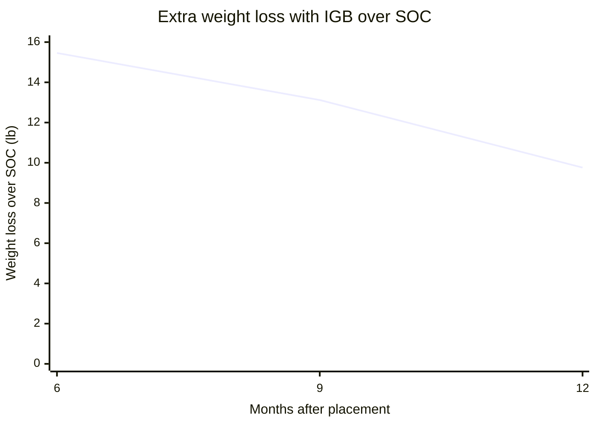

# Intragastric Balloon (IGB)

## Contents
- [[#Overview]]
- [[#Indications and Patient Selection]]
  - [[#Contraindications and Age (BIBC 2018)]]
- [[#Efficacy]]
- [[#Device Types]]
- [[#Technique]]
- [[#Periprocedural Management]]
- [[#Adverse Events]]
  - [[#When the Balloon Must Come Out (BIBC 2018)]]
- [[#After Removal]]
- [[#See Also]]
- [[#Sources]]

---

## Overview

- **Intragastric balloon (IGB):** [[upper-endoscopy|endoscopically]] placed, restrictive [[endoscopic-bariatric-therapies|endoscopic bariatric therapy]] for [[obesity]]; filled with saline (fluid-filled) or gas; used to **augment lifestyle modification**, not replace it ([[aga-2021-intragastric-balloons|American Gastroenterological Association (AGA) 2021]]).
- **Dwell time:** AGA 2021 sets none; it reports outcomes at 6, 9 and 12 months and pools safety over a 6- to 8-month dwell. Device dwell times → [[#Device Types]].
- **Scope:** AGA 2021 assessed **endoscopically placed balloons only**; swallowable balloons (e.g. Elipse) were not assessed (not available in the US) and carry none of its recommendations.

## Indications and Patient Selection

- **AGA 2021 Rec 1** (conditional, moderate certainty): IGB **plus lifestyle modification over lifestyle modification alone** in individuals with obesity seeking weight loss who have **failed a trial of conventional weight-loss strategies**.
  - Implementation remark: US trials enrolled only **body mass index (BMI) 30–40 kg/m²**; international trials sometimes went outside it. This is the trial range, not an eligibility cutoff.
- **[[asge-esge-2024-primary-ebmt|American Society for Gastrointestinal Endoscopy–European Society of Gastrointestinal Endoscopy (ASGE–ESGE) 2024]] Rec 2** (conditional, moderate certainty): IGB plus lifestyle modification over lifestyle modification alone in adults with obesity. Conditional mainly because of **variability in patient values and preferences**.
- **BMI criteria — ASGE–ESGE 2024 Rec 1** (conditional, very low certainty): **BMI ≥30 kg/m²**, or **27.0–29.9 kg/m² with ≥1 obesity-related comorbidity**; **no upper BMI limit**. IGB data exist in both the overweight and class III groups.
- Alternatives and bridging (pharmacotherapy per [[aga-2022-obesity-pharm|AGA 2022]], e.g. [[semaglutide]]; [[bariatric-surgery]]) → [[endoscopic-bariatric-therapies]] and [[obesity]].

### Contraindications and Age (BIBC 2018)

Neither US guideline lists contraindications or an age range; these come from the [[bibc-2018-intragastric-balloon-consensus|Brazilian Intragastric Balloon Consensus (BIBC) 2018]] — 39 experts, **consensus = ≥70% agreement**; each percentage is **the vote, not an evidence grade**.

| | Items |
|---|---|
| **Absolute** | Ulcer, **even without signs of bleeding** — gastric body/fundus (83.3%), antrum (75.0%), any other location (71.9%); gastric, duodenal and esophageal ulcers are absolute irrespective of bleeding · **previous gastric surgery** (93.8%) · **esophageal varices** (84.4%) · **gastric varices** (90.6%) · **[[hiatal-hernia\|hiatal hernia]] >5 cm** (71.0%) · **anticoagulant use** (87.5%) |
| **Relative** | Angioectasias without bleeding (75.0%) · [[eosinophilic-esophagitis\|eosinophilic esophagitis]] (81.3%) · human immunodeficiency virus (HIV) positive, immunocompetent (96.9%) · uncontrolled/untreated psychiatric disorder (75.8%) |
| **Not a contraindication** | Esophagitis **Los Angeles grade A or B** (80.7%) · gastritis (83.3%) · hyperplastic or benign polyps (87.1%) · ***[[helicobacter-pylori-infection\|H. pylori]]* positive** (90.7%) |
| **No consensus** | Congestive gastropathy · familial gastric polyposis · antiplatelet agents · **Los Angeles grade C or D esophagitis** (52.9% absolute vs 44.1% relative — treat, then place) |

> [!pitfall] Prior gastric surgery rules out a balloon
> Absolute contraindication in BIBC (93.8%); 4 of the 8 gastric perforations with Orbera occurred after previous gastric surgery ([[aga-2017-endoscopic-bariatric-therapies]]).

- **Age:** minimum **≥12 years** with established puberty, after failed clinical treatment and/or with comorbidities, multidisciplinary evaluation and **written authorization from both parents** (84.9%); **no maximum** if fit for endoscopy (96.8%).
- **Team:** **dietician mandatory** (100%), following the patient throughout (90.0%); psychologist (70.0%), endocrinologist (93.3%), psychiatrist (96.8%) not mandatory.
- **Pre-placement endoscopy not considered essential** (84.4%): the implanting endoscopist examines the stomach at implant and aborts if needed.
- BIBC's lower BMI floor (**>25 kg/m²** with progressive weight gain refractory to clinical treatment, 84.4%) is wider than ASGE–ESGE; the US criteria above govern.

## Efficacy

IGB vs standard of care (SOC)/lifestyle alone, pooled randomized controlled trials (RCTs) (number of RCTs varies by outcome: 7 for total body weight loss [%TBWL] at removal, 2 at 12 months, 3 for ≥5% and 4 for ≥10% TBWL):

| Outcome | IGB | SOC | Effect |
|---|---|---|---|
| %TBWL at removal (6–8 mo) | 10.7% | 3.4% | Mean difference (MD) 6.9% ([[asge-esge-2024-primary-ebmt\|ASGE–ESGE]]); 6.89% (AGA) |
| %TBWL at 12 mo | 7.9% | 3.3% | MD 4.4% (ASGE–ESGE) |
| ≥5% TBWL at 6–8 mo | 85.1% | 34.6% | Relative risk (RR) 2.44 (AGA) |
| ≥10% TBWL at 6–8 mo | 61.9% | 13.7% | RR 4.31 (AGA) |
| Excess weight loss, peak at 9 mo | — | — | MD 20.43% (AGA) |

*Extra weight loss with an intragastric balloon over standard of care, by time after placement*
*Source: data from pooled RCTs of IGB vs SOC (7 RCTs at 6 mo, 3 at 9 mo, 2 at 12 mo), cited in AGA 2021*
*[[aga-2021-intragastric-balloons|AGA 2021 Intragastric Balloon Guideline]]*
*IGB = intragastric balloon · SOC = standard of care · RCT = randomized controlled trial*

- **Metabolic (AGA):** improves hemoglobin A1c (HbA1c), fasting glucose, alanine aminotransferase (ALT −9 U/L), aspartate aminotransferase (AST −3 U/L), waist circumference (−4.1 cm); more remission of diabetes, hypertension, dyslipidemia; low-density lipoprotein trends down; no triglyceride benefit. Effect most apparent with **fasting glucose >100 mg/dL, HbA1c >6.5% or BMI >40 kg/m²**.
- **Lifestyle (AGA Rec 2, strong, moderate certainty):** moderate- to high-intensity concomitant lifestyle modification to maintain and augment weight loss (e.g. very-low-calorie ketogenic diet).

> [!pearl] Expect regain after removal
> Both mechanisms (≥400 mL space occupation; slower gastric emptying with fluid-filled balloons) need the balloon in place — some regain within 6 months of removal ([[asge-esge-2024-primary-ebmt]]). Plan maintenance ([[#After Removal]]).

## Device Types

- **Fluid- vs gas-filled (AGA 2021):** meta-analysis of 22 RCTs — fluid-filled **~3% more weight loss**, but numerically more adverse events and lower tolerability. **No device-specific recommendation**; choose by shared decision-making (Rec 1 implementation remark).
- Per-device data below are [[aga-2017-endoscopic-bariatric-therapies|AGA 2017]] Table 1 and text (ungraded).

| Device | Fill / placement | Dwell | %TBWL | Early removal · other adverse events |
|---|---|---|---|---|
| **Orbera** | Silicone; saline **450–700 mL** | 6 mo | **13.2% at 6 mo** (95% confidence interval [CI] 12.4–13.95; 55 studies). Pivotal RCT completers 10.7% ± 6.8% vs 4.7% ± 5% | ~7.5% · abdominal pain 33.7%, nausea 29.0%, migration 1.4%, **gastric perforation 0.1%** |
| **ReShape Duo** | Two balloons, **independent channels**; **900 mL** saline/methylene blue (450 mL each) | 6 mo, endoscopic removal | Sham RCT completers 7.6% ± 5.5% vs 3.6% ± 6.3% | 15% · spontaneous deflation 6% without migration; ulcers/erosions **39.6% → 10.3% after redesign** |
| **Obalon** | **Gas**; swallowed capsule, **fluoroscopy confirms gastric entry**, inflated via catheter; up to **3 balloons** | **12–26 wk**, endoscopic removal | Sham RCT 6.9% ± 5 vs 3.6% ± 5 | 9.6% · failure to swallow capsule 8.3% |
| **Spatz** (adjustable) | Saline; extractable tube — **volume lowered for intolerance or raised for efficacy** in situ | Up to **12 mo** (approved outside the US) | 14 at 6 mo, 20 at 12 mo (single arm) | 5.4% (6 mo) · migration/surgical removal 4.1% |
| **Elipse** | Swallowed capsule, **550 mL**; **no endoscopy** to place or remove | Valve opens at ~4 mo; balloon excreted | 10% ± 6.6% at 4 mo (single arm) | 7.4% (needed endoscopy) · expelled with emesis after deflation 12% |

## Technique

- **Setting:** clinic with advanced life support (type II or III) and backup transfer (BIBC, 83.9%). Sedation: no consensus.
- **Before placement:** fast **≥8 h** (90.3%); no liquid diet (83.9%) or [[proton-pump-inhibitors|proton pump inhibitor (PPI)]] (90.3%) needed beforehand (BIBC).
- **Orbera placement (AGA 2017):** deflated balloon preloaded on a catheter, passed blindly transorally; endoscope advanced alongside to confirm position; inflated with saline under direct vision.
- **Fill (BIBC):** nonadjustable liquid balloons **≥500 mL** (87.1%); **saline + methylene blue** (90.0%) — methylene blue **always**, except allergy (100%). Maximum volume: no consensus.
- **Why methylene blue (AGA 2017):** on rupture it is absorbed and **turns the urine colour**, signalling deflation (it was not used in the pivotal US Orbera trial).

> [!howto] Balloon removal (BIBC 2018)
> 1. Liquid diet **≥2 days** (90.9%)
> 2. Fast **≥12 h** (80.7%); carbonated zero-sugar cola to clear residue (78.1%)
> 3. Grasp with a **hybrid jaw grasper** (alligator + rat tooth) (75.0%)
> 4. **Esophageal overtube** for selected difficult removals (74.1%)
> 5. Clinical follow-up **≥6 months** after removal (89.7%)

## Periprocedural Management

| Element | AGA 2021 | ASGE–ESGE 2024 | Detail |
|---|---|---|---|
| PPI | **Recommend** PPI prophylaxis (Rec 3; **strong**, moderate) | **Suggest** PPI while the IGB is in place (Rec 5; conditional, very low) | No agent, dose or duration given; AGA: lowest dose, frequency and duration. All 15 ASGE–ESGE experts give a PPI for the whole dwell |
| Antiemetics | Lowest-nausea anesthetic regimen + perioperative antiemetics, then **scheduled antiemetics for 2 weeks** (Rec 4; conditional, low) | Periprocedural antiemetics (Rec 3; conditional, very low) | No agent named. ASGE–ESGE survey, before placement: ondansetron 93%, aprepitant 73%, dexamethasone 60%, scopolamine patch 60%; at discharge: ondansetron 86%, scopolamine patch 64%, aprepitant 36%, lorazepam 36%. Nausea/vomiting 31.6%, emergency visit 7.7% within 72 h |
| Pain medication | — | Periprocedural pain medication (Rec 4; conditional, very low) | Survey: acetaminophen 67%, hyoscyamine 58%, opioids 42% — **opioids sparingly** (~10% of opioid-naive bariatric surgical patients become addicted after a periprocedural dose) |
| Nutritional screening | **Against** perioperative laboratory screening (Rec 5; conditional, low) | — | Clinical judgment on an individual basis still applies |
| Multivitamins | **Daily 1–2 adult-dose multivitamins** after placement (Rec 6; conditional, very low) | — | No formulation or targets given |

- **PPI:** same direction, different strength (AGA strong, ASGE–ESGE conditional; no comparative study). Rationale: mucosa can erode and bleed during and after placement; indirect evidence only ([[upper-gi-bleeding|upper gastrointestinal (GI) bleeding]] data; fewer serious adverse events with PPI in 4 IGB RCTs). Weigh PPI risks — enteric infection incl. [[clostridioides-difficile|*Clostridium difficile*]], pneumonia, fracture, kidney disease, micronutrient deficiency.
- **Electrolytes:** asymptomatic hypokalemia from vomiting in 6.8%–8.5% at 1 week after placement; in sleeve-gastrectomy cohorts given 1–2 multivitamins with minerals, **no patient (n = 205) had hypomagnesemia** up to 5 years (AGA, indirect).
- **BIBC adaptation period (3–5 days, 93.8%):** ondansetron (85.2%), hyoscine/scopolamine (88.9%), dexamethasone (70.4%), dimenhydrinate (82.8%), analgesic (92.6%), PPI (96.3%). Shorter than AGA's 2-week scheduled antiemetic, which governs. **Avoid** metoclopramide (70.4%; may worsen symptoms), anti-inflammatory drugs (96.3%; gastric injury), anxiolytics/antidepressants (78.6%). Physical activity may resume after the adaptation period (87.1%). Prophylactic antifungals against hyperinflation: no consensus (68.8% against).

## Adverse Events

AGA 2021 (serious adverse events pooled from 7 RCTs, 6- to 8-month dwell; early-removal source not specified):

| Event | IGB | SOC | Effect |
|---|---|---|---|
| **Serious adverse event, any** | **5.6%** | **1.1%** | **RR 3.07** (95% CI 1.16–8.11) |
| Perforation | **0.3%** | — | — |
| Esophageal mucosal injury | 0.8% | — | — |
| Gastric ulcer / bleeding | 0.76% | — | — |
| [[gastric-outlet-obstruction\|Gastric outlet]] / bowel obstruction | 0.12% | — | — |
| **Early removal for intolerance** | **9.4%** | — | — |
| Death | 0 | 0 | — |

- **Early removal** driven by device intolerance (fullness) and symptoms (epigastric pain, [[gerd|reflux]], [[nausea-and-vomiting|nausea, emesis]]); predictors of intolerance are not established.
- Post-marketing reports add rare **hyperinflation, [[acute-pancreatitis|acute pancreatitis]] and death**.

### When the Balloon Must Come Out (BIBC 2018)

| Remove | Can stay |
|---|---|
| **Patient request**, any reason (100%) | **Mild pancreatitis** (76.7%) |
| **Symptomatic hyperinflation** (96.9%) | **GI bleeding that stopped spontaneously** (84.4%) |
| **Moderate or severe acute pancreatitis** (90.6%) | **Severe erosive esophagitis** — treat first; removal risks esophageal tear or perforation (87.1%) |
| **Gastric ulcer with a nonadjustable balloon** (90.0%) | **Mallory-Weiss syndrome, endoscopically controlled** (77.4%) |
| **Recurrent antral impaction** (86.7%) — reposition on the first episode | **Hypovitaminosis or mild nutritional disorder** (76.9%) |
| **Pregnancy** — preferably **second trimester**, with the obstetrician (81.3%) | |
| **Recurrent hydroelectrolytic disorder** (76.7%) | |
| **Bleeding controlled by endoscopic therapy** (76.5%) | |
| **Possible rupture (green urine)** — **mandatory, within 72 h** (87.1%) | |
| **Rupture during treatment** — any substitution **simultaneous with removal** (93.6%) | |

> [!pitfall] Green urine means possible rupture
> Methylene blue in the urine signals deflation — removal is mandatory within 72 hours ([[bibc-2018-intragastric-balloon-consensus]]).

- **Adjustable balloon with an ulcer:** 53.9% remove even over the patient's objection; if declined, reposition the filling catheter and treat — **except a deep ulcer at high perforation risk, which must come out**.
- **No consensus:** asymptomatic spontaneous hyperinflation without gastric lesion (64.5% manage conservatively); fungal colonization (0% voted for removal).
- **"Premature removal"** = explant within 1 month of implant, for an adverse event or patient request (84.4%).

## After Removal

- **AGA Rec 7** (conditional, low certainty): a subsequent weight-loss or maintenance intervention — **dietary intervention, pharmacotherapy, repeat IGB or [[bariatric-surgery]]** — chosen by patient context and comorbidities through shared decision-making.
  - **Sequential IGB** (second balloon, 13-mo endpoint): greater BMI reduction (MD 5.49 kg/m²; 95% CI 4.82–6.16), but risks and complications more frequent with a second or prolonged IGB. BIBC sets **no limit on sequential implants** while an indication remains (100%).
  - **Pharmacotherapy:** [[glp-1-receptor-agonists|liraglutide 3 mg/day]] added to IGB for 6 mo beat IGB alone (weight MD 3.8 kg; 95% CI 2.43–5.17). Sibutramine 10 mg/day after removal was only slightly better than a moderate-/high-intensity diet (>10% weight loss RR 1.50; 95% CI 0.81–2.78).
  - **Bridge to surgery:** IGB before laparoscopic gastric banding shortened hospital stay by 1 day and lowered intraoperative risk and moderate-to-severe postoperative complications.
- **Durability:** no efficacy data beyond 1 year versus SOC (AGA).

---

## See Also

[[obesity]], [[endoscopic-bariatric-therapies]], [[endoscopic-sleeve-gastroplasty]], [[semaglutide]], [[proton-pump-inhibitors]], [[bariatric-surgery]], [[upper-gi-bleeding]], [[acute-pancreatitis]], [[clostridioides-difficile]], [[upper-endoscopy]], [[gerd]], [[nausea-and-vomiting]], [[glp-1-receptor-agonists]], [[gastric-outlet-obstruction]], [[hiatal-hernia]]

---

## Sources

1. [[aga-2021-intragastric-balloons|AGA Clinical Practice Guidelines on Intragastric Balloons in the Management of Obesity (2021)]]
2. [[asge-esge-2024-primary-ebmt|ASGE–ESGE Guideline on Primary Endoscopic Bariatric and Metabolic Therapies for Adults with Obesity (2024)]]
3. [[aga-2022-obesity-pharm|AGA Clinical Practice Guideline: Pharmacological Interventions for Adults with Obesity (2022)]]
4. [[aga-2017-endoscopic-bariatric-therapies|AGA Clinical Practice Update: Expert Review on Endoscopic Bariatric Therapies (2017)]]
5. [[bibc-2018-intragastric-balloon-consensus|Brazilian Intragastric Balloon Consensus Statement (BIBC): Practical Guidelines Based on Experience of Over 40,000 Cases (2018)]]
