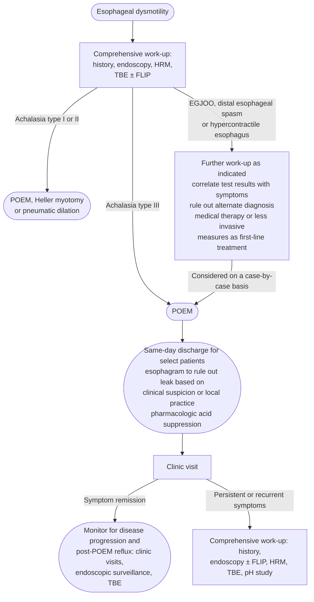

# POEM (Peroral Endoscopic Myotomy)

Peroral endoscopic myotomy (POEM): endoscopic myotomy of the lower esophageal sphincter (LES) and distal esophageal muscle via a submucosal tunnel. Mainstream therapy for [[achalasia]]; the same technique underlies [[g-poem|gastric POEM (G-POEM)]] (pyloromyotomy for [[gastroparesis]]). Content below is for esophageal POEM.

## Contents
- [[#Preprocedure Evaluation]]
- [[#Indications]]
- [[#Care Pathway]]
- [[#Technique]]
- [[#Immediate Post-Procedure Care]]
- [[#Post-POEM Reflux]]
- [[#Long-Term Surveillance]]
- [[#Adverse Events]]
- [[#Management After Failed Myotomy]]
- [[#Outcomes]]

## Preprocedure Evaluation

*Comprehensive workup is required to confirm the diagnosis before POEM (American Gastroenterological Association [AGA] 2024 Best Practice Advice [BPA] 1).*

- **Clinical history + medication review** — establish quality/severity of symptoms; exclude opiate-induced dysmotility
- **[[upper-endoscopy|Upper endoscopy]]** — retained frothy secretions, puckered gastroesophageal (GE) junction suggest poor clearance; **retroflexed exam mandatory to exclude pseudoachalasia**
- **Timed barium esophagram (TBE)** — confirms outflow obstruction; a 13-mm barium tablet elicits subtle esophagogastric junction (EGJ) narrowing; monitors severity and post-treatment effect
- **[[high-resolution-manometry|high-resolution manometry (HRM)]]** — gold standard for achalasia; subtype by [[chicago-classification-v4|Chicago Classification v4.0]] for phenotype-directed treatment
- **[[flip-panometry|functional lumen imaging probe (FLIP)]]** — useful adjunct when diagnosis equivocal; low EGJ distensibility index suggests achalasia when manometry inconclusive

## Indications

*Subtype drives the choice — achalasia types I/II/III defined by [[chicago-classification-v4|Chicago Classification v4.0]] on [[high-resolution-manometry|HRM]]. Choosing among POEM, [[heller-myotomy|laparoscopic Heller myotomy (LHM)]] and [[pneumatic-dilation|pneumatic dilation (PD)]] for an individual patient: see [[achalasia#Therapeutics|achalasia]].*

| Indication | Role of POEM |
|---|---|
| Achalasia type I & II, adults | POEM with appropriate [[proton-pump-inhibitors\|proton pump inhibitor (PPI)]] use **or** LHM with fundoplication, by surgeon–patient shared decision making ([[sages-2024-poem\|Society of American Gastrointestinal and Endoscopic Surgeons (SAGES) 2024]] — conditional, low certainty). AGA 2024 BPA 2: POEM, LHM and PD are all effective; choose by shared decision making, patient/disease characteristics, preferences, local expertise |
| Achalasia type III (spastic) | **Preferred treatment** — POEM allows tailored, unlimited proximal myotomy to cover the spastic segment (AGA 2024 BPA 2; SAGES 2024 favors POEM over LHM as **expert opinion** — no evidence-based recommendation was possible) |
| Achalasia — POEM vs PD | POEM over PD (SAGES 2024 — conditional, moderate certainty). PD may still be the better choice after **repeated treatment failure**, and in **elderly or frail** patients or those unable to tolerate a prolonged procedure and general anesthesia |
| Achalasia in **children** | No new pediatric comparative data since 2021, so the 2021 statements stand — types I/II: **either POEM or LHM** (conditional, very low certainty); type III: **POEM favored** over LHM (expert opinion) ([[sages-2021-poem\|SAGES 2021]]) |
| [[esophagogastric-junction-outflow-obstruction\|EGJ outflow obstruction (EGJOO)]] alone | Case-by-case only, after less invasive options exhausted (AGA 2024 BPA 3) |
| Nonachalasia spastic disorders ([[distal-esophageal-spasm\|distal esophageal spasm (DES)]], [[hypercontractile-esophagus\|hypercontractile esophagus]]) | Case-by-case only, after medical therapy / [[botulinum-toxin\|botulinum toxin]] / dilation exhausted (AGA 2024 BPA 3) |

- POEM is **superior to PD and noninferior to LHM** in separate multicenter randomized controlled trials (RCTs) (AGA 2024).
- **What changed in 2024:** SAGES 2021 graded POEM over PD a **strong** recommendation; the 2024 update **downgraded it to conditional** at the same moderate certainty, and reframed the surgical question as *POEM + appropriate PPI use* vs *LHM + fundoplication* rather than POEM vs LHM alone. SAGES 2021 also allowed either POEM or PD, by joint decision making, for the subgroup **particularly concerned about continued postoperative PPI use** (conditional, very low certainty).
- EGJOO is a **manometric finding, not a diagnosis** — must exclude mimics ([[obesity]], [[hiatal-hernia|hiatal hernia]], [[gerd|gastroesophageal reflux disease (GERD)]], external compression, [[subepithelial-lesion|submucosal mass]], opiates, artifact) and confirm symptomatic delayed emptying before intervention.
- POEM and LHM are complex procedures — SAGES 2024 advises performing them at **high-volume centers**, with preprocedure HRM and barium studies available; without them patients receive the wrong intervention (fundoplication for presumed GERD, repeated dilation or botulinum toxin).

## Care Pathway

*Role of POEM in the evaluation and management of esophageal motility disorders*
*Source: redrawn from Figure 1 of the AGA 2024 Clinical Practice Update*
*[[aga-2024-poem-advances|AGA Clinical Practice Update on Advances in Per-Oral Endoscopic Myotomy (POEM)]]*
*HRM = high-resolution manometry · TBE = timed barium esophagram · FLIP = functional lumen imaging probe · EGJOO = esophagogastric junction outflow obstruction · POEM = peroral endoscopic myotomy*

## Technique

- Mucosal incision → submucosal tunnel with an [[endoscopic-submucosal-dissection|endoscopic submucosal dissection (ESD)]] knife → selective myotomy → mucosal closure with clips.
- **Tunnel orientation** (AGA 2024 BPA 5): anterior (2 o'clock) vs posterior (5 o'clock) — **equivalent** clinical success, adverse events, and post-POEM reflux (meta-analysis 18 studies, 1247 patients); posterior slightly shorter procedure time. For **prior LHM or POEM, choose the approach opposite the prior surgery** (avoids dense fibrosis plane).
- **Myotomy length** (AGA 2024 BPA 6): optimal length **undetermined**.
  - Original Inoue technique: 7–8 cm esophageal + 2–3 cm gastric. [[acg-2020-achalasia|American College of Gastroenterology (ACG) 2020]] describes cutting the muscle over a **minimum of 6 cm into the esophagus and 2 cm below the squamocolumnar junction** onto the cardia.
  - Extending just **1–2 cm beyond the LES** may normalize EGJ distensibility without the added reflux risk of a longer gastric myotomy.
  - RCT of short (<5 cm) vs long (6–10 cm) esophageal myotomy in types I/II: similar efficacy, safety, and GERD; shorter procedure time with short myotomy.
  - **Type III:** long esophageal myotomy tailored to the proximal spasm extent on [[high-resolution-manometry|HRM]] — key advantage over LHM.
  - Long myotomy may predispose to **blown-out myotomy** (weak point vulnerable to retained contractions).
  - Real-time intraprocedure [[flip-panometry|FLIP]] may help tailor/confirm myotomy adequacy.
- **[[antibiotic-prophylaxis-endoscopy|Antibiotic prophylaxis]]** (AGA 2024 BPA 4): a **single dose at the time of POEM may suffice** (RCT n=124: single-dose vs short-course — no difference in inflammation, transient bacteremia, or infection at day 5). No routine antifungal prophylaxis; incidental [[infectious-esophagitis|esophageal candidiasis]] → full antifungal course (14–21 days), does not preclude POEM.

## Immediate Post-Procedure Care

- **Routine post-POEM esophagram/endoscopy** (AGA 2024 BPA 7): unclear benefit; high false-positive rate and poor correlation with clinically significant outcomes. Most complications are identified at the time of the procedure → **postprocedural testing should be driven by clinical suspicion / intraprocedural events**, not routine.
- **Same-day discharge** (AGA 2024 BPA 8): feasible in select patients (achieved in 62–79% without post-discharge complications in retrospective series). Criteria: no intraprocedural issues requiring observation, tolerates oral fluids, minimal nausea/pain manageable orally; **contact within 24–48 h**. Consider **admission** for advanced age, significant comorbidities, poor social support, and/or limited access to specialized care — irrespective of symptoms.
- **Acid suppression** (AGA 2024 BPA 9): strongly consider empiric PPI in the immediate post-POEM healing period given high reflux/esophagitis risk; continue **≥3–6 months** until re-evaluation.

## Post-POEM Reflux

*GERD is the main concern after any LES-disrupting myotomy — common, and often asymptomatic.*

- Abnormal acid exposure **41–56%**; esophagitis **41–65%** after POEM, **~one-quarter asymptomatic** (AGA 2024 BPA 10). SAGES 2024 puts the asymptomatic share near **60%** of those with abnormal acid exposure or endoscopic esophagitis.
- **Versus the alternatives:** POEM carries a **higher incidence of GERD than LHM with fundoplication or PD** ([[acg-2020-achalasia|ACG 2020]] — *Strong; Moderate*). Beyond 12 months versus LHM + fundoplication, SAGES 2024 pooled more **PPI use** after POEM (odds ratio 2.62, 95% confidence interval [CI] 1.40–4.89; 193 more per 1,000; high certainty) and more **grade C/D esophagitis** (odds ratio 2.18, CI 0.17–27.50; very low certainty).
  - Older pooled rates run lower: ACG 2020's 2018 meta-analysis (1,542 POEM vs 2,581 LHM-with-fundoplication patients) put post-POEM abnormal acid exposure at **39.0% (CI 24.5–55.8%)** and esophagitis at **29.4% (CI 18.5–43.3%)**. Use the newer AGA ranges; ACG's figures only mean something beside their own LHM comparators, which live on [[heller-myotomy]].

> [!pitfall] Never judge post-POEM reflux on symptoms
> Most post-POEM reflux is silent, and achalasia stasis mimics heartburn in patients with no acid reflux at all — symptoms neither rule it in nor out. Confirm objectively before committing to, or stopping, long-term acid suppression ([[aga-2024-poem-advances|AGA 2024]], [[sages-2024-poem|SAGES 2024]]).

- **Objective [[reflux-testing|reflux testing]] generally 6–12 months post-POEM:**
  - **Off-PPI** pH monitoring if presence of GERD is in question.
  - **On-PPI** testing if GERD already established or esophagitis **Los Angeles (LA) grade B or higher** — assesses adequacy of acid suppression. LA grade A–D mucosal-break criteria: see [[reflux-testing]].
- **"Appropriate PPI use" has an operative definition** (SAGES 2024): treat the patient with **objectively confirmed abnormal distal esophageal acid exposure**. Started empirically → still do objective testing at some point, since long-term PPI use is not without consequence. The panel's clinically relevant endpoint is **medically uncontrollable reflux**, not esophagitis alone.
- Reflux symptoms after POEM may **not** be acid-related (food stasis, acid fermentation, visceral hypersensitivity) — objective testing discriminates.
- **Management ladder:** confirm PPI adherence (take 30–60 min before meals) → diet/lifestyle + alginates for mild/breakthrough → [[potassium-competitive-acid-blockers|potassium-competitive acid blocker]] (e.g., [[vonoprazan]]) a possible future preferred option for difficult erosive esophagitis → **[[antireflux-surgery|antireflux procedure]]** (endoscopic or surgical fundoplication) in a small subset after confirming GERD, excluding other etiologies, and failing optimization.
- Reflux esophagitis and abnormal acid exposure **decrease over time** (ongoing LES healing/remodeling) — SAGES 2024 saw the same fall between <12 and >12 months, including for grades C/D → favor a stepwise approach.

## Long-Term Surveillance

*Long-term surveillance encouraged for disease progression and GERD complications (AGA 2024 BPA 11).*

- Achalasia is chronic → endoscopic surveillance to detect disease progression and complications of asymptomatic GERD. FLIP may be integrated to assess EGJ opening; some programs alternate esophagram and endoscopy.
- **Consider routine upper endoscopy after POEM and after LHM + fundoplication** to find the asymptomatic patient with significant reflux who could be at risk of adenocarcinoma (SAGES 2024, **expert opinion**). Neither society sets an interval or protocol — both state the data are absent. A symptomatic patient gets a full work-up for an objective GERD diagnosis before treatment.
- **[[esophageal-cancer|Esophageal cancer]]:** achalasia patients had **5-fold higher risk** (hazard ratio [HR] 4.6; 95% CI 2.3–9.2) vs non-achalasia in a 9314-patient cohort — supports (but is not a routine endorsement of) endoscopic surveillance.
- Follow-up endoscopy and/or pH monitoring to objectively evaluate abnormal acid exposure; screen for erosive esophagitis and [[barretts-esophagus|Barrett's esophagus]].

## Adverse Events

- Capnoperitoneum / capnomediastinum (needle decompression), mucosal injury, bleeding, infection.
- **Post-procedural GERD** — most clinically important (see above).
- **Blown-out myotomy** — late adverse event; long myotomy may raise risk.

## Management After Failed Myotomy

*Full retreatment ladder across all three therapies: [[achalasia#Post-Therapy Monitoring and Retreatment|achalasia]].*

- ~**10–15%** of achalasia patients have persistent/recurrent symptoms (AGA 2024 BPA 12).
- Re-evaluate comprehensively: repeat [[upper-endoscopy|esophagogastroduodenoscopy (EGD)]], HRM and TBE — **TBE is the first-line test** for continued or recurrent symptoms after definitive therapy (ACG 2020, *Strong; Very low*).
- **POEM may be superior to PD for failed initial POEM or LHM** (AGA 2024 BPA 12) — **the only randomized comparison**: 1 RCT of POEM vs PD after failed LHM, success **62% vs 27%**, with no difference in esophagitis, reflux symptoms, PPI use, or serious adverse events. Individualize by etiology of failure, local expertise, patient characteristics, and preferences.
- ACG 2020's graded statements for this setting cover **safety**, not comparative efficacy: POEM is a safe option after prior PD or LHM (*Strong; Low*), and PD is appropriate and safe after an initial surgical myotomy or POEM (*Strong; Moderate*). Consider Heller myotomy **before esophagectomy** in patients who have failed both PD and POEM, if the anatomy is conducive and there is evidence of incomplete myotomy (*Strong; Very low*).

> [!pearl] 62%, not 94% — know which number is which
> ACG 2020's salvage-POEM rates after failed LHM — **94%** at 12 months (13-centre registry, 51 patients) and **95.7%** at median 28 months (46-patient series), both Eckardt ≤3 — are **uncontrolled single-arm** results from cohorts where everyone got POEM.
> Only the **62%** comes from a randomized comparison, so it is the figure that supports choosing POEM over PD. Counsel from it.

## Outcomes

*Symptomatic response is scored with the **Eckardt score** — components under [[achalasia#Severity Assessment|Severity Assessment]] on the achalasia page. ACG 2020 cautions that judging treatment failure by Eckardt score alone has been questioned — post-treatment bolus retention is discordant with the score.*

| Setting | Clinical success |
|---|---|
| POEM overall, prospective cohorts | **>90%** — symptom improvement with no further medical or surgical treatment ([[acg-2020-achalasia\|ACG 2020]]) |
| Achalasia type III | **93%** vs **71%** for LHM (2019 meta-analysis; odds ratio 3.50, CI 1.39–8.77) ([[acg-2020-achalasia\|ACG 2020]]) |
| EGJOO | **~80–85%** long-term — lower than the classic achalasia subtypes ([[aga-2024-poem-advances\|AGA 2024]]) |

*Salvage POEM after a failed myotomy: see [[#Management After Failed Myotomy]].*

*G-POEM (pyloromyotomy for gastroparesis) outcomes live on [[g-poem]] — the dedicated AGA 2023 Clinical Practice Update (CPU) reports durable clinical success ~50–60%, and explicitly flags the older short-term pooled figures (71–82%) as overestimates.*

---

## See Also

[[achalasia]], [[heller-myotomy]], [[pneumatic-dilation]], [[high-resolution-manometry]], [[chicago-classification-v4]], [[flip-panometry]], [[esophagogastric-junction-outflow-obstruction]], [[distal-esophageal-spasm]], [[hypercontractile-esophagus]], [[g-poem]], [[gastroparesis]], [[gerd]], [[reflux-testing]], [[hiatal-hernia]], [[barretts-esophagus]], [[esophageal-cancer]], [[dysphagia]], [[upper-endoscopy]], [[antireflux-surgery]], [[endoscopic-submucosal-dissection]], [[antibiotic-prophylaxis-endoscopy]], [[infectious-esophagitis]], [[subepithelial-lesion]], [[proton-pump-inhibitors]], [[potassium-competitive-acid-blockers]]

---

## Sources

1. [[aga-2024-poem-advances|AGA Clinical Practice Update on Advances in Per-Oral Endoscopic Myotomy (POEM) and Remaining Questions—What We Have Learned in the Past Decade: Expert Review]]
2. [[sages-2024-poem|SAGES Guideline Update: Peroral Endoscopic Myotomy (POEM) for Achalasia (2024)]]
3. [[sages-2021-poem|SAGES Guidelines for the Use of Peroral Endoscopic Myotomy (POEM) for the Treatment of Achalasia (2021)]]
4. [[acg-2020-achalasia|ACG 2020: Diagnosis and Management of Achalasia]]
