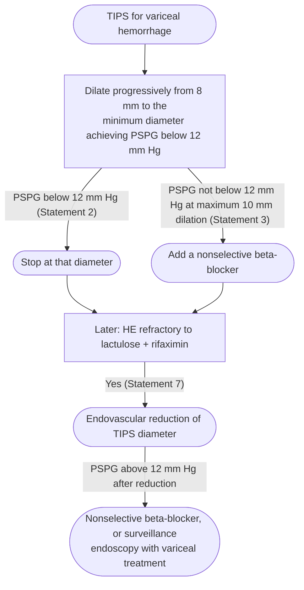

*Transjugular intrahepatic portosystemic shunt (TIPS): a percutaneously created portosystemic shunt for complications of [[portal-hypertension|portal hypertension]] — [[variceal-upper-gi-bleeding|variceal hemorrhage]], [[ascites|ascites]], and [[hepatic-hydrothorax|hepatic hydrothorax]]. Placed by interventional radiology, not endoscopically; included here because selection, timing, and post-procedure management are hepatology/gastroenterology decisions. Evidence below from the American Association for the Study of Liver Diseases (AASLD) is **Practice Guidance** — consensus guidance statements (GS) from an expert panel, **not Grading of Recommendations Assessment, Development and Evaluation (GRADE)-rated recommendations** ([[aasld-2024-tips]]).*

## Contents
- [[#Physiological Effects]]
- [[#Indications]]
  - [[#Variceal Hemorrhage]]
  - [[#Ascites and Hepatic Hydrothorax]]
  - [[#Vascular Disease]]
  - [[#Before Surgery]]
- [[#Contraindications and Futility]]
- [[#Technique]]
  - [[#Pre-TIPS Workup]]
  - [[#Shunt Creation]]
  - [[#Stent Diameter]]
- [[#Hemodynamic Targets]]
- [[#Complications]]
- [[#Follow-Up and Shunt Surveillance]]
- [[#TIPS vs Variceal Obliteration (RTO / ATO)]]
- [[#See Also]]
- [[#Sources]]

## Physiological Effects

- Portal flow diverted to the systemic circulation → ↓ portal venous pressure gradient; renal perfusion and function may improve
- **Volume load on the right heart:** right atrial pressure, cardiac preload and central blood volume ↑ **~50–100%**; cardiac output ↑ **~10–15%**; right ventricular, pulmonary arterial and wedge pressures ↑; systemic vascular resistance and afterload ↓ — hence the pre-procedure echocardiogram
- **Core trade-off:** better control of bleeding, ascites and renal function **vs** worsening [[hepatic-encephalopathy|hepatic encephalopathy (HE)]], cardiac overload and liver function → create the **smallest shunt that works**

## Indications

### Variceal Hemorrhage

| Scenario | Definition |
|---|---|
| **Pre-emptive TIPS** (formerly "early" TIPS) | Placed within **72 h** of hemorrhage, bleeding controlled with medical/endoscopic therapy but **high risk of treatment failure** |
| **Salvage TIPS** | Placed for **uncontrolled (ongoing)** bleeding despite medical and endoscopic therapy |
| **Rescue TIPS** | Placed for **early (within 5 days) recurrence** of variceal hemorrhage |
| **Elective TIPS** (secondary prevention) | Placed after recovery from acute hemorrhage, **>72 h** after the index bleed |

*Table — TIPS scenarios in variceal bleeding ([[aasld-2024-tips]], Table 4).*

- **Pre-emptive TIPS criteria** (GS 20) — Child-Turcotte-Pugh (CTP) class **C 10–13 points**, or class **B 8–9 points with active bleeding at initial endoscopy** despite vasoactive agents → polytetrafluoroethylene (PTFE)-covered stent within 72 h (ideally <24 h) of the index [[upper-endoscopy|upper endoscopy]]. CTP and Model for End-Stage Liver Disease (MELD) scoring tables: [[cirrhosis]]
  - **[[baveno-viii-2026-portal-hypertension|Baveno VIII]] 5.31** (level of evidence [LoE] 1, strong): bleeding from esophageal varices or gastroesophageal varices type 1 (GOV1); same CTP bands (**C 10–13**; **B >7 with active bleeding**) **plus a third limb — hepatic venous pressure gradient (HVPG) ≥20 mm Hg at the time of bleeding**. Baveno VII said CTP C **<14** and HVPG **>**20
  - **Missed the 72 h window → still benefit** (5.32): **2 weeks** for CTP C 10–13, **1 week** for CTP B >7 with active bleeding
  - **Not contraindications:** encephalopathy, hyperbilirubinemia, [[acute-on-chronic-liver-failure|acute-on-chronic liver failure]]; Baveno VIII 5.33 adds **MELD score and severe [[alcohol-associated-liver-disease|alcohol-related hepatitis]]**
  - Candidate profile (Baveno VIII Figure 3): **age <75 y, creatinine <3 mg/dL, no heart failure**
  - **Survival benefit unsettled** — updated meta-analysis: less 6-week rebleeding, no significant survival benefit; trials enrolled mainly alcohol- and [[chronic-hepatitis-b|hepatitis B]]–related cirrhosis, so [[nafld-masld|metabolic dysfunction-associated steatohepatitis]] cirrhosis is untested

> [!pitfall] Read the score name literally — MELD, not MELD-Na
> The TIPS thresholds on this page are stated by their sources as **plain MELD** (<18 for ascites, >30 for salvage futility), not MELD-sodium. The two differ by several points around exactly these cutoffs; do not substitute one for the other.

- **Salvage / rescue TIPS** (GS 21–22) — for bleeding uncontrolled by, or recurring early despite, medical and endoscopic therapy. Controls bleeding in **80–100%** (87–100% in gastrofundal varices), but 6-week mortality **27–55%** (liver failure, infection, renal failure)
- **Secondary prevention:** TIPS is **second-line** (GS 24) — first-line remains [[nonselective-beta-blockers|nonselective beta-blockers (NSBB)]] (propranolol, nadolol or carvedilol) + endoscopic variceal ligation; TIPS is the treatment of choice for rebleeding despite that combination. Randomized trials consistently show TIPS prevents rebleeding but with **more HE and no survival difference**
- **No role in primary prevention** (GS 19, 25) — of esophageal or gastrofundal variceal bleeding; for gastrofundal varices **neither TIPS nor retrograde transvenous obliteration (RTO)** should be used to prevent a first hemorrhage

### Ascites and Hepatic Hydrothorax

*What makes ascites "refractory" has one home: **[[ascites]]**. Confirm the label there first; TIPS is not an alternative to an inadequate medical trial.*

- **Consider TIPS for recurrent *or* refractory ascites** (Baveno VIII 6.3, LoE 1, strong) — broader than refractory ascites alone. Refer well-selected patients with refractory ascites, hepatic hydrothorax, volume overload or hyponatremia (American Gastroenterological Association [AGA] Best Practice Advice [BPA] 7, [[aga-2025-ascites-cirrhosis]]); refractory hydrothorax despite standard medical treatment → TIPS (6.7; second-line per [[aasld-2021-ascites-sbp-hrs]])
- **Preferred over repeated large-volume [[paracentesis]]:** **MELD <18** (≥18 = poor candidate), **covered stent <10 mm** (8–10 mm). Advanced age, cardiopulmonary insufficiency and sarcopenia predispose to post-TIPS complications and HE ([[aasld-2021-ascites-sbp-hrs]])
- **Timing undefined.** Better ascites control, fewer hospitalizations and better survival without more HE in a study confined to patients with **<6 paracenteses in 3 months**; some panels suggest TIPS after **3 large-volume paracenteses in 12 months**, especially with another indication such as prior variceal bleeding — data limited ([[aga-2025-ascites-cirrhosis]])
- **Also prompt [[liver-transplantation|liver transplant (LT)]] evaluation regardless of MELD** (AGA BPA 4); Baveno VIII 6.4 — **TIPS and LT discussed *together*, not sequentially**
- **Smallest diameter achieving an adequate response**, to limit overshunting (HE, cardiac failure) (6.5); **no improvement in ascites → dilate stepwise** (6.6)
- **Age ≥70 y:** case by case, benefit vs risk (6.8). **Assess renal function and stage chronic kidney disease by estimated glomerular filtration rate** first (6.9)
- **Not a candidate →** long-term [[albumin|albumin]], or (if also not an LT candidate) a home drainage device rather than repeated large-volume paracentesis (6.10–6.11) — both on [[ascites]]
- **[[hepatocellular-carcinoma|Hepatocellular carcinoma (HCC)]] is not an absolute contraindication** unless the tumour lies along the TIPS trajectory (4.15); **[[nutrition-in-liver-disease|sarcopenia]] and frailty alone neither indicate nor contraindicate** TIPS (4.19)
- **After TIPS:** ascites clears gradually over **4–6 months** (~80% eventually clear) — continue sodium restriction until controlled, use diuretics cautiously (they slow volume refilling and delay clearance); **still ascites with a widely patent TIPS at 12 months → LT evaluation** ([[aasld-2021-ascites-sbp-hrs]])

### Vascular Disease

- **Bland (noncancerous) [[portal-vein-thrombosis|portal vein thrombosis (PVT)]], acute or chronic, does not preclude TIPS** (GS 4) — may need transhepatic or trans-splenic access ± thrombectomy; refer to experienced centers. In PVT: **84%** 1-year stent patency, **78%** 1-year portal vein patency, **10%** major complications
  - **Baveno VIII 9.26–9.28:** TIPS for **main PVT not improving on anticoagulation** with complications of portal hypertension, or to facilitate a physiological anastomosis in a transplant candidate; **first-line in that setting when anticoagulation is contraindicated** (9.27); **routine anticoagulation after TIPS is *not* recommended** in cirrhosis with PVT (9.28, LoE 2, strong)
  - **Non-cirrhotic PVT:** TIPS is for the **chronic** clot with increased intrahepatic resistance — [[porto-sinusoidal-vascular-disorder|porto-sinusoidal vascular disorder (PSVD)/noncirrhotic portal fibrosis]], or extension into the intrahepatic branches (9.12–9.13)
  - Recanalization + TIPS may restore a portal vein suitable for anastomosis and improve transplant candidacy; for PVT with recurrent bleeding after medical and endoscopic failure, recanalization then TIPS — still **second-line** ([[aasld-2021-vascular-pvt]])
- **[[budd-chiari-syndrome|Budd-Chiari syndrome]]:** TIPS is the **third rung** of the ladder owned by [[budd-chiari-syndrome]] (anticoagulation → angioplasty/stenting → TIPS → transplant). Presenting as [[acute-liver-failure|acute liver failure]] → **salvage TIPS if possible, independent of transplant listing** (8.37)
- **Vascular liver disease incl. PSVD:** TIPS for **refractory or recurrent portal-hypertensive bleeding** (8.13); **no data support pre-emptive TIPS here** (8.14) — do not extrapolate the cirrhosis criteria above
- **Sinistral (left-sided/segmental) portal hypertension** from isolated splenic vein thrombosis or compression **will not benefit from TIPS** — consider splenectomy, splenic embolization, or trans-splenic anterograde transvenous obliteration (ATO)

### Before Surgery

- **Pre-operative TIPS** may be considered before major surgery to reduce postoperative decompensation in compensated cirrhosis/compensated advanced chronic liver disease (cACLD) with clinically significant portal hypertension (CSPH); **TIPS is *not* recommended to prevent decompensation otherwise** (Baveno VIII 3.20)
- Consider TIPS **before elective hernia repair, or after an emergent hernia operation**, in cirrhosis with uncontrolled ascites ([[aasld-2021-ascites-sbp-hrs]])

## Contraindications and Futility

| Absolute | Relative | Technically difficult |
|---|---|---|
| Congestive heart failure (**American College of Cardiology (ACC)/American Heart Association (AHA) stage C or D**, or **ejection fraction (EF) <50%**) — *the ACC/AHA stage definitions are not given in [[aasld-2024-tips]]; take the stage from the cardiology assessment* | Untreated biliary obstruction | Polycystic liver disease ([[hepatic-cysts]]) |
| Severe pulmonary arterial hypertension (**mean pulmonary arterial pressure [mPAP] >45 mm Hg**) — see [[hepatopulmonary-syndrome-portopulmonary-hypertension]] | **Moderate portopulmonary hypertension (35 ≤ mPAP < 45 mm Hg)** ([[ilts-2016-hps-poph\|ILTS 2016]]) · Uncorrectable severe coagulopathy — see [[cirrhosis-hemostasis]] | Hepatic or portal vein occlusion |
| Severe **uncontrolled** hepatic encephalopathy | | Intrahepatic tumors |
| Systemic infection or sepsis | | |

*Table — contraindications ([[aasld-2024-tips]], Table 3; moderate portopulmonary band from [[ilts-2016-hps-poph]]).*

- **Echocardiographic gate:** also avoid TIPS with EF <50%, **severe diastolic or valvular dysfunction**, or **right ventricular systolic pressure >45 mm Hg** ([[aga-2025-ascites-cirrhosis]])
- **No specific MELD threshold contraindicates TIPS** in general, although higher MELD predicts higher mortality — no conflict with the futility rule below, which is scoped to **salvage/rescue** TIPS in uncontrolled bleeding
- Most variceal-bleeding trials excluded **CTP >13**; patients **>75** were excluded, and TIPS in those >70 has been infrequent (recent data suggest acceptable outcomes in highly selected patients >70)
- Risk–benefit differs when TIPS is last-resort and life-saving (uncontrolled hemorrhage) vs when alternatives exist (secondary prevention, refractory ascites)
- **Futility (GS 23):** MELD **>30**, lactate **>12 mmol/L**, or CTP **>13** → no salvage/rescue TIPS unless as a **short-term bridge to transplant**. These mark extreme risk — lactate >12 mmol/L and/or MELD >30 carried **>90% 6-week mortality**, and 1-year mortality with CTP >13 may approach **100%**

> [!pitfall] Baveno VIII drops the numeric futility rule; AASLD keeps it
> [[aasld-2024-tips]] GS 23 (US) still applies the thresholds above. **[[baveno-viii-2026-portal-hypertension|Baveno VIII]] 5.37** (modified from [[baveno-vii-2022-portal-hypertension|Baveno VII]] 6.31) says salvage TIPS should be discussed for any refractory variceal bleeding, **regardless of age and of the Child-Pugh and MELD scores, case by case** (LoE 3, strong). US guidance governs this page; Baveno VIII 5.46 asks that futility account for liver function and tumour prognosis where HCC is present.

## Technique

### Pre-TIPS Workup

- **Cross-sectional imaging** for an anatomical map of the portal and hepatic veins (bedside Doppler ultrasound an alternative in emergent situations)
- **Echocardiogram** — systolic and diastolic function, valvular disease, pulmonary pressures
- Preprocedural correction of coagulopathy per [[aasld-2021-vascular-pvt]]

### Shunt Creation

- Interventional radiology; transjugular venous approach under fluoroscopic and ultrasound guidance, general anesthesia or deep [[endoscopy-sedation|sedation]]
- Hepatic vein catheterized → portal vein punctured with a long-curved needle → portal venography + hemodynamics → parenchymal tract dilated and measured → expandable **PTFE-covered stent-graft** lines the tract from portal vein entry to hepatic vein ostium
- **Stent must cover the hepatic vein up to its ostium into the inferior vena cava (IVC)** to prevent dysfunction; the uncovered portion sits in the portal vein
- **Bare metallic stents are no longer used** (GS 1) — more stenosis/occlusion than PTFE-covered, which also associates with less bleeding and better survival
- **Direct intrahepatic portosystemic shunt (DIPS)** — IVC-to-portal-vein shunt, for occluded or unsuitable hepatic veins as in Budd-Chiari syndrome

### Stent Diameter

- **8 mm** may suffice to prevent variceal rebleeding and may **lower HE incidence**, with less worsening of hepatic decompensation than larger shunts, and a possible **survival advantage over 10 mm**
- 8-mm covered TIPS is superior to medical therapy for preventing esophageal variceal rebleeding
- "Controlled expansion" stent-grafts allow an operator-determined **8–10 mm** diameter with a single shunt

## Hemodynamic Targets

- **Portosystemic pressure gradient (PSPG)** = portal pressure − **suprahepatic (intra-abdominal) IVC pressure** — correlates better with outcomes than right atrial pressure, which **overestimates PSPG** when substituted. Gradients under anesthesia and fasting may not reflect the "real" PSPG
- **[[hepatic-venous-pressure-gradient|HVPG]]** = **wedged − free hepatic vein pressure**, an *indirect* estimate (one home: [[hepatic-venous-pressure-gradient]]). [[aasld-2024-tips]] phrases HVPG as "portal vein minus hepatic vein pressure", which is the *direct* portocaval gradient measured at TIPS or by [[interventional-eus-vascular|endoscopic ultrasound (EUS)-guided portosystemic pressure gradient (EUS-PPG)]], not HVPG

| Indication | Post-TIPS PSPG target |
|---|---|
| Acute, uncontrolled esophageal variceal bleeding | **<12 mm Hg**, or **≥50% reduction** from baseline |
| Secondary prevention of gastroesophageal variceal bleeding | **<12 mm Hg** |
| Gastric variceal bleeding | **Not well defined** |

*Table — post-TIPS gradient target by indication ([[aasld-2024-tips]]).*

*Choosing shunt diameter by gradient, and recalibrating it for encephalopathy*
*Source: built from AASLD 2024 Guidance Statements 2, 3 and 7 (the guidance has no flowchart)*
*[[aasld-2024-tips|AASLD Practice Guidance: TIPS, Variceal Embolization, and Retrograde Transvenous Obliteration (2024)]]*
*HE = hepatic encephalopathy · PSPG = portosystemic pressure gradient · TIPS = transjugular intrahepatic portosystemic shunt*

- Adding an NSBB may reduce portal pressure a further **20–25%**
- PSPG **≥12 mm Hg** after TIPS → **35%** risk of recurrent portal hypertension complications at 2 years vs **<5%** if <12 mm Hg; PSPG >12 at any point in follow-up → **8.5-fold** increase in the recurrence rate
- Lower PSPG cuts bleeding but raises HE and liver dysfunction — **individualize the target** by indication and patient profile
- In post-TIPS patients, **EUS-PPG** correlated strongly with **direct transjugular portal pressure (r=0.91)** — an emerging alternative for shunt hemodynamic assessment ([[wang-2026-eus-ppg-delphi-consensus]])

## Complications

**Procedural (<5%; procedure-related death <1%)**

- Intraperitoneal bleeding, arterial injury, liver infarct, hepatic capsular puncture, hemobilia, immediate TIPS thrombosis, sepsis

**Post-TIPS HE — the dominant long-term complication**

- ≥1 episode in **30–50%**; severe, disabling HE in **~8%**
- Risk factors: previous HE, older age, advanced liver dysfunction, [[aki-in-cirrhosis|kidney dysfunction]], hyponatremia, sarcopenia, and a **post-TIPS low PSPG**
- 8-mm stents (higher post-TIPS PSPG) → lower HE than 10-mm, with similar efficacy against rebleeding and similar patency
- **Management:** [[lactulose]] + [[rifaximin|rifaximin]] controls the vast majority; refractory → shunt reduction per the algorithm above. **Baveno VIII 6.17** frames the options as **spontaneous shunt embolisation and/or reduction or occlusion of the TIPS**, after precipitants are removed and medical treatment has failed. Refractory overt HE may be a reason to **prioritise [[liver-transplantation|liver transplantation]]** (5.34)
- **Prophylaxis:** rifaximin **550 mg twice daily started ≤14 days before elective TIPS and continued 6 months** (GS 6) reduced overt HE in a double-blind multicenter trial — 81% of those enrolled had TIPS for ascites and 86% alcohol-related cirrhosis, so extrapolation to bleeding indications and other etiologies is uncertain. **Baveno VIII 6.16 broadens it to *any* elective-TIPS candidate** (LoE 2, strong); Baveno VII 4.9 restricted it to prior overt HE
- **Assess HE history and HE medications before elective TIPS** (6.14) — prior overt HE is **not** an absolute contraindication; individualise (6.15)
- Concurrent **embolization of large spontaneous portosystemic shunts** decreased overt HE in a randomized trial (GS 5); Baveno VIII 6.12 recommends it for recurrent/persistent HE despite optimal pharmacological therapy, alongside an LT discussion, **particularly when liver function is preserved**

**Other long-term**

- **Liver function:** slight ↑ bilirubin and international normalized ratio (INR), without a signal for increased liver-failure–related deaths
- **Cardiac:** decompensation in **20%** (half had previously diagnosed cardiomyopathy); post-TIPS mortality from cardiac decompensation **5% within 1 year**
- **Pulmonary hypertension:** new development in **4%** (retrospective series)

## Follow-Up and Shunt Surveillance

- **TIPS dysfunction** = loss of portal venous decompression (**PSPG >12 mm Hg**) from thrombosis or stenosis; presents as recurrent variceal bleeding, ascites or hepatic hydrothorax
- Far more likely with bare metallic stents; with PTFE stent-grafts the usual site of lost patency is the **unstented native hepatic vein** — hence precise placement to the ostium. **PTFE patency >90% at 1 year, 75% at 3 years**
- **Doppler ultrasound:** first study **1–4 weeks** (usual practice, any indication), then 3 months, 6 months, then every 6 months; **after TIPS for variceal hemorrhage GS 8 narrows the first study to 1 week** (practice description vs scoped recommendation, not a disagreement). Not a routine study — may require tertiary referral
- **Dysfunction prediction rule** (GS 9) — mean maximum portal vein velocity (mVPmax) **<28 cm/s if hepatofugal**, **<39 cm/s if hepatopetal** → venography and pressure measurement; 90% sensitivity, 45% specificity, negative likelihood ratio 0.23; better with clinical parameters (e.g. ascites) added
- Endovascular evaluation/therapy for Doppler stenosis or occlusion; a **negative Doppler does not preclude** catheter venography when portal-hypertensive signs recur
- **Ascites recurring after initial clearance → TIPS venogram**, revise if stenosis is found, then periodic Doppler surveillance ([[aasld-2021-ascites-sbp-hrs]])

## TIPS vs Variceal Obliteration (RTO / ATO)

*RTO and ATO act **on the varices and do not lower portal pressure** — obliterating large collaterals can **raise** PSPG. Modality comparison, technique and post-obliteration follow-up: **[[variceal-obliteration]]**; the acute gastric-variceal pathway: [[variceal-upper-gi-bleeding]]. Only the TIPS-side decision follows.*

- **Gastrofundal varices** (gastroesophageal varices type 2 [GOV2]/isolated gastric varices type 1 [IGV1]): cyanoacrylate injection, TIPS and RTO are all first-line (GS 26), chosen by **anatomy, clinical profile and center expertise** (GS 28) — RTO with prior overt HE or poor liver function; TIPS with large esophageal varices, significant ascites or PVT. **RTO is first-line endovascular therapy when TIPS is contraindicated** (GS 27)
- **TIPS is less efficacious in gastric than esophageal varices** — cardiofundal varices bleed at lower portal pressures and **up to 50% rebleed after TIPS** → combine with embolization or endovascular sclerosis; **favor TIPS for lesser-curve gastric varices** refractory to band ligation or rebleeding. Up to **85% drain through a gastrorenal shunt (GRS)** — why RTO is possible, and why HE and hepatic ischemia may be worse here ([[aga-2021-bleeding-gastric-varices]], ungraded)
- **Ectopic varices:** TIPS first-line for most (GS 33), but shunting alone is often insufficient (the ectopic vessel–systemic gradient may sit below the post-TIPS PSPG) → routinely combine with ATO/RTO. **Multidisciplinary** decision after **comprehensive imaging** of the vascular anatomy (GS 30–31); endoscopy is a **bridge** (GS 32); **poor TIPS candidate or small feeding collaterals → ATO or RTO alone** may suffice (GS 34)

> [!pitfall] A good post-TIPS gradient does not mean the gastric varix is decompressed
> The GRS is often **wider than the TIPS**, so flow persists through the varices despite a PSPG below target — and partial obliteration is dangerous, closing the decompressing shunt while the varices remain. Confirm obliteration on the post-procedure schedule in [[variceal-obliteration]] ([[aasld-2024-tips]]).

---

## See Also

[[portal-hypertension]], [[variceal-upper-gi-bleeding]], [[ascites]], [[hepatic-encephalopathy]], [[cirrhosis]], [[portal-vein-thrombosis]], [[budd-chiari-syndrome]], [[porto-sinusoidal-vascular-disorder]], [[rifaximin]], [[liver-transplantation]], [[upper-endoscopy]], [[endoscopic-ultrasound]], [[acute-on-chronic-liver-failure]], [[acute-liver-failure]], [[aki-in-cirrhosis]], [[cirrhosis-hemostasis]], [[hepatopulmonary-syndrome-portopulmonary-hypertension]], [[hepatic-cysts]], [[nafld-masld]], [[hepatic-venous-pressure-gradient]], [[interventional-eus-vascular]], [[alcohol-associated-liver-disease]], [[chronic-hepatitis-b]], [[endoscopy-sedation]], [[hepatocellular-carcinoma]], [[albumin]], [[nutrition-in-liver-disease]], [[nonselective-beta-blockers]], [[hepatic-hydrothorax]], [[paracentesis]], [[lactulose]], [[variceal-obliteration]]

---

## Sources

1. [[aasld-2024-tips|AASLD Practice Guidance: TIPS, Variceal Embolization, and Retrograde Transvenous Obliteration (2024)]]
2. [[baveno-viii-2026-portal-hypertension|Baveno VIII — Advancing Consensus in Portal Hypertension (2026)]]
3. [[aasld-2021-ascites-sbp-hrs|AASLD 2021: Diagnosis, Evaluation, and Management of Ascites, SBP, and HRS in Cirrhosis]]
4. [[aga-2025-ascites-cirrhosis|AGA Clinical Practice Update on the Management of Ascites, Volume Overload, and Hyponatremia in Cirrhosis: Expert Review]]
5. [[aasld-2021-vascular-pvt|AASLD Practice Guidance: Vascular Liver Disorders, Portal Vein Thrombosis, and Procedural Bleeding in Cirrhosis (2021)]]
6. [[wang-2026-eus-ppg-delphi-consensus|International Expert Delphi Consensus on Endoscopic Ultrasound-guided Portosystemic Pressure Gradient: Best Practices and Future Directions]]
7. [[baveno-vii-2022-portal-hypertension|Baveno VII — Renewing Consensus in Portal Hypertension (2022)]]
8. [[aga-2021-bleeding-gastric-varices|AGA Clinical Practice Update on Management of Bleeding Gastric Varices: Expert Review (2021)]]
9. [[ilts-2016-hps-poph|International Liver Transplant Society Practice Guidelines: Diagnosis and Management of Hepatopulmonary Syndrome and Portopulmonary Hypertension (2016)]]

