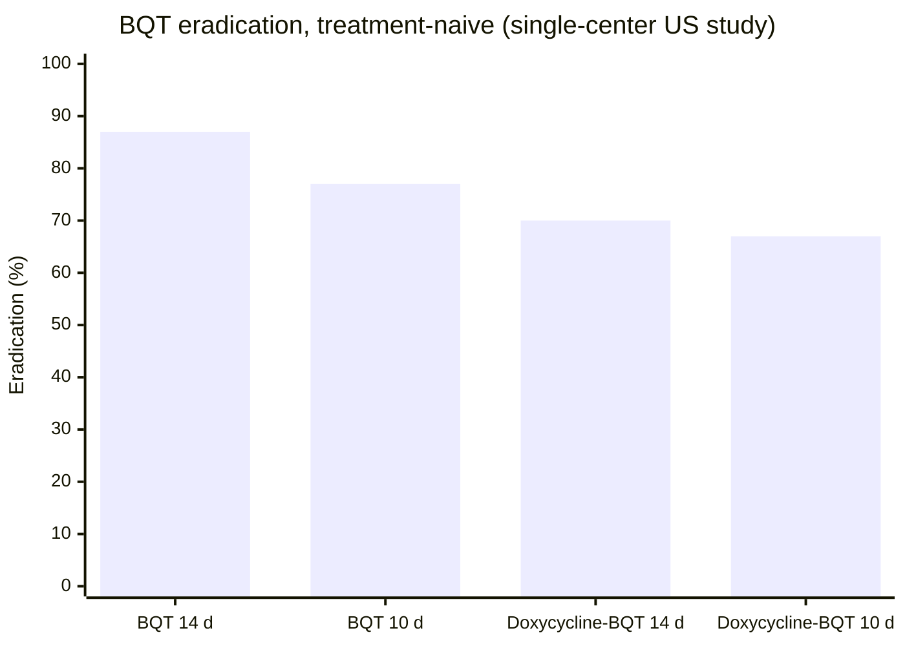

## Contents
- [[#Regimen and Dosing]]
  - [[#Optimized vs Non-Optimized]]
  - [[#Combination Products]]
- [[#Indications]]
  - [[#Treatment-Naive]]
  - [[#Treatment-Experienced]]
  - [[#Penicillin Allergy]]
- [[#Efficacy]]
- [[#Mechanism]]
- [[#Adverse Effects and Adherence]]
- [[#Contraindications and Interactions]]

## Regimen and Dosing

Optimized bismuth quadruple therapy (BQT) for [[helicobacter-pylori-infection|*Helicobacter pylori* (*H. pylori*)]] = appropriately dosed [[proton-pump-inhibitors|proton pump inhibitor (PPI)]] + bismuth + nitroimidazole (**1,500–2,000 mg/day** in divided doses) + tetracycline (**not doxycycline**) — American College of Gastroenterology (ACG) 2024 Tables 5 and 6, footnote a. [[acg-2024-hp-treatment]]

| Drug | Dose | Frequency |
|---|---|---|
| PPI | Standard dose, 30–60 min before a meal | Twice daily (b.i.d.) |
| Bismuth | Subcitrate **120–300 mg** or subsalicylate **300 mg** | Four times daily (q.i.d.) |
| Tetracycline | **500 mg** | q.i.d. |
| Metronidazole | **500 mg** | Three times daily (t.i.d.) or q.i.d. |

- **Duration: 14 days**, first-line and salvage (Tables 5 and 6: "All regimens are recommended for 14 days"); Rec 6 text: "10 to (preferably) 14 days". [[acg-2024-hp-treatment]]
- Nitroimidazole: usually metronidazole, "but could also be tinidazole" (no tinidazole dose given).
- Bismuth dose differs within ACG 2024: the Rec 6 text defines optimized BQT as bismuth "300 mg 4 times daily at least" (Tables 5/6: as in the table above).

### Optimized vs Non-Optimized

> [!pitfall] Failed non-optimized BQT can be repeated — optimized
> Prior BQT not optimized — duration **<10 days**, metronidazole **<1.5–2 g/day**, **doxycycline** substituted for tetracycline, or **inadequate PPI dose** → acceptable to repeat BQT with these corrected; the only exception to not repeating a failed regimen (Rec 6 text, [[acg-2024-hp-treatment]]).

- Doxycycline substitution and metronidazole below 1.5–2 g/day are common in practice, lower eradication, and are **not recommended** (Rec 6 text).

### Combination Products

- Individually prescribed BQT is **not approved by the US Food and Drug Administration (FDA)**; two combination products are (Table 5 footnote c). Give either with a PPI **b.i.d.**
- **Pylera** — bismuth subcitrate + metronidazole + tetracycline; FDA-approved with omeprazole; **dispensed only as a 10-day regimen** — "acceptable" (Table 6 footnote a).
- **Helidac** — bismuth subsalicylate + metronidazole + tetracycline; **14-day** regimen; originally approved with a histamine-2 receptor antagonist (H2RA) for patients with a duodenal ulcer — ACG does not recommend H2RAs in *H. pylori* regimens. With a b.i.d. PPI for 14 days = "an appropriate selection" (Table 6 footnote a).
- No regimen is FDA-approved for persistent *H. pylori* infection (Table 6).

---

## Indications

Regimen-selection algorithms (ACG 2024 Figures 1, 3 and 4): see the *H. pylori* infection page. [[acg-2024-hp-treatment]]

### Treatment-Naive

- **Rec 1:** optimized BQT is **recommended** as a first-line treatment option — **strong recommendation; moderate quality evidence**; the guideline's only strong recommendation.
- **Rec 5:** concomitant therapy is **not suggested over** BQT — conditional; low quality evidence.
- No concern for clarithromycin resistance and **no pretreatment antimicrobial susceptibility testing** needed — its notable advantage over PPI–clarithromycin triple therapy; clarithromycin- and levofloxacin-containing regimens are no longer appropriate empirically.

### Treatment-Experienced

| Prior therapy | ACG 2024 | Grade |
|---|---|---|
| No previous BQT | Optimized BQT **suggested** (Rec 6) | Conditional; very low quality of evidence |
| Previous PPI–clarithromycin triple | Optimized BQT **suggested** (Rec 7) | Conditional; low quality of evidence |
| Previous BQT | **Rifabutin triple** suggested (Rec 8); text: 14 days after previous *optimized* BQT | Conditional; low quality of evidence |
| No previous *optimized* BQT | Optimized BQT **suggested over** quinolone-based therapy (Rec 9) | Conditional; low quality of evidence |

- Rec 6 text: optimized BQT for **14 days** when not previously received optimized BQT.
- Clarithromycin- or levofloxacin-containing salvage regimens are still less preferred than optimized BQT unless susceptibility is demonstrated (Rec 7 text).

### Penicillin Allergy

- BQT contains no amoxicillin. Of the recommended and suggested first-line and salvage regimens, **only optimized BQT** is suitable for true penicillin allergy (Figure 1: "may require formal allergy testing").
- Optimized BQT not appropriate + suspected penicillin allergy → **allergist referral** to confirm the allergy and consider penicillin desensitization (<1% of the population has true type 1 IgE-mediated penicillin allergy).

---

## Efficacy

*Eradication falls with a shorter course and with doxycycline in place of tetracycline*
*Source: data from treatment-naive patients in a nonrandomized single-center observational study (Brown University, Rhode Island; 585 patients at 14 days, 135 at 10 days, doxycycline groups "quite small"), cited in ACG 2024*
*[[acg-2024-hp-treatment|ACG 2024 Treatment of H. pylori Infection]]*
*BQT = bismuth quadruple therapy · d = days*

- **First line vs PPI–clarithromycin triple:** BQT superior in a network meta-analysis of trials in Western countries.
- **Second line:** BQT for 10–14 days 78.8% vs 67.8% for 7 days (pooled randomized controlled trials [RCTs], mostly Asian-Pacific). After PPI–clarithromycin triple failure, 10-day BQT 88% intention-to-treat (ITT) vs 88% levofloxacin-based sequential therapy (Taiwan RCT, 560 patients).
- **Combination capsule vs separate components** (European salvage studies, ITT):

| Line | Component BQT | Combination capsule BQT |
|---|---|---|
| Second line | 75.6% (78 patients) | 89.2% (1,120 patients) |
| Third line | 64.1% (240 patients) | 83.6% (330 patients) |

> [!pearl] Combination capsule may outperform separate pills
> BQT as a combination product may be more effective than its components given separately, possibly through better adherence (Rec 6 text, [[acg-2024-hp-treatment]]).

- Chinese RCT (≥2 prior failures; BQT arm: bismuth 660 mg b.i.d., metronidazole 400 mg q.i.d., tetracycline 500 mg q.i.d., esomeprazole 20 mg b.i.d.): in vitro metronidazole resistance (95%) was not associated with eradication failure on optimized BQT.

---

## Mechanism

- **Bismuth:** bactericidal — accumulates on the bacterial cell wall and in the periplasmic space, inhibiting adherence to gastric mucosa and essential intracellular enzymes (ACG 2024 supplementary drug table). [[acg-2024-hp-treatment]]

---

## Adverse Effects and Adherence

- **Minor adverse events common, discontinuation low.** Taiwan RCT, treatment-naive: **>50%** reported ≥1 adverse effect (dark stool, fatigue, nausea, diarrhea, dizziness each **>15%**); only **~5%** discontinued. Similarly low discontinuation in European data. [[acg-2024-hp-treatment]]
- **Counsel to maximize adherence:** why treating *H. pylori* matters + the most frequent adverse effects.
- Disadvantages vs PPI–clarithromycin triple: large pill burden, relatively frequent minor (particularly gastrointestinal [GI]) adverse events, difficulty obtaining tetracycline and its cost, relative contraindications to tetracycline (e.g., photosensitivity, women of childbearing potential).
- Avoid bismuth (and antibiotics) for **≥4 weeks** before a test of cure.

| Component | Adverse effects (ACG 2024 supplementary drug table) |
|---|---|
| Bismuth | Dark stools, dark tongue |
| Tetracycline | Abdominal discomfort, epigastric pain, diarrhea, nausea, vomiting, anorexia · photosensitivity · [[clostridioides-difficile\|*Clostridioides difficile* (*C. difficile*)]] · **pill esophagitis** · rare hepatotoxicity |
| Metronidazole | Nausea, vomiting, metallic taste |
| PPI | Increased risk of enteric infections incl. *C. difficile*-associated diarrhea |

---

## Contraindications and Interactions

[[acg-2024-hp-treatment]] (Tables 5/6 footnotes; supplementary drug table):

| Component | Avoid / contraindicated | Important interactions |
|---|---|---|
| Bismuth | **Salicylate allergy → no bismuth subsalicylate** | Avoid bismuth subsalicylate with other salicylates |
| Tetracycline | **Contraindicated in pregnancy** (dental enamel defects in children <8 y listed as an adverse effect) | Absorption impaired by calcium, magnesium, iron, zinc, aluminum and dairy |
| Metronidazole | **Avoid in pregnancy** | Disulfiram-like reaction with alcohol described |
| PPI | — | ↓ bioavailability/absorption: azole antifungals; velpatasvir, ledipasvir, rilpivirine, atazanavir; mycophenolate; several oncology tyrosine kinase inhibitors · warfarin modestly ↑ (international normalized ratio [INR]) · methotrexate excretion mildly ↓ · cilostazol, citalopram, escitalopram ↑ |

- ACG 2024 does not address bismuth in renal impairment.

---

## See Also

[[helicobacter-pylori-infection]], [[test-and-treat]], [[vonoprazan]], [[proton-pump-inhibitors]], [[peptic-ulcer-disease]], [[dyspepsia]]

---

## Sources

1. [[acg-2024-hp-treatment|ACG Clinical Guideline: Treatment of Helicobacter pylori Infection (2024)]]
