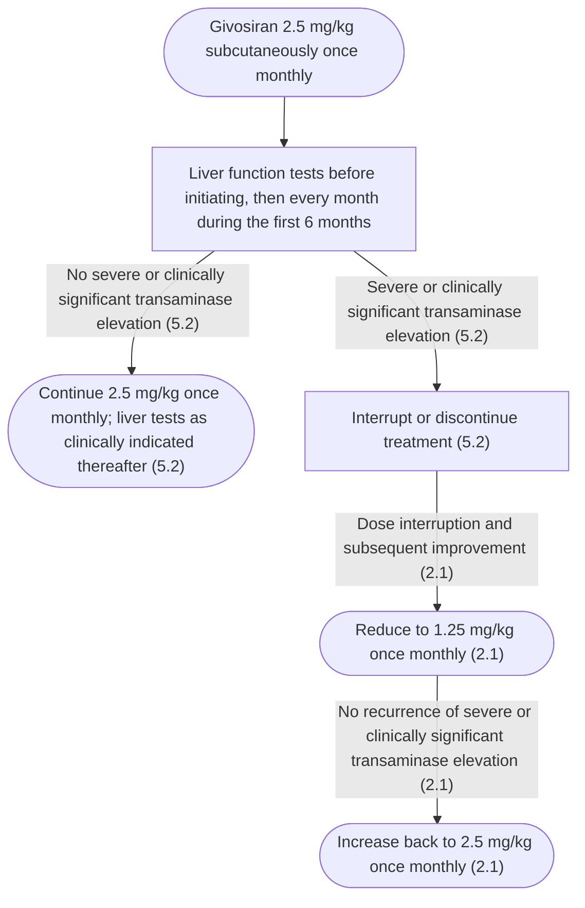

## Contents
- [[#Class / Mechanism]]
- [[#Indication and Patient Selection]]
- [[#Efficacy]]
- [[#Dosing]]
  - [[#Administration]]
  - [[#Dose Modification for Transaminase Elevation]]
- [[#Monitoring]]
- [[#Adverse Effects]]
  - [[#Reported Frequencies]]
  - [[#Labelled Warnings]]
- [[#Contraindications and Special Populations]]
- [[#Drug Interactions]]
- [[#See Also]]
- [[#Sources]]

## Class / Mechanism

- **Aminolevulinate synthase 1 (ALAS1)-directed small interfering RNA (siRNA)**, covalently linked to a ligand containing three **N-acetylgalactosamine (GalNAc)** residues to deliver the siRNA to hepatocytes ([[givlaari-2025-givosiran-label]]).
- Taken up selectively by hepatocytes via the asialoglycoprotein receptor; processed by Dicer into ~20-base-pair single strands that bind **ALAS1 messenger RNA** and target it for destruction → reduced ALAS1 translation, and lower circulating **aminolevulinic acid (ALA)** and **porphobilinogen (PBG)** — the neurotoxic intermediates associated with attacks ([[aga-2023-acute-hepatic-porphyria]], [[givlaari-2025-givosiran-label]]).
- **Biochemical response:** median urinary ALA and PBG fall **83.7%** and **75.1%** 14 days after the first dose; maximal around **month 3** (**93.8%** ALA, **94.5%** PBG) and sustained with repeated monthly dosing ([[givlaari-2025-givosiran-label]]).
- **Approvals:** Food and Drug Administration (FDA) — **adults** (initial US approval 2019); European Medicines Agency (EMA) — persons **≥12 years** (European Union) ([[aga-2023-acute-hepatic-porphyria]]).

## Indication and Patient Selection

- **American Gastroenterological Association (AGA) 2023 Best Practice Advice (BPA) 7:** prophylactic heme therapy **or** givosiran, administered in an **outpatient** setting, should be considered in [[acute-hepatic-porphyria|acute hepatic porphyria (AHP)]] with **recurrent attacks (4 or more per year)**. Expert Review — the Best Practice Advice statements carry **no formal rating** of evidence quality or strength ([[aga-2023-acute-hepatic-porphyria]]).
- The **labelled** indication sets no attack-frequency threshold — "adults with acute hepatic porphyria" ([[givlaari-2025-givosiran-label]]). AGA's 4-or-more-per-year threshold is what governs selection here.
- **Alternative for the same indication:** off-label prophylactic intravenous (IV) [[hemin]] — effectiveness at *preventing* recurrent attacks is less established, and chronic use brings indwelling central venous catheters, infections and [[iron-overload-and-iron-metabolism|iron overload]] ([[aga-2023-acute-hepatic-porphyria]]).
- Menstrual-cycle–associated attacks and the rest of AHP management: see [[acute-hepatic-porphyria]].

> [!pitfall] Confirm biochemically and genetically first
> AGA 2023 suggests prescribing givosiran **only** for patients with recurrent acute attacks that are **both biochemically and genetically confirmed** — random urine ALA, PBG and creatinine plus sequencing of *ALAD*, *HMBS*, *CPOX* and *PPOX* ([[aga-2023-acute-hepatic-porphyria]]).

## Efficacy

| Outcome over the 6-month double-blind period | Givosiran (N=48) | Placebo (N=46) | Ratio (95% CI) |
|---|---|---|---|
| Mean rate of porphyria attacks | 1.9 (1.3–2.8) | 6.5 (4.5–9.3) | **0.3 (0.2–0.4)**, p<0.0001 |
| Mean days of hemin use | 4.7 (2.8–7.9) | 12.8 (7.6–21.4) | **0.3 (0.1–0.5)**, p=0.0002 |

*Givosiran 2.5 mg/kg monthly vs placebo in ENVISION*
*Data from 94 patients with AHP and at least 2 attacks requiring hospitalization, urgent health care visit or home IV hemin in the prior 6 months (89 acute intermittent porphyria, 2 variegate porphyria, 1 hereditary coproporphyria, 2 with no identified mutation); median age 37.5 y, 89% female — Table 3 of the product label*
*[[givlaari-2025-givosiran-label|GIVLAARI (Givosiran) Injection — FDA Prescribing Information]]*
*CI = confidence interval*

- Attacks counted were those requiring hospitalization, urgent health care visit or IV hemin at home; ratios adjusted for prior hemin prophylaxis status and historical attack rate. On average **70% (95% CI 60%–80%) fewer attacks** than placebo ([[givlaari-2025-givosiran-label]]).
- AGA 2023 summarises the same phase 3 trial: monthly subcutaneous givosiran significantly lowered acute attack rates, correlating with lower urine ALA and PBG, and a significant proportion of treated patients were free of attacks ([[aga-2023-acute-hepatic-porphyria]]).

## Dosing

| Item | Givosiran |
|---|---|
| **Dose** | **2.5 mg/kg subcutaneously once monthly**, based on **actual body weight** |
| **Supplied** | 189 mg/mL single-dose vial; ready-to-use solution, no reconstitution or dilution |
| **Missed dose** | Give as soon as possible, then resume monthly intervals from that administration |
| **Storage** | 2°C–25°C (36°F–77°F), in the original container until use |
| **Who administers** | Health care professional only |

- All values from the product label ([[givlaari-2025-givosiran-label]]). [[aga-2023-acute-hepatic-porphyria|AGA 2023]] gives only the route and interval — monthly subcutaneous — and states no weight-based dose.

### Administration

> [!howto] Giving the injection
> 1. Draw up with a **21-gauge or larger** needle; divide any dose needing **>1.5 mL** equally into multiple syringes.
> 2. Change to a **25- or 27-gauge, ½″ or ⅝″** needle before injecting; avoid drug on the needle tip until the needle is in the subcutaneous space.
> 3. Inject into abdomen, back or side of the upper arms, or thighs — rotate sites, never into scar tissue or reddened, inflamed or swollen skin.
> 4. In the abdomen, stay outside a **5 cm diameter circle around the navel**; multiple injections for one dose go **≥2 cm** from previous sites. Discard the unused portion ([[givlaari-2025-givosiran-label]]).

### Dose Modification for Transaminase Elevation

*Dose modification for transaminase elevation on givosiran*
*Built from the product label's Recommended Dosage (2.1) and Hepatic Toxicity (5.2) sections (the label has no flowchart)*
*[[givlaari-2025-givosiran-label|GIVLAARI (Givosiran) Injection — FDA Prescribing Information]]*

## Monitoring

| What | When |
|---|---|
| **Givosiran panel** — comprehensive metabolic panel (liver enzymes, blood urea nitrogen (BUN)/creatinine, estimated glomerular filtration rate (eGFR)), plasma homocysteine, amylase/lipase, urinalysis, urine protein-to-creatinine ratio, B12/folate | Before starting, then **before each monthly injection for 3 months**; if results are stable and the drug is well tolerated → **every 3 months for the next year**, then **at least every 6 months** thereafter ([[aga-2023-acute-hepatic-porphyria]], Table 2) |
| **Liver enzymes** | **Monthly during the first 3–6 months** — the window in which alanine aminotransferase (ALT) elevation is reported; if findings are normal, decrease gradually to **twice per year** ([[aga-2023-acute-hepatic-porphyria]]). The label sets the same window from the other side: liver function tests before initiating and **monthly for the first 6 months**, then as clinically indicated ([[givlaari-2025-givosiran-label]]) |
| **Blood homocysteine** | Before starting and monitor for changes during treatment ([[givlaari-2025-givosiran-label]]) |
| **Serum creatinine + eGFR** | At least annually in any patient with AHP on treatment, and **more frequently on givosiran** ([[aga-2023-acute-hepatic-porphyria]], BPA 11) |

- Patients on chronic givosiran (like chronic [[hemin]]) require close follow-up for adverse effects **and** treatment response ([[aga-2023-acute-hepatic-porphyria]]).
- Disease-level surveillance continues independently of the drug — annual liver monitoring, [[hcc-surveillance|hepatocellular carcinoma (HCC) surveillance]] from age 50 y, and chronic kidney disease (CKD) surveillance: see [[acute-hepatic-porphyria]].

## Adverse Effects

### Reported Frequencies

| Adverse reaction | Givosiran (N=48) | Placebo (N=46) |
|---|---|---|
| Nausea | 13 (**27%**) | 5 (11%) |
| Injection site reactions | 12 (**25%**) | 0 |
| Rash | 8 (**17%**) | 2 (4%) |
| Serum creatinine increase | 7 (**15%**) | 2 (4%) |
| Transaminase elevations | 6 (**13%**) | 1 (2%) |
| Fatigue | 5 (**10%**) | 2 (4%) |

*Adverse reactions occurring at least 5% more frequently with givosiran than placebo*
*Data from the 48 givosiran vs 46 placebo patients of the 6-month double-blind period of ENVISION (median exposure 5.5 months), Table 1 of the product label*
*[[givlaari-2025-givosiran-label|GIVLAARI (Givosiran) Injection — FDA Prescribing Information]]*

- Rash is a grouped term (pruritus, eczema, erythema, rash, pruritic rash, urticaria); serum creatinine increase groups blood creatinine increased, decreased glomerular filtration rate and CKD (decreased eGFR).
- Only the first two reach the ≥20% "most frequent" threshold. **One patient discontinued permanently**, for elevated transaminases. Treatment-emergent anti-drug antibodies in **1 of 111 (0.9%)**, with no detectable effect on efficacy, safety or pharmacokinetics ([[givlaari-2025-givosiran-label]]).

### Labelled Warnings

| Warning | Detail | What to do |
|---|---|---|
| **Hepatic toxicity** | ALT at least **3× the upper limit of normal (ULN)** in **15%**, primarily between **months 3 and 5** of treatment | Monitor as above; **interrupt or discontinue** for severe or clinically significant elevations, then resume per the flowchart |
| **Renal toxicity** | Rising serum creatinine / falling eGFR; **15%** of the givosiran arm had a renally-related adverse reaction, **median creatinine increase 0.07 mg/dL at month 3** | Monitor renal function as clinically indicated. [[aga-2023-acute-hepatic-porphyria\|AGA 2023]] adds that givosiran may worsen eGFR and renal function in a subset of patients |
| **Injection site reactions** | Erythema, pain, pruritus, rash, discoloration or swelling; of 12 affected patients **11 (92%) mild, 1 (8%) moderate**. One patient (2%) had a single transient **recall reaction** of erythema at a prior site with a later dose | Monitor and manage clinically; rotate sites |
| **Blood homocysteine increased** | **15 of 93 (16%)** during the ENVISION open-label extension; clinical relevance unknown | If elevated, **assess folate, vitamin B12 and vitamin B6**, and consider a **vitamin B6–containing supplement** (monotherapy or multivitamin) |
| **Anaphylactic reaction** | **<1%** of patients in clinical trials | Ensure medical support is available at administration; **discontinue immediately** and treat if it occurs |
| **Pancreatitis** | **Acute pancreatitis, some severe** — postmarketing | **Consider interruption and/or discontinuation for severe cases** |

*Warnings and precautions, product label sections 5.1–5.6*
*Recreated from the product label; frequencies as the label reports them*
*[[givlaari-2025-givosiran-label|GIVLAARI (Givosiran) Injection — FDA Prescribing Information]]*
*ALT = alanine aminotransferase · ULN = upper limit of normal · eGFR = estimated glomerular filtration rate · CKD = chronic kidney disease*

> [!pitfall] Upper abdominal pain may be pancreatitis, not an attack
> Acute upper abdominal pain in a patient on givosiran is the presenting symptom of an AHP attack **and** of [[acute-pancreatitis|acute pancreatitis]]. Consider the latter when there is clinically significant elevation of pancreatic enzymes and/or imaging findings, rather than treating every episode as an attack ([[givlaari-2025-givosiran-label]]).

## Contraindications and Special Populations

- **Contraindication:** known **severe hypersensitivity to givosiran** — reactions have included anaphylaxis ([[givlaari-2025-givosiran-label]]).
- **Renal impairment:** no clinically meaningful difference in givosiran pharmacokinetics or pharmacodynamics (percent reduction in urinary ALA and PBG) across **mild, moderate or severe impairment (eGFR ≥15 to <89 mL/min/1.73 m², Modification of Diet in Renal Disease formula)**; the label gives no dose adjustment. Effect of **end-stage renal disease (eGFR <15 mL/min/1.73 m²)** is unknown ([[givlaari-2025-givosiran-label]]).
- **Hepatic impairment:** likewise no clinically meaningful difference in **mild impairment** (bilirubin ≤1× ULN with aspartate aminotransferase (AST) >1× ULN, or bilirubin >1× to 1.5× ULN); effect of **moderate to severe impairment** is unknown ([[givlaari-2025-givosiran-label]]).
- **Pregnancy:** AGA 2023 — because of limited safety data, do **not** use in women who are pregnant or planning a pregnancy. The label has **no human data**; adverse developmental outcomes occurred in pregnant rabbits at maternally toxic doses. The competing disease-side risk of untreated AHP in pregnancy is on [[acute-hepatic-porphyria]].
- **Lactation:** no data on presence in human milk, effects on the breastfed child, or milk production ([[givlaari-2025-givosiran-label]]).
- **Pediatric:** safety and effectiveness **not established** in the US label, which is narrower than the EMA's ≥12 years ([[givlaari-2025-givosiran-label]]).
- **Geriatric:** too few patients aged ≥65 y studied to know whether response differs ([[givlaari-2025-givosiran-label]]).

## Drug Interactions

- Givosiran **increases the concentration of sensitive CYP1A2 and CYP2D6 substrates** — it does not inhibit or induce CYP enzymes directly, but its effect on hepatic heme biosynthesis can reduce hepatic CYP activity. Single 2.5 mg/kg doses raised caffeine (sensitive CYP1A2 substrate) area under the curve (AUC) **3.1-fold** and dextromethorphan (sensitive CYP2D6 substrate) AUC **2.4-fold** ([[givlaari-2025-givosiran-label]]).
- **Avoid** concomitant use with CYP1A2 or CYP2D6 substrates for which minimal concentration changes may cause serious or life-threatening toxicity; if unavoidable, **decrease the substrate dose** per its own approved labeling.
- Changes with other CYP substrates were **not considered clinically relevant**: losartan (CYP2C9) AUC 1.1-fold, [[proton-pump-inhibitors|omeprazole]] (sensitive CYP2C19) AUC 1.6-fold, midazolam (sensitive CYP3A4) AUC 1.5-fold ([[givlaari-2025-givosiran-label]]).

## See Also

[[acute-hepatic-porphyria]], [[hemin]], [[iron-overload-and-iron-metabolism]], [[hcc-surveillance]], [[acute-pancreatitis]], [[proton-pump-inhibitors]]

---

## Sources

1. [[aga-2023-acute-hepatic-porphyria|AGA Clinical Practice Update on Diagnosis and Management of Acute Hepatic Porphyrias: Expert Review]]
2. [[givlaari-2025-givosiran-label|GIVLAARI (Givosiran) Injection — FDA Prescribing Information]]
