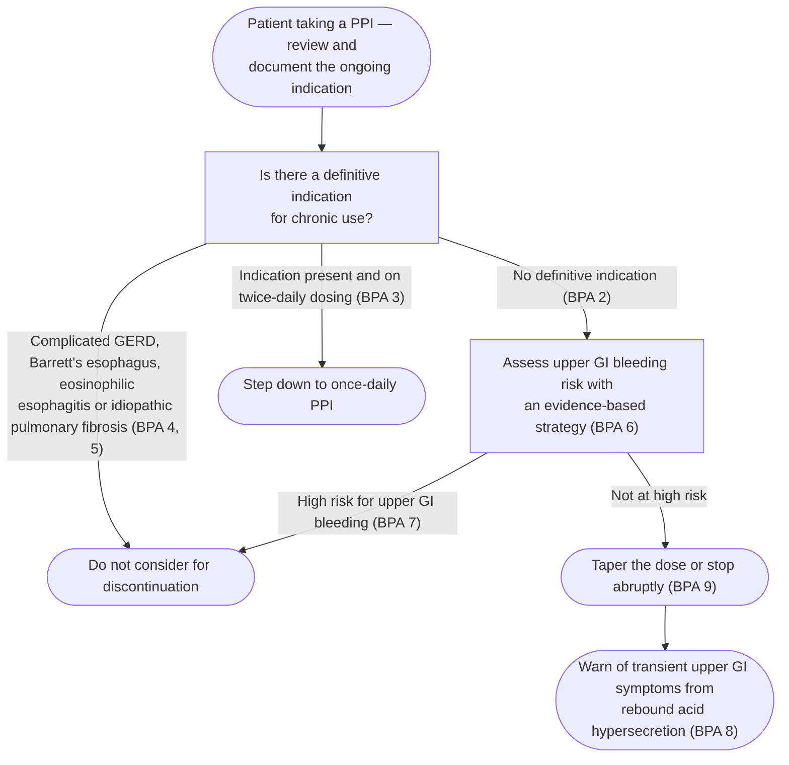

Proton pump inhibitors (PPIs) are the drug class that inhibits the gastric H⁺/K⁺-ATPase (proton pump); the mainstay medical acid-suppressant for [[gerd|gastroesophageal reflux disease (GERD)]], erosive esophagitis, [[peptic-ulcer-disease|peptic ulcer disease (PUD)]], and [[helicobacter-pylori-infection|H. pylori]] eradication regimens. Contrast with [[potassium-competitive-acid-blockers|potassium-competitive acid blockers (P-CABs)]] (e.g. [[vonoprazan]]).

## Contents
- [[#Mechanism]]
- [[#Agents and Relative Potency]]
- [[#Dosing and Administration]]
- [[#Indications and Regimens]]
  - [[#GERD and Erosive Esophagitis]]
  - [[#Barrett's Esophagus]]
  - [[#Eosinophilic Esophagitis]]
  - [[#H. pylori Eradication]]
  - [[#Peptic Ulcer Disease and Ulcer Bleeding]]
- [[#De-Prescribing and Step-Down]]
  - [[#Indications for Chronic Use]]
  - [[#Do Not De-Prescribe]]
  - [[#Stepping Down and Stopping]]
  - [[#After Stopping]]
- [[#PPI-Refractory Symptoms]]
- [[#Safety and Adverse Effects]]
- [[#PPIs vs P-CABs]]
- [[#See Also]]
- [[#Sources]]

## Mechanism
- Bind only to **actively secreting** proton pumps → premeal dosing (meals stimulate pump activity) maximizes acid control ([[acg-2021-gerd]]).
- Enteric-coated formulations control intragastric pH best when given before a meal; bedtime dosing discouraged (less effective than a predinner dose).
- Metabolized largely by **CYP2C19**; genetic differences affect response. Routine CYP2C19 genotyping has no established role in GERD, but rapid/ultrarapid metabolizers are at higher risk of eradication failure in [[helicobacter-pylori-infection|H. pylori]] treatment ([[acg-2024-hp-treatment]]).

## Agents and Relative Potency
Standard-dose acid-suppression potency standardized to omeprazole = 1.00 ("omeprazole equivalents" [OE]; based on mean 24-h intragastric pH) ([[acg-2021-gerd]]):

| PPI | OE |
|---|---|
| Pantoprazole | 0.23 |
| Lansoprazole | 0.90 |
| **Omeprazole** | **1.00** (reference) |
| Esomeprazole | 1.60 |
| Rabeprazole | 1.82 |

- Despite these pH differences, symptom relief and esophagitis healing **differ little among the 7 available PPIs** — esomeprazole gave a 4% absolute difference in 8-week erosive-esophagitis healing (relative risk 1.05, 95% confidence interval [CI] 1.02–1.08; number needed to treat [NNT] 25), unlikely to be clinically meaningful.
- **Dexlansoprazole** — dual delayed-release (duodenum, then more distal small bowel); similar pH control **regardless of meal timing**.
- **Omeprazole–sodium bicarbonate** (immediate-release, not enteric-coated) — good intragastric pH control in the first 4 h of sleep when dosed at bedtime.
- Individual pH control varies widely between agents → **switching PPIs** is reasonable for incomplete response; rabeprazole does not rely on CYP2C19 for primary metabolism.

## Dosing and Administration
| Situation | Timing / dose |
|---|---|
| Once daily | 30–60 min **before breakfast** (Strong/Moderate, [[acg-2021-gerd]]) |
| Twice daily | 30–60 min before **breakfast and dinner** |
| Bedtime | Discouraged — less effective than a predinner dose |
| Dexlansoprazole | Efficacy independent of meal timing |
| Maintenance | **Lowest dose** that controls symptoms and maintains healing of reflux esophagitis (Conditional/Low) |
| Incomplete response | Switch PPI (consider a non-CYP2C19 agent) rather than automatically doubling — doubling lansoprazole 30 mg daily vs switching to esomeprazole 40 mg daily were equally effective |

- **Double dose = standard dose twice daily, or a double-strength dose once daily.** Never studied in any randomized controlled trial (RCT) and not US Food and Drug Administration (FDA)-approved, yet up to **15%** of PPI users take it ([[aga-2022-ppi-deprescribing]]).
- **High dose is justified acutely** to prevent rebleeding from PUD, and for [[gastroenteropancreatic-neuroendocrine-tumors|Zollinger-Ellison syndrome]]. Evidence is **minimal** for high dose in maintenance of healed esophagitis or prevention of PUD complications.
- These guidelines prescribe "standard-dose" and "double-dose" PPI without printing a milligram equivalent for each agent; the doses they do state are given with their indications below.

## Indications and Regimens

### GERD and Erosive Esophagitis
- **8-week empiric trial**, once daily before a meal, for typical symptoms (heartburn/regurgitation) without alarm features — Strong/Moderate ([[acg-2021-gerd]]).
- Symptoms respond to the trial → **attempt discontinuation** (Conditional/Low). No erosive esophagitis or [[barretts-esophagus|Barrett's esophagus]] and symptoms resolved → stop, or switch to **on-demand** therapy taken only while symptoms are present (Conditional/Low).
- **PPI over histamine-2 receptor antagonist (H2RA)** for healing erosive esophagitis (Strong/High) and for maintenance of healing (Strong/Moderate).
- **[[reflux-testing|Los Angeles (LA) grade]] C or D: indefinite maintenance PPI or antireflux surgery** (Strong/Moderate) — nearly 100% of LA grade C relapse within 6 months if stopped; recurrence can occur in as little as 1–2 weeks.
- **On-demand or intermittent PPI** for heartburn control in non-erosive reflux disease (NERD) — Conditional/Low; symptom-free days equivalent to continuous therapy, both superior to placebo. **Not adequate for erosive esophagitis.** Step-down to an H2RA is another acceptable option, particularly in NERD.

### Barrett's Esophagus
- **At least once-daily PPI** in every patient with Barrett's esophagus without allergy or other contraindication — Conditional/Very low ([[acg-2022-barretts]]).
- Associated with reduced progression to high-grade dysplasia (HGD)/[[esophageal-adenocarcinoma|esophageal adenocarcinoma]]: 71% risk reduction (adjusted odds ratio [OR] 0.29, 95% CI 0.12–0.79) across observational studies; adjusted hazard ratio (aHR) **0.32** (95% CI 0.15–0.67) in the cohort studies reporting time to progression.
- Benefit of **higher doses on oncogenesis is unclear** → at least daily dosing, with higher doses reserved for those who need them for symptom control.
- **Combination PPI + aspirin: ACG 2022 could not make a recommendation** for reducing progression to HGD/esophageal adenocarcinoma. A large proportion of these patients will take aspirin anyway for cardioprotection.
- Twice-daily (maximal) acid suppression is used around [[endoscopic-eradication-therapy|endoscopic eradication therapy]] — surveillance endoscopy is generally performed after it is started, and vigorous suppression may be advisable after resection.

### Eosinophilic Esophagitis
- Initial adult treatment of [[eosinophilic-esophagitis|eosinophilic esophagitis (EoE)]]: **"high-dose" PPI = double the approved reflux dose per day** — the guideline's example is **omeprazole 20 mg twice daily *or* 40 mg daily**, or the equivalent of another PPI ([[acg-2025-eoe]]). Once daily or divided before meals; dosing-efficacy data are variable, so divided dosing may be chosen for adherence.
- Pooled response **60.8% clinical / 50.5% histologic** (<15 eosinophils per high-power field); twice daily numerically better than once daily (55.9% vs 49.7%, not significant).
- In a 305-patient cohort, histologic remission was **53%–54% with omeprazole 20–40 mg twice daily vs 10%–12% with 20–40 mg once daily** (P<0.0001).
- **Step-down in responders:** 30% relapsed when reduced to once daily but regained histologic remission on re-escalation; in another cohort >80% stayed in remission stepping 40 mg twice daily → 40 mg daily → 20 mg daily.

### H. pylori Eradication
- **Standard-dose PPI twice daily, 30–60 min before a meal** — the acid-suppression backbone of [[bismuth-quadruple-therapy|optimized bismuth quadruple therapy]] and the rifabutin triple regimen; all recommended regimens run **14 days** ([[acg-2024-hp-treatment]]).
- The FDA-approved rifabutin triple preparation delivers **omeprazole 40 mg three times daily** (10 mg per capsule, 4 capsules three times daily).
- **Potent acid suppression is the point**: high intragastric pH drives H. pylori into active replication (↑ antibiotic susceptibility) and stabilizes acid-labile antibiotics (clarithromycin, amoxicillin).
- **CYP2C19:** do not genotype for the sole purpose of selecting an acid suppressant. In a patient **known** to be a rapid or ultrarapid metabolizer, prefer **esomeprazole or rabeprazole**; if another PPI is used, increase the starting daily dose of omeprazole/lansoprazole/pantoprazole by **50%–100% (rapid) or 100% (ultrarapid)**; a P-CAB regimen is a third option.
- P-CABs ([[vonoprazan]]) provide deeper, more sustained suppression and are superior to PPIs in eradication regimens.

### Peptic Ulcer Disease and Ulcer Bleeding
- **Ulcer healing and nonsteroidal anti-inflammatory drug (NSAID)/aspirin co-prescription:** see [[peptic-ulcer-disease]].
- **Bleeding ulcer** — high-dose PPI after [[endoscopic-hemostasis|endoscopic hemostasis]]; what "high dose" means, continuous vs intermittent regimens, and the twice-daily step-down: see [[peptic-ulcer-disease]]. Pre-endoscopic PPI: see [[upper-gi-bleeding]].
- P-CAB positioning in PUD (generally not first-line): [[potassium-competitive-acid-blockers]].

## De-Prescribing and Step-Down

*Source for this section: [[aga-2022-ppi-deprescribing]] — 10 ungraded Best Practice Advice (BPA) statements.*

> [!pearl] Stop a PPI for lack of indication, not for fear of harm
> **BPA 10:** a PPI-associated adverse event (PAAE), a *history* of one, or *risk factors* for one is **not an independent indication for withdrawal**. The trigger for stopping is the absence of an indication ([[aga-2022-ppi-deprescribing]]).

- **BPA 1** — regular review and documentation of the ongoing indication, the **primary care provider's** responsibility; a gastroenterologist involved should document the indication for prolonged use and the endpoints that would signify discontinuation.
- **BPA 2** — consider a trial of de-prescribing in everyone **without a definitive indication**. Chronic use is often unintended (a PPI started inpatient for stress ulcer prophylaxis, continued at discharge).

*De-prescribing a proton pump inhibitor*
*Built from the AGA 2022 PPI de-prescribing update, Best Practice Advice 2, 3, 4, 5, 6, 7, 8 and 9 (the update has no flowchart)*
*[[aga-2022-ppi-deprescribing|AGA Clinical Practice Update on De-Prescribing of Proton Pump Inhibitors: Expert Review]]*
*PPI = proton pump inhibitor · BPA = Best Practice Advice · GI = gastrointestinal · GERD = gastroesophageal reflux disease*

### Indications for Chronic Use

**Long-term use = >8 weeks. Acute/short-term = ≤8 weeks.** [[aga-2022-ppi-deprescribing]]

| | **Definitely indicated** | **Conditionally indicated** | **NOT indicated** |
|---|---|---|---|
| **Long-term (>8 wk)** | Barrett's esophagus; clinically significant (LA grade **C/D**) erosive esophagitis; peptic [[esophageal-stricture\|strictures]] from GERD; Zollinger-Ellison syndrome; EoE; gastroprotection in aspirin (ASA)/NSAID users **at high risk for gastrointestinal (GI) bleeding**; prevention of progression of idiopathic pulmonary fibrosis (IPF) | PPI-responsive endoscopy-negative reflux disease, with recurrence on cessation; PPI-responsive [[functional-dyspepsia\|functional dyspepsia]], with recurrence on cessation; PPI-responsive upper-airway symptoms ascribed to [[laryngopharyngeal-symptoms\|laryngopharyngeal reflux (LPR)]], with recurrence on cessation; refractory steatorrhea in [[exocrine-pancreatic-insufficiency\|chronic pancreatic insufficiency]] on enzyme replacement; secondary prevention of gastric/duodenal peptic ulcers **with no concomitant antiplatelet drug** | Nonerosive reflux symptoms with **no sustained response** to high-dose PPI; functional dyspepsia with no sustained response; steroid therapy **in the absence of** ASA/NSAID; prevention of recurrent upper GI bleeding from causes **other than** [[peptic-ulcer-disease\|PUD]] (incl. gastric/duodenal erosions) or erosive esophagitis |
| **Acute (≤8 wk)** | *H. pylori* eradication; stress ulcer prophylaxis for **intensive care unit (ICU) patients with risk factors**; uninvestigated GERD/dyspepsia; treatment of NSAID-related gastric and duodenal peptic ulcers | Initial or on-demand treatment of endoscopy-negative reflux disease; initial treatment of functional dyspepsia; uninvestigated [[dyspepsia]]; ulcer prevention after sclerotherapy or band ligation of [[variceal-upper-gi-bleeding\|esophageal varices]]; prevention of rebleeding from Mallory-Weiss tears | **Empiric** treatment of laryngopharyngeal symptomatology; acute undifferentiated abdominal pain; acute [[nausea-and-vomiting\|nausea and vomiting]] not believed related to GERD/esophagitis; **any isolated lower GI symptomatology** |

### Do Not De-Prescribe

- **Complicated GERD (BPA 4)** — history of **severe erosive esophagitis, esophageal ulcer, or peptic stricture**. ~20% of untreated GERD has erosive esophagitis; recurrence after withdrawal is common, particularly in symptomatic **LA grade C or D**.
  - Treated empirically, so it **may not be known** whether a user ever had severe erosive esophagitis → a trial can be considered, but **re-initiate quickly** if signs of complicated GERD emerge, with [[upper-endoscopy|upper endoscopy]] to confirm.
- **Barrett's esophagus, EoE, or idiopathic pulmonary fibrosis (BPA 5).** De-prescribing a previous EoE responder risks high rates of symptomatic and histologic recurrence; the IPF evidence is low-quality but the authors judge it reasonable not to target these patients.
- **Hypersecretory states** — Zollinger-Ellison syndrome.
- **High upper gastrointestinal bleeding (UGIB) risk (BPA 6, 7)** — assess **before** de-prescribing, using an evidence-based strategy. Risk factors such as over-the-counter (OTC) aspirin use are often **"hidden."** **Any** of:
  - **History of upper GI bleeding**
  - **Multiple antithrombotics** — the term covers both anticoagulants and antiplatelet agents
  - **Aspirin or an NSAID plus ≥1 additional risk factor:** age **>60 years**, severe medical comorbidity, a second NSAID or aspirin, an antithrombotic, or an oral corticosteroid

> [!pitfall] The bleeding-risk threshold is not settled
> The criteria above are the update's own synthesis of guidance statements that differ (ACG 2009 through American College of Cardiology 2020); it states plainly that precisely which patients are at sufficiently increased risk remains uncertain. Its ACG 2009 row uses age **>65 years** rather than >60 ([[aga-2022-ppi-deprescribing]]).

### Stepping Down and Stopping

- **BPA 3 — most patients on twice-daily dosing who still have an indication should step down to once daily.** 80% of 117 patients on higher-than-standard doses for GERD stepped down successfully, without significant symptom recurrence or need to re-escalate.
- No Barrett's study shows double dose beats standard dose for preventing extension or progression to dysplasia/cancer; PPIs at **any** dose are **ineffective** for laryngopharyngeal symptoms.
- Higher doses cost more and are more strongly associated with community-acquired pneumonia, hip fracture, and [[clostridioides-difficile|*C. difficile*]] infection — **though with no direct evidence of causality**.
- **BPA 9 — taper or stop abruptly; either is reasonable.** The one trial comparing them (abrupt vs a 3-week taper: daily → every other day × 3 weeks → stop) found **no significant difference** at 6 months: **31% (tapered) vs 22% (abrupt)** remaining off and symptom-free. The taper may simply have been **too rapid** — parietal and enterochromaffin-like (ECL) cell hyperplasia may take **2–6 months** to regress.

### After Stopping

**BPA 8 — warn every patient stopping long-term PPI that they may develop transient upper GI symptoms from rebound acid hypersecretion (RAHS).**

- **Mechanism:** PPI raises intragastric pH → serum gastrin rises (inhibition of acid secretion normally requires gastric acid present) → hypergastrinemia drives parietal and ECL cell proliferation → increased acid-producing capacity, unleashed on withdrawal.
- **Duration:** not well characterized. ECL/parietal cell mass may persist **8 weeks** after withdrawal, usually regressed by **6 months**.
- **Do not reflexively restart continuous PPI.** As-needed **H2RAs** and/or contact antacids are reasonable; **on-demand PPI** gives effective symptom control and is itself a **partial de-prescribing strategy**.
- **~Half** of uncomplicated GERD patients who stopped remained off at 6 months — but **three-quarters of the successes** were using H2RAs or OTC antacids for symptom control.
- **Severe persistent symptoms lasting >2 months** after discontinuation suggest a continuing indication, or a **non–acid-mediated** cause.
- Persons **without abnormal esophageal acid exposure (acid exposure time >4.0%)** on [[ambulatory-reflux-monitoring|ambulatory pH testing]] in the first **7 days** after withdrawal are much more likely **not** to need PPI re-initiation (RCT); feasibility before every attempt is unclear.

*[[acg-2021-gerd]] holds that RAHS is demonstrated in healthy controls but that strong evidence for increased symptoms after abrupt withdrawal is lacking. This page follows the newer [[aga-2022-ppi-deprescribing]], which cites a double-blind RCT in which withdrawal after an 8-week course produced more upper GI symptoms than continuing.*

## PPI-Refractory Symptoms
- **Optimize the PPI first** — the first step in managing refractory GERD (Strong/Moderate, [[acg-2021-gerd]]): verify compliance and confirm the drug is taken 30–60 min before the first meal of the day, and before dinner as well for twice-daily dosing. In a randomized multicentre trial of veterans with refractory heartburn, **42 of 366 (11.4%)** improved by ≥50% on optimization alone.
- GERD is generally not considered PPI-refractory until the patient has been on **twice-daily** dosing, which maintains **gastric pH >4 over 24 h** better than once-daily double dose.
- **Against routine addition of other medical therapies in PPI nonresponders** (Conditional/Moderate). A bedtime H2RA may help nocturnal symptoms or nocturnal acid breakthrough when used **as needed** — tachyphylaxis develops with scheduled use.
- Patients with **both** typical and extraesophageal symptoms: twice-daily PPI × **8–12 weeks** before additional testing (Conditional/Low).
- **Stop the PPI if off-therapy reflux testing is negative**, unless another indication is present.
- Definition of refractory GERD and the full workup algorithm: [[gerd]].

## Safety and Adverse Effects

> **An adverse-event signal is not a reason to stop the drug ([[aga-2022-ppi-deprescribing]] BPA 10).** All studies reporting PAAEs are **observational** and cannot establish causality — they are especially prone to confounding by indication and protopathic bias. **RCTs comparing PPIs with placebo have not shown a higher rate of any adverse event.** Neither a PAAE, nor a history of one, nor risk factors for one, is an independent indication to withdraw a PPI.

- **Common adverse drug reactions** (clinical trials / FDA labels): headache, abdominal pain, nausea, vomiting, diarrhea, constipation, flatulence — infrequent, abate on stopping; can be preparation-specific → switching PPI is reasonable ([[acg-2021-gerd]]).

| Putative adverse effect | Hazard ratio (HR) or odds ratio (OR), 95% CI |
|---|---|
| Cardiovascular events | HR 1.04 (0.93–1.15) |
| — myocardial infarction (MI) | HR 0.94 (0.79–1.12) |
| — stroke | HR 1.16 (0.94–1.44) |
| — cardiovascular death | HR 1.03 (0.89–1.20) |
| Chronic kidney disease | OR 1.17 (0.94–1.45) |
| **Enteric infection (other than *C. difficile*)** | **OR 1.33 (1.01–1.75)** |
| *C. difficile* | OR 2.26 (0.70–7.34) |
| Pneumonia | OR 1.02 (0.87–1.19) |
| Dementia | OR 1.20 (0.81–1.78) |
| Bone fracture | OR 0.96 (0.79–1.17) |
| Gastric atrophy | OR 0.73 (0.40–1.32) |
| All-cause mortality | HR 1.03 (0.92–1.15) |

*Putative adverse effects of chronic PPI therapy — the randomized estimates*
*Data from 17,598 patients aged ≥65 y with stable cardiovascular or peripheral artery disease on rivaroxaban and/or aspirin, randomized to pantoprazole 40 mg daily (n=8,791) or placebo (n=8,807) and followed 3 years, as tabulated in ACG 2021*
*[[acg-2021-gerd|ACG 2021 Clinical Guideline: Diagnosis and Management of GERD]]*
*HR = hazard ratio · OR = odds ratio · CI = confidence interval · MI = myocardial infarction · PPI = proton pump inhibitor*

- **Only enteric infection reached significance** — 1.4% vs 1.0% over the trial; number needed to harm (NNH) **>900 per year** of PPI therapy ([[acg-2022-barretts]]). A small increase in the others cannot be fully excluded, but benefits generally far outweigh the theoretical risks.
- Associations reviewed by the guideline for which that trial reported **no estimate**: [[small-intestinal-bacterial-overgrowth|small intestinal bacterial overgrowth]], [[spontaneous-bacterial-peritonitis|spontaneous bacterial peritonitis]] in cirrhosis, [[gastric-adenocarcinoma|gastric cancer]], vitamin B12 deficiency, hypomagnesemia, acute interstitial nephritis, and cardiovascular events on clopidogrel.
- **No routine monitoring or supplementation** in patients without other risk factors: calcium/vitamin D/bone mineral density; vitamin B12; serum creatinine. ACG judged the data insufficient to recommend for or against magnesium monitoring.
- **[[anticoagulation-gi-bleeding|Clopidogrel]]:** for LA grade C/D esophagitis or GERD not controlled by alternative medical therapy, benefits outweigh the proposed (highly questionable) cardiovascular risk — but the FDA recommends avoiding **omeprazole** specifically with clopidogrel.
- **Renal insufficiency:** PPIs may be used, with monitoring of renal function or nephrology input.
- **Pregnancy:** all PPIs FDA category **B except omeprazole** (category C).
- ***C. difficile* — the decision is binary; dose reduction is not an option** ([[aga-2026-cdiff-adults]], BPA 13). During C. difficile infection (CDI) treatment or recurrence prevention, **evaluate the indication**: legitimate one (ulcer prevention, severe GERD) → **do not discontinue**; none → discuss cessation. Pooled observational recurrent CDI **24% in PPI users vs 18% in nonusers**; recent meta-analyses found no significant difference vs placebo, H2RA, or [[potassium-competitive-acid-blockers|P-CAB]].
- **Gastric neuroendocrine tumors (gNETs)** ([[nccn-2026-net]]) — long-term PPI use raises gNET risk via sustained hypergastrinemia driving ECL-cell hyperplasia, but is not a reason to stop: these lesions metastasize far less than sporadic (type 3) gNETs and are treated endoscopically. It changes **interpretation** — a gNET in a long-term user with high gastrin and no gastrinoma is PPI-associated, not type 3, and gastrin drawn on a PPI is uninterpretable ([[gastroenteropancreatic-neuroendocrine-tumors]]).

## PPIs vs P-CABs
- P-CABs ([[vonoprazan]]) competitively and reversibly block the H⁺/K⁺-ATPase — **faster, deeper, more sustained** acid suppression (intragastric pH >6 for longer), **CYP2C19-independent**, and effective **fed or fasted** ([[acg-2024-hp-treatment]]).
- Superior to PPIs for acid suppression in H. pylori eradication; vonoprazan FDA-approved (2022) in dual and triple regimens.
- Positioning across GERD, PUD and eradication: [[potassium-competitive-acid-blockers]].

---

## See Also

[[potassium-competitive-acid-blockers]], [[vonoprazan]], [[gerd]], [[barretts-esophagus]], [[eosinophilic-esophagitis]], [[peptic-ulcer-disease]], [[upper-gi-bleeding]], [[helicobacter-pylori-infection]], [[bismuth-quadruple-therapy]], [[ambulatory-reflux-monitoring]], [[reflux-testing]], [[endoscopic-eradication-therapy]], [[esophageal-adenocarcinoma]], [[anticoagulation-gi-bleeding]], [[clostridioides-difficile]], [[dyspepsia]], [[laryngopharyngeal-symptoms]], [[gastroenteropancreatic-neuroendocrine-tumors]], [[endoscopic-hemostasis]]

---

## Sources

1. [[acg-2021-gerd|ACG 2021 Clinical Guideline: Diagnosis and Management of GERD]]
2. [[acg-2024-hp-treatment|ACG Clinical Guideline: Treatment of Helicobacter pylori Infection (2024)]]
3. [[acg-2025-eoe|ACG 2025: Diagnosis and Management of Eosinophilic Esophagitis]]
4. [[acg-2022-barretts|ACG 2022: Diagnosis and Management of Barrett's Esophagus]]
5. [[aga-2026-cdiff-adults|AGA Clinical Practice Update on Management of Clostridioides difficile Infection in Adults: Expert Review (2026)]]
6. [[aga-2022-ppi-deprescribing|AGA Clinical Practice Update on De-Prescribing of Proton Pump Inhibitors: Expert Review]]
7. [[nccn-2026-net|NCCN Clinical Practice Guidelines in Oncology: Neuroendocrine and Adrenal Tumors (Version 1.2026)]]
