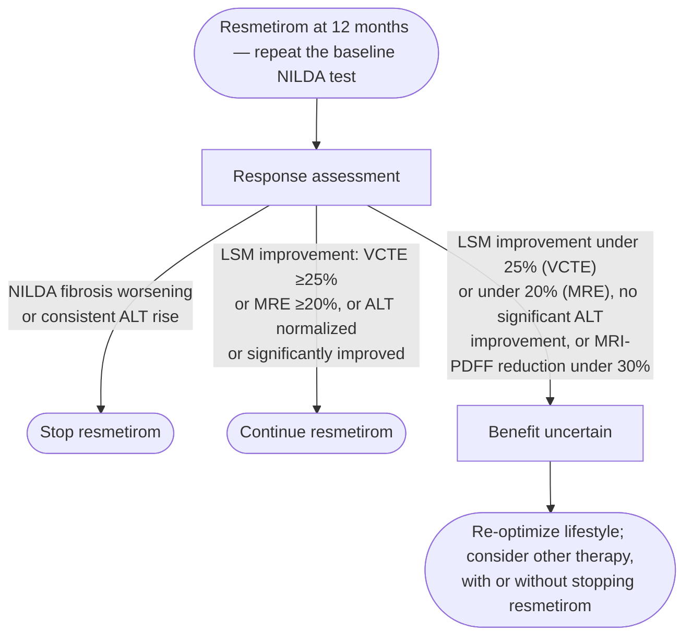

**Resmetirom (Rezdiffra)** is an oral, liver-directed **thyroid hormone receptor-β (THR-β) agonist** — the first US Food and Drug Administration (FDA)-approved pharmacotherapy for **metabolic dysfunction-associated steatohepatitis (MASH)** (accelerated approval, March 2024), for MASH with **moderate-to-advanced fibrosis (stages F2–F3)**. Approval rested on the phase 3 **MAESTRO-NASH** trial plus MAESTRO-NAFLD-1 safety data. See [[nafld-masld|metabolic dysfunction-associated steatotic liver disease (MASLD)]] for disease context; the American Association for the Study of Liver Diseases (AASLD) guidance below is the source for everything on this page unless stated otherwise ([[aasld-2024-resmetirom]]).

## Contents
- [[#Indication & candidacy]]
  - [[#Eligibility criteria]]
  - [[#Efficacy (MAESTRO-NASH, 52 weeks)]]
- [[#Not recommended in]]
- [[#Dosing]]
  - [[#Weight-based dose]]
  - [[#Drug interactions]]
- [[#Monitoring & adverse events]]
  - [[#Assessment schedule]]
  - [[#Stopping for hepatotoxicity]]
  - [[#Adverse events]]
  - [[#Response and futility at 12 months]]
- [[#Concomitant therapy]]
- [[#See Also]]
- [[#Sources]]

## Indication & candidacy

Adults with MASH and F2–F3 fibrosis. [[liver-biopsy|Liver biopsy]] is **not** required — candidates are identified by [[noninvasive-liver-disease-assessment|noninvasive liver disease assessment (NILDA)]], preferably imaging-based.

### Eligibility criteria

| Tier | Criteria |
|---|---|
| **Recommended** | Imaging NILDA: [[liver-stiffness-measurement\|vibration-controlled transient elastography (VCTE)]] liver stiffness measurement (LSM) **8–15 kPa**, or magnetic resonance elastography (MRE) LSM **3.1–4.4 kPa** · **or** liver histology showing MASH with F2–F3 |
| **May be used** — individualized, by a specialist experienced in liver fibrosis | LSM values outside the recommended ranges · other NILDA consistent with F2–F3; imaging preferred (e.g. shear wave elastography, applying local F2–F3 standards) over Enhanced Liver Fibrosis (ELF) score **9.2–10.4** |
| **Not recommended** | [[cirrhosis\|Cirrhosis]], including VCTE LSM **>20 kPa** or MRE **>5 kPa** · concomitant active liver disease · alcohol **>20 g/d** (women) / **>30 g/d** (men) · active thyroid disease |

- The ELF band is the MAESTRO-NASH interquartile range; the AASLD NILDA guideline offers no ELF recommendation for this purpose.
- **Historical biopsy** qualifies if reasonably recent (e.g. within 3 years) and shows **no concomitant, histologically active autoimmune liver disease**. NILDA used for candidacy should be current — e.g. within 6–12 months.
- **Steatosis** need not be quantified: nonquantitative imaging evidence (e.g. ultrasound) in a person with ≥1 cardiometabolic risk factor and F2–F3 may suffice.
- Magnetic resonance with the LiverMultiScan corrected-T1 protocol detects fibrotic MASH but has not been shown to exclude clinically inapparent stage 4 fibrosis — limiting its use for selection.
- **The prescriber adjudicates fibrosis status.** Half of MAESTRO-NASH participants with biopsy-proven F2–F3 had a VCTE LSM outside the trial interquartile range of 10–15 kPa, so rigid thresholds will exclude true candidates.

> [!pearl] Pick the baseline test you can repeat
> Response at 12 months is judged against the same assay used for selection, so the baseline NILDA choice decides how the reassessment is done ([[aasld-2024-resmetirom]]).

### Efficacy (MAESTRO-NASH, 52 weeks)

| Endpoint at 52 weeks | Resmetirom | Placebo |
|---|---|---|
| MASH resolution without worsening fibrosis | 26–30% | 10% |
| ≥1-stage fibrosis improvement without worsening MASH | 24–26% | 14% |

- More than **70% of participants reached neither primary endpoint** by week 52. Accelerated approval is contingent on verification of long-term clinical benefit in the ongoing trial.

## Not recommended in

- Compensated or decompensated **cirrhosis** — including VCTE LSM >20 kPa or MRE >5 kPa.
- Concomitant **uncontrolled active liver disease** ([[autoimmune-hepatitis|autoimmune hepatitis]], [[primary-biliary-cholangitis|primary biliary cholangitis (PBC)]]).
- Alcohol **>20 g/d** (women) / **>30 g/d** (men).
- **Untreated hyperthyroidism or hypothyroidism** — do not start until thyroid function is optimized. Thyroid assessment with at least a thyroid-stimulating hormone (TSH) level is required at baseline or up to 6 months prior.
  - "Untreated hypothyroidism" as operationalized in the MAESTRO-NASH exclusions: TSH **>10 mIU/L without symptoms**, or TSH **>7 mIU/L with symptoms**; active hyperthyroidism likewise excluded.
- **Symptomatic gallstone-related conditions** such as [[acute-cholecystitis|acute cholecystitis]].

> [!pitfall] Gallstones alone do not block treatment
> Only *symptomatic* gallstone-related conditions preclude initiation. The presence of gallstones and/or a history of biliary colic are **not** contraindications — even though resmetirom increases symptomatic gallstone disease ([[aasld-2024-resmetirom]]).

## Dosing

### Weight-based dose

| Setting | ≥100 kg | <100 kg |
|---|---|---|
| Standard | **100 mg/day** | **80 mg/day** |
| With a moderate cytochrome P450 2C8 (CYP2C8) inhibitor (e.g. clopidogrel) | **80 mg/day** | **60 mg/day** |

### Drug interactions

- Substrate of CYP2C8 and of organic anion transporting polypeptide (OATP) 1B1/1B3; itself a **weak CYP2C8 inhibitor**.
- Statins may be used concurrently, but because resmetirom is an OATP1B1/1B3 substrate it may influence statin metabolism — maximum daily doses apply:

| Statin | Maximum dose with resmetirom |
|---|---|
| Rosuvastatin | 20 mg/day |
| Simvastatin | 20 mg/day |
| Atorvastatin | 40 mg/day |
| Pravastatin | 40 mg/day |

- Resmetirom lowers **low-density lipoprotein cholesterol (LDL-C)**; its long-term effect on cardiovascular risk is undetermined. Where a statin dose is cut to meet these ceilings, keep monitoring the lipid profile and re-titrate statins — with or without additional lipid-lowering therapy — to the patient's cardiovascular risk and LDL-C target.

## Monitoring & adverse events

### Assessment schedule

| Assessment | Baseline | 3 mo | 6 mo | 12 mo |
|---|---|---|---|---|
| Hepatic function panel | All | All | All | All |
| Thyroid function | All (at least TSH) | — | Selected | Selected |
| Lipid profile | Selected | — | Selected | Selected |
| Liver stiffness (imaging NILDA) | All | — | — | Optional — repeat if imaging NILDA was used at baseline |
| Magnetic resonance imaging–proton density fat fraction (MRI-PDFF) | Optional | — | — | Optional — repeat if baseline data available |

*All* = recommended for all treated patients · *Selected* = recommended for the subset for whom testing is appropriate · *Optional* = based on availability.

- **Hepatic function panel** = total protein, albumin, alkaline phosphatase (ALP), total and direct bilirubin, alanine aminotransferase (ALT), aspartate aminotransferase (AST).
- Beyond 12 months there are insufficient data for a recommendation; continued hepatic function panels **every 6 months** are suggested.
- **Thyroid:** no systematic monitoring if baseline function is normal. With known thyroid disease or on thyroid hormone replacement, check TSH and free thyroxine (T4) at **3–6 month intervals**, at the treating clinician's discretion.
- Image-based liver stiffness is strongly preferred at baseline where available; **repeat the same modality at 12 months**.

### Stopping for hepatotoxicity

**Stop resmetirom** for clinically significant hepatotoxicity, defined per the AASLD [[drug-induced-liver-injury|drug-induced liver injury (DILI)]] guidance as **any one** of:

- **AST or ALT >5× upper limit of normal (ULN)**, *or* **ALP >2× ULN** (or >2× pretreatment baseline if baseline abnormal) — **on 2 occasions**
- **Total bilirubin >2.5 mg/dL** *plus* elevated AST, ALT, or ALP
- **International normalized ratio (INR) >1.5** *plus* elevated AST, ALT, or ALP

> [!pitfall] Rule out autoimmune liver disease before starting
> The single severe hepatotoxicity case on resmetirom — jaundice with bilirubin 15× ULN and interface hepatitis — occurred in a participant who in retrospect met criteria for PBC, with strongly positive antimitochondrial and antinuclear antibodies at baseline ([[aasld-2024-resmetirom]]).

### Adverse events

- **Diarrhea 24–34%** and **nausea 12–22%**; onset usually <12 weeks, often <4 weeks. Median diarrhea duration 15–20 days with no severe cases, but symptoms lasted >4 weeks in roughly half of those affected.
- **Increased symptomatic gallstone disease.**
- **Thyroid axis:** mean free T4 fell ~16–21% (up to 24% on levothyroxine), rarely to abnormal levels; TSH and triiodothyronine (T3) changed slightly but stayed within normal ranges; new hypothyroidism requiring levothyroxine in **1.8%**. The FDA integrated review concluded thyroid axis function was maintained and recommended no thyroid-specific management.
- **Sex hormones:** ↑ sex hormone-binding globulin (SHBG) — mean total testosterone in men rose ~50–100% with free testosterone unchanged; total estradiol rose significantly in women (free estradiol not reported). Clinical significance unestablished.

### Response and futility at 12 months

*Assessment for treatment outcome at 12 months of resmetirom*
*Source: redrawn from Figure 2 of the AASLD October 2024 resmetirom guidance update*
*[[aasld-2024-resmetirom|Resmetirom Therapy for MASLD: October 2024 Updates to AASLD Practice Guidance]]*
*ALT = alanine aminotransferase · LSM = liver stiffness measurement · MRE = magnetic resonance elastography · MRI-PDFF = magnetic resonance imaging–proton density fat fraction · NILDA = noninvasive liver disease assessment · VCTE = vibration-controlled transient elastography*

- **The LSM thresholds are not resmetirom-specific** — they come from assay measurement characteristics (the Radiological Society of North America Quantitative Imaging Biomarkers Alliance puts a true MRE fibrosis reduction at 19%). A 25% VCTE fall **overestimates** histologic response: 49% of treated participants achieved it versus 24–30% with a histologic response, and some histologic responders had no VCTE improvement at all.
- **ALT:** no resmetirom-specific cut-off exists. In prior studies, MASH resolution without worsening fibrosis was associated with an ALT fall of **≥17 U/L**, or ALT **≤40 U/L plus a ≥30% fall** from baseline. Applies only to patients with an elevated baseline ALT.
- **MRI-PDFF:** reduction **<30%** at 52 weeks → histologic response rate no different from placebo (~10%). A ≥30% reduction predicts better histology but with a positive predictive value under 50%, so it cannot stand alone; MRI-PDFF should not be required to start or continue therapy. **Controlled attenuation parameter (CAP) change does not predict response and should not be used to judge futility.**
- **Blood-based NILDA** (e.g. ELF): improvement has not correlated consistently with MASH resolution or fibrosis regression, but **worsening** from baseline may be read as futility.
- The AASLD NILDA guideline generally advises against imaging NILDA as a standalone test for tracking fibrosis change. All of the above rests on 52-week data; long-term outcome data were not available when the guidance was written, and these thresholds may change.

> [!pearl] Stabilizing fibrosis can be the win
> In advanced fibrosis, apparent lack of fibrosis improvement should not by itself mandate discontinuation — stabilization may carry important long-term benefit ([[aasld-2024-resmetirom]]).

## Concomitant therapy

- **Lifestyle modification** (nutrition, exercise, behavior) and optimal control of comorbid metabolic conditions remain foundational regardless of resmetirom ([[nafld-masld]], [[aasld-2023-nafld]]).
- MAESTRO-NASH **excluded anyone who started or dose-modified** a [[glp-1-receptor-agonists|glucagon-like peptide-1 receptor agonist (GLP-1 RA)]], a thiazolidinedione, or vitamin E within 6 months of randomization. For a patient already on one of these, data are insufficient to say whether or when to add resmetirom — decide on comorbidity profile, response to the existing drug, fibrosis stage, and concern for progression.
- For a patient on neither resmetirom nor a GLP-1 or GLP-1/glucose-dependent insulinotropic polypeptide (GIP) receptor agonist who meets criteria for both, weigh progressive liver fibrosis against the severity of extrahepatic comorbidity. **Vitamin E, pioglitazone and tirzepatide are not FDA-approved for MASH — their use for MASH is off-label.**
- **Combination with [[semaglutide|semaglutide (Wegovy)]]**, itself approved for MASH F2–F3 in August 2025, has not been formally studied — see [[semaglutide]] ([[aasld-2025-semaglutide-mash]]).

## See Also

[[nafld-masld]], [[semaglutide]], [[glp-1-receptor-agonists]], [[noninvasive-liver-disease-assessment]], [[liver-stiffness-measurement]], [[drug-induced-liver-injury]], [[liver-biopsy]], [[cirrhosis]], [[autoimmune-hepatitis]], [[primary-biliary-cholangitis]], [[acute-cholecystitis]]

---

## Sources

1. [[aasld-2024-resmetirom|Resmetirom Therapy for MASLD: October 2024 Updates to AASLD Practice Guidance]]
2. [[aasld-2023-nafld|AASLD Practice Guidance on the Clinical Assessment and Management of Nonalcoholic Fatty Liver Disease (2023)]]
3. [[aasld-2025-semaglutide-mash|Semaglutide Therapy for Metabolic Dysfunction–Associated Steatohepatitis: November 2025 Updates to AASLD Practice Guidance]]
