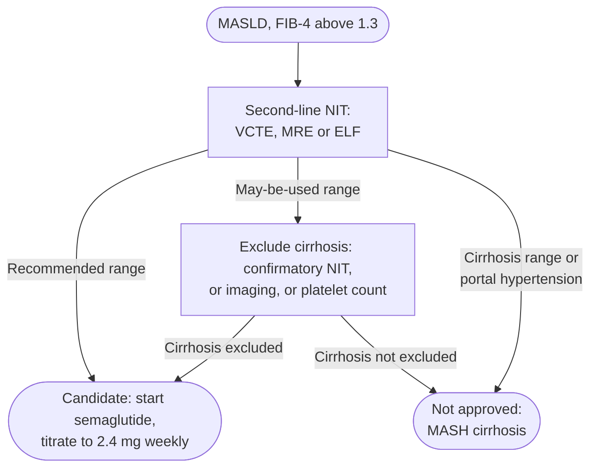
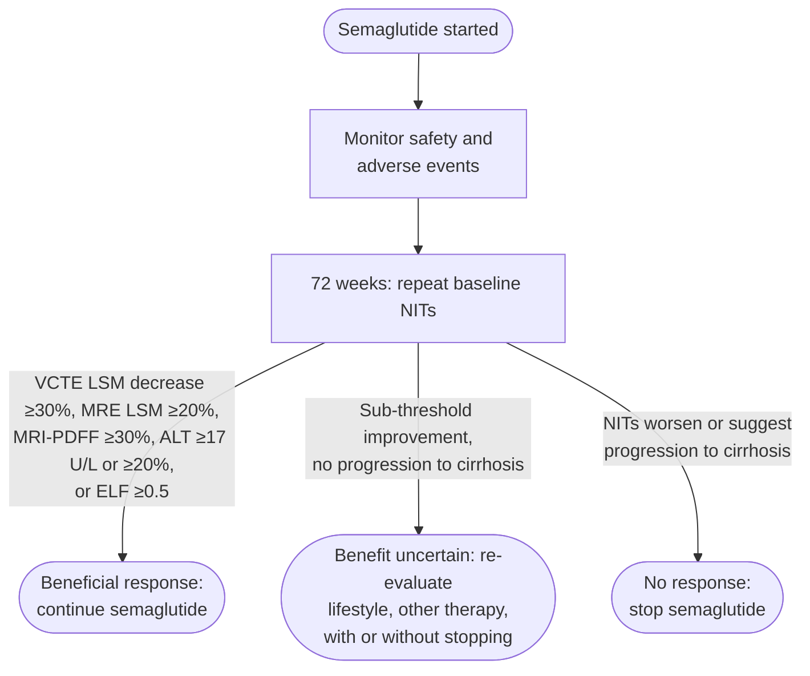

## Contents
- [[#Overview]]
- [[#Mechanism of Action]]
- [[#GI Indication: MASH with Moderate-to-Advanced Fibrosis]]
  - [[#FDA Approval and Evidence Base]]
  - [[#Patient Selection (AASLD 2025 Guidance)]]
  - [[#Contraindications (MASH Indication)]]
  - [[#Dosing]]
  - [[#Monitoring and Safety]]
  - [[#Safety Profile]]
- [[#Broader Cardiometabolic Benefits]]
- [[#Investigational: Alcohol Use Disorder (off-label)]]
- [[#Concomitant Use]]
- [[#See Also]]
- [[#Sources]]

## Overview

- [[glp-1-receptor-agonists|Glucagon-like peptide-1 receptor agonist (GLP-1 RA)]]: long-acting analogue of human GLP-1, modified to slow dipeptidyl peptidase-4 (DPP-4) cleavage and prolong receptor activation [[aasld-2025-semaglutide-mash]]
- 94% sequence homology with human GLP-1; half-life ~5–7 days (native GLP-1: ~1–2 min) → once-weekly dosing

**Formulations and US Food and Drug Administration (FDA) indications:**

| Brand | Route | Dose | Approved indications |
|---|---|---|---|
| Wegovy | Subcutaneous (SC) | 2.4 mg weekly | Chronic weight management: adults with [[obesity]] or overweight + ≥1 weight-related comorbidity (2021; age ≥12 y from 2022) · cardiovascular (CV) risk reduction with established CV disease and obesity/overweight (2024) · **metabolic dysfunction–associated steatohepatitis (MASH) with F2–F3 fibrosis (accelerated, August 2025)** |
| Ozempic | SC | 0.5 or 1.0 mg weekly | Type 2 diabetes mellitus (T2DM) · major adverse CV event reduction in T2DM + established cardiovascular disease (CVD) (2020) |
| Rybelsus | Oral | — | T2DM only; not approved for obesity |

*Sources: [[aasld-2025-semaglutide-mash]] (Wegovy, Ozempic); [[aga-2022-obesity-pharm]] (oral semaglutide).*

## Mechanism of Action

GLP-1 = incretin hormone from enteroendocrine L-cells (distal ileum, colon), released with nutrient intake [[aasld-2025-semaglutide-mash]].

- **Pancreatic:** glucose-dependent insulin release (β-cells); somatostatin secretion (δ-cells); glucagon suppression (α-cells) → low hypoglycemia risk as monotherapy
- **Central nervous system (CNS):** receptors in hypothalamus, hindbrain, brainstem → less hunger, more satiety, lower caloric intake — the main driver of weight loss
- **Gut:** slows gastric emptying; increases early satiety
- **Liver — indirect:** GLP-1 receptor expression negligible on hepatocytes, Kupffer, stellate and sinusoidal endothelial cells → hepatoprotection thought to come from weight loss, better glycemic/lipid control and less hepatic/systemic inflammation
- **Lipids:** inhibits chylomicron synthesis/secretion; decreases de novo lipogenesis; lowers hepatic very-low-density lipoprotein (VLDL) production; weight loss lowers free fatty acids and ceramides

## GI Indication: MASH with Moderate-to-Advanced Fibrosis

### FDA Approval and Evidence Base

- **Accelerated FDA approval, August 15, 2025:** Wegovy 2.4 mg/week SC for [[nafld-masld|MASH]] with moderate-to-advanced fibrosis (consistent with F2–F3) [[aasld-2025-semaglutide-mash]]
- Full approval depends on ESSENCE outcome results, expected 2028 or later
- **ESSENCE (phase 3, NCT04822181), first 800 participants:** biopsy-confirmed MASH, Metavir F2–F3; mild alcohol use allowed (up to 20/30 g/day women/men); 72 weeks of 2.4 mg/week vs placebo
  - MASH resolution without fibrosis worsening: **62.9% vs 34.3%** (p<0.001)
  - ≥1-stage fibrosis improvement without MASH worsening: **36.8% vs 22.4%** (p<0.001)
  - 37.1% on semaglutide did not resolve MASH; 63.2% had no fibrosis improvement without worsening of steatohepatitis

**ESSENCE week-72 noninvasive test (NIT) results** (Table 1, aggregate):

| Measure | Semaglutide (n=534) | Placebo (n=266) |
|---|---|---|
| Alanine aminotransferase (ALT), relative change | −52.1% | −22.2% |
| Controlled attenuation parameter (CAP), absolute change | −43.4 dB/m | −13.1 dB/m |
| Enhanced Liver Fibrosis (ELF) score, absolute change | −0.60 | 0.00 |
| ≥30% decrease in liver stiffness measurement (LSM) | 52.0% | 30.3% |
| ≥0.5 decrease in ELF | 55.8% | 25.5% |

*No individual NIT reliably predicts histologic response at the patient level.*

### Patient Selection (AASLD 2025 Guidance)

- **[[liver-biopsy|Liver biopsy]] not routinely required** — NIT-based selection preferred (American Association for the Study of Liver Diseases [AASLD] 2025, [[aasld-2025-semaglutide-mash]])
- **Sequential testing in metabolic dysfunction–associated steatotic liver disease (MASLD):** Fibrosis-4 index (FIB-4) first, then elastography (vibration-controlled transient elastography [VCTE] or magnetic resonance elastography [MRE]) or a blood-based [[noninvasive-liver-disease-assessment|NIT]] such as ELF
  - FIB-4 <1.3 excludes advanced fibrosis (F3+) in 99% of all patients and 95% with multiple cardiometabolic risks (primary care)
  - FIB-4 ≥1.3 has weaker positive predictive value for F2+
  - **FIB-4 is never the single rule-in or rule-out test for eligibility**

*Selecting semaglutide candidates for MASH by noninvasive test; ranges in the table below*
*Source: built from the AASLD 2025 update's Whom to Treat section (pp. 1328–1329) and Figure 1 (the guidance has no flowchart)*
*[[aasld-2025-semaglutide-mash|AASLD 2025 Semaglutide MASH Update]]*
*MASLD = metabolic dysfunction–associated steatotic liver disease · FIB-4 = Fibrosis-4 index · NIT = noninvasive test · VCTE = vibration-controlled transient elastography · MRE = magnetic resonance elastography · ELF = Enhanced Liver Fibrosis score · MASH = metabolic dysfunction–associated steatohepatitis*

| NIT | Recommended (F2–F3) | May be used (exclude cirrhosis first) | [[cirrhosis\|Cirrhosis]] — not approved |
|---|---|---|---|
| [[liver-stiffness-measurement\|VCTE]] LSM | 8–15 kPa | 15–20 kPa | >20 kPa |
| MRE LSM | 3.1–4.4 kPa | 4.4–5.0 kPa | >5.0 kPa |
| ELF score | 9.2–10.5 | 10.5–11.3 | >11.3 |
| Liver histology | MASH F2–F3 (biopsy in prior 6–12 mo, no substantial weight change since) | — | Cirrhosis |

- **"May be used" band:** individualized decision, based on excluding cirrhosis by another confirmatory NIT, or cross-sectional imaging excluding a nodular liver contour and signs of [[portal-hypertension|portal hypertension]], or a platelet count <150,000/mm³
  - VCTE 15–20 kPa was present in up to 19% of ESSENCE participants
  - AASLD's body text gives the MRE band as 4.5–5.0 kPa (abstract and Figure 1: 4.4–5)
- Get a **baseline NIT** before starting, even after a biopsy — response is judged against it
- **Alcohol:** assess everyone with Alcohol Use Disorders Identification Test–Consumption (AUDIT-C) **and** phosphatidylethanol (PEth)
  - Moderate drinkers: individualized decision; enroll in trials where possible
  - [[metald|Metabolic dysfunction and alcohol-associated liver disease (MetALD)]]-range drinking was excluded from ESSENCE; NIT cut-points may differ in this group

### Contraindications (MASH Indication)

[[aasld-2025-semaglutide-mash]]

| Status | Condition |
|---|---|
| Not approved — do not prescribe solely for MASH | MASH cirrhosis: VCTE >20 kPa, MRE >5.0 kPa, ELF >11.3, and/or portal hypertension |
| Not recommended (Figure 1) | Concomitant active liver disease · pregnancy |
| Contraindicated | Personal or family history of medullary thyroid carcinoma (MTC) · multiple endocrine neoplasia type 2 (MEN2) · severe [[gastroparesis]] |
| Should not be prescribed | History of pancreatitis |
| Do not initiate | Active suicidal ideation — wait until stable and under mental health care |
| Caution only (not an absolute contraindication) | History of gallbladder disease |

- **Compensated cirrhosis on semaglutide for another FDA indication** (obesity, T2DM): monitor carefully; a single phase 2 trial in compensated cirrhosis found no liver-related safety concerns

### Dosing

- **Maintenance: Wegovy 2.4 mg SC once weekly**, reached by gradual titration, which limits nausea and vomiting [[aga-2022-obesity-pharm]]

| Weeks | Dose (SC, weekly) |
|---|---|
| 1–4 | **0.25 mg** |
| 5–8 | **0.5 mg** |
| 9–12 | **1.0 mg** |
| 13–16 | **1.7 mg** |
| 17 onward | **2.4 mg** (maintenance, reached after 16 weeks) |

- Adjust the pace by clinical judgment for response, tolerance and adverse effects
- **Missed doses:**
  - >2 consecutive missed → clinical judgment; resume the same dose if previously well tolerated (expert opinion), otherwise consider lowering the next dose
  - **≥3 consecutive missed → consider restarting the titration schedule**
- **Submaximal dose can be the endpoint** — strong responders may stay on it long term
- Already on lower-dose semaglutide for another indication → escalation to the MASH dose can be considered if tolerated (Global NASH/MASH Council consensus, [[younossi-2026-global-masld-consensus]])

### Monitoring and Safety

**Assessment schedule** (Table 2, [[aasld-2025-semaglutide-mash]]):

| Timeframe | Symptoms | Diagnostic tests | Efficacy |
|---|---|---|---|
| Before initiation | Active suicidal thoughts | Thyroid nodule evaluation · consider retinal exam in T2DM if none in past 12 mo | Hepatic function panel · NIT of fibrosis · NIT of steatosis |
| On treatment | Nausea, vomiting, diarrhea, constipation, abdominal pain, depression or suicidal thoughts | As clinically indicated: pregnancy test · hepatic function panel · right upper quadrant ultrasound (RUQUS) for symptomatic gallstones | — |
| 72 weeks | — | Retinal exam per society guidelines | Hepatic function panel · NIT of fibrosis · NIT of steatosis |

- **Hepatic panel only as clinically indicated**, not on a fixed schedule — no ESSENCE discontinuations for elevated ALT or aspartate aminotransferase (AST)
- Baseline serum creatinine/estimated glomerular filtration rate (eGFR): see acute kidney injury row below

**Response at 72 weeks** — same NITs as at baseline, including magnetic resonance imaging–proton density fat fraction (MRI-PDFF):

*Response assessment after 72 weeks of semaglutide for MASH*
*Source: redrawn from AASLD 2025 Figure 2*
*[[aasld-2025-semaglutide-mash|AASLD 2025 Semaglutide MASH Update]]*
*NIT = noninvasive test · VCTE = vibration-controlled transient elastography · LSM = liver stiffness measurement · MRE = magnetic resonance elastography · MRI-PDFF = magnetic resonance imaging–proton density fat fraction · ALT = alanine aminotransferase · ELF = Enhanced Liver Fibrosis score*

- ESSENCE cannot identify non-responders; AASLD text also counts **lack of decline in ALT or VCTE liver stiffness** as non-response
- **Global NASH/MASH Council consensus differs (AASLD governs):** progression at ≥1 year (ELF rise >0.5 or LSM rise >30%, confirmed by a second-line NIT) → **add [[resmetirom]] and continue semaglutide** for cardiometabolic benefit (Statement 5.10, 87% agreement); stop and switch (Statement 5.9, 70%) also passed [[younossi-2026-global-masld-consensus]]

### Safety Profile

**Most common adverse events (AEs), ESSENCE** [[aasld-2025-semaglutide-mash]]:

| AE | Semaglutide | Placebo |
|---|---|---|
| Nausea | 36.2% | 13.2% |
| Diarrhea | 26.9% | 12.2% |
| Constipation | 22.2% | 8.4% |
| Vomiting | 18.6% | 5.6% |
| Decreased appetite | 14.0% | 2.8% |

- Mostly transient, mild–moderate; AE discontinuation similar (2.6% vs 3.3%)
- **Gastrointestinal (GI) tolerability:** gradual titration; smaller, lower-fat meals; stop eating when full; hydration; fiber for constipation; persistent/severe symptoms → temporary dose reduction, slower titration, or antiemetics/prokinetics/antidiarrheals

**Key safety considerations** (Table 3):

| Concern | Monitoring | Action |
|---|---|---|
| Acute kidney injury (AKI) | Creatinine + eGFR at baseline and during initiation/titration; higher risk with vomiting, diarrhea, dehydration | Hydrate; hold or reduce dose during significant GI intolerance; recheck renal function until recovery |
| [[acute-pancreatitis\|Acute pancreatitis]] | Severe persistent abdominal pain (± vomiting); amylase/lipase if symptomatic | Stop immediately if suspected; no rechallenge after a confirmed episode |
| Gallbladder disease (cholelithiasis/[[acute-cholecystitis\|cholecystitis]]) | Right upper quadrant pain, biliary colic; ultrasound if symptomatic | Educate on biliary symptoms; caution with prior gallbladder disease. Cholelithiasis 1.6% vs 0.7%; meta-analysis (76 randomized controlled trials [RCTs], n=103,371): 37% higher risk |
| Thyroid C-cell tumors | History of MTC/MEN2; neck mass, hoarseness, [[dysphagia]] | Educate on symptoms; **routine calcitonin not required**; no conclusive evidence semaglutide causes MTC in humans |
| Hypoglycemia (with insulin or sulfonylureas) | Glucose monitoring | Adjust insulin/sulfonylurea dose; ESSENCE (T2DM) 7.4% vs 5.4%; higher risk after [[bariatric-surgery]] |
| Heart rate increase | Pulse; palpitations or racing heart at rest | Caution if arrhythmia-prone; reassess persistent tachycardia |
| Gastroparesis / delayed emptying | Baseline motility in at-risk patients; early satiety, vomiting, retained food | Avoid in severe gastroparesis; consider gastric emptying evaluation if symptoms persist. Incidence 6.5/1000 person-years (retrospective) |
| Procedural aspiration / retained gastric contents | Document GLP-1 RA use pre-procedure | Customize fasting per local guidance — see below |
| Diabetic retinopathy, ocular | T2DM: baseline eye exam if not recent, then periodic; blurred vision | Avoid rapid glucose lowering; refer new visual symptoms. SUSTAIN-6 retinopathy 3.0% vs 1.8%; increased nonarteritic anterior ischemic optic neuropathy (NAION) and wet age-related macular degeneration (AMD) risk |
| Lean mass loss / sarcopenia | Muscle strength/mass (dual-energy X-ray absorptiometry [DEXA], grip test) | Protein 1.2–1.5 g/kg/day + resistance training; watch older/sarcopenic adults. ~13% lean mass loss (~39% of total weight lost); appendicular muscle −9–10% over 2 y |

> [!pitfall] Don't cancel endoscopy just for a GLP-1 RA
> American Gastroenterological Association (AGA) 2024: individualized approach, not routine cessation — standard fast (8 h solids, 2 h liquids) and no GI symptoms → proceed. The American Society of Anesthesiologists (ASA) consensus instead considers holding the day-of (daily) or 1 week before (weekly). Full guidance: [[endoscopy-sedation]] ([[aga-2024-glp1-endoscopy]]).

## Broader Cardiometabolic Benefits

[[aasld-2025-semaglutide-mash]]

- **SUSTAIN-6** (Trial to Evaluate Cardiovascular and Other Long-term Outcomes with Semaglutide in Subjects with Type 2 Diabetes; T2DM + established CVD; 0.5 or 1.0 mg weekly): 2.3% absolute reduction in major adverse CV events (CV death, nonfatal myocardial infarction, nonfatal stroke), mostly from fewer nonfatal strokes
- **SELECT** (Semaglutide Effects on Cardiovascular Outcomes in People with Overweight or Obesity; >17,000 adults without diabetes, obesity/overweight + established CVD; Wegovy 2.4 mg): 1.5% absolute reduction in the composite CV endpoint after nearly 40 months; benefit independent of starting weight or weight lost
- **FLOW** (Evaluate Renal Function with Semaglutide Once Weekly; n=3,533, T2DM + chronic kidney disease [CKD]; 1.0 mg weekly): 24% relative reduction in kidney failure, CV death and other renal events; stopped early for efficacy → 2025 FDA indication for CV-death risk reduction and slowing kidney disease progression in T2DM + CKD
- **STEP (Semaglutide Treatment Effect in People with Obesity) trials, 2.4 mg weekly:** mean weight loss 14.9% (STEP 1), 9.6% (STEP 2, T2DM), 16% (STEP 3, intensive behavioral therapy); 45.6% (STEP 2) to 75.3% (STEP 3) reached ≥10% loss — the fibrosis-reversal target in MASLD guidance
  - STEP 4 and STEP 1 extension: stopping semaglutide reversed cardiometabolic gains → ongoing treatment needed

## Investigational: Alcohol Use Disorder (off-label)

- **Off-label, investigational** — not FDA-approved for alcohol use disorder (AUD); one small phase 2 trial
- **Phase 2 RCT** (n=48 non–treatment-seeking adults, 9 weeks, single center) [[hendershot-2025-semaglutide-aud]]:
  - Dose: 0.25 mg weeks 1–4 → 0.5 mg weeks 5–8 (primary outcome measured here) → 1.0 mg week 9 — well below obesity/MASH doses
  - Reduced **laboratory alcohol self-administration** (grams consumed, peak breath alcohol), **drinks per drinking day**, **weekly craving**, and heavy drinking days over time vs placebo; reduced cigarettes/day in smokers (n=13)
  - No change in drinks per calendar day or number of drinking days
  - No serious AEs or alcohol interactions
- **Limits:** authors argue a non–treatment-seeking sample approximates patients exposed to GLP-1 RAs in general medical settings, but AUD severity was moderate — heavier drinkers untested; primary endpoint is a laboratory surrogate
- The only prior randomized AUD trial of a GLP-1 RA (exenatide) did not reduce overall consumption — see [[glp-1-receptor-agonists]]
- Larger trials needed; relevant to the rising burden of [[alcohol-associated-liver-disease]]

## Concomitant Use

- **Class rules** (no second GLP-1 RA or DPP-4 inhibitor; delayed emptying may affect oral drugs needing rapid onset; insulin/sulfonylurea dose adjustment) → [[glp-1-receptor-agonists]]
- **Resmetirom:** combination with semaglutide 2.4 mg/week not studied, nor relative efficacy compared [[aasld-2025-semaglutide-mash]]
  - MAESTRO-NASH: 14% were on a stable GLP-1 RA (maximum 1 mg/week, >6 months) and had similar MASH resolution, fibrosis improvement and safety
- **Lifestyle modification** (nutrition, exercise, behavior) and comorbidity control continue regardless of semaglutide
- **ESSENCE exclusions:** vitamin E (800 IU/day) or pioglitazone not at a stable dose from 90 days before baseline biopsy to screening; weight-loss drugs not at a stable dose within 28 days of biopsy

## See Also

[[glp-1-receptor-agonists]], [[nafld-masld]], [[resmetirom]], [[obesity]], [[noninvasive-liver-disease-assessment]], [[liver-stiffness-measurement]], [[liver-biopsy]], [[cirrhosis]], [[portal-hypertension]], [[gastroparesis]], [[acute-pancreatitis]], [[acute-cholecystitis]], [[bariatric-surgery]], [[endoscopy-sedation]], [[alcohol-associated-liver-disease]], [[metald]]

---

## Sources

1. [[aasld-2025-semaglutide-mash|Semaglutide Therapy for Metabolic Dysfunction–Associated Steatohepatitis: November 2025 Updates to AASLD Practice Guidance]]
2. [[aga-2022-obesity-pharm|AGA Clinical Practice Guideline: Pharmacological Interventions for Adults with Obesity (2022)]]
3. [[hendershot-2025-semaglutide-aud|Once-Weekly Semaglutide in Adults With Alcohol Use Disorder: A Randomized Clinical Trial]]
4. [[aga-2024-glp1-endoscopy|AGA Rapid Clinical Practice Update on the Management of Patients Taking GLP-1 Receptor Agonists Prior to Endoscopy: Communication (2024)]]
5. [[younossi-2026-global-masld-consensus|Global NASH/MASH Council 2026: Updated Global Consensus on MASLD Risk Stratification, Treatment Initiation, and Response Monitoring]]
