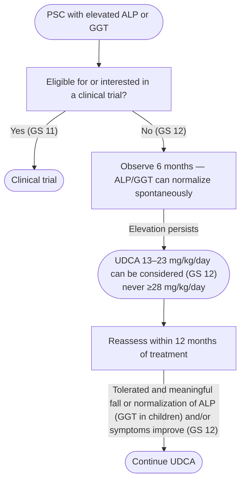

## Contents
- [[#What It Is]]
- [[#Dosing by Indication]]
  - [[#Administration]]
- [[#Primary Biliary Cholangitis]]
  - [[#Biochemical Response to UDCA]]
  - [[#Second-Line Agents]]
- [[#Primary Sclerosing Cholangitis]]
- [[#Intrahepatic Cholestasis of Pregnancy]]
- [[#After Liver Transplantation]]
- [[#Where UDCA Is Not Recommended]]
- [[#Adverse Effects and Interactions]]
- [[#Monitoring]]
- [[#See Also]]
- [[#Sources]]

---

## What It Is

- Oral hydrophilic bile acid; **first-line therapy for [[primary-biliary-cholangitis|primary biliary cholangitis (PBC)]]**, offered to every person at diagnosis ([[aasld-aga-2026-pbc]] Rec 2).
- **Mechanisms** (PBC): choleretic, cytoprotective, anti-inflammatory, immunomodulatory ([[aasld-2018-pbc]]).
- **In PBC, ursodeoxycholic acid (UDCA) does:** improve liver biochemistries · slow histologic progression · reduce the risk of developing varices · lower low-density lipoprotein (LDL) cholesterol · improve transplant-free survival ([[aasld-2018-pbc]]; [[aasld-aga-2026-pbc]]).
- **In PBC, UDCA does NOT:** improve fatigue, pruritus, bone disease, or associated autoimmune features — these need separate treatment ([[aasld-2018-pbc]]).
- **Timing of effect:** liver tests improve within a few weeks; 90% of the improvement within **6–9 months**; about **20%** normalize liver biochemistries after **2 years** ([[aasld-2018-pbc]]).

---

## Dosing by Indication

| Indication | Dose | Basis |
|---|---|---|
| **[[primary-biliary-cholangitis\|PBC]]** — every person at diagnosis (2018: abnormal liver enzymes, **any** histologic stage) | **13–15 mg/kg/day** orally; **not above 15 mg/kg/day** | [[aasld-aga-2026-pbc]] Rec 2 (*Strong, Moderate*); [[aasld-2018-pbc]] Guidance Statement (GS) 5 |
| **PBC–[[autoimmune-hepatitis\|autoimmune hepatitis (AIH)]] overlap** | **Consider adding UDCA** to prednisone or prednisolone + azathioprine (guidance statement). Paris-criteria AIH–PBC: prednisone or prednisolone 30 mg/day tapered over 4 weeks to 10 mg/day **+ UDCA 13–15 mg/kg/day** beat either alone | [[aasld-2020-autoimmune-hepatitis]] |
| **AIH–[[primary-sclerosing-cholangitis\|primary sclerosing cholangitis (PSC)]] overlap** | Prednisone or prednisolone 0.5 mg/kg/day tapered to 10–15 mg/day **+ UDCA 13–15 mg/kg/day**. Children with autoimmune sclerosing cholangitis: **10 mg/kg twice daily** (not exceeding 1.5–2 g/day) with prednisone or prednisolone | [[aasld-2020-autoimmune-hepatitis]] |
| **PSC** — persistently elevated alkaline phosphatase (ALP) or gamma-glutamyl transferase (GGT), not eligible for or interested in a trial | **13–23 mg/kg/day** *can be considered* | [[aasld-2022-psc]] GS 12 |
| **PSC — high dose** | **≥28 mg/kg/day — do not use** | [[aasld-2022-psc]]; [[acg-2015-psc]] Rec 6 (*Strong, high*) |
| **[[intrahepatic-cholestasis-of-pregnancy\|Intrahepatic cholestasis of pregnancy (ICP)]]** | **10–15 mg/kg/day** total daily dose, divided | [[aga-2024-pregnancy-gi-liver]] Best Practice Advice (BPA) 10; [[acg-2016-liver-disease-pregnancy]] Rec 13 (*strong, moderate*) |
| **PBC in pregnancy** | Continue existing UDCA | [[acg-2016-liver-disease-pregnancy]] Rec 32 (*strong, very low*) |
| **After [[liver-transplantation\|liver transplantation (LT)]] for PBC — prophylaxis** | **13–15 mg/kg/day**, started as soon as possible after LT | [[aasld-aga-2026-pbc]] Rec 6 (*Conditional, Very Low*) |
| **Recurrent PBC after LT**, histologically proven | **10–15 mg/kg/day** may be considered | [[aasld-2012-liver-transplant-long-term]] Rec 84 (*grade 2, level B*) |

**Why 13–15 mg/kg/day in PBC:** a three-dose comparison found it superior to **5–7** and **23–25 mg/kg/day** in biochemical response and cost; the survival studies all used it ([[aasld-2018-pbc]]).

### Administration

- Initiate gradually. Generally **two divided doses**; **once daily, particularly at bedtime**, can improve compliance ([[aasld-2018-pbc]]).
- **No dose adjustment for liver or renal disease** ([[aasld-2018-pbc]]).
- **Bile acid sequestrants and some antacids interfere with absorption** → give UDCA **at least 1 hour before or 4 hours after** the sequestrant ([[aasld-2018-pbc]] GS 6).
- Bioavailability differed substantially by preparation in a short-term study of normal volunteers; formulations not compared directly in PBC ([[aasld-2018-pbc]]).
- PBC: **continue indefinitely** ([[aasld-2018-pbc]]).

---

## Primary Biliary Cholangitis

- **Every stage:** earlier histologic stage responds better, but advanced disease may still gain survival or avoid transplant ([[aasld-2018-pbc]]). No subgroup exempted — advanced fibrosis, decompensated cirrhosis, awaiting LT — unless intolerant ([[aasld-aga-2026-pbc]]).
- Response similar in antimitochondrial antibody (AMA)–negative and AMA-positive PBC ([[aasld-2018-pbc]]).

### Biochemical Response to UDCA

**Current rule — [[aasld-aga-2026-pbc]] (Rec 4 implementation considerations, ungraded):**
- **When:** ideally after **≥6 months and no later than 12 months**; at **6 months** with high-risk features, including but not limited to **[[liver-stiffness-measurement|liver stiffness measurement (LSM)]] ≥10 kPa and age <62 years** (Figure 1 note 2).
- **Inadequate response** (definition used by most studies) = failure to reach **ALP <1.5–1.67× upper limit of normal (ULN) and normal total bilirubin at 12 months**.
- **ALP normalization is the ideal goal** where attainable — particularly with LSM ≥10 kPa.
- Decision to start second-line therapy and which agent: by disease severity, prognostic data and symptom burden, with shared decision-making.

> [!pitfall] Inadequate response is not a reason to stop UDCA
> Keep UDCA even with persistent ALP elevation — it still gives a survival benefit; even partial biochemical improvement beats no therapy. Add second-line therapy on top ([[aasld-aga-2026-pbc]] Rec 2).

- **Before calling a patient an inadequate responder, check:** adherence, a superimposed liver disease (including fatty liver), co-administration with a bile sequestrant (cholestyramine, colestipol, colesevelam) ([[aasld-2018-pbc]]).
- Serum **ALP and total bilirubin** predict outcome on treatment; **[[liver-biopsy|liver biopsy]] is not indicated** to monitor response ([[aasld-2018-pbc]]).

**Older rule — [[aasld-2018-pbc]] GS 7:** evaluate at **12 months** by any one published binary criterion (Table 1); **up to 40%** are inadequate responders by one of them.

| Criteria (arranged by year) | Response definition |
|---|---|
| Rochester I | ALP 2× ULN |
| Barcelona | Reduction in ALP 40% from baseline, or normalization of ALP |
| Paris I | ALP 3× ULN; aspartate aminotransferase (AST) 2× ULN; **and** total bilirubin 1 mg/dL |
| Rotterdam | Total bilirubin <1× ULN **and** albumin >1× lower limit of normal (LLN) |
| Toronto | ALP 1.67× ULN |
| Paris II | ALP 1.5× ULN; AST 1.5× ULN; **and** total bilirubin 1 mg/dL |
| Rochester II | ALP 2× ULN |
| Global | ALP 2× ULN |

*ALP = alkaline phosphatase · AST = aspartate aminotransferase · ULN = upper limit of normal · LLN = lower limit of normal. Paris I/II require **all** listed components. Table 1 prints the cutoffs without comparison signs except for Rotterdam; the text describes ALP response as less than twice the ULN ([[aasld-2018-pbc]] Table 1).*

- "Global" here is a binary ALP criterion, not the continuous **GLOBE score** — GLOBE and UK-PBC models: [[primary-biliary-cholangitis#Severity Assessment]].

### Second-Line Agents

- **Do not raise the UDCA dose:** beyond 15 mg/kg/day is not indicated for symptoms or persistently elevated ALP ([[aasld-aga-2026-pbc]] Rec 2); doubling the dose gave no benefit over standard UDCA ([[aasld-2018-pbc]]).
- **Current choice — [[aasld-aga-2026-pbc]] Rec 4 (*Conditional, Low*):** a peroxisome proliferator–activated receptor (PPAR) agonist — **elafibranor 80 mg/day** or **seladelpar 10 mg/day** — **added to UDCA** for inadequate response, or as **monotherapy** for UDCA intolerance. Not in pregnancy, breastfeeding or decompensated cirrhosis. Agent table, monitoring and fibrates: [[primary-biliary-cholangitis#PPAR Agonists (Second-Line)]].
- **Obeticholic acid (OCA):** the 2026 guideline makes no recommendation on it.

**Older second-line guidance ([[aasld-2018-pbc]]; [[aasld-2021-pbc]]):**

| Agent | Dose | Restriction |
|---|---|---|
| **OCA** — farnesoid X receptor (FXR) agonist | Start **5 mg/day** (2018 GS 8); after **3 months** may increase to **10 mg/day** if liver chemistries remain abnormal and tolerated | **Contraindicated in advanced cirrhosis**; careful monitoring of **any** patient with cirrhosis on OCA, even if not advanced (2021 Revised GS 10) |
| **Fibrates** — PPAR agonists, **off-label** (approved only as lipid-lowering drugs) | Studied at **bezafibrate 400 mg/day**, **fenofibrate 160 mg/day** | **Discouraged in decompensated liver disease** (2021 Revised GS 9); not studied there |

- **"Advanced cirrhosis"** (2021) = [[cirrhosis]] with **current or prior** evidence of liver decompensation (e.g., [[hepatic-encephalopathy|encephalopathy]], coagulopathy) **or** [[portal-hypertension|portal hypertension]] (e.g., [[ascites]], gastroesophageal varices, or persistent thrombocytopenia). No platelet or international normalized ratio (INR) cutoff given.
- **What changed:** 2018 GS 10 discouraged OCA and fibrates in decompensated disease defined as **Child-Pugh-Turcotte B or C** (after a September 2017 Food and Drug Administration [FDA] warning); 2021, after a **May 2021** FDA warning, made OCA **contraindicated** in advanced cirrhosis — wider, since Child-Pugh A with varices or persistent thrombocytopenia now qualifies.

---

## Primary Sclerosing Cholangitis

No approved medication for PSC; none proven to halt progression ([[aasld-2022-psc|American Association for the Study of Liver Diseases (AASLD) 2022]]).

*UDCA decision in PSC*
*Source: built from AASLD 2022 Guidance Statements 11 and 12 and the text supporting them (the guidance has no UDCA flowchart)*
*[[aasld-2022-psc|AASLD 2022 PSC Guidance]]*
*PSC = primary sclerosing cholangitis · ALP = alkaline phosphatase · GGT = gamma-glutamyl transferase · GS = Guidance Statement · UDCA = ursodeoxycholic acid*

- **"Meaningful" is not defined.** Reductions AASLD 2022 cites as linked to better outcomes — adults: ALP to **<1.5× ULN**, **40% reduction** or normalization of ALP, normalization of ALP; children: **75% reduction in GGT** or **GGT <50 IU** ([[aasld-2022-psc]]).
- **Dose:** no data favor low (13–15) over intermediate (17–23 mg/kg/day) ([[aasld-2022-psc]]).

> [!pitfall] High-dose UDCA harms patients with PSC
> 28–30 mg/kg/day vs placebo (150 patients): stopped early for futility; more transplant and varices, more serious adverse events, and more colorectal neoplasia in PSC with [[ulcerative-colitis|ulcerative colitis]] ([[acg-2015-psc]]; [[aasld-2022-psc]]). American College of Gastroenterology (ACG) 2015 Rec 6: **>28 mg/kg/day should not be used** (*Strong, high*); AASLD 2022: avoid **≥28 mg/kg/day**.

- **What changed:** AASLD 2010 recommended against UDCA in PSC; AASLD 2022 now allows 13–23 mg/kg/day to be considered. ACG 2015 recommends only against high dose and notes many practitioners use ~20 mg/kg/day without controlled-trial support ([[aasld-2022-psc]]; [[acg-2015-psc]]).
- **Withdrawal** associated with more fatigue, pruritus, higher liver biochemistries and Mayo PSC Risk Score ([[aasld-2022-psc]]).
- **Not effective for pruritus** in PSC ([[aasld-2022-psc]]).
- **Colorectal chemoprevention in PSC–[[inflammatory-bowel-disease|inflammatory bowel disease (IBD)]]:** no prospective controlled trial shows benefit; a meta-analysis suggested possible benefit at low dose (8–13 mg/kg/day) with significant heterogeneity ([[acg-2015-psc]]).
- **Pregnancy and lactation:** safe; may be continued ([[aasld-2022-psc]]).

---

## Intrahepatic Cholestasis of Pregnancy

- **UDCA 10–15 mg/kg/day**, total daily dose, divided — **first-line** once ICP is diagnosed (serum bile acids >10 μmol/L with pruritus) ([[aga-2024-pregnancy-gi-liver]] BPA 10; [[acg-2016-liver-disease-pregnancy]] Rec 13).
- Improves pruritus, serum bile acids and alanine aminotransferase (ALT); meta-analysis: **fewer preterm births and stillbirths** ([[aga-2024-pregnancy-gi-liver]]).
- **More effective than cholestyramine or dexamethasone** for pruritus; well tolerated and safe for mother and fetus ([[acg-2016-liver-disease-pregnancy]]).
- **Pregnancy category B.** Data on UDCA for PBC in pregnancy are limited, especially in the first trimester; potential risks appear small compared with the benefit ([[acg-2016-liver-disease-pregnancy]]).
- Delivery timing by bile acid level: [[intrahepatic-cholestasis-of-pregnancy]].

---

## After Liver Transplantation

- **Prophylaxis after LT for PBC:** **suggested** — UDCA **13–15 mg/kg/day**, started **as soon as possible** after LT, to prevent recurrent PBC and graft failure ([[aasld-aga-2026-pbc]] Rec 6, *Conditional, Very Low*). AASLD–American Society of Transplantation 2025 Rec 70: prophylactic UDCA **may be considered** to prevent recurrent PBC (*Weak, Level 3*) ([[aasld-ast-2025-liver-transplant-graft-complications]]).
  - **What changed:** AASLD 2012 Rec 84 saw **no indication** for prophylactic UDCA with normal liver histology (*grade 2, level B*) ([[aasld-2012-liver-transplant-long-term]]).
- **Recurrent PBC** (diagnosis requires histology): treat with UDCA ([[aasld-ast-2025-liver-transplant-graft-complications]]); **10–15 mg/kg/day** may be considered — improves liver tests, **no documented impact on graft survival** (*grade 2, level B*) ([[aasld-2012-liver-transplant-long-term]] Rec 84). Safety and efficacy of elafibranor or seladelpar for recurrent PBC are not known ([[aasld-ast-2025-liver-transplant-graft-complications]]).
- **Recurrent PSC:** no specific effective medical therapy, **including UDCA**, for prophylaxis or treatment ([[aasld-ast-2025-liver-transplant-graft-complications]]).

---

## Where UDCA Is Not Recommended

| Setting | Position |
|---|---|
| **[[nafld-masld\|Nonalcoholic steatohepatitis (NASH)]]** | **Should not be used** — well studied, no meaningful histologic benefit ([[aasld-2023-nafld]] GS 28) |
| **PSC at ≥28 mg/kg/day** | Harmful — [[#Primary Sclerosing Cholangitis]] |
| **PBC — dose above 15 mg/kg/day** | Not indicated for symptoms or persistent ALP elevation ([[aasld-aga-2026-pbc]]) |
| **Recurrent PSC after LT** | No effective medical therapy, including UDCA ([[aasld-ast-2025-liver-transplant-graft-complications]]) |
| **Fatigue, pruritus, or bone disease in PBC** | Ineffective — treat separately ([[aasld-2018-pbc]]) |
| **Pruritus in PSC** | Not shown effective ([[aasld-2022-psc]]) |
| **Secondary sclerosing cholangitis in [[hereditary-hemorrhagic-telangiectasia\|hereditary hemorrhagic telangiectasia (HHT)]]** | May be used, but **no data support it** ([[acg-2020-hepatic-mesenteric-circulation]]) |

---

## Adverse Effects and Interactions

- **Minimal side effects; generally well tolerated** ([[aasld-2018-pbc]]). Trials: serious adverse events no different from control (13.5% vs 15.6%); non-serious events mainly gastrointestinal (diarrhea, nausea, vomiting) and possible weight gain ([[aasld-aga-2026-pbc]]).
- **5-pound weight gain** over the first year — reported, **not progressive**; **loose stools and/or thinning of the hair** — infrequent ([[aasld-2018-pbc]]).
- **Absorption:** bile acid sequestrants and some antacids — separate doses ([[#Administration]]).
- **Post-LT:** little to no serious interaction with typical post-transplant medications ([[aasld-aga-2026-pbc]]).
- **High dose in PSC** (28–30 mg/kg/day): more transplant and varices, serious adverse events, colorectal neoplasia in PSC with ulcerative colitis ([[#Primary Sclerosing Cholangitis]]).

---

## Monitoring

| What | When | Setting |
|---|---|---|
| Liver tests | Every **3–6 months** | PBC on UDCA ([[aasld-2018-pbc]] Table 2) |
| Biochemical response | **≥6 and ≤12 months** after starting; **6 months** if high-risk (e.g., LSM ≥10 kPa and age <62 years) | PBC — decides second-line therapy ([[aasld-aga-2026-pbc]]) |
| ALP (GGT in children) ± symptoms | Observe **6 months** before starting; reassess within **12 months** of treatment | PSC — decides whether to continue ([[aasld-2022-psc]] GS 12) |
| Liver biopsy | **Not indicated** to monitor response | PBC ([[aasld-2018-pbc]]) |

Full PBC follow-up schedule (thyroid, bone density, fat-soluble vitamins, varices, [[hcc-surveillance|hepatocellular carcinoma surveillance]]): [[primary-biliary-cholangitis#Monitoring Schedule]].

---

## See Also

[[primary-biliary-cholangitis]], [[primary-sclerosing-cholangitis]], [[intrahepatic-cholestasis-of-pregnancy]], [[liver-disease-in-pregnancy]], [[autoimmune-hepatitis]], [[nafld-masld]], [[liver-transplantation]], [[cirrhosis]], [[portal-hypertension]], [[ascites]], [[hepatic-encephalopathy]], [[hereditary-hemorrhagic-telangiectasia]], [[abnormal-liver-chemistries]], [[hcc-surveillance]], [[liver-stiffness-measurement]], [[ulcerative-colitis]], [[inflammatory-bowel-disease]], [[liver-biopsy]]

---

## Sources

1. [[aasld-2018-pbc|AASLD 2018 Practice Guidance: Primary Biliary Cholangitis]]
2. [[aasld-2021-pbc|AASLD 2021 Practice Guidance Update: Primary Biliary Cholangitis]]
3. [[aasld-2022-psc|AASLD 2022 Practice Guidance on Primary Sclerosing Cholangitis and Cholangiocarcinoma]]
4. [[acg-2015-psc|ACG 2015 Clinical Guideline: Primary Sclerosing Cholangitis]]
5. [[aga-2024-pregnancy-gi-liver|AGA Clinical Practice Update on Pregnancy-Related Gastrointestinal and Liver Disease: Expert Review]]
6. [[acg-2016-liver-disease-pregnancy|ACG Clinical Guideline: Liver Disease and Pregnancy (2016)]]
7. [[aasld-2023-nafld|AASLD Practice Guidance on the Clinical Assessment and Management of Nonalcoholic Fatty Liver Disease (2023)]]
8. [[aasld-2012-liver-transplant-long-term|AASLD/AST 2012: Long-Term Management of the Successful Adult Liver Transplant]]
9. [[aasld-ast-2025-liver-transplant-graft-complications|AASLD/AST 2025: Practice Guideline on Adult Liver Transplantation — Diagnosis and Management of Graft-Related Complications]]
10. [[aasld-2020-autoimmune-hepatitis|AASLD Practice Guidance on Autoimmune Hepatitis (2020)]]
11. [[acg-2020-hepatic-mesenteric-circulation|ACG Clinical Guideline: Disorders of the Hepatic and Mesenteric Circulation]]
12. [[aasld-aga-2026-pbc|AASLD–AGA 2026: Management of Primary Biliary Cholangitis]]
