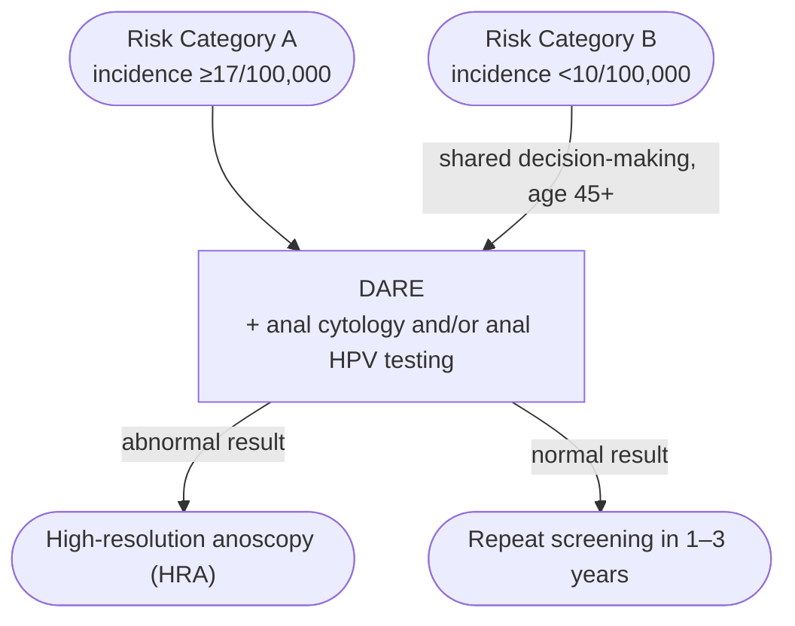

Screening defined high-risk populations for **anal high-grade squamous intraepithelial lesion (HSIL)** — the treatable precursor — rather than for anal cancer itself. Directly parallel to cervical cancer prevention: both cancers are human papillomavirus (HPV)-mediated, and both screening programs triage to a magnified examination of the epithelium. Framework here is [[asccp-2024-anal-cancer-screening|American Society for Colposcopy and Cervical Pathology (ASCCP) 2024]], which endorses and reconciles the International Anal Neoplasia Society (IANS) 2024 consensus and the 2024 National Institutes of Health (NIH)/Centers for Disease Control and Prevention (CDC)/Infectious Diseases Society of America (IDSA) guidelines for people with human immunodeficiency virus (HIV).

## Contents
- [[#Why Screen]]
- [[#Who to Screen]]
  - [[#Risk Category A — Screening Recommended]]
  - [[#Risk Category B — Shared Decision-Making]]
- [[#Screening Tests]]
  - [[#Test Strategies (IANS)]]
  - [[#People with HIV (NIH/CDC/IDSA)]]
- [[#Where HRA Is Unavailable]]
- [[#What ASCCP Itself Endorses]]
- [[#Open Questions]]
- [[#See Also]]
- [[#Sources]]

## Why Screen

- Anal cancer is **HPV-mediated**, like other lower genital tract cancers.
- **Target of screening = anal HSIL**, not cancer. Treating anal HSIL cut anal cancer incidence in people with HIV by **almost 60%** (ANCHOR trial, cited by [[asccp-2024-anal-cancer-screening|ASCCP 2024]]).
- General US population incidence is only **1.7 per 100,000 person-years (p-y)** — too low to screen broadly. Hence risk-group–restricted screening.
- Risk groups are sorted by **incidence rate relative to that 1.7/100,000 baseline**.

## Who to Screen

### Risk Category A — Screening Recommended

Incidence **≥17 per 100,000** — at least **10×** the general population. Each group carries its own start trigger; the trigger is the decision, not the category name.

| Group | Incidence (per 100,000) | Start screening |
|---|---|---|
| Men who have sex with men (MSM) and transgender women **with HIV** | **>70** | Age **35** |
| History of vulvar HSIL or vulvar cancer (vulvar intraepithelial neoplasia grade 3 [VIN3]) | **>40** | **Within 1 year of diagnosis** |
| Men who have sex with women (MSW) **with HIV** | **40** | Age **45** |
| Women **with HIV** | **25** | Age **45** |
| Solid organ transplant recipients | **>25** | **10 years post-transplant** |
| MSM and transgender women **without HIV** | **>18** | Age **45** |

### Risk Category B — Shared Decision-Making

Incidence **<10 per 100,000 p-y**. IANS calls for **shared decision-making, not routine screening**, until outcome data mature. Qualifying at **age 45 and older**:

- History of cervical or vaginal cancer
- Cervical or vaginal HSIL
- Perianal warts
- **Persistent cervical HPV 16**
- Other immunosuppression, **or on chronic systemic steroid therapy** — named examples: rheumatoid arthritis, lupus, **[[crohns-disease|Crohn's disease]]**, **[[ulcerative-colitis|ulcerative colitis]]** — [[inflammatory-bowel-disease|inflammatory bowel disease (IBD)]]-specific perianal/anal examination guidance lives on [[ibd-preventive-care]]

## Screening Tests

- Accepted modalities: **anal cytology**, **high-risk HPV (hrHPV) testing**, or **combinations**.
- hrHPV testing of the anal canal is **not approved by the US Food and Drug Administration (FDA)** — but is highly sensitive for anal precancer and cancer.

> [!pearl] DARE is what finds early anal cancers
> Digital anal rectal examination (DARE) is recommended at **every screening visit**: cytology and hrHPV testing are aimed at anal HSIL, while DARE is the tool that detects early anal *cancers* ([[asccp-2024-anal-cancer-screening|ASCCP 2024]]).

*Anal cancer screening pathway — who to screen, how, and what each result triggers*
*Source: redrawn from Figure 1 of the ASCCP 2024 practice advisory*
*[[asccp-2024-anal-cancer-screening|ASCCP Practice Advisory: Anal Cancer Screening (2024)]]*
*DARE = digital anal rectal examination · HPV = human papillomavirus · HRA = high-resolution anoscopy*

### Test Strategies (IANS)

| Strategy | Result → action |
|---|---|
| **Anal cytology alone** (acceptable) | Any abnormal cytology → HRA referral |
| **Cytology where HRA capacity is limited** | **High-grade cytology → immediate HRA**; lesser abnormalities may **repeat testing within 12 months** |
| **hrHPV triage of cytology** (endorsed) | Stratifies cytology results — used specifically to **reduce immediate HRA referrals** |
| **Primary hrHPV** (acceptable) | Positive → immediate HRA; negative → **repeat screening in 12–24 months** |
| **Co-testing** (cytology + hrHPV, acceptable) | High-risk result → immediate HRA |

### People with HIV (NIH/CDC/IDSA)

Concordant with IANS on *whom* to screen, but not on *how*:

- **All at-risk adults with HIV:** assess **at least annually** for anal symptoms (pain, burning, masses) **+ DARE**.
- **Age <35, symptomatic or with signs of anal cancer:** **DARE + at least standard anoscopy** (not lab-based screening).
- **Asymptomatic MSM and transgender women with HIV:** begin **lab-based screening** — cytology alone, or cytology + hrHPV co-testing — at age **35**.
- **All other people with HIV:** begin at age **45**.
- **Symptoms or abnormal screening at any age:** refer for **HRA**.
- **Primary hrHPV testing was not recommended** by this panel in persons with HIV — see [[#Open Questions]].

## Where HRA Is Unavailable

HRA capacity is the rate-limiting resource, and both guidelines address it explicitly rather than assuming access.

> [!pitfall] Don't start a screening test you can't complete
> Anal cytology or hrHPV testing is added only where abnormal results can actually reach HRA ([[asccp-2024-anal-cancer-screening|ASCCP 2024]]).

- No HRA access → Category A patients (people with HIV, solid organ transplant recipients, women with a history of vulvar HSIL or vulvar cancer, MSM and transgender women without HIV) are still screened with **symptom assessment + DARE**.

## What ASCCP Itself Endorses

ASCCP adds no new criteria; its own recommendation is the implementable floor:

- **Routine annual DARE** for providers caring for patients with lower genital tract dysplasia, in **both** risk categories A and B.
- **Anal cytology and/or hrHPV testing may be added — conditional on capacity for HRA referral** for abnormal results.
- Implementation depends on addressing limited HRA provider availability, funding, and equitable access.

## Open Questions

- **Primary hrHPV in people with HIV — the two 2024 guidelines disagree.** IANS accepts primary hrHPV testing as a standalone strategy; the NIH/CDC/IDSA panel explicitly did not recommend it in persons with HIV. Same year, same tier — neither supersedes the other. [[asccp-2024-anal-cancer-screening|ASCCP]] reports both without adjudicating.
- **Management after HRA is not covered** by the ASCCP advisory — what is done with biopsy-proven anal HSIL (ablation, topical therapy, surveillance interval) is in the IANS consensus itself.
- The ASCCP advisory is a narrative endorsement and attaches **no evidence grades** to its statements.

## See Also

[[colorectal-cancer-screening]], [[gastric-cancer-screening]], [[pancreatic-cancer-screening]], [[crohns-disease]], [[ulcerative-colitis]], [[ibd-preventive-care]], [[ibd-in-malignancy]], [[hemorrhoids]], [[anal-fissure]]

---

## Sources

1. [[asccp-2024-anal-cancer-screening|ASCCP Practice Advisory: Anal Cancer Screening (2024)]]
