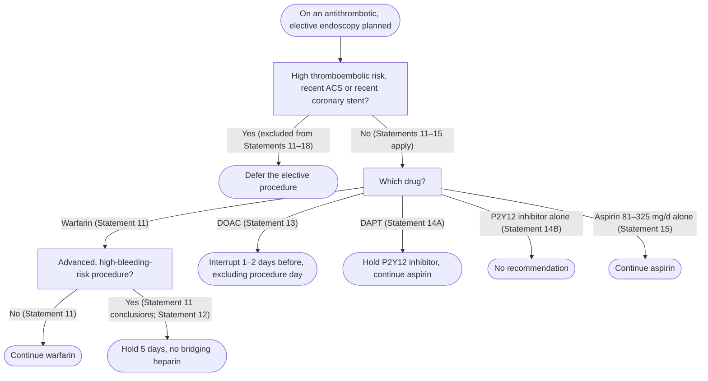

## Contents
- [[#Overview]]
- [[#Acute GI Bleeding Management]]
  - [[#VKA Reversal (Warfarin)]]
  - [[#DOAC Reversal (Apixaban, Rivaroxaban, Dabigatran, Edoxaban)]]
  - [[#Antiplatelet Management]]
- [[#Periendoscopic Period]]
  - [[#Risk Stratification (Procedural Bleeding and Thrombotic Risk)]]
  - [[#Warfarin Periendoscopic Management]]
  - [[#Bridging Therapy — When Indicated vs. Not]]
  - [[#DOAC Periendoscopic Management]]
  - [[#Antiplatelet Periendoscopic Management]]
  - [[#Resumption After Elective Endoscopy]]
  - [[#Drug-Specific Hold Intervals and Reversal (ASGE Reference Table)]]
  - [[#DOAC Hold Intervals by Creatinine Clearance (ASGE Tables 6–9)]]
- [[#See Also]]
- [[#Sources]]

## Overview

- **Drugs covered:** vitamin K antagonists (VKAs; warfarin), direct oral anticoagulants (DOACs; apixaban, dabigatran, edoxaban, rivaroxaban), antiplatelets (acetylsalicylic acid [ASA, aspirin]; P2Y12 receptor inhibitors clopidogrel, prasugrel, ticagrelor) ([[acg-cag-2022-anticoag-gi-bleeding]])
- **Two settings, two questions:**
  - Acute gastrointestinal (GI) bleeding → reverse or hold the drug?
  - Elective endoscopy → interrupt, bridge, when to resume?
- **Governing guideline:** 2022 American College of Gastroenterology (ACG)/Canadian Association of Gastroenterology (CAG). Every recommendation is conditional — very low certainty except Statement 12 (low); Statements 2, 14B, 16, 17 and 18 reached no recommendation.
- **Older American Society for Gastrointestinal Endoscopy (ASGE) 2016 guideline** adds drug hold intervals and reversal options; where it differs, ACG/CAG 2022 governs and the difference is flagged inline ([[asge-2016-antithrombotic]]).

---

## Acute GI Bleeding Management

- **Acute GI bleeding** = hospitalized or under observation with acute overt bleeding, upper and/or lower: melena, hematochezia or hematemesis ([[upper-gi-bleeding]], [[acute-lower-gi-bleeding]]).
- **Life-threatening hemorrhage** = major overt bleeding with any of: hypovolemic shock or severe hypotension needing pressors or surgery · hemoglobin drop >5 g/dL · transfusion of ≥5 units packed red blood cells · death ([[acg-cag-2022-anticoag-gi-bleeding]]).

### VKA Reversal (Warfarin)

| Intervention | ACG/CAG 2022 stance | When it can still be considered |
|---|---|---|
| Fresh frozen plasma (FFP) | Suggest **against** (Statement 1; conditional, very low) | Life-threatening bleed; supratherapeutic international normalized ratio (INR) far above range; massive transfusion undesirable (coagulopathy, dilution) **when PCC is unavailable** |
| Prothrombin complex concentrate (PCC) vs none | **No recommendation** (Statement 2) | Not needed for most warfarin GI bleeds; consider in life-threatening bleed, INR far above range, or massive transfusion undesirable |
| PCC vs FFP | Suggest **PCC** (Statement 3; conditional, very low) | 3-factor and 4-factor PCC treated as equivalent |
| Vitamin K | Suggest **against** (Statement 4; conditional, very low) | Supratherapeutic INR when the aim is reversal over 2–4 weeks or stopping the VKA — decide with hematology, cardiology or the anticoagulation prescriber |

*ACG/CAG 2022 Statements 1–4 ([[acg-cag-2022-anticoag-gi-bleeding]])*

- FFP often leaves the INR unnormalized (mean 2.3 in 12 patients); PCC lowers it faster (relative risk [RR] 6.99, 95% confidence interval [CI] 3.61–13.53), effect on rebleeding unknown.
- Vitamin K 2–5 mg (oral or intravenous [IV]) reaches INR ≤1.3 only in 24–48 h — no rapid hemostasis.
- **ASGE 2016 differs:** recommends either 4-factor PCC + vitamin K or FFP for life-threatening warfarin bleeding (Rec B2); ACG/CAG 2022 (against routine FFP and vitamin K) governs. ASGE also suggests endoscopic therapy not be delayed in serious GI bleeding with INR <2.5 (Rec B3) ([[asge-2016-antithrombotic]]).

### DOAC Reversal (Apixaban, Rivaroxaban, Dabigatran, Edoxaban)

| DOAC | Agent | ACG/CAG 2022 stance | Selective use may be considered |
|---|---|---|---|
| Dabigatran | Idarucizumab | Suggest **against** (Statement 5; conditional, very low) | Life-threatening GI bleed, dabigatran taken within the past 24 h |
| Rivaroxaban, apixaban | Andexanet alfa | Suggest **against** (Statement 6; conditional, very low) | Life-threatening GI bleed in a hospitalized patient, drug taken within the past 24 h |
| Any DOAC | PCC | Suggest **against** (Statement 7; conditional, very low) | Life-threatening GI bleed, DOAC taken within the past 24 h |

*ACG/CAG 2022 Statements 5–7 ([[acg-cag-2022-anticoag-gi-bleeding]])*

- **Idarucizumab:** one cohort (159 treated vs 1,124 not) — no significant difference in mortality or venous thromboembolism (VTE); high cost.
- **Andexanet alfa** (factor Xa decoy; cut apixaban activity 94%, rivaroxaban 92%): single uncontrolled cohort — 85% excellent/good hemostasis at 12 h among the **62 GI-bleeding patients** in the efficacy group; 30-day thrombotic events 9.7% and mortality 13.9% reported only for the **whole cohort (352)**; up to $49,500 at high dose.
- **PCC for DOACs:** 2 of 28 dabigatran GI bleeds received 4-factor PCC; both died within 30 days (unadjusted).

### Antiplatelet Management

- **Platelet transfusion:** suggest **against** in antiplatelet-related GI bleeding (Statement 8; conditional, very low) — patients not thrombocytopenic.
  - Matched cohort (204 vs 204): higher mortality with transfusion (odds ratio [OR] 5.57, 95% CI 1.52–27.1); nonsignificant rises in further bleeding and thrombosis.
  - ASA, clopidogrel and prasugrel block platelets irreversibly for the 7–10-day platelet life span; ticagrelor is reversible, 3–5 days.
- **Cardiac ASA for secondary prevention:** suggest **against holding** it (Statement 9; conditional, very low).
- **If ASA was held:** resume on the day hemostasis is endoscopically confirmed (Statement 10; conditional, very low) — text: within 24 h of successful endoscopic hemostasis.
  - Why: randomized controlled trial (RCT) of 156 high-risk ulcer bleeds after endoscopic therapy — continued ASA vs 8 weeks placebo: 30-day rebleeding 10.3% vs 5.4% (not significant); 8-week mortality 1.3% vs 10.3%, lower with ASA.
  - Statements 9–10 do **not** apply to primary-prevention ASA.
- **ASGE 2016 (urgent setting):** consult the prescribing specialist before stopping antiplatelet agents (APAs) in significant GI bleeding with a drug-eluting stent (DES) <1 y, bare-metal stent (BMS) <30 days, or acute coronary syndrome (ACS) <90 days (Rec B1). Its Rec B2 (hold APAs after cardiology discussion in life-threatening or serious bleeding) and Table 2 ("can give platelets") differ from ACG/CAG Statements 8–9, which govern ([[asge-2016-antithrombotic]]).

---

## Periendoscopic Period

- **Scope:** scheduled, elective procedures. ACG/CAG periendoscopic statements **exclude high-thromboembolic-risk patients — defer their elective procedure**:

| Situation | Defer elective endoscopy within |
|---|---|
| Acute VTE, stroke or transient ischemic attack (TIA) | **3 months** (Table 4) |
| ACS event | **3 months** |
| DES, **no** ACS history | **6 months** |
| BMS, **no** ACS history | **1 month** |
| DES placed **after an ACS event** | **12 months** |
| BMS placed **after an ACS event** | **2 months** |

*ACG/CAG 2022, elective-setting introduction ([[acg-cag-2022-anticoag-gi-bleeding]])*

- Dual antiplatelet therapy (DAPT) can be converted to P2Y12 monotherapy at ≤3 months after a DES placed for ACS (recent data).
- **ASGE 2016** also defers elective procedures until short-term anticoagulation (e.g., warfarin for VTE) is completed (Rec A1) ([[asge-2016-antithrombotic]]).
- **High-risk conditions that may need bridging, deferral or specialist consultation (ASGE/ACG 2024):** atrial fibrillation (AF) associated with other cardiac conditions (e.g., heart failure or valvular disease) or a history of thromboembolism · mechanical mitral valve · coronary stent within a year · ACS · nonstented percutaneous coronary intervention after myocardial infarction. A documented antithrombotic plan before the procedure is a priority quality indicator → [[endoscopy-quality-indicators]] ([[asge-acg-2024-common-endoscopy-quality-indicators]]).

*Elective endoscopy on an antithrombotic — defer, interrupt or continue*
*Source: built from ACG/CAG 2022 Statements 11–15 and the elective-setting exclusion of high-risk patients (the guideline has no flowchart)*
*[[acg-cag-2022-anticoag-gi-bleeding|ACG/CAG 2022: Anticoagulants and Antiplatelets in GI Bleeding and the Periendoscopic Period]]*
*ACS = acute coronary syndrome · DOAC = direct oral anticoagulant · DAPT = dual antiplatelet therapy*

### Risk Stratification (Procedural Bleeding and Thrombotic Risk)

**Procedural bleeding risk (ACG/CAG 2022 Table 3):**

| High bleeding risk (30-day major bleed >2%) | Low/moderate bleeding risk (≤2%) |
|---|---|
| [[polypectomy\|Polypectomy]] (≥1 cm) | [[upper-endoscopy\|Esophagogastroduodenoscopy (EGD)]] ± biopsy |
| [[enteral-access\|Percutaneous endoscopic gastrostomy/jejunostomy (PEG/PEJ)]] placement | [[colonoscopy\|Colonoscopy]] ± biopsy |
| [[ercp\|Endoscopic retrograde cholangiopancreatography (ERCP)]] with biliary or pancreatic sphincterotomy | Flexible sigmoidoscopy ± biopsy |
| [[endoscopic-mucosal-resection\|Endoscopic mucosal resection (EMR)]]/[[endoscopic-submucosal-dissection\|endoscopic submucosal dissection (ESD)]] | ERCP with stent (biliary or pancreatic) placement or papillary balloon dilation, without sphincterotomy |
| [[endoscopic-ultrasound\|Endoscopic ultrasound (EUS)]]-guided fine-needle aspiration (FNA) | EUS without FNA |
| [[endoscopic-hemostasis\|Endoscopic hemostasis]] (excluding [[argon-plasma-coagulation\|argon plasma coagulation (APC)]]) | Push enteroscopy and diagnostic [[device-assisted-enteroscopy\|balloon-assisted enteroscopy]] |
| [[radiofrequency-ablation\|Radiofrequency ablation (RFA)]] | Enteral stent deployment |
| [[poem\|Peroral endoscopic myotomy (POEM)]] | APC |
| [[variceal-upper-gi-bleeding\|Treatment of varices]] (incl. band ligation) | Balloon dilation of luminal stenoses |
| Therapeutic balloon-assisted enteroscopy | Polypectomy (<1 cm) |
| **Tumor ablation** | ERCP without biliary or pancreatic sphincterotomy |
| Cystogastrostomy | Marking (incl. clipping, electrocoagulation, tattooing) |
| Ampullary resection | Video [[capsule-endoscopy\|capsule endoscopy]] |
| [[pneumatic-dilation\|Pneumatic]] or bougie [[esophageal-dilation\|dilation]] | |
| Laser ablation and coagulation | |

- **ASGE 2016 Table 3 differs:** all polypectomy high risk (no size cut-off); Barrett's ablation low risk; text adds POEM, cystoenterostomy and Zenker's diverticulum therapy as high risk. Its footnotes: PEG on aspirin or clopidogrel is low risk (not on DAPT); EUS-FNA of solid masses on aspirin or nonsteroidal anti-inflammatory drugs (NSAIDs) is low risk ([[asge-2016-antithrombotic]]).

**Thromboembolic risk (ACG/CAG 2022 Table 4):**

| Risk | Mechanical heart valve | Atrial fibrillation | VTE |
|---|---|---|---|
| **High** | Any mitral valve prosthesis; any caged-ball or tilting-disc aortic valve prosthesis; stroke/TIA within 3 mo | CHADS2 5 or 6; CHA2DS2-VASc ≥7; stroke/TIA within 3 mo; rheumatic valvular heart disease | VTE within 3 mo; **severe** thrombophilia (protein C, protein S or antithrombin deficiency; antiphospholipid antibodies; multiple abnormalities) |
| **Moderate** | Bileaflet aortic valve prosthesis **plus ≥1 of**: AF, prior stroke/TIA, hypertension, diabetes, congestive heart failure, age >75 y | CHADS2 2–4 (no prior stroke/TIA); CHA2DS2-VASc 5 or 6 | VTE within past 3–12 mo; **nonsevere** thrombophilia (e.g., heterozygous factor V Leiden or prothrombin gene mutation); recurrent VTE; active cancer (treated within 6 mo or palliative) |
| **Low** | Bileaflet aortic valve prosthesis without AF and no other stroke risk factors | CHADS2 0 or 1; CHA2DS2-VASc 1–4 | VTE >12 mo ago and no other risk factors |

> [!pitfall] The grid alone under-calls high risk
> Table 4's footnote adds: prior stroke/TIA **>3 mo** ago with CHADS2 **<5**; prior thromboembolism **during a temporary VKA interruption**; certain surgery (cardiac valve replacement, carotid endarterectomy, major vascular surgery) ([[acg-cag-2022-anticoag-gi-bleeding]]).

**CHA2DS2-VASc points (ASGE 2016 Table 4; score 0–9):**

| Item | Points |
|---|---|
| Congestive heart failure | 1 |
| Hypertension | 1 |
| Age ≥75 y | 2 |
| Diabetes mellitus | 1 |
| Stroke | 2 |
| Vascular disease (prior myocardial infarction, peripheral artery disease or aortic plaque) | 1 |
| Age 65–74 y | 1 |
| Female sex | 1 |

- Neither guideline prints the CHADS2 items.
- **ASGE 2016 differs on cut-offs:** calls CHA2DS2-VASc ≥2 high thromboembolic risk (>2.2%/year), and its mechanical-valve high-risk row uses stroke/TIA within **6 months** (Table 5). ACG/CAG 2022 bands (above) govern ([[asge-2016-antithrombotic]]).

### Warfarin Periendoscopic Management

- **Statement 11** (conditional, very low): elective/planned procedures → **continue** warfarin rather than temporarily interrupt (1–7 days). No thrombotic- or bleeding-risk qualifier in the statement itself.
- **Operational conclusion:** continue **unless an advanced endoscopic procedure** (high-risk column above) → **5 days of interruption without bridging heparin**.
- Evidence: pooled continuous-warfarin arms of 5 studies — 0/239 bleeding events (95% CI 0%–12.5%); no studies of advanced procedures ([[acg-cag-2022-anticoag-gi-bleeding]]).
- ASGE 2016 agrees: continue warfarin for low-risk procedures (Rec A3); stop for the drug-specific interval before high-risk procedures in low-thromboembolic-risk patients (Rec A2). INR falls to ≤1.5 in ~93% within 5 days of stopping ([[asge-2016-antithrombotic]]).

### Bridging Therapy — When Indicated vs. Not

- **Bridging** = typically subcutaneous full-dose low-molecular-weight heparin (LMWH) for 3 days before and 3–5 days after the procedure.
- **Statement 12** (conditional, **low** certainty — the only periendoscopic statement not very low): warfarin held for an elective procedure → suggest **against** bridging. The guideline abstract words it "unless the patient has a mechanical heart valve".
- **May be appropriate (Conclusions):** mechanical valves · AF with CHADS2 >5 · prior thromboembolism during temporary VKA interruption · certain surgery (cardiac valve replacement, carotid endarterectomy, major vascular surgery). Consult a cardiologist and hematologist in these patients.
- **Evidence:** BRIDGE RCT (1,813 AF patients; 758 GI procedures, 98.7% minor/low bleeding risk; mechanical valves excluded) — no bridging noninferior for arterial thromboembolism (0.4% vs 0.3%), less major bleeding (1.3% vs 3.2%, P = 0.005). A second RCT (1,471 patients, incl. 304 with mechanical valves) showed similar results ([[acg-cag-2022-anticoag-gi-bleeding]]).
- **ASGE 2016 differs:** suggests bridging for high-thromboembolic-risk patients undergoing high-risk procedures (Rec A4); individualize in moderate risk (Table 13). Superseded by Statement 12 ([[asge-2016-antithrombotic]]).

### DOAC Periendoscopic Management

- **Statement 13** (conditional, very low): **interrupt** DOACs rather than continue for elective procedures.
- **Duration:** 1–2 days before, excluding the procedure day (Conclusions). Renal impairment → longer; interval by creatinine clearance in [[#DOAC Hold Intervals by Creatinine Clearance (ASGE Tables 6–9)]].
- **PAUSE GI subgroup** (556 procedures, mostly colonoscopy, gastroscopy, flexible sigmoidoscopy): pre-procedure hold 2.0 ± 0.5 days (day before + day of in 91.7%); only 8.1% held >2 days before; 30-day GI bleeding 2.5%, thromboembolism 0.7%, mortality 0.5%. No continue-DOAC comparator ([[acg-cag-2022-anticoag-gi-bleeding]]).

### Antiplatelet Periendoscopic Management

| Regimen | Stance | Source |
|---|---|---|
| DAPT for secondary cardiovascular prevention | **Interrupt P2Y12 inhibitor, continue ASA** — elective only, never for emergency procedures | Statement 14A (conditional, very low) |
| P2Y12 inhibitor alone | **No recommendation** | Statement 14B |
| ASA 81–325 mg/d alone, secondary prevention | Suggest **against** interrupting | Statement 15 (conditional, very low) |
| ASA for primary prevention | **Stop** before higher-risk procedures — bleeding risk outweighs minimal cardiovascular benefit | Statement 15 conclusions |

*ACG/CAG 2022 ([[acg-cag-2022-anticoag-gi-bleeding]])*

- **Statement 15 exception:** larger, complex polyps and the highest-risk procedures (e.g., ESD, biliary/pancreatic sphincterotomy, ampullectomy, POEM, RFA) → interruption of secondary-prevention ASA can be considered, weighing cardiovascular risk and patient preference.
- DAPT evidence: RCT of 387 — clopidogrel held 7 days: similar polypectomy bleeding; nonsignificant trend to fewer cardiothromboembolic events (1.3% vs 2.7%).
- **ASGE 2016 hold intervals** before high-risk procedures: clopidogrel/prasugrel ≥5–7 days, ticagrelor 3–5 days (Recs A3, A5); continue thienopyridines for low-risk procedures (Rec A2). Table 13 footnote: there is evidence to hold APAs for ESD and EMR in low-thromboembolic-risk patients ([[asge-2016-antithrombotic]]).

> [!pitfall] Aspirin gets stopped when it should not be
> Almost all endoscopic procedures can be done on 81–325 mg of daily aspirin; aspirin is frequently stopped inappropriately, and education reduces it. Cold snare resection of small polyps on clopidogrel may not require cessation ([[asge-acg-2024-common-endoscopy-quality-indicators]]).

### Resumption After Elective Endoscopy

- **No recommendation** on same-day vs 1–7-day resumption for warfarin (Statement 16), DOACs (Statement 17) or P2Y12 inhibitors (Statement 18).
- **Decide on:** adequate hemostasis at the procedure · delayed-bleeding risk of the procedure · thrombosis risk · patient preference — with a cardiologist and hematologist; for DOACs also their rapid onset (Statements 16–17 conclusions).
- **Patient values:** patients weigh stroke prevention above GI bleeding unless they have had a GI bleed; of those, 87% rank rebleeding risk first ([[acg-cag-2022-anticoag-gi-bleeding]]).
- DOAC timing data: cohort of 529 — resumed day 0–3 vs after day 3, bleeding 2.3% vs 11.5% (RR 0.20, 95% CI 0.08–0.52); LMWH bridging in 18 high-risk patients may have inflated late-resumption bleeding. PAUSE resumed at 1.9 ± 1.5 days.
- **ASGE 2016 (older):** restart warfarin the same day if no ongoing bleeding (Rec A5); after high-risk procedures delay DOAC restart until hemostasis is ensured, and if therapeutic dosing cannot restart within 12–24 h in a high-thromboembolic-risk patient, consider an unfractionated heparin (UFH) bridge (Rec A6) ([[asge-2016-antithrombotic]]). ACG/CAG 2022 excluded the studies behind same-day warfarin restart (no valid comparator).
- **ASGE/ACG 2024:** after most nontherapeutic procedures, resume immediately; after high-bleeding-risk interventions, individualize by therapy type and thromboembolic risk ([[asge-acg-2024-common-endoscopy-quality-indicators]]).

### Drug-Specific Hold Intervals and Reversal (ASGE Reference Table)

ASGE 2016 Table 2 (erratum-corrected). "Elective" is ASGE's approach before a procedure; for warfarin, aspirin and platelet transfusion the ACG/CAG 2022 stances above govern.

| Agent (class) | Duration of action | Elective | Urgent |
|---|---|---|---|
| Aspirin | 7–10 days | Not applicable (NA) | Hold, can give platelets |
| NSAIDs | Varies | NA | Hold |
| Dipyridamole | 2–3 days | Hold | Hold |
| Cilostazol | 2 days | Hold | Hold |
| Clopidogrel, prasugrel (thienopyridines) | 5–7 days | Hold | Hold |
| Ticagrelor | 3–5 days | Hold | Hold |
| Ticlopidine | 10–14 days | Hold | Hold |
| Glycoprotein IIb/IIIa inhibitors: tirofiban / eptifibatide / abciximab | 1–2 s / 4 h / 24 h | NA | Hold; hemodialysis (HD) for tirofiban |
| Vorapaxar (protease-activated receptor-1 [PAR-1] inhibitor) | 5–13 days | Hold | Hold |
| Warfarin | 5 days | Hold | Vitamin K, PCC |
| UFH | IV 2–6 h; subcutaneous 12–24 h | Hold | Protamine sulfate (partial)* |
| LMWH (enoxaparin, dalteparin) | 24 h | Hold | Protamine sulfate, consider recombinant factor VIIa (rVIIa) |
| Fondaparinux | 36–48 h | — | Protamine sulfate, consider rVIIa |
| Factor Xa inhibitors (rivaroxaban, apixaban, edoxaban) | See Tables 7–9 | Hold | Charcoal if last intake within 2–3 h; nonactivated or activated PCC |
| Dabigatran | See Table 6 | Hold | Charcoal if last intake within 2–3 h; nonactivated or activated PCC; HD |

*ASGE 2016 Table 2 ([[asge-2016-antithrombotic]]). \*Protamine can cause severe hypotension and anaphylaxis.*

### DOAC Hold Intervals by Creatinine Clearance (ASGE Tables 6–9)

- ASGE 2016 sets the pre-procedure interval by creatinine clearance (CrCl); stop a factor Xa inhibitor for **at least 2 half-lives** before a high-bleeding-risk procedure ([[asge-2016-antithrombotic]]).

**Dabigatran** (Table 6 — ~80% renal excretion):

| CrCl (mL/min) | Half-life, h (range) | Moderate procedural bleeding risk (2–3 half-lives) | High procedural bleeding risk (4–5 half-lives) |
|---|---|---|---|
| >80 | 13 (11–22) | 1–1.5 days | 2–3 days |
| 50–80 | 15 (12–34) | 1–2 days | 2–3 days |
| 30–49 | 18 (13–23) | 1.5–2 days | 3–4 days |
| ≤29 | 27 (22–35) | 2–3 days | 4–6 days |

**Factor Xa inhibitors** — days off before a **high-risk** procedure (CrCl bands differ by drug):

| CrCl (mL/min) | Apixaban (Table 7) | Rivaroxaban (Table 8) |
|---|---|---|
| >90 | 1 or 2 (band >60) | ≥1 |
| 60–90 | 1 or 2 (band >60) | 2 |
| 30–59 | 3 | 3 |
| 15–29 | 4 | 4 |

- **Edoxaban** (Table 9): at least 24 h at CrCl >60 (half-life 8.6 h), 30–60 (9.4 h) and 15–30 (16.9 h); no data at ≤15.
- **Time to onset on restart:** dabigatran 1.25–3 h, apixaban 1–3 h, rivaroxaban 2–4 h, edoxaban 1–2 h.
- **Fondaparinux:** stop ≥36 h before a high-risk procedure.
- **Therapeutic LMWH:** last dose 24 h before, at 50% of the total daily dose.

---

## See Also

[[endoscopy-quality-indicators]], [[upper-gi-bleeding]], [[acute-lower-gi-bleeding]], [[variceal-upper-gi-bleeding]], [[endoscopic-hemostasis]], [[cirrhosis-hemostasis]], [[preprocedure-testing]], [[colonoscopy]], [[upper-endoscopy]], [[polypectomy]], [[endoscopic-mucosal-resection]], [[endoscopic-submucosal-dissection]], [[ercp]], [[endoscopic-ultrasound]], [[enteral-access]], [[poem]], [[radiofrequency-ablation]], [[argon-plasma-coagulation]], [[capsule-endoscopy]], [[device-assisted-enteroscopy]], [[pneumatic-dilation]], [[esophageal-dilation]]

---

## Sources

1. [[acg-cag-2022-anticoag-gi-bleeding|ACG/CAG 2022: Management of Anticoagulants and Antiplatelets During Acute GI Bleeding and the Periendoscopic Period]]
2. [[asge-2016-antithrombotic|ASGE 2016: The Management of Antithrombotic Agents for Patients Undergoing GI Endoscopy]]
3. [[asge-acg-2024-common-endoscopy-quality-indicators|ASGE/ACG 2024: Quality Indicators Common to All GI Endoscopic Procedures]]
