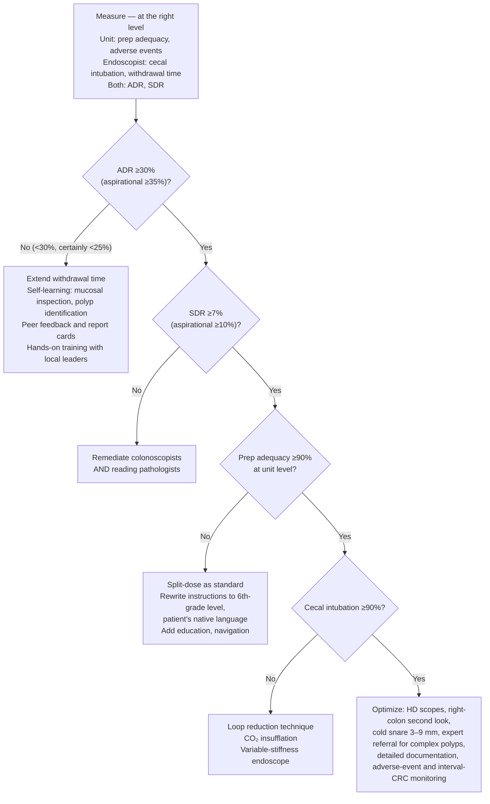

Colonoscopy's efficacy varies among endoscopists, and lower-quality colonoscopies are associated with higher interval colorectal cancer (CRC) incidence and mortality. Quality has three components: **effectiveness** (detecting [[colorectal-cancer|CRC]] and its precursors), **safety**, and **value** (avoiding unnecessary costs). [[aga-2021-colonoscopy-quality]]

## Contents
- [[#The Benchmark Set]]
  - [[#Which Level to Measure At, and Why]]
  - [[#Denominators — What Actually Goes in the Numerator and Denominator]]
- [[#Bowel Preparation Adequacy]]
- [[#Cecal Intubation]]
- [[#Withdrawal Time]]
- [[#Adenoma Detection Rate (ADR)]]
  - [[#Adenomas per Colonoscopy (APC)]]
- [[#Serrated Lesion Detection Rate (SSLDR)]]
- [[#Resection Indicators]]
- [[#IBD Colonoscopy Indicators]]
- [[#Unnumbered Best Practices]]
- [[#Documentation]]
- [[#Adverse Events]]
- [[#Interval Adherence]]
- [[#Remediation — What to Do When a Metric Misses]]
  - [[#Tiers of Colonoscopy Quality]]
- [[#Where the Benchmarks Differ Between Documents]]

---

## The Benchmark Set

*The governing set is [[asge-acg-2024-colonoscopy-quality-indicators|ASGE/ACG 2024]] — 15 numbered indicators, each with the task force's own strength grade, a measure type and a single minimum performance target. It is the direct successor to the same task force's 2006 and 2015 documents and is newer than every other quality document on the wiki, so where numbers differ it governs (see [[#Where the Benchmarks Differ Between Documents]]). ⭐ = **priority indicator**, measurement of which is "considered essential".*

| # | Indicator | Target | Strength | Type |
|---|---|---|---|---|
| 1 | Appropriate indication, documented | **≥95%** | 1C+ | Process |
| 2 | ⭐ Bowel preparation adequacy rate | **≥90%** | 1C | Process |
| 3 | ⭐ Cecal intubation rate | **≥95%** | 1C | Process |
| 4 | ⭐ **Adenoma detection rate (ADR)** | **≥35%** | 1C+ | Outcome |
| 5 | ADR after a **positive fecal test** (fecal blood or multitarget stool DNA, mt-sDNA) | **≥50%** | 1C | Outcome |
| 6 | **Adenomas per colonoscopy (APC)** | **≥0.6** | 2C | Outcome |
| 7 | ⭐ **Sessile serrated lesion detection rate (SSLDR)** | **≥6%** | 2C | Outcome |
| 8 | Average withdrawal time, normal colonoscopies | **≥8 min** | 2A | Process |
| 9 | Polyp resections documenting size, shape, location, method | **≥98%** | 3 | Process |
| 10 | 4–9 mm lesions resected by **cold snare** | **≥90%** | **1A** | Process |
| 11 | ⭐ Use of recommended screening / surveillance intervals | **≥90%** | 1C | Process |
| 12 | Serious adverse events tracked, documented, **reviewed by a quality-improvement committee** | **≥95%** | 1C | Process |
| 13 | [[ulcerative-colitis\|UC]]: formal extent **and** activity score recorded | **≥90%** | 3 | Process |
| 14 | [[crohns-disease\|Crohn's disease]]: formal endoscopic activity score reported | **≥90%** | 3 | Process |
| 15 | Appropriate next interval after dysplasia-negative UC / indeterminate colitis surveillance | **≥90%** | 3 | Process |

> [!pearl] Three benchmarks went up in 2024 — an old audit can pass and still fail
> **ADR ≥30% → ≥35%**, **withdrawal ≥6 → ≥8 min**, **cecal intubation ≥90% → ≥95%**, plus a new serrated indicator. And the **ADR denominator widened** from screening-only to screening + surveillance + diagnostic at age ≥45. A unit auditing against [[aga-2021-colonoscopy-quality|AGA 2021]] is not measuring the same thing ([[asge-acg-2024-colonoscopy-quality-indicators]]).

- **Grades are the task force's own 8-level scheme, not GRADE:** **1A** randomized trials without important limitations · **1B** randomized trials with important limitations · **1C+** overwhelming observational evidence (strong) · **1C** observational (intermediate strength) · **2A** benefit unclear but good randomized data (intermediate) · **2B** weak · **2C** very weak · **3** expert opinion only. Indicator 10 is the document's **only 1A**.
- Targets came from published benchmarking data. Where data were absent and failure would be a **"never event"**, the target is written **>98%**.
- **Cecal intubation has a measurement carve-out:** measure it for everyone, but it **may be measured intermittently or not at all** for a colonoscopist with demonstrated consistent high performance — the only indicator with that allowance.
- ⚠ **These targets are not the standard of care, credentialing requirements or training standards**, and the document states that applying them that way is a **misuse** of it.
- **Earlier resource-triage advice (AGA 2021): if only three can be measured, take cecal intubation rate, bowel preparation quality and ADR.** The 2024 set's five priority indicators are the current answer to the same question.

### Which Level to Measure At, and Why

- **Uncommon outcomes** (adverse events) and metrics reflecting **system-based practice** (bowel preparation quality) → aggregate **unit-level** measurement.
- Metrics that primarily reflect **colonoscopist skill** (ADR) → **endoscopist-level** measurement, so individual feedback is possible.

### Denominators — What Actually Goes in the Numerator and Denominator

**Current definitions** ([[asge-acg-2024-colonoscopy-quality-indicators]]). Indicators 4, 6, 7 and 8 share one denominator — **patients aged ≥45 y having colonoscopy for screening, surveillance *or* diagnostic indications** — and the same **four exclusions: positive non-colonoscopy screening tests** (fecal tests, CT colonography), **genetic cancer syndromes** (e.g. polyposis), **IBD**, and **colonoscopy for therapy of known neoplasms**.

| Metric | Numerator / definition | Notes |
|---|---|---|
| **ADR** | **≥1 conventional adenoma** detected and **verified by pathology** | **No threshold adjustment** for including **45–49-year-olds**, and **second and subsequent screening colonoscopies count without adjustment** — both settled explicitly |
| **APC** | **Number of conventional adenomas** detected per colonoscopy | Added because ADR ignores every adenoma after the first. ADR and APC correlate highly **but not always** — in one study **47.6% of endoscopists in the lowest APC quartile still had an ADR ≥25%** |
| **SSLDR** | **≥1 sessile serrated lesion removed** and documented by pathology | Depends on pathologist interpretation; see [[#Serrated Lesion Detection Rate (SSLDR)]] |
| **ADR after a positive fecal test** | ≥1 conventional adenoma resected and documented by pathology | **The same ≥50% threshold applies to mt-sDNA-positive and fecal immunochemical test (FIT)-positive patients** |
| **Cecal intubation rate** | Patients **with intact colons** with full cecal intubation **and photodocumentation of cecal landmarks** | Photodocumentation is part of the definition, not an add-on |
| **Withdrawal time** | **Average**, normal colonoscopies **without biopsy sampling or polypectomy**, from the **appendiceal orifice to completion of rectal retroflexion** | |
| **Bowel prep adequacy** | **Boston Bowel Preparation Scale (BBPS) segment score ≥2 in each of the 3 segments**, *or* the prep described as **excellent, good or adequate** | The assigned interval must also be consistent with US Multi-Society Task Force (MSTF) recommendations |

**Measurement frequency** — no interval is specified by the 2024 set; the figures below are AGA 2021's and remain the wiki's practical guidance ([[aga-2021-colonoscopy-quality]]):

| Metric | Measure over |
|---|---|
| **ADR** | **≥250 screening colonoscopies** — semi-annually if high volume, annually if lower |
| **SDR / SSLDR** | **≥500 screening colonoscopies, or annually** (lower lesion prevalence needs a bigger denominator) |
| **Bowel prep adequacy** | At a minimum **annually** |

---

## Bowel Preparation Adequacy

- **Adequate = BBPS total ≥6 *and* every segment score ≥2.** Both halves are required — a total of 6 built on a segment scoring 0 or 1 is not adequate.
- BBPS scores each segment (right, transverse, left) **0 (unprepared colon) to 3 (entire segment well seen)**. It is **preferred over the modified Aronchick score** (single global excellent/good/fair/poor/inadequate rating) because it is applied **after cleaning** and has been rigorously validated.
- Suboptimal cleansing causes failed detection of **flat or otherwise subtle polyps**; the impact is **most pronounced in the proximal colon**, reducing detection of both adenomas and sessile serrated lesions.
- Preparation regimens, salvage maneuvers, indication-specific adequacy wording, and the full scale anchors live on [[bowel-preparation]].

**How to measure it, and what to do below benchmark** ([[acg-2014-bowel-cleansing|US Multi-Society Task Force (USMSTF) 2014]], which established the adequate-preparation rate as a routinely measured indicator):

- **Assess adequacy only after all appropriate efforts to clear residual debris** — washing and suctioning — are complete (strong, low). Grading before cleansing measures the purgative, not the examination.
- **Measure the rate of adequate colon cleansing routinely** (strong, moderate).
- **Below the benchmark → undertake an improvement initiative.** The expectation is explicit, not implied.
- **Submit procedure reports to a data registry** that benchmarks performance against minimally accepted thresholds and against peer means.
- Framing that motivates the indicator: up to **20%–25% of all colonoscopies** are reported to have an inadequate preparation, which lowers adenoma detection, lengthens procedural time, lowers cecal intubation rates, raises electrocautery risk, and shortens the interval to the next examination.

⚠ **The benchmark and the level it is measured at both changed.** USMSTF 2014 set **≥85% of all examinations, on a per-physician basis**; [[usmstf-2025-bowel-prep|USMSTF 2025]] sets **≥90% at the individual endoscopist *and* the endoscopy-unit level**, which is what the table above follows. Readers auditing against an older benchmark will pass at a rate the current documents call inadequate.

**Two prep practices carried as advice rather than as a measured rate:**

- **Split-dose preparation is the standard strategy** — one-half to three-quarters of the purgative the evening before, the remainder **4–6 h before the start** of colonoscopy. **Same-day preparation** (purgative the morning of the procedure, finished **2–4 h before the scheduled appointment**) is **equally efficacious for afternoon examinations** and may be preferred for less disruption of activities and sleep.
- **Written instructions at a sixth-grade (or lower) reading level, in the patient's native language.** More than one-third of the US population has limited health literacy. Units with suboptimal prep quality should add patient education and support: instructional videos and **patient navigation** (trained staff helping patients overcome barriers) improve prep adequacy, particularly in low-literacy populations; smartphone apps and text messaging help but **may not be as universally effective as traditional navigation**.

---

## Cecal Intubation

- **≥95%** of patients **with intact colons**, with **photodocumentation of cecal landmarks** (appendiceal orifice and ileocecal valve) in the report — the photodocumentation is part of the definition ([[asge-acg-2024-colonoscopy-quality-indicators]]).
- Failure to reach the cecum should be rare in skilled hands **except with inadequate preparation or an obstructing lesion**.
- Low rates track with **diminished neoplasia detection, higher interval CRC incidence**, and the cost of repeat or alternative testing.
- **Uniquely, this indicator may be measured intermittently or not at all** for a colonoscopist with demonstrated consistent high performance — justified by limited evidence of variable performance, evidence that high performance is sustained, and the ceiling effect at 100%.
- Levers for low performers (limited evidence): **loop reduction technique, CO₂ insufflation, variable-stiffness endoscopes**.

---

## Withdrawal Time

- **Average ≥8 minutes** in normal colonoscopies without biopsy sampling or polypectomy, measured **appendiceal orifice → completion of rectal retroflexion** ([[asge-acg-2024-colonoscopy-quality-indicators]]).
- **The evidence is for 8–9 minutes, not 6.** The 6-minute figure dates from 2006 and a single private-practice study; evidence since 2015 shows optimal detection typically needs an average of **at least 8–9 min**, and that **PCCRC prevention is optimized** in that range. High-quality inspection — cleaning retained pools, systematically exposing mucosa behind every fold, flexure and valve, adequate distention, intraprocedural cleansing — takes that long.

> [!pitfall] A low ADR plus a short withdrawal time is a technique diagnosis
> The ≥8-min target is a benchmark for an **average**, and the document is explicit that **not every withdrawal must last 8 minutes**. But **ADR and/or SSLDR below threshold *with* an average withdrawal <8 min "could be construed as evidence of an inadequate withdrawal technique"** → evaluate and correct the inspection technique, don't just run the clock longer ([[asge-acg-2024-colonoscopy-quality-indicators]]).

- Mucosal-exposure devices (Endocuff Vision) may allow faster withdrawal without losing detection; further study is needed.

---

## Adenoma Detection Rate (ADR)

- **Target ≥35%** ([[asge-acg-2024-colonoscopy-quality-indicators]], grade 1C+). **No sex-specific thresholds** — the 2024 set does not split by sex at all, where AGA 2021 allowed it for markedly sex-skewed practices and USMSTF 2020 split outright.
- **ADR is "the most clinically relevant and best validated quality indicator in colonoscopy"** — proposed in 2002, validated as a predictor of PCCRC.
- **ADR varies up to 5-fold among colonoscopists**; unmeasured, a colonoscopist cannot know where they sit. The task force's position: given the consequences, **failure to measure performance is unacceptable**.
- Measure and give feedback at **both endoscopist and unit level**, at minimum annually or per 250 accrued screening colonoscopies ([[aga-2021-colonoscopy-quality]]).
- **[[acg-2021-crc-screening|ACG 2021]] Rec 13:** every screening colonoscopist should **measure** individual cecal intubation rate, ADR, and withdrawal time (Strong; moderate for ADR, low for withdrawal time and cecal intubation).
- **Counting rules:** only **conventional adenomas** count — sessile serrated lesions are excluded and counted separately as SSLDR. Colonoscopies done for a **positive fecal test are excluded from routine ADR** and measured as their own indicator at **≥50%** (the same threshold for FIT-positive and mt-sDNA-positive patients) ([[asge-acg-2024-colonoscopy-quality-indicators]]).
- **Why ADR matters:** each **1% rise in ADR → 3% lower CRC incidence and 5% lower fatal CRC**; ADR <20% carried a >10-fold higher post-colonoscopy CRC risk ([[acg-2021-crc-screening]]).

### Adenomas per Colonoscopy (APC)

- **Target ≥0.6** adenomas per colonoscopy, same denominator and exclusions as ADR ([[asge-acg-2024-colonoscopy-quality-indicators]], grade 2C, outcome measure). New in 2024.
- **Why a second detection measure:** ADR **does not reward detecting any adenoma after the first**, and many patients have several. Higher APC, like higher ADR, is associated with **lower PCCRC risk**.
- **ADR and APC correlate highly — but not reliably enough to drop one.** In one study **47.6% of endoscopists in the lowest APC quartile had an ADR ≥25%**: an acceptable ADR can sit on top of a poor APC, which means "find one and stop looking".

**Improvement levers (from the same update):**

| Lever | What the evidence shows |
|---|---|
| Report cards / audit and feedback | Modestly effective, particularly for **low-performing** colonoscopists |
| Hands-on training with local leaders | Improved ADR **significantly more than quality feedback alone** |
| Quality-improvement "champions" in the unit | A primary component of sustainable educational intervention |
| Educational content that works | Adequate withdrawal time, looking **behind folds**, cleaning the colon, recognizing subtle lesions |
| Electronic chromoendoscopy (eg, narrow band imaging) on withdrawal | Higher ADR among **experienced** colonoscopists; particularly helpful for **flat** lesions |
| Distal-tip accessory devices | Improve mucosal exposure; **modest** ADR gains |
| Water exchange (instil and suction water on insertion, no air/CO₂) | Improves ADR, likely via better colon cleansing |
| Computer-aided detection (CADe) | Named only as anticipated future work here; the evidence and the AGA position are on [[artificial-intelligence-endoscopy]] |

---

## Serrated Lesion Detection Rate (SSLDR)

- **Target ≥6%** — patients with **≥1 sessile serrated lesion removed and documented by pathology**, same denominator and exclusions as ADR ([[asge-acg-2024-colonoscopy-quality-indicators]], grade 2C). **A priority indicator**, new to that list in 2024.
- **Pathology-dependent in a way ADR is not** — substantial interobserver variation among pathologists distinguishing sessile serrated lesions from hyperplastic polyps, which is not an issue for conventional adenomas. So **remediation must target both the colonoscopist and the reading pathologists**.
- Two further design problems the task force names: an ideal serrated indicator should **not reward resecting diminutive distal hyperplastic polyps** (generally not precancerous), and any indicator relying on endoscopist-reported location **could be gamed**.
- **Alternatives considered**, each tied to the lowest PCCRC risk at that level: **clinically significant serrated detection rate, benchmark 9%** (needs pathology, size and location) and **proximal serrated polyp detection rate, benchmark 17%** (location only — least pathology-dependent).
- Practical limitation: the **larger denominator** needed for a confident estimate — **≥500 screening colonoscopies, or an annual window** ([[aga-2021-colonoscopy-quality]]). There is a clear association between **withdrawal time and serrated detection**.
- ⚠ **AGA 2021 says that if only one of ADR/SDR can be collected, prioritize ADR. The 2024 set makes both priority indicators** and expects both.

---

## Resection Indicators

Two indicators, both new in 2024 ([[asge-acg-2024-colonoscopy-quality-indicators]]).

- **Cold snare for 4–9 mm lesions, ≥90%** (grade **1A** — the only 1A-graded indicator in the document). Technique and the other size bands: [[polypectomy]].
- **Documentation of size, shape, location and method of resection, ≥98%** (grade 3) — see [[#Documentation]].

---

## IBD Colonoscopy Indicators

Three indicators, all new in 2024, all grade 3 (expert opinion) with a **≥90%** target ([[asge-acg-2024-colonoscopy-quality-indicators]]).

| # | Requirement |
|---|---|
| **13** | [[ulcerative-colitis\|UC]] colonoscopy records a **formal assessment of extent *and* activity** — Mayo Endoscopic Score (MES), Modified MES, Ulcerative Colitis Endoscopic Index of Severity (UCEIS), or Ulcerative Colitis Colonoscopic Index of Severity |
| **14** | [[crohns-disease\|Crohn's disease]] colonoscopy reports a **formal endoscopic activity score** — Crohn's Disease Endoscopic Index of Severity (CDEIS), Simple Endoscopic Score for Crohn's Disease (SES-CD), or Rutgeerts score |
| **15** | A dysplasia-negative UC / indeterminate colitis surveillance exam gets an **appropriate next interval** — the 1 y / 2–3 y / 3–5 y grid is on [[ulcerative-colitis#Colorectal Cancer Surveillance\|ulcerative colitis]] |

- **Why a score rather than a description:** symptoms often do not correlate with endoscopic findings, and extent plus severity drive **severity classification, prognosis, choice of medical therapy, and colorectal neoplasia risk**.
- Extent may be given by involved segments or by the **Montreal classification** — **E1** rectum only, **E2** left-sided, **E3** proximal to the splenic flexure.
- Score anchors, inter-rater performance and the STRIDE-II endoscopic-healing targets (UC: MES 0 and UCEIS ≤1 · CD: SES-CD <3 or ulceration subscore 0) live on [[ibd-endoscopic-scoring]].
- **Surveillance technique:** high-definition colonoscopy **plus one modality of chromoendoscopy** with targeted biopsy sampling of suspicious areas; whether dye-spray or electronic chromoendoscopy adds anything over high definition alone is **uncertain**.

---

## Unnumbered Best Practices

Advice statements without a measurable rate attached:

- **High-definition (HD) colonoscopes for screening and surveillance.** Meta-analysis of randomized controlled trials (RCTs) confirms a **definite but modest** impact on adenoma, serrated polyp, and advanced adenoma detection. Many legacy lower-definition instruments remain in circulation; upgrading is an effective unit-level strategy.
- **Second look of the right colon, retroflexed or forward view.** The right colon is the **most frequent location for missed CRCs and polyps** — largely flat and serrated lesions that are hard to see even with adequate prep. A second look **increases ADR by 5%–20%**. *Technique:* insert to the base of the cecum, withdraw to the hepatic flexure inspecting and removing polyps, then **reintubate the cecum** and examine the proximal colon a second time. **Retroflexion and forward view are equally effective**; the second look matters most if polyps were found on first pass or the completeness of the first inspection is in doubt.
- **Cold snare polypectomy for nonpedunculated polyps 3–9 mm**, aiming for a **small rim of normal tissue** around the polyp — equally efficacious to hot snare, **substantially reduces delayed post-polypectomy bleeding**, avoids thermal injury. (The 2024 *measured* indicator covers **4–9 mm**; the advice band starts at 3 mm.)
- **Forceps limits.** Avoid forceps generally for polyps **>2 mm**; **standard cold forceps** carry a high rate of residual neoplasia and **hot biopsy forceps should not be used** (deep thermal injury). Narrow exceptions: **jumbo forceps for diminutive polyps ≤2 mm**, or **polyps ≤5 mm in locations that preclude a snare**. **Never the primary modality for polyps >5 mm.** Residual neoplasia is found at roughly **14% of post-polypectomy sites**.
- **Refer benign complex polyps for endoscopic resection, not surgery.** Endoscopic resection of nonmalignant colon polyps is **more cost-effective with a lower adverse event rate** than surgery, yet many are still sent to surgery because a "large" polyp is misjudged as malignant. Colonoscopists should be educated on the endoscopic features of **covert malignancy — a depressed component, nongranular lesions**. With no overt features of deep invasion, offer [[endoscopic-mucosal-resection|endoscopic resection]] by an expert in polypectomy. **For a lesion you are referring, avoid partial removal, tattoo injected *underneath* the polyp, and multiple biopsies** — each induces fibrosis and makes later endoscopic resection technically difficult.

---

## Documentation

A detailed report covering **indication, extent of examination, bowel preparation quality, findings and interventions, and the follow-up plan with its rationale**. The **CO-RADS** standardized colonoscopy reporting and data system (National Colorectal Cancer Roundtable, 2007) lists the elements:

| Element | Required content |
|---|---|
| Patient | Demographics and history; assessment of risk and comorbidity |
| Indication | Reason for the procedure |
| Technical description | Extent of examination, **bowel preparation adequacy**, and **withdrawal time where appropriate** |
| Findings and assessment | Interventions and unplanned events |
| Follow-up plan | Includes **resumption of medications — anticoagulants and antiplatelet agents** ([[anticoagulation-gi-bleeding]]) |
| Pathology and interval | Communicated to the **patient and the primary care provider** and documented in the chart |

**If the assigned interval deviates from standard guidelines, the report must state the rationale** — eg, inadequate preparation or incomplete polyp resection.

**Polyp reporting rules** (indicator 9, target ≥98%; [[asge-acg-2024-colonoscopy-quality-indicators]]):

- Report for **every** polyp: **size · shape · location by segment** (or distance in cm from the anus for left-sided polyps) **· method of removal**.
- **Shape:** the **Paris classification** is recommended (its types are on the polypectomy page); "sessile", "flat" and "pedunculated" are also acceptable.
- **Sizing:** open biopsy forceps held over and against the polyp; for smaller polyps, the **snare sheath tip (2.4 mm)** against the polyp base.
- **Grouping:** polyps in one segment may be reported as a range ("4 flat and sessile polyps 2–4 mm removed by cold snare"). **Polyps ≥10 mm are described individually**; several ≥10 mm from the same segment removed the same way with similar predicted histology may be grouped.
- ⚠ **Any lesion of any size suggesting advanced histology or endoscopic features of submucosal-or-deeper invasion goes in its own pathology bottle** — never combined with polyps from another segment.

---

## Adverse Events

- Most serious events: **colonic perforation; adjacent organ injury such as splenic rupture; serious post-procedure bleeding**.
- **After routine colonoscopy: delayed bleeding ~0.24%, perforation ~0.06%.**
- **After endoscopic resection of large polyps: bleeding 4.3%–7.6%, perforation 0.2%–0.6%** — rates that predominantly reflect polypectomy by high-volume experts.
- **Most adverse events occur within 14 days**; risk rises with **age, comorbidity, and performance of polypectomy**.
- Every patient is counselled by the colonoscopist on possible events and their symptoms, and given **contact information** with instructions to call or seek emergency care for **severe abdominal pain, fever, significant bleeding, or other worrisome symptoms**.
- Optional unit-level systematic monitoring of **delayed** events: scheduled phone calls; administrative data on post-procedure bleeding and perforation, hospital readmission or emergency department (ED) visits, patient deaths, and interval CRC. **Perforations, deaths, and interval CRC cases should be reviewed for quality improvement.**
- Complication management and the ≤1 per 100 colonoscopies post-polypectomy bleeding benchmark are on [[colonoscopy#Complications|colonoscopy]].

**The 2024 indicator makes the review mandatory, not optional** ([[asge-acg-2024-colonoscopy-quality-indicators]]):

- **≥95% of serious adverse events tracked, documented *and* reviewed by a quality-improvement committee** to identify system and clinical areas for improvement.
- The document's serious-adverse-event list is wider than the AGA set: **perforation, postpolypectomy bleeding, sedation-related cardiovascular events, unplanned hospitalization, mortality**.
- Serious adverse events run **under 1%** across large integrated health systems.

---

## Interval Adherence

Assigning the guideline-concordant interval is itself a quality indicator — non-adherence produces both interval CRC (surveillance too late) and unnecessary harm and cost (surveillance too early). **The full interval grids live on [[colonoscopy-surveillance]]**; the two rules this update states outright:

- **Advanced adenoma → repeat colonoscopy in 3 years** (advanced precancerous lesions carry the highest risk of metachronous advanced neoplasia; follow-up ≤3 y after the index exam).
- **Average-risk patient with a high-quality colonoscopy negative for precancerous polyps, or with only small distal hyperplastic polyps → do not rescreen before 10 years.**
- **1–2 small adenomas (especially 1–2 diminutive adenomas):** increasing evidence that these patients are **not at significantly elevated CRC risk versus the general population**, and endoscopists **should consider assigning a 10-year interval** for this group — longer than the 7–10 y the surveillance grid assigns.
- **The 2024 indicator puts a number on adherence: ≥90%**, covering post-polypectomy and post-cancer-resection intervals **and** the 10-year interval between screening colonoscopies in average-risk patients with a negative, adequately-prepped examination. **A shorter screening interval is appropriate only for inadequate bowel preparation.** Clinical decision support tools improve compliance. ([[asge-acg-2024-colonoscopy-quality-indicators]])

---

## Remediation — What to Do When a Metric Misses

*Ladder rebuilt from the update's Best Practice Advice and its tiers-of-quality figure.*

### Tiers of Colonoscopy Quality

| Tier | Poor | Variable | Adequate | Optimal |
|---|---|---|---|---|
| **Bowel preparation** | High risk of inadequate prep | Variable | Adequate for all patient groups | Adequate for all patient groups |
| **Withdrawal** | Insufficient withdrawal quality and time | Variable withdrawal quality and time, occasionally insufficient | Average withdrawal time and quality meets minimal standards | Average withdrawal time and quality **exceeds** minimal standards |
| **Polyp detection** | Suboptimal | Suboptimal | Meets benchmark levels | **Exceeds** benchmarks, may meet aspirational targets |
| **Polypectomy** | — | Improved documentation, but may lack important details | Low rate of incomplete or inadequate polypectomy | Performed with high degree of skill and accuracy; appropriate referral for endoscopic mucosal resection (EMR) of large polyps and avoidance of surgery for benign polyps |
| **Documentation** | Poor | Improved but may lack important details | Meets minimal standards | Detailed, including photodocumentation and polyp details |
| **Surveillance intervals** | Inappropriate recommendations | May vary from guidelines | Low rate of inappropriate recommendations | Appropriate for all patients |

**The corresponding interventions, by tier:**

| Tier | Recommended measures and interventions |
|---|---|
| **Tier 1 — all providers** | Adequate bowel preparation ≥90%; use of split preps; measurement of withdrawal time; measurement of ADR; meeting ADR benchmarks; interventions to improve polyp detection for low detectors; minimum procedure documentation; adherence to guideline-recommended surveillance intervals |
| **Tier 2 — quality improvement** | Interventions to improve bowel preparation for all patients; interventions to improve polyp detection for **all** providers; interventions to improve polypectomy practices |
| **Tier 3 — optimizing quality** | All providers continuously monitor and optimize polyp detection; optimized care for patients with large polyps; detailed procedure documentation; monitoring of adverse events and interval cancer rates |

---

## Where the Benchmarks Differ Between Documents

**[[asge-acg-2024-colonoscopy-quality-indicators|ASGE/ACG 2024]] is the governing set** — the current task-force document and the newest of the four. The older numbers are kept here because readers will have audited against them, not because they are live targets.

| Metric | **ASGE/ACG 2024 (governs)** | [[aga-2021-colonoscopy-quality\|AGA 2021 Clinical Practice Update (CPU)]] | [[acg-2021-crc-screening\|American College of Gastroenterology (ACG) 2021]] | [[usmstf-2020-followup-colonoscopy\|USMSTF 2020]] |
|---|---|---|---|---|
| **ADR** | **≥35%**, no sex split | **≥30%** (aspirational ≥35%); sex-based ADR only for a markedly sex-skewed practice | **<25%** → remedial training (Rec 14, Conditional / Very low); discussion treats 30% men / 20% women as minimums, aspirational 45%–50% | **≥30% men / ≥20% women** |
| **ADR denominator** | Screening **+ surveillance + diagnostic**, age **≥45 y**; 4 exclusions | **Screening only, ages 50–75** | Screening | Screening |
| **Cecal intubation** | **≥95%**, patients with intact colons, photodocumented | **≥90%** of screening + surveillance; **≥95%** excluding inadequately prepped exams | **≥95% in screening subjects** (Rec 16, Strong / Low) | Complete to cecum with photodocumented landmark |
| **Withdrawal time** | **≥8 min** average | Mean **≥6 min**, aspirational **≥9 min** | **≥6 min** of mucosal inspection (Rec 15, Strong / Low) | Not specified |
| **Serrated detection** | **SSLDR ≥6%**, a priority indicator | **SDR ≥7%** (aspirational ≥10%); prioritize ADR if only one | — | — |
| **1–2 small adenomas** | — | **Consider 10 y** | — | **7–10 y** (see [[colonoscopy-surveillance]]) |

> [!pitfall] The denominator mismatch is the dangerous one
> The threshold changes are visible; the denominator change is silent. Two endoscopists each reporting "my ADR is 33%" — one on the 2024 definition (screening + surveillance + diagnostic, age ≥45) and one on AGA 2021's (screening only, 50–75) — are not measuring the same quantity. **Say which definition produced the number.**

- **SSLDR ≥6% is *lower* than AGA 2021's SDR ≥7%** — the one benchmark that moved down, and the two documents also disagree on whether a serrated indicator is optional.
- Cecal intubation now has a **third** denominator (intact colons, with photodocumentation) on top of the two the wiki already flagged. The 2024 definition is the current one.

Other USMSTF ADR figures, each tied to its own population:

- **Post-CRC-resection surveillance:** a "high-quality" exam requires conventional adenoma detection **>25%** overall ([[usmstf-2015-crc-surveillance|USMSTF 2015]])
- **Screening start/stop modeling:** "high-quality" colonoscopy assumes ADR **≥25%** overall ([[usmstf-2021-crc-screening-age|USMSTF 2021]])
- **Colonoscopy after a positive fecal immunochemical test (FIT)** (cut-off ≤20 µg/g): ADR **>45% men, >35% women** ([[usmstf-2016-fit-screening|USMSTF 2016]])

---

## See Also

[[endoscopy-quality-indicators]], [[colonoscopy]], [[colonoscopy-surveillance]], [[polypectomy]], [[colorectal-cancer-screening]], [[colorectal-cancer]], [[artificial-intelligence-endoscopy]], [[endoscopic-mucosal-resection]], [[anticoagulation-gi-bleeding]], [[upper-endoscopy]]

---

## Sources

1. [[asge-acg-2024-colonoscopy-quality-indicators|ASGE/ACG 2024: Quality Indicators for Colonoscopy]]
2. [[aga-2021-colonoscopy-quality|AGA 2021 Clinical Practice Update on Strategies to Improve Quality of Screening and Surveillance Colonoscopy: Expert Review]]
3. [[acg-2021-crc-screening|ACG Clinical Guidelines: Colorectal Cancer Screening 2021]]
4. [[usmstf-2020-followup-colonoscopy|USMSTF 2020: Recommendations for Follow-Up After Colonoscopy and Polypectomy]]
5. [[acg-2014-bowel-cleansing|Optimizing Adequacy of Bowel Cleansing for Colonoscopy: Recommendations from the US Multi-Society Task Force on Colorectal Cancer (2014)]]
6. [[usmstf-2025-bowel-prep|USMSTF 2025: Optimizing Bowel Preparation Quality for Colonoscopy]]
