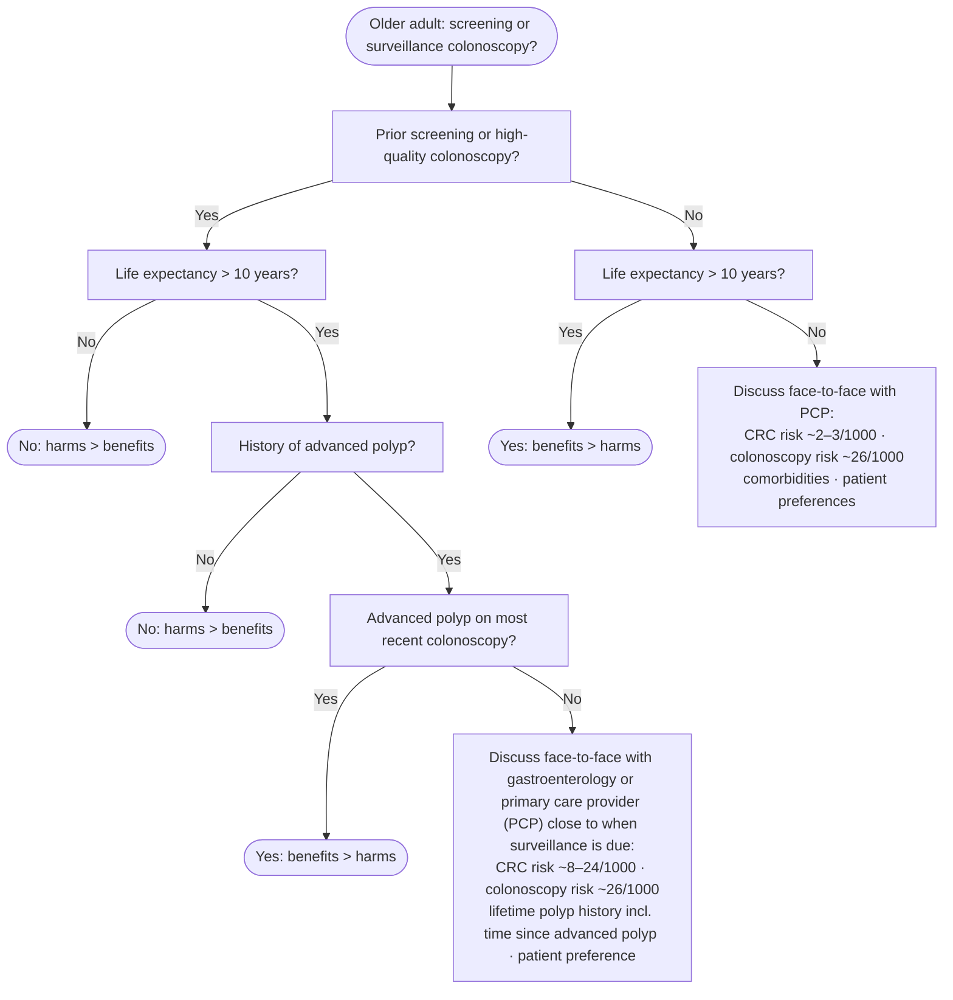

## Contents
- [[#Overview]]
- [[#Who These Intervals Do NOT Apply To]]
- [[#Quality Prerequisite]]
- [[#Adenoma Surveillance]]
- [[#Serrated Polyp Surveillance]]
- [[#Piecemeal Resection ≥20 mm]]
- [[#Serial (Second) Surveillance]]
- [[#Stopping Surveillance in Older Adults]]
- [[#Definitions]]
- [[#See Also]]
- [[#Sources]]

## Overview

Post-[[colonoscopy]] surveillance intervals after [[polypectomy]] are set by the number, size, and histology of polyps found, per US Multi-Society Task Force (USMSTF) 2020 ([[usmstf-2020-followup-colonoscopy]]). Key 2020 change from 2012: 1-2 small tubular adenomas extended to **7-10 years**. In a cohort of 1,251,318 average-risk adults, a normal screening colonoscopy carried a **46% relative reduction in incident [[colorectal-cancer|colorectal cancer (CRC)]]** (hazard ratio [HR] 0.54; 95% confidence interval [CI] 0.31–0.94) and an **88% relative reduction in fatal CRC** (HR 0.12; 95% CI 0.02–0.82) through the 10-year follow-up window; reduced risk persisted to 12 years. For the screening decision that precedes the first polypectomy (start/stop ages, modality choice, family-history stratification), see [[colorectal-cancer-screening]].

## Who These Intervals Do NOT Apply To

The tables below are for **average-risk** adults only — defined as absence of all of the following. In these groups, favor the shortest interval indicated by either the underlying condition or the polyp findings:

- Hereditary CRC syndrome (e.g. [[lynch-syndrome]], [[familial-adenomatous-polyposis|familial adenomatous polyposis (FAP)]]) or any hereditary cancer syndrome
- [[inflammatory-bowel-disease|Inflammatory bowel disease (IBD)]] — IBD dysplasia surveillance is a separate strategy (who/when and the **1–5 y risk-stratified interval table** on [[ulcerative-colitis]] and [[crohns-disease]]; chromoendoscopy technique on [[colonoscopy]]). Post-polypectomy intervals in this page's grid do **not** apply. Note the carve-out: **isolated ileal Crohn's disease without colonic inflammation gets CRC screening with colonoscopy as for the average-risk population**, not IBD surveillance ([[aga-2021-ibd-colorectal-dysplasia]] Figure 2 note).
- [[serrated-polyposis-syndrome|Serrated polyposis syndrome]]
- [[polypectomy|Malignant polyp]]
- Personal history of CRC
- Family history of CRC

## Quality Prerequisite

All intervals **assume a high-quality exam**, defined by all four:

| Component | USMSTF definition |
|---|---|
| Complete examination | To cecum, with photo documentation of a cecal landmark (appendiceal orifice, terminal ileum, or ileocecal valve) |
| Adequate [[bowel-preparation\|bowel preparation]] | Adequate to visualize polyps >5 mm |
| Adequate adenoma detection rate (ADR) | ≥30% in men and ≥20% in women |
| Complete polyp excision | Attention to complete resection |

*USMSTF 2020 Table 3.* Other societies' ADR benchmarks and how they differ: [[colonoscopy-quality-indicators]].

## Adenoma Surveillance

*USMSTF 2020 Table 4.*

| Baseline finding | Next surveillance | Strength | Quality |
|---|---|---|---|
| Normal (no adenoma/sessile serrated polyp [SSP]/traditional serrated adenoma [TSA]/hyperplastic polyp [HP] ≥10 mm/CRC) | 10 y (may use any average-risk screening modality) | Strong | High |
| 1-2 tubular adenomas <10 mm | 7-10 y | Strong | Moderate |
| 3-4 tubular adenomas <10 mm | 3-5 y (**Task Force favors 5 y**) | Weak | Very low |
| 5-10 tubular adenomas <10 mm | 3 y | Strong | Moderate |
| Any adenoma ≥10 mm | 3 y | Strong | High |
| Tubulovillous / villous histology | 3 y (assumes high confidence of complete resection) | Strong | Moderate |
| High-grade dysplasia | 3 y (assumes high confidence of complete resection) | Strong | Moderate |
| >10 adenomas on one exam | 1 y + consider genetic testing | Weak | Very low |
| **Piecemeal resection of adenoma ≥20 mm** | **6 mo** (full sequence: [[#Piecemeal Resection ≥20 mm]]) | Strong | Moderate |

- Villous histology is **not** quantified by proportion — USMSTF deliberately sets no percentage threshold, because it is rarely and variably reported.
- **>10 adenomas on one exam, or >10 cumulative lifetime adenomas** → consider genetic testing, weighing absolute/cumulative adenoma number, patient age, and other factors such as family history of CRC ([[colorectal-polyposis]]).
- Patients told before 2020 to return sooner than 7-10 y after 1-2 tubular adenomas may keep the original interval, or be re-evaluated and updated to 7-10 y weighing baseline exam quality, polyp history, and preference.

## Serrated Polyp Surveillance

*USMSTF 2020 Table 5. Every serrated-polyp interval is a **Weak** recommendation on **Very low** quality evidence except the two marked.*

| Baseline finding | Next surveillance | Strength | Quality |
|---|---|---|---|
| ≤20 HPs in rectum or sigmoid, <10 mm | 10 y (any average-risk modality) | **Strong** | **Moderate** |
| ≤20 HPs proximal to sigmoid, <10 mm | 10 y | Weak | Very low |
| 1-2 SSPs <10 mm | 5-10 y | Weak | Very low |
| 3-4 SSPs <10 mm | 3-5 y | Weak | Very low |
| 5-10 SSPs <10 mm | 3 y | Weak | Very low |
| SSP ≥10 mm | 3 y | Weak | Very low |
| SSP with dysplasia | 3 y (assumes high confidence of complete resection) | Weak | Very low |
| Hyperplastic polyp ≥10 mm | 3-5 y — **pick the end of the range**, see below | Weak | Very low |
| TSA | 3 y | Weak | Very low |
| **Piecemeal resection of SSP ≥20 mm** | **6 mo** (full sequence: [[#Piecemeal Resection ≥20 mm]]) | **Strong** | **Moderate** |

**HP ≥10 mm — which end of 3-5 y:**

- **3 y** if there is concern about local consistency in distinguishing SSP from HP, about bowel prep, or about complete excision.
- **5 y** if all three are reassuring (reliable SSP-vs-HP distinction locally, adequate prep, confident complete excision).

**Counts that cross into [[serrated-polyposis-syndrome|serrated polyposis syndrome]]** — and so out of these tables — are >20 cumulative HPs throughout the colon with ≥5 proximal to the rectum, or 5 serrated polyps proximal to the rectum >5 mm with ≥2 being ≥10 mm.

## Piecemeal Resection ≥20 mm

*USMSTF 2020 Tables 4 and 5 and text. Applies to adenoma **or** SSP; Strong recommendation, Moderate quality of evidence.*

> [!pearl] Three exams, not one catch-up scope
> After piecemeal resection of a ≥20 mm adenoma or SSP: first surveillance at ~6 months, second 1 year after the first, third 3 years after the second ([[usmstf-2020-followup-colonoscopy]]).

- At baseline, emphasize complete excision; for polyps ≥20 mm, consider strategies for verifying complete excision ([[usmstf-2020-followup-colonoscopy]]). Resection technique: [[endoscopic-mucosal-resection|endoscopic mucosal resection (EMR)]].
- Threshold written two ways: **>20 mm** in the recommendation text, **≥20 mm** in Tables 4 and 5 — USMSTF does not reconcile them.
- Why: recurrent neoplasia **20% after piecemeal vs 3% after en bloc** resection (meta-analysis, 33 studies); 10–20 mm polyps removed piecemeal by EMR carried an **18%** risk, similar to the 19% at 20–30 mm and >30 mm.

## Serial (Second) Surveillance

*USMSTF 2020 Table 7 — complete grid. Weak recommendation, low quality of evidence. "Normal" here = no adenoma, SSP, or CRC.*

| Baseline finding | First surveillance at | Finding at first surveillance | Next scope |
|---|---|---|---|
| 1-2 tubular <10 mm | 7-10 y | Normal | 10 y |
| | | 1-2 tubular <10 mm | 7-10 y |
| | | 3-4 tubular <10 mm | 3-5 y |
| | | Advanced* | 3 y |
| 3-4 tubular <10 mm | 3-5 y | Normal | 10 y |
| | | 1-2 tubular <10 mm | 7-10 y |
| | | 3-4 tubular <10 mm | 3-5 y |
| | | Advanced* | 3 y |
| Advanced* | 3 y | Normal | 5 y |
| | | 1-2 tubular <10 mm | 5 y |
| | | 3-4 tubular <10 mm | 3-5 y |
| | | Advanced* | 3 y |

\* **Advanced** in this table = adenoma ≥10 mm, **or** tubulovillous/villous histology, **or** high-grade dysplasia, **or** 5-10 adenomas <10 mm. (Broader than the *advanced adenoma* definition below, which excludes the multiplicity criterion.)

> [!pearl] Advanced baseline never returns to 10 years
> After an advanced baseline finding, even a normal first surveillance leads to a 5-y next interval — not 10 y ([[usmstf-2020-followup-colonoscopy]] Table 7).

## Stopping Surveillance in Older Adults

**Individualize past age 75 on benefits, polyp history, comorbidities and risks — not on age alone** ([[aga-2026-surveillance-older-adults]] Best Practice Advice [BPA] 7; BPA 6 is the same rule for screening). No formal evidence grades. A frail 70-year-old may have a shorter life expectancy than a robust 85-year-old; **a 10-year life expectancy is needed to derive a survival benefit from cancer screening**. Life-expectancy tools: Lee–Schonberg 4- to 14-year mortality index (ePrognosis).

**Polyp history in patients >75:**

- **Low-risk adenomas** (1–2 small [<1 cm] adenomas without villous features or high-grade dysplasia): 5-y CRC risk **~0.5%** — similar to no adenomas, **lower than the general population** → may be managed much as a patient without polyps
- **Advanced adenoma on the most recent colonoscopy:** 5-y CRC risk **0.8%**

**Cancer risk vs competing mortality in older adults (AGA 2026 Table 2):**

| Colorectal finding | 5-y CRC risk | 5-y CRC death | 5-y competing all-cause mortality | 10-y CRC risk | 10-y CRC death | 10-y competing all-cause mortality | Death from other causes vs CRC |
|---|---|---|---|---|---|---|---|
| No adenomas | 0.3% | 0.1% | 21.0% | 0.7% | 0.4% | 46.9% | 117–210× higher |
| Nonadvanced adenomas | 0.3%–0.6% | 0.2% | 22.4% | 1.2% | 0.5% | 48.4% | 97–112× higher |
| Advanced adenomas | 0.4%–0.5% | — | — | 1.3% | — | — | — |

*— = not given in the table.*

- **Harms of screening colonoscopy (~26 per 1000) likely outweigh the benefit of finding CRC (2–3 per 1000).** Colonoscopy adverse events are almost **22-fold higher above age 65** than in younger adults and rise **for every 5 years past 75**; **non-gastrointestinal (GI) harms** (arrhythmia, aspiration pneumonia, myocardial infarction, ischemic stroke) **exceed GI harms** (bleeding, perforation)
- **Document the decision-making in the electronic health record for anyone >75** (BPA 8), and elicit **whether the patient could or would pursue treatment if CRC were found** — in one review of patients >75, **10 of 15 found to have CRC did not pursue treatment**
- Stopping surveillance is **harder in practice than stopping screening** — standing recall systems, primary-care deference to the prior colonoscopy recommendation, and reports written without knowledge of future health. The update suggests **transitioning away from open-access colonoscopy above age 75**
- **Stool tests ([[fecal-immunochemical-test|fecal immunochemical test (FIT)]]) are not currently recommended for polyp surveillance in the US**; effectiveness in older adults with an adenoma history is under study

*Screening or surveillance colonoscopy in older adults*
*Source: redrawn from AGA 2026 Figure 1B (life expectancy aided by a calculator such as the combined Lee–Schonberg 4- to 14-year mortality index on ePrognosis)*
*[[aga-2026-surveillance-older-adults|AGA 2026 Surveillance in Older Adults]]*
*CRC = colorectal cancer · PCP = primary care provider*

Stopping **screening** (as opposed to polyp surveillance): [[colorectal-cancer-screening]].

## Definitions

*USMSTF 2020 Table 3.*

- **Average risk for CRC:** absence of IBD, family history of CRC, a hereditary syndrome conferring increased risk, serrated polyposis syndrome, and personal history of CRC.
- **Normal colonoscopy:** no adenoma, SSP, TSA, HP ≥10 mm, or CRC.
- **Low-risk adenoma:** 1-2 nonadvanced adenomas <10 mm.
- **Advanced adenoma:** ≥10 mm **OR** tubulovillous/villous **OR** high-grade dysplasia.
- **Advanced neoplasia:** advanced adenoma **OR** CRC.
- **High-risk adenoma:** advanced neoplasia **OR** ≥3 adenomas.
- Advanced adenoma confers 2.2× CRC risk vs the general population (standardized incidence ratio [SIR] 2.23; 95% CI 1.67–2.92); nonadvanced adenoma at baseline carried *reduced* risk (SIR 0.68; 95% CI 0.44–0.99). After advanced adenoma, 10-y cumulative CRC probability was 2.05% with vs 6.22% without subsequent surveillance colonoscopy; with ≥1 follow-up colonoscopy, risk fell to general-population level (SIR 1.10; 95% CI 0.62–1.82).

> [!pitfall] Name the criteria, not the category
> USMSTF proposes specifying the actual criteria (e.g. "1–2 adenomas <10 mm") instead of "low-risk adenoma" / "high-risk adenoma", because evidence on the risk of each criterion keeps evolving ([[usmstf-2020-followup-colonoscopy]] Table 3 footnote).

## See Also

[[colonoscopy]], [[colorectal-cancer]], [[colorectal-cancer-screening]], [[colonoscopy-quality-indicators]], [[polypectomy]], [[endoscopic-mucosal-resection]], [[colorectal-polyposis]], [[fecal-immunochemical-test]], [[gastric-polyps]], [[serrated-polyposis-syndrome]], [[lynch-syndrome]], [[familial-adenomatous-polyposis]], [[inflammatory-bowel-disease]], [[ulcerative-colitis]], [[crohns-disease]]

---

## Sources

1. [[usmstf-2020-followup-colonoscopy|USMSTF 2020: Recommendations for Follow-Up After Colonoscopy and Polypectomy]]
2. [[aga-2021-ibd-colorectal-dysplasia|AGA Clinical Practice Update on Endoscopic Surveillance and Management of Colorectal Dysplasia in Inflammatory Bowel Diseases: Expert Review (2021)]]
3. [[aga-2026-surveillance-older-adults|AGA Clinical Practice Update on Surveillance of Metaplastic and Premalignant Conditions of the Esophagus and Colorectum in Older Adults: Expert Review (2026)]]
