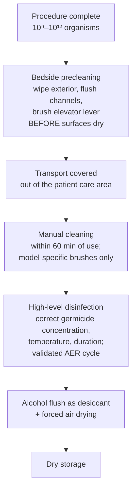

*Why flexible endoscopes transmit infection between patients, what reprocessing is supposed to achieve, and what a unit is actually held to.*

## Contents
- [[#Why Reprocessing Has No Safety Margin]]
- [[#Why Duodenoscopes Are the Worst Case]]
- [[#Outbreak Epidemiology]]
- [[#The Reprocessing Sequence]]
- [[#What the Unit Is Held To]]
- [[#Supplemental Measures Beyond Standard Reprocessing]]
- [[#Monitoring and Tracking]]
- [[#Sterilization vs High-Level Disinfection]]
- [[#Unresolved Issues]]
- [[#See Also]]
- [[#Sources]]

## Why Reprocessing Has No Safety Margin

**Spaulding classification** sets the required processing by what the device touches ([[mstf-2016-endoscope-reprocessing]]):

| Category | Touches | Requires |
|---|---|---|
| **Critical** | Normally sterile tissue or the vascular system | **Sterilization** — destruction of all microbial life. *GI examples: biopsy forceps, sphincterotomes, endoscopes used in sterile settings* |
| **Semicritical** | **Intact mucous membranes**, without penetrating sterile tissue | **At least high-level disinfection (HLD)** — kills all vegetative organisms, mycobacteria, small/nonlipid and medium/lipid viruses, fungal spores, and **some but not all bacterial spores**. *GI endoscopes* |
| **Noncritical** | Does not touch the patient, or only intact skin | **Low-level disinfection**. *Stethoscopes, patient carts* |

- **Sterility Assurance Level** for sterile devices = **10⁻⁶** (<1 organism in 10⁶ reprocessed instruments). A similar standard holds for HLD, except for some tolerant spores.
- The bioburden ledger makes the margin narrow:

| Step | Organisms / log reduction |
|---|---|
| Endoscope at procedure completion | **10⁹–10¹²** organisms |
| Bedside precleaning | **10³** (1000-fold) reduction |
| Manual washing | further **10⁶** reduction |
| High-level disinfection (liquid chemical germicide) | must supply the final **10⁶–10⁹** reduction |

- "A tall order, given the need to achieve optimal reprocessing on every instrument every day" — space, pace, staffing, and resources all erode it ([[aga-2016-infection-ercp-endoscopes]]).
- **Lapses → biofilm.** Adherent biofilm cannot be eradicated by repeated, thorough cleaning and HLD; its aggregation lets otherwise susceptible organisms defy HLD.
- Real-world failure rate: universal culturing of reprocessed endoscopes at one center found **2% of patient-ready instruments harbored persistent enteric pathogens**.

## Why Duodenoscopes Are the Worst Case

- **Tight crevices and mechanical joints repeatedly exposed to high bioburden** — the **elevator region** and **cable channels**. **Linear ultrasound endoscopes share the problem.** Outbreaks are attributed to persistent contamination at exactly these sites.
- **Durability matters:** inert surfaces exposed to significant wear become more susceptible to contamination and less amenable to clearance of bioburden.
- Not new — *Pseudomonas aeruginosa* outbreaks after side-viewing duodenoscope [[ercp|endoscopic retrograde cholangiopancreatography (ERCP)]] date to the **1980s**, clustering in the **first patient of the day** after overnight storage. Largely eliminated by **complete channel drying with alcohol flushing and forced air perfusion after HLD**.
- Contaminated endoscopes transmit **antibiotic-sensitive as well as highly resistant** causes of post-ERCP [[acute-cholangitis|cholangitis]], and can produce **chronic colonization with infection appearing weeks to months later in unrelated organ systems**.

## Outbreak Epidemiology

Carbapenem-resistant *Enterobacteriaceae* (CRE) and multidrug-resistant organism (MDRO) outbreaks after ERCP, as of 2016 ([[aga-2016-infection-ercp-endoscopes]], [[mstf-2016-endoscope-reprocessing]]):

- **≥25 outbreaks worldwide, ≥250 clinical infections, >20 deaths** in the 3 years to 2016; **>1000 patients notified**, **>100 estimated silent carriers**; mortality of clinical infection **≤50%**, worst with comorbidity or immunosuppression. **All 3 manufacturers** and **multiple AER models** implicated.
- **CRE is not inherently more resistant to HLD** — it was transmitted *despite apparent optimal HLD*. The failure is **mechanical and design-related**; resistant species merely made transmission visible by prompting typing-based source investigation.
- Infections often appear **months later and in a different organ** than the exposure.
- **Scale of preventable risk:** at **>650,000 ERCPs/year** in the United States, even the lowest reported defect rate of **0.7%** exposes **4500 patients** annually.
- **Not all endoscopy-associated infection is the endoscope** — several hepatitis C outbreaks came from **intravenous sedation tubing, multidose vials, and reused needles or syringes**, which is why aseptic medication practice is itself a reprocessing-guideline requirement (#39).

## The Reprocessing Sequence

- **Manual cleaning is the most effective single step** — exterior wipe, channel flush, and **brushing the elevator lever immediately after use, before surfaces dry**.
- **Biofilm only develops in a moist environment** → alcohol desiccation, forced air drying and dry storage are "equally important steps," not optional finishing touches.

> [!pitfall] Simethicone through the scope leaves residue that reprocessing cannot clear
> Endoscope manufacturers, following US Food and Drug Administration (FDA) guidance, advise **against instilling simethicone into accessory channels at all** — crystal formation, residue, biofilm. If used for intraprocedural bubbles: **lowest possible dilution, 0.5 mL simethicone (20 mg/0.3 mL) in 99.5 mL water (0.5%)** — the lowest of three concentrations studied (0.5%, 1%, 3%) and the one leaving least channel residue — and **only through an instrument channel routinely brushed during reprocessing** ([[usmstf-2025-bowel-prep]]). Oral dosing and the bubble rationale: [[bowel-preparation]].

## What the Unit Is Held To

The **Multi-Society Task Force (MSTF) 2016 reprocessing guideline** — **41 recommendations** (2003: 34; 2011: 39), endorsed by ASGE, AASLD, ACG, AGA, APIC, ASCRS, SHEA, SAGES and SGNA — governs flexible gastrointestinal endoscope reprocessing in the United States ([[mstf-2016-endoscope-reprocessing]]). Only **2 were new in 2016**; the changes otherwise aligned language with the 2015 FDA communications and tightened monitoring and tracking of the endoscope ([[aga-2017-mstf-endoscope-reprocessing-commentary]]).

**Grades are CDC categories, not GRADE** — **IA** (well-designed studies) · **IB** (some studies + strong rationale) · **IC** (required by state or federal regulation; no IC does *not* mean no state regulation) · **II** (suggestive studies or rationale) · **NR** (unresolved — no recommendation).

**Full list of 41: [[mstf-2016-endoscope-reprocessing]].** The operative rules, by phase:

| Phase | Requirement (recommendation #, category) |
|---|---|
| **Point of use** | **Preclean before bioburden dries** — wipe exterior, aspirate a large volume of detergent through air/water and biopsy channels (#2, IB). **Pressure/leak test after each use and before formal reprocessing** (#4, IB) |
| **Transport** | Move to reprocessing **before remaining soil dries**. Open container only for an immediately adjacent room; **fully enclosed, labeled container or bag** through shared corridors (#3, II) |
| **Manual cleaning** | Clean the entire endoscope **within the manufacturer's recommended time frame**; beyond it, follow the manufacturer's delayed-processing directions. **Only model-specific cleaning devices designed for that endoscope model.** Disassemble valves, **completely immerse**, flush and brush all accessible channels, **repeatedly actuate the valves**, clean external surfaces (#5, IB). Brushes sized so bristles contact all surfaces and **approved by the endoscope manufacturer**; cleaning items disposable or disinfected between uses (#6, II). **Discard enzymatic detergent after each use** (#7, IB). Ultrasonic cleaning may be used for hard-to-reach soil on accessories and components (#9, II) |
| **High-level disinfection** | Endoscopes are semicritical → **at least HLD after each patient use** (#10, IA). Disinfectant and machine must be **FDA-cleared for their HLD claims** (#11, IA); **follow the FDA-cleared label's exposure time and temperature** (#12, IA); the agent must be **compatible with the endoscope** (#13, IC). **Completely immerse and perfuse all channels; nonimmersible endoscopes should not be used** (#15, IB). **An AER is advisable and should be adopted when feasible**, but confirm the AER can reprocess that endoscope — **the elevator wire channel of duodenoscopes is not effectively disinfected by most AERs and must be done manually** (#16, IB). Attach all channel connectors per both manufacturers' instructions; **only approved connectors** (#17, IB). **An interrupted AER cycle must be repeated** (#18, II) |
| **Rinse and dry** | Rinse and flush channels with **sterile or filtered water**, **discard rinse water after each use or cycle**, flush channels with **70%–90% ethyl or isopropyl alcohol**, dry with **filtered forced air** (#20, IA) |
| **Storage** | **Hang vertically**, caps and valves removed, to facilitate drying (#22, II). Storage and transport practices are set **at facility level** with infection prevention, as no data link outbreaks to them (#23, II) |
| **Accessories and water** | **Reusable accessories that break the mucosal barrier must be mechanically cleaned then *sterilized* — HLD is not appropriate**; do not reprocess single-use items except per FDA guidance (#8, IA). **HLD or sterilize the water bottle and its connecting tube at least daily; fill with sterile water** (#26, IB) |
| **Disinfectant quality control** | **Test liquid HLD concentration at the start of each day of use** (or more often per manufacturer), document it, and **discard the solution if below the minimum effective concentration** (#28, IA). **Discard at the end of reuse life regardless of concentration — "topping off" does not extend reuse life** (#29, IB) |
| **Inspection** | **Inspect endoscopes and accessories frequently** — before, during and after use and cleaning. **Cleaning complex components such as elevators requires optimal lighting and may need magnification.** Remove damaged items from use (#21, II). Review and document attention to **FDA advisories, manufacturer alerts and the literature** on endoscope/AER deficiencies (#19, II) |
| **Documentation** | **Log every procedure** — patient name and medical record number, procedure, **endoscope serial number (and AER)**, date and type, and **who performed the cleaning and HLD**; include **loaner endoscopes** temporarily added to inventory (#27, II). Users must be able to **readily identify whether and when an endoscope has been reprocessed** (#35, II) |
| **Facility and staff** | Reprocessing **out of patient care areas**, with flow designed to separate entering dirty from reprocessed clean instruments (#31, IC and II). **Eyewash stations available, and not on sinks used for soaking soiled endoscopes**; ventilation keeping vapor below allowable limits — respirators are not a substitute (#30, IB and IC). **Device-specific instruction, with competency tested and documented at commencement, at least annually, after any identified breach, and when technique or equipment changes; temporary personnel may not reprocess until competency is established** (#32, IA). Chemical hazard education with documented competency (#33, IC); **personal protective equipment readily available and used** (#34, IC). Standard infection prevention for aseptic medication and sedation administration (#39, IC) |
| **Outbreaks** | **Environmental sampling per standard outbreak investigation protocols** (#40, IA). **Report an endoscopy-related infection to all four:** institutional infection control (notifying referring physician and affected patients as appropriate) · **the state or local public health agency** · **the FDA via MedWatch** · **the manufacturers** of endoscope, disinfectant/sterilant and AER (#41, IB and IC) |

> [!pitfall] A single unit-wide work process is not permitted
> Cleaning must be **device- and manufacturer-specific**. "A single standard work process within one institution may be **insufficient**, given differences among manufacturers' instructions and varied instrument designs" — so a generic protocol built from the elements common to all brands fails, and brushes must be matched to the endoscope brand rather than to the majority of the unit's scopes ([[aga-2017-mstf-endoscope-reprocessing-commentary]]).

- **The 60-minute manual-cleaning limit is the AGA commentary's figure, not the guideline's.** MSTF 2016 #5 says "within the manufacturer's recommended time frame" and names no number; the commentary renders it as **within 60 minutes of use, with the intervals monitored** ([[aga-2017-mstf-endoscope-reprocessing-commentary]]).
- **Competency interval:** the guideline floor is **annual** (#32); the AGA has encouraged **semi-annual** demonstration. Certification of reprocessing staff has been proposed but not adopted beyond the operating room.
- **AGA short-term measures for elevator-channel endoscopes:** surveillance of all patients scoped with one; tracking each **by patient and device serial number**; and **periodic cultures** of all elevator-equipped endoscopes in use.
- **Valve and bottle replacement intervals** (FDA nonbinding draft guidance, relayed by the guideline): **air/water valve replaced per procedure** but the **water bottle feeding the channel changed daily**; **one-way inline high-volume flushing valves daily**; **suction valves per procedure**. Vacuum tubing and waste canister intervals are **incompletely addressed**; AORN advises water and irrigation bottles be high-level disinfected or sterilized at least daily.

## Supplemental Measures Beyond Standard Reprocessing

In May 2015 a majority of the FDA's independent advisory panel judged reprocessing standards for existing duodenoscope designs **insufficient for ensuring patient safety**. The FDA encouraged units to consider four optional supplemental measures; MSTF 2016 recommendation #24 (new) states that **"no validated methods for additional duodenoscope reprocessing currently exist"** but that units should review and consider their feasibility and appropriateness.

| Measure | How it is done | Why it may not be worth it |
|---|---|---|
| **Surveillance cultures ± quarantine** | Centers for Disease Control and Prevention (CDC) technique: sterile flushes of the biopsy channel + **swabbing and swirling immersion of the elevator region**. CDC advises **quarantine until negative results return after 2–3 days**; one centre resolved an outbreak by culturing every instrument and storing it **48 h** pending clearance. Can be **per-procedure** or **intermittent** (a subset each week) | **Not cost-effective unless the unit's CRE transmission probability is ≥24%**. Expensive, hard to perform and interpret. **Not validated for confirming sterility or even post-HLD pathogen clearance** — the FDA panel called the CDC guidance insufficient as a best practice, and the American Society for Microbiology advises against hospital labs running these cultures, since a negative is misread as sterility. Contaminated scopes can still harbour **culture-negative but viable residue**. Quarantine curtails availability or demands a larger inventory |
| **Double reprocessing** (repeat HLD) | **Wash → HLD → wash → HLD**, without quarantine. From culture-quarantine experience, repeat reprocessing of culture-positive duodenoscopes cut the pathogen-positive rate **by one log (~2% → 0.2%)** | "Perhaps the most simple and readily adopted additional measure," but **not validated**; staffing, space and equipment are limiting |
| **Ethylene oxide (ETO) sterilization** | The **only low-temperature sterilization technique currently available** for these instruments; prolonged exposure | **Not FDA-approved for reprocessing endoscopes**; some manufacturers do not approve it. **Cannot sterilize residual gross soil.** May stiffen or alter function; carcinogenic and teratogenic controls required, so few units are equipped; turnaround **17–48 h**. In practice a unit using ETO **still cultured CRE from a sterilized endoscope**, with extra scope-purchase cost and more damage |
| **Liquid chemical sterilant / germicide** (peracetic acid, 2% glutaraldehyde) | Automated reprocessing with a liquid chemical sterilant | Peracetic acid is **not validated or approved as a chemical sterilant for duodenoscopes**; transmissions have occurred despite appropriate liquid germicide, so a liquid process is unlikely to reach inaccessible crevices. **2% glutaraldehyde exposes staff to known irritants and can cause colitis if the endoscope is not properly rinsed** |

**Other strategies**

- **Preprocedure MDRO/CRE screening** — anal swab by polymerase chain reaction avoids culture turnaround and permits intensified reprocessing of exposed instruments, but **does not address transmission of common antibiotic-sensitive organisms**.
- **Antibiotic prophylaxis is not a substitute** — useful only where **persisting obstruction is expected** ([[primary-sclerosing-cholangitis]], hilar tumors, duct leaks, fluid collections). Regimens: [[antibiotic-prophylaxis-endoscopy]].
- **Disposable endoscopes.** First disposable colonoscope FDA-approved **September 2016**, expected in the United States in early 2017 at **~$250 each**; no disposable elevator-mechanism endoscope was then available. Cost-effectiveness is unsettled, and prioritising patients at highest transmission risk has budgeting and reimbursement implications.

## Monitoring and Tracking

- **Real-time verification of reprocessing adequacy remains elusive** — tests for biologic contaminants evaluate *intermediate* steps and **none correlates well with terminal culture negativity** (ATP testing: see [[#Unresolved Issues]]).
- Monitoring the use-to-cleaning interval and endoscope lifecycle in practice needs **barcode scanning or equivalent** in both clinical and reprocessing areas, and may need electronic health record changes to capture **endoscope and reprocessor serial numbers** for patient-specific notification during an outbreak.
- **Endoscopist-level tracking is absent from the 2011 and 2016 recommendations** though the 2003 set included it; cross-documenting the endoscope details in the patient's record restores it.
- **Equipment upkeep:** scheduled maintenance, parts replacement and **scheduled retirement**; AER manufacturers should supply systems that **monitor and record the integrity of their functionality**; preventive inspection for **material degradation and biofilm**.

## Sterilization vs High-Level Disinfection

- **The FDA has acknowledged flexible endoscopes cannot be sterilized with available high-level disinfectants** — the old label term "high-level disinfectant/sterilant" no longer implies the ability to sterilize, and neither HLD nor extreme application of it meets the needs of a sterile environment ([[mstf-2016-endoscope-reprocessing]]).
- In 2016 the **majority of FDA panel members recommended reclassifying duodenoscopes as critical devices**, concluding **"duodenoscopes and AERs do not provide a reasonable assurance of safety and effectiveness."** Some held HLD is adequate when done properly.
- **The evidence does not clearly support reclassification** — no difference in transmission between laparoscopes sterilized versus high-level disinfected, and the unit using ethylene oxide still cultured CRE from a sterilized endoscope. So **contamination may be unavoidable under the current paradigm**, making **rapid outbreak identification and containment the priority for innovation**, alongside designs with removable tips, autoclave tolerance and single-use components.

## Unresolved Issues

Three issues carry unchanged through the **2003, 2011 and 2016** guidelines, and MSTF 2016 grades two of them **NR** — explicitly *not* recommendations ([[mstf-2016-endoscope-reprocessing]]). Because the units that had outbreaks were adherent to the guidelines, these may be where the outbreaks came from.

| Issue | Where it stands |
|---|---|
| **Shelf life / "hang time"** (#25, NR) | Contamination during appropriate storage for **7–21 days is negligible, unrelated to duration, predominantly exterior, and involves common skin organisms**. **Reuse within 21 days, perhaps 56, appears safe — but no maximum can be set.** **SGNA advises a 7-day maximum**; APIC is silent; **AORN requires a facility-level multidisciplinary risk assessment**. Where instruments enter otherwise sterile regions (biliary tree, pancreas, peritoneum), reprocess **before use** — not at fixed intervals without scheduled reuse |
| **Microbiologic surveillance** (#36, NR; #37, II) | **Not established for quality assurance.** If performed, use **standard CDC microbiologic technique**. **ATP residue testing** is the best-studied alternative: a **5-minute** swab assessment that correlates with bioburden clearance by precleaning and manual cleaning but **not with terminal HLD outcome**, and whose methodology and thresholds are **not standardized** — so it is for **training, competency testing and spot surveillance**, not release |
| **Endoscope durability and longevity** | Incompletely understood. Simulated repetitive use equivalent to years of high volume **increased bacterial surface adhesion**; two duodenoscope contamination reports traced to **unexpected wear or vendor-identified need for repair in instruments that passed local functional assessment** |

- **Also unaddressed:** the minimum time between a change in recommendations and updated staff training, and whether "all staff involved in the use" includes the **endoscopists**.
- The 2016 guidelines are "**unlikely to guarantee the prevention of future outbreaks**" — the changes aim to **contain rather than prevent**, by making the source traceable.
- All 3 manufacturers validated reprocessing in **test environments**; in October 2015 the FDA mandated **postmarket studies of reprocessing in clinical settings**, including how often end users can complete the instructions and achieve complete clearance.

## See Also

[[ercp]], [[colonoscopy]], [[upper-endoscopy]], [[endoscopic-ultrasound]], [[antibiotic-prophylaxis-endoscopy]], [[acute-cholangitis]], [[primary-sclerosing-cholangitis]], [[colonoscopy-quality-indicators]], [[bowel-preparation]], [[preprocedure-testing]]

---

## Sources

1. [[mstf-2016-endoscope-reprocessing|Multisociety Guideline on Reprocessing Flexible GI Endoscopes: 2016 Update]]
2. [[aga-2016-infection-ercp-endoscopes|AGA Clinical Practice Update: Commentary — Infection Using ERCP Endoscopes (2016)]]
3. [[aga-2017-mstf-endoscope-reprocessing-commentary|AGA Clinical Practice Update: Commentary on the 2016 Multi-Society Task Force Endoscope Reprocessing Guidelines (2017)]]
4. [[usmstf-2025-bowel-prep|Optimizing Bowel Preparation Quality for Colonoscopy: Consensus Recommendations by the US Multi-Society Task Force on Colorectal Cancer]]
