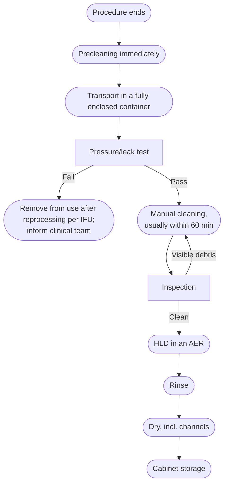

*Why flexible endoscopes transmit infection between patients, what reprocessing is supposed to achieve, and what a unit is actually held to.*

## Contents
- [[#Why Reprocessing Has No Safety Margin]]
- [[#Why Duodenoscopes Are the Worst Case]]
- [[#Outbreak Epidemiology]]
- [[#The Reprocessing Sequence]]
- [[#What the Unit Is Held To]]
- [[#Supplemental Measures Beyond Standard Reprocessing]]
- [[#Monitoring and Tracking]]
- [[#Sterilization vs High-Level Disinfection]]
- [[#Unresolved Issues]]
- [[#See Also]]
- [[#Sources]]

## Why Reprocessing Has No Safety Margin

**Spaulding classification** sets the required processing by what the device touches ([[multisociety-2021-endoscope-reprocessing]]):

| Category | Touches | Requires |
|---|---|---|
| **Critical** | Vascular system or sterile tissue | **Sterilization** — destruction of all microbial life. *Gastrointestinal (GI) examples: endoscopes used in sterile settings (laparoscopic endoscopy); endoscopic devices for invasive procedures such as [[ercp\|endoscopic retrograde cholangiopancreatography (ERCP)]] and interventional [[endoscopic-ultrasound\|endoscopic ultrasound (EUS)]]; biopsy, polypectomy and sphincterotomy equipment* |
| **Semicritical** | Intact mucous membranes or nonintact skin, without penetrating sterile tissue | Sterilization preferred; **high-level disinfection (HLD) at a minimum** if sterilization is not feasible — kills all vegetative microorganisms, mycobacteria, small/nonlipid and medium/lipid viruses, fungal spores; **some bacterial spores and prions may remain**. *Flexible GI endoscopes* |
| **Noncritical** | Does not ordinarily touch the patient, or only intact skin | **Low-level disinfection**. *Stethoscopes, blood pressure cuffs, mouth guards* |

- **Sterility Assurance Level** = **10⁻⁶** (<1 organism in 10⁶ reprocessed instruments); similar for HLD, except some tolerant spores — a narrow margin:

| Step | Organisms / log reduction |
|---|---|
| Endoscope at procedure completion | **10⁹–10¹²** organisms |
| Bedside precleaning | **10³** (1000-fold) reduction |
| Manual washing | further **10⁶** reduction |
| HLD (liquid chemical germicide) | must supply the final **10⁶–10⁹** reduction |
*Bioburden reduction needed at each step ([[aga-2016-infection-ercp-endoscopes]])*

- **Lapses → biofilm** — not eradicable by repeated, thorough cleaning and HLD; lets otherwise susceptible organisms defy HLD.
- Universal culturing at one center: **2% of patient-ready instruments harbored persistent enteric pathogens** ([[aga-2016-infection-ercp-endoscopes]]).

## Why Duodenoscopes Are the Worst Case

- **Tight crevices and mechanical joints repeatedly exposed to high bioburden** — the **elevator region** and **cable channels**; **some ultrasound endoscopes share the problem**. Worn surfaces become more susceptible to contamination and harder to clear ([[aga-2016-infection-ercp-endoscopes]]).
- Contaminated endoscopes transmit **antibiotic-sensitive as well as highly resistant** post-ERCP [[acute-cholangitis|cholangitis]]; the unusual resistant cases can colonize the GI tract chronically, with infection **weeks to months later in unrelated organ systems**.
- End-viewing endoscopes: no transmission when all steps are followed; duodenoscopes: outbreaks **despite appropriate compliance**. U.S. Food and Drug Administration (FDA) postmarket surveillance: **0.3%–4.4%** of duodenoscopes contaminated with low/moderate-concern organisms, **4.1%–6.1%** with high-concern ([[multisociety-2021-endoscope-reprocessing]]).

## Outbreak Epidemiology

Carbapenem-resistant *Enterobacteriaceae* (CRE) and multidrug-resistant organism (MDRO) outbreaks after ERCP, as of 2016 ([[aga-2016-infection-ercp-endoscopes]], [[mstf-2016-endoscope-reprocessing]]):

- **≥25 outbreaks worldwide, >250 infections, >20 deaths** in the 3 years to 2016; **>1000 patients** advised to have screening cultures, **≥100** believed silent carriers. **All 3 manufacturers** and multiple automated endoscope reprocessor (AER) models involved.
- **CRE is not inherently more resistant to HLD** — transmitted *despite apparent optimal HLD*; transmission became evident only when highly resistant species prompted investigation.
- **Scale:** **>650,000 ERCPs/year** in the United States → even the lowest reported defect rate (**0.7%**) exposes **4500 patients** ([[aga-2016-infection-ercp-endoscopes]]).
- **Not always the endoscope** — hepatitis C clusters from **intravenous sedation tubing, multidose vials, reused needles or syringes** ([[mstf-2016-endoscope-reprocessing]]).

## The Reprocessing Sequence

Every step follows the endoscope, device and disinfectant manufacturers' instructions for use (IFU) ([[multisociety-2021-endoscope-reprocessing]]).

*Reprocessing sequence for a flexible GI endoscope*
*Source: built from the 2021 multisociety guideline's Table 2 statements and its stated sequence (leak test → manual cleaning → inspection → HLD, p. 18; failed leak test and visible debris, p. 19) — the guideline has no flowchart*
*[[multisociety-2021-endoscope-reprocessing|Multisociety 2021 Reprocessing Guideline]]*
*IFU = instructions for use · HLD = high-level disinfection · AER = automated endoscope reprocessor*

- **Cleaning immediately after use**, before surfaces dry (wipe, flush channels, brush the elevator), is most effective ([[aga-2016-infection-ercp-endoscopes]]); systematic manual cleaning lowers pathogen counts by **99.9%** ([[multisociety-2021-endoscope-reprocessing]]).
- **Biofilm only develops in a moist environment** → drying and dry storage are "equally important steps" ([[aga-2016-infection-ercp-endoscopes]]). Improper drying: **80%** contamination rate, linked to waterborne outbreaks ([[multisociety-2021-endoscope-reprocessing]]):
  - A drying cabinet forcing air through the channels for **≥1 hour** also suffices for internal channels (alternative to the 10-minute air flow, table below).
  - **Ineffective:** vertical hanging alone without filtered-air flushing; a manual air pistol aimed at several areas at varying times.
  - **Alcohol** (70%–90% ethyl or isopropyl): purges water and is antimicrobial, but may fix protein; no data strongly support or refute it.

## What the Unit Is Held To

The **2021 multisociety guideline** ([[multisociety-2021-endoscope-reprocessing]]) replaces the 2016 update ([[mstf-2016-endoscope-reprocessing]]); where they differ, the 2021 rule governs and the 2016 rule is noted. Recommendations are **unnumbered**, graded **strong or conditional** × **quality of evidence** (high to very low) by Grading of Recommendations Assessment, Development and Evaluation (GRADE) or literature review.

*Operative rules by phase — strength, quality in brackets; **unmarked = Strong, Low**.*

| Phase | 2021 requirement |
|---|---|
| **Staff** | Written reprocessing policy. **Model-specific** training; **documented competency before assignment** to HLD/sterilization. Competency re-evaluated on an organization-defined schedule — eg, start of employment, **at least annually**, after any breach, when a major technique or new endoscope or reprocessing accessory is introduced; **temporary staff may not reprocess until competency is verified** (Strong, Moderate) |
| **Unit layout** | Flow separates soiled from reprocessed instruments. **No reprocessing in patient care areas** beyond point-of-use precleaning. Separate areas for manual cleaning and for drying/storage. Eyewash stations available, **placed near** sinks for soiled endoscopes (2016: not on those sinks). Ventilation keeps disinfectant vapor within allowable limits (Strong, Moderate) |
| **Point of use and transport** | Preclean **immediately**, before bioburden dries: wipe exterior with IFU detergent; aspirate detergent through all channels **until clear**; preclean duodenoscope elevator channel/recess and echoendoscope balloon groove per manufacturer. **Transport immediately in fully enclosed, puncture-resistant, leak-proof, labeled containers** (2016 allowed an open container to an immediately adjacent room). **Leak test** per IFU after precleaning, before manual cleaning (Strong, Moderate) |
| **Manual cleaning** | Within the manufacturer's time frame, **usually within 60 minutes** of release from the procedure (2016 gave no number); later → IFU delayed-processing directions. **Only model-specific, manufacturer-approved brushes** sized to the channel. Disassemble, **completely immerse**, flush and brush all accessible channels; **repeatedly actuate elevators of duodenoscopes and linear echoendoscopes**. **Discard enzymatic detergent after each use** |
| **Inspection** | Lighted magnification, frequently during use and reprocessing; **exterior inspection after each manual cleaning**, before HLD. Complex components (elevators, recess grooves) need optimal lighting, helped by magnification (Conditional, Low). **Borescopes: no recommendation** for routine use (Conditional, Moderate) |
| **HLD** | **HLD in an AER** (Strong, Moderate; 2016: AER "advisable" when feasible). FDA-cleared AER with a compatible high-level disinfectant. **FDA-cleared label exposure time and temperature** (Strong, Moderate). **Duodenoscope elevator wire channel may not be disinfected by some AERs → do that step manually.** Only approved connectors. **Interrupted cycle → repeat the full cycle** |
| **Manual HLD** (AER under repair) | Immerse completely, perfuse all channels; test **minimum effective concentration at the start of each day of use** (or more often per manufacturer), record it, **discard if below**; discard at end of reuse life regardless of concentration — reuse life runs from first activation of the original solution |
| **Rinse and dry** | Rinse/flush with **sterile or filtered water**; discard rinse water each cycle. Exterior with lint-free cloth. Channels with forced, pressure-regulated filtered air (Strong, Moderate). **Medical air through all accessible channels, ideally simultaneously, ≥10 minutes** (Strong, Moderate). **Completely dry before use** (Strong, Moderate). Alcohol **per IFU** (Strong, Moderate; 2016: routine alcohol flush) |
| **Storage** | Secure cabinets (drying or conventional) in a secure room; **not in procedure rooms** (Conditional, Low). **Vertical or horizontal** per validated cabinet design and IFU (Strong, Moderate; 2016: hang vertically); if vertical, **not coiled, no acute angulation, not touching the cabinet bottom**; avoid hanging endoscopes touching one another (Conditional, Low). Accessories removed; need not be stored with a specific endoscope. Hand hygiene and clean gloves whenever handling |
| **Accessories and water** | Reusable accessories breaking the mucosal barrier → cleaned, then **sterilized between patients**. **No reprocessing of single-use items** except per FDA guidance. **Backflow-prevention valve per procedure**; irrigation tubing daily; **vacuum tubing and canisters at least daily**; **water bottles HLD/sterilized or replaced daily**. **Sterile water for mucosa-traversing procedures** ([[poem\|peroral endoscopic myotomy (POEM)]], necrosectomy, interventional EUS); otherwise follow IFU, else unit risk assessment of sterile vs tap water (2016: sterile water in the bottle for all). Text: **sterile irrigation water for immunosuppressed patients** (eg, liver transplant). Simethicone per IFU (Strong, Moderate) — see pitfall below |
| **Documentation** | **Log every procedure:** patient name and medical record number, procedure, **endoscope (and AER) serial number**, date and type, **who cleaned and disinfected**; include loaners. Users can readily tell **whether and when** an endoscope was reprocessed (Strong, Moderate). AER maintenance and repairs recorded |
| **Maintenance and loaners** | Equipment **reprocessed before going to repair and again before returning to service**; defective endoscope removed from service and tagged until cleared. Loaners arrive in time to be **reprocessed before first patient use**, compatible with unit equipment, inspected and function-tested, traceable; prior culture data supplied and **culture-positive loaner → notify the manufacturer** (this item Strong, Moderate) |
| **Leadership and outbreaks** | Interdisciplinary infection-control team with a **designated individual directing infection prevention** (Strong, Moderate). Outbreak → **environmental sampling** per standard protocols (Strong, Moderate). **Report an endoscopy-related infection to:** the **patient** (new in 2021) · institutional infection control (+ referring physicians, potentially affected patients) · public health agency · **FDA via MedWatch** · manufacturers of endoscope, disinfectant/sterilant and AER |

> [!pitfall] Simethicone through the scope leaves residue
> In response to FDA guidance, endoscope manufacturers recommend **against giving simethicone through accessory channels**. If bubbles force its use: **lowest possible dilution** (eg, 0.5 mL simethicone [20 mg/0.3 mL] in 99.5 mL water), only through a channel routinely brushed in reprocessing ([[usmstf-2025-bowel-prep]]).
> 2021: **lowest concentration (≤0.5%) and smallest volume, through the working channel** (Conditional, Moderate — [[multisociety-2021-endoscope-reprocessing]]). Oral dosing: [[bowel-preparation]].

> [!pitfall] Generic cross-brand protocols are not permitted
> Cleaning is **device- and manufacturer-specific** — a protocol built from elements common to all brands does not comply; brushes are matched to the endoscope brand, not the unit's majority ([[aga-2017-mstf-endoscope-reprocessing-commentary]]).

- **Competency interval:** guideline floor **annual**; the American Gastroenterological Association (AGA) suggests **semi-annual** demonstration; certification proposed but not adopted beyond the operating room ([[aga-2016-infection-ercp-endoscopes]]).
- **Coronavirus disease 2019 (COVID-19):** no specific reprocessing changes needed — detergents inactivate coronaviruses ([[multisociety-2021-endoscope-reprocessing]]).

## Supplemental Measures Beyond Standard Reprocessing

FDA advised duodenoscope units to add **≥1 supplemental measure** — microbiologic culturing, ethylene oxide (EtO) sterilization, a liquid chemical sterilant system, or repeat HLD; nearly 90% of U.S. units adopted ≥1, with scant effectiveness data ([[multisociety-2021-endoscope-reprocessing]]).

| Measure | 2021 guideline | Practical limits (AGA commentaries) |
|---|---|---|
| **Repeat HLD** | **Nonoutbreak: no added benefit** over single HLD for duodenoscope contamination (Conditional, Moderate; 2 randomized controlled trials); data insufficient for other designs ([[multisociety-2021-endoscope-reprocessing]]) | Wash → HLD → wash → HLD; repeat reprocessing of culture-positive duodenoscopes cut pathogen positivity by one log (~2% → 0.2%) ([[aga-2016-infection-ercp-endoscopes]]) |
| **EtO sterilization** | **Nonoutbreak: limited data suggest no reduction** in duodenoscope contamination vs single HLD (Conditional, Moderate). **Routine EtO of all endoscopes not recommended** (Conditional, Moderate). **Outbreaks:** associated with terminating them — **consider in selected settings and patient populations** (Conditional, Low). Costly, inefficient, potentially toxic, durability concerns, not widely available → **selective sterilization of duodenoscopes for high-risk patients** (CRE/MDRO-colonized or at risk) may be more feasible ([[multisociety-2021-endoscope-reprocessing]]) | Cannot sterilize residual gross soil ([[mstf-2016-endoscope-reprocessing]]); turnaround **17–48 h** ([[aga-2016-infection-ercp-endoscopes]]); one unit still cultured CRE from a sterilized endoscope ([[aga-2017-mstf-endoscope-reprocessing-commentary]]) |
| **Surveillance cultures ± quarantine** | Routine testing **not established**, but the most recognized way to detect contamination; if done, per **FDA and Centers for Disease Control and Prevention (CDC)** guidance (Conditional, Moderate). "Culture and quarantine" ended transmission at some U.S. units ([[multisociety-2021-endoscope-reprocessing]]) | Per-procedure culturing **not cost-effective unless CRE transmission probability ≥24%** ([[aga-2017-mstf-endoscope-reprocessing-commentary]]). CDC quarantine until negative after 2–3 days; culture-negative endoscopes may still carry viable residue ([[aga-2016-infection-ercp-endoscopes]]) |
| **Liquid chemical sterilant** | Comparison with HLD in AERs is a research gap ([[multisociety-2021-endoscope-reprocessing]]) | Peracetic acid not validated as a duodenoscope sterilant ([[aga-2016-infection-ercp-endoscopes]]); 2% glutaraldehyde irritates staff and **can cause colitis if not rinsed** ([[aga-2017-mstf-endoscope-reprocessing-commentary]]) |

- **Preprocedure MDRO/CRE screening** — anal swab by polymerase chain reaction permits intensified reprocessing of exposed instruments but **does not address antibiotic-sensitive organisms** ([[aga-2016-infection-ercp-endoscopes]]).
- **Prophylactic antibiotics** — shown useful and deemed appropriate only where **persisting obstruction is expected** ([[primary-sclerosing-cholangitis]], hilar tumors, duct leaks, fluid collections) ([[aga-2016-infection-ercp-endoscopes]]). Regimens: [[antibiotic-prophylaxis-endoscopy]].
- **Single-use endoscopes:** FDA-cleared for colonoscopy and ERCP (single-use duodenoscopes: lower image quality in anatomic models); FDA recommended moving to duodenoscopes with **disposable components (incl. distal endcaps) or fully disposable duodenoscopes** when available ([[multisociety-2021-endoscope-reprocessing]]).

## Monitoring and Tracking

- **Adenosine triphosphate (ATP) testing** — a **5-minute** swab check of cleaning adequacy before HLD ([[aga-2016-infection-ercp-endoscopes]]); 2021 data ([[multisociety-2021-endoscope-reprocessing]]):
  - Relative light unit (RLU) **<200** (3M Clean Trace) associated with "clean" benchmarks; other studies suggest **<100** for colonoscopes.
  - After manual cleaning of duodenoscopes vs terminal cultures: **sensitivity 30%, specificity 53%**.
  - **FDA advises against ATP testing for duodenoscope surveillance** → role is training, competency testing and spot surveillance of cleaning steps.
- Tracking use-to-cleaning time and endoscope lifecycle needs **barcode scanning or equivalent**; electronic health records may need to capture **endoscope and reprocessor serial numbers** for outbreak notification. Cross-documenting the endoscope in the patient's record also allows **endoscopist-level tracking** (in the 2003 recommendations, not 2011 or 2016) ([[aga-2017-mstf-endoscope-reprocessing-commentary]]).
- **Equipment upkeep:** scheduled maintenance, parts replacement and **scheduled retirement** ([[aga-2016-infection-ercp-endoscopes]]).

## Sterilization vs High-Level Disinfection

- **The FDA has acknowledged flexible endoscopes cannot be sterilized with available high-level disinfectants**; most FDA advisory panel members favored **reclassifying duodenoscopes as critical devices** ([[mstf-2016-endoscope-reprocessing]]).
- **2021: reclassification not advocated** — the GI tract is not sterile, and sterility is broken on entry ([[multisociety-2021-endoscope-reprocessing]]).
- Contamination may be unavoidable under the current reprocessing or sterilization paradigm → **rapid outbreak identification and containment** is the highest priority for innovation ([[aga-2017-mstf-endoscope-reprocessing-commentary]]).

## Unresolved Issues

**Storage time ("hang time")** — data are **insufficient to set a maximum**; each unit sets its own storage-time policy (Conditional, Moderate). Reuse **within 21 and perhaps even 56 days appears safe** ([[multisociety-2021-endoscope-reprocessing]]).

Pooled data from 8 storage-time studies (1242 procedures; each comparison pools a subset; Figures 3–4):

| Storage-time comparison | Organisms counted | Odds ratio (95% confidence interval) |
|---|---|---|
| <7 vs ≥7 days | Any | **0.15 (0.06–0.33)** |
| <7 vs ≥14 days | Any | **0.43 (0.19–0.99)** |
| <7 vs ≥7 days | Pathogenic only | **0.50 (0.13–1.97)** — no difference |

- 2016: procedures entering otherwise sterile regions (biliary tree, pancreas, peritoneum) → reprocessing **before reuse** may be advisable, not re-reprocessing stored endoscopes at fixed intervals; Society of Gastroenterology Nurses and Associates then set a **7-day maximum** ([[mstf-2016-endoscope-reprocessing]]).
- **Endoscope durability** — incompletely understood; two duodenoscope contamination reports traced to unexpected wear in instruments that passed local functional checks ([[mstf-2016-endoscope-reprocessing]]).
- **2021 research gaps** include air-drying duration, alcohol flushes, ATP accuracy, safe simethicone concentration and disposable endoscopes ([[multisociety-2021-endoscope-reprocessing]]).
- Unclear: minimum time from a change in recommendations to retraining; whether "all staff involved in the use" includes **endoscopists** ([[aga-2017-mstf-endoscope-reprocessing-commentary]]).

## See Also

[[ercp]], [[colonoscopy]], [[upper-endoscopy]], [[endoscopic-ultrasound]], [[poem]], [[antibiotic-prophylaxis-endoscopy]], [[acute-cholangitis]], [[primary-sclerosing-cholangitis]], [[colonoscopy-quality-indicators]], [[bowel-preparation]], [[preprocedure-testing]]

---

## Sources

1. [[multisociety-2021-endoscope-reprocessing|Multisociety Guideline on Reprocessing Flexible GI Endoscopes and Accessories (2021)]]
2. [[mstf-2016-endoscope-reprocessing|Multisociety Guideline on Reprocessing Flexible GI Endoscopes: 2016 Update]]
3. [[aga-2016-infection-ercp-endoscopes|AGA Clinical Practice Update: Commentary — Infection Using ERCP Endoscopes (2016)]]
4. [[aga-2017-mstf-endoscope-reprocessing-commentary|AGA Clinical Practice Update: Commentary on the 2016 Multi-Society Task Force Endoscope Reprocessing Guidelines (2017)]]
5. [[usmstf-2025-bowel-prep|Optimizing Bowel Preparation Quality for Colonoscopy: Consensus Recommendations by the US Multi-Society Task Force on Colorectal Cancer]]
