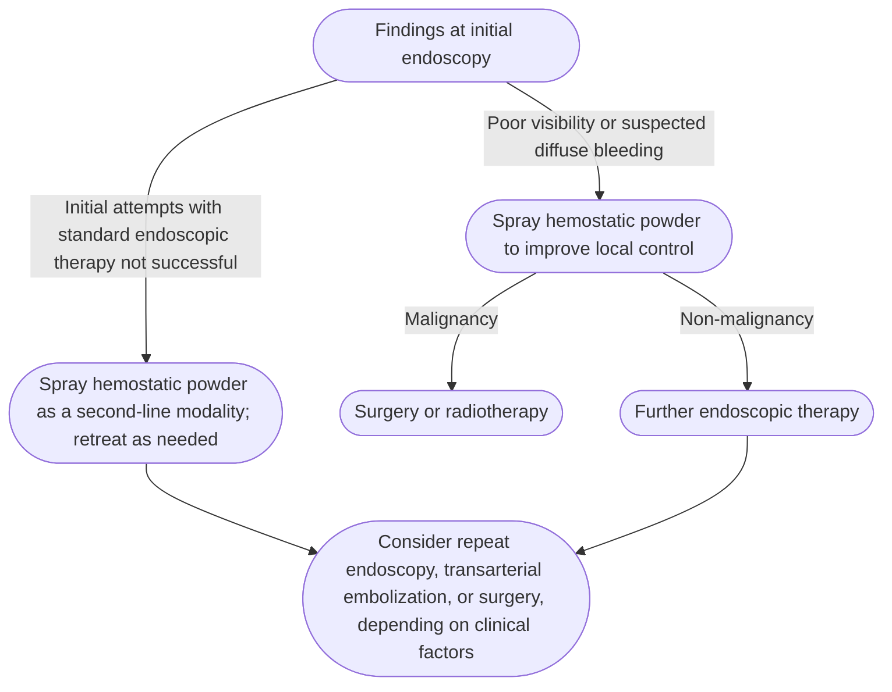

## Contents
- [[#Scope — What Lives Here and What Lives Elsewhere]]
- [[#The Modalities at a Glance]]
- [[#Injection Therapy]]
  - [[#Dilute Epinephrine]]
  - [[#Absolute Ethanol]]
- [[#Contact Thermal Therapy]]
  - [[#Heater Probe]]
  - [[#Bipolar / Multipolar Electrocoagulation]]
  - [[#Soft Monopolar Coagulation and Hemostatic Forceps]]
- [[#Noncontact Thermal — Argon Plasma Coagulation]]
- [[#Mechanical Therapy]]
  - [[#Through-the-Scope Clips]]
  - [[#Over-the-Scope Clips]]
  - [[#Endoscopic Band Ligation]]
- [[#Topical Hemostatic Powder (TC-325)]]
- [[#Confirming Hemostasis — Doppler Probe]]
- [[#Bleeding Caused by Endoscopy Itself]]
- [[#When Endoscopic Hemostasis Fails]]
- [[#Preparation and Equipment]]
- [[#See Also]]
- [[#Sources]]

---

## Scope — What Lives Here and What Lives Elsewhere

This page covers the **hemostatic devices themselves** — mechanism, settings, technique, and how each one fails. Site-specific decisions live on their own pages:

| Question | Where it is answered |
|---|---|
| Ulcer stigmata (Forrest classes), class-specific rebleeding rates, ulcer-specific modality choice | [[upper-gi-bleeding]] |
| Timing of endoscopy, transfusion thresholds, pre-endoscopic [[proton-pump-inhibitors\|proton pump inhibitor (PPI)]] and prokinetics | [[upper-gi-bleeding]] |
| Modality for diverticular hemorrhage, [[angioectasia\|angioectasias]], or postpolypectomy bleeding | [[acute-lower-gi-bleeding]] |
| Variceal band ligation, glue injection, and the portal-hypertensive algorithm | [[variceal-upper-gi-bleeding]] |
| Argon plasma coagulation (APC) in [[radiation-proctopathy\|radiation proctopathy]], [[gastric-antral-vascular-ectasia\|gastric antral vascular ectasia (GAVE)]], and non-bleeding indications | [[argon-plasma-coagulation]] |
| Electrosurgical current modes and generator principles | [[electrosurgery]] |

**Which lesions get therapy:**

- **Ulcers:** active spurting, active oozing, or nonbleeding visible vessel — Forrest Ia, Ib, IIa ([[acg-2021-ugib]] Statement 6, strong recommendation, moderate-quality evidence; [[aga-2020-nvugib-endoscopic-therapies]]). Flat pigmented spot (IIc) or clean base (III) → no endoscopic therapy ([[acg-2025-egd-quality]]). Adherent clot → [[#Preparation and Equipment]].
- **Colon:** active bleeding or stigmata of recent hemorrhage (SRH), irrespective of etiology ([[acg-2023-lgib]] Key concept 9).

---

## The Modalities at a Glance

| Modality | Class | Role (ulcer bleeding unless stated) | Key limitation |
|---|---|---|---|
| Dilute [[epinephrine]] injection | Injection | Temporizing; improves visualization | **Never alone** — high rebleeding risk |
| Absolute ethanol injection | Injection | Definitive; American College of Gastroenterology (ACG) 2021 **strong** (Statement 8) | Volume capped to limit tissue injury |
| Heater probe | Contact thermal | Definitive; ACG **strong** (Statement 8) | Thermal contact on consecutive endoscopies may raise perforation risk |
| Bipolar / multipolar probe | Contact thermal | Definitive; ACG **strong** (Statement 8); diverticular SRH (ACG 2023 Recommendation 10) | As above |
| Monopolar hemostatic forceps (MHF), soft coagulation | Contact thermal | ACG **conditional** (Statement 9); difficult locations, rigid fibrotic base; [[endoscopic-submucosal-dissection\|endoscopic submucosal dissection (ESD)]]/[[endoscopic-mucosal-resection\|endoscopic mucosal resection (EMR)]] bleeding | Dissipated by a large overlying clot; relatively costly |
| [[argon-plasma-coagulation\|APC]] | Noncontact thermal | ACG **conditional** (Statement 9); effective initial treatment for colonic angioectasias | Settings differ by site |
| Through-the-scope clips | Mechanical | ACG **conditional** (Statement 9); typical treatment for postpolypectomy bleeding; diverticular SRH | Harder in some locations and on fibrotic or large ulcers |
| Over-the-scope clips (OTSC) | Mechanical | ACG **conditional** for recurrent ulcer bleeding (Statement 12) | No head-to-head trials against each other, through-the-scope clips, or thermal therapy |
| [[endoscopic-band-ligation\|Endoscopic band ligation (EBL)]] | Mechanical | Diverticular SRH, with less rebleeding than clips; varices | Conventional variceal banding device on a gastroscope may limit use to the left colon |
| TC-325 hemostatic powder | Topical | ACG **conditional** for actively bleeding ulcers (Statement 11); rescue | **Present <24 h**; adheres only to actively bleeding lesions |

Statements 8–12: [[acg-2021-ugib]]; Recommendation 10: [[acg-2023-lgib]].

**No definitively superior modality.** Meta-analysis subgroup analyses show **no difference between hemoclips and thermal treatment** in peptic ulcer rebleeding; choice of clips vs thermal therapy is largely the endoscopist's, guided by lesion location and ulcer characteristics (American Gastroenterological Association [AGA] 2020, [[aga-2020-nvugib-endoscopic-therapies]]).

---

## Injection Therapy

### Dilute Epinephrine

- Injected at or near the bleeding site; **induces vasospasm** for initial hemostasis — a **temporizing measure only**, to improve visualization and target definitive therapy ([[aga-2020-nvugib-endoscopic-therapies]]).
- Upper gastrointestinal (GI) bleeding: usually **1:10,000, injected in 0.5–2.0 mL aliquots** ([[acg-2021-ugib]]).

> [!pitfall] Never epinephrine alone
> Monotherapy carries a high rebleeding risk — always combine with a second modality ([[acg-2021-ugib]] Statement 10, strong recommendation, very-low- to moderate-quality evidence). Dual therapy has **no advantage over properly applied thermal or mechanical monotherapy** ([[aga-2020-nvugib-endoscopic-therapies]]): the rule is *never alone*, not *always add it*.

- Dilutions, the diverticular-bleeding aliquot rule, comparative relative risks and lifting-solution use: [[epinephrine]].

### Absolute Ethanol

- One of the three **strong** options for ulcer bleeding ([[acg-2021-ugib]] Statement 8, strong recommendation, moderate-quality evidence).
- Technique: **0.1–0.2 mL per injection, maximum 1–2 mL total**, to minimize serious tissue injury ([[acg-2021-ugib]]).

---

## Contact Thermal Therapy

**General technique** ([[aga-2020-nvugib-endoscopic-therapies]]):

- **10F probe** when possible.
- **Forceful contact for at least 8 seconds**, scope tip as close as possible, to **completely obliterate the culprit vessel**.
- **Failure to obliterate the vessel** → bleeding during treatment or higher rebleeding risk.
- Excellent visualization is paramount — use an endoscope with a **dedicated water jet**.

> [!pitfall] Thermal contact on consecutive endoscopies
> About half of heater-probe perforations in randomized trials occurred in patients given 2 consecutive treatments. Thermal contact on consecutive endoscopies in the same hospitalization may raise perforation risk — consider another modality at repeat endoscopy ([[acg-2021-ugib]]).

### Heater Probe

| Parameter | Value | Source |
|---|---|---|
| Energy per pulse | **25–30 J** | [[aga-2020-nvugib-endoscopic-therapies]] |
| Pulses | **4–5** | [[aga-2020-nvugib-endoscopic-therapies]] |
| Total energy | **100–150 J** | [[aga-2020-nvugib-endoscopic-therapies]] |
| Earlier ACG settings, cited in ACG 2021 | **30 J**, large **3.2-mm probe**, firm/maximal pressure | [[acg-2021-ugib]] |

### Bipolar / Multipolar Electrocoagulation

| Parameter | Value | Source |
|---|---|---|
| Power | **15–20 W** | [[aga-2020-nvugib-endoscopic-therapies]] |
| Earlier ACG settings, cited in ACG 2021 | **~15 W**, **8–10 second** applications, large **3.2-mm probe**, firm/maximal pressure | [[acg-2021-ugib]] |

### Soft Monopolar Coagulation and Hemostatic Forceps

**MHF** — small, flat, rotatable jaws (e.g. Coagrasper), first used for bleeding during [[endoscopic-submucosal-dissection|ESD]] ([[aga-2020-nvugib-endoscopic-therapies]]).

- **Indication:** an effective alternative to other mechanical and thermal treatments, **particularly for ulcers in difficult locations or with a rigid, fibrotic base** (AGA best practice advice [BPA] 4). ACG 2021 Statement 9: **conditional recommendation, very-low- to low-quality evidence**.

| | AGA 2020 | ACG 2021 |
|---|---|---|
| Mode and power | Low-voltage soft coagulation, **80 W, effect 4** (ERBE VIO) | Soft coagulation mode, **50–80 W** (settings used in the trials) |
| Application | **1–2 seconds**, retract, retreat as needed | **1–2 seconds** |
| Forceps in ulcer bleeding | Apply **closed** to the bleeding point — do not first open the jaws to grasp the vessel | Closed tip on the bleeding site, **or** grasp the bleeding site |

Sources: [[aga-2020-nvugib-endoscopic-therapies]]; [[acg-2021-ugib]] (discussion of Statement 9).

- Low voltage limits peak voltage → **less depth of penetration and tissue effect**.
- **Evidence:** randomized controlled trial (RCT) of 112 patients with Forrest Ia/Ib/IIa gastric or duodenal ulcers — initial hemostasis **98% with MHF vs 80% with hemoclips (P = .004)** ([[aga-2020-nvugib-endoscopic-therapies]]).
- **Advantages:** small forceps reach where a clip cannot; endoscopist-controlled current → **more controlled retreatment, less tissue injury**.
- **How it fails:** a **large overlying clot dissipates the effect**; a **large area** needs repeated applications.
- **Cheaper improvisations** (snare-tip soft coagulation, APC through placed clips, closed hot biopsy forceps) are **unstudied** — only for endoscopists very familiar with them ([[aga-2020-nvugib-endoscopic-therapies]]).
- **Forced coagulation** can overcome liquid or blood between forceps and bleeding point, but treats a larger area with less depth control. Watch the coagulum for **deep tissue injury, perforation, or delayed bleeding**. See [[electrosurgery]].

---

## Noncontact Thermal — Argon Plasma Coagulation

- **Ulcer bleeding:** **conditional** ([[acg-2021-ugib]] Statement 9) — below the strong options (bipolar electrocoagulation, heater probe, absolute ethanol).
- **Colonic [[angioectasia|angioectasias]]:** APC is an **effective initial treatment**; for **large right-colon** lesions, submucosal fluid injection before APC can be considered to reduce perforation risk ([[acg-2023-lgib]]).
- **Power, argon flow and probe distance differ by site** — settings table on [[argon-plasma-coagulation#Settings by Site]].

---

## Mechanical Therapy

### Through-the-Scope Clips

- **Ulcers:** conditional ([[acg-2021-ugib]] Statement 9). Earlier ACG technique: clips **over the bleeding site and on either side**, to seal the underlying artery.
- **Harder and less effective than thermal therapy** in some locations (posterior duodenal wall, lesser curvature of the stomach) and with fibrosis, large ulceration, or a large visible vessel ([[aga-2020-nvugib-endoscopic-therapies]]).
- A **low-profile distal attachment cap** on a forward-viewing scope helps; a **duodenoscope may be needed** for the posterior duodenal bulb and second portion of the duodenum.
- **Postpolypectomy bleeding:** typically through-the-scope clips, highly effective; other options direct thermal therapy, APC, OTSC — no head-to-head comparisons ([[acg-2023-lgib]]).
- **Diverticular hemorrhage:** clip **directly onto the culprit vessel** (neck or dome); indirect clipping around the neck or zipper closure may carry higher rebleeding risk ([[acg-2023-lgib]]).

### Over-the-Scope Clips

- **Two devices** with different designs: OTSC (Ovesco) and Padlock clip (Steris). **No head-to-head comparisons** between them, and **none against through-the-scope clips or thermal therapy** ([[aga-2020-nvugib-endoscopic-therapies]]).
- **Placement:** cap with a single clip on the scope tip → approach lesion en face → suction it into the cap → release the clip ([[acg-2021-ugib]]).
- **Recurrent ulcer bleeding** after previous successful hemostasis: suggested ([[acg-2021-ugib]] Statement 12, conditional, low-quality evidence); RCT further bleeding **15.2% vs 57.6%** with standard therapy (94% through-the-scope clips).
- **AGA BPA 5:** consider in select patients when conventional electrosurgical coagulation and hemostatic clips are **unsuccessful or predicted to be ineffective**. Possible first-line use: **large, fibrotic ulcer bed with a large visible vessel** not amenable to through-the-scope clips, or where thermal therapy is predicted to fail. Rescue: small case series ([[aga-2020-nvugib-endoscopic-therapies]]).
- **Initial therapy — guidelines differ by date:**
  - AGA 2020: large RCTs showing considerable benefit are needed before a paradigm shift.
  - ACG 2021: an initial-therapy RCT (ulcer further bleeding 1/23 [4%] vs 7/25 [28%]) was very-low-quality evidence → recommendation left at recurrent bleeding.
  - [[acg-2025-egd-quality|ACG/American Society for Gastrointestinal Endoscopy (ASGE) 2025]]: recent RCTs show OTSC **may be a viable option for initial monotherapy** — e.g. 30-day further bleeding **3.2% vs 14.6%** vs standard treatment in high-risk ulcers.

### Endoscopic Band Ligation

- **Diverticular SRH:** treat with through-the-scope clips, EBL, or coagulation ([[acg-2023-lgib]] Recommendation 10, strong recommendation, moderate-quality evidence).
- **Technique:** mark the SRH with a clip → withdraw → attach banding device → reinsert to the marked diverticulum → suction it into the device → deploy band. Typically feasible if the diverticulum is **smaller than the banding device diameter** ([[acg-2023-lgib]]).
- Initial hemostasis **99–100%** with bipolar coagulation, clipping, and EBL alike — they separate on **rebleeding**:

| Outcome | EBL | Clipping |
|---|---|---|
| Early rebleeding | **8%** | **19%** (P = 0.012) |
| Late rebleeding | **9%** | **29%** (P = 0.02) |

*Rebleeding after endoscopic treatment of diverticular hemorrhage: EBL vs clipping*
*Source: data from a meta-analysis of 16 studies (780 patients), cited in ACG 2023*
*[[acg-2023-lgib|ACG 2023 Acute LGIB]]*
*EBL = endoscopic band ligation*

- EBL **may be preferable to clips for long-term rebleeding**; perforation in a large Japanese cohort: 2 EBL patients (0.31%) vs none with clips. Most EBL data are Japanese, where right-sided diverticulosis is more common ([[acg-2023-lgib]]).
- Even after treatment of definitive diverticular hemorrhage, early and late rebleeding were **17.4%** and **32.0%** ([[acg-2023-lgib]]).
- Variceal band ligation: [[variceal-upper-gi-bleeding]].

---

## Topical Hemostatic Powder (TC-325)

**TC-325 (Hemospray)** — the commercially available agent in North America ([[aga-2020-nvugib-endoscopic-therapies]]).

- **Mechanism:** propelled through a catheter by a **carbon dioxide canister**; on contact with moisture the powder **aggregates into a mechanical barrier** on the mucosa.
- **Advantage:** noncontact — no en-face positioning, **no advanced endoscopic training needed**; useful to temporize before definitive therapy or transfer.

**Indications — the two guidelines differ:**

- **ACG 2021 Statement 11** (conditional, very-low-quality evidence): suggested for **actively bleeding ulcers**. It adheres only to active bleeding, so likely ineffective on nonbleeding lesions. In the US (list price **$2,500**, November 2020) it **should not be the initial modality if other therapies can be readily applied**; use as monotherapy needs further research ([[acg-2021-ugib]]).
- **AGA BPA 6:** may be considered for **massive bleeding with poor visualization**, **salvage**, and **diffuse bleeding from malignancy** (pilot RCT: optimally a **bridge to radiotherapy or surgery**).
- **AGA BPA 7:** preferentially **rescue, not primary hemostasis**, except **malignant bleeding** or **massive bleeding with inability to perform thermal therapy or hemoclip placement** ([[aga-2020-nvugib-endoscopic-therapies]]).
- **Postpolypectomy bleeding:** initial hemostasis **97%**; in a multicenter study of 50 patients with lower gastrointestinal bleeding (LGIB), mostly postpolypectomy, powder as monotherapy, combination or rescue achieved hemostasis in **98%** ([[acg-2023-lgib]]).

*Hemostatic powder as an option in acute nonvariceal upper GI bleeding*
*Source: redrawn from AGA 2020 clinical practice update Figure 2*
*[[aga-2020-nvugib-endoscopic-therapies|AGA 2020 CPU Endoscopic Therapies for NVUGIB]]*
*GI = gastrointestinal*

> [!pitfall] Powder is gone within 24 hours
> Powder remains present **<24 hours**, so **TC-325 monotherapy is not recommended for ulcers with high-risk stigmata** — follow with another modality at the index procedure or second-look endoscopy ([[aga-2020-nvugib-endoscopic-therapies]]). ACG 2021 notes one RCT with similar 30-day further bleeding vs standard therapy in ulcers (12.3% vs 15.4%), but calls for more data before monotherapy ([[acg-2021-ugib]]).

> [!howto] Deploying TC-325 without blocking the catheter
> 1. Pick the catheter for the channel (**7F or 10F**); preflush the channel with air (60-mL syringe) and detach suction tubing before inserting it.
> 2. Keep the tip out of pools of fluid or blood — moisture activates powder inside the catheter; avoid kinking at the duodenoscope elevator or in retroflexion.
> 3. Hold the tip **1–2 cm** from the bleeding site.
> 4. Spray in **1–2 second bursts** until the site is covered and bleeding stops; avoid spraying the lens.
> 5. **Do not wash** the site afterward.
> ([[aga-2020-nvugib-endoscopic-therapies]], [[acg-2021-ugib]])

- **Overapplication** gives a diffuse spray that limits later mucosal assessment — plan the timing and sequence of any other modality ([[aga-2020-nvugib-endoscopic-therapies]]).

---

## Confirming Hemostasis — Doppler Probe

- A **through-the-scope Doppler probe can be considered after hemostasis**; a **persistent Doppler signal is a risk factor for rebleeding**.
- Single-blind RCT: **less rebleeding within 30 days** with post-treatment Doppler assessment vs controls ([[aga-2020-nvugib-endoscopic-therapies]]).

---

## Bleeding Caused by Endoscopy Itself

**AGA BPA 8** — endoscopists must understand the bleeding risk of therapeutic interventions and be able to treat it. Higher-risk procedures: **[[endoscopic-mucosal-resection|EMR]], [[endoscopic-submucosal-dissection|ESD]], and endoscopic sphincterotomy** ([[ercp|endoscopic retrograde cholangiopancreatography (ERCP)]]). Bleeding may be **immediate/intraprocedural** or **delayed/postprocedural** ([[aga-2020-nvugib-endoscopic-therapies]]).

- **During EMR or ESD:** thermal therapy, **particularly hemostatic forceps, may be preferable to hemoclips**, which may interfere with completing the resection.
- **Post-sphincterotomy bleeding:** **biliary stents** may tamponade the site; clips and thermal therapy can be used, but clip placement through a duodenoscope is difficult and thermal therapy or errant clips can cause **pancreatitis**. Be prepared to perform **ERCP for all delayed post-sphincterotomy bleeds** (biliary and/or pancreatic duct stenting may be required).

> [!pearl] Clips or heat at a sphincterotomy → think pancreatic stent
> When clips or thermal coagulation are used for post-sphincterotomy bleeding, keep a **low threshold for a prophylactic pancreatic duct stent** ([[aga-2020-nvugib-endoscopic-therapies]]).

**Preventing delayed bleeding:**

- **Right-sided colonic EMR:** clip closure of the defect may decrease post-polypectomy bleeding.
- **Upper GI EMR/ESD:** no similar high-level evidence and no comparative trials; options are MHF to visible vessels, or closure with clips or endosuturing. Consider closing the site, when amenable, if **immediate resumption of [[anticoagulation-gi-bleeding|antithrombotics]]** is needed.
- **Sphincterotomy:** no data on prophylaxis; if immediate antithrombotic resumption is needed, a **fully covered metallic biliary stent** may be used.

---

## When Endoscopic Hemostasis Fails

**First: repeat endoscopy.**

- Recurrent bleeding after endoscopic therapy for an ulcer → **repeat endoscopy and endoscopic therapy rather than surgery or transcatheter arterial embolization (TAE)** ([[acg-2021-ugib]] Statement 15, conditional; low-quality evidence vs surgery, very-low vs TAE) — prevents further bleeding in about **three-quarters** of patients.
- **Change or add modality:** after initial thermal therapy, further thermal therapy or a clip (AGA); thermal contact on consecutive endoscopies may raise perforation risk ([[#Contact Thermal Therapy]]). Consider **TC-325 as rescue** and **OTSC** (Statement 12).
- In difficult cases, seek a **second opinion or a more experienced endoscopist**.
- **Second-look endoscopy is not routine** — reserve it for high rebleeding risk despite initial success, or an index procedure that did not control bleeding ([[aga-2020-nvugib-endoscopic-therapies]]).

**Why the first attempt was suboptimal — check before repeating:** ulcer size, location, or fibrosis; **epinephrine-injection monotherapy**; **single use of hemostatic powder for a high-risk lesion**; inadequate coagulation; insufficient tissue grasped by a clip ([[aga-2020-nvugib-endoscopic-therapies]]).

**Then: TAE or surgery.**

- **ACG 2021 Statement 16** (conditional, very-low-quality evidence): failed endoscopic therapy for a bleeding ulcer → **TAE next**.
- **AGA BPA 9:** choose between TAE and surgery case by case, weighing etiology ([[peptic-ulcer-disease|peptic ulcer disease]], unknown source, post-surgical), patient factors (hemodynamic instability, coagulopathy, multi-organ failure, surgical history), rebleeding risk and adverse events, with local expertise and resources.
- TAE vs surgery outcome data: [[upper-gi-bleeding]].
- **Prophylactic TAE of high-risk ulcers after successful endoscopic therapy:** not encouraged (AGA BPA 10); ACG 2021 — cannot be recommended (RCT of 241 patients).
- Refractory bleeding needs a **multidisciplinary team**: endoscopists, intensivists, surgeons, interventional radiologists, sometimes hematologists and oncologists.
- **Colon:** after rebleeding, repeat colonoscopy can be considered depending on stability and likelihood of successful repeat therapy ([[acg-2023-lgib]] Key concept 10); recurrent or refractory bleeding at a known site despite endoscopic therapy → transcatheter arteriography with possible embolization ([[acg-2023-lgib]]; detail on [[acute-lower-gi-bleeding]]).

---

## Preparation and Equipment

- **Airway:** endotracheal intubation for suspected ongoing or massive bleeding, active hematemesis, or suspected retained gastric contents ([[aga-2020-nvugib-endoscopic-therapies]]).
- **Scope:** therapeutic upper endoscopes have a **larger working channel for 10F accessories** and better suction of contents and clots — may be preferred in severe bleeding; use a **dedicated water jet** for nonvariceal upper GI bleeding (NVUGIB) ([[aga-2020-nvugib-endoscopic-therapies]]). In the colon, a **clear cap is recommended** to help detect and treat bleeding ([[acg-2023-lgib]] Key concept 7).
- **Clot obscuring the field:** reposition the patient (reverse Trendelenburg, or supine / right lateral decubitus); pre-procedural prokinetics; "clot-busting" tubing or 6-mm-channel endoscopes; extraction/foreign-body retrieval nets. **Don't spend time clearing a large gastric clot unless no source is found distally**; if clot prevents a full gastric examination and no source is found, **repeat endoscopy after gastric emptying**, timed to stability and bleeding severity.
- **Coagulation:** in lower GI bleeding, endoscopic hemostasis can be considered safe and effective at **international normalized ratio (INR) ≤2.5** ([[acg-2023-lgib]] Key concept 4).
- **Adherent clot over an ulcer:** AGA advises endoscopic clot removal to look for high-risk stigmata needing therapy; ACG 2021 could not reach a recommendation for or against endoscopic therapy for clots resistant to vigorous irrigation (Statement 7). Evidence and the high-dose PPI option: [[upper-gi-bleeding]].

---

## See Also

[[upper-gi-bleeding]], [[acute-lower-gi-bleeding]], [[variceal-upper-gi-bleeding]], [[small-bowel-bleeding]], [[peptic-ulcer-disease]], [[upper-endoscopy]], [[colonoscopy]], [[polypectomy]], [[endoscopic-mucosal-resection]], [[endoscopic-submucosal-dissection]], [[ercp]], [[argon-plasma-coagulation]], [[electrosurgery]], [[proton-pump-inhibitors]], [[anticoagulation-gi-bleeding]], [[angioectasia]], [[radiation-proctopathy]], [[endoscopy-quality-indicators]]

---

## Sources

1. [[aga-2020-nvugib-endoscopic-therapies|AGA 2020 Clinical Practice Update: Endoscopic Therapies for Non-Variceal Upper Gastrointestinal Bleeding]]
2. [[acg-2021-ugib|ACG 2021: Upper Gastrointestinal and Ulcer Bleeding]]
3. [[acg-2023-lgib|ACG 2023: Management of Patients With Acute Lower Gastrointestinal Bleeding]]
4. [[acg-2025-egd-quality|ACG/ASGE 2025: Quality Indicators for Upper GI Endoscopy (EGD)]]
