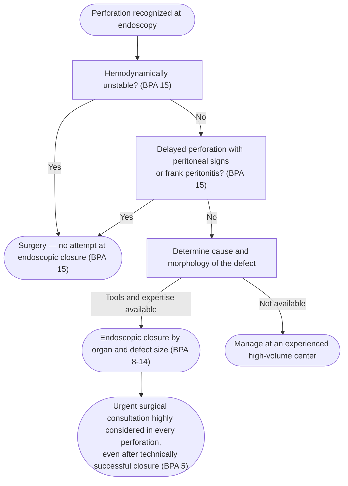

*What to do at the moment an endoscopist makes a hole — prevention, recognition, and closure, organ by organ. Single home for the size-keyed closure rule.*

> ⚠ **Evidence quality is low throughout.** All 16 statements in [[aga-2021-gi-perforations-endoscopic-management|American Gastroenterological Association (AGA) 2021]] are **Best Practice Advice (BPA) from expert opinion — no Grading of Recommendations Assessment, Development and Evaluation (GRADE) ratings**; the literature is retrospective.

## Contents
- [[#The Two Absolute Surgical Indications]]
- [[#First-Response Sequence]]
- [[#Closure Device by Defect Size]]
- [[#Procedures That Carry Increased Perforation Risk]]
  - [[#Perforation Rates by Procedure]]
- [[#Technique]]
- [[#Esophagus]]
- [[#Stomach]]
- [[#Duodenum and Periampullary]]
  - [[#Stapfer Classification of Post-ERCP Duodenal Perforation]]
  - [[#Type 1 — Lateral Duodenal Wall Tear]]
  - [[#Type 2 — Periampullary (Retroperitoneal)]]
  - [[#Duodenal Resection Defects]]
- [[#Colon]]
- [[#Aftercare and Documentation]]
- [[#See Also]]
- [[#Sources]]

---

## The Two Absolute Surgical Indications

*Surgical-versus-endoscopic triage at the moment a perforation is recognized*
*Source: built from AGA 2021 Best Practice Advice 5 and 15 and its practical-approach sequence (the update has no flowchart)*
*[[aga-2021-gi-perforations-endoscopic-management|AGA Clinical Practice Update on Endoscopic Management of Perforations in Gastrointestinal Tract (2021)]]*
*BPA = Best Practice Advice*

- **Know your limits before the case** — review surgical history, cross-sectional imaging and prior endoscopies, and rehearse the planned procedure with the team.

## First-Response Sequence

1. **Inform the staff** — trainees, colleagues, nurses, technicians, anesthesiologists.
2. **Confirm carbon dioxide (CO₂) insufflation, low flow** (BPA 3 — CO₂ encouraged for all endoscopic procedures, and used for all of them if available).
3. **Keep the perforation clean** (BPA 2) — aspirate liquids to prevent spillage of gastrointestinal (GI) contents into the defect; **reposition the patient to make the defect non-dependent** if needed; **minimize insufflation to avoid compartment syndrome**.
4. **Intravenous (IV) antibiotics covering Gram-negative and anaerobic organisms.**
5. **Determine cause and morphology** → size and site pick the device.

## Closure Device by Defect Size

**Size is the organizing decision of the whole document.**

| Organ | <2 cm | >2 cm | Stent or rescue |
|---|---|---|---|
| **Esophagus** (BPA 8) | Through-the-scope clips (TTSC) or over-the-scope clips (OTSC) | Endoscopic suturing | Fully covered self-expanding metal stent (SEMS) **only when primary closure is not possible**; endoscopic vacuum therapy for large or persistent defects and fistulas |
| **Stomach** (BPA 9) | TTSC or OTSC — TTSC optimal **<1 cm**, OTSC preferable **1–3 cm** | Endoscopic suturing, **or** TTSC + endoloop (body text: **>3 cm**) | Omental fat pulled into the lumen and clipped to the defect edges (selected cases) |
| **Duodenum** (BPA 10, 11) — AGA gives no 2 cm cut-off here | **Small defects:** TTSC, OTSC, band ligation or endoloop — clips close **88%–100%** of defects **<13 mm** | **Large defects:** suturing devices; **type 1 tear >3 cm → urgent surgical consultation** while feasibility of closure is assessed | Fully covered SEMS into the bile duct across the ampulla for **type 2**; enteral SEMS is the last endoscopic resort |
| **Colon** (BPA 13, 14) | TTSC or OTSC — **only if the bowel preparation is good and the patient is stable** | Suturing (needs an upper endoscope — not colonoscope-compatible) | **Right colon and cecum: TTSC only** |

AGA 2021 gives no defect-size bands for the colon beyond BPA 13 and 14.

**[[ercp|Endoscopic retrograde cholangiopancreatography (ERCP)]]-related perforation — [[asge-2026-ercp-adverse-events|ASGE 2026]] is newer and sizes it differently:**

- Nonampullary luminal defect **~10 mm or less → TTSC**; **larger → OTSC or suturing devices**; **≥30 mm** may still be targeted with suturing or over-the-scope devices where availability, familiarity and expertise are present, though historically managed surgically.
- **Periampullary or intraductal perforation → biliary stent** to seal the defect; if a SEMS is used in a patient with a normal pancreas, consider a **pancreatic duct stent to prevent post-ERCP pancreatitis**.
- **Confirm or exclude with imaging, preferably computed tomography (CT)** — contrast-enhanced is ideal, but a non-contrast study may be more readily obtained depending on the patient's condition. Use CO₂ rather than room air, position to divert luminal contents away from the defect, and consider a nasogastric tube to suction.

## Procedures That Carry Increased Perforation Risk

Know them before the case, so the consent conversation and team preparation happen up front (BPA 4). BPA 1 requires a **thorough discussion with the patient — preferably with family present — of the procedural techniques and risks**, especially for these:

- Any **dilation**; **foreign body removal** ([[ingested-foreign-body]]); any **per-oral endoscopic myotomy (POEM)** ([[zenkers-diverticulum|Zenker's]], esophageal, pyloric — [[poem]]); **stricture incision**; **thermal coagulation** for hemostasis or tumor ablation; **percutaneous endoscopic gastrostomy** ([[enteral-access]]); **[[ampullary-adenoma|ampullectomy]]**
- **[[endoscopic-mucosal-resection|Endoscopic mucosal resection (EMR)]]**, **[[endoscopic-submucosal-dissection|endoscopic submucosal dissection (ESD)]]**, **[[endoscopic-full-thickness-resection|full-thickness endoscopic resection]]**, **endoluminal stenting with SEMS** ([[colonic-stenting]])
- **ERCP in surgically altered anatomy**; **[[endoscopic-ultrasound|endoscopic ultrasound (EUS)]]–guided biliary and pancreatic access**; **EUS-guided cystogastrostomy**; **endoscopic gastroenterostomy using a [[lumen-apposing-metal-stents|lumen-apposing metal stent (LAMS)]]**

### Perforation Rates by Procedure

| Procedure | Perforation rate |
|---|---|
| [[esophageal-dilation\|Esophageal dilation]], simple ring or peptic stricture | **0.09%–2.2%** (higher for caustic or radiation strictures); [[pneumatic-dilation\|pneumatic dilation]] for [[achalasia]] **0.4%–14%** |
| EMR in [[barretts-esophagus\|Barrett's esophagus]] | **0%–3%** |
| POEM — delayed barrier failure or leak | **0.2%–1.1%** |
| Gastric ESD | **3.02%** (512/16,941) — **98% recovered without surgery**; delayed perforation **0.4%–0.7%** |
| ERCP | **<1%**, mortality **7.8%–9.9%** (AGA 2021); **0.5%** all-comers ([[asge-2026-ercp-adverse-events]]) |
| [[colonoscopy]] with [[polypectomy]] | **0.8 per 1000**; EMR of large colon polyps **1.5%** (96/6595); stricture dilation in [[crohns-disease\|Crohn's disease]] **3%** |
| Colorectal SEMS | **7.4%** overall, **20.4%** after post-stent dilation (4086 patients) — detail on [[colonic-stenting]] |

## Technique

- **Through-the-scope clips.** First clip at **the end of the defect distal to the endoscope**, to preserve the view of the remainder. **Apply suction before placing each clip** for tighter approximation.
- **Over-the-scope clips.** Mounting one increases scope tip diameter to **16.5–21 mm**; cap edges are not smooth — introduce **gently** through the hypopharynx, especially after head-and-neck surgery or cervical radiation. **Twin Grasper** (two independently opening jaws): grab one edge, pull it across, grasp the opposing edge, pull both into the suction cap, apply suction, then fire. May inadvertently capture adjacent organs or vessels beyond the GI wall.
- **Endoloop + clips.** TTSCs placed at equal distance fix a detachable snare around the defect; tighten the snare. Needs a double-channel scope.
- **Endoscopic suturing.** Obtains **full-thickness purchases** — arguably superior for large defects.
- **Through-the-scope tacking.** Suture-tethered tacks placed into healthy tissue beside the defect, then cinched — deep submucosal and intramuscular fixation of large or irregular colonic and small-bowel defects through a standard gastroscope or colonoscope. **No human studies** at the time of the update.
- **Fully covered SEMS.** Diameter **slightly wider than the native esophagus** — seal the defect without expanding it. **Secure the proximal end** by endosuturing or a stent-fixing device to prevent migration — essential in fistula, where no stricture holds the stent. **Uncovered SEMS should be avoided.**
- **Endoscopic vacuum therapy.** Polyurethane sponge, cut to shape, on a nasogastric tube. 11 studies, 210 patients: **90% healing for anastomotic leaks, 96% closure for esophageal perforations**; median therapy **17 days**.
- Lengthy procedures → **general anesthesia**.

> [!pitfall] An over-the-scope clip gives you one attempt
> Aim precisely. The **remOVE** cutting device can remove a deployed OTSC but has a **10–15 minute warm-up**, so re-deploying after a misfire costs significant time ([[aga-2021-gi-perforations-endoscopic-management]]).

## Esophagus

- **Non-iatrogenic causes:** caustic ingestion, sharp penetrating foreign bodies (e.g. fishbone), Boerhaave syndrome. **Iatrogenic:** dilation, EMR, ESD.
- **Risk factors in [[eosinophilic-esophagitis|eosinophilic esophagitis]]:** **history of food impaction** (odds ratio [OR] 14.9, 95% confidence interval [CI] 1.7–129.2) and **a focal stricture** (OR 4.6, 95% CI 1.1–19.7); most perforations in this group are **non-iatrogenic**.
- **Primary closure is the goal** — a fully covered SEMS only diverts flow and lets the defect heal by secondary intention, a longer and more drawn-out course. **OTSC** clinical success **85.3% (399/468)**; failure driven by **defects >2 cm** and **closure attempted >72 hours** after perforation.
- **POEM.** Small intraprocedural mucosal-flap perforations are common and usually inconsequential → TTSC. Rare large flap injuries with devitalized edges → TTSC, suturing, fibrin glue injection and/or stenting; emergency esophagectomy has been reported for severe perforation. The dangerous complication is **delayed barrier failure** → leak, mediastinitis, peritonitis. **Stenting after POEM is discouraged** — erosion through the myotomy, high migration rate, inadequate seal at the patulous post-POEM esophagogastric junction. *Tunnel technique and orientation: [[poem]].*
- **Esophagectomy leaks** (within days of operation): attempt primary closure with TTSC, OTSC or endosuturing, **plus** a fully covered stent. **Esophageal fistula:** clips or endosuturing alone are usually ineffective → fully covered stent with a snug fit.

## Stomach

- **Non-iatrogenic causes:** [[peptic-ulcer-disease|peptic ulcer disease]], caustic ingestion. **High-risk procedures:** EMR and ESD.
- **The proximal gastric wall is thinner than the antrum** — extra caution for proximal resections. Most EMR/ESD perforations are intraprocedural.
- **ESD perforation risk factors:** lesion location (**upper third, middle third, greater curvature**); **lesion size >20 mm**; depth of invasion; **submucosal fibrosis**; endoscopist's prior workload; **procedure length >60–120 min**; octogenarian patients; **piecemeal resection**.
- **Closure yields:** combined OTSC + TTSC closed post-ESD mucosal defects in **91.3% (11/12)**, facilitating early discharge; endosuturing succeeded in **31/31** patients (58.1% gastric, 41.9% rectal ESD) with no delayed bleeding or perforation.
- **Abdominal compartment rescue:** if the gastric lumen will not insufflate and the abdomen is tense, place a **16–18 gauge angiocath percutaneously into the peritoneum** to decompress and recover luminal insufflation. Percuss the left upper and mid-to-low abdomen for a tympanitic area; for a **duodenal bulb** perforation the entry point is roughly **3–5 cm below the umbilicus**. Clean with alcohol; introduce the needle slowly, monitoring air flow.

## Duodenum and Periampullary

**Why the duodenum is the highest-risk site:** thin wall; the anatomic challenge of the C-loop; paradoxical endoscope motion; and **luminal exposure to pancreatic proteolytic enzymes**, which pool in the duodenum and break down exposed muscle at an EMR/ESD base — the mechanism of **delayed** perforation.

- **Iatrogenic causes:** duodenal stricture dilation, EMR (including ampullectomy), ESD, EUS, ERCP. *ERCP-specific risk factors and the prevention technique for surgically altered anatomy: [[ercp]].*
- **Delayed recognition >6 hours after ERCP** is associated with increased length of stay, increased mortality, and more complicated surgery.
- **Large duodenal polyps** (BPA 12): **EMR only by experienced endoscopists, ESD only by experts** — both require proficiency in resection *and* mucosal-defect closure to manage immediate and delayed perforation ([[nonampullary-duodenal-adenoma]]).

### Stapfer Classification of Post-ERCP Duodenal Perforation

**Mechanism and anatomic location together define the type, and the type predicts the need for surgery** — descending severity ([[stapfer-2000-duodenal-perforation-ercp]]). The wiki uses the paper's roman numerals; AGA 2021 writes the first two as "type 1" and "type 2".

| Type | Location | Mechanism | Character | Management in the derivation series |
|---|---|---|---|---|
| **I** | Lateral or **medial duodenal wall** | The **endoscope** (shaft or tip) | Large, **remote from the ampulla**; persistent leak | **Immediate surgery for all** |
| **II** | **Peri-Vaterian** (periampullary, retroperitoneal) | **Sphincterotomy** beyond the intraduodenal ampulla | Usually **discrete**; 43% needed surgery | Nonsurgical **only if** an early contrast study shows minimal extravasation or a sealed perforation **and no fluid collection** |
| **III** | **Distal bile duct** | **Guidewire or basket** near an obstructing stone | Often **small** | As type II |
| **IV** | **Retroperitoneal air alone** | Probably **compressed air** keeping the lumen patent | **Not a true perforation** | **None**, if the abdominal examination is normal and no extravasation was seen at ERCP |

- Nonsurgical management succeeded in **5 of 8 (62%)** type II/III lesions; the **3 of 8 (38%)** that failed needed a mean of **3.6** reoperations each and a median stay of **111 days**, against **17 days** for nonsurgical success and **14 days** for primary surgery.
- **Types II, III or IV with retained stones and unrelieved biliary obstruction, or retained foreign bodies, should still be explored** even with no other indication.

**Surgical indications — any one of five:**

1. **Large contrast extravasation at ERCP** — contrast **still present after 1 minute** on follow-up plain film. **Minimal** leak (contrast **gone within 60 seconds**) → water-soluble upper gastrointestinal contrast study (UGI) at **2–8 h**; **extravasation there → explore.**
2. **Follow-up CT showing a retroperitoneal or peritoneal fluid collection** consistent with perforation — **not** with pancreatitis.
3. **Cholelithiasis, choledocholithiasis, or retained hardware** (stones, basket, wire).
4. **Massive subcutaneous emphysema** after ERCP with what looked endoscopically like a **large duodenal diverticulum**.
5. **Failure of nonsurgical management.**

**Surveillance if managed nonsurgically:** repeat **UGI within 8 h**; **double-contrast CT at 8 h and 48 h**, repeated until recovery is certain. The decision not to operate is **dynamic**.

> [!pitfall] A benign abdomen does not exclude surgery
> These injuries are retroperitoneal. **Abdominal examination is unhelpful in the first few hours** (71% had only mild tenderness) and **fever and leukocytosis alone are not an indication for surgery** (leukocytosis in 9 of 10 patients tested, regardless of outcome). *Early* peritonitis should dictate surgery; late peritonitis marked a poor outcome. **3 of the 14 perforations (21%) were mistaken at ERCP for a duodenal diverticulum** ([[stapfer-2000-duodenal-perforation-ercp]]).

⚠ The classification rests on a **single-center retrospective series of 14 patients from the 1990s, predating every modern closure device**; the endoscopic options below are newer and govern management.

### Type 1 — Lateral Duodenal Wall Tear

- Most often on scope advancement, where the shaft presses on the duodenal wall or a periampullary diverticulum, or on forceful retraction during difficult stone extraction.
- **Presentation:** sudden bleeding, lumen deflation, difficulty maintaining insufflation.
- **Usually requires surgery** unless early endoscopic closure succeeds; **>3 cm → urgent surgical consultation** while feasibility is assessed (BPA 10). Where closure succeeds, **>90%** recover without surgery.
- Enteral SEMS is the last resort — ⚠ **covered duodenal stents were not available in the US** as of 2021; fully covered through-the-scope esophageal stents have been used, sutured proximally.

### Type 2 — Periampullary (Retroperitoneal)

- **Closure:** TTSCs if feasible, and/or a **fully covered SEMS into the bile duct across the ampulla**.
- **Course:** patients declare within **24–48 h** (worsening abdominal pain or systemic inflammatory response). If improving, at **2–4 days** a water-soluble upper GI series or CT with oral contrast confirms no extravasation before clear liquids.
- ⚠ **Asymptomatic retroperitoneal air after ERCP may need no intervention** — **14% (7/50)** had CT retroperitoneal air with uneventful recovery. But type 2 can still cause retroperitoneal abscess, peritonitis and death.

> [!pitfall] Type 2 perforations are subtle and easily missed
> Carefully assess the **fluoroscopic gas pattern under the liver or around the right kidney**, and **request a CT scan** if concerned — delay in treatment is the harm (BPA 11).

> [!howto] Sphincterotomy technique that prevents a type 2 tear
> 1. Minimize the length of cutting wire in contact with the ampulla.
> 2. Use **stepwise incisions**.
> 3. Direct the force and direction of the cut with the **right hand on the scope shaft, creating counter-clockwise torque** — not by lifting the elevator or bowing the sphincterotome.
> 4. **Terminate the sphincterotomy just before the flat transverse duodenal mucosa** cephalad of the papillary mound.
> 5. Use newer generators with controlled, pulsed-blended current to reduce "zipper cuts" ([[electrosurgery]]).

### Duodenal Resection Defects

- Closure modalities: TTSC, OTSC, endosuturing, polymer gels or sheets, TTSC + endoloop cinching, and covering the defect with **Vicryl mesh** affixed by TTSCs.
- If a large post-EMR duodenal defect **cannot** be closed → **admit with close observation for delayed perforation**.
- **Nasopancreatic tube** placement may prevent delayed perforation by diverting pancreatic secretions away from the defect — weigh against the risks of duodenoscope passage, pancreatitis, and drain dislodgement.

## Colon

- **Non-iatrogenic causes:** [[diverticulitis]], [[inflammatory-bowel-disease|inflammatory bowel disease]], rarely colonic obstruction. **Iatrogenic:** endoscopic resection, hot forceps biopsy, stricture dilation (Crohn's, radiation), [[colonic-stenting|colonic stenting]], and **forceful scope advancement** across angulations, into diverticula, or without scope straightening.
- **Site distribution** (systematic review, 19 studies, 744 perforations) — **the sigmoid dominates because of direct trauma from forceful scope advancement** (BPA 13): sigmoid **63.8%** (310) › cecum 10% (49) › transverse 9% (44) › rectum 7% (34) › ascending 5.6% (27) › descending 4.4% (21) › hepatic flexure 0.2% (1).
- **Management:** intraprocedural perforation in a **stable** patient with a **clean** site and **no spillage** → attempt endoscopic closure. A **rectal** perforation gives the most time and space for TTSC, OTSC or suturing. In the systematic review, endoscopic clipping was used in **114 cases (15.4%)** and conservative management in **71 (9.1%)**; the remainder were surgical.
- **Cecum / tortuous or unclean colon → TTSC only** (BPA 14): withdrawing the colonoscope to fit an OTSC may be difficult and dangerous, and a suturing device may not reach.
- **Large sigmoid tears from blunt scope trauma** (lumen collapse, bleeding, inability to keep the lumen insufflated), hemodynamic instability, or delayed perforation with peritoneal signs → **surgery** (BPA 15).

> [!howto] EMR of a large colon polyp — the five steps that prevent a perforation
> 1. Inject a solution **more viscous than normal saline** — succinylated gelatin, hydroxyethyl starch, or glycerol.
> 2. Consider **partially reopening and closing the snare before resection** to let the muscularis propria fall back down.
> 3. **Inspect the resection base** for muscularis propria injury — look for the **target sign**.
> 4. **Recognize and close muscularis propria injury or perforation early.**
> 5. Submucosal injection fails to lift the polyp → consider **full-thickness resection** with a full-thickness resection device ([[aga-2021-gi-perforations-endoscopic-management]]).

## Aftercare and Documentation

- **All upper GI perforations** (BPA 6) — consider admission for observation, plus **IV fluids**, **nothing by mouth**, **broad-spectrum antibiotics** (Gram-negative and anaerobic coverage), **nasogastric tube** (with some exceptions), and **surgical consultation**.
- **Before clear liquids** (upper GI perforations), consider a **water-soluble upper GI series** to confirm there is no continuing leak at the perforation site (BPA 7).
- **Documentation (BPA 16)** — **accurate documentation**, **prompt discussion with the patient and family**, and **swift reporting to the institution's quality officer (or equivalent) and risk management team** (in major adverse events).

---

## See Also

[[colonoscopy]], [[upper-endoscopy]], [[ercp]], [[polypectomy]], [[endoscopic-mucosal-resection]], [[endoscopic-submucosal-dissection]], [[colorectal-esd]], [[endoscopic-full-thickness-resection]], [[poem]], [[pneumatic-dilation]], [[esophageal-dilation]], [[colonic-stenting]], [[endoscopic-hemostasis]], [[endoscopic-ultrasound]], [[electrosurgery]], [[eosinophilic-esophagitis]], [[achalasia]], [[barretts-esophagus]], [[ingested-foreign-body]], [[enteral-access]], [[ampullary-adenoma]], [[nonampullary-duodenal-adenoma]], [[diverticulitis]], [[crohns-disease]], [[peptic-ulcer-disease]], [[antibiotic-prophylaxis-endoscopy]]

---

## Sources

1. [[aga-2021-gi-perforations-endoscopic-management|AGA Clinical Practice Update on Endoscopic Management of Perforations in Gastrointestinal Tract: Expert Review (2021)]]
2. [[asge-2026-ercp-adverse-events|Adverse Events Associated With ERCP and ERCP-Related Procedures (ASGE, 2026)]]
3. [[stapfer-2000-duodenal-perforation-ercp|Management of Duodenal Perforation After Endoscopic Retrograde Cholangiopancreatography and Sphincterotomy]]
