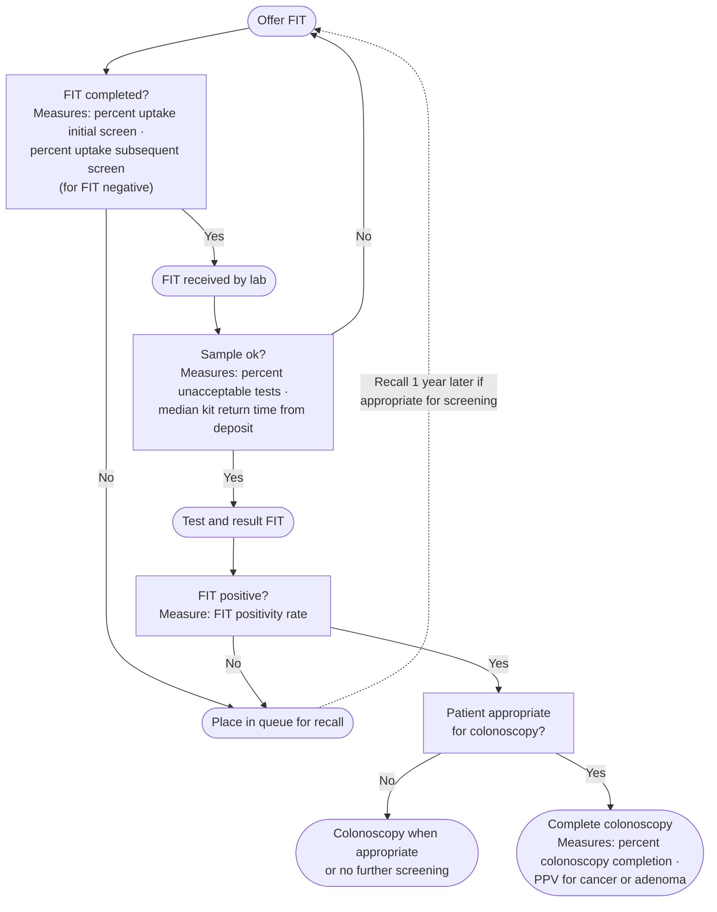

The fecal immunochemical test (FIT) as a **primary screening modality for average-risk individuals** — performance, threshold, sampling, interval, positive-test follow-up and programmatic quality. Where FIT sits among the screening options, and the start/stop ages, belong to [[colorectal-cancer-screening]]; post-polypectomy and post-resection use is on [[colonoscopy-surveillance]] and [[colorectal-cancer]].

## Contents
- [[#Overview and Rationale]]
- [[#Performance Characteristics — Single Application]]
- [[#Threshold (Hemoglobin Cut-off Value)]]
- [[#Qualitative vs Quantitative]]
- [[#Number of Samples]]
- [[#Interval]]
- [[#FIT vs gFOBT]]
- [[#Follow-up of a Positive FIT]]
- [[#Practical Considerations]]
- [[#Programmatic Quality Targets]]
- [[#Relation to the 2021 Guidelines]]
- [[#See Also]]
- [[#Sources]]

---

## Overview and Rationale

FITs measure human hemoglobin directly in stool using antibodies against the globin moiety. Unlike the guaiac-based fecal occult blood test (gFOBT), FIT:

- Is not confounded by dietary peroxidase activity — **no dietary restriction required** (Strong; Moderate)
- Requires fewer samples (usually 1 or 2 vs. 3 for gFOBT)
- Has superior sensitivity for [[colorectal-cancer|colorectal cancer (CRC)]] and advanced neoplasia
- Has superior adherence (~10% absolute increase in ≥4 randomized controlled trials (RCTs); ~20% greater participation in 2 meta-analyses)

American College of Gastroenterology (ACG) 2021 recommends **[[colonoscopy]] and FIT as the primary screening modalities** (Strong; low-quality evidence), with **FIT every 1 y** and colonoscopy every 10 y (Strong; low-quality evidence) [[acg-2021-crc-screening]]; United States Multi-Society Task Force (USMSTF) 2021 positions colonoscopy every 10 y or annual FIT as tier-1 options.

## Performance Characteristics — Single Application

**For CRC (meta-analysis of 19 studies, asymptomatic average-risk adults):** [[usmstf-2016-fit-screening]]

- Pooled sensitivity: **~79%** (95% confidence interval (CI), 0.69–0.86)
- Pooled specificity: **~94%** (95% CI, 0.92–0.95)
- With colonoscopy as reference standard only: sensitivity 77%, specificity 94%
- OC FIT-CHEK (large US study, n=9,989 undergoing colonoscopy): sensitivity 74%, specificity 96%

**For advanced adenoma (single application):** [[usmstf-2016-fit-screening]]

- Sensitivity: **~20–30%** typical (range 6–56% depending on brand and cut-off); specificity 68–99% across studies
- Implication: single-application FIT is a poor screen for advanced adenomas; repeated annual application is required to meaningfully accumulate detection of precancerous lesions

**USMSTF 2016:** because one-time FIT is ~80% sensitive for cancer but only ~20–30% for advanced neoplasia, **we recommend repeated testing**; patients choosing FIT should understand that testing recurs and that a positive result needs colonoscopy — **Strong recommendation; moderate-quality evidence.** When FIT is positive, do colonoscopy, **not a repeat FIT** — **Strong; moderate.** [[usmstf-2016-fit-screening]]

## Threshold (Hemoglobin Cut-off Value)

| Cut-off range | Effect on sensitivity (CRC) | Effect on specificity | Positivity rate (1-sample) |
|---|---|---|---|
| <20 µg Hgb/g feces | 0.86 (95% CI, 0.75–0.92) | 0.91 (0.89–0.93) | 5.3–14.2% |
| 20–50 µg/g | Not reported | Not reported | 1.4–7.5% |
| >50 µg/g | 0.67 (95% CI, 0.59–0.74) | 0.96 (0.94–0.98) | Not reported |

- In the meta-analysis, <20 µg/g gave the best combination of sensitivity and specificity for CRC
- **Task Force favors a lower cut-off** (Table 7: "20 µg/g or lower"; text: <20 µg/g), weighing performance, cost-effectiveness, FIT device, and the program's colonoscopy resources — **Weak recommendation; low-quality evidence** [[usmstf-2016-fit-screening]]
- Including 20 µg/g partly reflects the threshold of the commonly available US quantitative test
- Individuals with fecal hemoglobin >177 µg/g are ~4× more likely to harbor advanced neoplasia (odds ratio (OR) 3.80; 95% CI, 3.07–4.71)

## Qualitative vs Quantitative

- **Quantitative FIT preferred** over qualitative — **Weak recommendation; low-quality evidence** [[usmstf-2016-fit-screening]]
- Rationale: automated reading, adjustable thresholds, better quality control
- Pooled sensitivity: quantitative 77% vs. qualitative 85% for CRC; specificity similar (~94% both)
- US Food and Drug Administration (FDA)–cleared quantitative systems in the US (as of 2016): OC-Auto Micro 80, OC-Sensor Diana (Polymedco), i-Chroma (Boditech)

## Number of Samples

- **1-sample annual approach is suggested** — **Weak recommendation; low-quality evidence** [[usmstf-2016-fit-screening]]
- 2-sample FIT associated with higher advanced neoplasia detection in some studies (4.1% vs. 3.1%), but 1-sample is simpler and cost-effectiveness modeling (MISCAN-Colon) favored 1-sample annually
- Pooled sensitivities for CRC: 1-sample 0.79, 2-sample 0.77, 3-sample 0.80 — no meaningful difference by sample number

## Interval

- **Annual** (part of the 1-sample annual suggestion above)
- Programmatic annual gFOBT reduces CRC-related mortality by up to 33%
- Optimal FIT interval unclear — 2 RCTs of annual vs biennial ongoing at publication; modeling: annual high-sensitivity FIT gives life-years similar to colonoscopy every 10 years; Dutch program: advanced neoplasia detection unaffected by intervals of 1–3 years

## FIT vs gFOBT

- **Use FIT over gFOBT** — **Strong recommendation; high-quality evidence** [[usmstf-2016-fit-screening]]
- Meta-analysis: cancer detection relative risk (RR) 1.96 (1.2–3.2); advanced neoplasia detection RR 2.28 (95% CI, 1.68–3.10); adherence RR 1.16 (95% CI, 1.03–1.30)
- FIT sensitivity for CRC ~2× gFOBT (73.3% vs. 33.3%) with similar specificity (>95%)

## Follow-up of a Positive FIT

- **Colonoscopy is the recommended test for follow-up of a positive FIT** in screen-eligible individuals — **Strong recommendation; moderate-quality evidence** [[usmstf-2016-fit-screening]]
- Computed tomographic colonography (CTC) (sensitivity ≥6 mm 89%, specificity 75.4%) and colon [[capsule-endoscopy|capsule endoscopy]] (sensitivity 95%, specificity 65%; complete in 73%) have been studied after a positive stool test; specificity is the weakness
- **A positive FIT + negative colonoscopy should NOT prompt upper gastrointestinal (GI) evaluation** in the absence of signs/symptoms of upper GI pathology or [[iron-deficiency-anemia|iron-deficiency anemia]] — **Weak recommendation; very low quality evidence**
- **A positive FIT after a recent colonoscopy** (before repeat endoscopy is due): generally offer repeat colonoscopy, weighing clinical context, patient factors (advanced-neoplasia risk, preference), and prior exam quality ([[bowel-preparation|prep]], endoscopist adenoma detection rate (ADR)) — **Weak recommendation; low-quality evidence**
- Positive predictive value (PPV) for cancer from positive FIT: 2.9–7.8% (range across programs, round 1); PPV for advanced neoplasia: 33.9–54% (round 1)

> [!pitfall] A positive FIT is a colonoscopy, not a second FIT
> Repeating the FIT after a positive result is the commonest way a programme loses a cancer, and the Task Force rules it out explicitly (Strong; moderate). The same logic applies to a positive FIT with a negative colonoscopy: **do not reflex to upper endoscopy** without upper GI symptoms or iron-deficiency anemia ([[usmstf-2016-fit-screening]]).

## Practical Considerations

| Issue | Recommendation | Strength | Evidence |
|---|---|---|---|
| Dietary/medication adjustment | Not required — instruct patients explicitly | Strong | Moderate |
| Sample collection | Spontaneously passed stool; NOT an in-office digital rectal examination (DRE) sample | Weak | Very Low |
| Sample return time | No strong evidence that delays up to 10 days harm performance; tell participants to return the kit promptly (preferably within 24 h of sampling); programs monitor return times and request a repeat sample when outside the manufacturer's limit | Weak | Very Low |
| Ambient temperature / season | Need not adjust distribution or mailing for temperature; follow manufacturer storage and transport specifications | Weak | Low |

## Programmatic Quality Targets

[[usmstf-2016-fit-screening]]

| Metric | Target |
|---|---|
| FIT completion rate among those offered testing | ≥60% |
| Proportion of returned FITs unprocessable by lab | <5% |
| Colonoscopy completion rate for FIT-positive individuals | ≥80% |

**ADR on follow-up colonoscopy after a positive FIT** is a distinct benchmark from the screening-colonoscopy ADR, and lives with the other detection targets on [[colonoscopy-quality-indicators]].

*Key processes in a FIT-based program and the quality measure at each step*
*Source: redrawn from the USMSTF 2016 FIT process-flow figure*
*[[usmstf-2016-fit-screening|USMSTF 2016 FIT Screening]]*
*FIT = fecal immunochemical test · PPV = positive predictive value*

## Relation to the 2021 Guidelines

[[acg-2021-crc-screening]] and USMSTF 2021 do not supersede the FIT-specific operational guidance in the 2016 document. Where they differ on topics covered by both:

- **Screening start age:** use the 2021 values (age 45–50; see [[colorectal-cancer-screening]])
- **Modality ranking:** the 2021 guidelines position colonoscopy and FIT as co-equal preferred options; the 2016 document predates this framing but is consistent with it
- **FIT performance data, cut-off recommendations, programmatic quality targets:** the 2016 document remains the primary source — no conflicting 2021 data on these specific points

---

## See Also

[[colorectal-cancer-screening]], [[colorectal-cancer]], [[colonoscopy]], [[colonoscopy-quality-indicators]], [[colonoscopy-surveillance]], [[capsule-endoscopy]], [[iron-deficiency-anemia]], [[bowel-preparation]]

---

## Sources

1. [[usmstf-2016-fit-screening|USMSTF 2016 — Recommendations on Fecal Immunochemical Testing to Screen for Colorectal Neoplasia]]
2. [[acg-2021-crc-screening|ACG 2021 Colorectal Cancer Screening Guidelines]]
