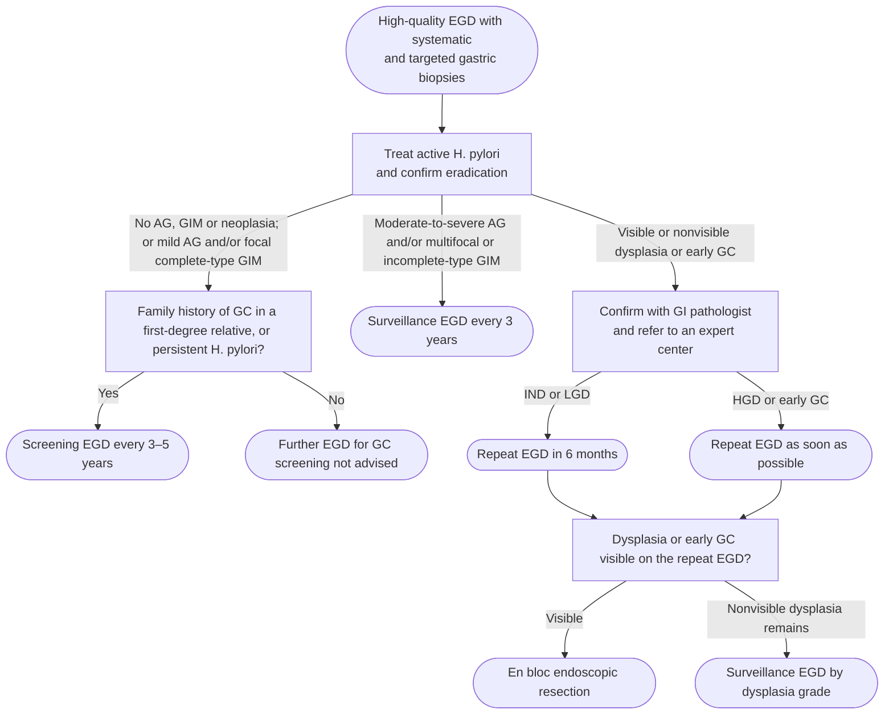

## Contents
- [[#Overview]]
- [[#Who to Screen (high-risk populations)]]
- [[#H. pylori — Primary Prevention]]
- [[#Modality — High-Quality EGD + Biopsy]]
- [[#Surveillance Intervals by Finding]]
  - [[#Branch Criteria]]
  - [[#Dysplasia and Early Gastric Cancer]]
  - [[#Residual Nonvisible Dysplasia After Second-Look]]
- [[#Type I Gastric Carcinoids (in AG)]]
- [[#Health Equity]]
- [[#See Also]]
- [[#Sources]]

## Overview

Screening and surveillance framework for **noncardia intestinal-type [[gastric-adenocarcinoma|gastric cancer]] (GC)** in individuals at increased risk in the United States (US), per the [[aga-2025-gastric-cancer-screening|American Gastroenterological Association (AGA) 2025 clinical practice update (CPU)]] — GC primarily related to chronic [[helicobacter-pylori-infection|H. pylori]] infection, but also encompassing autoimmune gastritis. There are **no established US GC screening guidelines**; guidance is expert opinion built on largely indirect (East Asian) evidence. **Cardia GC and [[hereditary-diffuse-gastric-cancer|hereditary diffuse gastric cancer]] are out of scope** (cardia GC mirrors distal esophageal/gastroesophageal junction adenocarcinoma in epidemiology and risk factors).

Two-pronged prevention:

- **Primary prevention** = H. pylori eradication (adjunct, not stand-alone).
- **Secondary prevention** = endoscopic screening + surveillance of premalignant conditions ([[atrophic-gastritis]], [[gastric-intestinal-metaplasia]], dysplasia) along the [[gastric-premalignant-conditions|Correa cascade]].

**Endoscopy is the only currently acceptable US screening modality** — direct visualization to stage the mucosa + biopsy for histologic staging. Simple age-based universal screening is not cost-effective. US 5-year GC survival is 32% (<25% caught early); by contrast, programmatic screening in Japan/South Korea drove early-stage diagnosis to 60%–70% and survival >70%. A meta-analysis of 10 Asian observational studies (342,013 people) found endoscopic screening associated with a **42% reduction in GC mortality** (relative risk [RR] 0.58; 95% confidence interval [CI] 0.48–0.70).

---

## Who to Screen (high-risk populations)

Per [[aga-2025-gastric-cancer-screening]], no universal screening — a **personalized approach** in individuals **≥45 years** with risk factors. Identifiable high-risk groups:

- **First-generation / early-generation immigrants** from moderate-to-high incidence GC regions (GC incidence ≥10–12 per 100,000) — includes East Asia, Eastern Europe, Andean Latin America
- **Family history of GC in a first-degree relative** (begin screening 10 years earlier than the youngest affected relative)
- **Non-White racial/ethnic groups** with established moderate-to-high GC incidence (noncardia GC incidence 2- to >10-fold higher than non-Hispanic White; Korean Americans ≥50 up to 14.5-fold higher)
- **Chronic H. pylori infection AND ≥1 of:** >20 pack-year tobacco use; chronic high-salt / red-processed-meat diet; living under persistent US poverty (≥20% of residents below federal poverty level over a 4-decade period)
- **Hereditary gastrointestinal (GI) polyposis / cancer syndromes** — [[familial-adenomatous-polyposis|familial adenomatous polyposis (FAP)]], [[peutz-jeghers-syndrome|Peutz-Jeghers]], [[juvenile-polyposis-syndrome|juvenile polyposis]], [[mutyh-associated-polyposis|MUTYH-associated polyposis]], gastric adenocarcinoma and proximal polyposis of the stomach (GAPPS); [[lynch-syndrome|Lynch]], [[brca-pathogenic-variants|hereditary breast/ovarian cancer]], Li-Fraumeni

**Age of initiation:** ~**45 years** proposed (aligns with average-risk [[colorectal-cancer-screening|colorectal cancer (CRC) screening]] → [[upper-endoscopy|esophagogastroduodenoscopy (EGD)]] at time of screening [[colonoscopy]]; mirrors high-risk-country eligibility: South Korea ≥40, Japan 40–50). Optimal age not evidence-established. Individualize earlier for hereditary syndromes and first-degree family history.

**Fitness gate (Best Practice Advice [BPA] 14):** Only individuals **fit for endoscopic or potentially surgical treatment** should be screened/surveilled; stop once no longer fit. There is **no strict age or comorbidity threshold** for de-escalation — balance life expectancy, expected benefit of continued screening, complication risk, and patient preference.

---

## H. pylori — Primary Prevention

- H. pylori is the most common infectious carcinogen (~90% of global GC burden). Eradication → **46% ↓ GC incidence** (RR 0.54; number needed to treat [NNT] 72) and **39% ↓ GC mortality** (RR 0.61; NNT 135) in non-US randomized controlled trial (RCT) meta-analysis.
- **Opportunistic screening** for H. pylori in individuals at increased GC risk (nonserologic testing). **All** adults who test positive warrant eradication regardless of symptoms (barring contraindications/limited life expectancy). Confirm eradication ≥4 weeks after treatment.
- **Familial-based testing:** screen adult household members of anyone who tests positive — whole-family [[test-and-treat]] had 3-fold higher eradication success and ~70% lower recurrence.
- Benefit is greatest **before** precancerous change: 63% ↓ GC risk when eradicated with no gastric precancer at baseline vs 43% ↓ overall irrespective of histology (non-US RCT, ~27 y of endoscopic follow-up).

> [!pitfall] Eradication does not close out surveillance
> Individuals with more advanced histologic changes stay at risk of neoplastic progression even after H. pylori is eradicated — eradication is an adjunct to endoscopic screening and surveillance, never a stand-alone prevention strategy ([[aga-2025-gastric-cancer-screening]]).

See [[helicobacter-pylori-infection]] for eradication regimens.

---

## Modality — High-Quality EGD + Biopsy

**High-quality upper endoscopy** components (BPA 3): high-definition (HD) white-light endoscopy **with image enhancement** (narrow-band imaging [NBI], linked color imaging [LCI]), **gastric mucosal cleansing**, **insufflation** for complete mucosal visualization, adequate **inspection time**, **photodocumentation**, and a **systematic biopsy protocol** when appropriate. Early-GC endoscopic miss rate is consistently ~10% (higher among inexperienced endoscopists). NBI/LCI without magnification: sensitivity/specificity for gastric intestinal metaplasia (GIM) exceeding 85%–90%.

**GIM and dysplasia are endoscopically detectable (BPA 6)** — but are often missed when the endoscopist is unfamiliar with their visual features; US training in lesion detection is an unmet need. [[artificial-intelligence-endoscopy|Artificial intelligence (AI)]] tools for early gastric neoplasia detection in an adequately visualized stomach are promising but too preliminary for routine use.

**Biopsy protocol — updated Sydney System (BPA 5):** minimum **5 total biopsies**; samples from **antrum/incisura** and **corpus** in **separately labeled jars** (jar 1 "antrum/incisura", jar 2 "corpus"); any suspicious area described and biopsied **separately**.

**Pathology documentation (BPA 7):** at minimum — presence/absence of H. pylori, severity of atrophy and/or metaplasia, and histologic **subtyping of GIM** (if applicable). Endoscopists should reach consensus with local pathologists on consistent reporting.

---

## Surveillance Intervals by Finding

The index finding sets the interval — after a high-quality EGD with systematic biopsies, with active H. pylori treated and eradication confirmed. Decision inputs: **atrophic gastritis (AG)** severity, **GIM** subtype and extent, and dysplasia grade — **indefinite for dysplasia (IND)**, **low-grade dysplasia (LGD)**, **high-grade dysplasia (HGD)** — or **early GC (EGC)**. Every confirmed AG with or without GIM is risk-stratified before an interval is chosen (BPA 9). Recurring caveat throughout: **intervals are "not well defined."**

*Index screening endoscopy to surveillance interval in individuals at increased gastric cancer risk*
*Source: redrawn from Figure 1 of the AGA 2025 clinical practice update*
*[[aga-2025-gastric-cancer-screening|AGA 2025 Clinical Practice Update: Screening and Surveillance in Individuals at Increased Risk for Gastric Cancer in the United States]]*
*AG = atrophic gastritis · GIM = gastric intestinal metaplasia · GC = gastric cancer · EGD = esophagogastroduodenoscopy · GI = gastrointestinal · IND = indefinite for dysplasia · LGD = low-grade dysplasia · HGD = high-grade dysplasia*

### Branch Criteria

- **3-year surveillance branch** — any of: **moderate-to-severe AG** of antrum or corpus (with or without GIM); **multifocal, incomplete- or mixed-type GIM** (vs complete-type only); **corpus-extended GIM** (= corpus involved in addition to antrum and/or incisura). Particularly when other GC risk factors (e.g. family history) are present. Surveillance every 3 years "should be considered" — evidence-based intervals are not well defined.
- **Shorter than 3 years** may be advisable with multiple risk factors or severe corpus-extended GIM — progression in those cases is often found **within 2 years** of the previous endoscopy.
- **Established or suspected hereditary syndrome** conferring GC risk: endoscopic surveillance continues at the interval set by that syndrome, whatever the index findings.
- AG/GIM **severity grading** and **GIM subtyping** must be documented (BPA 7) but are not defined by this CPU — criteria, the Operative Link on Gastritis Assessment (OLGA)/Operative Link on Gastric Intestinal Metaplasia Assessment (OLGIM) stage bands, and Kimura-Takemoto live on [[atrophic-gastritis#Severity Assessment|atrophic gastritis]] and [[gastric-intestinal-metaplasia]], which also carry lesion-level management and the American College of Gastroenterology (ACG) 2025 / AGA 2021 / AGA 2026 interval concordance. AG/GIM surveillance beyond the screening decision is **out of scope** for this CPU.

### Dysplasia and Early Gastric Cancer

- **Confirm all dysplasia with an experienced GI pathologist** — ~40% of IND is reclassified on re-review (to negative, or upgraded to LGD or HGD). Refer visible *and* nonvisible dysplasia to an endoscopist or center with expertise in gastric neoplasia.
- **IND/LGD with H. pylori:** treat and confirm eradication, then repeat endoscopy with biopsies — visual and histologic discernment improve once inflammation subsides. For HGD/EGC eradication is essential but **must not delay** intervention.
- **Visible dysplasia or EGC → en bloc, R0 endoscopic resection.** Use [[endoscopic-submucosal-dissection|endoscopic submucosal dissection (ESD)]] rather than [[endoscopic-mucosal-resection|endoscopic mucosal resection (EMR)]] for confirmed or suspected HGD and for lesions that are **depressed, ulcerated, and/or ≥20 mm** (more likely to harbor carcinoma); EMR only in select scenarios — lesions <1 cm or confirmed IND histology. Counsel beforehand that surgery may follow if cancer is found.
- **Post-resection (BPA 12):** all resected gastric dysplasia or cancer gets ongoing surveillance; suggested intervals depend on lesion histology and whether R0 was achieved, and surveillance continues **indefinitely** after resected HGD or GC unless health status or preference dictates otherwise (US data limited). Post-curative-ESD intervals: see the AGA CPU on ESD.

> [!pearl] Biopsy grade under-calls a quarter of dysplastic lesions
> Nearly 25% of lesions read as LGD on biopsy were upstaged after complete endoscopic resection — 17% to HGD, 7% to carcinoma — which is why visible dysplasia is resected en bloc rather than simply surveyed ([[aga-2025-gastric-cancer-screening]]).

### Residual Nonvisible Dysplasia After Second-Look

Nonvisible IND/LGD → repeat high-quality EGD with image-enhanced endoscopy within **6 months** (ideally H. pylori eradicated first; the second look detects focal neoplastic lesions in 90% of patients). Nonvisible HGD → second look **as soon as possible** (high synchronous-cancer risk). If the second look again confirms nonvisible dysplasia, repeat EGD with image-enhanced endoscopy plus systematic and targeted biopsies at:

| Finding | Surveillance EGD interval |
|---|---|
| IND | **1 year** (12 months) |
| LGD | **6–12 months** |
| HGD | **3 months** |
| Nonvisible GC | Multidisciplinary discussion; **consider surgery** |

---

## Type I Gastric Carcinoids (in AG)

Type I [[gastroenteropancreatic-neuroendocrine-tumors|gastric neuroendocrine tumors (gNETs)]] arise in corpus atrophy → hypergastrinemia; typically indolent (BPA 13):

| Size | Management |
|---|---|
| <1 cm | May consider endoscopic resection |
| 1–2 cm | Endoscopically resect (endoscopist with resection expertise); [[endoscopic-ultrasound\|endoscopic ultrasound (EUS)]] for larger lesions to assess depth and local metastasis |
| >2 cm, **or** unfavorable histology (World Health Organization grade II or higher) | Metastasis risk → EUS + cross-sectional imaging + multidisciplinary tumor board; surgical resection if >2 cm, invasion past the submucosa, and/or lymph node metastasis |

Type is assigned by serum gastrin (elevated vs normal), surrounding mucosa (atrophic vs nonatrophic), anatomic location, and focality — type II (gastrinoma-driven) and type III gNETs are out of scope for this CPU. Surveillance is advised but intervals are not well defined; lesion-level management detail lives on the neuroendocrine tumor and atrophic gastritis pages.

---

## Health Equity

GC in the US epitomizes racial/ethnic disparity across incidence, stage at diagnosis, post-diagnosis management, and survival (BPA 15). A personalized risk assessment determines whether to screen/survey; **modifiable risk factors** — H. pylori infection, persistent living in poverty, tobacco use, high-salt/processed-food diets, barriers to accessing and paying for care — should be distinctly addressed, as they disproportionately affect high-risk groups and represent health care disparities. GC mortality is **43% higher** in US counties designated persistent-poverty (vs 17.7% for CRC, 12.3% for all cancers combined).

---

## See Also

[[gastric-intestinal-metaplasia]], [[atrophic-gastritis]], [[gastric-premalignant-conditions]], [[helicobacter-pylori-infection]], [[test-and-treat]], [[gastric-adenocarcinoma]], [[hereditary-diffuse-gastric-cancer]], [[gastroenteropancreatic-neuroendocrine-tumors]], [[upper-endoscopy]], [[colonoscopy]], [[endoscopic-submucosal-dissection]], [[endoscopic-mucosal-resection]], [[artificial-intelligence-endoscopy]], [[colorectal-cancer-screening]]

---

## Sources

1. [[aga-2025-gastric-cancer-screening|AGA 2025 Clinical Practice Update: Screening and Surveillance in Individuals at Increased Risk for Gastric Cancer in the United States]]
