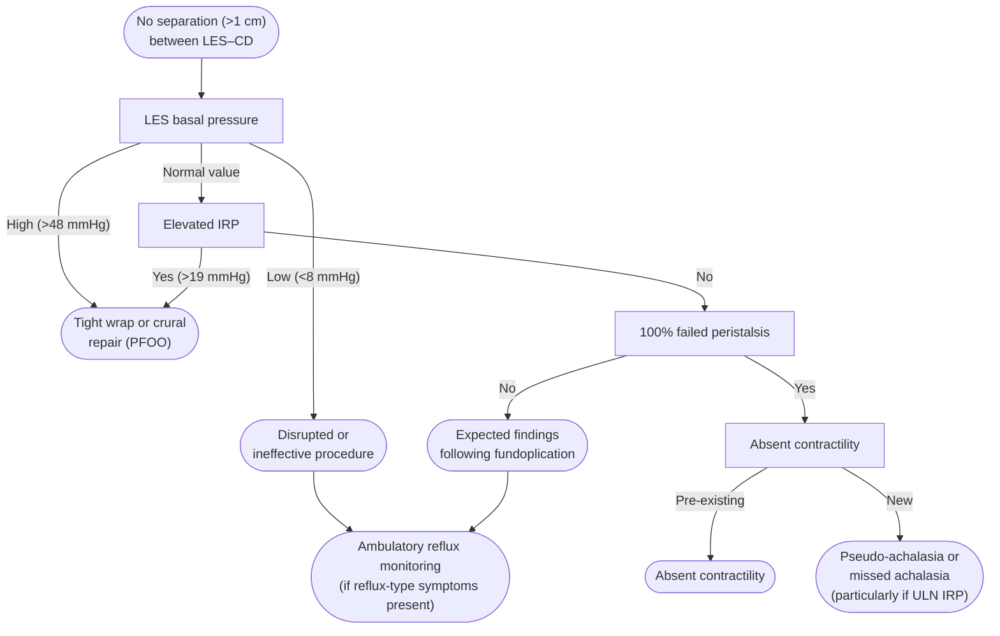

## Contents
- [[#Overview]]
- [[#Pre-Operative HRM]]
  - [[#Why HRM Before ARS]]
  - [[#Pre-ARS Motor Findings — Consensus Statements]]
  - [[#EGJ Barrier Assessment]]
- [[#Post-Operative HRM]]
  - [[#Why HRM After ARS]]
  - [[#Expected Findings After a Successful Fundoplication]]
  - [[#PFOO — Post-Fundoplication Outflow Obstruction]]
  - [[#New Dysphagia With Normal Endoscopy]]
- [[#The Padova Classification]]
  - [[#Step 1: Anatomy — LES–CD Separation]]
  - [[#Step 2: Physiology — No Separation]]
- [[#See Also]]
- [[#Sources]]

---

## Overview

- [[high-resolution-manometry|High-resolution manometry (HRM)]] in [[antireflux-surgery|antireflux surgery (ARS)]] has two jobs:
  - **Before ARS:** exclude motor disorders not amenable to ARS; describe the esophagogastric junction (EGJ) barrier.
  - **After ARS:** classify wrap anatomy and physiology in persistent or new reflux symptoms and/or dysphagia.
- Framework: **Padova Consensus (2025)** — 29 surgeons and gastroenterologists, RAND/University of California, Los Angeles appropriateness method; statement accepted at median ≥7 (1–9 scale) with ≥80% ranking it appropriate ([[padova-2025-hrm-antireflux]]).
- [[chicago-classification-v4|Chicago Classification v4.0 (CCv4.0)]] was built for surgery-naive patients; post-ARS findings are read with the Padova Classification below.

---

## Pre-Operative HRM

### Why HRM Before ARS

- **HRM is essential to exclude motor disorders not amenable to ARS** (median 9, **89%**).
- >1000 patients having HRM before ARS → **3%** had EGJ obstruction suspicious for [[achalasia|achalasia-spectrum disorders]], where standard ARS would have significantly worsened esophageal transit.
- 524 achalasia patients → **29%** had been referred for ARS for incomplete response to [[gerd|gastroesophageal reflux disease (GERD)]] management.

> [!pearl] Normal IRP does not clear the patient of achalasia
> Integrated relaxation pressure (IRP) is occasionally normal in achalasia, so **absent contractility with [[dysphagia]] needs barium radiography or [[flip-panometry|functional lumen imaging probe (FLIP)]]** to exclude achalasia before ARS ([[padova-2025-hrm-antireflux]]).

### Pre-ARS Motor Findings — Consensus Statements

| HRM finding | Padova statement | Median / % appropriate |
|---|---|---|
| [[esophagogastric-junction-outflow-obstruction\|EGJ outflow obstruction (EGJOO)]] by CCv4.0 criteria | Lower esophageal sphincter (LES) obstruction **must be addressed before ARS**. Confirm first: CCv4.0 requires a supportive timed barium esophagram or FLIP plus obstructive symptoms; act only if obstruction is definitively identified | 8 / 86% |
| [[hypercontractile-esophagus\|Hypercontractile esophagus]] (CCv4.0) | **Can be referred for ARS** if objective GERD **and** typical reflux symptoms **and** at least partial improvement on acid-suppression medication | 7 / 81% |
| [[distal-esophageal-spasm\|Distal esophageal spasm (DES)]] **with** obstructive symptoms (dysphagia and/or chest pain) | ARS **with caution** — may be on the type III (spastic) achalasia spectrum or opioid-related; treatment other than ARS may need to be considered | 8 / 95% |
| DES **without** obstructive symptoms + objective GERD | **Can be referred for ARS** | 7 / 81% |

- Manometric criteria for each of these diagnoses: [[chicago-classification-v4]].
- [[ineffective-esophageal-motility|Ineffective esophageal motility]] and peristaltic vigor: **no agreement** (48% appropriate) that ineffective swallows, peristaltic breaks, or multiple rapid swallow (MRS) response should choose total vs partial fundoplication. Retrospective data: absent contraction reserve on MRS associated with more post-ARS dysphagia, higher reflux burden, persistent hypomotility.
- No agreement (66%) that EGJ obstruction seen only on the rapid drink challenge warrants further pre-ARS work-up.

### EGJ Barrier Assessment

- Assess by HRM (median 8, **85%**) using:
  - LES end-expiratory pressure
  - LES baseline pressure **or** EGJ contractile integral (EGJ-CI)
  - presence of [[hiatal-hernia|hiatal hernia]] = LES–crural diaphragm (CD) separation
- LES–CD separation correlates well with hiatal hernia found at laparoscopy.

---

## Post-Operative HRM

### Why HRM After ARS

- **HRM has a diagnostic role in unsuccessful fundoplication** (persistent or new reflux symptoms and/or dysphagia), **unless a large recurrent hernia already necessitates reoperation** (median 8, **85%**).
- **No manometric finding is an absolute indication for reoperation**; HRM informs the decision alongside endoscopy, pH monitoring, and barium studies (median 9, **96%**).
- Initial evaluation of post-ARS symptoms = endoscopy + barium esophagram; HRM read with them.
- Scale: reflux symptoms and/or pathologic acid reflux recur in ~5–15%; persistent dysphagia in up to 12–25%.

### Expected Findings After a Successful Fundoplication

- **Single distal high-pressure zone (HPZ)** — normal LES–CD configuration — **with appropriate deglutitive relaxation** (median 8, **89%**); wrap, native LES, and crura all at the pressure inversion point (PIP).
- **Nissen (360°) vs partial:** Nissen tends to give higher EGJ resting pressure, higher IRP, higher esophageal contractility (median 8, **81%**); one study found no significant IRP difference.
- IRP alone may not be enough to judge outflow obstruction → read with intrabolus pressure (IBP).

**Normative post-operative metrics** — median (5th–95th percentile) for Medtronic, median (95th percentile) for Diversatek:

| Metric | Nissen, Medtronic (n=46) | Nissen, Diversatek (n=33) | Toupet, Medtronic (n=51) | Toupet, Diversatek (n=17) |
|---|---|---|---|---|
| LES resting pressure (mmHg) | 25.8 (8–47.8) | 20 (39.2) | 18.9 (9.8–37.6) | 18 (46.18) |
| LES total length (mm) | 32 (17–49) | 40 (44) | 29 (18–45.9) | 37 (44) |
| LES abdominal length (mm) | 17 (8–35) | — | 17 (3–30.6) | — |
| IRP (mmHg) | 11.2 (2.5–19) | 15 (29.4) | 8.4 (1.9–17.3) | 12 (23.2) |
| % peristaltic swallows | 90 (30–100) | 90 (100) | 90 (35–100) | 70 (100) |
| % premature swallows | 0 (0–20) | — | 0 (0–26.5) | — |
| % failed swallows | 0 (0–50) | — | 0 (0–40) | — |
| % ineffective swallows | 0 (0–20) | — | 0 (0–66.5) | — |
| Distal contractile integral (DCI) (mmHg·cm·s) | 1014.1 (252.6–2552.1) | 817 (3698.2) | 718.6 (189.7–3462.8) | 348 (2353) |

*Normative HRM metrics after laparoscopic fundoplication, by wrap type and manometry system*
*Source: recreated from Supplemental Table 1 of the Padova Consensus 2025*
*[[padova-2025-hrm-antireflux|Padova Consensus 2025 HRM After Antireflux Surgery]]*
*LES = lower esophageal sphincter · IRP = integrated relaxation pressure · DCI = distal contractile integral*

> [!pitfall] 15 mmHg is not a post-operative IRP cutoff
> IRP runs higher after ARS than in surgery-naive patients, and varies with wrap type and manometry system. **Any IRP <15 mmHg (Medtronic) is consistent with normal, but a higher value may still be normal** — Padova sets no post-ARS upper limit of normal for IRP ([[padova-2025-hrm-antireflux]]).

### PFOO — Post-Fundoplication Outflow Obstruction

- **High IBP + high IRP may indicate post-fundoplication outflow obstruction (PFOO)** (median 8, **93%**).
- **Very prominent single HPZ with impaired or failed deglutitive relaxation → twisted or too-tight fundoplication** (median 8, **86%**).
- PFOO = **hypertensive neo-LES** (tight wrap or tight crural repair) **or normotensive neo-LES with elevated median IRP**; intrabolus pressurization increases confidence.
- **Manometric criteria (Medtronic; device-dependent):** neo-LES basal pressure **>48 mmHg** *or* median IRP **>19 mmHg**. The low-pressure cutoff used elsewhere in the classification is **<8 mmHg**.
- Padova gives no numeric post-ARS cutoff for elevated IBP, and the surgery-naive supine IBP threshold on [[chicago-classification-v4]] has not been validated after fundoplication.

### New Dysphagia With Normal Endoscopy

- **Timed barium swallow (with tablet) and FLIP may help clarify the cause, especially if manometry is equivocal** (median 8, **93%**).
- Neither has been tested specifically in failed fundoplication; used by analogy to confirming EGJOO under CCv4.0.
- **No post-ARS normative FLIP values** for distensibility index or EGJ diameter.

---

## The Padova Classification

### Step 1: Anatomy — LES–CD Separation

| Finding | Neo-LES basal pressure | Interpretation |
|---|---|---|
| No separation | — | Expected anatomy → Step 2 |
| HPZ ≥1 cm **below** CD | — | **Slipped fundoplication** |
| HPZ ≥1 cm **above** CD (neo-LES–fundoplication complex migrated into chest) | Low (**<8 mmHg**, Medtronic) | **Disrupted fundoplication with herniation** |
| HPZ ≥1 cm **above** CD | Normal | **Intrathoracic (herniated) wrap**, not disrupted |

*Padova Classification, anatomy after an antireflux procedure*
*Source: recreated from the Padova 2025 classification text and Supplemental Table 2 pressure cutoffs*
*[[padova-2025-hrm-antireflux|Padova Consensus 2025 HRM After Antireflux Surgery]]*
*LES = lower esophageal sphincter · CD = crural diaphragm · HPZ = high-pressure zone*

- The table follows the classification text and the discussion, which agree. **Padova's Figure 1 and Supplemental Table 2 reverse the two separation branches** — they put "slipped" under HPZ-above-CD and the basal-pressure split under HPZ-below-CD.
- Threshold written ≥1 cm in the classification text, >1 cm in Figure 1, Supplemental Table 2, and the discussion.
- **Slipped fundoplication** — dual HPZ: upper HPZ relaxes normally; distal HPZ (crus + slipped wrap) is generally a uniform pressure band (median 7, **80%**). Example tracing: native LES (proximal HPZ) above the wrap (distal HPZ, at gastric-body level); distal HPZ neither relaxes nor varies with respiration; PIP above the distal HPZ.
- **Intrathoracic fundoplication** — dual HPZ: lower HPZ (crus) shows the expected respiratory pattern, as in surgery-naive hiatal hernia; upper HPZ (herniated wrap around native LES) may relax with swallowing (median 7, **81%**). PIP at the distal HPZ.

### Step 2: Physiology — No Separation

*Padova Classification, physiology after an antireflux procedure with no LES–CD separation*
*Source: redrawn from the Padova 2025 classification algorithm (physiology panel), with the Medtronic pressure cutoffs from its Supplemental Table 2*
*[[padova-2025-hrm-antireflux|Padova Consensus 2025 HRM After Antireflux Surgery]]*
*LES = lower esophageal sphincter · CD = crural diaphragm · PFOO = post-fundoplication outflow obstruction · IRP = integrated relaxation pressure · ULN = upper limit of normal*

- Pressure cutoffs are device-dependent; the values shown are the Medtronic system's.
- Ambulatory reflux monitoring after expected findings → if clinically indicated for recurrent GERD.
- Absent contractility: compare with pre-ARS HRM to separate pre-existing from new.
- Pseudoachalasia related to ARS and missed [[achalasia]] are the two possible sources of new absent contractility; the source gives no further criteria to separate them.

---

## See Also

[[high-resolution-manometry]], [[antireflux-surgery]], [[gerd]], [[achalasia]], [[chicago-classification-v4]], [[flip-panometry]], [[ambulatory-reflux-monitoring]], [[dysphagia]], [[hypercontractile-esophagus]], [[distal-esophageal-spasm]], [[ineffective-esophageal-motility]], [[hiatal-hernia]], [[esophagogastric-junction-outflow-obstruction]]

---

## Sources

1. [[padova-2025-hrm-antireflux|Padova Consensus: High-Resolution Manometry Before and After Antireflux Surgery]]
