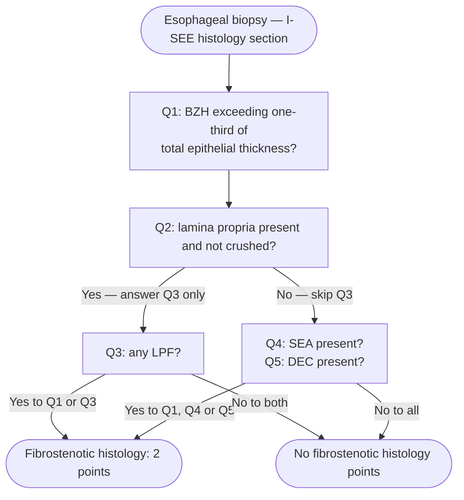

**I-SEE (Index of Severity for Eosinophilic Esophagitis):** consensus point-based index that grades the severity of established [[eosinophilic-esophagitis|eosinophilic esophagitis (EoE)]] across symptoms, complications, and inflammatory and fibrostenotic activity — three domains, assessed together rather than by eosinophil count alone. Available as a downloadable app ([[asge-2026-eoe-endoscopic-management-part-2|American Society for Gastrointestinal Endoscopy (ASGE) 2026]]).

[[acg-2025-eoe|American College of Gastroenterology (ACG) 2025]] advises that providers **could consider** using I-SEE to assess baseline severity. It is developed but still undergoing validation.

## Contents
- [[#Scoring]]
- [[#Scoring Rules That Decide the Box]]
  - [[#Symptoms and Complications]]
  - [[#Inflammatory Features]]
  - [[#Fibrostenotic Features]]
- [[#Reading the Histology Section]]
- [[#Worked Examples]]
- [[#What I-SEE Does Not Do]]
- [[#See Also]]
- [[#Sources]]

---

## Scoring

Assess at initial diagnosis and **at every subsequent visit, with the recall covering only the interval since the last visit**. Select the box the patient fits in each row; **where a box lists more than one element, each selected element scores.** Scoring presupposes the diagnosis (isolated esophageal eosinophilia ≥15 eosinophils per high-power field [eos/hpf], other etiologies excluded). ([[i-see-2022-eoe-severity-index]])

| Domain / feature | 1 point | 2 points | 4 points | 15 points |
|---|---|---|---|---|
| **Symptoms** | Weekly | Daily | Multiple times per day **or** disrupting social functioning | — |
| **Complications** | — | Food impaction with emergency-room visit or endoscopy (*≥18 years*) | • Food impaction with emergency-room visit or endoscopy (*<18 years*) • Hospitalization due to EoE | • Esophageal perforation • Malnutrition with body mass <5th percentile or decreased growth trajectory • Persistent inflammation requiring elemental formula, systemic corticosteroid, or immunomodulatory treatment |
| **Inflammatory — endoscopy** (edema, furrows and/or exudates) | Localized | Diffuse | — | — |
| **Inflammatory — histology** | 15–60 eos/hpf | >60 eos/hpf | — | — |
| **Fibrostenotic — endoscopy** (rings, strictures) | Present, endoscope passes easily | Present, but requires dilation **or** a snug fit passing a standard endoscope | — | Cannot pass a standard upper endoscope; repeated dilations (*adult ≥18 years*); **or any dilation** (*child <18 years*) |
| **Fibrostenotic — histology** | — | Basal zone hyperplasia (BZH) **or** lamina propria fibrosis (LPF) — or dyskeratotic epithelial cells (DEC) / surface epithelial alteration (SEA) if no lamina propria | — | — |

**Bands: <1 inactive · 1–6 mild active · 7–14 moderate active · ≥15 severe active.**

## Scoring Rules That Decide the Box

- **A single 15-point box makes the patient severe** regardless of the rest of the index.
- **Endoscopy: score the worst overall finding for the esophagus** — inflammatory and fibrostenotic alike; if a stricture is identified, estimate its diameter.
- **No endoscopy or biopsy since the last visit → carry the prior endoscopic and histologic information forward**, and let the severity assessment itself prompt the decision whether a monitoring endoscopy is due.

### Symptoms and Complications

- **Frequency drives the symptom score, not symptom type** — the index does not specify which symptoms to count; the provider chooses them.
  - Adolescents and adults: dysphagia, transient food impaction that clears spontaneously, heartburn, chest pain.
  - Children: abdominal pain, vomiting, heartburn/reflux, chest pain, unintentional weight loss, feeding difficulty (refusal, failure to progress, trouble swallowing), failure to thrive.
- **Social disruption is a 4-point symptom**: missed work or school, fear of eating in public, social isolation.
- **Food impaction scores higher in children** (4 points) than adults (2 points) — impactions are less common in children and may mark early-onset fibrostenosis.
- **Immunomodulatory** treatment includes biologics, azathioprine/6-mercaptopurine, and other immune-targeted agents.

### Inflammatory Features

- Endoscopic inflammatory features (edema, furrows, exudates) are assessed with the **EoE Endoscopic Reference Score (EREFS)** ([[eosinophilic-esophagitis#Establishing the Diagnosis|grading table]]), but scored here only as **localized vs diffuse** — current data do not support prespecified EREFS cut-points for severity, and endoscopists do not reliably detect strictures or narrowing.
- **Quantify the peak eosinophil count in every case**, for diagnosis and for monitoring; the 15–60 vs >60 eos/hpf split is a scoring band, not a substitute for the number.

### Fibrostenotic Features

- **A standard adult upper endoscope is 8–10 mm; "snug fit" means mild resistance passing one, i.e. a 10–14 mm esophagus.** Diameter can instead be established by other methods — see [[esophageal-dilation#Establishing Esophageal Diameter]].
- **Any dilation in a child or adolescent scores 15**; in an adult only *repeated* dilations do — most pediatric endoscopic features are inflammatory, so a dilation requirement at that age marks severe disease.
- **If lamina propria is absent or crushed, DEC/SEA substitute for LPF** — but they predict the *presence*, not the severity, of fibrosis.
- Luminal-diameter ranges were discussed at the consensus conference (normal ≥20 mm, mildly decreased 15–19 mm, moderate 10–14 mm, severe 5–9 mm = failed passage of an adult upper endoscope, critical <5 mm = failed passage of a pediatric upper endoscope) but were deliberately left out of the index in favour of the three endoscope-passage categories.

> [!pitfall] After a dilation, symptoms no longer measure severity
> Dysphagia and food impaction cannot be reliably assessed once any patient has been dilated — which is why dilation history, not symptom report, carries the fibrostenotic weight ([[i-see-2022-eoe-severity-index]]). Fibrostenotic grading is itself unvalidated: it ignores the longitudinal extent of disease and the presence of multiple strictures, and dilation practice varies between physicians.

## Reading the Histology Section

*Scoring the I-SEE fibrostenotic histology row from an esophageal biopsy*
*Source: redrawn from the I-SEE five-question histology sequence*
*[[i-see-2022-eoe-severity-index|A Clinical Severity Index for Eosinophilic Esophagitis (I-SEE, 2022)]]*
*I-SEE = Index of Severity for Eosinophilic Esophagitis · BZH = basal zone hyperplasia · LPF = lamina propria fibrosis · SEA = surface epithelial alteration · DEC = dyskeratotic epithelial cells*

The index states that each selected element in a multi-element box scores, but in the authors' own third example BZH **and** LPF together score 2 points, not 4 — the fibrostenotic histology box scores once.

## Worked Examples

The authors' own three cases, with the points each selected box contributes ([[i-see-2022-eoe-severity-index]]):

| Patient | Points scored | Total | Band |
|---|---|---|---|
| 12 y: daily abdominal pain · no complications · localized inflammatory endoscopy · 45 eos/hpf · no fibrostenotic features | 2 + 1 + 1 | **4** | Mild active |
| 17 y: chest pain, heartburn and dysphagia multiple times per day with eating-related anxiety and social isolation · no complications · diffuse exudates, edema and furrows · 100 eos/hpf · rings with the endoscope passing easily · BZH + LPF | 4 + 2 + 2 + 1 + 2 | **11** | Moderate active |
| 32 y: daily dysphagia · 2 prior emergency-department visits for food bolus impaction · diffuse exudates and edema · 35 eos/hpf · BZH · stricture precluding passage of a standard endoscope | 2 + 2 + 2 + 1 + 15 + 2 | **24** | Severe active |

## What I-SEE Does Not Do

- **No treatment attaches to any band.** The index classifies; linking severity to therapy and monitoring is named as a future goal ([[i-see-2022-eoe-severity-index]]).
- **It is explicitly unvalidated** — a gap ASGE 2026 restates. Domain weighting, the mild/moderate and moderate/severe boundaries, and whether children and adults need separate indices are all open; so is whether using the index changes treatment or long-term outcomes.

---

## See Also

[[eosinophilic-esophagitis]], [[esophageal-dilation]], [[eoe-therapies]], [[upper-endoscopy]], [[flip-panometry]], [[esophageal-stricture]]

---

## Sources

1. [[i-see-2022-eoe-severity-index|A Clinical Severity Index for Eosinophilic Esophagitis: Development, Consensus, and Future Directions (I-SEE, 2022)]]
2. [[acg-2025-eoe|ACG 2025: Diagnosis and Management of Eosinophilic Esophagitis]]
3. [[asge-2026-eoe-endoscopic-management-part-2|ASGE Consensus Recommendations on the Endoscopic Management of Eosinophilic Esophagitis — Part 2 (2026)]]
