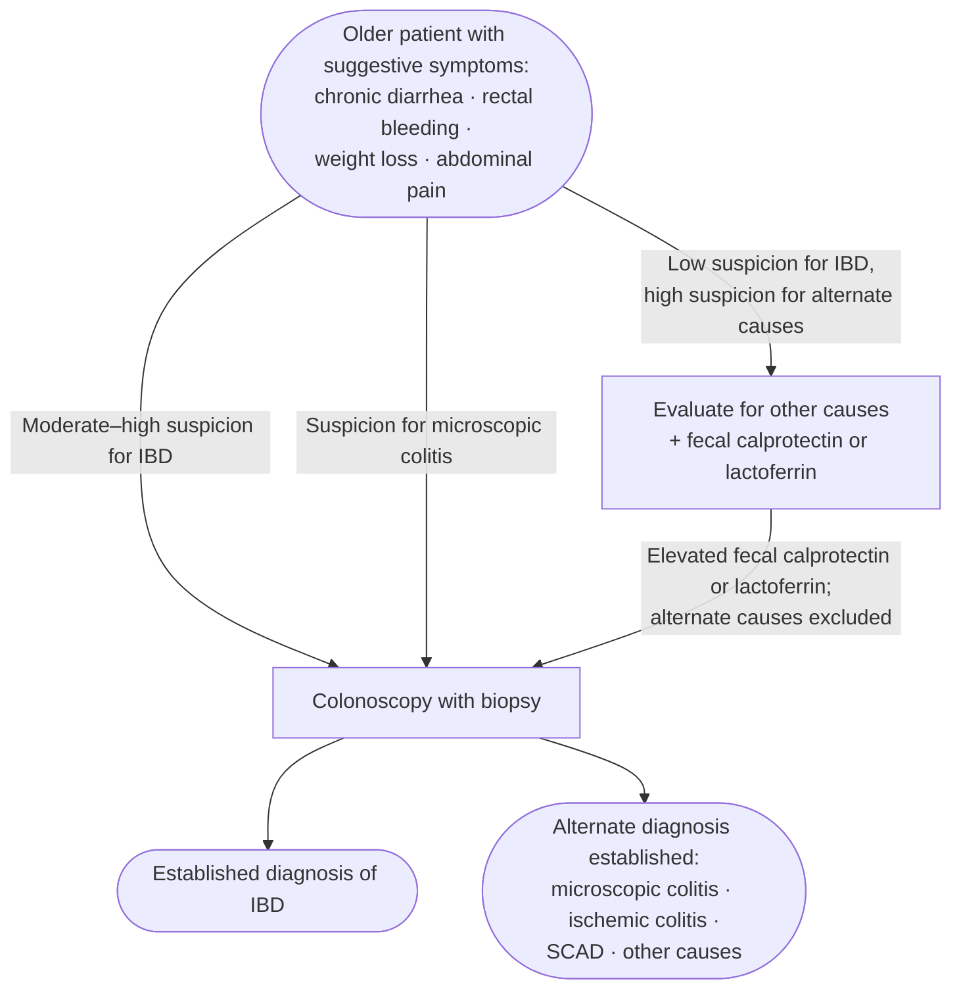

# IBD in Older Adults

*Age- and frailty-specific overlay on the general [[inflammatory-bowel-disease|inflammatory bowel disease (IBD)]] framework. Drug efficacy ordering lives on [[crohns-disease|Crohn's disease (CD)]] and [[ulcerative-colitis|ulcerative colitis (UC)]]; little evidence shows age-related efficacy differences — what changes in older patients is mainly **safety** ([[aga-2021-ibd-elderly]]).*

## Contents
- [[#Definition and Scope]]
- [[#Epidemiology and Phenotype]]
- [[#Diagnosis]]
  - [[#Mimics to Exclude After Age 60]]
  - [[#Diagnostic Algorithm]]
- [[#Treatment Principles]]
  - [[#Drug-by-Drug Safety in Older Adults]]
  - [[#Treatment Algorithm]]
- [[#Surgery]]
- [[#Health Maintenance]]
- [[#Best Practice Advice]]

## Definition and Scope

- **Older/elderly = age ≥60 years** ([[aga-2021-ibd-elderly]]).
- Population growing from two directions: incident elderly-onset disease + aging of the prevalent cohort.
- Comorbidity — especially malignancy and a greater disposition to infection — makes older patients more vulnerable to complications of immunosuppression.
- Most data are observational or indirect: older patients are a very small share of IBD trial and pharmacovigilance participants.

> [!pitfall] Don't let age-related risk stall treatment
> Despite the risks of immunomodulatory therapy, therapy choices should not be delayed, nor [[corticosteroids-ibd|corticosteroid]] therapy prolonged, out of concern for immune therapy–associated risks ([[aga-2021-ibd-elderly]]).

## Epidemiology and Phenotype

| Measure | Value |
|---|---|
| Prevalence | ~**1 in 160** older individuals; rising **5.2%/year** |
| Share of IBD diagnosed after 60 (North America, Asia) | **up to 15%** |
| Incidence >60 y | **4–8 per 100,000** |
| Mortality — UC | **no difference** by age of onset |
| Mortality — CD | **33/10,000 person-years** (elderly) vs **5.6** (middle age) vs **1** (young) |
| CD phenotype | **isolated colonic disease 44%**; less penetrating or perianal disease |
| UC phenotype | **left-sided disease 40%**; some data show elderly-onset UC more likely to reach colectomy |

- Phenotypes look more benign, but predict course from **specific disease characteristics, not chronologic age**.

## Diagnosis

- **Consider IBD** in older patients with diarrhea, rectal bleeding, urgency, abdominal pain or weight loss — up to 15% of new IBD diagnoses occur after 60 (Best Practice Advice [BPA] Diagnosis 1).

### Mimics to Exclude After Age 60

*More likely in persons >60 y than in persons <40 y:* [[colorectal-cancer]] · [[colon-ischemia|ischemic colitis]] · [[segmental-colitis-associated-with-diverticulosis|segmental colitis associated with diverticulosis (SCAD)]] · nonsteroidal anti-inflammatory drug (NSAID)–induced pathology · [[radiation-proctopathy|radiation enteritis/colitis]] · [[microscopic-colitis]].

- Medical and surgical management of these differs substantially → confirm the IBD diagnosis vigorously.

> [!pearl] Segmental left-sided colitis with diverticulosis
> Consider SCAD in addition to CD or IBD-unclassified (BPA Diagnosis 3; [[aga-2021-ibd-elderly]]).

**First-pass labs:** complete blood count (CBC) · serum albumin · serum ferritin · C-reactive protein (CRP). Liver enzymes, urea and creatinine serve double duty — comorbidity assessment **and** baseline for toxicity monitoring.

**Stool:** [[clostridioides-difficile|*Clostridioides difficile*]] testing in **all** new presentations of diarrhea, **regardless of antibiotic history**; selective culture and ova and parasites.

**Imaging:** cross-sectional computed tomography (CT) is appropriate with acute symptoms, especially prominent abdominal pain — also rules out ischemic colitis and diverticular disease.

**Endoscopy:** [[colonoscopy]] with histologic confirmation is the cornerstone.
- Hematochezia or chronic diarrhea with **intermediate to high suspicion** for IBD, microscopic colitis or colorectal neoplasia → colonoscopy (BPA Diagnosis 2).
- Fecal calprotectin or lactoferrin may help prioritize **low-probability** patients for endoscopic evaluation (BPA Diagnosis 2).
- Weigh procedural risk and anesthesia tolerance against comorbidity and polypharmacy; indication equivocal or relatively high-risk → fecal calprotectin and imaging may aid the decision.

### Diagnostic Algorithm

*Workup of suggestive symptoms in an older patient*
*Source: redrawn from the AGA 2021 diagnostic algorithm for elderly patients with IBD (Figure 1)*
*[[aga-2021-ibd-elderly|AGA 2021 Clinical Practice Update: IBD in Elderly Patients]]*
*IBD = inflammatory bowel disease · SCAD = segmental colitis associated with diverticulosis*

## Treatment Principles

- **Selection principles are the same as in the general population**, based on presentation and prognostic factors. Safety concerns differ — higher malignancy frequency and immunosenescence.
- **Comprehensive initial assessment** to set short- and long-term goals and priorities collaboratively (BPA Treatment 1).
- **Risk-stratify for severe course** (BPA Treatment 2): perianal or penetrating phenotype · long-segment small bowel involvement (CD) · extensive colitis (UC) · anemia · hypoalbuminemia · elevated inflammatory markers · weight loss.
- **Candidacy for immunosuppression** = chronologic age **plus** functional status, comorbidities (including prior neoplasia and potential for infectious complications) and frailty (BPA Treatment 4).
  - Pretreatment frailty was associated with increased infection risk after immunomodulator or [[anti-tnf-agents|anti-tumor necrosis factor (anti-TNF)]] treatment **and** after surgery.
  - Physical therapy and nutritional support for frailty may be an important part of care.
- **Prefer lower infection/malignancy-risk agents** ([[vedolizumab]], [[il-23-and-il-12-23-inhibitors|ustekinumab]]) when possible — but also weigh clinical context, efficacy for the specific phenotype, rapidity of onset and ability to achieve corticosteroid-free remission (BPA Treatment 5).
- **Fold age-amplified risks into every decision** (BPA Treatment 9): fracture · venous thromboembolism (VTE) · infections (pneumonia, opportunistic, herpes zoster) · skin and nonskin cancers (including lymphoma).
- **Optimize comorbidity** — minimizes IBD and treatment risks and guides agent selection (BPA Treatment 7).
- **Pre-therapy screening is unchanged from younger patients:** hepatic and renal function · latent tuberculosis · [[chronic-hepatitis-b|hepatitis B]] · thiopurine methyltransferase (TPMT) status before [[thiopurines|thiopurine]] use.
- **Polypharmacy → pharmacist involvement:** **29%** of persons aged **57–85 y** use **≥5 prescription drugs**; **4%** are at risk of a major drug–drug interaction.
- **Multidisciplinary care** (BPA Treatment 10): gastroenterology · primary care/geriatrics · other subspecialists (e.g., cardiology) · mental health · general or colorectal surgery · nutrition · pharmacy; engage family and caregivers.

> [!pitfall] Systemic steroids are not maintenance therapy
> Trials show no maintenance efficacy at any age, yet older patients are more often kept on them. For induction prefer nonsystemic steroids (budesonide), or early biologic therapy if budesonide doesn't suit the phenotype (BPA Treatment 3; [[aga-2021-ibd-elderly]]).

### Drug-by-Drug Safety in Older Adults

| Agent | Age-specific signal |
|---|---|
| [[mesalamine-5-asa\|Aminosalicylates]] | Proven for induction and maintenance in mild–moderate UC; **less well established in CD** (no or modest benefit over placebo). **>2/3 of older patients** with UC and CD receive mesalamine. Rare **interstitial nephritis** is especially pertinent given age-related renal decline |
| Systemic corticosteroids | Efficacy seems similar by age. More often used for maintenance in older patients despite **less** steroid dependence (**21% vs 30%**). May exacerbate diabetes, hypertension, glaucoma, cataract, osteoporosis, cognitive impairment; also anxiety, depression, fatigue, poor sleep. Any systemic use → consider steroid-sparing therapy; prolonged course → mitigate osteoporosis risk. Rapid-onset biologic or small molecule may reduce or eliminate steroid need |
| Budesonide | Only **modestly lower efficacy** than systemic steroids in CD, fewer adverse effects, **less adrenal suppression** long-term. **Budesonide-MMX** effective in mild–moderate **left-sided UC**. → May be preferred in **ileocolonic or right-sided luminal CD, or left-sided UC** |
| Topical steroids / aminosalicylates | Effective for distal colonic disease but may be **poorly tolerated with limited mobility or weak sphincter tone** → a **lower-volume formulation such as foam** may be preferred |
| Thiopurines | **Non-melanoma skin cancer (NMSC) 4.04 vs 0.66 per 1000** (>65 y vs <50 y). **Lymphoproliferative disorder 5.41 vs 0.37 per 1000 person-years** (elderly vs <50 y); smaller age gap in nonusers (**1.68 vs 0**). More hepatotoxicity, **less** acute pancreatitis. Oral and inexpensive, but inferior and delayed efficacy (may prolong steroid exposure) → prudence about **new** initiation. Maintenance monotherapy: weigh oral route and lower cost vs lower efficacy, slow onset, NMSC and lymphoma risk (BPA Treatment 6). **Routine discontinuation or absolute avoidance solely on chronologic age is not appropriate** — case by case |
| [[methotrexate]] | Attractive in older patients with **CD** — data for induction and maintenance; alternative to thiopurines **in combination therapy** when thiopurine-related adverse effects (including malignancy) are a high risk |
| Anti-TNF | Efficacy mixed: corticosteroid-free remission at 12 mo **31% vs 67%** (older vs younger); lower response at **10 weeks** but **no difference later**; meta-analysis found no efficacy difference for infliximab or golimumab. Safety vs **190 matched younger controls**: severe infection **11% vs 2.6%**, cancer **3% vs 0%**, death **10% vs 1%**. Meta-analysis, older vs younger biologic users: infection **13% vs 6%**, odds ratio (OR) **2.28** (95% confidence interval [CI] 1.57–3.31); malignancy OR **3.07** (95% CI 1.98–4.62) — **but no malignancy excess vs older controls**. **A fifth discontinue within 12 months.** Studies can't separate anti-TNF from concomitant steroid or immunomodulator effects. Many older patients, particularly the non-frail: **benefit likely outweighs the small increase in risk** |
| Vedolizumab | Effectiveness **similar** by age (limited data); **no age-related difference in any adverse events, including infections and serious infections**. Gut-selective → favorable safety expected. 131 anti-TNF vs 103 vedolizumab starters: **no infection difference at 1 year**, with wide CIs |
| Ustekinumab | **No published safety data specifically in older patients with IBD.** A case series of 24 psoriasis patients showed few infections |
| [[jak-inhibitors\|Tofacitinib]] | Safety data are **indirect, from rheumatology**. Serious adverse events more common in older users at both 5 mg and 10 mg twice daily (BID) — **but the same effect appeared on placebo**, suggesting no incremental age effect. **Herpes zoster 5.5 (5 mg) and 3.1 (10 mg) per 100 patient-years vs 0 on placebo.** **VTE including pulmonary embolism, older rheumatoid arthritis patients with cardiovascular risk factors: 10 mg BID 0.4 vs anti-TNF 0.07 per 100 patient-years** — led to the boxed warning |
| [[calcineurin-inhibitors\|Cyclosporine]] | Rarely used, but **may be considered as rescue therapy in acute severe UC** where anti-TNF is contraindicated or has failed |

**Combination therapy (immunomodulator + anti-TNF)** — safety evidence is mixed; split by phenotype and fitness:

- *Combine* with **severe disease: deep ulceration, extensive bowel involvement, penetrating phenotype.** REACT post hoc: benefit of early combined intervention **similar in older and younger patients, with no increase in risk**.
- *Anti-TNF monotherapy* may be the preferred initial option with **significant frailty, comorbidity or infection risk**. One cohort: older patients on combination therapy **twice as likely to stop early** (hazard ratio [HR] 2.20; 95% CI 1.12–4.32).

### Treatment Algorithm

At a new IBD diagnosis, three parallel assessments:

| Assessment | Output |
|---|---|
| Prognostic factors · disease phenotype · psychosocial supports and needs | Mild vs severe disease |
| Comorbidity, frailty, functional status | Fit vs frail patient |
| Health maintenance | See [[#Health Maintenance]] |

| Phase | Options (figure's own annotations in parentheses) |
|---|---|
| **Induction** | Steroids (preference for budesonide over prednisone) · anti-TNF (assess ability to administer and adhere to the prescribed regimen) · vedolizumab (*maybe slightly favored with higher risk of complication*) · ustekinumab (*same*) · tofacitinib (*higher VTE risk with 10 mg BID in those with cardiac risk factors*) |
| **Maintenance** | Anti-TNF (assess ability to administer and adhere) · vedolizumab (*maybe slightly favored with high risk of complication*) · ustekinumab (*same*) · thiopurines (*select cases; higher lymphoma and NMSC risk vs more targeted biologics*) · tofacitinib 5 mg BID |

*Treatment framework at a new IBD diagnosis in an older patient*
*Source: redrawn as tables from the AGA 2021 treatment algorithm for elderly patients with IBD (Figure 2)*
*[[aga-2021-ibd-elderly|AGA 2021 Clinical Practice Update: IBD in Elderly Patients]]*
*IBD = inflammatory bowel disease · TNF = tumor necrosis factor · VTE = venous thromboembolism · BID = twice daily · NMSC = nonmelanoma skin cancer*

- The figure draws no arrow from a mild/severe or fit/frail box to a specific drug; it lists the options beneath the assessments.

## Surgery

- Data on whether older age raises postoperative complication risk **conflict** — some small studies found no difference.
- **American College of Surgeons National Surgical Quality Improvement Program (NSQIP):** 30-day postoperative mortality **higher** in older patients with both CD and UC; **complications 34.5% vs 21.3%**. Also more postoperative infection, VTE, bleeding requiring transfusion, and cardiac, renal and neurologic complications including stroke and coma.
- **Emergent surgery is independently associated with increased mortality.**
- **UC operation choice:** reduced anal sphincter tone → **worse functional outcomes from an ileal pouch–anal anastomosis**; an [[ostomy-management|end-ostomy]] **may offer more functional independence** in select patients.
- **Pharmacologic thromboprophylaxis** is important — higher VTE risk.
- **Assess and optimize nutritional status before surgery.**
- Timing and type of surgery (BPA Treatment 8): disease severity · impact on functional status and independence · risks and effectiveness of medical therapy · candidacy for surgery · postoperative complication risk.

## Health Maintenance

- Discuss health maintenance **soon after diagnosis**; see [[ibd-preventive-care]].
- **Vaccination** (BPA Health maintenance 1): facilitate adherence to influenza (annual) · pneumococcal · **inactivated** herpes zoster; schedule **before starting immunosuppression** when possible.
  - Influenza and zoster vaccines are underused, including in IBD, where risk of influenza, pneumococcal pneumonia and shingles is increased — especially on immunomodulatory drugs.
  - Structural gap: gastroenterologists often defer vaccination to primary care, but IBD patients of any age may lack a primary care provider, and primary care may be uncertain about vaccine safety and timing on immunomodulators.
- **General health maintenance:** depression screen · optimize comorbidity · age-appropriate general-population colon and non-colon cancer screening.
- **Chronic colitis (UC or CD), usually ≥8 years' duration** → ~**2-fold** colorectal cancer (CRC) risk vs age-matched community counterparts. Adenomas and serrated polyps are also more common with age.

> [!pearl] Older patients carry the higher absolute CRC risk
> Relative risk is higher in younger IBD patients, but absolute risk is higher in older patients → stay vigilant with [[colonoscopy-surveillance|surveillance colonoscopy]] and be ready to manage dysplastic lesions ([[aga-2021-ibd-elderly]]).

- **Continuing vs stopping surveillance** in long-standing UC or Crohn's colitis (BPA Health maintenance 2): age · comorbidity · overall life expectancy · likelihood of endoscopic resectability of the lesion · candidacy for colon resection surgery — plus the anesthesia and perforation risk of the procedure itself.

## Best Practice Advice

- [[aga-2021-ibd-elderly]] is an American Gastroenterological Association (AGA) Expert Review with **15 Best Practice Advice statements**, numbered **within three groups** (Diagnosis 1–3; Treatment: general principles 1–10; Health maintenance 1–2) — no continuous 1–15 numbering. Each is cited above by group and number.
- It assigns **no Grading of Recommendations Assessment, Development and Evaluation (GRADE) rating, strength of recommendation or quality-of-evidence label** to any statement. Full statement text is on the source page.

## See Also

[[inflammatory-bowel-disease]], [[crohns-disease]], [[ulcerative-colitis]], [[ibd-preventive-care]], [[ibd-in-malignancy]], [[thiopurines]], [[anti-tnf-agents]], [[vedolizumab]], [[jak-inhibitors]], [[corticosteroids-ibd]], [[segmental-colitis-associated-with-diverticulosis]], [[microscopic-colitis]], [[colonoscopy-surveillance]]

---

## Sources

1. [[aga-2021-ibd-elderly|AGA Clinical Practice Update on Management of Inflammatory Bowel Disease in Elderly Patients: Expert Review]]
