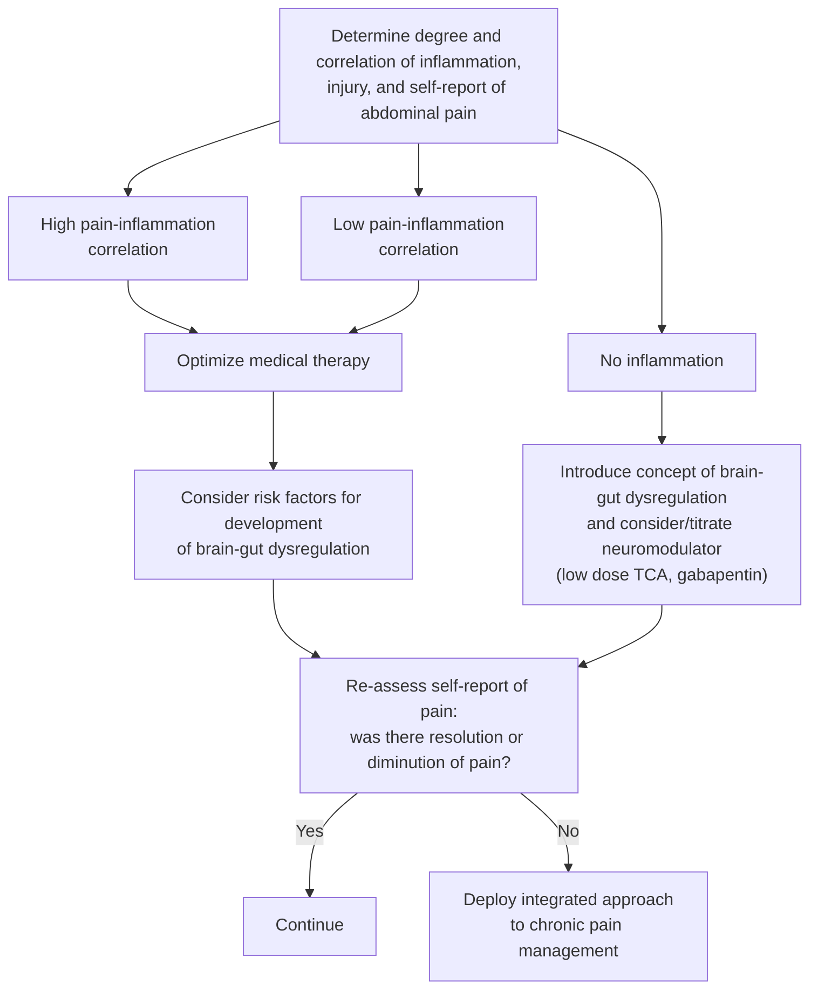

## Contents
- [[#Overview]]
  - [[#Definitions]]
- [[#Diagnostic Workup]]
- [[#Matching Intervention to Pain Complexity]]
- [[#Assessing Pain in IBD]]
  - [[#Peripheral Initiators vs Central Maintainers]]
  - [[#Risk Factors for the Acute→Chronic Transition]]
  - [[#Cognitive-Affective Amplifiers]]
  - [[#Listening to Pain Descriptors]]
- [[#Communicating the Diagnosis]]
- [[#Pharmacologic Strategy]]
  - [[#Neuromodulator Classes and Dosing]]
  - [[#Neuromodulation — Practical Rules]]
  - [[#Opioids and Cannabis]]
- [[#Non-pharmacologic Management]]
- [[#Referral and Team Structure]]
- [[#See Also]]
- [[#Sources]]

## Overview

- Pain (mostly abdominal) reported by **60–75%** of [[inflammatory-bowel-disease|inflammatory bowel disease (IBD)]] patients.
- Expected during active inflammation; the clinical problem is **persistent pain when inflammation is quiescent**.
- Persistent abdominal pain despite endoscopic remission: **30% of [[ulcerative-colitis]]**, **60% of [[crohns-disease]]** — i.e. not automatically a flare.
- **Organic causes to exclude first** (pain here correlates with mucosal/serologic inflammation markers): active disease activity; **mechanical obstruction from stricture**; **abscess**; **fistula**. Acute, sharp, transient pain is informative — attending to it can prevent further bowel-wall damage by driving treatment-seeking.
- Reframe chronic pain in IBD as a **distinct, waxing-and-waning disease state** with central mechanisms — managed proactively like IBD itself.
- Central mechanisms: central sensitization; altered descending pain modulation; cognitive-affective amplifiers (pain catastrophizing).
- Drives unplanned health care use, disability, mental-health decline; collides with the strong recommendation to avoid narcotics.
- Shares central mechanisms with [[disorders-of-gut-brain-interaction]] and [[irritable-bowel-syndrome|irritable bowel syndrome (IBS)]].
- ⚠ Expert commentary — no systematic reviews were performed, so **no statement here carries a quality-of-evidence or strength rating**.

### Definitions

- Pain (International Association for the Study of Pain [IASP]): unpleasant sensory and emotional experience associated with actual or potential tissue damage, or described in terms of such damage.

Source Table 1, in full — the terms the rest of the page conditions on.

| Term | Definition |
|---|---|
| Acute pain | Happens suddenly, starts out sharp or intense; serves as a warning sign of disease or threat to the body |
| Chronic pain | Persists or recurs for longer than 3 months |
| Visceral hyperalgesia | Increased sensitivity to stimuli near site of injury/infection/inflammation |
| Allodynia | Abnormal pain responsiveness elicited by innocuous stimuli, such as food in the stomach or urge to have a bowel movement |
| Hyperalgesia | Exaggerated/prolonged response to noxious stimuli (e.g. low-grade inflammation) |
| Central sensitization | Increased sensitivity mediated by the central nervous system (CNS) |
| Pain acceptance | Giving up the struggle with pain and learning to live life despite pain |
| Psychological flexibility | Staying in contact with the present moment regardless of unpleasant thoughts, feelings, and bodily sensations, while choosing behaviors based on situation and personal values |
| Pain catastrophizing | Tendency to magnify or exaggerate the threat value or seriousness of pain sensations |
| Negative expectancy | Attending particularly to negative information; interpreting ambiguous information as threatening |
| Probability overestimation | Overestimating the likelihood of an event and acting on the overestimate rather than the actual likelihood |

- Chronicity threshold (text): abdominal pain is **chronic if persisted 3–6 months past acute onset and resolution of the insult** (e.g. surgery for stricture, resolution of obstruction).
- ⚠ 3–6 month text window vs IASP >3-month definition stated side by side without reconciliation.
- Animal models: **inflammation-induced hyperalgesia often outlasts the actual inflammation**.
- Allodynic pain can also be elicited by innocuous chemical or physical stimuli — certain food components, bile acids, intestinal distension or contractions.

## Diagnostic Workup

Entry point is the **degree and correlation of inflammation, injury, and self-reported abdominal pain** — the pain–inflammation correlation assigns the arm.

*Figure 1A — algorithm for the diagnostic workup of patients with IBD and abdominal pain, recreated. ([[aga-2024-ibd-pain]])*

> [!pitfall] The figure and the text disagree on gabapentin
> Figure 1A lists **gabapentin** alongside a low-dose tricyclic antidepressant (TCA) as the neuromodulator to introduce and titrate in the no-inflammation arm. The body text places gabapentin among mood stabilizers that have **not been studied in IBD**, have case-report support only, and should be used **only with psychiatric consultation**. The Update does not reconcile the two ([[aga-2024-ibd-pain]]).

## Matching Intervention to Pain Complexity

Intervention is chosen by **level of pain complexity**; complexity and the need for integrated care or multiple modalities rise together down this table.

| Pain complexity (ascending) | Level of intervention |
|---|---|
| Visceral hypersensitivity · overlapping disorder of gut–brain interaction, including IBS and functional dyspepsia | **Brain–gut behavior therapies** — cognitive behavior therapy; acceptance and commitment therapy; hypnosis; mindfulness/relaxation; wellness activities (exercise, sleep hygiene, stress management) |
| Overlapping depression/anxiety · multiple pain sites/comorbidities | **Augmentation with neuromodulators** including serotonin noradrenergic reuptake inhibitor (SNRI) and selective serotonin reuptake inhibitor (SSRI) — if anxiety or depression present, combine with TCA |
| Severe disability/impact on ability to work · central sensitization or centrally mediated abdominal pain syndrome (CAPS) | **Intensive pain and psychological management programs** |
| Opioid overuse/substance abuse | **Substance abuse referral and psychiatric care** |

*Figure 1B — levels of intervention matched to levels of pain complexity, recreated. ([[aga-2024-ibd-pain]])*

## Assessing Pain in IBD

- Initial comprehensive assessment **should include a psychologist experienced in chronic visceral pain conditions** — few gastroenterologists have in-depth knowledge of the psychological aspects.
- **Assess both sensory and affective properties** of the pain — all chronic pain has both, and both drive symptom experience, impact, and outcome.
- Assess the pre-existing risk factors below **and** the pain-related emotions, thoughts, and behaviors currently driving the response to pain.
- Several questionnaires can capture pain severity and impact; this Update names none. Listening for what the patient says in the office about the **quality, intensity, or location** of pain is offered as the practical alternative.

### Peripheral Initiators vs Central Maintainers

- **Peripheral initiators** (obstruction, inflammation) *start* pain.
- **Central maintainers** (fear of pain or re-injury) *maintain and amplify* it — these are the treatment target.
- Central mechanisms: central sensitization at spinal cord, brainstem, cortical levels; altered descending tonic modulation of spinal cord excitability via serotonergic + noradrenergic brainstem nuclei projecting to the dorsal horn.
- ⚠ Knowing when an acute pain episode has "converted" to chronic pain is **often difficult in IBD** — the relapsing-remitting nature of inflammation and the lack of clarity about when the peripheral cause is resolved are named as an area of future research.

### Risk Factors for the Acute→Chronic Transition

- History of any type of chronic pain.
- Early-life adversity or trauma — including discrimination experiences, poverty.
- Poor coping styles — catastrophizing, pre-existing anxiety, depression.
- Prior negative experiences with pain or with recovery from a flare.
- Pain-reinforcing social context — disability receipt, substance-misuse history, worker's compensation; absent positive social support.

### Cognitive-Affective Amplifiers

These originate in dedicated brain networks, influence descending brainstem pain modulation, are often present during acute pain and **linger after the source resolves** — and are **highly responsive to self-management interventions**.

- **Increased stress responsiveness** — greater engagement of the brain's emotional-arousal (threat-appraisal) and central autonomic systems in response to even mild stressors.
- **Pain catastrophizing** — the core of the chronic-pain fear-avoidance model; two affective components, both driving disability and unplanned care:
  - **Pain seen as serious/threatening** (fear it means obstruction, perforation, or flare rather than gut–brain dysregulation) → amplifies severity, impairs the pain-inhibitory response, blocks self-correction ("it was bad but it resolved"), generalizes fear to other settings, increases avoidance.
  - **Self seen as helpless** → drives help-seeking / unplanned care, unnecessary procedures + hospitalizations, relieves the patient of personal responsibility for active pain management, and **substantially increases opioid-misuse risk**.
  - Frame to patients as a **consequence of brain mechanisms** (biased engagement of the salience system) — **not a psychological weakness**.
- **Negative expectancy** and **probability overestimation** (see [[#Definitions]]).
- **Inflexible coping**, low **pain acceptance** / low ability to self-regulate discomfort, and **avoidance behavior** that reinforces pain and reduces quality of life (QoL).
- Treatment targets, not just descriptors: **pain acceptance and psychological flexibility are associated with improved pain tolerance and pain inhibition at the level of the brain.**

### Listening to Pain Descriptors

| Descriptor | Points to | Action |
|---|---|---|
| "Unbearable," "ripping and tearing through my body" | High emotional-reactivity / salience-network activation | Catastrophizing |
| "Burning," "sharp" | Altered sensory input | — |
| "I cannot have this pain; there must be something wrong" | — | Work on acceptance; shift from "cure" to management |

## Communicating the Diagnosis

- **Set expectations early** that the pain is real and multifactorial — so being told it is chronic and unrelated to gut inflammation later does not feel like an abrupt transition in care.
- Emphasize chronic pain **differs from acute nociceptive pain, has a well-documented neurobiological mechanism, and is not simply a psychological problem**.
- Hallmark of effective communication: the patient **feels heard**. Empathic stance, reflective listening, explicit exploration of the biological *and* psychosocial factors behind the presentation.
- Open-ended questioning style; maintain **nonverbal engagement**; offer validation whenever possible.
- Educate, reassure, **set realistic goals**, maintain boundaries, stay aware of time constraints.
- After the initial assessment, tell the patient you are **adding an expert to their team** — not handing them off; you remain substantially involved, and treatment will use multiple approaches, not one intervention.
- Multidisciplinary programs are ideal; where unavailable, the core gastrointestinal (GI) team can deliver proper care with effective communication plus timely referral.

## Pharmacologic Strategy

### Neuromodulator Classes and Dosing

| Variable | TCAs | SSRIs | SNRIs | Miscellaneous |
|---|---|---|---|---|
| Agents/dosing (mg/d) | Amitriptyline 10–100; Imipramine 25–100; Nortriptyline 50–150; Desipramine 50–200 | Fluoxetine 20–80; Citalopram 20–40; Escitalopram 10–20; Sertraline 50–200; Paroxetine 20–50 | Venlafaxine extended-release (XR) 37.5–225; Duloxetine 30–120; Vortioxetine 5–20 | Mirtazapine 15–45; Bupropion sustained-release (SR) or extended-release (XL) 100–450 |
| Adverse effects (minimized by individualized dosing) | Sedation; arrhythmia (high dose); dry mouth; sexual dysfunction | GI; headache; insomnia; akathisia; sexual dysfunction | Same as SSRIs + hypertension | Mirtazapine: sedation, nausea, weight gain. Bupropion: weight loss, tachycardia, dry mouth, headache |
| Timing | Adverse effects (AE): days; efficacy 1–3 wk | AE: days; efficacy 2–4 wk | AE: days; efficacy 2–4 wk | AE: days; efficacy 1–2 wk |
| Efficacy | Small controlled trials; analgesic effect independent of mood effect | Large randomized trials for depression/anxiety; little/no efficacy for direct pain reduction | Large randomized trials for depression/anxiety; small controlled studies for chronic pain | Small randomized controlled trials for depression |
| Indications | Pain; insomnia; anxiety | Anxiety; depression | Pain; anxiety; depression | Mirtazapine: pain, sleep, appetite. Bupropion: pain, depression, fatigue |

### Neuromodulation — Practical Rules

- Consider **early** in a multidisciplinary plan — especially if pain is severe, chronic, or with functionally impairing anxiety/depression.
- Most proven efficacy in chronic pain: **low-dose TCAs, SNRIs, and mirtazapine**.
- Explain (in patients without psychiatric comorbidity): mechanism is **modulation of the pain modulatory system in brain + spinal cord**, not mood treatment — so **lower doses often suffice**.
- **Higher-dose SSRIs or bupropion** (within US Food and Drug Administration [FDA] guidelines) indicated **only with significant psychiatric comorbidity** (anxiety, depression).
- **Low-dose TCAs + SNRIs** are prescribable/manageable by the gastroenterologist; other neuromodulators reserved for patients with anxiety/depression or intractable pain.
- **Mood stabilizers** (gabapentin, valproic acid, topiramate) and **atypical antipsychotics** (quetiapine, olanzapine): **not studied in IBD**, case-report support only → use **only with psychiatric consultation**.
- **Start low, titrate every few weeks** until benefit or intolerability. For most antidepressants **AEs precede therapeutic benefit** — set expectations.
- **Augmentation** = add a different neuromodulator or brain–gut treatment when a single agent fails or causes AEs, then decrease the first agent's dose. **Change one medication at a time**, with careful daily logging.

### Opioids and Cannabis

- **Narcotics not advised for any chronic abdominal pain** — addiction risk, **paradoxical spinal amplification of pain sensitivity**, and [[narcotic-bowel-syndrome|narcotic bowel syndrome]].
- **Opioid reduction** should proceed **while behavioral support is in place**. Opioid detoxification protocols improve narcotic bowel syndrome and were associated with **lower abdominal pain scores**.
- Be direct upfront: **work disability and opioids for chronic IBD pain are associated with poorer long-term outcomes and do not reduce suffering**.
- **N-methyl-D-aspartate (NMDA) antagonists** (e.g. ketamine) reduce hyperalgesia in gut inflammation but not extensively studied in IBD trials.
- **Cannabis:** qualitative reports only; **no quantitative studies support use**; long-term safety unknown.

## Non-pharmacologic Management

| Intervention | Rationale | Examples |
|---|---|---|
| Exercise / physical activity | Offsets fear-driven reduction in activity; improves function + QoL | Yoga, tai chi, Pilates |
| Soft-tissue mobilization | "Breaking up" abdominal adhesions may improve pain | Abdominal massage, visceral manipulation, myofascial release |
| Acupuncture | May modulate brain pain-perception networks (neuroimaging) | — |
| Relaxation training | Counters heightened autonomic arousal | Breathing techniques, guided imagery; apps: Nerva, Headspace, Calm |
| Mindfulness-based stress reduction | In-the-moment nonjudgmental observation of pain; encourages movement/yoga; some IBS evidence | — |
| Virtual reality | Distraction/re-engagement; mostly acute-pain data, promise in chronic | — |
| Self-management skills training | Teaches control over symptom experience; empowers acceptance; may include community-based support | Sleep hygiene, nutrition, routine, coping-skills; apps: Mahana (prescription), Zemedy (over-the-counter) |
| Brain–gut behavior therapies / cognitive behavioral therapy (CBT) | Targets cognitive-affective amplifiers incl. pain catastrophizing | — |

- **CBT** — for no/limited response; works best with insight into how thoughts, feelings, behaviors relate to pain.
- Patients suited to **clinician-administered brain–gut behavior therapies**: those who recognize the cognitive and behavioral contributors to their pain, and/or need their treatment plan personalized.
- **Hypnotherapy** — for more visceral hypersensitivity or somatic symptoms; requires no severe post-traumatic stress disorder (PTSD) / contraindication; certified clinical provider.
- Best self-management candidates: **milder symptoms, high motivation, sense of confidence**; digital CBT + gut-directed hypnosis improve access.
- Breathing-technique instruction is prescribable/manageable by the gastroenterologist.

## Referral and Team Structure

- First contact for new-onset abdominal pain: primary care or gastroenterologist.
- **Once organic causes (e.g. flare) ruled out → the gastroenterologist should *always* consider multidisciplinary, whole-person-centered care early in the treatment plan** — and make the referral **early in the course of patient–physician interactions**.
- Initial comprehensive assessment includes a **psychologist experienced in chronic visceral pain**; nonpsychologists yield to mental-health professionals on modality choice.
- Significant psychiatric comorbidity → psychologist or psychiatrist involvement. Baseline + annual depression/anxiety screening for every IBD patient is on [[ibd-preventive-care]].
- **Uptake of nonpharmacologic therapy rises considerably when the IBD provider makes the referral** — schedule a follow-up visit after any outside referral to check on it.
- The gastroenterology provider must **remain fully involved in the care plan** — ideally via a shared electronic medical record or an established community referral pathway.
- **Rome Foundation Psychogastroenterology Group** named as a route to brain–gut-trained psychologists.

## See Also

[[inflammatory-bowel-disease]], [[crohns-disease]], [[ulcerative-colitis]], [[disorders-of-gut-brain-interaction]], [[irritable-bowel-syndrome]], [[ibd-preventive-care]], [[nutrition-in-ibd]], [[narcotic-bowel-syndrome]]

---

## Sources

1. [[aga-2024-ibd-pain|AGA 2024 Clinical Practice Update on Pain Management in Inflammatory Bowel Disease]]
