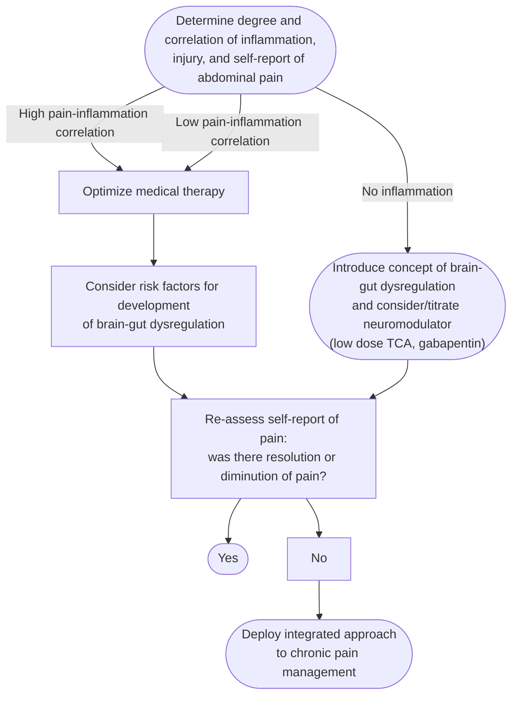

## Contents
- [[#Overview]]
  - [[#Definitions]]
- [[#Diagnostic Workup]]
- [[#Matching Intervention to Pain Complexity]]
- [[#Assessing Pain in IBD]]
  - [[#Peripheral Initiators vs Central Maintainers]]
  - [[#Risk Factors for the Acute→Chronic Transition]]
  - [[#Cognitive-Affective Amplifiers]]
  - [[#Listening to Pain Descriptors]]
- [[#Communicating the Diagnosis]]
- [[#Pharmacologic Strategy]]
  - [[#Neuromodulator Classes and Dosing]]
  - [[#Neuromodulation — Practical Rules]]
  - [[#Opioids and Cannabis]]
- [[#Non-pharmacologic Management]]
- [[#Referral and Team Structure]]
- [[#See Also]]
- [[#Sources]]

## Overview

- Pain (mostly abdominal) reported by **60–75%** of [[inflammatory-bowel-disease|inflammatory bowel disease (IBD)]] patients.
- Expected during active inflammation; the clinical problem is **persistent pain when inflammation is quiescent**.
- Persistent abdominal pain despite endoscopic remission: **30% of [[ulcerative-colitis|ulcerative colitis]]**, **60% of [[crohns-disease|Crohn's disease]]** — i.e. not automatically a flare.
- **Organic causes:** pain during uncontrolled disease activity generally correlates with mucosal and/or serologic inflammation markers; complications also cause pain — **mechanical obstruction from stricture**, **abscess**, **fistula**. Rule these out (e.g. a flare) before treating pain as chronic.
- Acute (sudden, sharp, transient) pain is informative — attending to it can prevent further bowel-wall damage by driving treatment-seeking.
- Reframe chronic pain in IBD as a **distinct, waxing-and-waning disease state** — managed like IBD itself: multidisciplinary, integrated, proactive.
- Drives unplanned health care use, disability, mental-health decline; some central mechanisms shared with [[irritable-bowel-syndrome|irritable bowel syndrome (IBS)]] and other chronic pain disorders.
- Expert commentary — no systematic reviews, so **no statement here carries an evidence or strength rating**.

### Definitions

- Pain (International Association for the Study of Pain [IASP]): unpleasant sensory and emotional experience associated with actual or potential tissue damage, or described in terms of such damage.

| Term | Definition |
|---|---|
| Acute pain | Happens suddenly, starts out sharp or intense; serves as a warning sign of disease or threat to the body |
| Chronic pain | Persists or recurs for longer than 3 months |
| Visceral hyperalgesia | Increased sensitivity to stimuli near site of injury/infection/inflammation |
| Allodynia | Abnormal pain responsiveness elicited by innocuous stimuli, such as food in the stomach or urge to have a bowel movement |
| Hyperalgesia | Exaggerated/prolonged response to noxious stimuli (e.g. low-grade inflammation) |
| Central sensitization | Increased sensitivity mediated by the central nervous system (CNS) |
| Pain acceptance | Giving up the struggle with pain and learning to live life despite pain |
| Psychological flexibility | Staying in contact with the present moment regardless of unpleasant thoughts, feelings, and bodily sensations, while choosing behaviors based on situation and personal values |
| Pain catastrophizing | Tendency to magnify or exaggerate the threat value or seriousness of pain sensations |
| Negative expectancy | Attending particularly to negative information; interpreting ambiguous information as threatening |
| Probability overestimation | Overestimating the likelihood of an event and acting on the overestimate rather than the actual likelihood |

*Terms and definitions related to chronic pain*
*Source: recreated from Table 1 of the AGA 2024 IBD pain CPU*
*[[aga-2024-ibd-pain|AGA 2024 CPU: Pain Management in IBD]]*
*CNS = central nervous system*

- Chronicity threshold (text): abdominal pain is **chronic if persisted 3–6 months past acute onset and resolution of the insult** (e.g. surgery for stricture, resolution of obstruction). Table 1 (IASP) uses longer than 3 months; the Update does not reconcile the two.
- Chronic pain occurs irrespective of the presence, intensity or duration of peripheral gut stimuli; can be episodic and fluctuating. In animal models, **inflammation-induced hyperalgesia often outlasts the inflammation**.
- Allodynia after inflammation resolves (as in IBS): triggered by certain food components, bile acids, intestinal distension or contractions.
- Hyperalgesia with **low-grade inflammation or pre-existing tissue injury** (e.g. mild nonobstructing stricture, site of bowel obstruction): self-management, neuromodulation and brain–gut behavior therapies are **similarly indicated**.

## Diagnostic Workup

The pain–inflammation correlation assigns the arm; the no-inflammation arm introduces brain–gut dysregulation and considers a neuromodulator such as a low-dose tricyclic antidepressant (TCA).

*Diagnostic workup of abdominal pain in IBD*
*Source: redrawn from AGA 2024 IBD pain Figure 1A*
*[[aga-2024-ibd-pain|AGA 2024 CPU: Pain Management in IBD]]*
*IBD = inflammatory bowel disease · TCA = tricyclic antidepressant*

- Risk factors for chronic pain ([[#Risk Factors for the Acute→Chronic Transition]]) should be **assessed and managed early**; monitor the potential for progression closely and discuss it with the patient.

> [!pitfall] The figure and the text disagree on gabapentin
> Figure 1A lists **gabapentin** alongside a low-dose TCA as the neuromodulator to introduce and titrate in the no-inflammation arm. The body text places gabapentin among mood stabilizers that have **not been studied in IBD**, have case-report support only, and should be used **only with psychiatric consultation**. The Update does not reconcile the two ([[aga-2024-ibd-pain]]).

## Matching Intervention to Pain Complexity

- Provider and patient work out the personal, biological, psychological and social factors that facilitate the pain or impair the ability to down-regulate it; complexity and the need for integrated care or multiple modalities rise together.
- **Pain complexity, lowest → highest:** visceral hypersensitivity → overlapping [[disorders-of-gut-brain-interaction|disorder of gut–brain interaction]], incl. IBS and [[functional-dyspepsia|functional dyspepsia]] → overlapping depression/anxiety → multiple pain sites/comorbidities → severe disability/impact on ability to work → central sensitization/[[centrally-mediated-abdominal-pain-syndrome|centrally mediated abdominal pain syndrome (CAPS)]] → opioid overuse/substance abuse.
- Interventions escalate alongside, drawn as **nested brackets spanning the scale** — the figure does not assign tiers 1–3 to specific complexity levels; only tier 4 sits level with opioid overuse/substance abuse.

| Intervention tier (lowest → highest) | Content |
|---|---|
| 1. [[brain-gut-behavioral-therapy\|Brain–gut behavior therapies]] | Cognitive behavior therapy; acceptance and commitment therapy; hypnosis; mindfulness/relaxation; wellness activities (exercise, sleep hygiene, stress management) |
| 2. Augmentation with neuromodulators | Including serotonin noradrenergic reuptake inhibitor (SNRI) and selective serotonin reuptake inhibitor (SSRI) (if anxiety or depression present), combined with TCA |
| 3. Intensive pain and psychological management programs | — |
| 4. Substance abuse referral and psychiatric care | — |

*Intervention tiers beside the pain-complexity scale*
*Source: redrawn as a table from AGA 2024 IBD pain Figure 1B*
*[[aga-2024-ibd-pain|AGA 2024 CPU: Pain Management in IBD]]*
*SNRI = serotonin noradrenergic reuptake inhibitor · SSRI = selective serotonin reuptake inhibitor · TCA = tricyclic antidepressant*

## Assessing Pain in IBD

- Initial comprehensive assessment **should include a psychologist experienced in chronic visceral pain conditions** — few gastroenterologists have in-depth knowledge of the psychological aspects; nonpsychologists yield to mental-health professionals on modality choice.
- **Assess both sensory and affective properties** of the pain — both drive symptom experience, impact, and outcome.
- Assess pre-existing risk factors (below) **and** the pain-related emotions, thoughts, and behaviors driving the current response to pain.
- Questionnaires exist (the Update names none); alternatively listen to what the patient says about pain **quality, intensity, or location** ([[#Listening to Pain Descriptors]]).

### Peripheral Initiators vs Central Maintainers

- **Peripheral initiators** (obstruction, inflammation) *start* pain; **central maintainers** (fear of pain or re-injury) *maintain and amplify* it — addressing the maintainers is most critical to relief.
- Central mechanisms: central sensitization (spinal cord, brainstem, cortex); altered descending modulation via serotonergic and noradrenergic brainstem nuclei projecting to the dorsal horn.
- When acute pain has "converted" to chronic is **often hard to tell in IBD** (relapsing-remitting inflammation; unclear when the peripheral cause has resolved).

### Risk Factors for the Acute→Chronic Transition

- History of any type of chronic pain.
- Early-life adversity or trauma — including discrimination experiences, poverty.
- Poor coping styles — catastrophizing, pre-existing anxiety, depression.
- Prior negative experiences with pain or with recovery from a flare.
- Pain-reinforcing social context — disability receipt, substance-misuse history, worker's compensation; absent positive social support.

### Cognitive-Affective Amplifiers

Often present during acute pain, they **linger after the source resolves** — and are **highly responsive to self-management interventions**.

- **Increased stress responsiveness** — greater engagement of emotional-arousal (threat-appraisal) and central autonomic systems even to mild stressors.
- **Pain catastrophizing** — heart of the fear-avoidance model; 2 affective components, both driving disability and unplanned care:
  - **Pain seen as threatening** (feared to mean obstruction, perforation, flare) → amplifies severity, impairs pain inhibition, blocks self-correction, generalizes fear, increases avoidance.
  - **Self seen as helpless** → help-seeking, unnecessary procedures and hospitalizations, and **substantially increased opioid-misuse risk**.
  - Frame to patients as a **consequence of brain mechanisms** (biased engagement of the salience system) — **not a psychological weakness**.
- **Negative expectancy**, **probability overestimation**, **inflexible coping**, low **pain acceptance**, and **avoidance behavior** that reinforces pain and reduces quality of life (QoL).
- **Pain acceptance and psychological flexibility are associated with improved pain tolerance and pain inhibition at the level of the brain.**

### Listening to Pain Descriptors

| Patient says | May indicate |
|---|---|
| "Unbearable," "ripping and tearing through my body" | High activation of brain networks for emotional reactivity and salience assessment; problems like pain catastrophizing |
| "Burning," "sharp" | Altered sensory input |
| "I cannot have this pain; there must be something wrong" | Need to build acceptance of chronic pain and its uncertainty; shift focus from "cure" to management |

*Reading the patient's own pain descriptors*
*Source: built from the AGA 2024 IBD pain practical-tips text (no source table)*
*[[aga-2024-ibd-pain|AGA 2024 CPU: Pain Management in IBD]]*

- Modify the emphasis on cognitive- and emotion-targeted treatment modalities according to the patient's description.

## Communicating the Diagnosis

- **Set expectations early** that the pain is real and multifactorial — so calling it chronic and unrelated to inflammation later is not an abrupt transition in care.
- Chronic pain **differs from acute nociceptive pain, has a well-documented neurobiological mechanism, and is not simply a psychological problem**.
- Hallmark: the patient **feels heard** — empathic stance, reflective listening, open-ended questions, **nonverbal engagement**, validation; explore biological *and* psychosocial factors.
- Educate, reassure, **set realistic goals**, maintain boundaries, mind time constraints.
- After the initial assessment: you are **adding another expert to their care team**, in close communication; you stay substantially involved; treatment may use multiple approaches.
- Multidisciplinary programs are ideal; otherwise the core gastrointestinal (GI) team can deliver proper care with effective communication plus referral when needed.
- Patients seeking work disability or opioids: be direct upfront that **both are associated with poorer long-term outcomes and do not reduce suffering**; discuss pain acceptance and doing what they value despite pain.

## Pharmacologic Strategy

### Neuromodulator Classes and Dosing

| Variable | TCAs | SSRIs | SNRIs | Miscellaneous |
|---|---|---|---|---|
| Agents/dosing (mg/d) | Amitriptyline 10–100; Imipramine 25–100; Nortriptyline 50–150; Desipramine 50–200 | Fluoxetine 20–80; Citalopram 20–40; Escitalopram 10–20; Sertraline 50–200; Paroxetine 20–50 | Venlafaxine extended-release (XR) 37.5–225; Duloxetine 30–120; Vortioxetine 5–20 | Mirtazapine 15–45; Bupropion sustained-release (SR) or extended-release (XL) 100–450 |
| Adverse effects (minimized by individualized dosing) | Sedation; arrhythmia (high dose); dry mouth; sexual dysfunction | GI; headache; insomnia; akathisia; sexual dysfunction | Same as SSRIs + hypertension | Mirtazapine: sedation, nausea, weight gain. Bupropion: weight loss, tachycardia, dry mouth, headache |
| Timing | Adverse effects (AE): days; efficacy 1–3 wk | AE: days; efficacy 2–4 wk | AE: days; efficacy 2–4 wk | AE: days; efficacy 1–2 wk |
| Efficacy | Small controlled trials; analgesic effect independent of mood effect | Large randomized trials for depression/anxiety; little/no efficacy for direct pain reduction | Large randomized trials for depression/anxiety; small controlled studies for chronic pain | Small randomized controlled trials for depression |
| Indications | Pain; insomnia; anxiety | Anxiety; depression | Pain; anxiety; depression | Mirtazapine: pain, sleep, appetite. Bupropion: pain, depression, fatigue |

*Neuromodulators for chronic abdominal pain in IBD — doses, adverse effects, timing, evidence, indications*
*Source: recreated from Table 2 (pharmacologic part) of the AGA 2024 IBD pain CPU*
*[[aga-2024-ibd-pain|AGA 2024 CPU: Pain Management in IBD]]*
*TCA = tricyclic antidepressant · SSRI = selective serotonin reuptake inhibitor · SNRI = serotonin noradrenergic reuptake inhibitor · XR = extended-release · SR = sustained-release · XL = extended-release · AE = adverse effect · GI = gastrointestinal*

### Neuromodulation — Practical Rules

- Consider **early**, with behavioral self-management, in a multidisciplinary plan — especially if pain is severe, chronic, or with functionally impairing anxiety/depression.
- Most proven efficacy in chronic pain: **low-dose TCAs, SNRIs, mirtazapine**.
- Tell patients without psychiatric comorbidity the presumed mechanism is **modulation of the pain modulatory system in brain + spinal cord**, not mood treatment — so **lower doses often suffice**.
- **Higher-dose SSRIs or bupropion** (within US Food and Drug Administration [FDA] guidelines): **only with significant psychiatric comorbidity** (anxiety, depression).
- **Low-dose TCAs + SNRIs** are prescribable/manageable by the gastroenterologist; reserve other neuromodulators for anxiety/depression or intractable patients.
- **Mood stabilizers** (gabapentin, valproic acid, topiramate) and **atypical antipsychotics** (quetiapine, olanzapine): **not studied in IBD**, case-report support only → use **only with psychiatric consultation**.
- **Start low, titrate every few weeks** until benefit or intolerability. For most antidepressants **AEs precede therapeutic benefit** — set expectations.
- **Augmentation** = add a different neuromodulator or brain–gut treatment when a single agent fails or causes AEs, then decrease the first agent's dose. **Change one medication at a time**, with careful daily logging.

### Opioids and Cannabis

> [!pitfall] No narcotics for chronic abdominal pain
> Not advised for any chronic abdominal pain — addiction risk, **paradoxical spinal amplification of pain sensitivity**, and [[narcotic-bowel-syndrome|narcotic bowel syndrome]] ([[aga-2024-ibd-pain]]).

- **Opioid reduction** is implemented **while the patient receives behavioral support**. Withdrawing opioids under detoxification protocols improves narcotic bowel syndrome and was associated with **lower abdominal pain scores**.
- **N-methyl-D-aspartate (NMDA) antagonists** (e.g. ketamine) reduce hyperalgesia in gut inflammation but are not extensively studied in IBD trials.
- **Cannabis:** qualitative reports only; **no quantitative studies support use**; long-term safety unknown.

## Non-pharmacologic Management

| Intervention | Rationale | Examples |
|---|---|---|
| Exercise / physical activity | Offsets fear-driven reduction in activity; improves function + QoL | Yoga, tai chi, Pilates |
| Soft-tissue mobilization | "Breaking up" abdominal adhesions may improve pain | Abdominal massage, visceral manipulation, myofascial release |
| Acupuncture | May modulate brain pain-perception networks (neuroimaging) | — |
| Relaxation training | Counters heightened autonomic arousal | Breathing techniques, guided imagery; apps: Nerva, Headspace, Calm |
| Mindfulness-based stress reduction | In-the-moment nonjudgmental observation of pain; encourages movement/yoga; some IBS evidence | — |
| Virtual reality | Distraction/re-engagement; mostly acute-pain data, promise in chronic | — |
| Self-management skills training | Teaches skills that affect symptom experience; empowers patients to accept, recognize, control symptoms; may include community-based support | Self-care rituals, routine, sleep hygiene, nutrition, education, coping-skills training; IBS apps: Mahana (prescription), Zemedy (over-the-counter) |
| Brain–gut behavior therapies / cognitive behavioral therapy (CBT) | Targets cognitive-affective factors that amplify pain, incl. pain catastrophizing | — |

*Nonpharmacologic options for chronic abdominal pain in IBD*
*Source: recreated from Table 2 (nonpharmacologic part) of the AGA 2024 IBD pain CPU*
*[[aga-2024-ibd-pain|AGA 2024 CPU: Pain Management in IBD]]*
*QoL = quality of life · IBS = irritable bowel syndrome · CBT = cognitive behavioral therapy*

- **CBT** — for no/limited response; works best with insight into how thoughts, feelings, behaviors relate to pain.
- Patients suited to **clinician-administered brain–gut behavior therapies**: those who recognize the cognitive and behavioral contributors to their pain, and/or need their treatment plan personalized.
- **Hypnotherapy** — for more visceral hypersensitivity or somatic symptoms, provided there is no severe post-traumatic stress disorder (PTSD) or other contraindication; delivered by a certified clinical provider.
- Best self-management candidates: **milder symptoms, high motivation, sense of confidence**; digital CBT and gut-directed hypnosis tools may improve access.
- Breathing-technique instruction (like low-dose TCAs and SNRIs) is prescribable/manageable by the gastroenterologist.

## Referral and Team Structure

- First contact for new-onset abdominal pain: primary care or gastroenterologist.
- **Once organic causes (e.g. flare) are ruled out, the gastroenterologist should *always* consider multidisciplinary, whole-person-centered care early in the treatment plan**; refer **early in the course of patient–physician interactions**.
- Significant psychiatric comorbidity → psychologist or psychiatrist involvement. Routine depression/anxiety screening in IBD: [[ibd-preventive-care]].
- **Uptake of nonpharmacologic therapy rises considerably when the IBD provider makes the referral** — schedule a follow-up visit after any outside referral to check on it.
- The gastroenterology provider must **remain fully involved in the care plan** — ideally via a shared electronic medical record or an established community referral pathway.
- No integrated program → virtual programs help find psychologists with brain–gut expertise, e.g. the **Rome Foundation Psychogastroenterology Group**.

## See Also

[[inflammatory-bowel-disease]], [[crohns-disease]], [[ulcerative-colitis]], [[disorders-of-gut-brain-interaction]], [[irritable-bowel-syndrome]], [[functional-dyspepsia]], [[centrally-mediated-abdominal-pain-syndrome]], [[brain-gut-behavioral-therapy]], [[ibd-preventive-care]], [[nutrition-in-ibd]], [[narcotic-bowel-syndrome]]

---

## Sources

1. [[aga-2024-ibd-pain|AGA 2024 Clinical Practice Update on Pain Management in Inflammatory Bowel Disease]]
