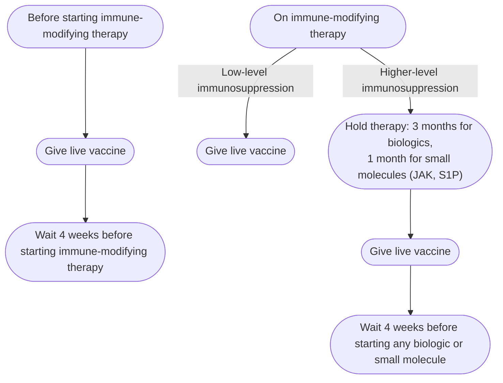
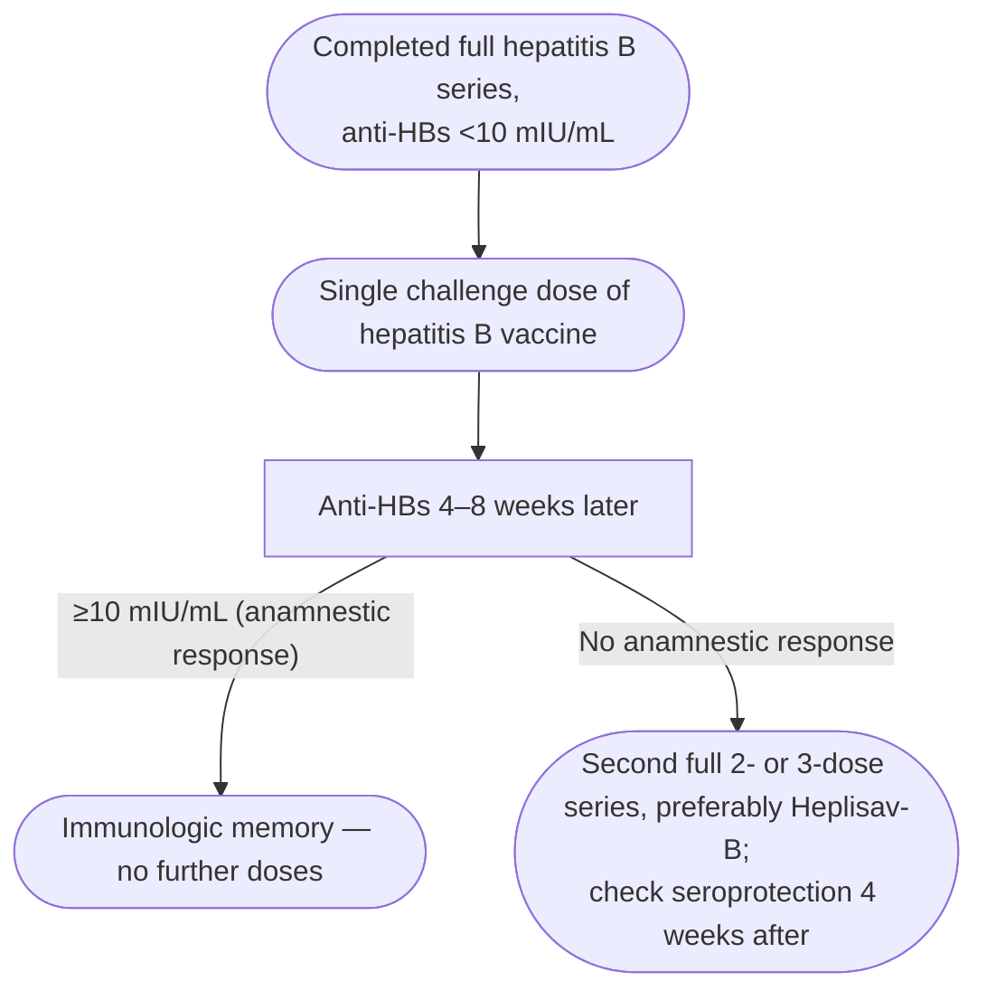

Health maintenance for adults with [[inflammatory-bowel-disease|inflammatory bowel disease (IBD)]] — [[crohns-disease|Crohn's disease (CD)]] and [[ulcerative-colitis|ulcerative colitis (UC)]]. **>70% of patients with IBD will at some time be on immune-modifying therapy (IMT)**, raising the risk of infections, many vaccine-preventable ([[acg-2025-ibd-preventive-care]]).
- The gastroenterology (GI) team documents and recommends vaccines and shares responsibility for giving them with primary care ([[acg-2025-ibd-preventive-care]]; [[aga-2025-noncolorectal-cancer-ibd]] Best Practice Advice [BPA] 5).
- How the American College of Gastroenterology (ACG) recommendations changed from 2017 to 2025: [[acg-2025-ibd-preventive-care#What Changed From 2017]].

## Contents
- [[#Vaccination Principles]]
  - [[#Vaccine Checklist by Agent/Age]]
  - [[#Live Vaccines]]
  - [[#Pneumococcal Schedule (ACG 2025 Figure 1)]]
  - [[#Hepatitis B Seroprotection Algorithm (AGA 2025)]]
  - [[#Before Pregnancy]]
- [[#Cancer Screening]]
  - [[#Cervical Cancer]]
  - [[#Melanoma]]
  - [[#Non-Melanoma Skin Cancer (NMSC)]]
  - [[#Anal Cancer]]
  - [[#Colorectal Dysplasia]]
- [[#Osteoporosis Screening]]
- [[#Mental Health Screening]]
- [[#Smoking]]
- [[#See Also]]
- [[#Sources]]

---

## Vaccination Principles

- **No live vaccine while on IMT** (ACG 2025 key concept 1) — live attenuated influenza, measles-mumps-rubella (MMR), dengue, yellow fever. Live herpes zoster (HZ) vaccine (Zostavax) is no longer available in the US. Pathway when a live vaccine is needed: [[#Live Vaccines]].
- **Timing:**
  - Review vaccine status at diagnosis, at transfer of care, or during remission.
  - Give age-appropriate vaccines **before starting IMT** when possible (key concept 2) — but **never delay needed IBD therapy** to vaccinate.
  - Already on therapy → vaccinate at the **earliest opportunity, regardless of the biologic dosing cycle**; small molecules are **not held** for vaccination ([[acg-2025-ibd-preventive-care]]).
  - [[aga-2025-noncolorectal-cancer-ibd|American Gastroenterological Association (AGA) 2025]] BPA 6: inactivated vaccines are safe and do not exacerbate IBD; give at the earliest opportunity, **preferably off corticosteroids or at the lowest tolerable corticosteroid dose**. Seasonal influenza and coronavirus disease 2019 (COVID-19) vaccines are still offered on high-dose corticosteroids.
- **Safety:** nonlive vaccines — adverse events mainly local or mildly systemic, no different from patients without IBD (meta-analysis) ([[acg-2025-ibd-preventive-care]]).
- **Response by drug** ([[acg-2025-ibd-preventive-care]]):
  - Aminosalicylate or [[thiopurines|thiopurine]] monotherapy → normal responses.
  - [[anti-tnf-agents|Anti–tumor necrosis factor (TNF) therapy]] → blunted responses to inactivated vaccines; lowest with anti-TNF **plus** a thiopurine or [[methotrexate]].
  - [[vedolizumab|Vedolizumab]] and [[il-23-and-il-12-23-inhibitors|ustekinumab]] → normal influenza responses in **small** studies; no lower messenger RNA (mRNA) COVID-19 antibody responses in **larger** studies. Whether this extends to other inactivated vaccines is unknown.
  - Tofacitinib → lower pneumococcal (not influenza) response in rheumatoid arthritis. No data for upadacitinib, sphingosine-1-phosphate (S1P) receptor modulators, or selective interleukin-23 (IL-23) inhibitors ([[jak-inhibitors|Janus kinase (JAK) inhibitors]]).

### Vaccine Checklist by Agent/Age

ACG 2025 and AGA 2025 are both 2025 US guidance; where they differ, both are shown.

| Vaccine | Who | Schedule and notes |
|---|---|---|
| Influenza, inactivated (annual) | All adults with IBD (ACG key concept 3; AGA BPA 8) | **Anti-TNF monotherapy → high-dose (HD) vaccine** (AGA adds solid organ transplant recipients). **Age ≥65 → HD, recombinant, or adjuvanted.** Patients on IMT **and household contacts**: inactivated, **not** live intranasal (key concept 4). Ideally September–October; can be co-given with pneumococcal, COVID-19 and respiratory syncytial virus (RSV) vaccines |
| Pneumococcal conjugate vaccine, 20- or 21-valent (PCV20 or PCV21), single dose | ACG: **≥50**, no prior vaccine (Rec 1, strong, low); **19–49 on IMT**, no prior vaccine (Rec 2, conditional, very low). AGA BPA 9: **all 19–64** get an initial vaccine, second vaccine at **≥65** | Previously vaccinated and 19–64 on IMT, or ≥65 → follow Centers for Disease Control and Prevention (CDC) guidance on whether to give more (ACG Rec 3, strong, low). Sequencing: [[#Pneumococcal Schedule (ACG 2025 Figure 1)]] |
| Recombinant zoster vaccine (Shingrix), 2 doses, nonlive | ACG: **all ≥50** (Rec 4, conditional, low); **≥19 on or planning IMT** (Rec 5, conditional, very low). AGA BPA 11: ≥19 on or planning IMT, **regardless of prior varicella vaccination** | ACG: 0.5 mL intramuscular at **0 and 2–6 months**; immunocompromised **0 and 1–2 months**. AGA Table 1: **8–12 weeks apart** off IMT, **4–8 weeks apart** on IMT. Safe if chickenpox/varicella vaccine history unknown |
| RSV, single dose | **ACG** (key concepts 5–6, citing the Advisory Committee on Immunization Practices [ACIP]): all **≥75**; **50–74** with chronic cardiovascular, lung, liver or renal disease, diabetes with end-organ damage, immunocompromise, obesity, neurologic/neuromuscular conditions, frailty, or nursing-home residence | **AGA 2025 is internally inconsistent:** BPA 10 says **all IBD ≥60** (no product preference); its Table 1 says ≥75, or 60–74 with conditions or risk factors for severe RSV |
| COVID-19 | All adults with IBD (ACG Rec 6, conditional, very low) | Per national guidelines (AGA: ACIP). Robust responses; titers may be lower on anti-TNF or corticosteroids; no appreciable flare risk after mRNA vaccine |
| Hepatitis B | ACG key concept 10: all **not immune**. AGA Table 1: universal for adults **19–59**, and **all starting IMT** | ACG: test hepatitis B surface antigen, core antibody and surface antibody (anti-HBs), and vaccinate nonimmune patients **before anti-TNF**; immunocompromised → check anti-HBs **1–3 months after** the series. AGA: Heplisav-B **2 doses at 0 and 1 month** (preferred over Engerix-B); Engerix-B, Recombivax HB, Twinrix or PreHevbrio **3 doses at 0, 1, 6 months**. Previously vaccinated, anti-HBs <10 mIU/mL → [[#Hepatitis B Seroprotection Algorithm (AGA 2025)]] |
| Varicella (live), 2 doses | Not immune (ACG key concept 7) | Immunity = documented chickenpox **or** completed 2-dose series; **no serology** after prior vaccination (false negatives). Give **4 weeks before** IMT; already on IMT → [[#Live Vaccines]] |
| MMR (live), 2 doses ≥4 weeks apart | Not immune to MMR (AGA Table 1) | History of the 2-dose MMR and varicella series = presumptive immunity (AGA BPA 5); serology not recommended when the immunization history is adequate |
| Human papillomavirus (HPV) | ACG (per ACIP): 2- or 3-dose series at **9–14**, catch-up **through 26**; **27–45** by shared decision-making. AGA BPA 5: all **18–26**; **27–45** if likely to have a new sexual partner | AGA Table 1 (Gardasil 9): 3 doses at 0, 1–2 and 6 months |
| Tetanus-diphtheria-acellular pertussis (Tdap), hepatitis A, meningococcal | Per ACIP (ACG key concept 9) | Tdap once, then tetanus-diphtheria (Td) or Tdap every 10 years. [[hepatitis-a\|Hepatitis A]] for increased risk (travel, men who have sex with men, illicit drug use, homelessness, occupational exposure) or severe-disease risk (chronic liver disease, human immunodeficiency virus [HIV]). Meningococcal for patients with IBD with meningitis risk factors |
| [[rotavirus\|Rotavirus]] (live), infant | Infants with **in-utero biologic exposure** | **May be offered** (ACG Rec 7, conditional, very low); no increased adverse events in >300 exposed infants |

### Live Vaccines

*Live vaccine administration in IBD*
*Source: redrawn from ACG 2025 Figure 2; immunosuppression levels per CDC definitions (table below)*
*[[acg-2025-ibd-preventive-care|ACG 2025 Preventive Care in IBD]]*
*JAK = Janus kinase · S1P = sphingosine-1-phosphate*

| Low-level immunosuppression | Higher-level immunosuppression |
|---|---|
| Short-term steroids (<14 days) | High-dose steroids (>20 mg/day prednisone) |
| Low-to-moderate dose steroids (<20 mg/day prednisone or equivalent; <2 mg/kg/day for a young child) | Methotrexate or azathioprine |
| Long-term alternate-day short-acting steroids | Biologic therapy (anti-TNF) |
| Maintenance physiologic (replacement) steroid doses | Non-TNF biologics (ustekinumab, risankizumab, mirikizumab, guselkumab) |
| Topical (skin, eyes), inhaled, or intra-articular/bursal/tendon steroid injection | JAK inhibitors and S1P modulators (tofacitinib, upadacitinib, ozanimod, etrasimod) |
| Vedolizumab | |

Figure 2 caveats ([[acg-2025-ibd-preventive-care]]):
- GI guidelines have **not** recommended live vaccines during any IMT; a live vaccine on a TNF or non-TNF biologic or a small molecule is currently not recommended.
- One opportunity to interrupt therapy: after surgical resection for CD. A 3-month hold resembles episodic dosing (antidrug antibodies, loss of response, infusion reactions, flares) — weigh against infection risk (likely low even in outbreaks).
- Low-dose immunomodulators (methotrexate <0.4 mg/kg/week, azathioprine <3 mg/kg/day, 6-mercaptopurine <1.5 mg/kg/day) do not preclude live zoster vaccine (Zostavax); this says nothing about other live vaccines.
- Vedolizumab: US Food and Drug Administration (FDA) label allows concurrent live vaccines only if benefits outweigh risks.
- Varicella on immunosuppression: CDC experts advise waiting **3 months after stopping** therapy; with active disease, treating IBD comes first.

> [!pitfall] Household contacts can get live vaccines — with precautions
> MMR, varicella and rotavirus may be given to contacts (ACG key concept 8). Post-varicella rash → avoid the patient until it resolves; wash hands after diapers for 1 month after infant rotavirus vaccine; live influenza vaccine to contacts unless the patient is in a protective (positive-pressure, high-efficiency particulate air–filtered) environment — though key concept 4 advises contacts get the inactivated influenza vaccine ([[acg-2025-ibd-preventive-care]]).

- **Travel:** pretravel consultation; patients on IMT should consider avoiding yellow fever–endemic areas (AGA 2025).

### Pneumococcal Schedule (ACG 2025 Figure 1)

Vaccine-naive adults with IBD, any age or immunosuppression status: **one dose of PCV20 or PCV21, no further boosters**. Prior 13-valent conjugate (PCV13) or 23-valent polysaccharide (PPSV23) vaccine:

| Age group | PCV-naive | Incomplete PCV series† | Completed adult PCV series‡ |
|---|---|---|---|
| 19–49 immunocompromised; all 50–64 | PCV21 or PCV20 | PCV13 only → PCV21 or PCV20 **≥1 year** later; PCV13 + PPSV23 → PCV21 or PCV20 **≥5 years** later | No vaccine recommendation |
| ≥65 | PCV21 or PCV20 | **≥5 years** since last PCV → PCV21 or PCV20 | PCV20 or PCV21 — one additional dose **5 years** after the previous vaccine |

† Incomplete: unknown history; 7-valent vaccine (PCV7) at any age; PPSV23 only; PCV13 only; PCV13 + 1 dose PPSV23.
‡ Completed: PCV13 + 2 doses PPSV23; 15-valent vaccine (PCV15) + PPSV23; PCV20; or PCV21.
- AGA 2025 Figure 2 gives the same grid with a single **19–64** row (no immunocompromise qualifier), and prefers single-dose PCV20 or PCV21 over PCV15 followed by PPSV23.

### Hepatitis B Seroprotection Algorithm (AGA 2025)

Evaluate **all** adults with IBD for latent [[chronic-hepatitis-b|hepatitis B]] infection (BPA 7).

*Challenge dose in previously vaccinated, non-seroprotected adults with IBD*
*Source: built from AGA 2025 Best Practice Advice 7 and its supporting text (the CPU has no flowchart)*
*[[aga-2025-noncolorectal-cancer-ibd|AGA 2025 CPU Noncolorectal Cancer Screening and Vaccinations in IBD]]*
*anti-HBs = hepatitis B surface antibody · CPU = Clinical Practice Update*

### Before Pregnancy

- Preconception ([[global-consensus-2025-pregnancy-ibd]] Table 5): vaccines up to date — annual influenza, hepatitis B, MMR, varicella. MMR and varicella are live → avoided on high-dose steroid, thiopurine and/or biologic therapy; **live vaccines should be given 28 days before pregnancy**. Rest of reproductive care, incl. infant live vaccines (bacille Calmette-Guérin [BCG]) after in utero exposure: [[ibd-in-pregnancy]].

---

## Cancer Screening

*Screening of the cancer-free patient. Drug decisions once a cancer develops: [[ibd-in-malignancy]].*

- All adults with IBD: **age-appropriate cancer screening** (AGA BPA 1) — breast, prostate and lung per the US Preventive Services Task Force (USPSTF).

### Cervical Cancer

- **ACG 2025 Rec 8 (conditional, very low):** women on IMT → **annual** screening starting **within 1 year of onset of sexual activity**; if **<30**, annual for **3 consecutive years**, then **every 3 years**.
  - Modeled on HIV guidance: baseline cytology → if normal, annual × 3 years, then every 3 years. Abnormal cytology → HPV serotyping; persistent abnormality → colposcopy.
  - Not on IMT → average-risk screening.
  - JAK inhibitor and S1P modulator users: same (expert opinion; no data).
- **AGA 2025 BPA 2 differs:** age-appropriate screening; data **insufficient** to say whether combined immunosuppression or thiopurines need more frequent screening — shared decision-making and individual risk stratification.
  - USPSTF intervals cited by AGA: 21–29 → cytology every 3 years; 30–65 → cytology every 3 years, high-risk HPV testing every 5 years, or co-testing every 5 years.
  - Mann et al meta-analysis: no significant increase in cervical cancer (hazard ratio [HR] 1.24, 95% confidence interval [CI] 0.94–1.63); slightly more low-grade lesions (HR 1.15).

### Melanoma

- **ACG 2025 Rec 9 (conditional, very low):** **annual** melanoma screening for all IBD (CD and UC), regardless of biologic use.
- ACG 2025: everyone on **systemic immunosuppressive therapy → annual total body skin exam** (melanoma + non-melanoma skin cancer [NMSC]) plus regular self-exams; everyone starting immunosuppression → ultraviolet A/B-protective sunscreen and sun-protective clothing.
- IBD itself: ~37% higher melanoma risk (relative risk [RR] 1.37); meta-analyses show no significant biologic- or thiopurine-associated increase.

### Non-Melanoma Skin Cancer (NMSC)

- **ACG 2025 Rec 10 (conditional, very low):** **annual** NMSC screening while on 6-mercaptopurine, azathioprine, methotrexate, JAK inhibitors, or S1P receptor modulators — **particularly if >50**.
- Thiopurines: RR 1.88; incidence rate ratio ~1.6 in year 1 → 3.6 by year 5. Persistence after stopping is debated; ACG keeps skin surveillance going after thiopurines stop.
- Vedolizumab: not linked to malignancy.
- **AGA 2025 BPA 3:** all IBD → sun/ultraviolet primary prevention; **yearly total body skin exam (TBSE)** on immunomodulators, anti-TNF biologics, or small molecules; **any history of thiopurine use → continue yearly TBSE after stopping**.

### Anal Cancer

*Risk groups, start ages and the cytology/high-risk HPV → high-resolution anoscopy pathway: [[anal-cancer-screening]].*

- **AGA 2025 BPA 4:** at **every [[colonoscopy]]**, a thorough perianal and anal exam — special attention to the anal canal in perianal CD, anal stricture, HPV, HIV, and anoreceptive intercourse.
- Mostly squamous cell carcinoma. Incidence per 100,000 person-years: UC 10.2, CD 7.7, **anal/perianal CD 19.6**.
- Other risk factors: smoking, persistent HPV (as on chronic immunosuppression), HIV, men who have sex with men, women with HPV-associated genital cancers, solid organ recipients.
### Colorectal Dysplasia

- Outside the scope of both preventive-care guidelines. IBD [[colorectal-cancer|colorectal cancer (CRC)]] surveillance: [[ulcerative-colitis]], [[crohns-disease]], [[colonoscopy]]. The average-risk grid on [[colonoscopy-surveillance]] excludes IBD.

---

## Osteoporosis Screening

- **ACG 2025 Rec 11 (conditional, very low):** adults with IBD **and conventional risk factors for abnormal bone mineral density (BMD)** → BMD testing (dual-energy x-ray absorptiometry [DEXA]) **at diagnosis and periodically after**.
- **AGA 2025 BPA 12:** consider bone densitometry **at any age** with body mass index (BMI) **<20 kg/m²**, **>3 months cumulative corticosteroids**, current smoking, postmenopausal status, or hypogonadism. No other factors → consider for postmenopausal women and men **≥65**. Normal BMD → repeat timing by result and risk factors, **no more often than annually**.
- Osteoporosis = BMD **≥2.5 standard deviations** below mean young-adult peak bone mass.

**Conventional risk factors for low BMD (ACG 2025):**

| Type | Factors |
|---|---|
| Modifiable | Current smoking; low body weight (<129 lb); estrogen deficiency; menopause <45; bilateral ovariectomy; premenopausal amenorrhea >1 year; low lifelong calcium intake; excess alcohol; uncorrected visual impairment; repeated falls; inactivity; frailty or poor health |
| Nonmodifiable | Adult fracture history; family history of fracture (especially first-degree relatives); White race; female sex; dementia; older age |
| Secondary causes | Parathyroid, thyroxine or cortisol excess; estrogen, testosterone or vitamin D deficiency; heparin, warfarin, cyclosporine A, methotrexate, tacrolimus |

**[[corticosteroids-ibd|Corticosteroids]] (ACG 2025):**
- 30–50% of long-term users fracture; risk tracks **daily** dose, not cumulative.
- Prednisone 3–10 mg/day already raises risk; **2.5 mg/day → 1.55-fold** spinal fracture risk; **>7.5 mg/day → 5-fold** spine and hip fracture risk.
- Fractures appear **3–6 months after starting**; risk falls as early as **3 months after stopping**, back to baseline in **1–2 years**.
- Overall IBD fracture risk RR 1.38 (vertebral 2.26).

**Tools and follow-up (ACG 2025):**
- **Fracture Risk Assessment Tool (FRAX):** 10-year hip and major osteoporotic fracture probability. Built for postmenopausal women and men ≥50; not validated after osteoporosis treatment; may overestimate risk in IBD. The suggestion that FRAX could replace DEXA rests on one small retrospective study and needs prospective validation.
- **Spinal x-rays** only with height loss **≥4 cm** vs height at age 20, **≥2 cm** during follow-up, or symptoms such as back pain.
- **Repeat DEXA** after starting osteoporosis therapy: at **a minimum of 1 year**. BMD changes ~1%/year, below scanner error (~3%), so 1–2-year monitoring scans are contested.

---

## Mental Health Screening

- Screen all patients with CD and UC for **depression and anxiety at baseline and annually**; refer positive screens for counseling/therapy (ACG 2025 key concept 11, ungraded). AGA 2025 BPA 13: annually; refer to primary care or a mental health specialist.
- Prevalence (ACG 2025 meta-analysis): anxiety 32.1% vs 10.4%; depression 25.2% vs 17.9%. Active vs quiescent IBD: anxiety odds ratio 2.5, depression 3.1.
- Treatment ([[acg-2025-ibd-preventive-care]]): psychological therapies lowered depression and anxiety scores (meta-analysis); antidepressants helped psychological and somatic symptoms, serotonin-noradrenaline reuptake inhibitors both depression and anxiety. Neuromodulator doses: [[ibd-pain-management]].

---

## Smoking

- **ACG 2025 Rec 12 (strong, low):** counsel all adults with IBD who smoke to quit (2017 limited this to CD).
- CD: smoking raises risk of CD (odds ratio 1.76), stricturing and perianal disease, flares, surgery and postoperative endoscopic recurrence. Anti-TNF response (CD or UC): similar overall in smokers, but lower when restricted to studies clearly defining smoking (≥5 cigarettes/day for ≥6 months; RR 0.63). Quitting >1 year → flare risk similar to never-smokers.
- Colorectal neoplasia: former smoking raised risk in UC (HR 1.73); active and passive smoking raised it in CD.

## See Also

[[inflammatory-bowel-disease]], [[crohns-disease]], [[ulcerative-colitis]], [[thiopurines]], [[anti-tnf-agents]], [[methotrexate]], [[vedolizumab]], [[il-23-and-il-12-23-inhibitors]], [[jak-inhibitors]], [[corticosteroids-ibd]], [[ibd-in-malignancy]], [[ibd-in-pregnancy]], [[ibd-pain-management]], [[nutrition-in-ibd]], [[anal-cancer-screening]], [[colonoscopy]], [[colonoscopy-surveillance]], [[colorectal-cancer]], [[chronic-hepatitis-b]], [[rotavirus]]

---

## Sources

1. [[acg-2025-ibd-preventive-care|ACG Clinical Guideline Update: Preventive Care in Inflammatory Bowel Disease (2025)]]
2. [[acg-2017-ibd-preventive-care|ACG Clinical Guideline: Preventive Care in Inflammatory Bowel Disease (2017)]] *(historical / superseded)*
3. [[aga-2025-noncolorectal-cancer-ibd|AGA Clinical Practice Update on Noncolorectal Cancer Screening and Vaccinations in Patients With Inflammatory Bowel Disease: Expert Review]]
4. [[global-consensus-2025-pregnancy-ibd|Global Consensus Statement on the Management of Pregnancy in Inflammatory Bowel Disease (2025)]]
