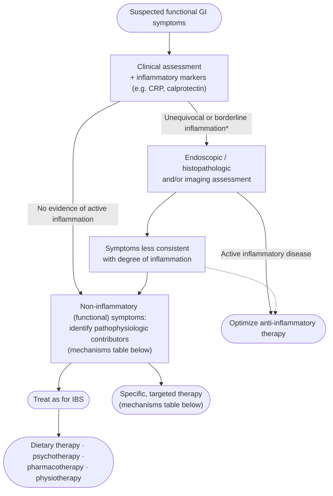

## Contents
- [[#Overview]]
- [[#Where Each Topic Lives]]
- [[#Index Endoscopy and Biopsy Protocol]]
- [[#Endoscopic Monitoring of Treatment Response]]
- [[#Inpatient Management of Hospitalized IBD]]
- [[#Functional GI Symptoms in Quiescent IBD]]
  - [[#Scale of the Overlap]]
  - [[#Is It Inflammation? (BPA 1–4)]]
  - [[#Biomarker Limits — the Decision Inputs Behind BPA 1–2]]
  - [[#Diagnostic Algorithm]]
  - [[#Acquired Mechanisms to Work Up Before Calling Symptoms Functional]]
  - [[#Managing the Functional Component (BPA 5–14)]]
- [[#IBD Therapy During an Acute Systemic Viral Illness]]

## Overview

Inflammatory bowel disease (IBD) comprises two major chronic immune-mediated disorders of the gastrointestinal (GI) tract: [[crohns-disease|Crohn's disease (CD)]] and [[ulcerative-colitis|ulcerative colitis (UC)]]. Distinguishing the two: [[uc-vs-crohns-comparison]].

## Where Each Topic Lives

| Topic | Page |
|---|---|
| Disease-specific diagnosis and therapy | [[crohns-disease]], [[ulcerative-colitis]] |
| Endoscopic activity scores | [[ibd-endoscopic-scoring]] |
| Vaccination, cancer screening, bone/mental health | [[ibd-preventive-care]] |
| Cancer risk; IBD drugs after or with a cancer | [[ibd-in-malignancy]] |
| Anal cancer screening (general high-risk framework) | [[anal-cancer-screening]] |
| Colitis-associated [[colorectal-cancer\|colorectal cancer (CRC)]] dysplasia surveillance | [[ulcerative-colitis#Colorectal Cancer Surveillance]] (technique on [[colonoscopy]]) |
| Pregnancy and IBD (drug safety, monitoring, delivery) | [[crohns-disease#Pregnancy]] |
| Diet and nutritional therapy | [[nutrition-in-ibd]] |
| Pain management | [[ibd-pain-management]] |
| Age- and frailty-specific safety overlay (age ≥60) | [[ibd-in-older-adults]] |
| Transmural monitoring | [[intestinal-ultrasound]] |
| Pouch disorders | [[pouchitis]] |
| Virtual follow-up, visit-type selection, remote monitoring | [[telemedicine-in-gastroenterology]] |
| Immunomodulator positioning, dosing, thiopurine methyltransferase (TPMT)/NUDT15 testing | [[thiopurines]] |
| Thiopurine / methotrexate hepatotoxicity | [[drug-induced-liver-injury]] |

## Index Endoscopy and Biopsy Protocol

*Cross-cutting rules from [[asge-2025-ibd-endoscopy-consensus|American Society for Gastrointestinal Endoscopy (ASGE) 2025 IBD Endoscopy Consensus]] — a **modified Delphi consensus with no evidence grades**. Disease-specific findings: [[crohns-disease]], [[ulcerative-colitis]].*

- **Indication:** ileocolonoscopy in every patient with chronic diarrhea (**>4–6 wk**), persistent bleeding, new or unexplained anemia, weight loss, growth failure in children, or other alarming presentation. **Ileocolonoscopy with biopsy sampling is required for the diagnosis** of both CD and UC.
- **Index biopsy set — at least 4 sets, one each from:** terminal ileum, right colon, left colon, rectum — **plus biopsies of every endoscopically reachable stricture.**
- **Timing: biopsy before starting medical therapy.** Treated UC becomes patchy in about **one-third** of patients, which defeats extent assessment and CD-vs-UC separation.
- **Density: 3 samples per region of interest is the minimum** needed to overcome microscopic heterogeneity and grade inflammation accurately in active colitis.
- **Where to aim:** strictures, representative nodular and inflamed mucosa, and **the edge of an ulcer**. Endoscopically normal ileum and colon may also be sampled.
- **Avoid inflammation-inducing drugs,** [[nsaid-enteropathy|nonsteroidal anti-inflammatory drugs (NSAIDs)]] in particular, before a diagnostic ileocolonoscopy. A **≥4-week** hold specifically **failed to reach consensus**, as did avoiding sodium phosphate preparation in favour of polyethylene glycol.
- **Document a bowel preparation score** for diagnostic and therapeutic IBD endoscopy ([[bowel-preparation]]).
- **Around the index exam:** computed tomography (CT) enterography or magnetic resonance enterography to verify diagnosis, assess extent and look for stricture and fistula. [[intestinal-ultrasound|Intestinal ultrasound (IUS)]] "can be considered, where available" — the stronger statement encouraging onsite IUS **failed consensus**.

> [!pearl] Three histologic findings that settle an ambiguous biopsy
> **Paneth cell metaplasia** distal to the splenic flexure marks chronic injury in CD or UC — it appears in only **0%–1.9%** of non-IBD distal colon (infectious, ischemic, prolapse). **Pyloric gland metaplasia** with severe active inflammation or crypt distortion in small-bowel mucosa, in a young patient with no prior bowel surgery, is strongly indicative of CD. Absence of granulomas never excludes CD — they appear in only **9%–67%** of patients ([[asge-2025-ibd-endoscopy-consensus]]).

> [!pitfall] Two mimics are diagnosed by *where* you biopsy
> [[segmental-colitis-associated-with-diverticulosis|Segmental colitis associated with diverticulosis]] spares the rectum → **biopsy the rectum** to separate it from IBD. Solitary rectal ulcer syndrome, rectal prolapse and rectocele inflame the distal rectum, preferentially the **anterior wall** → biopsy there ([[asge-2025-ibd-endoscopy-consensus]]).

## Endoscopic Monitoring of Treatment Response

*Same source ([[asge-2025-ibd-endoscopy-consensus]]).*

- **After starting, escalating or switching therapy:** flexible sigmoidoscopy, colonoscopy or ileocolonoscopy **with** clinical and laboratory biomarkers to document response; interval and modality depend on IBD type, the drug's mechanism of action, and the response.
- **Score it:** Simple Endoscopic Score for Crohn's Disease (SES-CD) for CD, Mayo for UC, Rutgeerts for postoperative CD ([[ibd-endoscopic-scoring]]).
- **Endoscopic mucosal healing without histologic healing is sufficient to continue the current therapy** — endoscopic remission without histologic remission is **not** a treatment failure; histologic healing has not been set as a therapeutic target in clinical guidelines ([[treat-to-target-ibd]]).

## Inpatient Management of Hospitalized IBD

*Cross-cutting framework from [[aga-2026-inpatient-ibd|American Gastroenterological Association (AGA) 2026 Clinical Practice Update (CPU) on Inpatient Management of IBD]]. Disease-specific pathways: [[ulcerative-colitis]] (Acute Severe UC) and [[crohns-disease]] (Fulminant/Hospitalized CD).*

- **When to admit:** severe disease refractory to outpatient therapy, high suspicion for an IBD-related complication (intestinal obstruction, intra-abdominal abscess), or significant nutritional risk/failure to thrive. Increasingly patients are admitted for **failing outpatient therapy** rather than fulminant presentation.
- **Initial workup:** IBD-tailored history/exam; anemia evaluation, C-reactive protein (CRP) and/or fecal calprotectin; assess disease activity with **biomarkers + endoscopy when indicated**; evaluate for IBD-related complications and **concomitant infections** ([[clostridioides-difficile|C. difficile]], cytomegalovirus).
  - **Preparatory labs for anticipated drugs:** fasting lipid panel before [[calcineurin-inhibitors|cyclosporine]] or a [[jak-inhibitors|Janus kinase inhibitor]]; latent tuberculosis (tuberculin skin test or interferon-gamma release assay — the latter preferred if bacille Calmette-Guérin vaccinated); [[chronic-hepatitis-b|hepatitis B]] testing.
  - **[[nutrition-in-hospitalized-patients|Malnutrition screen]]** with a validated tool (e.g., Malnutrition Universal Screening Tool), dietitian referral as indicated.
- **Supportive care:** intravenous (IV) hydration/electrolytes, treat acute anemia, pain control — **avoid opioids if possible; use NSAIDs with caution** (may exacerbate intestinal ulceration). Pain detail: [[ibd-pain-management]].
- **Venous thromboembolism (VTE) prophylaxis:** all hospitalized IBD patients **without absolute contraindications** should receive **prophylactic [[anticoagulation-gi-bleeding|anticoagulation]]** — subcutaneous low-molecular-weight heparin or fondaparinux. Inpatient IBD carries **2×** the VTE risk of non-IBD inpatients.
  - **Continuing after discharge:** decide individually for those at especially high risk — recent surgery (within 3 months), active malignancy, lower-limb trauma, immobilization, thrombophilia; data are insufficient to support the practice.
- **Discharge:** appropriate after resolution/stabilization of the acute indication — does **not** require CRP or imaging normalization; establish a clear outpatient transition plan (named responsible clinician, patient education) to reduce readmission.

## Functional GI Symptoms in Quiescent IBD

*Symptoms do not track inflammation in either direction. From [[aga-2018-functional-gi-symptoms-ibd|AGA 2018 CPU on Functional Gastrointestinal Symptoms in Patients With IBD]]: 14 numbered Best Practice Advice (BPA) statements, **no** evidence grades.*

### Scale of the Overlap

- Pooled [[irritable-bowel-syndrome|irritable bowel syndrome (IBS)]] prevalence across IBD: **39% (95% confidence interval [CI] 30%–48%)** — low-quality data the Update says "should be taken with caution." Disease-specific split on [[crohns-disease]]; endoscopic-remission discordance on [[ulcerative-colitis]].
- Persistent diarrhea and abdominal pain in **16.3%** of IBD patients despite mucosal healing.
- **15% of IBD patients account for approximately 50% of health care expenditures**, apparently driven by concomitant chronic pain, depression and poor social support ([[aga-2018-psychogastroenterology]]).

> [!pitfall] Don't escalate on symptoms alone
> Escalating anti-inflammatory therapy for functional symptoms adds adverse-event risk with no symptomatic benefit; the Crohn's Disease Activity Index (CDAI) can be as high in IBS as in IBD — "no therapeutic decision should be taken based on clinical consideration alone" ([[aga-2018-functional-gi-symptoms-ibd]]).

### Is It Inflammation? (BPA 1–4)

| # | Best practice advice (verbatim) |
|---|---|
| **1** | A stepwise approach to rule-out ongoing inflammatory activity should be followed in IBD patients with persistent GI symptoms (measurement of fecal calprotectin, endoscopy with biopsy, cross-sectional imaging). |
| **2** | In those patients with indeterminate fecal calprotectin levels and mild symptoms, clinicians may consider serial calprotectin monitoring to facilitate anticipatory management. |
| **3** | Anatomic abnormalities or structural complications should be considered in patients with obstructive symptoms including abdominal distention, pain, nausea and vomiting, obstipation or constipation. |
| **4** | Alternative pathophysiologic mechanisms should be considered and evaluated (small intestinal bacterial overgrowth, bile acid diarrhea, carbohydrate intolerance, [[chronic-pancreatitis\|chronic pancreatitis]]) based on predominant symptom patterns. |

**Clinical assessment that precedes any test:**

- History: bowel pattern; presence *and severity* of pain, incontinence episodes, urgency, tenesmus; alarm features (weight loss, nocturnal symptoms, bleeding, high-volume or high-frequency diarrhea, fevers); recent antibiotic use; symptom duration.
- **Alarm features, or acute onset in previously well-controlled disease → keep suspicion for inflammation high.**
- Exam: distension, masses, perianal disease; absent obvious perianal pathology, a **careful digital rectal exam** for mass lesions and a rectal evacuation disorder.

### Biomarker Limits — the Decision Inputs Behind BPA 1–2

- **CRP: up to 15% of patients fail to mount a CRP response.** Optimal biomarker cutoffs "remain a source of debate."
- **Fecal calprotectin (FC)** — interpretive values for persistent symptoms as stated by this Update (not treat-to-target values; those live on [[ulcerative-colitis]] and [[crohns-disease]], whose newer guideline sources take precedence):

| FC | What the Update says it means |
|---|---|
| **<50 µg/g** | May be reassuring; points toward a non-IBD etiology for persisting symptoms |
| **50–250 µg/g** | May be challenging to interpret — upper normal limits vary; mild elevation occurs with nonspecific low-grade inflammation |
| **200–250 µg/g** | Range of thresholds that may predict endoscopic remission in both UC and CD |
| **<60 µg/g** | Predicted deep remission in UC (sensitivity 86%, specificity 87%; 1 retrospective review) |
| **≤40.5 µg/g** | Predicted histologic remission (sensitivity 41%, specificity 100%; 1 prospective study) |

- **The operative interval behind BPA 2: serial calprotectin every 3–6 months** in patients with mild symptoms, to catch impending flares early.
- If a flare is suspected → **endoscopy with biopsies, or dedicated small-bowel imaging in CD.**

### Diagnostic Algorithm

*Evaluation of suspected functional GI symptoms in IBD (\*calprotectin and other marker cut-offs vary with the clinical scenario; dotted arrow as in the source)*
*Source: redrawn from Figure 1 of the AGA 2018 Clinical Practice Update (four therapy boxes merged into one)*
*[[aga-2018-functional-gi-symptoms-ibd|AGA 2018 CPU on Functional GI Symptoms in IBD]]*
*GI = gastrointestinal · IBD = inflammatory bowel disease · CRP = C-reactive protein · IBS = irritable bowel syndrome*

### Acquired Mechanisms to Work Up Before Calling Symptoms Functional

| Potential pathophysiological abnormality | Presentation | Potential investigations | Potential therapy |
|---|---|---|---|
| Anxiety and depression (inflammation-associated gut–brain axis change) | Pain, IBS, fatigue | Psychological or psychiatric evaluations | Psychological therapy, antidepressant, anxiolytic |
| Hypervigilance, central sensitization of pain processing | Pain, IBS | — | Similar approaches as for IBS (see [[ibd-pain-management]]) |
| Altered visceral sensory neurons (neuroinflammation); activation/sensitization of nociceptors; ↑mast cell density | Pain, IBS | — | — |
| [[bile-acid-diarrhea\|Bile acid diarrhea]] | Diarrhea, IBS | Selenium-75-homocholic acid taurine (⁷⁵SeHCAT) testing*, fecal bile acids | Bile salt sequestrant |
| [[small-intestinal-bacterial-overgrowth\|Small intestinal bacterial overgrowth]] | Diarrhea, bloating, gas, pain, IBS | Breath testing, culture of small bowel aspirates | Antibiotics |
| [[exocrine-pancreatic-insufficiency\|Pancreatic exocrine insufficiency]] | Pain, weight loss, bloating, diarrhea | Fecal elastase | Pancreatic enzyme replacement |
| Lactose or fructose malabsorption | Gas, bloating, diarrhea, IBS | Breath testing | Dietary restriction |
| Obstipation/constipation from fecal stasis in uninflamed colon proximal to distal colitis (UC) | Constipation | Abdominal x-ray | Laxation, prokinetic |
| Intestinal stenosis (CD) | Pain, obstruction | Imaging, endoscopy | Dilatation, surgery |
| [[defecation-disorders\|Pelvic floor dyssynergia]] | Pain, constipation, IBS | Rectal exam, anorectal physiological studies | [[biofeedback-therapy\|Biofeedback therapy]] |
| [[celiac-disease\|Celiac disease]] (not IBD-specific) | Diarrhea, gas, malabsorption | Celiac serology, small intestinal biopsy | Gluten-free diet |

\*⁷⁵SeHCAT testing is not widely available in most countries outside Europe or Canada.

- **Pancreatic exocrine insufficiency:** increased prevalence in IBD by fecal elastase screening, but falsely low elastase may reflect diarrhea, and its clinical significance in IBD remains undefined.
- **Structural disease hides from ileocolonoscopy.** Active small-bowel CD, stenosis and fistulas can be missed without systematic cross-sectional small-bowel imaging. Fibrosis in UC is likely to affect colonic motility and anorectal function **even without strictures or active mucosal disease**.

### Managing the Functional Component (BPA 5–14)

Therapy is borrowed from IBS — the Update notes "a paucity of randomized controlled trials or even prospective studies" in IBD. FODMAP = fermentable oligosaccharides, disaccharides, monosaccharides, and polyols.

| # | Best practice advice (verbatim) | Where the detail lives |
|---|---|---|
| **5** | A low FODMAP diet may be offered for management of functional GI symptoms in IBD with careful attention to nutritional adequacy. | [[low-fodmap-diet]] |
| **6** | Psychological therapies (cognitive behavioural therapy, hypnotherapy, mindfulness therapy) should be considered in IBD patients with functional symptoms. | [[ibd-pain-management]], [[brain-gut-behavioral-therapy]] |
| **7** | Osmotic and stimulant laxative should be offered to IBD patients with chronic constipation. | [[chronic-constipation]] |
| **8** | Hypomotility agents or bile-acid sequestrants may be used for [[chronic-diarrhea\|chronic diarrhea]] in quiescent IBD. | [[bile-acid-diarrhea]], [[loperamide]] |
| **9** | Antispasmodics, neuropathic-directed agents, and anti-depressants should be used for functional pain in IBD while use of opiates should be avoided. | [[ibd-pain-management]] |
| **10** | Probiotics may be considered for treatment of functional symptoms in IBD. | [[probiotics]] |
| **11** | Pelvic floor therapy should be offered to IBD patients with evidence of an underlying defecatory disorder. | [[defecation-disorders]] |
| **12** | Until further evidence is available, fecal microbiota transplant should not be offered for treatment of functional GI symptoms in IBD. | [[fmt]] |
| **13** | Physical exercise should be encourage[d] in IBD patients with functional GI symptoms. | — |
| **14** | Until further evidence is available, complementary and alternative therapies should not be routinely offered for functional symptoms in IBD. | — |

- **BPA 5 qualifier:** dietary instruction should be delivered by a dietitian, given common undernutrition in IBD.
- **BPA 13:** moderate exercise is safe in quiescent or mildly active IBD; whether it helps the *functional* symptoms specifically is untested.

## IBD Therapy During an Acute Systemic Viral Illness

*From [[aga-2020-ibd-covid-19|AGA 2020 CPU on Management of IBD During the COVID-19 Pandemic]], written for coronavirus disease 2019 (COVID-19) and severe acute respiratory syndrome coronavirus 2 (SARS-CoV-2). **Ungraded expert commentary** — no numbered Best Practice Advice, no evidence grades.*

**Baseline position:** patients with IBD do **not** appear to be at increased risk of infection. Do not pre-emptively stop therapy — relapse may require steroids or hospitalization, outcomes "much worse than the known risks of existing IBD therapies."

| Agent class | Not infected | Infected, no symptoms | Confirmed illness |
|---|---|---|---|
| [[mesalamine-5-asa\|Aminosalicylates]], topical rectal therapy, diet, antibiotics | Continue | Not addressed | **Continue — considered safe** |
| Oral budesonide | Continue | Switch to it from prednisone where feasible | Likely safe; may continue if needed for control |
| Systemic [[corticosteroids-ibd\|corticosteroids]] | Continue | Reduce to **prednisone <20 mg/day** | **Avoid; discontinue quickly** — watch for adrenal insufficiency |
| [[thiopurines]], [[methotrexate]], [[jak-inhibitors\|tofacitinib]] | Continue | **Hold** | **Hold** |
| [[anti-tnf-agents\|Anti–tumor necrosis factor (TNF) agents]], [[il-23-and-il-12-23-inhibitors\|ustekinumab]] | Continue | **Delay dosing 2 weeks** while monitoring | **Hold** |
| [[vedolizumab]] | Continue | Delay dosing 2 weeks | Hold if the IBD is stable (an international consensus group was uncertain it is necessary) |

- **Restart** after 2 weeks if no illness develops; after confirmed illness, restart on complete symptom resolution or, if available, negative follow-up viral testing or serologic evidence of convalescence.
- **Infusion centres stay open** if they prescreen for exposure and symptoms, check temperatures at the door, space chairs **at least 6 feet apart**, use and supply masks and gloves, and deep-clean after each patient. **Do not electively switch to an injectable** (infliximab → adalimumab switching was associated with relapse). **Home infusion is not recommended** (a travelling nurse can become a vector).
- **New digestive symptoms during the viral illness:** first exclude [[clostridioides-difficile|C. difficile]] and other enteric pathogens; then confirm active inflammation **nonendoscopically** — CRP, fecal calprotectin, or cross-sectional imaging — read with caution, since the viral illness itself can make them abnormal.
- **Hospitalized for IBD with milder or incidentally found viral illness:** treat the acute IBD by standard inpatient algorithms; limit intravenous steroids to **3 days**, then decide between a [[calcineurin-inhibitors|calcineurin inhibitor]] and infliximab. Cytomegalovirus can be assessed by **serum polymerase chain reaction** to avoid [[colonoscopy]]. Surgical consultation as per standard practice. **Severe viral illness:** IBD therapy "likely will take a back seat"; choose viral-illness therapy with the IBD in mind, if feasible.
- **Endoscopy:** urgent and emergent only — where it will "urgently change management" (in IBD: biopsies to diagnose new severe disease, excluding cytomegalovirus when noninvasive tests are equivocal, or inspection that would direct surgery). Use **N95, N99, or powered air-purifying respirators rather than surgical masks, plus double-gloving**, for both [[upper-endoscopy|upper]] and lower endoscopy **regardless of the patient's infection status**.

## See Also

[[crohns-disease]], [[ulcerative-colitis]], [[thiopurines]], [[ibd-preventive-care]], [[ibd-endoscopic-scoring]], [[ibd-pain-management]], [[ibd-in-malignancy]], [[nutrition-in-ibd]], [[intestinal-ultrasound]], [[clostridioides-difficile]], [[disorders-of-gut-brain-interaction]], [[drug-induced-liver-injury]], [[nutrition-in-hospitalized-patients]], [[colorectal-cancer]], [[pouchitis]], [[uc-vs-crohns-comparison]], [[probiotics]], [[anticoagulation-gi-bleeding]], [[anal-cancer-screening]], [[colonoscopy]], [[calcineurin-inhibitors]], [[jak-inhibitors]], [[ibd-in-older-adults]], [[irritable-bowel-syndrome]], [[low-fodmap-diet]], [[bile-acid-diarrhea]], [[small-intestinal-bacterial-overgrowth]], [[exocrine-pancreatic-insufficiency]], [[defecation-disorders]], [[chronic-constipation]], [[celiac-disease]], [[fmt]], [[loperamide]], [[brain-gut-behavioral-therapy]], [[bowel-preparation]], [[nsaid-enteropathy]], [[segmental-colitis-associated-with-diverticulosis]], [[treat-to-target-ibd]], [[capsule-endoscopy]], [[extraintestinal-manifestations-ibd]]

---

## Sources

1. [[aga-2026-inpatient-ibd|AGA Clinical Practice Update on Inpatient Management of Adults With Inflammatory Bowel Disease: Expert Review (2026)]]
2. [[aga-2018-functional-gi-symptoms-ibd|AGA Clinical Practice Update on Functional Gastrointestinal Symptoms in Patients With Inflammatory Bowel Disease: Expert Review]]
3. [[aga-2018-psychogastroenterology|Best Practice Update: Incorporating Psychogastroenterology Into Management of Digestive Disorders]]
4. [[aga-2020-ibd-covid-19|AGA Clinical Practice Update on Management of Inflammatory Bowel Disease During the COVID-19 Pandemic: Expert Commentary]]
5. [[asge-2025-ibd-endoscopy-consensus|Endoscopic diagnosis and management of adult inflammatory bowel disease: a consensus document from the American Society for Gastrointestinal Endoscopy IBD Endoscopy Consensus Panel (2025)]]
