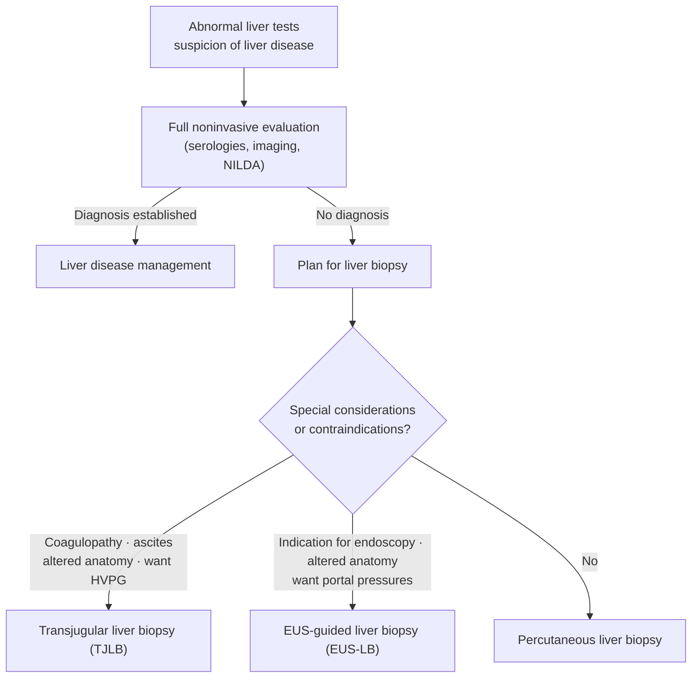

Liver biopsy is the procedural acquisition of hepatic tissue for histological assessment. It serves three major roles: **diagnosis**, **prognosis (disease staging, chiefly fibrosis)**, and **guiding therapeutic management** ([[aasld-2009-liver-biopsy|American Association for the Study of Liver Diseases (AASLD) 2009]], reaffirmed by [[aasld-2026-expo-liver-biopsy|AASLD 2026]]). Although it remains a reference standard, noninvasive tools — serum panels and [[liver-stiffness-measurement|elastography]] ([[noninvasive-liver-disease-assessment|noninvasive liver disease assessment (NILDA)]]) — increasingly replace it for fibrosis staging, and biopsy is now reserved largely for diagnostic uncertainty or when histology will change management.

> **[[aasld-2026-expo-liver-biopsy|AASLD 2026 EXPO]] updates the 2009 position paper and governs this page where the two differ.** It is an **Expert Practice Opinion**: 16 unanimously-agreed statements built on a *targeted* literature review, with **no systematic review and no GRADE** — so its statements carry **no evidence grade or strength rating**, unlike the Class/Level ratings of 2009. A liver biopsy specimen is only **1/50,000th of the liver volume**, and many conditions do not affect the liver uniformly.

## Contents
- [[#Indications]]
- [[#Approaches]]
  - [[#Percutaneous]]
  - [[#Transvenous (Transjugular / Transfemoral)]]
  - [[#Surgical / Laparoscopic]]
  - [[#EUS-Guided]]
- [[#Pre-Procedure Coagulation Assessment]]
- [[#Medication Management]]
  - [[#Sedation]]
- [[#Complications]]
- [[#Sample Adequacy]]
- [[#Liver Biopsy in Children]]
- [[#Noninvasive Alternatives]]
- [[#See Also]]
- [[#Sources]]

## Indications

**The three current indications** ([[aasld-2026-expo-liver-biopsy]], statements 1–3, ungraded) — biopsy when:

1. **Liver test results are unexplained** and abnormal
2. **Fibrosis assessment is needed and noninvasive testing is uncertain and/or discordant**
3. **Histologic assessment will inform clinical management decisions**

**Which scenarios actually tip to biopsy** ([[aasld-2026-expo-liver-biopsy]], Table 1):

| Indication | Proceed to biopsy when |
|---|---|
| Unexplained liver test elevation | Elevated alanine aminotransferase (ALT) **despite weight loss and alcohol cessation**, or after stopping herbal supplements · elevated alkaline phosphatase (ALP) with **normal anti-mitochondrial antibody (AMA)** and magnetic resonance cholangiopancreatography, no [[drug-induced-liver-injury\|drug-induced liver injury (DILI)]] risk · suspected [[autoimmune-hepatitis\|autoimmune hepatitis (AIH)]] **when immunosuppression is being considered** · **ruling out drug-induced AIH-like hepatitis** when DILI is suspected |
| Fibrosis assessment | **Discrepant results** — eg high [[noninvasive-liver-disease-assessment\|Fibrosis-4 (FIB-4)]], nodular liver, but low liver stiffness · **high-stakes decisions**, eg heart failure with nodular liver in heart-transplant evaluation · **payer requires histologic confirmation** of fibrosis stage before starting therapy |
| Clinical management | [[autoimmune-hepatitis\|AIH]] patient **considering discontinuation of immunosuppression** · [[liver-transplantation\|liver transplant]] recipient with abnormal liver tests **who may need immunosuppression adjustment** |

- **Diagnostic yield:** a diagnosis is reached in **74%–94%** of biopsies done for unexplained liver test elevation — but **normal histology is still found in as many as 15%**.

Also on biopsy ([[aasld-2009-liver-biopsy]], Recs 1–2, Class I/B; Tables 3–4): **coexisting parenchymal diseases** (steatosis plus [[hepatitis-c|hepatitis C virus (HCV)]] or [[hereditary-hemochromatosis|hemochromatosis]]; overlap syndromes) · **[[acute-liver-failure|acute liver failure]]**, post–[[liver-transplantation|liver transplant]] allograft dysfunction, cryptogenic [[cirrhosis]] · **diffuse infiltrative disease** (amyloidosis, granulomatous hepatitis, malignancy) ([[aasld-2026-expo-liver-biopsy]]).

- **Disease-specific roles** — each disease page carries its own biopsy criteria: [[autoimmune-hepatitis]], [[nafld-masld]], [[primary-biliary-cholangitis]], [[primary-sclerosing-cholangitis]], [[wilson-disease]] (quantitative hepatic copper), [[hereditary-hemochromatosis]] ([[iron-overload-and-iron-metabolism|iron quantification]]), [[drug-induced-liver-injury]].
- **Focal/mass lesions are outside the scope of [[aasld-2026-expo-liver-biopsy|AASLD 2026]]**, as are laparoscopic/surgical approaches and biopsy for clinical trials. Per [[aasld-2009-liver-biopsy]]: image-guided biopsy when imaging is indeterminate; core (not aspirate) preferred for suspected neoplasia; sampling error and ~0.13% tumour-track seeding risk in [[hepatocellular-carcinoma|hepatocellular carcinoma (HCC)]] and [[cholangiocarcinoma]].

## Approaches

**Choosing the route** ([[aasld-2026-expo-liver-biopsy]], Figure 1). Technique selection depends on **local expertise** plus patient-specific factors — ascites, coagulopathy, concurrent indications such as [[hepatic-venous-pressure-gradient|hepatic venous pressure gradient (HVPG)]], and **patient preference** (statement 4):

*Figure — Approach to liver biopsy in a patient with abnormal liver tests of unclear etiology. ([[aasld-2026-expo-liver-biopsy]])*

**The three techniques side by side** ([[aasld-2026-expo-liver-biopsy]], Figure 2):

| | Percutaneous | TJLB | EUS-LB |
|---|---|---|---|
| **Operator** | Hepatology, radiology | Hepatology, interventional radiology | Advanced endoscopist |
| **Needle size** | **16–18-gauge** | **18–19-gauge** | **19-gauge preferred** |
| **Major bleeding risk** | **0.5%–2%** | **0.6%–0.7%** | **0.6%–0.9%** |
| **Pain** | +++ | ++ | + |
| **Best for** | Most patients — fast, widely available, good specimen, low cost | **Safest in coagulopathy, thrombocytopenia or significant ascites**; HVPG wanted; obesity | Endoscopy needed anyway; difficult anatomy or obesity; **direct portal pressures** |
| **Against** | Higher risk if anatomy atypical; limited in ascites or severe coagulopathy | More equipment and specialized expertise; **smaller, sometimes fragmented specimens**; limited availability; high cost | Advanced endoscopy expertise; **resource intensive (anesthesia)**; limited availability; high cost |

### Percutaneous
The standard transthoracic intercostal approach, performed supine under local anesthesia (1% lidocaine), with the needle inserted over the cephalad aspect of the rib to avoid the intercostal artery; breath-holding reduces capsule laceration. Variants:
- **Palpation/percussion-guided** — the classic method.
- **Image-guided (US marking) and real-time image-guided** — **use imaging for every percutaneous liver biopsy in adults**, either immediately before or in real time ([[aasld-2026-expo-liver-biopsy]], statement 5). This **strengthens** the 2009 position, which made US marking preferred but **not** mandatory (Rec 13, Class I/B). Real-time guidance is required for large vascular lesions (Rec 17) and known intrahepatic lesions (Rec 24).
  - **Ultrasound is the preferred modality** — no ionizing radiation (unlike CT), real-time visualization allowing immediate needle adjustment, more economical and readily available. It steers the path away from gallbladder, large vessels, colon and lung ([[aasld-2026-expo-liver-biopsy]]).
- **Plugged percutaneous biopsy** — biopsy track plugged with collagen/thrombin as the needle is withdrawn; proposed for higher-risk patients (coagulopathy, small cirrhotic liver).

**Devices:** cutting needles (Tru-cut style, including automated variable-pitch core devices) vs core-aspiration needles (Menghini, Jamshidi, Klatskin). Typical cutting-needle caliber ~16-gauge (1.6 mm), trough 1.6-1.8 cm. **If cirrhosis is suspected, a cutting needle is recommended** because suction needles fragment cirrhotic cores (Rec 27, Class I/B).

### Transvenous (Transjugular / Transfemoral)
Accomplished via a jugular or femoral venous approach under fluoroscopy. Considered standard and preferred when percutaneous access is risky or limited:
- **Clinically evident [[ascites]]** (transvenous generally recommended; alternatives are percutaneous after paracentesis, or laparoscopic — Rec 16).
- **Uncooperative patients** (alternative to general anesthesia — Rec 15).
- Known/suspected **hemostatic defect**, small/hard cirrhotic liver, morbid [[obesity]] with a difficult flank site.
- When **[[hepatic-venous-pressure-gradient|hepatic venous pressure gradient]]** measurement is also desired (relevant to [[portal-hypertension]]).

Transvenous biopsy yields smaller specimens (typically 3 cores with a 19-gauge needle to limit sampling error). Bleeding risk appears similar to percutaneous overall, but comparative data are confounded by selection bias.

### Surgical / Laparoscopic
Performed under direct vision (needle device or wedge resection) when the liver is being operated on or visualized. Allows direct hemostatic control and high diagnostic accuracy for cirrhosis, but wedge specimens may overestimate fibrosis (subcapsular) and the approach requires anesthesia and expertise.

### EUS-Guided
The AASLD 2009 paper predates routine endoscopic ultrasound (EUS)-guided liver biopsy and does not address it (it notes only experimental natural orifice transluminal endoscopic surgery (NOTES) transgastric biopsy), so the percutaneous/transvenous recommendations above remain the AASLD-graded standards. [[endoscopic-ultrasound|EUS]]-guided liver biopsy has since become established enough to carry its own **quality benchmarks** ([[acg-2025-eus-quality|American College of Gastroenterology (ACG)/American Society for Gastrointestinal Endoscopy (ASGE) 2025 EUS quality indicators]]) — the numbers to audit against:

| Benchmark | Target | Grade |
|---|---|---|
| Diagnostically adequate EUS-guided liver biopsy (indicator 8) | **>85%** | 1B (strong; randomized trials with important limitations) |
| Clinically significant bleeding after EUS liver biopsy (indicator 19) | **<5%** | 1C+ (strong; overwhelming observational evidence) |

**Technique and yield:**
- **Needle: 19-gauge fine-needle biopsy (FNB)** (fork-tip or Franseen), the minimum gauge for EUS-LB ([[aasld-2026-expo-liver-biopsy]] statement 11). FNB beats fine-needle aspiration (FNA) on specimen length and portal triads (2.09 vs 1.47 cm; 42.6 vs 18.1 triads), though adverse events were higher (6% vs 1%); Franseen yield 99% vs 88% for other FNB needles. A randomized trial also found 19-gauge gave longer, less fragmented cores than 22-gauge ([[acg-2025-eus-quality]], [[aasld-2026-expo-liver-biopsy]]).
- **"Wet heparin suction"** — flushing the needle with heparin plus wet suction improves yield over dry suction. Number of passes is not specified.
- **Adequacy in EUS-LB studies:** >15 mm with **>6 complete portal triads** — note this is **below** AASLD's >11 portal tract standard above; the stricter >2 cm / >11 triad definition is often hard to achieve by this route ([[acg-2025-eus-quality]]).
- **Yield:** pooled diagnostic yield ~94%–95%, adequacy 84%, adverse events 3%; the >85% target reflects series from experienced, high-volume centers.
- **Advantages:** real-time needle visualization with Doppler to avoid vessels; access to both lobes; combinable with endoscopic screening, [[ercp|endoscopic retrograde cholangiopancreatography (ERCP)]], or EUS-guided portal pressure measurement. Equivalent or superior to transjugular biopsy; data vs percutaneous conflict, with no clear winner.

## Pre-Procedure Coagulation Assessment
A central message, unchanged and reinforced in 2026: **conventional coagulation tests poorly predict post-biopsy bleeding.** There is **no prothrombin time-international normalized ratio (PT-INR) or platelet count cutoff** at/above which adverse bleeding can be reliably predicted (Rec 18, Class I/C). Standard US practice often withholds percutaneous biopsy at **PT-INR >1.5**, but the evidence base is weak, and the PT-INR is derived from coumadin-treated reference ranges that don't apply to the rebalanced hemostasis of liver disease (see [[cirrhosis-hemostasis]]).

**What [[aasld-2026-expo-liver-biopsy|AASLD 2026]] adds — and deliberately declines to add:**

- **AASLD Guidance on Procedural Bleeding classifies both percutaneous biopsy and TJLB as high-bleeding-risk procedures**, yet makes **no recommendation on any specific INR or platelet threshold requiring correction**. Studies generally show **no clear difference in bleeding risk between patients with and without cirrhosis**.
- **Prophylactic platelet transfusion did not help:** in 497 patients with cirrhosis and thrombocytopenia having US-guided biopsy (42 transfused), **no effect on any bleeding (odds ratio 1.318, p=0.449) or major bleeding (OR 1.754, p=0.420)**. Cutoffs warranting transfusion remain unclear.
- **TJLB's advantage is narrower than assumed:** propensity-matched in 1467 patients, TJLB had **less hematoma formation (0.2% vs 1.2%, p=0.049)** but **no difference in other complications, readmission or mortality**.
- **Where coagulation or platelets are severely deranged** — individualize the approach and any prophylactic blood product **in consultation with a hematologist** (statement 4 applies). **In patients with deranged coagulation or platelets, or who are anticoagulated or on antiplatelet therapy, the TJLB approach is usually preferred.**
- **Desmopressin (DDAVP) in uremia** may be reasonable in high-risk patients with prolonged bleeding time, but **routine premedication is not supported** — its effect on clinically significant bleeding remains uncertain.
- **Platelets:** transfuse for counts <50,000-60,000/mL (Rec 20, Class I/C); in vitro thrombin-generation data suggest ~56,000 may suffice in cirrhosis, but in vivo validation is lacking.
- **Hyperfibrinolysis** occurs in ~10%-15% of chronic liver disease patients and is undetectable by conventional tests — suspect it with late post-procedure bleeding; thromboelastography may help.
- Prophylactic/rescue plasma, fibrinolysis inhibitors, or recombinant factors may be considered in specific situations but effectiveness is unproven (Rec 21, Class IIa/C).
- **Renal failure:** Desmopressin (DDAVP) may be considered (Rec 22, IIa/B), generally unnecessary on stable dialysis; dialyze well and avoid heparin (Rec 23). Known congenital bleeding disorders (factor VIII/IX deficiency, von Willebrand disease [vWD], sickle cell) warrant definitive factor replacement before biopsy.

## Medication Management

**Hold intervals before percutaneous biopsy** ([[aasld-2026-expo-liver-biopsy]]):

| Agent | Hold |
|---|---|
| **Warfarin** | **~5 days**, target **INR ≤1.5** |
| **Direct oral anticoagulants** (apixaban, rivaroxaban) | **2–3 days** — **longer with renal impairment** |
| **Clopidogrel** | **5–7 days** |
| **Aspirin** | **No hold needed on current evidence** — in 3636 patients, bleeding risk with aspirin within 10 days (n=585) was **the same** as without (n=3051) |

- **Aspirin and NSAIDs: data are insufficient for a robust recommendation** — the negative aspirin study above is the best available, not a guideline endorsement.
- 2009 figures, where they still apply: antiplatelets stopped several to 10 days before (Rec 5, Class I/C), restart 48-72 h after (Rec 7); warfarin restart the day after biopsy (Rec 8); heparin stopped 12-24 h prior (Rec 6).
- Liver biopsy **can be performed safely with appropriate anticoagulant management**; bleeding risk depends on approach and agent. Weigh thrombotic risk of stopping against bleeding risk; agent-by-agent hold intervals and reversal are on [[anticoagulation-gi-bleeding]].

### Sedation
- Percutaneous: typically **moderate sedation** (benzodiazepine ± opioid). **EUS-LB: almost always deep sedation** (monitored anesthesia care with propofol) — this adds to its risk profile.
- **TJLB combined with HVPG may be done with little or no sedation** — sedating drugs can alter portal pressure and distort HVPG; **propofol, but not fentanyl alone, may affect HVPG interpretation**.
- Patients with advanced liver disease may have **altered clearance of sedative drugs** ([[aasld-2026-expo-liver-biopsy]]).

## Complications
**Rates by approach** ([[aasld-2026-expo-liver-biopsy]], Table 2):

| | Percutaneous | TJLB | EUS-LB |
|---|---|---|---|
| Severe pain | 20%–30% | 10%–20% (neck/needle site) | 10%–15% (epigastric or RUQ) |
| Major haemorrhage | **0.3%–0.6%** (6–24 h) | Intraperitoneal **<0.1%–0.3%** (24 h) | **0.50%** (6–24 h) |
| Death | **~0.01%** | **~0.01%** | Very rare |
| Route-specific | Hemobilia <0.1% (up to ~5 d) · bile peritonitis <0.1% · pneumothorax/hemothorax <0.1% | **Carotid artery puncture <0.5%** · major neck hematoma <0.5% · transient arrhythmias 1%–5% | GI perforation <0.1% · bile leak very rare · sore throat/dysphagia <5% |

> [!pearl] Severe pain after liver biopsy is the warning sign, not a nuisance
> In 1838 biopsies, **severe pain was the *sole* significant independent predictor of major complications** (hazard ratio **30.6**). Pain severe enough to need hospitalization warrants **contrast-enhanced CT or CT angiography** ([[aasld-2026-expo-liver-biopsy]]).

- **Pain** — most common, in **up to 80%** ([[aasld-2026-expo-liver-biopsy]]; up to 84% per [[aasld-2009-liver-biopsy]]); usually minor, mild and transient, in the right upper quadrant or **right shoulder** (referred from capsular stretch). **Severe pain in <10%.** Managed with small narcotic doses. Pain out of proportion should prompt evaluation for bleeding or gallbladder puncture.
- **Bleeding** — most important; severe (intraperitoneal) bleeding occurs in ~1 in 2,500 to 1 in 10,000 percutaneous biopsies. Greatest risk in the first several hours; delayed bleeding can occur up to ~1 week. Managed expectantly, with transfusion, angiographic embolization, or surgery for ongoing loss.
- **Death** — usually from hemorrhage; typically ≤1 in 10,000.
- **Other** — pneumothorax, hemothorax, visceral perforation, bile peritonitis, hemobilia, infection (notably increased after biopsy in post-transplant patients with choledochojejunostomy).
- **Post-procedure care:** vital signs at least every 15 minutes for the first hour (Rec 11); observation 2-4 hours with bed rest, assessing vital signs, pain and the biopsy site — **most bleeding occurs in the first few hours**. Watch for **increasing abdominal pain, hypotension, tachycardia, or shoulder pain**. **No evidence supports any particular duration of monitoring**; monitor both vital signs *and* symptoms ([[aasld-2026-expo-liver-biopsy]]).
  - **After TJLB:** add **cardiac rhythm monitoring** (right atrial / hepatic vein instrumentation) and neck access site inspection; 2–4 h, longer with sedation, coagulopathy or cardiopulmonary comorbidity.
  - **After EUS-LB:** monitor as for other advanced endoscopy; most adverse events present early and **same-day discharge is appropriate if stable and asymptomatic**.

> [!pitfall] Stop putting patients in the right lateral decubitus position
> The traditional right-side recovery position is **not supported by evidence and causes more pain**. Randomized to right-side vs supine vs combined, the right lateral decubitus group had significantly worse immediate pain — **visual analog scale 26.5/100 vs 14.2 (combined) and 12.1 (supine)** — with **no difference in complications**, and rated the procedure significantly **less acceptable** ([[aasld-2026-expo-liver-biopsy]]).
- **Factors influencing risk (Table 8):** patient cooperation, coagulation status, operator experience, image guidance, percutaneous vs transvenous technique, number of passes, needle diameter and type.

## Sample Adequacy
Adequacy is essential to justify the procedural risk:

**The current minimum, by route** ([[aasld-2026-expo-liver-biopsy]], statement 11):

| Route | Needle | Specimen length |
|---|---|---|
| Percutaneous | **≥16-gauge preferred** | **>1.5 cm** |
| TJLB | **19-gauge minimum** | **>1.5 cm** |
| EUS-LB | **19-gauge minimum** | **>1.5 cm** |

> [!pitfall] >1.5 cm is the floor to accept, not the length to aim for
> **AASLD 2026 lowered the minimum to >1.5 cm, but its own cited evidence still favours longer.** Specimens **≥20 mm** had interobserver kappa **0.98** for fibrosis score and **0.94** for inflammatory activity, versus **0.92 and 0.77** at 15 mm — and **15 mm specimens differed by >1 fibrosis stage between pathologists in 20% of cases**. Biopsies **≥3 cm long and 1.4 mm wide** detected inflammation and advanced fibrosis better than 1.5 cm biopsies. Accept >1.5 cm; prefer ≥2 cm when staging drives the decision.

- Historical target ([[aasld-2009-liver-biopsy]] Rec 25, Class I/C): ≥2-3 cm and 16-gauge for nonneoplastic diffuse parenchymal disease. Formalin fixation shrinks specimens (~19.6 → 18.3 mm).
- **Portal tracts:** **>11 complete portal tracts** is the adequacy target, and **the pathology report must state whether the specimen has more than 11** — grading and staging may be erroneous below that ([[aasld-2026-expo-liver-biopsy]], statement 12; unchanged from [[aasld-2009-liver-biopsy]] Rec 26, Class I/C).
- **Interobserver concordance for fibrosis staging is only 78% even among expert pathologists**, and fibrosis is genuinely patchy: in paired right/left lobe samples, **15%** of HCV patients were read as cirrhosis in one lobe and F3 in the other, and **35%** of MASLD patients as F3 in one and F0–F1 in the other ([[aasld-2026-expo-liver-biopsy]]).
- Short specimens (<2-2.5 cm) under-grade/stage and miss cirrhosis in up to 20% of cases; thin (<18-gauge) needles cause diagnostic error in up to two-thirds of cases for diffuse disease.
- **Scoring:** use a simple system — Metavir or Batts-Ludwig (or International Association for the Study of the Liver [IASL]) — rather than complex Ishak in clinical practice (Rec 28, Class I/C).
- **Don't convert stages between systems** — interchangeable use "is problematic": Scheuer 3 ≠ METAVIR F3; Ishak 5 (incomplete cirrhosis) ≠ cirrhosis. Metabolic dysfunction-associated steatotic liver disease (MASLD) uses Brunt-Kleiner (Nonalcoholic Steatohepatitis Clinical Research Network) — table on [[nafld-masld]] ([[aasld-2024-nilda-blood]]).
- **Fibrosis pattern:** adult fatty liver disease (alcohol or metabolic) begins in **zone 3 (centrilobular), perisinusoidal/pericellular**; most other chronic liver disease is portal-based; pediatric nonalcoholic steatohepatitis is mainly **zone 1 (periportal)** ([[aasld-2024-nilda-blood]]).
- **Excluding cirrhosis takes a shorter specimen than staging does.** When the question is suspected [[porto-sinusoidal-vascular-disorder|PSVD or NCPF]], **15 mm with at least one fragment ≥10 mm** reliably excludes cirrhosis, with no added diagnostic benefit from longer samples — this **replaces the older ≥20 mm / ≥10 portal tract, minimal-fragmentation standard**, which rested on expert opinion ([[multisociety-2026-psvd-ncpf-criteria]], 100% agreement). The relaxation is specific to ruling cirrhosis out: **no data define the specimen needed to identify the vascular lesions of PSVD/NCPF themselves**, and the ≥2–3 cm target above still governs grading and staging of diffuse parenchymal disease.

## Liver Biopsy in Children

Same three indications as adults (statement 15); the **technical approach is chosen by tissue quantity required, age/size, sedation need, abnormal hepatic anatomy, ascites and/or coagulopathy, and local expertise** (statement 16). Source throughout: [[aasld-2026-expo-liver-biopsy]], Table 4.

| Technique | Sedation | Tissue |
|---|---|---|
| Percutaneous (**15–16G**) | Infant: minimal sedation, **transabdominal approach** · toddler and older: moderate sedation | **1 cm if <2.5 kg** · **2 cm if >2.5–15 kg** · **3 cm if >15 kg** |
| Transjugular (**18–19G**) | **Lower size limit 8–10 kg**; moderate sedation to general anesthesia | **Multiple passes collected more safely** than percutaneous |
| Laparoscopic | General anesthesia | **Wedge biopsy useful for enzyme analysis** |
| EUS-guided | General anesthesia | **Longer tissue core**; used safely in children |

- **Infants need a transabdominal, not transthoracic, approach** — the liver sits lower in the abdomen. Biopsy can be done **at the bedside with minimal sedation** (high-concentration oral sucrose plus local analgesia).
- **Urgent assessment for biliary obstruction in cholestasis is the commonest infant indication.** Neonatal cholestasis has a broader differential than in older children, and **electron microscopy has greater potential impact**. Biopsy can be **combined with gallbladder cholangiogram**; when suspicion for biliary atresia is low this is most efficient if the cholangiogram is normal, avoiding an open procedure.
- **Adjust the automated needle throw length to patient size:** **1 cm for <3 kg neonates, 2 cm for 3–20 kg, 3 cm for ≥2 years (20 kg) and older.** Smaller-gauge needles in young children give smaller-caliber specimens that **fragment on removal and may lack enough portal tracts**.
- **Antithrombotics:** in 275 biopsies in 190 children, major bleeding was rare and **aspirin within 5 days did not significantly increase bleeding risk**; however **low-molecular-weight heparin within 24 hours before biopsy may increase risk**.
- Larger needle size and more passes have **not** been shown to increase bleeding risk, though clinicians still limit passes in practice.
- Genetic testing (gene panels, whole exome sequencing) **has largely but not completely replaced** biopsy for suspected metabolic liver disease.

## Noninvasive Alternatives
The two-tier noninvasive test (NIT) pathway has displaced biopsy as the routine first step for fibrosis staging; the pathway and all cut-offs live on **[[noninvasive-liver-disease-assessment]]**. [[aasld-2026-expo-liver-biopsy|AASLD 2026]] expects NILDA to **remain a complement to histology rather than eliminate it**, and names **EUS-LB** as the major new technical advance — bilateral lobe sampling, simultaneous portal pressure measurement, and concurrent endoscopic indications in one procedure.

**When to biopsy anyway — the three triggers** ([[aga-2023-nafld-noninvasive-biomarkers]], Best Practice Advice [BPA] 6; same sense as [[aasld-2026-expo-liver-biopsy]] statement 2):

- NITs are **indeterminate or discordant** with each other
- NIT results **conflict** with other clinical, laboratory, or radiologic findings
- An **alternative etiology** of liver disease is suspected

## See Also

[[noninvasive-liver-disease-assessment]], [[liver-stiffness-measurement]], [[cirrhosis-hemostasis]], [[autoimmune-hepatitis]], [[nafld-masld]], [[primary-biliary-cholangitis]], [[primary-sclerosing-cholangitis]], [[wilson-disease]], [[hereditary-hemochromatosis]], [[hepatocellular-carcinoma]], [[cholangiocarcinoma]], [[drug-induced-liver-injury]], [[portal-hypertension]], [[hepatic-venous-pressure-gradient]], [[endoscopic-ultrasound]], [[ascites]], [[acute-liver-failure]], [[anticoagulation-gi-bleeding]], [[iron-overload-and-iron-metabolism]], [[liver-transplantation]], [[porto-sinusoidal-vascular-disorder]]

---

## Sources

1. [[aasld-2026-expo-liver-biopsy|AASLD EXPO: Liver Biopsy (2026)]]
2. [[aasld-2009-liver-biopsy|AASLD 2009 Position Paper: Liver Biopsy]]
3. [[aga-2021-cirrhosis-coagulation|AGA Clinical Practice Guideline: Coagulation Disorders in Cirrhosis (2021)]]
4. [[acg-2025-eus-quality|ACG/ASGE 2025: Quality Indicators for EUS]]
5. [[aga-2023-nafld-noninvasive-biomarkers|AGA Clinical Practice Update on the Role of Noninvasive Biomarkers in the Evaluation and Management of Nonalcoholic Fatty Liver Disease: Expert Review (2023)]]
6. [[aasld-2024-nilda-blood|AASLD 2024 Practice Guideline: Blood-Based Noninvasive Liver Disease Assessment (NILDA) of Hepatic Fibrosis and Steatosis]]
7. [[multisociety-2026-psvd-ncpf-criteria|A Multisociety Consensus Statement on a New Common Definition and Diagnostic Criteria for PSVD or NCPF (2026)]]
