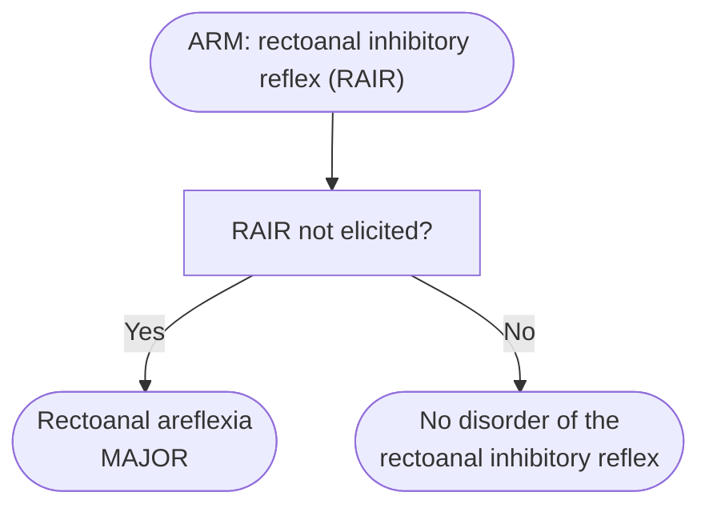
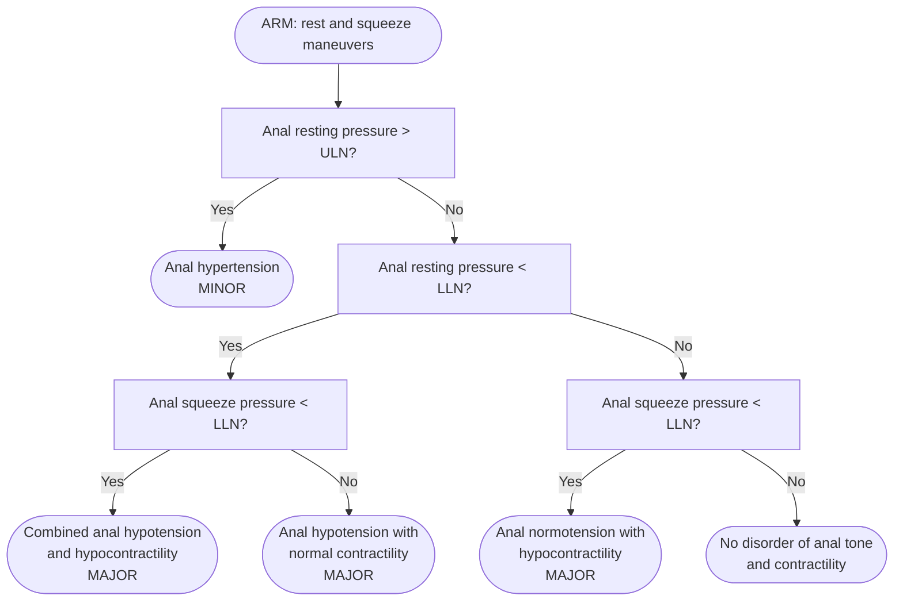
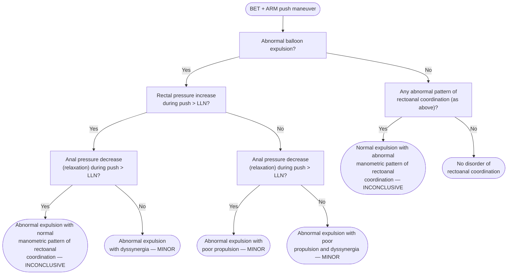
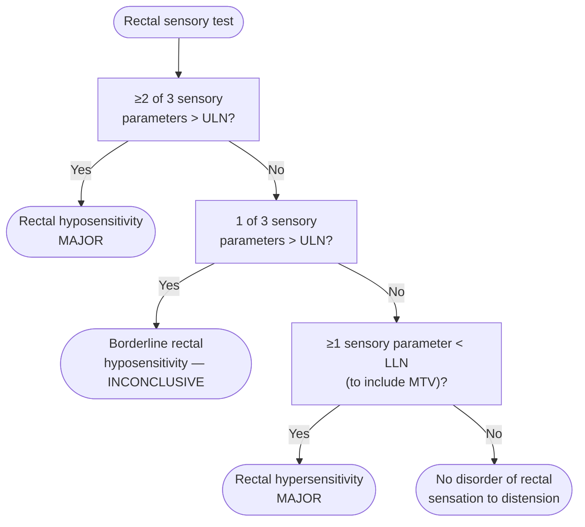

## Contents
- [[#What It Is]]
- [[#Finding Tiers — Major, Minor, Inconclusive]]
- [[#The Four Parts]]
  - [[#Part 1 — Disorder of the Rectoanal Inhibitory Reflex]]
  - [[#Part 2 — Disorders of Anal Tone and Contractility]]
  - [[#Part 3 — Disorders of Rectoanal Coordination]]
  - [[#Part 4 — Disorders of Rectal Sensation]]
- [[#What the Classification Deliberately Leaves Out]]
- [[#See Also]]
- [[#Sources]]

## What It Is

- Consensus scheme of the **International Anorectal Physiology Working Group (IAPWG)** for describing results of **[[anorectal-manometry|anorectal manometry (ARM)]]**, the **rectal sensory test (RST)** and the **balloon expulsion test (BET)**. ([[london-2020-anorectal-classification]])
- Modeled on [[chicago-classification-v4|the Chicago Classification]] (esophageal motility) and the Lyon Consensus (reflux): a **common language** for test results, complementary to disease classifications such as Rome.
- **Four parts; one study may return a diagnosis under more than one part.** Every result is interpreted in the context of adjunctive testing. Protocol and measurements: [[anorectal-manometry]].
- **Decision points are set against the lab's limits of normal — above the upper limit of normal (ULN) or below/above the lower limit of normal (LLN) — or present/absent (RAIR); no numeric normal values are recommended** (equipment, protocol and practice vary). The lab supplies them:
  - From published data → equipment setup and procedure **identical** to the reference study (C1).
  - From a local healthy-volunteer study → allow for **sex (C1), parity (C2) and age (C2)**.
  - C1 = >90% unanimity · C2 = 75%–90% (consensus levels, not evidence grades).
- Applies to **conventional as well as high-resolution** equipment.

## Finding Tiers — Major, Minor, Inconclusive

| Tier | Definition | Diagnoses in this tier |
|---|---|---|
| **Major** | Pattern **not seen in control subjects**; likely represents a physiological alteration associated with symptom generation | Rectoanal areflexia · combined anal hypotension and hypocontractility · anal hypotension with normal contractility · anal normotension with hypocontractility · rectal hyposensitivity · rectal hypersensitivity |
| **Minor** | Seen in patients with anorectal symptoms **but also in controls**; may represent a physiological alteration associated with symptom generation | Anal hypertension · abnormal expulsion with dyssynergia · abnormal expulsion with poor propulsion · abnormal expulsion with poor propulsion and dyssynergia |
| **Inconclusive** | Seen in patients **and** in controls; may be associated with symptom generation, **relevance not yet determined** | Borderline rectal hyposensitivity · abnormal expulsion with a normal manometric pattern · normal expulsion with an abnormal manometric pattern |

**Terminology fixed by the classification:** *(hypo/hyper)tension* = anal resting tone · *(hypo)contractility* = anal squeeze · *expulsion* = ability to expel a rectal balloon · *propulsion* = adequate rise in rectal pressure during push · *dyssynergia* = failure of coordinated anal relaxation during push · *(hypo/hyper)sensitivity* = rectal sensation.

## The Four Parts

### Part 1 — Disorder of the Rectoanal Inhibitory Reflex

*London Classification Part 1: disorder of the rectoanal inhibitory reflex*
*Source: redrawn from Figure 2 of the IAPWG 2020 London Classification*
*[[london-2020-anorectal-classification|IAPWG 2020 London Classification]]*
*ARM = anorectal manometry · RAIR = rectoanal inhibitory reflex*

> [!pitfall] Absent RAIR may be a volume artifact
> The minimum eliciting volume is not established; low distending volumes in a large-capacity rectum can fail to elicit it — repeat with increasing volumes if megarectum is suspected ([[london-2020-anorectal-classification]]).

- Not seen in health, but **can occur in asymptomatic patients** after rectal resection or ileal pouch–anal anastomosis, and with anal hypotonia, fecal loading or megarectum.
- May indicate further investigation **to exclude aganglionosis** — especially in pediatric patients and adults with coexistent megarectum/megacolon (see [[chronic-constipation]]).

### Part 2 — Disorders of Anal Tone and Contractility

*London Classification Part 2: disorders of anal tone and contractility*
*Source: redrawn from Figure 3 of the IAPWG 2020 London Classification*
*[[london-2020-anorectal-classification|IAPWG 2020 London Classification]]*
*ARM = anorectal manometry · ULN = upper limit of normal · LLN = lower limit of normal*

- **Functional anal canal length** may be measured (a short canal can accompany anal hypotonia) — unproven as a stand-alone diagnostic criterion.
- **Anal hypertension:** may come with slow and/or ultraslow waves (significance not established); may matter more in [[anal-fissure|chronic anal fissure]], levator ani syndrome and proctalgia fugax ([[proctalgia-syndromes]]).
- **Cough with the two anal hypotension diagnoses:** an abnormal cough response may indicate a more severe phenotype; a preserved one may suggest a target for [[biofeedback-therapy|biofeedback]] — unproven as a criterion.

### Part 3 — Disorders of Rectoanal Coordination

Needs **both BET and ARM** (simulated defecation / push maneuver). *Abnormal balloon expulsion* also covers **impaired evacuation of contrast** (prolonged evacuation end time and/or reduced percentage emptied) on barium or magnetic resonance (MR) defecography.

*London Classification Part 3: disorders of rectoanal coordination*
*Source: redrawn from Figure 4 of the IAPWG 2020 London Classification*
*[[london-2020-anorectal-classification|IAPWG 2020 London Classification]]*
*BET = balloon expulsion test · ARM = anorectal manometry · LLN = lower limit of normal*

> [!pearl] Minor needs abnormal expulsion and abnormal push
> Part 3 has no major findings. Abnormal expulsion plus an abnormal manometric push pattern → minor; either one alone → inconclusive ([[london-2020-anorectal-classification]]).

- **BET is the only test shown to predict response to biofeedback.**
- Inconclusive findings such as dyssynergia may be confirmed or refuted by fuller pelvic floor evaluation: endoanal ultrasound, barium/MR defecography, rectal barostat. Agreement between evacuation tests is fair at best.

### Part 4 — Disorders of Rectal Sensation

Sensory parameters: **first constant sensation volume (FCSV)**, **desire to defecate volume (DDV)**, **maximum tolerated volume (MTV)**.

*London Classification Part 4: disorders of rectal sensation*
*Source: redrawn from Figure 5 of the IAPWG 2020 London Classification*
*[[london-2020-anorectal-classification|IAPWG 2020 London Classification]]*
*ULN = upper limit of normal · LLN = lower limit of normal · MTV = maximum tolerated volume*

> [!pearl] Hypersensitivity requires a low MTV
> A low FCSV or DDV alone does not qualify — MTV must be among the parameters below the LLN ([[london-2020-anorectal-classification]]).

- Abnormal results may be further described with additional methods, e.g. barostat for compliance.
- IAPWG testing indications: **constipation/evacuation symptoms** → rectal sensitivity, particularly hyposensitivity; **[[fecal-incontinence]]** → both hyper- and hyposensitivity.

## What the Classification Deliberately Leaves Out

- **Cough and long (endurance) squeeze.** In the IAPWG protocol, but **not part of the diagnostic classification** — inclusion was not considered justified at present.
- **Rao dyssynergia criteria.** Named only as an area for future investigation; recent evidence questions **quantitative metrics such as the rectoanal pressure gradient**, given significant overlap between findings in dyssynergia and in healthy volunteers.
- **Disease definitions.** The classification describes physiology; **what is not normal does not necessarily constitute disease**. Disease criteria: [[defecation-disorders]].
- **Biofeedback guidance.** Explicitly out of scope.

---

## See Also

[[anorectal-manometry]], [[defecation-disorders]], [[fecal-incontinence]], [[chronic-constipation]], [[biofeedback-therapy]], [[proctalgia-syndromes]], [[anal-fissure]], [[chicago-classification-v4]], [[high-resolution-manometry]]

---

## Sources

1. [[london-2020-anorectal-classification|The International Anorectal Physiology Working Group (IAPWG) Recommendations: Standardized Testing Protocol and the London Classification for Disorders of Anorectal Function]]
