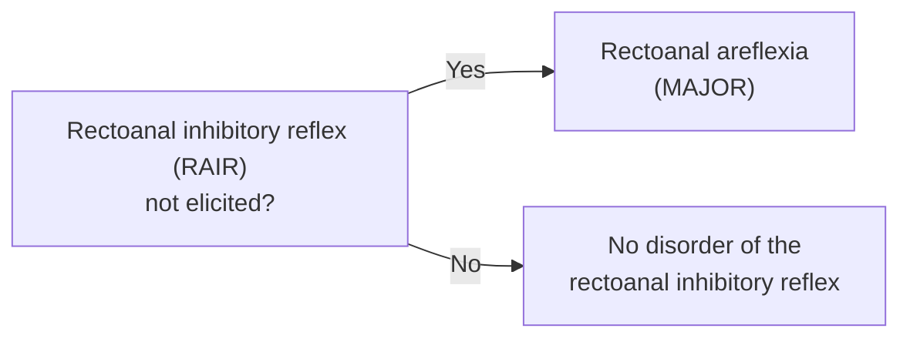
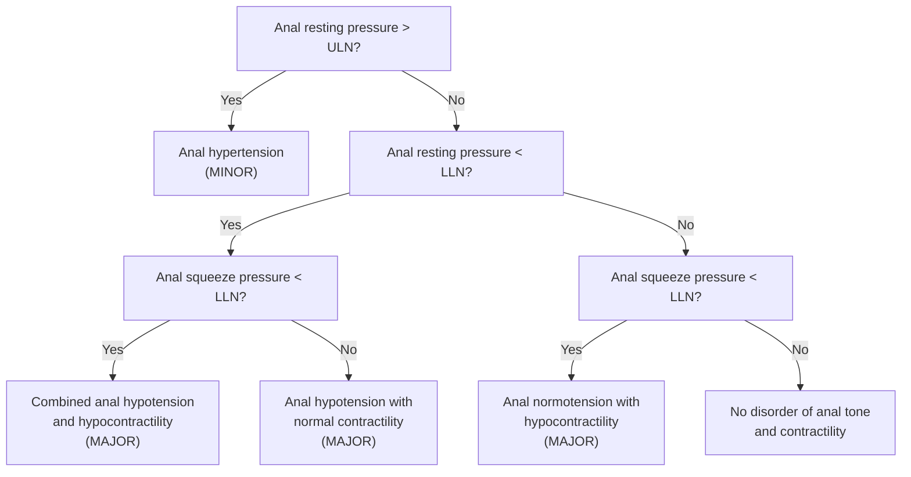
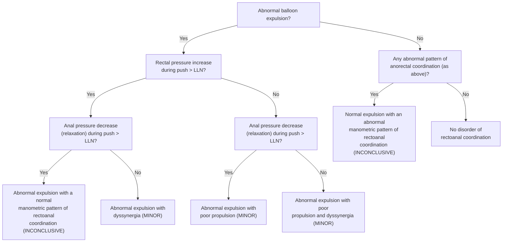
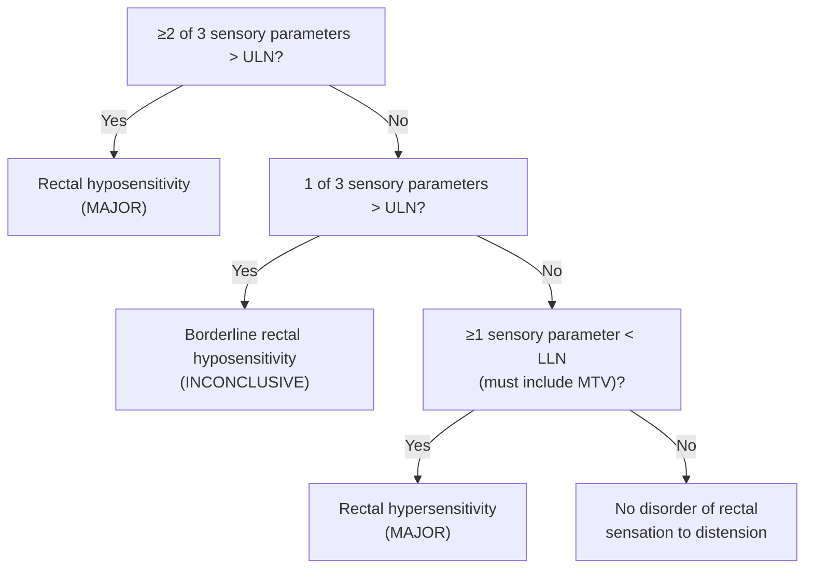

## Contents
- [[#What It Is]]
- [[#Finding Tiers — Major, Minor, Inconclusive]]
- [[#Part 1 — Disorder of the Rectoanal Inhibitory Reflex]]
- [[#Part 2 — Disorders of Anal Tone and Contractility]]
- [[#Part 3 — Disorders of Rectoanal Coordination]]
- [[#Part 4 — Disorders of Rectal Sensation]]
- [[#All Diagnoses at a Glance]]
- [[#What the Classification Deliberately Leaves Out]]
- [[#See Also]]
- [[#Sources]]

## What It Is

- Consensus scheme of the **International Anorectal Physiology Working Group (IAPWG)** for naming the findings of **anorectal manometry (ARM)**, the **rectal sensory test (RST)** and the **balloon expulsion test (BET)**. ([[london-2020-anorectal-classification]])
- Built to do for the anorectum what [[chicago-classification-v4|the Chicago Classification]] did for esophageal motility and the [[lyon-2024-gerd-diagnosis|Lyon Consensus]] for reflux: a **common language**, not a disease definition.
- **Four parts; one study may return a diagnosis under more than one part.** The protocol that generates the measurements lives on [[anorectal-manometry]].
- **Every decision point is "> upper limit of normal (ULN)" or "< lower limit of normal (LLN)" — the consensus publishes no numbers.** Values must come from the lab's own healthy-volunteer data, or from published data acquired with identical equipment and protocol. Allow for sex, parity and age.
- Applies to **conventional as well as high-resolution** equipment.

## Finding Tiers — Major, Minor, Inconclusive

| Tier | Definition | Diagnoses in this tier |
|---|---|---|
| **Major** | Pattern **not seen in control subjects**; likely represents a physiological alteration associated with symptom generation | Rectoanal areflexia · combined anal hypotension and hypocontractility · anal hypotension with normal contractility · anal normotension with hypocontractility · rectal hyposensitivity · rectal hypersensitivity |
| **Minor** | Seen in patients with anorectal symptoms **but also in controls**; may represent a physiological alteration associated with symptom generation | Anal hypertension · abnormal expulsion with dyssynergia · abnormal expulsion with poor propulsion · abnormal expulsion with poor propulsion and dyssynergia |
| **Inconclusive** | Seen in patients **and** in controls; may be associated with symptom generation, **relevance not yet determined** | Borderline rectal hyposensitivity · abnormal expulsion with a normal manometric pattern · normal expulsion with an abnormal manometric pattern |

**Terminology fixed by the classification:** *(hypo/hyper)tension* = anal resting tone · *(hypo)contractility* = anal squeeze · *expulsion* = ability to expel a rectal balloon · *propulsion* = adequate rise in rectal pressure during push · *dyssynergia* = failure of coordinated anal relaxation during push · *(hypo/hyper)sensitivity* = rectal sensation.

## Part 1 — Disorder of the Rectoanal Inhibitory Reflex

- **Minimum volume required to elicit the reflex is not established in the literature** — failure to elicit a RAIR may simply reflect a low distending volume in a large-capacity rectum. Start at ≥30 mL and **repeat with increasing volumes if megarectum is suspected**.
- Rectoanal areflexia is **not seen in health**, but **can be found in asymptomatic patients** after rectal resection or ileal pouch–anal anastomosis, and with anal hypotonia, fecal loading or megarectum.
- May indicate the need for further investigation **to exclude aganglionosis** — especially in pediatric populations and in adults with coexistent megarectum/megacolon (see [[chronic-constipation]]).

## Part 2 — Disorders of Anal Tone and Contractility

From the rest and squeeze maneuvers.

- **Functional anal canal length may be measured** — a short anal canal can be associated with anal hypotonia — but **its use as a diagnostic criterion in isolation is unproven**.
- **Anal hypertension** may be accompanied by slow and/or ultraslow waves, whose clinical significance is not established; the finding **may matter more in [[anal-fissure|chronic anal fissure]], levator ani syndrome and proctalgia fugax** ([[proctalgia-syndromes]]).
- **Cough response is not a diagnostic criterion.** An abnormal cough response alongside the hypotension/hypocontractility diagnoses may mark a **more severe phenotype**, and a preserved one may mark a **target for [[biofeedback-therapy|biofeedback]]** — but its use as a criterion is unproven, and cough is excluded from the classification altogether.

## Part 3 — Disorders of Rectoanal Coordination

**Requires both BET and ARM** (simulated defecation / push maneuver). *Abnormal balloon expulsion* here also covers **impaired evacuation of contrast medium** — prolonged evacuation end time and/or reduced percentage of contrast emptied — on barium or magnetic resonance (MR) defecography.

- **Part 3 contains no major findings.** Dyssynergia never rises above *minor*, and a manometric coordination abnormality with normal expulsion is *inconclusive* — because paradoxical contraction and a negative rectoanal gradient are both common in healthy people (see [[anorectal-manometry]] for the reference-value pitfalls).
- Consequence for practice: **the balloon expulsion test, not the manometric pattern, is what moves a patient out of the inconclusive box.** BET is also the only one of these tests shown to predict response to biofeedback.
- Where the classification labels a finding inconclusive, **a fuller pelvic floor evaluation** — endoanal ultrasound, barium or MR defecography, rectal barostat — may confirm or refute it.

## Part 4 — Disorders of Rectal Sensation

Sensory parameters are **first constant sensation volume (FCSV)**, **desire to defecate volume (DDV)** and **maximum tolerated volume (MTV)**.

- The **MTV requirement is the operative detail** in the hypersensitivity branch: a low FCSV or DDV alone does not qualify — maximum tolerated volume must be among the parameters below the lower limit of normal.
- Abnormal results **may be further described with additional methods**, e.g. barostat to assess compliance.
- Rectal hyposensitivity is the finding the consensus flags for **constipation/evacuation disorders**; hypersensitivity is sought in **[[fecal-incontinence]]** and in **[[irritable-bowel-syndrome|irritable bowel syndrome (IBS)]]**.

## All Diagnoses at a Glance

| Part | Diagnosis | Tier | Trigger |
|---|---|---|---|
| 1 | Rectoanal areflexia | Major | RAIR not elicited |
| 2 | Anal hypertension | Minor | Resting pressure >ULN |
| 2 | Combined anal hypotension and hypocontractility | Major | Resting <LLN **and** squeeze <LLN |
| 2 | Anal hypotension with normal contractility | Major | Resting <LLN, squeeze normal |
| 2 | Anal normotension with hypocontractility | Major | Resting normal, squeeze <LLN |
| 3 | Abnormal expulsion with dyssynergia | Minor | Abnormal BET, rectal pressure rise >LLN, anal relaxation ≤LLN |
| 3 | Abnormal expulsion with poor propulsion | Minor | Abnormal BET, rectal pressure rise ≤LLN, anal relaxation >LLN |
| 3 | Abnormal expulsion with poor propulsion and dyssynergia | Minor | Abnormal BET, rectal pressure rise ≤LLN, anal relaxation ≤LLN |
| 3 | Abnormal expulsion, normal manometric pattern | Inconclusive | Abnormal BET, both manometric criteria normal |
| 3 | Normal expulsion, abnormal manometric pattern | Inconclusive | Normal BET, any abnormal coordination pattern |
| 4 | Rectal hyposensitivity | Major | ≥2 of 3 sensory parameters >ULN |
| 4 | Borderline rectal hyposensitivity | Inconclusive | 1 of 3 sensory parameters >ULN |
| 4 | Rectal hypersensitivity | Major | ≥1 parameter <LLN, including MTV |

## What the Classification Deliberately Leaves Out

- **Normal values.** None are published — by design, because equipment and protocol vary (see [[#What It Is]]).
- **Cough and long (endurance) squeeze.** Both are in the IAPWG protocol but **form no part of the diagnostic classification**; the group did not consider their inclusion justifiable.
- **Rao dyssynergia types I–IV.** Not reproduced here. The consensus cites the Rao criteria only as an area for future investigation, noting that **recent evidence questions the usefulness of quantitative metrics such as the rectoanal pressure gradient**, because findings overlap substantially between patients with dyssynergia and healthy volunteers. A study can be given a London diagnosis but not a Rao type.
- **Disease definitions.** The classification describes physiology; whether a finding constitutes disease is a clinical judgement, and the consensus says plainly that **what is not normal does not necessarily constitute disease**. [[rome-v-2026-dgbi|Rome V]] and [[acg-2021-anorectal-disorders|ACG 2021]] supply the disease criteria — see [[defecation-disorders]].
- **Biofeedback guidance.** Explicitly out of scope for this consensus.

---

## See Also

[[anorectal-manometry]], [[defecation-disorders]], [[fecal-incontinence]], [[chronic-constipation]], [[biofeedback-therapy]], [[proctalgia-syndromes]], [[chicago-classification-v4]], [[high-resolution-manometry]], [[irritable-bowel-syndrome]]

---

## Sources

1. [[london-2020-anorectal-classification|The International Anorectal Physiology Working Group (IAPWG) Recommendations: Standardized Testing Protocol and the London Classification for Disorders of Anorectal Function]]
