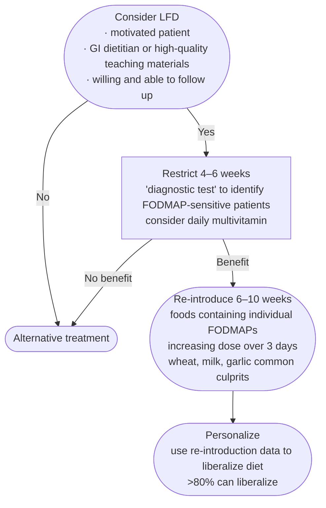

## Contents
- [[#Definition]]
- [[#Who Is a Candidate]]
- [[#The 3 Phases]]
  - [[#Phase 1 — Restriction (4–6 weeks)]]
  - [[#Phase 2 — Reintroduction (6–10 weeks)]]
  - [[#Phase 3 — Personalization]]
- [[#Efficacy]]
- [[#In Inflammatory Bowel Disease]]
- [[#Nutritional Adequacy and Risks]]
- [[#Predicting Response]]
- [[#See Also]]
- [[#Sources]]

## Definition

- **FODMAPs** = fermentable oligo-, di-, and monosaccharides and polyols — short-chain, poorly digestible, poorly absorbed sugars that can trigger symptoms in some patients with [[irritable-bowel-syndrome|irritable bowel syndrome (IBS)]].
- Carbohydrates = the most common macronutrient trigger of IBS symptoms.
- Low-FODMAP diet (LFD) = currently the **most evidence-based diet intervention for IBS** ([[aga-2022-diet-ibs|American Gastroenterological Association (AGA) 2022]], Best Practice Advice [BPA] 6).
- A structured 3-phase program, not an open-ended restriction (BPA 7).

---

## Who Is a Candidate

- **Entry criteria:** top box of the flowchart under [[#The 3 Phases]] (AGA 2022 Figure 2); not met → alternative treatment.
- **Poor candidates for a restrictive diet (BPA 2):** few culprit foods eaten, risk for malnutrition, food insecurity, eating disorder, or uncontrolled psychiatric disorder.
  - Diet already minimal in FODMAP-containing foods → little benefit from trialing the LFD.
  - Eating-disorder and malnutrition screening: on [[irritable-bowel-syndrome]].
- **Delivery:** a registered dietitian nutritionist (RDN) with gastrointestinal (GI) expertise — the LFD is complex, potentially costly, and many patients with IBS already eat a nutritionally inadequate diet ([[aga-2022-diet-ibs]]).
  - No GI RDN → community RDN with an interest in digestive disorders; reliable educational materials and digital tools can supplement, but never implement the diet on a brief document or mobile app alone.
  - [[acg-2020-ibs|American College of Gastroenterology (ACG)]]: committee view (stated as not evidence-based) favors a trained GI dietitian; none available or unaffordable → high-quality teaching materials.

> [!pitfall] No LFD in an eating disorder
> Restrictive diets like the LFD should be avoided in patients with an eating disorder; screen by careful dietary history before prescribing ([[aga-2022-diet-ibs]], BPA 2).

---

## The 3 Phases

*Low-FODMAP diet for patients with IBS*
*Source: redrawn from AGA 2022 Figure 2*
*[[aga-2022-diet-ibs|AGA Clinical Practice Update on the Role of Diet in IBS (2022)]]*
*LFD = low-FODMAP diet · FODMAP = fermentable oligo-, di-, and monosaccharides and polyols · GI = gastrointestinal*

### Phase 1 — Restriction (4–6 weeks)

- FODMAP intake reduced substantially; lasts **no more than 4–6 weeks** (BPA 7).
- Responders typically improve within **2–6 weeks** ([[aga-2022-diet-ibs]]; same window in [[acg-2020-ibs]]).
- Numerous trials: 4–6 weeks is enough to determine response; a set duration reduces complications of prolonged over-restriction.

> [!pitfall] Restriction is a test, not the diet
> No improvement in the prescribed time → discontinue and move to another treatment; never leave patients on "open-ended" restriction ([[aga-2022-diet-ibs]], BPA 3).

### Phase 2 — Reintroduction (6–10 weeks)

- FODMAP restriction **continues** while challenging with foods containing a single FODMAP; symptom responses recorded throughout → individual tolerances and intolerances.
- Double-blind reintroduction trials: **fructans, mannitol, and galacto-oligosaccharides** most commonly trigger recurrent symptoms.

### Phase 3 — Personalization

- Reintroduction data used to diversify FODMAP intake → individualized LFD for long-term use.
- Liberalization: Figure 2 gives **>80%**; the body text of the same update gives **up to 76%** after reintroduction (observational trials).
- Further evidence, preferably randomized controlled trials (RCTs), needed for reintroduction and personalization; a **simplified LFD** may be effective but is unproven in RCTs.

---

## Efficacy

| Evidence | Result |
|---|---|
| Meta-analysis, **7 RCTs (397 patients)** | LFD significantly reduced global IBS symptoms vs different control interventions ([[aga-2022-diet-ibs]]); risk ratio (RR) **0.69 (95% confidence interval [CI] 0.54–0.88)** vs comparators, and a nonsignificant trend vs an alternative diet (3 trials; RR 0.82; 95% CI 0.66–1.02) ([[acg-2020-ibs]]) |
| Network meta-analysis, **13 RCTs** | LFD the **most effective diet strategy** for global symptoms, abdominal pain, and bloating |
| RCT, **100 patients with IBS with diarrhea (IBS-D)** — LFD vs traditional dietary advice (National Institute for Health and Care Excellence [NICE]) | Both improved IBS Symptom Severity Score (IBS-SSS) and IBS-related quality of life (QOL) vs baseline; primary outcome (**>50-point reduction in IBS-SSS**) favored LFD: **62.7% vs 40.8%, P = .04** |
| Crossover RCT, **42 patients** — LFD vs gluten-free vs "balanced" (Mediterranean) | All 3 improved symptom severity, bloating, abdominal pain, and QOL (P < .05); LFD better **for bloating only** — not pain, IBS-SSS, or IBS-related QOL. Needs a larger trial |
| **2 comparative effectiveness trials** | LFD similar to gut-directed hypnotherapy or yoga for overall IBS symptoms, **up to 6 months** |

- LFD improves symptoms and disease-specific QOL, particularly in **IBS-D**; LFD studies in **IBS with constipation (IBS-C) are lacking** — IBS-C benefits from higher **soluble fiber** intake ([[aga-2022-diet-ibs]]).
- ACG: **limited trial** of an LFD to improve global IBS symptoms — **Conditional recommendation; very low quality of evidence**.

---

## In Inflammatory Bowel Disease

*All from [[aga-2018-functional-gi-symptoms-ibd|AGA 2018]].*

- **BPA 5:** an LFD **may be offered** for functional GI symptoms in [[inflammatory-bowel-disease|inflammatory bowel disease (IBD)]] **with careful attention to nutritional adequacy**.
  - Undernutrition is common in IBD → dietary instruction should be delivered by a dietitian.
- **Yield:** benefit in **at least 50%** of IBD patients with ongoing symptoms despite controlled inflammatory disease.
- **Supporting data:** in a small [[crohns-disease|Crohn's disease]] randomized feeding study, typical FODMAP intake was associated with increased symptom severity; a blinded rechallenge study confirmed FODMAPs as likely culprits for functional symptoms in quiescent IBD.
- **Other diets linked to improvement:** lactose-reduced, FODMAP-reduced, gluten-free, specific-carbohydrate — common denominator = reduced intake of indigestible, slowly absorbed carbohydrates (osmotic effects, fermentability).
- **Gluten (IBS data; not examined in IBD):** no evidence gluten or wheat protein is the culprit in more than a small minority of patients with IBS; concomitant FODMAP reduction is the likely mechanism, since fructans coexist with gluten in cereals. Double-blind crossover challenge in self-reported nonceliac sensitivity: symptoms significantly higher with **fructans than gluten**.
- **Microbiota:** cutting carbohydrates with prebiotic actions might harm gut microbiota; in one Crohn's disease feeding study, strictly controlled FODMAPs did not alter the relative abundance of a limited number of key bacteria. More real-world data required.

---

## Nutritional Adequacy and Risks

- **Short-term** restriction: little impact on micronutrient intake; taught by an RDN, may even improve overall diet quality vs the habitual diets of most patients with IBS ([[aga-2022-diet-ibs]]).
- **Prolonged over-restriction:** risk of nutritional deficiencies; could also promote or exacerbate disordered eating ([[aga-2022-diet-ibs]]). ACG: LFD seems safe without serious adverse events, although long-term over-restriction may lead to micronutrient deficiencies ([[acg-2020-ibs]]).
- **Long-term** effectiveness and adherence data lacking; preliminary observational data promising.

---

## Predicting Response

*All from [[aga-2022-diet-ibs]].*

- **No biomarker is ready for routine use** — limited data, insufficient evidence (BPA 9).
- **Sucrase-isomaltase (SI) variants:** more common in IBS; may be associated with lower LFD response. Post-hoc analysis: pathogenic SI variants → **3- to 4-fold reduction in response** to either the LFD or a modified NICE diet, particularly the LFD (small sample; no mucosal disaccharidase measurements).
- **Fecal microbiome/metabolites** may predict response: in two adult studies, baseline fecal bacterial profile discriminated responders from nonresponders, but the discriminating profiles **differed between studies**; fecal volatile organic compound patterns also distinguished responders.
- **Fructose breath testing:** no convincing evidence it predicts response to an LFD or fructose-restricted diet; may predict LFD response — further studies needed.

---

## See Also
[[irritable-bowel-syndrome]], [[inflammatory-bowel-disease]], [[disorders-of-gut-brain-interaction]], [[abdominal-bloating-and-distention]], [[chronic-diarrhea]], [[celiac-disease]], [[confocal-laser-endomicroscopy]]

---

## Sources

1. [[aga-2022-diet-ibs|AGA Clinical Practice Update on the Role of Diet in Irritable Bowel Syndrome: Expert Review (2022)]]
2. [[acg-2020-ibs|ACG 2020 Clinical Guideline: Management of Irritable Bowel Syndrome]]
3. [[aga-2018-functional-gi-symptoms-ibd|AGA Clinical Practice Update: Functional Gastrointestinal Symptoms in Patients with Inflammatory Bowel Disease (2018)]]
